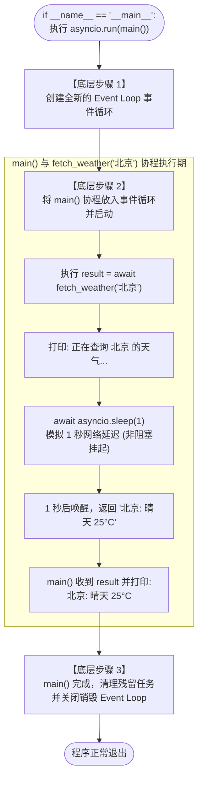

# `02-asyncio_run.py` 源码精讲：`asyncio.run()` 异步程序总入口与事件循环生命周期

---

## 一、文件定位与核心前置知识精讲

### 1.1 文件定位
[`02-asyncio_run.py`](file:///d:/soft/python/Voyage智途A2A/前置知识/3-异步编程/02-asyncio_run.py) 是 `3-异步编程` 模块的**第 2 课（事件循环启动与生命周期管理篇）**。
在上一课中我们学到：`await` 只能写在 `async def` 协程函数内部。那么问题来了——如果 `fetch_weather` 要靠 `main` 来 `await`，那最顶层的 `main()` 协程自己又该由谁来启动呢？
答案就是 Python 3.7+ 引入的异步程序标准总入口：**`asyncio.run(main())`**。本文件通过一个模拟异步查询北京天气的完整示例，深入讲解 `asyncio.run()` 在底层一键完成的“创建事件循环 $\rightarrow$ 驱动顶层协程直到结束 $\rightarrow$ 清理并关闭事件循环”三大生命周期步骤，以及它的单次最外层调用铁律。

---

### 1.2 核心前置知识

#### （1）什么是事件循环（Event Loop）？
如果把一个个 `async def` 协程比作“列车车厢”，它们自己是没有动力往前跑的；**事件循环（Event Loop）** 就是驱动所有协程运转的“**火车头（无限循环调度器）**”。
- 事件循环内部维护着一个任务队列和操作系统底层的多路复用 I/O 监听器（Windows 下是 IOCP / Selector，Linux 下是 `epoll`）。
- 只要有协程处于就绪状态，事件循环就推着它执行；一旦某协程遇到 `await` 挂起等待网络 I/O 或定时器，事件循环就去推下一个就绪的协程；当所有协程都执行完毕，事件循环才功成身退。

#### （2）`asyncio.run(main())` 一步到位做了哪 3 件事？
在早期 Python（3.6 及以前）中，启动一个异步程序需要手写 3~4 行底层模板代码：
```python
loop = asyncio.new_event_loop()       # 1. 手动新建事件循环
asyncio.set_event_loop(loop)
try:
    loop.run_until_complete(main())   # 2. 运行主协程直到完成
finally:
    loop.close()                      # 3. 手动关闭事件循环
```
而现在，**`asyncio.run(main())`** 一行代码就将上述三步+异常清理全部封装完毕（对应源码第 16~19 行注释）：
1. **创建全新的事件循环（New Event Loop）**：为当前线程创建一个崭新的事件循环并设为当前活动循环；
2. **驱动运行顶层协程（Run Until Complete）**：把传入的 `main()` 协程对象注册进事件循环，一直运行到 `main()` 返回结果或抛出未捕获异常为止；
3. **清理并关闭事件循环（Close Event Loop）**：自动取消所有尚未结束的残留后台任务、关闭异步生成器与底层传输通道，最后彻底关闭并销毁该事件循环。

#### （3）`asyncio.run()` 的黄金使用铁律
正如源码第 25~26 行注释所强调：
- **铁律一（唯一总入口）**：一个标准异步脚本通常只在 `if __name__ == "__main__":` 最外层调用一次 `asyncio.run(main())`，所有的异步业务逻辑都在 `main()` 内部通过 `await`、`gather`、`create_task` 展开。
- **铁律二（严禁嵌套调用）**：**绝对不能在已经在运行的协程（`async def`）内部再次调用 `asyncio.run()`！** 因为 `asyncio.run()` 要求当前线程不能有正在运行的事件循环，如果在协程内部再次调用它，会立刻抛出致命异常：
  `RuntimeError: asyncio.run() cannot be called from a running event loop`！

---

### 1.3 在 Voyage 智途主项目中的关联
1. **所有独立客户端与测试脚本的启动入口**：
   - 在前置知识的 `4-MCP协议`（`02`/`03`/`05`/`06`/`08`/`09`）、`6-A2A协议`（`06_a2a_client.py`、`09_serial_flow.py`、`11_single_intent.py`、`12_multi_intent.py`）以及主项目 `test/` 下的测试脚本（如 [`test/test_business.py`](file:///d:/soft/python/Voyage智途A2A/test/test_business.py)）中，末尾全部使用 `asyncio.run(main())` 启动！
2. **主项目 `core/chat_service_core.py` 中对“铁律二（严禁在运行中的事件循环内调用 `asyncio.run`）”的高级工程实战处理**：
   打开主项目 [`core/chat_service_core.py`](file:///d:/soft/python/Voyage智途A2A/core/chat_service_core.py#L220-L240) 的第 220~240 行 `_run_async(self, coro)` 方法：
   ```python
   try:
       loop = asyncio.get_running_loop()
   except RuntimeError:
       loop = None
   if loop and loop.is_running():
       # 已在异步事件循环中（如 uvicorn 处理请求时）
       # 不能在同一线程再次调用 asyncio.run，所以开启新线程执行 asyncio.run！
       with concurrent.futures.ThreadPoolExecutor(max_workers=1) as pool:
           future = pool.submit(asyncio.run, coro)
           return future.result(timeout=30)
   else:
       return asyncio.run(coro)
   ```
   你看，主项目之所以专门写这段判断，正是为了遵守本文件第 26 行讲的“**不能在已运行的事件循环内部直接调用 `asyncio.run()`**”！

---

## 二、执行流程与示意图

### 2.1 `asyncio.run(main())` 生命周期流程图（Mermaid）



### 2.2 同步世界与异步世界的“唯一传送门”示意图（ASCII）

```text
+-------------------------------------------------------------------+
| 同步世界 (Synchronous World)                                      |
|   if __name__ == "__main__":                                      |
|       asyncio.run(main())   <=== 【唯一传送门：创建并关闭事件循环】 |
+-------------------|-----------------------------------------------+
                    | 进入异步事件循环 (Event Loop Running)
                    v
+-------------------------------------------------------------------+
| 异步世界 (Asynchronous World — 内部严禁再调 asyncio.run()!)        |
|                                                                   |
|   async def main():                                               |
|       result = await fetch_weather("北京")  <=== 内部全部用 await! |
|       print(result)                                               |
+-------------------------------------------------------------------+
```

---

## 三、完整源码与逐行/逐段深度拆解

### 3.1 完整源码（100% 原始文件嵌入）

文件路径：[`前置知识/3-异步编程/02-asyncio_run.py`](file:///d:/soft/python/Voyage智途A2A/前置知识/3-异步编程/02-asyncio_run.py)

```python
# 3.2 asyncio.run() - 异步程序入口
# asyncio.run() 创建事件循环、运行协程、关闭循环，一步到位
# 项目中所有客户端脚本（08/11/13/14）都用这个启动

import asyncio


async def fetch_weather(city):
    """模拟异步网络请求"""
    print(f"正在查询 {city} 的天气...")
    await asyncio.sleep(1)  # 模拟网络延迟
    return f"{city}: 晴天 25°C"


async def main():
    # asyncio.run() 会：
    # 1. 创建新的事件循环
    # 2. 运行 main() 协程直到完成
    # 3. 关闭事件循环
    result = await fetch_weather("北京")
    print(result)


if __name__ == "__main__":
    # 这是异步程序的唯一入口
    # 只能在最外层调用一次，不能在协程内部调用
    asyncio.run(main())
```

---

### 3.2 分段逐行深度拆解

#### 第一段：文件头注释与模块导入（第 1~5 行）
- **第 1~3 行**：点明 `asyncio.run()` 的核心职责（创建事件循环、运行协程、关闭循环，一步到位）以及在项目客户端脚本中的广泛应用。
- **第 5 行**：`import asyncio` 导入异步标准库。

#### 第二段：业务子协程 `fetch_weather(city)`（第 8~12 行）
- **第 8 行**：`async def fetch_weather(city):` 定义一个接收城市名参数 `city` 的异步协程函数，模拟去调用远程天气服务（如和风天气 API 或天气 A2A Agent）。
- **第 10 行**：打印提示 `"正在查询 北京 的天气..."`。
- **第 11 行**：`await asyncio.sleep(1)` 模拟 1 秒钟的网络传输与服务端响应耗时。
- **第 12 行**：返回查询结果字符串 `f"{city}: 晴天 25°C"`。

#### 第三段：顶层主协程 `main()`（第 15~21 行）
- **第 15 行**：`async def main():` 定义异步程序的主控入口协程。
- **第 20 行**：`result = await fetch_weather("北京")`
  - 在 `main()` 协程内部，调用另一个协程 `fetch_weather("北京")` 时，**使用的是 `await` 关键字，而不是 `asyncio.run()`**！
  - `await` 会等待 `fetch_weather("北京")` 在当前同一个事件循环中执行完毕，并将其 `return` 的字符串 `"北京: 晴天 25°C"` 赋值给变量 `result`。
- **第 21 行**：`print(result)` 将结果输出到控制台。

#### 第四段：脚本启动总入口（第 24~27 行）
- **第 24~27 行**：
  ```python
  if __name__ == "__main__":
      # 这是异步程序的唯一入口
      # 只能在最外层调用一次，不能在协程内部调用
      asyncio.run(main())
  ```
  - 注意传入 `asyncio.run(...)` 的参数是 **`main()`（带括号调用后生成的协程对象）**，而不是函数名 `main`！

---

### 3.3 沙盘推演（Dry Run）：`asyncio.run(main())` 从启动到销毁的 6 步内存推演

| 步骤序号 | 发生阶段 | 底层 / 代码动作 | 内存状态与变量值 | 控制台输出 |
| :--- | :--- | :--- | :--- | :--- |
| **Step 1** | 第 27 行入参求值 | 先执行括号内的 `main()` | 生成顶层协程对象 `coro_main = <coroutine object main>`（此时尚未进入 `main` 函数体） | *(无)* |
| **Step 2** | `asyncio.run` 阶段 1 | 调用 `asyncio.new_event_loop()` | 当前主线程绑定了一个全新的活动事件循环 `loop`（`loop.is_running() == True`） | *(无)* |
| **Step 3** | `asyncio.run` 阶段 2 | `loop` 开始驱动 `coro_main`，执行第 20 行 `await fetch_weather("北京")` | `city = "北京"`，进入 `fetch_weather` 函数体，执行第 10 行打印 | `正在查询 北京 的天气...` |
| **Step 4** | I/O 挂起与等待 | 执行第 11 行 `await asyncio.sleep(1)` | `fetch_weather` 与 `main` 挂起 1 秒，事件循环等待 1 秒定时器到期 | *(等待 1.0 秒)* |
| **Step 5** | 唤醒与结果返回 | 第 12 行 `return` $\rightarrow$ 第 20~21 行 | `result = "北京: 晴天 25°C"`，执行 `print(result)`，`coro_main` 彻底执行完毕 | `北京: 晴天 25°C` |
| **Step 6** | `asyncio.run` 阶段 3 | 调用 `loop.close()` | 关闭异步生成器，彻底销毁事件循环 `loop`（`loop.is_closed() == True`），程序退出 | *(程序结束)* |

---

## 四、常见易错点与对比总结

### 4.1 `asyncio.run(coro)` vs `await coro` 适用位置与职责对比

| 对比维度 | `asyncio.run(coro)` | `await coro` |
| :--- | :--- | :--- |
| **可以在哪里调用？** | **只能在普通同步代码中调用**（如 `if __name__ == "__main__":` 最外层，且当前线程没有正在运行的事件循环） | **只能在 `async def` 协程函数内部调用**（此时当前线程必定已有正在运行的事件循环） |
| **对事件循环的操作** | **新建**一个事件循环 $\rightarrow$ 运行协程 $\rightarrow$ **销毁关闭**事件循环 | **复用**当前正在运行的事件循环，挂起当前协程等待目标协程完成 |
| **一个程序里通常调用几次？** | 通常只在程序启动最外层**调用 1 次** | 在各个 `async def` 函数内部**调用无数次** |

### 4.2 新手最容易踩的 3 个坑

1. **在 `async def` 内部嵌套调用 `asyncio.run()`（头号高频报错）**：
   - 错误写法：
     ```python
     async def main():
         # ❌ 错误！已经在 main 协程的事件循环里了，不能再调 asyncio.run！
         result = asyncio.run(fetch_weather("北京"))
     ```
   - **报错**：`RuntimeError: asyncio.run() cannot be called from a running event loop`。
   - **正确写法**：在 `async def` 内部永远用 `result = await fetch_weather("北京")`。
2. **在 FastAPI / Jupyter Notebook 中直接调用 `asyncio.run()`**：
   - 当你在 FastAPI 的接口函数（如主项目 [`main_http_api.py`](file:///d:/soft/python/Voyage智途A2A/main_http_api.py) 由 `uvicorn` 启动）或 Jupyter Notebook 单元格中写代码时，**外层框架（Uvicorn / IPython）已经替你启动了事件循环**！所以在 FastAPI 路由里直接用 `await` 即可，千万不要在路由里调 `asyncio.run()`。
3. **传给 `asyncio.run` 时漏写了 `main` 后面的括号：`asyncio.run(main)`**：
   - 报错：`TypeError: a coroutine was expected, got <function main at 0x...>`（或者 Python 3.11+ 报错 `ValueError: a coroutine was expected, got <function main>`）。
   - **原因**：`asyncio.run()` 接收的是**协程对象 `main()`**，而不是协程函数名 `main`！

---

## 五、自测思考题（附答案解析）

### 思考题 1
如果有人在 `02-asyncio_run.py` 的 `async def main():` 函数内部，把第 20 行 `result = await fetch_weather("北京")` 改写成了 `result = asyncio.run(fetch_weather("北京"))`，运行程序时会报什么错？为什么？

<details>
<summary>点击查看答案解析</summary>

**答案解析**：
会抛出 **`RuntimeError: asyncio.run() cannot be called from a running event loop`** 异常！
**原因**：第 27 行的 `asyncio.run(main())` 已经为当前线程创建并启动了一个事件循环来运行 `main()`。在 `main()` 运行期间，当前线程的事件循环正处于 `running` 状态，而 Python 规定一个线程同一时刻只能有一个活动的事件循环，因此严禁在协程内部再次嵌套调用 `asyncio.run()`。在协程内部等待另一个协程必须使用 `await`。
</details>

### 思考题 2
请简述 `asyncio.run(main())` 在执行过程中依次针对“事件循环（Event Loop）”做了哪三步核心操作？

<details>
<summary>点击查看答案解析</summary>

**答案解析**：
1. **创建事件循环**：创建一个全新的事件循环（`new_event_loop`）并将其设为当前线程的活动循环；
2. **运行顶层协程**：在该事件循环上驱动执行传入的 `main()` 协程，一直等待它运行结束并返回结果；
3. **清理与关闭事件循环**：取消所有未完成的残留任务，清理异步生成器，最后彻底关闭（`close`）该事件循环。
</details>
