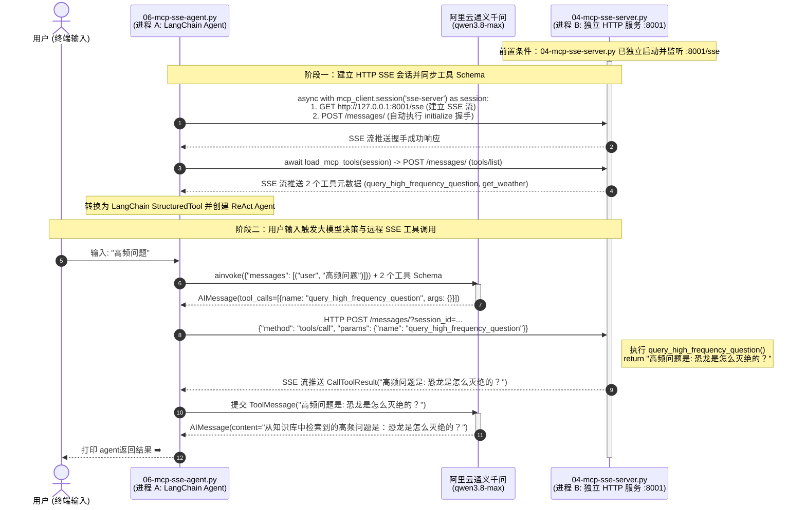

# `06-mcp-sse-agent.py` 深度精讲：LangChain 智能体通过 SSE 协议调用远程 MCP 工具服务

> **本篇导读**：本篇是 **MCP SSE 传输模式（`04`~`06`）** 的收官实战。在 `04` 启动了监听 `8001` 端口的 SSE 服务端、`05` 验证了客户端连通性之后，本篇 `06-mcp-sse-agent.py` 将演示如何配置 `MultiServerMCPClient` 的 `"transport": "sse"` 与 `"url": "http://127.0.0.1:8001/sse"`，让 LangChain 智能体（Agent）通过 HTTP SSE 网络长连接动态发现并调用远程工具。
> 阅读本文档**完全无需打开原 `.py` 文件**——全部 63 行源码已 100% 完整嵌入。

---

## 一、文件定位与核心前置知识精讲

### 1.1 从 `03-mcp-stdio-agent.py` 到 `06-mcp-sse-agent.py`：解耦带来的微服务化架构

回顾 `03-mcp-stdio-agent.py`：
- 当 `03` 运行时，Agent 进程自己把 `01-mcp-stdio-server.py` 作为子进程生出来；当 `03` 退出时，Server 子进程也跟着被销毁。也就是说，**Agent 与 Tool Server 依然捆绑在同一台机器、同一个父子进程树中**。

而在本文件 `06-mcp-sse-agent.py` 中，我们真正实现了**智能体（Agent）与工具服务（MCP Server）的物理隔离与微服务解耦**：
1. **独立部署与弹性伸缩**：`04-mcp-sse-server.py` 可以部署在专门的业务服务器（比如内网拥有数据库访问权限的机器 A）上常驻运行；而 `06-mcp-sse-agent.py` 可以部署在面向用户的应用服务器（机器 B）上。
2. **极简的配置切换**：在代码层面，从 `stdio` 切换到 `sse`，**只需要修改 `client_config` 字典中的配置项**，而底层的 `mcp_client.session(...)`、`await load_mcp_tools(session)`、`create_agent(...)`、`await agent.ainvoke(...)` **连一个标点符号都不用改**！

---

### 1.2 `MultiServerMCPClient` 在 `sse` 模式下的底层工作机制

当我们在 `06-mcp-sse-agent.py` 中配置：
```python
client_config = {
    "sse-server": {
        "url": "http://127.0.0.1:8001/sse",
        "transport": "sse",
    }
}
```
并执行 `async with mcp_client.session('sse-server') as session:` 时，`langchain-mcp-adapters` 在底层做了什么？

1. 它识别出 `"transport": "sse"`，于是调用 MCP 官方 Python SDK 中的 `mcp.client.sse.sse_client(url="http://127.0.0.1:8001/sse")`。
2. `sse_client` 使用 `httpx` 向 `http://127.0.0.1:8001/sse` 发起 HTTP GET 请求，建立 `text/event-stream` 事件流，并解析出服务端下发的 `/messages/?session_id=...` POST 端点，构造出异步的 `(read_stream, write_stream)` 内存通道对。
3. 基于这对读写流，创建 `ClientSession(read_stream, write_stream)` 并自动调用 `await session.initialize()` 完成 MCP 握手。
4. 随后的 `await load_mcp_tools(session)` 通过这条已经建立好的 HTTP SSE 会话拉取工具列表，并将其封装为 LangChain 的 `StructuredTool`。

---

## 二、架构交互与执行流程图

### 2.1 `06-mcp-sse-agent.py` 跨进程网络调用全链路时序图



---

## 三、完整源码与逐行/逐段深度拆解

### 3.1 100% 完整源码呈现

以下是 `前置知识/4-MCP协议/06-mcp-sse-agent.py` 的全部原始代码（共 63 行，一字未改）：

```python
import asyncio, os

from langchain_openai import ChatOpenAI
from langchain.agents import create_agent
from langchain_mcp_adapters.client import MultiServerMCPClient
from langchain_mcp_adapters.tools import load_mcp_tools

# 创建模型
api_key = os.environ.get("AliApiKey")
ali_url = "https://dashscope.aliyuncs.com/compatible-mode/v1"
llm = ChatOpenAI(base_url=ali_url,
                 api_key=api_key,
                 model='qwen3.8-max',
                 temperature=0.1)

# 定义mcp服务器参数
client_config = {
    "sse-server": { # 自定义session名字
        "url": "http://127.0.0.1:8001/sse",
        "transport": "sse",
    }
}

# TODO 异步执行
async def run_agent():
    # 创建mcp客户端，传入mcp服务器作为子进程的启动参数
    mcp_client = MultiServerMCPClient(client_config)
    # 基于会话名字创建mcp会话
    async with mcp_client.session('sse-server') as session:
        # 获取MCPserver提供的工具列表
        tools = await load_mcp_tools(session)
        print('MCP sse tools➡️ ：', tools)

        # 构建agent对象
        agent = create_agent(
            model=llm,  # 智能体的大脑LLM
            tools=tools,  # 向智能体提供工具函数名列表
            system_prompt='你能够调用工具回答用户问题。',
        )

        print('agent作为mcpclient通过sse的方式进行function call➡️ :')
        while True:
            # 接收用户查询
            query = input("\n➡️输入问题或输入'quit'退出: ").strip()
            if query.lower() == "quit": break
            try:
                messages_dict = {"messages": [
                    ("user", query),
                ]}
                # TODO 注意是异步的 ainvoke() ！
                response = await agent.ainvoke(messages_dict)
                print('agent返回结果 ➡️ :', response)
            except Exception:
                print("解析有问题")

    return


if __name__ == "__main__":
    # 异步执行函数
    asyncio.run(run_agent())
    # 问1：天气咋样
    # 问2：高频问题
```

---

### 3.2 逐段逐行深度拆解

#### 模块一：导入与 LLM 初始化（第 1~14 行）

- 注意第 1 行：`import asyncio, os`（相比 `03` 去掉了 `sys`，因为不需要再用 `sys.executable` 去启动本地 Python 子进程了）。
- 第 9~14 行：使用 `ChatOpenAI` 初始化阿里云通义千问 `qwen3.8-max` 模型，`temperature=0.1`。

#### 模块二：定义 SSE 模式的 `client_config`（第 16~22 行）

```python
# 定义mcp服务器参数
client_config = {
    "sse-server": { # 自定义session名字
        "url": "http://127.0.0.1:8001/sse",
        "transport": "sse",
    }
}
```

- **这是本文件与 `03-mcp-stdio-agent.py` 唯一不同的核心配置块！**
- `"sse-server"`：自定义的会话标识名，与第 29 行 `mcp_client.session('sse-server')` 相对应。
- `"url": "http://127.0.0.1:8001/sse"`：指向 `04-mcp-sse-server.py` 暴露的 SSE 端点 URL。
- `"transport": "sse"`：明确告知 `MultiServerMCPClient` 使用 HTTP SSE 传输适配器。

#### 模块三：建立 SSE 会话、转换工具与运行 Agent 对话循环（第 25~63 行）

```python
async def run_agent():
    # 创建mcp客户端，传入mcp服务器作为子进程的启动参数
    mcp_client = MultiServerMCPClient(client_config)
    # 基于会话名字创建mcp会话
    async with mcp_client.session('sse-server') as session:
        # 获取MCPserver提供的工具列表
        tools = await load_mcp_tools(session)
        print('MCP sse tools➡️ ：', tools)

        # 构建agent对象
        agent = create_agent(
            model=llm,  # 智能体的大脑LLM
            tools=tools,  # 向智能体提供工具函数名列表
            system_prompt='你能够调用工具回答用户问题。',
        )
        ...
```

- **第 29 行 `async with mcp_client.session('sse-server') as session:`**：
  - 在整个 `while True:` 循环期间，这条与 `http://127.0.0.1:8001/sse` 的 HTTP SSE 长连接始终保持打开状态（Keep-Alive）。
  - 这意味着用户在终端连续提问第 1 个问题、第 2 个问题、第 N 个问题时，**全部复用同一条 SSE 会话通道**，没有重复建连和重复握手的开销！
- **第 31 行 `tools = await load_mcp_tools(session)`**：
  - 在刚建立会话时拉取一次工具 Schema，生成 `StructuredTool` 列表并传给 `create_agent`。
- **第 51 行 `response = await agent.ainvoke(messages_dict)`**：
  - 异步执行 Agent 推理与远程工具调用。

---

### 3.3 沙盘推演（Dry Run）：完整运行过程与报文追踪

1. **前置操作**：确认终端 1 中 `python 04-mcp-sse-server.py` 正在运行。
2. **启动 Agent**：在终端 2 运行 `python 06-mcp-sse-agent.py`，首先输出：
   ```text
   MCP sse tools➡️ ： [StructuredTool(name='query_high_frequency_question', description='从知识库中检索常见问题解答（FAQ）,返回包含问题和答案', ...), StructuredTool(name='get_weather', description='查询天气', ...)]
   agent作为mcpclient通过sse的方式进行function call➡️ :

   ➡️输入问题或输入'quit'退出:
   ```
3. **输入问题 1：`天气咋样`**：
   - `qwen3.8-max` 输出 `tool_calls: [{"name": "get_weather", "args": {}}]`；
   - `StructuredTool` 通过 `session` 向 `http://127.0.0.1:8001/messages/?session_id=...` 发起 HTTP POST；
   - `04` 服务端在终端 1 打印 `INFO: 127.0.0.1:... - "POST /messages/?session_id=... HTTP/1.1" 202 Accepted`；
   - `04` 服务端通过 `/sse` 流推送 `"郑州的天气是多云"`；
   - `qwen3.8-max` 收到 `ToolMessage("郑州的天气是多云")`，生成最终 `AIMessage("根据查询结果，郑州目前的天气是多云。")`。
4. **输入 `'quit'` 退出**：
   - `break` 跳出 `while True` 循环，离开 `async with mcp_client.session('sse-server')` 块，客户端主动断开 HTTP SSE 长连接，`06` 进程结束；而终端 1 的 `04` 服务端进程继续保持运行。

---

## 四、横向对比、易错点与工程思考

### 4.1 既然 `SSE` 已经能跨网络调用了，为什么后面还要学 `07~09` 的 `Streamable HTTP`？

既然 `04~06` 的 `SSE` 模式已经实现了跨进程、跨网络的远程工具调用，为什么 MCP 官方在 2025 年新版协议规范中，要用 **`Streamable HTTP`（文件 `07~09`）** 取代 `SSE` 成为生产环境的唯一推荐标准？

我们在实战中发现 `SSE` 模式在企业级生产部署时有三大痛点：
1. **必须维持一条永久不断开的 `GET /sse` 长连接（有状态连接痛点）**：
   - 在 `06` 中，只要 Agent 不退出，`GET /sse` 这条 TCP 连接就必须一直挂着。如果中间经过了企业级网关（Nginx、Cloudflare、AWS ALB），网关默认 60 秒无数据传输就会超时掐断长连接，导致 `session` 突然失效报错！
2. **双端点（`/sse` + `/messages/`）在负载均衡集群下的路由粘滞难题**：
   - 如果后端部署了 3 台 MCP Server 实例做负载均衡，客户端 `GET /sse` 连到了机器 1（`session_id` 保存在机器 1 的内存里），结果下一次发 `POST /messages/?session_id=...` 被负载均衡分发到了机器 2，机器 2 根本不认识这个 `session_id`，直接报错 `Session not found`！
3. **不支持纯无状态（Stateless）短连接请求**：
   - 哪怕客户端只想调一次简单的 `get_weather()`，在 `SSE` 模式下也必须先建立 `GET /sse` 长连接、拿 `session_id`、再发 `POST /messages/`，握手链路重。

> **铺垫下一章（`07`~`09`）**：正是为了彻底解决 `SSE` 的这三个工程痛点，MCP 推出了单端点（`/mcp`）、按需流式升级、天然契合云原生负载均衡与网关的 **`Streamable HTTP`** 传输模式！这也是为什么 Voyage 智途主项目的 `mcp_server/` 全部采用 `Streamable HTTP` 的原因。

---

## 五、自测思考题（附答案解析）

### 思考题 1
对比 `03-mcp-stdio-agent.py` 和 `06-mcp-sse-agent.py`，要把一个基于本地 `stdio` 的 LangChain MCP Agent 改造为连接远程 `SSE` 服务的 Agent，需要修改哪几行代码？

<details>
<summary>点击查看答案解析</summary>

**答案**：
只需要修改两处：
1. 将 `client_config` 字典中的配置从 `{"command": ..., "args": ..., "env": ..., "transport": "stdio"}` 替换为：
   ```python
   client_config = {
       "sse-server": {
           "url": "http://127.0.0.1:8001/sse",
           "transport": "sse",
       }
   }
   ```
2. 将 `async with mcp_client.session('...') as session:` 中的会话名对应改为 `'sse-server'`（如果会话名保持不变，甚至连这一行都不用改）。其余工具加载与 Agent 逻辑 100% 无需变动。
</details>

---

### 思考题 2
如果在 `06-mcp-sse-agent.py` 已经启动并进入 `➡️输入问题或输入'quit'退出:` 等待用户输入期间，你突然去终端 1 按 `Ctrl+C` 把 `04-mcp-sse-server.py` 停掉了，然后再回到终端 2 输入 `"天气咋样"`，会发生什么？

<details>
<summary>点击查看答案解析</summary>

**答案**：
1. 当你输入 `"天气咋样"` 时，第一步是 `06` 把问题和之前已经缓存到内存里的 `tools` Schema 发给阿里云大模型 `qwen3.8-max`——**这一步依然能成功**，大模型会正常返回 `tool_calls: [{"name": "get_weather", "args": {}}]`。
2. 第二步，当 Agent 尝试通过 `session` 向 `http://127.0.0.1:8001/messages/...` 发送 HTTP POST 调用 `get_weather` 时，由于 `04` 服务端已经关闭，`httpx` 会抛出网络连接异常（`ConnectError` / `RemoteProtocolError`）。
3. 该异常被 `06` 第 53 行的 `except Exception:` 捕获，控制台打印出 `"解析有问题"`。
</details>
