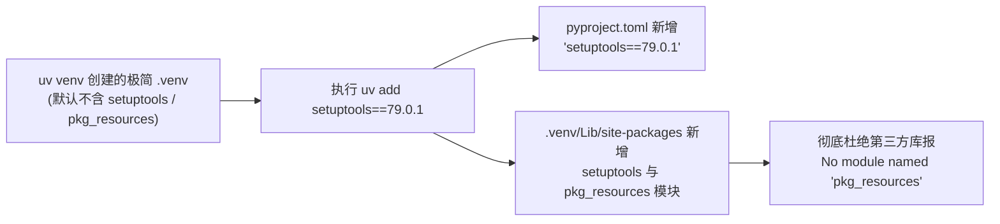

# `uv添加setuptools.sh` 源码精讲：在现代虚拟环境中补充 `setuptools` 基础构建包

---

## 一、文件定位与核心前置知识精讲

### 1.1 文件定位
[`uv添加setuptools.sh`](file:///d:/soft/python/Voyage智途A2A/前置知识/1-uv环境管理工具/uv添加setuptools.sh) 是 `1-uv环境管理工具` 模块的**第 5 步**。本脚本通过 `uv add setuptools==79.0.1` 向虚拟环境中显式安装 Python 传统打包与运行时元数据检索的核心基础库 **`setuptools`**。

### 1.2 核心前置知识
1. **什么是 `setuptools`？为什么 `uv` 创建的虚拟环境默认没有它？**
   - `setuptools`（内含经典的 `pkg_resources` 模块）是 Python 生态中最老牌的包构建、分发与运行时插件发现工具。
   - 传统的 `python -m venv` 或 `virtualenv` 在创建虚拟环境时，默认会自动把 `pip` 和 `setuptools` 预装进 `.venv`。
   - 而 **`uv venv` 为了追求极致的创建速度（几毫秒内建好环境）和极简纯净性，默认创建的 `.venv` 里既不预装 `pip`，也不预装 `setuptools`！**
2. **为什么在 AI / Agent 项目中必须显式执行 `uv add setuptools==79.0.1`？**
   - 许多第三方 Python 库（例如部分网络库、数据库驱动、模型工具或使用 `import pkg_resources` 检查版本号的库）在运行期默认假设环境中一定存在 `setuptools`（`pkg_resources`）。
   - 如果不显式添加 `setuptools`，在运行这些第三方包时就会抛出经典的异常：
     `ModuleNotFoundError: No module named 'pkg_resources'` 或 `ModuleNotFoundError: No module named 'setuptools'`。
   - 因此，在 `uv` 初始化环境后显式执行 `uv add setuptools==79.0.1`，是保障所有第三方库兼容性的一道重要“安全保险”。

### 1.3 在 Voyage 智途主项目中的关联
- 打开主项目根目录下的 [`pyproject.toml`](file:///d:/soft/python/Voyage智途A2A/pyproject.toml#L5-L9)，可以看到 `dependencies` 列表中赫然列着本脚本安装的 `setuptools==79.0.1`：
  ```toml
  dependencies = [
      "langchain==1.3.10",
      "pyrefly>=0.60.0",
      "setuptools==79.0.1",
  ]
  ```
- 这确保了主项目在加载 `modelscope`、`pymilvus`、`a2wsgi` 等复杂第三方库时，任何依赖 `pkg_resources` 或 `setuptools` 的底层代码都能稳定运行。

---

## 二、执行流程与示意图

### 2.1 执行流程图（Mermaid）



### 2.2 传统 `venv` 与 `uv venv` 默认预装包对比图（ASCII）

```text
+-----------------------------------+     +-----------------------------------+
|   传统 python -m venv .venv       |     |       现代 uv venv .venv          |
+-----------------------------------+     +-----------------------------------+
| 创建耗时: ~3000 ms (慢)           |     | 创建耗时: ~10 ms (极速！)         |
| 默认预装:                         |     | 默认预装:                         |
|   ├── pip                         |     |   └── (空！零冗余，完全按需安装)  |
|   └── setuptools (pkg_resources)  |     +-----------------------------------+
+-----------------------------------+                       |
                                                            | 执行: uv add setuptools==79.0.1
                                                            v
                                          +-----------------------------------+
                                          | 补齐 setuptools==79.0.1           |
                                          | 兼具 uv 的极速与传统库 100% 兼容  |
                                          +-----------------------------------+
```

---

## 三、完整源码与逐行/逐段深度拆解

### 3.1 完整源码（100% 原始文件嵌入）

文件路径：[`前置知识/1-uv环境管理工具/uv添加setuptools.sh`](file:///d:/soft/python/Voyage智途A2A/前置知识/1-uv环境管理工具/uv添加setuptools.sh)

```bash
uv add setuptools==79.0.1
```

---

### 3.2 逐行深度拆解

| 行号 | 源码内容 | 深度技术拆解 |
| :--- | :--- | :--- |
| **第 1 行** | `uv add setuptools==79.0.1` | **添加 `setuptools` 基础依赖指令**：<br/>• `uv add`：将依赖包添加到项目的 `pyproject.toml`、`uv.lock` 并安装至 `.venv`。<br/>• `setuptools`：提供 `setuptools` 及 `pkg_resources` 运行时模块，解决老牌第三方库对 `pkg_resources` 的隐式依赖。<br/>• `==79.0.1`：锁定经过主项目兼容性验证的稳定版本 `79.0.1`（注：`setuptools` 在 `82.0.0+` 版本中彻底移除了 `pkg_resources`，因此锁定在 `79.0.1` 这一包含 `pkg_resources` 的稳定版本尤为重要！）。 |

---

### 3.3 沙盘推演（Dry Run）：执行前后配置文件与环境的变化

1. **执行前 `pyproject.toml` 的 `dependencies`**：
   ```toml
   dependencies = [
       "langchain==1.3.10",
   ]
   ```

2. **在终端执行本脚本命令**：
   ```text
   > uv add setuptools==79.0.1
   Resolved 33 packages in 45ms
   Installed 1 package in 38ms
    + setuptools==79.0.1
   ```

3. **执行后 `pyproject.toml` 的 `dependencies`**：
   ```toml
   dependencies = [
       "langchain==1.3.10",
       "setuptools==79.0.1",
   ]
   ```
4. **验证效果**：
   此时在 `.venv` 中执行 `python -c "import setuptools, pkg_resources; print(setuptools.__version__)"`，终端正常输出 `79.0.1`。

---

## 四、常见易错点与对比总结

### 4.1 为什么不能随便安装最新版 `setuptools`（如 `82.x`）？

| `setuptools` 版本策略 | 具体命令 | 是否包含 `pkg_resources` 模块 | 潜在风险 |
| :--- | :--- | :--- | :--- |
| **锁定 `79.0.1`（本脚本采用）** | `uv add setuptools==79.0.1` | **包含** | **零风险**：完美兼容所有依赖 `import pkg_resources` 的第三方包。 |
| 不锁版本（装最新版 `>=82.0.0`） | `uv add setuptools` | **已移除！**（官方在 82.0.0 正式删除了 `pkg_resources`） | 许多尚未迁移到 `importlib.metadata` 的三方库在启动时会直接崩溃报 `No module named 'pkg_resources'`。 |
| 完全不装 `setuptools` | 无 | 不包含 | `uv venv` 默认不带 `setuptools`，任何用到它的包都会报错。 |

---

## 五、自测思考题（附答案解析）

### 思考题 1
为什么以前用 `conda create` 或 `python -m venv` 时从来没手动装过 `setuptools`，换到 `uv` 后却需要专门执行一条 `uv add setuptools==79.0.1`？

<details>
<summary>点击查看答案解析</summary>

**答案解析**：
因为传统的 `conda` 和 `python -m venv` 在创建虚拟环境时会自动捆绑预装 `pip` 和 `setuptools`；而 `uv venv` 为了保持毫秒级极速创建和环境的纯粹性，默认创建的是“零预装包”的干净虚拟环境。为了兼容那些在代码中隐式 `import setuptools` 或 `import pkg_resources` 的第三方库，我们需要在 `uv` 中显式执行 `uv add setuptools==79.0.1`。
</details>

### 思考题 2
为什么本脚本要把 `setuptools` 精确锁定在 `==79.0.1`，而不是直接写 `uv add setuptools` 安装最新版本？

<details>
<summary>点击查看答案解析</summary>

**答案解析**：
除了保证团队环境版本一致性外，更关键的技术原因是：`setuptools` 官方在后续的高版本（如 `82.0.0+`）中正式废弃并删除了内置的 `pkg_resources` 模块。锁定在经过测试的 `79.0.1` 版本，可以确保 `setuptools` 和 `pkg_resources` 均可用，避免因上游破坏性更新导致项目依赖报错。
</details>
