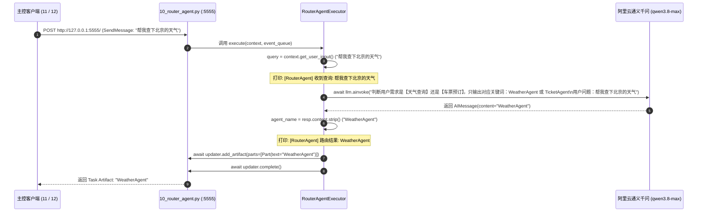

# `10_router_agent.py` 完全脱离源码级精讲手册：基于大模型的 A2A 路由智能体服务端（端口 5555）

> **文档定位**：本文是《Voyage 智途 A2A 协议前置知识（12 讲）》的第 10 讲。在上一讲 `09_serial_flow.py` 中，调用哪个 Agent 是由程序员在代码里写死的；而从本讲开始，我们将引入多智能体架构中最核心的“交通指挥官”——**路由智能体（`RouterAgent`，监听 `5555` 端口）**。本手册 **100% 完整嵌入了 `10_router_agent.py` 的全部源码**，深入剖析如何把大模型意图分类器（LLM Intent Classifier）本身也封装为一个标准的 A2A Server Agent，供 `11_single_intent.py` 和 `12_multi_intent.py` 调用。无需打开 `.py` 原文件，仅凭本文即可彻底掌握。

---

## 一、文件定位与核心前置知识精讲

### 1.1 什么是路由智能体（Router Agent）？为什么连“路由器”本身也要做成 A2A Server？

在多智能体（Multi-Agent）系统中，当后台驻扎着 `WeatherAgent`（`5008` 端口，查天气）、`TicketAgent`（`5009` 端口，订火车票）等多个专科专家时，用户发来一句自然语言请求，系统面临的第一个灵魂拷问就是：**“这句话到底该派给哪个专家去处理？”**

在传统软件开发中，我们用正则表达式或关键词 `if "天气" in query:` 来做路由；但在 AI Agent 时代，用户的问法千变万化（例如 `"明天去北京出差用不用带伞？"` 并没有出现“天气”二字，本质却是查天气；`"帮我弄张明天去上海的G字头车票"` 本质是订火车票）。因此，**必须由大模型（LLM）来担任“意图识别与路由分发官（Router）”**！

更有意思的是，在 `10_router_agent.py` 中，我们并没有把这段 LLM 意图识别代码写死在客户端脚本里，而是**把 Router 本身也做成了一个运行在 `5555` 端口的独立 A2A Server Agent（`RouterAgent`）**！

- **为什么把 `RouterAgent` 也封装成独立的 A2A 服务端？**
  1. **职责单一与微服务解耦**：`RouterAgent(5555)` 只做一件事——接收任意用户问句，调用通义千问（`qwen3.8-max`）判断意图，然后输出目标专家的标准名称（`"WeatherAgent"` 或 `"TicketAgent"`）。它不关心下游专家怎么查天气、怎么订票。
  2. **多端复用**：无论是第 11 讲的单意图主控（`11_single_intent.py`），还是第 12 讲的多意图并发主控（`12_multi_intent.py`），甚至是其他语言的客户端，都可以通过标准的 A2A 协议请求 `http://127.0.0.1:5555/` 来获得意图路由服务！
  3. **统一协议栈**：在 A2A 的世界里，“万物皆 Agent”——干活的专家是 A2A Agent（`5008`、`5009`），负责分诊导医的路由官也是 A2A Agent（`5555`）！

> **再次铭记黄金总结**：**MCP 是 Agent 连接 Tool 的协议（手和脚），A2A 是 Agent 连接 Agent 的协议（大脑与大脑协作）**。在这里，主控程序通过 A2A 协议先向“分诊大脑（`RouterAgent:5555`）”咨询该找哪位专家，拿到专家名字后，再通过 A2A 协议向对应的“专科大脑（`WeatherAgent:5008` 或 `TicketAgent:5009`）”派发任务！

---

### 1.2 核心技术点解析：用于路由分类的 LLM 参数与 Prompt 设计法则

在 `RouterAgentExecutor.execute()` 中，核心只有短短几行 LLM 调用代码，但却蕴含着工程级路由 Prompt 的三大设计铁律：

```python
llm = ChatOpenAI(
    base_url="https://dashscope.aliyuncs.com/compatible-mode/v1",
    api_key=os.environ.get("AliApiKey"),
    model="qwen3.8-max",
    temperature=0.1,  # 铁律1：极低温度保证分类确定性
)
...
resp = await llm.ainvoke(f"""
判断用户需求是【天气查询】还是【车票预订】，只输出对应关键词：
WeatherAgent 或 TicketAgent
用户问题：{query}
""")
agent_name = resp.content.strip()  # 铁律3：务必 .strip() 清除首尾空白换行
```

1. **铁律 1：将 `temperature` 设为低值（`0.1` 或 `0.0`）**：
   - 路由分类不是写诗歌散文，不需要任何“创造力”或“随机性”。温度越低，大模型输出目标分类标签的概率分布越集中，能保证相同的问句 100% 稳定输出相同的 Agent 名称。
2. **铁律 2：在 Prompt 中强约束“只输出对应关键词：WeatherAgent 或 TicketAgent”**：
   - 上游主控程序（`11` 和 `12`）拿到 `RouterAgent` 返回的字符串 `agent_name` 后，会直接用它作为字典的 Key 去查找客户端：`target_client = agent_map.get(agent_name)`。
   - 如果不在 Prompt 中强调 **“只输出对应关键词”**，大模型很可能会礼貌地回答：`"根据您的需求，建议交给 WeatherAgent 处理。"`——这会导致 `agent_map.get("根据您的需求，建议交给 WeatherAgent 处理。")` 返回 `None`，整个路由链路当场断裂！
3. **铁律 3：对 LLM 的输出执行 `resp.content.strip()`**：
   - 大模型在生成文本时，经常会在单词前后附带换行符 `\n` 或空格（例如 `"\nWeatherAgent\n"`）。调用 `.strip()` 剥离首尾空白字符，是所有 LLM 分类/路由代码必不可少的安全清洗步骤！

---

## 二、架构与交互时序图

### 2.1 三大 A2A 服务端（`5555` 路由 + `5008` 天气 + `5009` 票务）全景图（ASCII）

```text
                        +---------------------------------------+
                        |   主控程序 (11_single / 12_multi)      |
                        +-------------------+-------------------+
                                            |
                  第一步：把用户问题发给 5555   |   第二步：拿到 "WeatherAgent" 或 "TicketAgent"
                  POST http://...:5555/     |   去 agent_map 字典查出对应 client 并发起调用
                         |                  |                  |
                         v                  |                  v
        +-----------------------------------+   +-----------------------------------+
        |  10_router_agent.py (本文件)       |   |  07_weather_agent.py (:5008)      |
        |  RouterAgent - 监听 5555 端口      |   |  name = "WeatherAgent"            |
        |                                   |   +-----------------------------------+
        |  RouterAgentExecutor.execute():   |
        |    1. 提取 query                   |   +-----------------------------------+
        |    2. 调通义千问 LLM (qwen3.8-max)  |   |  08_ticket_agent.py (:5009)       |
        |    3. 识别意图并 strip()            |   |  name = "TicketAgent"             |
        |    4. 返回 "WeatherAgent"          |   +-----------------------------------+
        |       或 "TicketAgent"             |
        +-----------------------------------+
```

### 2.2 `RouterAgentExecutor` 内部意图识别时序图（Mermaid）



---

## 三、完整源码与逐行/逐段深度拆解

### 3.1 `10_router_agent.py` 100% 完整源码

以下是 `前置知识/6-A2A协议/10_router_agent.py` 的完整原始代码，一字未改：

```python
# 6.5.4 路由Agent服务端 - 用LLM自动识别意图并分发
#
# 功能：接收用户查询 → LLM识别意图 → 返回对应的 Agent 名称
#
# 执行流程：
#   用户查询 ──→ RouterAgent(5555)
#                    │
#                    ├─→ LLM 意图识别
#                    │   "查天气" → "WeatherAgent"
#                    │   "订票"   → "TicketAgent"
#                    │
#                    └─→ 返回 Agent 名称给客户端
#
# 与 07/08 的区别：
#   - 07/08：直接返回模拟数据（天气/票务）
#   - 本文件：用 LLM 判断意图，返回应该交给哪个 Agent
#
# 运行：uvicorn 启动在 5555 端口

import os
from a2a.types import AgentCard, AgentSkill, AgentCapabilities, AgentInterface, Part
from a2a.server.agent_execution import AgentExecutor
from a2a.server.request_handlers import DefaultRequestHandler
from a2a.server.tasks import InMemoryTaskStore, TaskUpdater
from a2a.server.routes import (
    add_a2a_routes_to_fastapi,
    create_agent_card_routes,
    create_jsonrpc_routes,
)
from fastapi import FastAPI
from langchain_openai import ChatOpenAI


# ---- LLM 初始化 ----
# 使用阿里云 DashScope 的 OpenAI 兼容接口
# 这里用 LLM 来做意图识别：判断用户想查天气还是订票
llm = ChatOpenAI(
    base_url="https://dashscope.aliyuncs.com/compatible-mode/v1",  # API 地址
    api_key=os.environ.get("AliApiKey"),        # 从环境变量读取 API Key
    model="qwen3.8-max",           # 模型名称
    temperature=0.1,                            # 温度：越低越确定，意图识别需要稳定输出
)

# ---- AgentCard 名片 ----
# 告诉客户端"我是谁、能干什么"
router_card = AgentCard(
    name="RouterAgent",                         # Agent 名称
    description="大模型路由智能体，识别用户意图分发任务",  # 描述
    capabilities=AgentCapabilities(streaming=False),  # 不支持流式
    skills=[AgentSkill(
        id="route_query",                       # 技能 ID
        name="route query",                     # 技能名称
        description="识别用户查询意图并输出路由指令",  # 技能描述
    )],
    default_input_modes=["text/plain"],         # 输入格式
    default_output_modes=["text/plain"],        # 输出格式
    supported_interfaces=[AgentInterface(       # 通信接口
        url="http://127.0.0.1:5555/",           # 服务地址（5555 端口）
        protocol_binding="JSONRPC",             # JSON-RPC 协议
    )],
)


# ---- AgentExecutor 执行器 ----
# 核心逻辑：用 LLM 判断用户意图，返回目标 Agent 名称
class RouterAgentExecutor(AgentExecutor):
    async def execute(self, context, event_queue):
        """处理用户查询：用 LLM 识别意图，返回 Agent 名称"""
        query = context.get_user_input()          # 提取用户输入
        print(f"[RouterAgent] 收到查询: {query}")
        updater = TaskUpdater(event_queue, context.task_id, context.context_id)

        # ========== 用 LLM 做意图识别 ==========
        # 提示词：让 LLM 判断意图，只输出 Agent 名称
        resp = await llm.ainvoke(f"""
        判断用户需求是【天气查询】还是【车票预订】，只输出对应关键词：
        WeatherAgent 或 TicketAgent
        用户问题：{query}
        """)
        # 提取 LLM 输出并清理空白字符
        agent_name = resp.content.strip()
        print(f"[RouterAgent] 路由结果: {agent_name}")

        # 返回目标 Agent 名称给客户端
        await updater.add_artifact(parts=[Part(text=agent_name)])
        await updater.complete()

    async def cancel(self, context, event_queue):
        """取消任务时的处理"""
        updater = TaskUpdater(event_queue, context.task_id, context.context_id)
        await updater.cancel()


# ---- 组装 & 启动 ----
# 实例化执行器
executor = RouterAgentExecutor()

# 创建 FastAPI 应用
app = FastAPI(title="RouterAgent")

# 挂载 A2A 标准路由（完成后有两个端点：
#   GET  /.well-known/agent.json → 返回 AgentCard
#   POST /                       → JSON-RPC 入口）
add_a2a_routes_to_fastapi(
    app,
    agent_card_routes=create_agent_card_routes(router_card),  # 名片路由
    jsonrpc_routes=create_jsonrpc_routes(
        request_handler=DefaultRequestHandler(                # 请求处理器
            agent_executor=executor,                          # 绑定执行器
            task_store=InMemoryTaskStore(),                   # 内存任务存储
            agent_card=router_card,                           # 绑定名片
        ),
        rpc_url="/",                                          # JSON-RPC 端点
        enable_v0_3_compat=True,                              # 兼容 v0.3 协议
    ),
)

# 启动服务：监听 5555 端口
if __name__ == "__main__":
    import uvicorn
    uvicorn.run(app, host="127.0.0.1", port=5555)
```

---

### 3.2 逐段逐行深度拆解

#### 第一段：模块导入与 `ChatOpenAI` 初始化（第 20~42 行）

```python
import os
...
from langchain_openai import ChatOpenAI

llm = ChatOpenAI(
    base_url="https://dashscope.aliyuncs.com/compatible-mode/v1",  # API 地址
    api_key=os.environ.get("AliApiKey"),        # 从环境变量读取 API Key
    model="qwen3.8-max",           # 模型名称
    temperature=0.1,                            # 温度：越低越确定，意图识别需要稳定输出
)
```

- 与 `05_a2a_agent_server.py` 对比：
  - 在 `05` 中，既导入了 `ChatOpenAI`，又导入了 `create_agent` 和 `MultiServerMCPClient`，因为 `05` 需要连接 MCP Server 调用外部工具。
  - 而在本文件 `10_router_agent.py` 中，**只需要导入 `ChatOpenAI` 即可，不需要任何 MCP 工具**！因为意图分类依靠的是大模型的纯文本语义理解能力，直接调用 `await llm.ainvoke(prompt)` 一次生成就能拿到分类结果，比走 ReAct Agent 循环更快、更轻量。

---

#### 第二段：定义 `RouterAgent` 的 `AgentCard`（第 44~61 行）

```python
router_card = AgentCard(
    name="RouterAgent",                         # Agent 名称
    description="大模型路由智能体，识别用户意图分发任务",  # 描述
    capabilities=AgentCapabilities(streaming=False),  # 不支持流式
    skills=[AgentSkill(
        id="route_query",                       # 技能 ID
        name="route query",                     # 技能名称
        description="识别用户查询意图并输出路由指令",  # 技能描述
    )],
    default_input_modes=["text/plain"],         # 输入格式
    default_output_modes=["text/plain"],        # 输出格式
    supported_interfaces=[AgentInterface(       # 通信接口
        url="http://127.0.0.1:5555/",           # 服务地址（5555 端口）
        protocol_binding="JSONRPC",             # JSON-RPC 协议
    )],
)
```

- 声明名片名称为 `"RouterAgent"`，技能为 `id="route_query"`，服务通信接口绑定在 **`http://127.0.0.1:5555/`**。

---

#### 第三段：定义 `RouterAgentExecutor`（第 64~91 行）

```python
class RouterAgentExecutor(AgentExecutor):
    async def execute(self, context, event_queue):
        """处理用户查询：用 LLM 识别意图，返回 Agent 名称"""
        query = context.get_user_input()          # 提取用户输入
        print(f"[RouterAgent] 收到查询: {query}")
        updater = TaskUpdater(event_queue, context.task_id, context.context_id)

        # ========== 用 LLM 做意图识别 ==========
        # 提示词：让 LLM 判断意图，只输出 Agent 名称
        resp = await llm.ainvoke(f"""
        判断用户需求是【天气查询】还是【车票预订】，只输出对应关键词：
        WeatherAgent 或 TicketAgent
        用户问题：{query}
        """)
        # 提取 LLM 输出并清理空白字符
        agent_name = resp.content.strip()
        print(f"[RouterAgent] 路由结果: {agent_name}")

        # 返回目标 Agent 名称给客户端
        await updater.add_artifact(parts=[Part(text=agent_name)])
        await updater.complete()
```

- **逐行精读第 75~86 行**：
  1. `resp = await llm.ainvoke(...)`：异步调用通义千问模型。传入的字符串把任务指令（判断是【天气查询】还是【车票预订】）、输出空间约束（只输出 `WeatherAgent` 或 `TicketAgent`）和用户输入（`{query}`）清晰地组合在一起。
  2. `agent_name = resp.content.strip()`：`llm.ainvoke` 返回的是 LangChain 的 `AIMessage` 对象，其 `.content` 属性即为模型输出的文本。加上 `.strip()` 去除可能存在的首尾空格或换行，得到纯净的 `"WeatherAgent"` 或 `"TicketAgent"`。
  3. `await updater.add_artifact(parts=[Part(text=agent_name)])` + `await updater.complete()`：将识别出的目标 Agent 名称作为任务产物（Artifact）发回给调用方。

---

#### 第四段：组装 FastAPI 应用并启动 `5555` 端口（第 94~121 行）

- 同样采用标准的 `DefaultRequestHandler` + `InMemoryTaskStore` + `add_a2a_routes_to_fastapi` 模板，并通过 `uvicorn.run(app, host="127.0.0.1", port=5555)` 在 `5555` 端口启动服务。

---

### 3.3 沙盘推演（Dry Run）：`RouterAgent(5555)` 收到不同问句时的内部流转

当我们在终端运行 `python 10_router_agent.py`（确保已设置环境变量 `AliApiKey`）后，服务在 `http://127.0.0.1:5555` 待命：

#### 推演 1：收到天气类查询 `"帮我查下北京的天气"`
1. `context.get_user_input()` 提取出 `"帮我查下北京的天气"`。
2. 控制台打印：`[RouterAgent] 收到查询: 帮我查下北京的天气`。
3. 构造完整 Prompt 发给 `qwen3.8-max`：
   ```text
   判断用户需求是【天气查询】还是【车票预订】，只输出对应关键词：
   WeatherAgent 或 TicketAgent
   用户问题：帮我查下北京的天气
   ```
4. `qwen3.8-max` 返回 `AIMessage(content="WeatherAgent")`。
5. `agent_name = resp.content.strip()` 得到 `"WeatherAgent"`，控制台打印：`[RouterAgent] 路由结果: WeatherAgent`。
6. `TaskUpdater` 将 `"WeatherAgent"` 封装进 `Artifact` 并标记任务完成，返回给主控端。

#### 推演 2：收到票务类查询 `"预订一张从北京到上海的火车票"`
1. `context.get_user_input()` 提取出 `"预订一张从北京到上海的火车票"`。
2. 控制台打印：`[RouterAgent] 收到查询: 预订一张从北京到上海的火车票`。
3. 发给 `qwen3.8-max`，模型返回 `AIMessage(content="TicketAgent")`。
4. 控制台打印：`[RouterAgent] 路由结果: TicketAgent`，并将 `"TicketAgent"` 作为产物返回给主控端。

---

## 四、在 12 个递进文件中的承上启下关系 & 常见易错点

### 4.1 承上启下关系

- **承上（解决 `09_serial_flow.py` 的硬编码痛点）**：
  - 在 `09` 中，程序只会按固定顺序调 Agent；而本文件 `10_router_agent.py` 提供了一个运行在 `5555` 端口的“AI 意图分诊台”。
- **启下（直接支撑 `11_single_intent.py` 与 `12_multi_intent.py`）**：
  - 注意：本文件 `10_router_agent.py` 是一个**服务端（Server）**！启动它之后，它自己不会主动发请求，而是静静监听 `5555` 端口等待主控客户端来问它。
  - 在接下来的第 11 讲 `11_single_intent.py` 和第 12 讲 `12_multi_intent.py` 中，**必须同时保持 `07_weather_agent.py`（`5008`）、`08_ticket_agent.py`（`5009`）和本文件 `10_router_agent.py`（`5555`）三个服务端在后台运行**！

### 4.2 常见易错点与避坑指南

1. **易错点 1：运行 `10_router_agent.py` 的终端未设置 `AliApiKey` 环境变量**
   - 因为 `RouterAgent` 内部调用了真实的阿里云 `qwen3.8-max` 大模型，如果忘记设置 `AliApiKey`，当 `11` 或 `12` 调用 `5555` 端口时，`llm.ainvoke` 会抛出鉴权异常，导致主控端拿不到 `"WeatherAgent"` 或 `"TicketAgent"`。
2. **易错点 2：修改了 Prompt 中的候选词大小写，导致与 `agent_map` 的 Key 对不上**
   - 如果把 Prompt 里的 `WeatherAgent 或 TicketAgent` 随手改成了 `weather_agent 或 ticket_agent`，那么主控端 `agent_map = {"WeatherAgent": weather_client, "TicketAgent": ticket_client}` 在执行 `agent_map.get(agent_name)` 时就会因为大小写不匹配而返回 `None`（打印 `未找到对应的Agent`）。

---

## 五、自测思考题（附答案解析）

### 思考题 1
**问题**：为什么在 `RouterAgentExecutor.execute()` 中，拿到大模型返回对象 `resp` 后，一定要写 `agent_name = resp.content.strip()`？如果不加 `.strip()` 可能会引发什么 Bug？
<details>
<summary>点击查看答案解析</summary>

- **答案**：
  - 大模型生成的文本前后经常会带有不可见的换行符（`\n`）或空格（如 `"WeatherAgent\n"`）。
  - 如果不加 `.strip()`，返回给主控客户端的字符串就是 `"WeatherAgent\n"`。当主控客户端执行字典查找 `agent_map.get("WeatherAgent\n")` 时，由于字典里的 Key 是没有换行符的 `"WeatherAgent"`，会导致匹配失败返回 `None`！
</details>

### 思考题 2
**问题**：如果未来系统中新增了第三个专家智能体——**酒店预订智能体（`HotelAgent`，监听 `5010` 端口）**，在 `10_router_agent.py` 中只需要修改哪几行代码就能让路由官支持分发酒店预订任务？
<details>
<summary>点击查看答案解析</summary>

- **答案**：只需要修改 `RouterAgentExecutor.execute()` 中第 75~79 行的 Prompt 提示词即可：
  ```python
  resp = await llm.ainvoke(f"""
  判断用户需求是【天气查询】、【车票预订】还是【酒店预订】，只输出对应关键词：
  WeatherAgent 或 TicketAgent 或 HotelAgent
  用户问题：{query}
  """)
  ```
</details>
