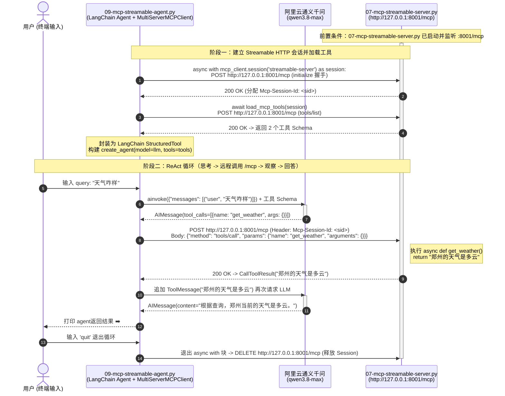

# `09-mcp-streamable-agent.py` 深度精讲：生产级 Streamable HTTP + LangChain Agent 终极形态（智途主项目同款架构）

> **本篇导读**：本篇是整个 `4-MCP协议` 模块（`01`~`09`）的**集大成收官之作**！在本文件中，我们将使用 `MultiServerMCPClient` 通过新一代 **`streamable-http`** 协议连接 `http://127.0.0.1:8001/mcp`，把远端 MCP 工具注入 LangChain ReAct 智能体。
> **为什么说本文件最重要？** 因为 Voyage 智途 A2A 主项目中的所有子智能体（`a2a_server/a2a_weather.py`、`a2a_ticket.py`、`a2a_trip.py`、`a2a_external.py`）连接 `mcp_server/` 的代码，**采用的就是与本文件 `09-mcp-streamable-agent.py` 100% 完全一致的 `streamable-http` + `MultiServerMCPClient` + `create_agent` 架构！**
> 阅读本文档**完全无需打开原 `.py` 文件**——全部 63 行源码已 100% 完整内嵌。

---

## 一、文件定位与核心前置知识精讲

### 1.1 `4-MCP协议` 九宫格全景复盘：从 `01` 到 `09` 我们走过了怎样的演进之路？

至此，我们已经学完了 `4-MCP协议` 下的全部 9 个代码文件。让我们站在架构师的高度，用一个“**3 种传输协议 $\times$ 3 种角色层级**”的九宫格矩阵，将这 9 个文件彻底串联起来：

| 传输机制 \ 角色层级 | 第一层：MCP Server（工具提供方） | 第二层：原生 MCP Client（协议直连测试） | 第三层：LangChain MCP Agent（大模型自主调用） |
| :--- | :--- | :--- | :--- |
| **第一代：`stdio`**<br/>（本地父子进程管道） | `01-mcp-stdio-server.py`<br/>`mcp.run(transport="stdio")` | `02-mcp-stdio-client.py`<br/>`Client(StdioTransport(...))` | `03-mcp-stdio-agent.py`<br/>`"transport": "stdio"` |
| **第二代：`sse`**<br/>（HTTP 双端点 `/sse` + `/messages/`） | `04-mcp-sse-server.py`<br/>`mcp.run(transport="sse", port=8001)` | `05-mcp-sse-client.py`<br/>`Client("http://.../sse")` | `06-mcp-sse-agent.py`<br/>`"transport": "sse"` + `"/sse"` |
| **第三代：`streamable-http`**<br/>（HTTP 单端点 `/mcp`，**生产级首选**） | `07-mcp-streamable-server.py`<br/>`mcp.run(transport="streamable-http", port=8001)` | `08-mcp-streamable-client.py`<br/>`Client("http://.../mcp")` | **`09-mcp-streamable-agent.py`（本文件）**<br/>`"transport": "streamable-http"` + `"/mcp"` |

---

### 1.2 `09-mcp-streamable-agent.py` 与 Voyage 智途主项目 `a2a_server/a2a_weather.py` 的直接对照

让我们把本文件的第 17~39 行代码，与 Voyage 智途主项目 `a2a_server/a2a_weather.py` 中的真实生产代码放在一起对比：

- **本文件（`09-mcp-streamable-agent.py`）**：
  ```python
  client_config = {
      "streamable-server": {
          "url": "http://127.0.0.1:8001/mcp",
          "transport": "streamable-http",
      }
  }
  mcp_client = MultiServerMCPClient(client_config)
  async with mcp_client.session('streamable-server') as session:
      tools = await load_mcp_tools(session)
      agent = create_agent(model=llm, tools=tools, system_prompt='你能够调用工具回答用户问题。')
      response = await agent.ainvoke(messages_dict)
  ```
- **Voyage 主项目（`a2a_server/a2a_weather.py`）**：
  ```python
  mcp_client = MultiServerMCPClient({
      "weather": {
          "url": f"http://{CONFIG.MCP_WEATHER_HOST}:{CONFIG.MCP_WEATHER_PORT}/mcp",
          "transport": "streamable_http",  # 注：streamable-http 与 streamable_http 均兼容支持
      }
  })
  tools = await mcp_client.get_tools()
  agent = create_agent(model=llm, tools=tools, system_prompt="你是一个专业的天气查询助手...")
  result = await agent.ainvoke({"messages": [("user", query)]})
  ```
  > **细节科普**：在 `langchain-mcp-adapters` 中，`"transport"` 字段写中划线 `"streamable-http"`（本文件写法）或下划线 `"streamable_http"`（主项目写法）都可以，但在新版适配器中推荐或兼容这两种写法；同时，`async with mcp_client.session(...) as session: tools = await load_mcp_tools(session)` 是**显式长会话写法**（整个 `async with` 期间复用同一个 `Mcp-Session-Id`），而 `tools = await mcp_client.get_tools()` 是**按次短会话写法**（每次调用工具时自动在内部开闭 session）。

---

## 二、架构交互与执行流程图

### 2.1 `09-mcp-streamable-agent.py` 全链路交互时序图



---

## 三、完整源码与逐行/逐段深度拆解

### 3.1 100% 完整源码呈现

以下是 `前置知识/4-MCP协议/09-mcp-streamable-agent.py` 的全部原始代码（共 63 行，一字未改）：

```python
import asyncio, os

from langchain_openai import ChatOpenAI
from langchain.agents import create_agent
from langchain_mcp_adapters.client import MultiServerMCPClient
from langchain_mcp_adapters.tools import load_mcp_tools

# 创建模型
api_key = os.environ.get("AliApiKey")
ali_url = "https://dashscope.aliyuncs.com/compatible-mode/v1"
llm = ChatOpenAI(base_url=ali_url,
                 api_key=api_key,
                 model='qwen3.8-max',
                 temperature=0.1)

# 定义mcp服务器参数
client_config = {
    "streamable-server": { # 自定义session名字
        "url": "http://127.0.0.1:8001/mcp", # TODO /mcp
        "transport": "streamable-http", # TODO streamable-http
    }
}

# TODO 异步执行
async def run_agent():
    # 创建mcp客户端，传入mcp服务器作为子进程的启动参数
    mcp_client = MultiServerMCPClient(client_config)
    # 基于会话名字创建mcp会话
    async with mcp_client.session('streamable-server') as session:
        # 获取MCPserver提供的工具列表
        tools = await load_mcp_tools(session)
        print('MCP streamable tools➡️ ：', tools)

        # 构建agent对象
        agent = create_agent(
            model=llm,  # 智能体的大脑LLM
            tools=tools,  # 向智能体提供工具函数名列表
            system_prompt='你能够调用工具回答用户问题。',
        )

        print('agent作为mcpclient通过streamable的方式进行function call➡️ :')
        while True:
            # 接收用户查询
            query = input("\n➡️输入问题或输入'quit'退出: ").strip()
            if query.lower() == "quit": break
            try:
                messages_dict = {"messages": [
                    ("user", query),
                ]}
                # TODO 注意是异步的 ainvoke() ！
                response = await agent.ainvoke(messages_dict)
                print('agent返回结果 ➡️ :', response)
            except Exception:
                print("解析有问题")

    return


if __name__ == "__main__":
    # 异步执行函数
    asyncio.run(run_agent())
    # 问1：天气咋样
    # 问2：高频问题
```

---

### 3.2 逐段逐行深度拆解

#### 模块一：配置 `streamable-http` 参数字典 `client_config`（第 16~22 行）

```python
# 定义mcp服务器参数
client_config = {
    "streamable-server": { # 自定义session名字
        "url": "http://127.0.0.1:8001/mcp", # TODO /mcp
        "transport": "streamable-http", # TODO streamable-http
    }
}
```

- **对比 `06-mcp-sse-agent.py` 的改动点（作者用两个 `# TODO` 高亮标出）**：
  1. **会话名 Key**：从 `"sse-server"` 改为 `"streamable-server"`（对应第 29 行 `mcp_client.session('streamable-server')`）。
  2. **`"url"`**：从 `"http://127.0.0.1:8001/sse"` 改为 **`"http://127.0.0.1:8001/mcp"`**。
  3. **`"transport"`**：从 `"sse"` 改为 **`"streamable-http"`**。
- **注意**：与 `fastmcp.Client` 会根据 URL 后缀自动猜传输方式不同，`langchain_mcp_adapters` 的 `MultiServerMCPClient` **强制要求在字典中显式指定 `"transport"` 字段**！如果你只把 `"url"` 改成了 `.../mcp`，却忘了把 `"transport"` 从 `"sse"` 改成 `"streamable-http"`，客户端依然会按旧版 SSE 协议去请求 `/mcp`，导致握手失败！

#### 模块二：异步会话、工具加载与智能体交互循环（第 25~63 行）

- **第 27~39 行**：
  - 实例化 `MultiServerMCPClient(client_config)`；
  - 进入 `async with mcp_client.session('streamable-server') as session:`，在底层通过 `POST http://127.0.0.1:8001/mcp` 完成 `initialize` 握手并获取 `Mcp-Session-Id`；
  - 调用 `tools = await load_mcp_tools(session)` 拉取远端工具并转换为 LangChain `StructuredTool` 列表；
  - 调用 `create_agent(model=llm, tools=tools, system_prompt='你能够调用工具回答用户问题。')` 构建 ReAct 智能体。
- **第 42~55 行**：
  - 在 `while True:` 循环中读取用户输入 `query`，构造 `messages_dict = {"messages": [("user", query)]}`，使用异步方法 **`await agent.ainvoke(messages_dict)`** 驱动大模型完成“思考 $\rightarrow$ 选工具 $\rightarrow$ 通过 `/mcp` 端点远程调用 `07` 服务端 $\rightarrow$ 拿到工具结果 $\rightarrow$ 生成最终回答”的完整闭环。

---

### 3.3 沙盘推演（Dry Run）：当用户提问“天气咋样，另外知识库的高频问题是什么？”时的多工具连续调用

如果我们不局限于单次只问一个问题，而是在终端一次性输入复合问题：
> `➡️输入问题或输入'quit'退出: 天气咋样？顺便查一下高频问题是什么？`

让我们推演 `09-mcp-streamable-agent.py` 内部 `messages` 列表与 `/mcp` 网络请求的完整轨迹：

1. **用户输入封装**：
   `messages = [HumanMessage(content="天气咋样？顺便查一下高频问题是什么？")]`
2. **第 1 次请求 LLM (`qwen3.8-max`)**：
   - 大模型同时看到了 `get_weather` 和 `query_high_frequency_question` 两个工具的 Schema，发现用户一句话里包含了两个意图。
   - 现代大模型支持 **Parallel Tool Calling（并行工具调用）**，它会在一条 `AIMessage` 中同时生成 2 个 `tool_calls`：
     ```python
     AIMessage(
         content="",
         tool_calls=[
             {"name": "get_weather", "args": {}, "id": "call_01"},
             {"name": "query_high_frequency_question", "args": {}, "id": "call_02"}
         ]
     )
     ```
3. **Agent 并发通过 `/mcp` 端点调用远程工具**：
   - LangGraph 的 `ToolNode` 并发执行这两个异步 `StructuredTool`：
     - 请求 1：`POST http://127.0.0.1:8001/mcp` (`name="get_weather"`) $\rightarrow$ 返回 `"郑州的天气是多云"`；
     - 请求 2：`POST http://127.0.0.1:8001/mcp` (`name="query_high_frequency_question"`) $\rightarrow$ 返回 `"高频问题是: 恐龙是怎么灭绝的？"`。
   - 消息列表中追加两条 `ToolMessage`：
     - `ToolMessage(content="郑州的天气是多云", name="get_weather", tool_call_id="call_01")`
     - `ToolMessage(content="高频问题是: 恐龙是怎么灭绝的？", name="query_high_frequency_question", tool_call_id="call_02")`
4. **第 2 次请求 LLM（整合最终回答）**：
   - 大模型看到两个工具的结果都已经返回，于是将它们整合为一段通顺的自然语言回复：
     `AIMessage(content="根据查询结果：\n1. 郑州目前的天气是多云。\n2. 知识库中的高频问题是：恐龙是怎么灭绝的？")`

---

## 四、横向对比、易错点与工程思考

### 4.1 三种 MCP 传输模式终极总结对照表（面试与架构选型必背）

学完 `01`~`09` 全部 9 个文件后，当你自己设计一个 Agent 系统时，到底该选哪种 MCP 传输模式？请牢记以下选型铁律：

| 选型维度 | `stdio`（01~03） | `sse`（04~06） | `streamable-http`（07~09） |
| :--- | :--- | :--- | :--- |
| **Client 配置关键词** | `"transport": "stdio"` + `"command"` + `"args"` | `"transport": "sse"` + `"url": "http://.../sse"` | `"transport": "streamable-http"` + `"url": "http://.../mcp"` |
| **进程关系** | Client 自动拉起 Server 作为本地**子进程** | Server 必须**先独立启动**监听端口 | Server 必须**先独立启动**监听端口 |
| **通信端点** | OS 匿名管道 `stdin` / `stdout` | 双端点：`GET /sse` + `POST /messages/` | **单端点：`/mcp`**（POST/GET/DELETE） |
| **一句话选型建议** | 开发给本地桌面端（Claude Desktop / Cursor）使用的本地脚本或命令行工具时选用 | 仅在对接只支持旧版 2024-11-05 协议规范的存量第三方 MCP Server 时兼容使用 | **所有新建的 Web 后端、微服务、Docker 容器化部署、多智能体系统（如 Voyage 智途主项目）无脑首选！** |

---

## 五、自测思考题（附答案解析）

### 思考题 1
在 `09-mcp-streamable-agent.py` 中，如果把第 19 行的 `"url"` 改成了 `"http://127.0.0.1:8001/mcp"`，但是忘了改第 20 行（依然保留为 `"transport": "sse"`），启动程序去连接 `07-mcp-streamable-server.py` 时能够成功吗？为什么？

<details>
<summary>点击查看答案解析</summary>

**答案**：
**不能成功！**
因为 `MultiServerMCPClient` 完全根据 `"transport"` 字段的值来决定底层使用哪个协议客户端：
- 如果 `"transport"` 写的是 `"sse"`，它会调用 `sse_client` 向 `http://127.0.0.1:8001/mcp` 发起 `GET` 请求并等待服务端推送 SSE 特有的 `event: endpoint` 事件（以获取 `/messages/` 地址）。
- 而 `07-mcp-streamable-server.py` 运行的是 `streamable-http` 协议，期望客户端首先发送的是携带 `initialize` JSON-RPC 报文的 `POST /mcp` 请求，并不会在 `GET` 连接上推送 `event: endpoint`，因此握手会直接失败或卡死报错。
- **结论**：`"url"` 的路径后缀（`/mcp`）与 `"transport"` 的协议类型（`"streamable-http"`）必须配套修改！
</details>

---

### 思考题 2
请结合 Voyage 智途主项目的架构（`core/chat_service_core.py` $\rightarrow$ `a2a_server/a2a_weather.py` $\rightarrow$ `mcp_server/mcp_weather.py`），说明 `07-mcp-streamable-server.py` 和 `09-mcp-streamable-agent.py` 分别对应主项目中的哪一层？

<details>
<summary>点击查看答案解析</summary>

**答案**：
1. **`07-mcp-streamable-server.py`** 对应主项目中的 **`mcp_server/` 层**（如 `mcp_server/mcp_weather.py`，运行在 `5001` 端口，暴露 `http://127.0.0.1:5001/mcp`），专注于封装数据库查询和外部第三方 API（如和风天气 API），对外提供纯粹的标准化 MCP 工具服务。
2. **`09-mcp-streamable-agent.py`** 对应主项目中的 **`a2a_server/` 子智能体层**（如 `a2a_server/a2a_weather.py`，运行在 `6001` 端口）。每个 A2A 子智能体内部都扮演着 **MCP Client + LangChain ReAct Agent** 的双重角色：它使用 `MultiServerMCPClient` 连接 `5001` 端口的 `/mcp` 获取工具，用 `create_agent` 结合 LLM 调用工具拿到天气数据并润色成自然语言，最后再通过 A2A 协议返回给主控 Agent（`core/chat_service_core.py`）。
</details>
