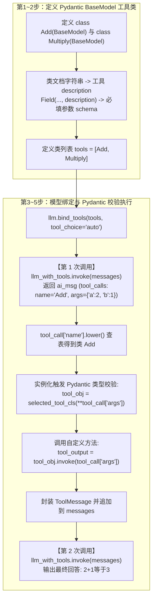

# `03-pydantic方式.py` 源码精讲：使用 Pydantic `BaseModel` 与 `Field` 实现强类型校验工具类

---

## 一、文件定位与核心前置知识精讲

### 1.1 文件定位
[`03-pydantic方式.py`](file:///d:/soft/python/Voyage智途A2A/前置知识/2-Function%20Call/03-pydantic方式.py) 是 `2-Function Call` 模块的**第 3 课（面向对象与数据验证篇）**。在掌握了 `01`（手写 JSON Schema）和 `02`（`@tool` 函数装饰器）之后，本文件展示第三种定义大模型工具的经典方式：**通过继承 `pydantic.BaseModel` 定义工具类（Class）**，利用 `Field(..., description="...")` 声明字段约束，并在类内自定义 `invoke` 方法完成数据校验与业务计算。

---

### 1.2 核心前置知识

#### （1）什么是 Pydantic？为什么 AI 框架（LangChain / FastAPI / MCP / A2A）全都重度依赖它？
正如源码第 6~10 行注释所言：**Pydantic** 是 Python 生态中最核心的数据验证（Data Validation）与序列化库：
1. **自动运行时类型转换与校验**：
   - Python 原生的类型注解（如 `def add(a: int, b: int)`）仅仅是静态提示，运行时如果你传了字符串 `add("2", "1")`，原生 Python 不会把它们转成整数，而是直接做字符串拼接返回 `"21"`！
   - 而继承自 `pydantic.BaseModel` 的类（如 `class Add(BaseModel)`），在实例化 `Add(**{"a": "2", "b": 1})` 时，会自动触发底层校验引擎，**将字符串 `"2"` 自动强制转换（Coerce）为整型 `2`**；如果传入无法转换的 `"abc"`，则会立即抛出清晰的 `ValidationError`！
2. **原生导出 JSON Schema**：
   - 任何 `BaseModel` 子类都可以直接生成标准的 JSON Schema，因此 `llm.bind_tools([Add, Multiply])` 可以直接接收 Pydantic 类列表！
   - 其中，**类名 `Add`** 成为工具的 `"name"`；**类的三引号注释 `"""将两个数字相加"""`** 成为工具的 `"description"`；**类的各个 `Field` 属性** 成为工具的 `"parameters"`。

#### （2）深入理解 `a: int = Field(..., description="第一个数字")` 中的三个点 `...`（Ellipsis）
在源码第 18~20 行：
```python
a: int = Field(..., description="第一个数字")
```
- **`Field`**：Pydantic 提供的字段配置函数，用于为属性附加给大模型看的 `description`（参数说明）、取值范围（如 `gt=0`、`le=100`）等元数据。
- **`...`（三个点 / Python 内置常量 `Ellipsis`）**：
  - 在 Pydantic 的 `Field(...)` 中，第一个位置参数代表该字段的“默认值”。
  - 当传入 **`...`** 时，这是 Pydantic 的特殊语法约定，表示**“该参数是必填项（Required），没有默认值！”**（在生成的 JSON Schema 中，该字段会被自动列入 `"required": ["a", "b"]`）。

#### （3）深入理解本文件中的 `tool_obj = selected_tool_cls(**tool_call["args"])` 与 `self.__class__(**args)`
在源码第 22~25 行和第 75~77 行：
1. 第 75 行：`tool_obj = selected_tool_cls(**tool_call["args"])`
   - `selected_tool_cls` 是 `Add` 类本身。通过 `**tool_call["args"]` 解包参数字典 `{'a': 2, 'b': 1}` 实例化 `Add(a=2, b=1)`，此时 **第 1 次触发 Pydantic 的必填项检查与 `int` 类型转换**，生成实例对象 `tool_obj`。
2. 第 77 行：`tool_output = tool_obj.invoke(tool_call["args"])`
   - 调用我们在 `Add` 类中自定义的实例方法 `def invoke(self, args):`。
   - 在 `invoke` 方法内部（第 24~25 行）：
     ```python
     tool_instance = self.__class__(**args)
     return tool_instance.a + tool_instance.b
     ```
     `self.__class__` 指向当前实例所属的类（即 `Add`），通过 `self.__class__(**args)` 再次根据传入的 `args` 字典完成规则触发与实例化，并取出校验后的整型属性 `tool_instance.a + tool_instance.b` 返回结果 `3`。（注：其实因为第 75 行实例化 `tool_obj` 时 `self.a` 和 `self.b` 已经校验完毕，在 `invoke` 中直接写 `return self.a + self.b` 也是等价的；源码中写 `self.__class__(**args)` 是为了向初学者重点强化演示“传入 `args` 字典如何在方法内触发当前类的 Pydantic 校验规则”）。

---

### 1.3 在 Voyage 智途主项目中的关联
Pydantic `BaseModel` 在主项目中无处不在：
- 在主项目 [`main_http_api.py`](file:///d:/soft/python/Voyage智途A2A/main_http_api.py#L74-L90) 的第 74~90 行，所有的 HTTP 请求体模型（`LoginRequest`、`RegisterRequest`、`ChatRequest`、`ProfileRequest`）全部继承自 `from pydantic import BaseModel`！当用户前端发送 JSON 请求时，FastAPI 就是靠 Pydantic 自动验证 `user_id` 和 `message` 字段类型的。

---

## 二、执行流程与示意图

### 2.1 Pydantic 工具类绑定与执行流程图（Mermaid）



### 2.2 Pydantic `BaseModel` 映射为 JSON Schema 的对照图（ASCII）

```text
  class Add(BaseModel):                  ┌──> "name": "Add"
      """                                │
      将两个数字相加                      ├──> "description": "将两个数字相加"
      """                                │
      a: int = Field(                    │    "properties": {
          ...,              ─────────────┼──>   "a": {"type": "integer", "description": "第一个数字"},
          description="第一个数字"        │      "b": {"type": "integer", "description": "第二个数字"}
      )                                  │    },
      b: int = Field(                    └──> "required": ["a", "b"]  (由 ... Ellipsis 自动生成)
          ...,
          description="第二个数字"
      )
```

---

## 三、完整源码与逐行/逐段深度拆解

### 3.1 完整源码（100% 原始文件嵌入）

文件路径：[`前置知识/2-Function Call/03-pydantic方式.py`](file:///d:/soft/python/Voyage智途A2A/前置知识/2-Function%20Call/03-pydantic方式.py)

```python
import os
from langchain_openai import ChatOpenAI
from langchain_core.messages import ToolMessage

from pydantic import BaseModel, Field
"""Pydantic 是一个 Python 三方包，用于数据验证和序列化。
它通过使用 Python 类型注解（类型声明）来定义数据模型，
并提供强大的数据验证功能。Pydantic 基于 Python 的 dataclasses 和 typing 模块，
允许开发者定义结构化的数据模型，并自动验证输入数据是否符合指定的类型和约束。
"""

# todo: 第1步：pydantic.v1.BaseModel 的方式定义工具函数
class Add(BaseModel):
    """
    将两个数字相加
    """
    # 定义参数，作用是做类型转换
    a: int = Field(..., description="第一个数字")
    b: int = Field(..., description="第二个数字")
    # 三个点 ... 表示参数是必填的，无默认值

    def invoke(self, args):
        # 规则触发 必须传俩参数，自动转换为int类型
        tool_instance = self.__class__(**args)
        return tool_instance.a + tool_instance.b

class Multiply(BaseModel):
    """
    将两个数字相乘
    """
    a: int = Field(..., description="第一个数字")
    b: int = Field(..., description="第二个数字")

    def invoke(self, args):
        # 规则触发
        tool_instance = self.__class__(**args)  
        return tool_instance.a * tool_instance.b

# todo: 第2步：将工具函数类名（类定义）添加到工具列表中
tools = [Add, Multiply]

# todo: 第3步：初始化模型
api_key = os.environ.get("AliApiKey")
ali_url = "https://dashscope.aliyuncs.com/compatible-mode/v1"
llm = ChatOpenAI(base_url=ali_url,
                 api_key=api_key,
                 model='qwen3.8-max',
                 temperature=0.1)
# todo: 第4步：绑定工具，允许模型自动选择工具
llm_with_tools = llm.bind_tools(tools, tool_choice="auto")

# todo: 第5步：调用回复
query = "2+1等于多少？"
messages = [('human', query)]
try:
    # TODO: 第1次调用
    ai_msg = llm_with_tools.invoke(messages)
    messages.append(ai_msg)
    print(f"\n第一轮调用后结果：\n{messages}")

    # 处理工具调用
    # 判断AIMessag对象中是否有tool_calls属性，且不为空列表
    if hasattr(ai_msg, 'tool_calls') and ai_msg.tool_calls:
        # 大模型可能生成多个工具调用，需要遍历处理
        for tool_call in ai_msg.tool_calls:
            '''tool_call["name"] 就是大模型告诉我们要使用的工具函数名
            tool_call["args"] 是大模型返回的使用工具函数所需的参数字典'''
            # TODO: 处理工具调用
            # 工具函数字典，根据工具名称映射到对应的类
            tool_dict = {"add": Add, "multiply": Multiply}
            # 根据工具名称选择工具函数
            selected_tool_cls = tool_dict[tool_call["name"].lower()]
            # TODO: ➡️ 工具对象实例化(解包参数)
            # 参数基于定义的类属性自动做类型验证
            tool_obj = selected_tool_cls(**tool_call["args"])
            # TODO: ➡️ 工具对象.自定义invoke函数(传整体参数不解包！)
            tool_output = tool_obj.invoke(tool_call["args"])
            # 创建工具输出消息对象
            tool_message = ToolMessage(
                content=tool_output,
                tool_call_id=tool_call["id"]
            )
            # 将工具输出消息添加到消息列表中
            messages.append(tool_message)
        print(f"\n第一轮对话结束，message中增加tool_output之后：\n{messages}")

        # TODO: 第2次调用，将工具结果传回模型以生成最终回答
        final_response = llm_with_tools.invoke(messages)
        print(f"\n最终模型响应：\n{final_response.content}")
    else:
        print("模型未生成工具调用，直接返回文本:")
        print(ai_msg.content)
except Exception as e:
    print(f"模型调用失败: {str(e)}")
```

---

### 3.2 分段逐行深度拆解

#### 第一段：导入 Pydantic 并定义 `Add` 与 `Multiply` 工具类（第 1~40 行）
- **第 5 行**：`from pydantic import BaseModel, Field` 导入 Pydantic 的数据模型基类 `BaseModel` 与字段描述函数 `Field`。
- **第 13~25 行**：定义 `class Add(BaseModel):`
  - **第 14~16 行**：类的三引号文档注释 `"""将两个数字相加"""`。**切记不能省略**，因为 `llm.bind_tools` 会读取类的 `__doc__` 作为工具的功能描述。
  - **第 18~19 行**：`a: int = Field(..., description="第一个数字")` 与 `b: int = Field(..., description="第二个数字")`。声明两个必填的 `int` 字段，当用字典解包实例化 `Add(**args)` 时，Pydantic 会强制要求传入 `a` 和 `b` 且能转为整数。
  - **第 22~25 行**：自定义方法 `def invoke(self, args):`。接收参数字典 `args`，通过 `tool_instance = self.__class__(**args)` 实例化并触发校验，返回 `tool_instance.a + tool_instance.b`。
- **第 27~37 行**：以同样结构定义乘法工具类 `class Multiply(BaseModel):`。
- **第 40 行**：`tools = [Add, Multiply]`。注意这里放入列表的是**类本身（Class）**，而不是类的实例（不要写成 `[Add(), Multiply()]`，因为 `a` 和 `b` 是必填字段，不传参调用 `Add()` 会立刻报 `ValidationError`！）。

#### 第二段：绑定工具与大小写路由匹配细节（第 42~72 行）
- **第 50 行**：`llm_with_tools = llm.bind_tools(tools, tool_choice="auto")`。
  - **关键细节**：因为我们传入的类名叫 `Add`（首字母大写），所以 `bind_tools` 传给大模型的工具 `"name"` 也是首字母大写的 **`"Add"`**！
  - 因此，在第 57 行第 1 次调用大模型后，大模型返回的 `tool_call["name"]` 实际上是 **`"Add"`**（首字母大写）！
- **第 70~72 行**：
  - `tool_dict = {"add": Add, "multiply": Multiply}`（字典的 key 是全小写的 `"add"`）。
  - `selected_tool_cls = tool_dict[tool_call["name"].lower()]`：这行里的 **`.lower()`** 在本文件中起到了决定性作用！它把大模型返回的 `"Add"` 转换为全小写的 `"add"`，从而成功在 `tool_dict` 中匹配到 `Add` 类！

#### 第三段：实例化验证、调用自定义 `invoke` 与第 2 次大模型调用（第 73~94 行）
- **第 75 行**：`tool_obj = selected_tool_cls(**tool_call["args"])`
  - 将 `tool_call["args"]`（即 `{'a': 2, 'b': 1}`）使用 `**` 解包传给 `Add` 类的构造函数，创建 `Add` 类的实例对象 `tool_obj`。
- **第 77 行**：`tool_output = tool_obj.invoke(tool_call["args"])`
  - 调用 `tool_obj` 上自定义的 `invoke` 方法（传入未解包的字典 `tool_call["args"]`），计算出 `3`。
- **第 79~89 行**：构造 `ToolMessage(content=tool_output, tool_call_id=tool_call["id"])`，追加到 `messages`，发起第 2 次大模型调用并打印最终回答。

---

### 3.3 沙盘推演（Dry Run）：Pydantic 类型自动转换与执行全过程

假设在某次调用中，大模型返回的参数字典里不小心把数字写成了字符串 `{'a': '2', 'b': '1'}`（这在某些弱能力模型中很常见），我们来看看 `01-基本调用.py` 和本文件 `03-pydantic方式.py` 的天壤之别：

1. **如果是 `01-基本调用.py`（无 Pydantic 校验）**：
   - 直接执行 `add(**{'a': '2', 'b': '1'})` $\rightarrow$ `'2' + '1'` $\rightarrow$ 返回字符串 `'21'`（严重的算术 Bug！）。
2. **在本文件 `03-pydantic方式.py` 中**：
   - **Step 1（第 57 行）**：大模型返回 `tool_call = {'name': 'Add', 'args': {'a': 2, 'b': 1}, 'id': 'call_pyd_01'}`（即使 `args` 是 `{'a': '2', 'b': '1'}`）。
   - **Step 2（第 72 行）**：`tool_call["name"].lower()` 将 `'Add'` 转为 `'add'`，从 `tool_dict` 取出 `selected_tool_cls = <class '__main__.Add'>`。
   - **Step 3（第 75 行）**：执行 `tool_obj = Add(**{'a': 2, 'b': 1})`：
     - Pydantic 校验器启动，检查 `a` 是否存在、是否可转为 `int`，检查 `b` 是否存在、是否可转为 `int`。
     - 得到实例 `tool_obj = Add(a=2, b=1)`（其中 `tool_obj.a` 必定是 `int` 类型的 `2`）。
   - **Step 4（第 77 行）**：执行 `tool_output = tool_obj.invoke({'a': 2, 'b': 1})`：
     - 内部 `tool_instance = self.__class__(**args)` 再次校验并计算 `2 + 1`，返回整型 `3`。
   - **Step 5（第 79~89 行）**：封装 `ToolMessage(content='3', tool_call_id='call_pyd_01')` 传回大模型，输出 `"2+1等于3。"`。

---

## 四、常见易错点与对比总结

### 4.1 前三种手动处理 `tool_calls` 的方式对比（`01` vs `02` vs `03`）

| 对比维度 | `01-基本调用.py` | `02-装饰器方式.py` | `03-pydantic方式.py`（本文件） |
| :--- | :--- | :--- | :--- |
| **定义载体** | 普通函数 `def add` + 手写 JSON 字典 | `@tool` 装饰函数 `def add` | 继承 `BaseModel` 的类 `class Add(BaseModel)` |
| **`tools` 列表放什么** | `[json_dict_1, json_dict_2]` | `[add, multiply]`（`StructuredTool` 实例） | `[Add, Multiply]`（`BaseModel` **子类本身**） |
| **传给 LLM 的工具名** | `"add"`（小写） | `"add"`（小写，取自函数名） | **`"Add"`（首字母大写，取自类名！）** |
| **执行工具的核心代码** | `selected_tool(**args)` | `selected_tool.invoke(args)` | `tool_obj = cls(**args)`<br/>`tool_obj.invoke(args)` |

### 4.2 新手最容易踩的 3 个坑

1. **在第 40 行把类实例化后放进 `tools` 列表：`tools = [Add(), Multiply()]`**：
   - 报错：`pydantic_core._pydantic_core.ValidationError: 2 validation errors for Add: a Field required, b Field required`。
   - **原因**：`Add` 的 `a` 和 `b` 都是 `Field(...)` 必填参数，定义 `tools` 列表时还没有参数，必须把**类名 `Add` 和 `Multiply`** 放进列表，绝不能加括号实例化！
2. **在第 72 行漏写 `.lower()`：`selected_tool_cls = tool_dict[tool_call["name"]]`**：
   - 报错：`KeyError: 'Add'`！
   - **原因**：按照 Python PEP 8 规范，类名采用大驼峰 `class Add(BaseModel)`，大模型返回的 `tool_call["name"]` 就是大写的 `"Add"`；而 `tool_dict` 的键是小写的 `"add"`，如果不调用 `.lower()` 转为小写就会查表失败。
3. **忘了在 `BaseModel` 子类中添加自定义 `invoke` 方法**：
   - `pydantic.BaseModel` 原生只负责数据结构定义和校验，**并不自带 `.invoke()` 方法**！本文件之所以能调用 `tool_obj.invoke(...)`，完全是因为我们在第 22 行和第 34 行自己定义了 `def invoke(self, args):` 方法。

---

## 五、自测思考题（附答案解析）

### 思考题 1
在 `class Add(BaseModel):` 中，代码 `a: int = Field(..., description="第一个数字")` 里的 `...`（三个点）代表什么意思？如果把 `...` 改成数字 `0`（即 `Field(0, description="第一个数字")`），生成的工具 JSON Schema 会发生什么变化？

<details>
<summary>点击查看答案解析</summary>

**答案解析**：
1. `...`（Ellipsis）在 Pydantic 的 `Field` 中表示**该字段是必填项（Required），没有默认值**。
2. 如果把 `...` 改成 `0`，则表示参数 `a` 拥有默认值 `0`，变成了**可选参数（Optional）**。在生成的 JSON Schema 中，`"a"` 将不再出现在 `"required"` 必填列表中，且其属性描述中会多出 `"default": 0`。如果大模型调用时不传 `a`，Pydantic 会自动使用默认值 `0`。
</details>

### 思考题 2
请观察第 22~25 行的 `invoke` 方法：
```python
def invoke(self, args):
    tool_instance = self.__class__(**args)
    return tool_instance.a + tool_instance.b
```
既然在第 75 行我们已经通过 `tool_obj = selected_tool_cls(**tool_call["args"])` 实例化出了 `tool_obj`，那么 `tool_obj.a` 和 `tool_obj.b` 里其实已经有值了。为什么 `invoke` 方法里还能直接简化写成 `return self.a + self.b`？原代码写 `self.__class__(**args)` 的教学意图是什么？

<details>
<summary>点击查看答案解析</summary>

**答案解析**：
1. 是的！因为第 75 行 `tool_obj = selected_tool_cls(**tool_call["args"])` 实例化时，Pydantic 已经校验并把 `a=2`、`b=1` 绑定到了 `tool_obj`（即 `self`）的属性上，所以如果 `def invoke(self): return self.a + self.b` 直接用 `self.a + self.b` 完全可行。
2. 原代码之所以设计成 `tool_obj.invoke(tool_call["args"])` 并在内部执行 `tool_instance = self.__class__(**args)`，是为了保持与 `02-装饰器方式.py` 中 `selected_tool.invoke(tool_call["args"])` 相同的 `.invoke(args)` 调用签名风格，同时向初学者展示如何在类方法内部通过 `self.__class__(**args)` 动态触发 Pydantic 的参数规则验证与类型转换。
</details>
