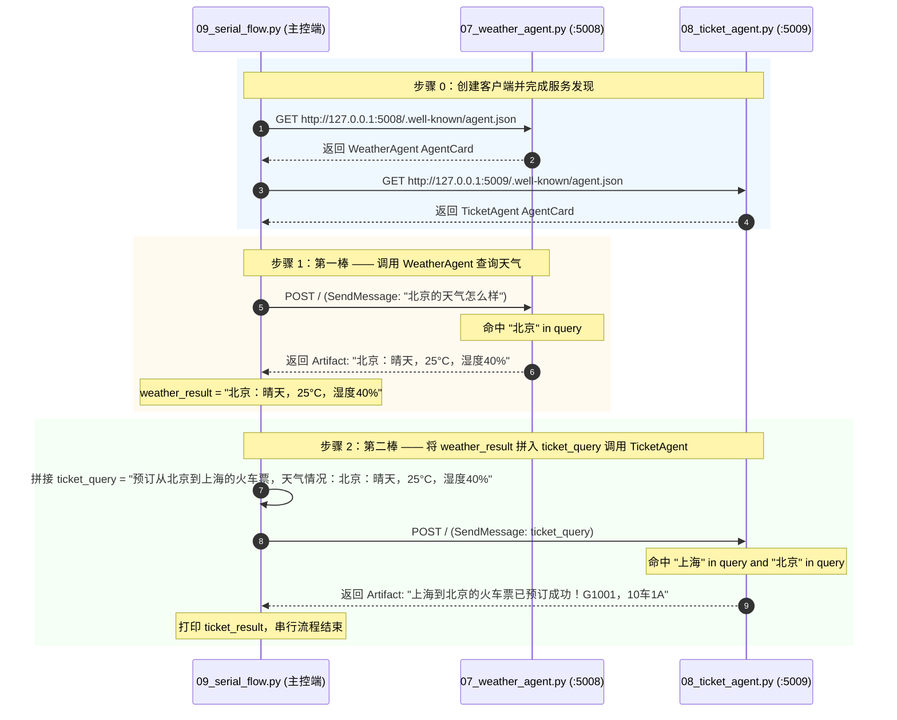

# `09_serial_flow.py` 完全脱离源码级精讲手册：多智能体串行流水线编排（Serial Orchestration）

> **文档定位**：本文是《Voyage 智途 A2A 协议前置知识（12 讲）》的第 9 讲。在前两讲中，我们分别在 `5008` 端口启动了 `WeatherAgent`（`07`），在 `5009` 端口启动了 `TicketAgent`（`08`）。本文件 `09_serial_flow.py` 将首次演示**两个独立 A2A 智能体之间的跨进程协作**——**串行编排（前一个 Agent 的输出作为后一个 Agent 的输入）**。本手册 **100% 完整嵌入了 `09_serial_flow.py` 的全部源码**，深入拆解通用客户端通信函数 `send_query(client, query)` 的封装艺术与串行上下文传递机制。无需打开 `.py` 原文件，仅凭本文即可彻底掌握。

---

## 一、文件定位与核心前置知识精讲

### 1.1 什么是多智能体的“串行编排（Serial Flow）”？为什么需要它？

在真实的智能旅行规划场景（如 Voyage 智途主项目）中，用户的许多复杂任务并不是各个智能体“各干各的、互不相干”，而是存在严格的**先后数据依赖关系（Data Dependency）**：
- **典型场景 1（本文件演示）**：先调用 `WeatherAgent(5008)` 查询目的地或出发地的天气情况，拿到具体的天气结果（`weather_result`）后，**将天气结果拼接到下一步的订票指令中**，再调用 `TicketAgent(5009)` 预订车票（例如在实际业务中，如果目的地台风大雨则改订高铁而非飞机，或根据天气推荐携带雨具）。
- **典型场景 2（旅行规划流水线）**：先调用 `TicketAgent` 查出抵达北京的具体时间（如“下午 14:00 抵达北京南站”），再把“14:00 从北京南站出发”作为输入发给 `ItineraryAgent`（行程规划专家）安排下午的景点路线。

> **串行编排的黄金定义**：**步骤 $N$ 的智能体输出（Artifact），直接作为步骤 $N+1$ 的智能体输入（Query / Context）的一部分，按严格的先后顺序依次 `await` 执行。**

> **再次强化黄金总结**：**MCP 是 Agent 连接 Tool 的协议（手和脚），A2A 是 Agent 连接 Agent 的协议（大脑与大脑协作）**。在 `09_serial_flow.py` 中，主控程序通过 A2A 协议先后与 `WeatherAgent`（大脑 1）和 `TicketAgent`（大脑 2）对话，实现了跨进程的“大脑接力赛”！

---

### 1.2 核心代码范式提炼：通用函数 `async def send_query(client, query)`

对比第 6 讲 `06_a2a_client.py`，本文件在代码结构上做了一次极其重要的**工程重构**——将“构造 `SendMessageRequest` → 调用 `client.send_message(request)` → 检查 `resp.HasField("task")` 与 `TASK_STATE_COMPLETED` → 提取 `task.artifacts[0].parts[0].text`”这套模板代码，封装成了一个短短 15 行的通用异步函数：

```python
async def send_query(client, query):
    request = SendMessageRequest(
        message=A2AMessage(
            message_id="msg-001",
            role=Role.ROLE_USER,
            parts=[Part(text=query)],
        )
    )
    async for resp in client.send_message(request):
        if resp.HasField("task"):
            task = resp.task
            if task.status.state == TaskState.TASK_STATE_COMPLETED:
                return task.artifacts[0].parts[0].text
    return "查询失败"
```

- **为什么要封装 `send_query(client, query)`？**
  - 当系统里只有一个 Agent 时（如 `06_a2a_client.py`），直接把 `async for resp in client.send_message(request):` 写在 `main()` 里还能看清；
  - 但当系统里有 2 个、3 个甚至 10 个 Agent 需要编排时，如果每次发消息都要写十几行 `SendMessageRequest` 和 `artifacts[0].parts[0].text` 解析代码，`main()` 函数的业务编排逻辑就会被底层协议细节彻底淹没！
  - 封装了 `send_query(client, query) -> str` 之后，任何 A2A 智能体调用都简化成了一行干净利落的异步函数调用：
    - `weather_result = await send_query(weather_client, weather_query)`
    - `ticket_result = await send_query(ticket_client, ticket_query)`
  - **请注意**：从本文件（`09`）开始，一直到 `11_single_intent.py` 和 `12_multi_intent.py`，全都复用了这同一个 `send_query(client, query)` 函数！

---

### 1.3 从 `09`（串行）到 `12`（多意图并发）再到 Voyage 主项目的演进脉络

为了让你看清 `09`、`10`、`11`、`12` 四个文件是如何一步步演进为 Voyage 主项目 `core/chat_service_core.py` 的，请看下面这张演进对比表：

| 演进阶段 | 对应文件 | 调度方式 | 解决的核心痛点 | 存在的局限性（引出下一讲） |
| :--- | :--- | :--- | :--- | :--- |
| **阶段 1：固定串行流水线** | **`09_serial_flow.py`（本文件）** | 硬编码顺序：先 `await weather_client`，拿结果拼字符串后再 `await ticket_client` | 解决了多个 Agent 之间的**跨进程调用与上下文数据接力传递** | 流程是程序员写死的！如果用户只想订票不想查天气，程序还是会傻傻地先查天气再订票 |
| **阶段 2：LLM 路由智能体服务端** | `10_router_agent.py` | 独立启动在 `5555` 端口的 `RouterAgent`，内部用 LLM 识别用户意图该找谁 | 让大模型代替硬编码 `if-else`，动态决定目标专家是 `"WeatherAgent"` 还是 `"TicketAgent"` | 仅提供了 `5555` 路由服务端，还没有主控端把路由结果与下游专家串联起来 |
| **阶段 3：单意图动态路由分发** | `11_single_intent.py` | 主控先问 `RouterAgent(5555)` 拿目标名字，再从 `agent_map` 字典取出对应 client 调用 | 实现了**任意单一意图问句的自动识别与动态分发** | 如果用户一句话里同时包含两个意图（“查北京天气，顺便订去上海的票”），单一路由只能选出一个 Agent，漏掉另一个任务 |
| **阶段 4：多意图拆解 + 并发调度** | `12_multi_intent.py` | `decompose_chain` 拆解复合问句为 `sub_queries` 列表 + `asyncio.gather` 并发调用 `route_and_execute` | 彻底解决**一句话多任务**的自动拆解、并行路由与并发执行（**Voyage 主项目 `chat_service_core.py` 原型**） | — |

---

## 二、架构与交互时序图

### 2.1 `09_serial_flow.py` 串行数据接力架构图（ASCII）

```text
+-------------------------------------------------------------------------+
|                     09_serial_flow.py (主控编排程序)                      |
|                                                                         |
|  [步骤0] 初始化两个 A2A 客户端:                                           |
|          weather_client ──(拉取名片)──> http://127.0.0.1:5008            |
|          ticket_client  ──(拉取名片)──> http://127.0.0.1:5009            |
|                                                                         |
|  [步骤1] 第一棒：查询天气                                                 |
|          weather_query = "北京的天气怎么样"                               |
|          weather_result = await send_query(weather_client, weather_query)
|                │                                                        |
|                │ (拿到返回值: "北京：晴天，25°C，湿度40%")                 |
|                ▼                                                        |
|  [步骤2] 数据接力（串行的灵魂！把第一步的输出拼进第二步的输入）：            |
|          ticket_query = f"预订从北京到上海的火车票，天气情况：{weather_result}"
|          ticket_result = await send_query(ticket_client, ticket_query)  |
|                │                                                        |
|                │ (拿到返回值: "上海到北京的火车票已预订成功！G1001，10车1A")|
|                ▼                                                        |
|          打印最终结果，串行任务全部完成！                                   |
+-------------------------------------------------------------------------+
```

### 2.2 跨进程串行调用时序图（Mermaid）



---

## 三、完整源码与逐行/逐段深度拆解

### 3.1 `09_serial_flow.py` 100% 完整源码

以下是 `前置知识/6-A2A协议/09_serial_flow.py` 的完整原始代码，一字未改：

```python
# 6.5.3 串行流程实现 - 先查天气，再根据结果订票
#
# 串行关键：第一个 Agent 的输出作为第二个 Agent 的输入
#
# 执行流程：
#   用户 → 主控程序
#              │
#              ├─→ 步骤1: WeatherAgent(5008) 查询天气
#              │         ↓
#              │    天气结果
#              │         ↓
#              └─→ 步骤2: TicketAgent(5009) 订票（携带天气信息）
#                        ↓
#                   订票结果
#
# 运行前确保 WeatherAgent(5008) 和 TicketAgent(5009) 已启动

import asyncio
from a2a.client import ClientFactory, ClientConfig
from a2a.types import (
    SendMessageRequest,
    Message as A2AMessage, Part, Role, TaskState,
)


async def send_query(client, query):
    """
    向 Agent 发送查询并返回结果文本
    :param client: A2A 客户端实例
    :param query: 用户查询文本
    :return: Agent 返回的结果文本
    """
    # 构造请求消息
    request = SendMessageRequest(
        message=A2AMessage(
            message_id="msg-001",
            role=Role.ROLE_USER,
            parts=[Part(text=query)],
        )
    )
    # 发送并等待响应
    async for resp in client.send_message(request):
        if resp.HasField("task"):
            task = resp.task
            if task.status.state == TaskState.TASK_STATE_COMPLETED:
                # 从 artifacts（产物）中提取结果文本
                return task.artifacts[0].parts[0].text
    return "查询失败"


async def main():
    # ========== 步骤0：创建客户端 ==========
    # ClientFactory 会自动拉取各 Agent 的 AgentCard
    factory = ClientFactory(ClientConfig(streaming=False))
    weather_client = await factory.create_from_url("http://127.0.0.1:5008")  # 天气 Agent
    ticket_client = await factory.create_from_url("http://127.0.0.1:5009")   # 票务 Agent

    # ========== 步骤1：查询天气 ==========
    weather_query = "北京的天气怎么样"
    print(f"[主控] 第一步：查询天气 -> '{weather_query}'")
    weather_result = await send_query(weather_client, weather_query)
    print(f"[主控] 天气结果: {weather_result}")

    # ========== 步骤2：根据天气结果订票（串行的关键）==========
    # 关键：把第一步的天气结果作为第二步的输入
    ticket_query = f"预订从北京到上海的火车票，天气情况：{weather_result}"
    print(f"\n[主控] 第二步：订票 -> '{ticket_query}'")
    ticket_result = await send_query(ticket_client, ticket_query)
    print(f"[主控] 订票结果: {ticket_result}")

    print("\n[主控] 串行任务全部完成！")


if __name__ == "__main__":
    asyncio.run(main())
```

---

### 3.2 逐段逐行深度拆解

#### 第一段：封装通用通信函数 `send_query(client, query)`（第 26~48 行）

```python
async def send_query(client, query):
    request = SendMessageRequest(
        message=A2AMessage(
            message_id="msg-001",
            role=Role.ROLE_USER,
            parts=[Part(text=query)],
        )
    )
    async for resp in client.send_message(request):
        if resp.HasField("task"):
            task = resp.task
            if task.status.state == TaskState.TASK_STATE_COMPLETED:
                return task.artifacts[0].parts[0].text
    return "查询失败"
```

- **输入参数**：
  - `client`：由 `await factory.create_from_url(...)` 创建出来的某个具体 Agent 的客户端实例（如 `weather_client` 或 `ticket_client`）。
  - `query`：要发给该 Agent 的自然语言文本字符串。
- **执行逻辑与兜底返回**：
  - 将 `query` 包装进 `Part(text=query)` → `A2AMessage` → `SendMessageRequest`。
  - 迭代 `client.send_message(request)`，一旦检测到 `task.status.state == TaskState.TASK_STATE_COMPLETED`，立即 `return task.artifacts[0].parts[0].text` 退出函数并把结果字符串交回给调用者。
  - 如果整个 `async for` 循环结束都没有收到 `TASK_STATE_COMPLETED`（例如服务端返回了 `TASK_STATE_FAILED`），则走到第 48 行兜底返回 `"查询失败"`。

---

#### 第二段：步骤 0——初始化多 Agent 客户端连接池（第 51~56 行）

```python
async def main():
    # ========== 步骤0：创建客户端 ==========
    # ClientFactory 会自动拉取各 Agent 的 AgentCard
    factory = ClientFactory(ClientConfig(streaming=False))
    weather_client = await factory.create_from_url("http://127.0.0.1:5008")  # 天气 Agent
    ticket_client = await factory.create_from_url("http://127.0.0.1:5009")   # 票务 Agent
```

- 同一个 `factory` 实例可以被复用，连续调用两次 `await factory.create_from_url(...)`，分别连接 `5008` 端口的 `WeatherAgent` 和 `5009` 端口的 `TicketAgent`。
- 注意：这里之所以没有像 `06_a2a_client.py` 那样显式配置 `httpx.Timeout(60.0)`，是因为 `07`（`5008`）和 `08`（`5009`）都是纯内存模拟服务，响应耗时不到 5 毫秒，默认的 `httpx` 超时完全绰绰有余。

---

#### 第三段：步骤 1 与步骤 2——串行执行与上下文拼接（第 58~71 行）

```python
    # ========== 步骤1：查询天气 ==========
    weather_query = "北京的天气怎么样"
    print(f"[主控] 第一步：查询天气 -> '{weather_query}'")
    weather_result = await send_query(weather_client, weather_query)
    print(f"[主控] 天气结果: {weather_result}")

    # ========== 步骤2：根据天气结果订票（串行的关键）==========
    # 关键：把第一步的天气结果作为第二步的输入
    ticket_query = f"预订从北京到上海的火车票，天气情况：{weather_result}"
    print(f"\n[主控] 第二步：订票 -> '{ticket_query}'")
    ticket_result = await send_query(ticket_client, ticket_query)
    print(f"[主控] 订票结果: {ticket_result}")

    print("\n[主控] 串行任务全部完成！")
```

- **看懂第 61 行与第 65~68 行的串行因果链**：
  1. 第 61 行 `weather_result = await send_query(weather_client, weather_query)`：由于加了 `await`，主控协程会在这里**暂停等待**，直到 `5008` 端口的 `WeatherAgent` 处理完毕并返回 `"北京：晴天，25°C，湿度40%"`。
  2. 第 65 行 `ticket_query = f"预订从北京到上海的火车票，天气情况：{weather_result}"`：**这是全篇的灵魂所在！** 它把上一个智能体的输出 `weather_result` 通过 Python 的 f-string 嵌入到了下一个智能体的输入 `ticket_query` 中。
  3. 第 68 行 `ticket_result = await send_query(ticket_client, ticket_query)`：拿着融合了天气信息的新请求去调用 `5009` 端口的 `TicketAgent`。

---

### 3.3 沙盘推演（Dry Run）：三终端运行实录

假设你已经打开了三个终端窗口：
- **终端 1**：运行 `python 07_weather_agent.py`（监听 `5008`）
- **终端 2**：运行 `python 08_ticket_agent.py`（监听 `5009`）
- **终端 3**：运行 `python 09_serial_flow.py`

让我们按时间轴观察三个终端的真实打印输出：

1. **T1 时刻（步骤 0 拉取名片）**：
   - 终端 1（`5008`）输出：`INFO: 127.0.0.1:xxxx - "GET /.well-known/agent.json HTTP/1.1" 200 OK`
   - 终端 2（`5009`）输出：`INFO: 127.0.0.1:xxxx - "GET /.well-known/agent.json HTTP/1.1" 200 OK`
2. **T2 时刻（步骤 1 查天气）**：
   - 终端 3（主控）输出：
     ```text
     [主控] 第一步：查询天气 -> '北京的天气怎么样'
     ```
   - 终端 1（`5008`）收到请求并输出：
     ```text
     [WeatherAgent] 收到查询: 北京的天气怎么样
     ```
   - 终端 3（主控）收到响应并输出：
     ```text
     [主控] 天气结果: 北京：晴天，25°C，湿度40%
     ```
3. **T3 时刻（步骤 2 携带天气订票）**：
   - 终端 3（主控）拼接字符串并输出：
     ```text
     [主控] 第二步：订票 -> '预订从北京到上海的火车票，天气情况：北京：晴天，25°C，湿度40%'
     ```
   - 终端 2（`5009`）收到包含天气结果的完整查询并输出：
     ```text
     [TicketAgent] 收到查询: 预订从北京到上海的火车票，天气情况：北京：晴天，25°C，湿度40%
     ```
   - 终端 3（主控）收到订票响应并输出：
     ```text
     [主控] 订票结果: 上海到北京的火车票已预订成功！G1001，10车1A

     [主控] 串行任务全部完成！
     ```

---

## 四、在 12 个递进文件中的承上启下关系 & 常见易错点

### 4.1 承上启下关系

- **承上（连接 `07` 与 `08`）**：
  - 首次在客户端同时连接 `07_weather_agent.py`（`5008`）和 `08_ticket_agent.py`（`5009`），打通了两个独立 A2A 服务之间的串行数据流。
- **启下（引出 `10_router_agent.py` 与 `11_single_intent.py`）**：
  - 思考一个问题：在 `09_serial_flow.py` 中，“第一步调 `weather_client`、第二步调 `ticket_client`”是由程序员在代码里**写死（Hardcoded）**的。
  - 但在真实的对话系统中，用户在聊天框里输入一句话（比如 `"帮我查下北京的天气"`，或者 `"预订一张从北京到上海的火车票"`），主控程序在事先根本不知道用户到底是想查天气还是想订票！**怎样才能让系统自动看懂用户的意图，动态决定该调用 `5008` 还是 `5009` 呢？**
  - 这就引出了第 10 讲 `10_router_agent.py`（专门负责用大模型识别意图的**路由智能体服务端**，监听 `5555` 端口）和第 11 讲 `11_single_intent.py`（先问 `5555` 拿名字，再动态分发给 `5008` 或 `5009`）！

### 4.2 常见易错点与避坑指南

1. **易错点 1：在步骤 1 调用 `send_query` 时漏写 `await`，导致把 `coroutine` 对象拼进了 `ticket_query`**
   - ❌ 错误写法：`weather_result = send_query(weather_client, weather_query)`
   - 💥 后果：如果不写 `await`，`weather_result` 的值不是字符串 `"北京：晴天..."`，而是 `"<coroutine object send_query at 0x...>"`，导致第一步根本没发请求，第二步拼出来的 `ticket_query` 也是错的！
2. **易错点 2：`5008` 或 `5009` 服务未启动**
   - 运行 `09_serial_flow.py` 前，务必确认 `07_weather_agent.py`（`5008`）和 `08_ticket_agent.py`（`5009`）两个服务都已经处于运行状态。

---

## 五、自测思考题（附答案解析）

### 思考题 1
**问题**：什么是多智能体协作中的“串行流程（Serial Flow）”？它与第 12 讲将要学习的“并行流程（Parallel Flow，`asyncio.gather`）”在适用场景上有什么本质区别？
<details>
<summary>点击查看答案解析</summary>

- **答案**：
  - **串行流程（Serial Flow）**：多个智能体按先后顺序依次执行，**前一个智能体的输出是后一个智能体的输入依赖**（例如必须先拿到第一步的查询结果，才能构造第二步的请求参数）。
  - **并行流程（Parallel Flow）**：多个子任务之间**彼此独立、没有先后数据依赖**（例如“查北京天气”和“订北京到上海的火车票”两个子查询互不依赖对方的输出），因此可以使用 `asyncio.gather` 同时并发请求多个智能体，大幅缩短总耗时。
</details>

### 思考题 2
**问题**：假设我们要在 `09_serial_flow.py` 的步骤 1 和步骤 2 之间加一层业务拦截判断：如果 `weather_result` 中包含 `"暂无"`（即没查到该城市的天气数据），就终止流程不再调用 `ticket_client` 订票。代码应该怎么写？
<details>
<summary>点击查看答案解析</summary>

- **答案**：
  ```python
  weather_result = await send_query(weather_client, weather_query)
  print(f"[主控] 天气结果: {weather_result}")

  if "暂无" in weather_result or weather_result == "查询失败":
      print("[主控] 未能获取有效天气数据，取消后续订票流程！")
      return

  ticket_query = f"预订从北京到上海的火车票，天气情况：{weather_result}"
  ticket_result = await send_query(ticket_client, ticket_query)
  ```
</details>
