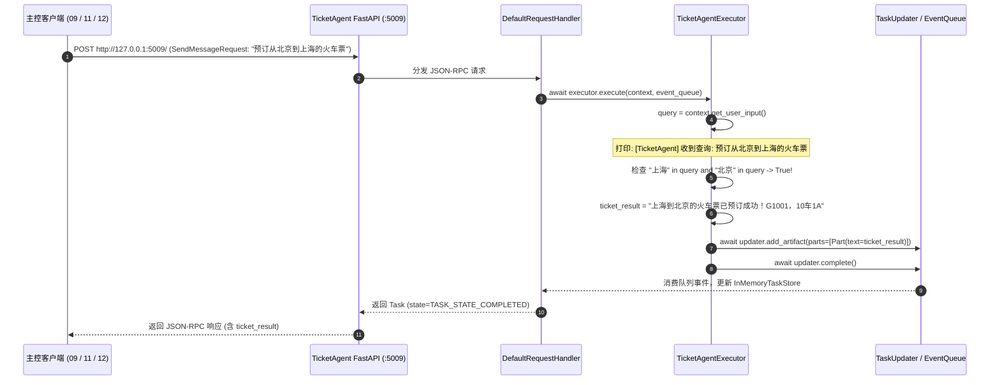

# `08_ticket_agent.py` 完全脱离源码级精讲手册：多智能体协同演练场之独立票务专家服务（端口 5009）

> **文档定位**：本文是《Voyage 智途 A2A 协议前置知识（12 讲）》的第 8 讲。本手册 **100% 完整嵌入了 `08_ticket_agent.py` 的全部源码**，详细拆解多智能体演练场中的第二个独立垂类专家——`TicketAgent`（监听 `5009` 端口），并与 `07_weather_agent.py`（监听 `5008` 端口）进行对比，重点剖析其 `if-elif` 出发地/目的地匹配逻辑在后续 `09`、`11`、`12` 三个多 Agent 编排脚本中的运行表现。无需打开 `.py` 原文件，仅凭本文即可独立掌握。

---

## 一、文件定位与核心前置知识精讲

### 1.1 为什么多智能体协同实验至少需要 `WeatherAgent`（`07`）和 `TicketAgent`（`08`）两个独立服务？

在上一讲 `07_weather_agent.py` 中，我们在 `5008` 端口启动了负责查天气的 `WeatherAgent`。为了构建一个真实可感的多智能体协同系统（就像 Voyage 智途主项目中的旅行多专家集群），我们至少需要第二个**职责完全不同、运行在不同端口**的独立智能体——这就是本文件 `08_ticket_agent.py` 启动在 `5009` 端口的 **`TicketAgent`（火车票预订智能体）**！

有了 `WeatherAgent(5008)` 和 `TicketAgent(5009)` 这两位“专科专家”，我们就能在接下来的四讲（`09`~`12`）中，完整推演企业级多智能体系统的**三大核心协作模式**：

1. **串行流水线协作模式（`09_serial_flow.py`）**：
   - 场景：先找 `WeatherAgent(5008)` 查出北京的天气，再把查出来的天气情况附带在订票请求里，发给 `TicketAgent(5009)` 预订火车票（前一个 Agent 的输出作为后一个 Agent 的输入）。
2. **单意图智能路由模式（`10_router_agent.py` + `11_single_intent.py`）**：
   - 场景：用户随便问一句话（可能是查天气，也可能是订火车票），主控程序先发给 `RouterAgent(5555)` 由大模型判断该找谁，拿到 `"WeatherAgent"` 或 `"TicketAgent"` 的名字后，再精准转发给 `5008` 或 `5009` 执行。
3. **多意图拆解与并发调度模式（`12_multi_intent.py` —— Voyage 主项目核心架构原型）**：
   - 场景：用户一句话同时包含多个意图（`"帮我查一下北京天气，顺便订一张北京到上海的火车票"`），主控程序先用大模型拆解成两个独立子查询，然后用 `asyncio.gather` **同时并发**路由并调用 `WeatherAgent(5008)` 和 `TicketAgent(5009)`！

> **再次铭记黄金总结**：**MCP 是 Agent 连接 Tool 的协议（手和脚），A2A 是 Agent 连接 Agent 的协议（大脑与大脑协作）**。在这里，`WeatherAgent(5008)` 和 `TicketAgent(5009)` 就是两个独立的 A2A Server Agent（在生产环境中，它们内部可以各自挂载不同的 MCP Server，例如 `5008` 挂载气象局 MCP 工具，`5009` 挂载 12306 票务 MCP 工具）。

---

### 1.2 `07_weather_agent.py` 与 `08_ticket_agent.py` 双子星对照表

`08_ticket_agent.py` 的代码结构与 `07_weather_agent.py` 高度对称，是巩固 A2A 服务端四步标准公式（名片 → 执行器 → 组装 → 启动）的绝佳范本：

| 对比项 | `07_weather_agent.py`（天气专家） | `08_ticket_agent.py`（本文件：票务专家） |
| :--- | :--- | :--- |
| **监听地址与端口** | `http://127.0.0.1:5008/` | **`http://127.0.0.1:5009/`** |
| **名片名称 (`AgentCard.name`)** | `"WeatherAgent"` | **`"TicketAgent"`** |
| **名片描述 (`description`)** | `"天气查询智能体"` | **`"火车票预订智能体"`** |
| **技能 ID (`AgentSkill.id`)** | `"query_weather"` | **`"book_ticket"`** |
| **技能描述 (`skill.description`)** | `"查询指定城市的天气"` | **`"预订火车票"`** |
| **技能示例 (`skill.examples`)** | `["查询北京的天气"]` | **`["预订从上海到北京的火车票"]`** |
| **执行器类名** | `WeatherAgentExecutor` | **`TicketAgentExecutor`** |
| **核心业务模拟逻辑** | 匹配 `"北京"` / `"上海"` / `"郑州"` 返回对应天气 | 匹配 `"上海" in query and "北京" in query` 返回预订成功的车次座位号 `G1001，10车1A` |

---

## 二、架构与交互时序图

### 2.1 `TicketAgent(5009)` 与 `WeatherAgent(5008)` 的双服务并存架构图（ASCII）

```text
+-----------------------------------------------------------------------------+
|                        本地主机 (127.0.0.1) 多进程环境                        |
|                                                                             |
|  +-----------------------------------+  +-----------------------------------+
|  |   进程 1: 07_weather_agent.py     |  |   进程 2: 08_ticket_agent.py      |
|  |   监听端口: 5008                   |  |   监听端口: 5009 (本文件)          |
|  |                                   |  |                                   |
|  |   GET  /.well-known/agent.json    |  |   GET  /.well-known/agent.json    |
|  |     -> name: "WeatherAgent"       |  |     -> name: "TicketAgent"        |
|  |     -> skill: "query_weather"     |  |     -> skill: "book_ticket"       |
|  |                                   |  |                                   |
|  |   POST / (JSON-RPC 2.0)           |  |   POST / (JSON-RPC 2.0)           |
|  |     -> WeatherAgentExecutor       |  |     -> TicketAgentExecutor        |
|  +-----------------+-----------------+  +-----------------+-----------------+
|                    ^                                      ^                 |
|                    | HTTP :5008                           | HTTP :5009      |
|                    +------------------+-------------------+                 |
|                                       |                                     |
|  +------------------------------------+----------------------------------+  |
|  |             上游 A2A 客户端 / 编排主控程序 (09 / 11 / 12)               |  |
|  |  weather_client = await factory.create_from_url("http://...:5008")    |  |
|  |  ticket_client  = await factory.create_from_url("http://...:5009")    |  |
|  +-----------------------------------------------------------------------+  |
+-----------------------------------------------------------------------------+
```

### 2.2 `TicketAgentExecutor.execute()` 请求处理时序图（Mermaid）



---

## 三、完整源码与逐行/逐段深度拆解

### 3.1 `08_ticket_agent.py` 100% 完整源码

以下是 `前置知识/6-A2A协议/08_ticket_agent.py` 的完整原始代码，一字未改：

```python
# 6.5.2 票务Agent（独立服务）
#
# 最简单的 A2A 票务 Agent 示例：不依赖 MCP，不依赖 LLM，直接返回模拟数据
# 与 07_weather_agent.py 结构相同，用于演示多 Agent 协作场景
#
# 运行：uvicorn 启动在 5009 端口

from a2a.types import AgentCard, AgentSkill, AgentCapabilities, AgentInterface, Part
from a2a.server.agent_execution import AgentExecutor
from a2a.server.request_handlers import DefaultRequestHandler
from a2a.server.tasks import InMemoryTaskStore, TaskUpdater
from a2a.server.routes import (
    add_a2a_routes_to_fastapi,
    create_agent_card_routes,
    create_jsonrpc_routes,
)
from fastapi import FastAPI


# ---- AgentCard 名片 ----
# 告诉客户端"我是谁、能干什么"
agent_card = AgentCard(
    name="TicketAgent",                         # Agent 名称（路由时用来匹配）
    description="火车票预订智能体",               # 描述
    capabilities=AgentCapabilities(streaming=False),  # 不支持流式
    skills=[AgentSkill(
        id="book_ticket",                       # 技能 ID
        name="book ticket",                     # 技能名称
        description="预订火车票",                 # 技能描述
        examples=["预订从上海到北京的火车票"],       # 示例
    )],
    default_input_modes=["text/plain"],         # 输入格式
    default_output_modes=["text/plain"],        # 输出格式
    supported_interfaces=[AgentInterface(       # 通信接口
        url="http://127.0.0.1:5009/",           # 服务地址（5009 端口）
        protocol_binding="JSONRPC",             # JSON-RPC 协议
    )],
)


# ---- AgentExecutor 执行器 ----
# 实际干活的类：接收查询 → 处理 → 返回结果
class TicketAgentExecutor(AgentExecutor):
    async def execute(self, context, event_queue):
        """处理用户查询：根据出发地/目的地返回模拟票务数据"""
        query = context.get_user_input()          # 提取用户输入
        print(f"[TicketAgent] 收到查询: {query}")
        updater = TaskUpdater(event_queue, context.task_id, context.context_id)

        # 模拟票务查询结果（根据关键词匹配）
        if "上海" in query and "北京" in query:
            ticket_result = "上海到北京的火车票已预订成功！G1001，10车1A"
        elif "北京" in query and "上海" in query:
            ticket_result = "北京到上海的火车票已预订成功！G1002，5车3B"
        else:
            ticket_result = "请输入明确的出发地和目的地"

        # 发布结果并标记完成
        await updater.add_artifact(parts=[Part(text=ticket_result)])
        await updater.complete()

    async def cancel(self, context, event_queue):
        """取消任务时的处理"""
        updater = TaskUpdater(event_queue, context.task_id, context.context_id)
        await updater.cancel()


# ---- 组装 & 启动 ----
# 实例化执行器
executor = TicketAgentExecutor()

# 创建 FastAPI 应用
app = FastAPI(title="TicketAgent")

# 挂载 A2A 标准路由（完成后有两个端点：
#   GET  /.well-known/agent.json → 返回 AgentCard
#   POST /                       → JSON-RPC 入口）
add_a2a_routes_to_fastapi(
    app,
    agent_card_routes=create_agent_card_routes(agent_card),  # 名片路由
    jsonrpc_routes=create_jsonrpc_routes(
        request_handler=DefaultRequestHandler(               # 请求处理器
            agent_executor=executor,                         # 绑定执行器
            task_store=InMemoryTaskStore(),                  # 内存任务存储
            agent_card=agent_card,                           # 绑定名片
        ),
        rpc_url="/",                                         # JSON-RPC 端点
        enable_v0_3_compat=True,                             # 兼容 v0.3 协议
    ),
)

# 启动服务：监听 5009 端口
if __name__ == "__main__":
    import uvicorn
    uvicorn.run(app, host="127.0.0.1", port=5009)
```

---

### 3.2 逐段逐行深度拆解

#### 第一段：定义 `TicketAgent` 的 `AgentCard`（第 20~38 行）

```python
agent_card = AgentCard(
    name="TicketAgent",                         # Agent 名称（路由时用来匹配）
    description="火车票预订智能体",               # 描述
    capabilities=AgentCapabilities(streaming=False),  # 不支持流式
    skills=[AgentSkill(
        id="book_ticket",                       # 技能 ID
        name="book ticket",                     # 技能名称
        description="预订火车票",                 # 技能描述
        examples=["预订从上海到北京的火车票"],       # 示例
    )],
    default_input_modes=["text/plain"],         # 输入格式
    default_output_modes=["text/plain"],        # 输出格式
    supported_interfaces=[AgentInterface(       # 通信接口
        url="http://127.0.0.1:5009/",           # 服务地址（5009 端口）
        protocol_binding="JSONRPC",             # JSON-RPC 协议
    )],
)
```

- **三个核心关注点**：
  1. `name="TicketAgent"`：与 `10_router_agent.py` 中提示词规定的输出词 `"WeatherAgent 或 TicketAgent"` 以及 `11`/`12` 中的 `agent_map["TicketAgent"]` 严格对应。
  2. `skills=[AgentSkill(id="book_ticket", name="book ticket", description="预订火车票", examples=["预订从上海到北京的火车票"])]`：清晰声明票务预订能力。
  3. `url="http://127.0.0.1:5009/"`：使用 **`5009`** 端口，与 `WeatherAgent` 的 `5008` 端口错开，使两个服务可以同时在同一台机器上并行运行。

---

#### 第二段：定义 `TicketAgentExecutor` 及一个非常有趣的布尔短路细节（第 41~65 行）

```python
class TicketAgentExecutor(AgentExecutor):
    async def execute(self, context, event_queue):
        """处理用户查询：根据出发地/目的地返回模拟票务数据"""
        query = context.get_user_input()          # 提取用户输入
        print(f"[TicketAgent] 收到查询: {query}")
        updater = TaskUpdater(event_queue, context.task_id, context.context_id)

        # 模拟票务查询结果（根据关键词匹配）
        if "上海" in query and "北京" in query:
            ticket_result = "上海到北京的火车票已预订成功！G1001，10车1A"
        elif "北京" in query and "上海" in query:
            ticket_result = "北京到上海的火车票已预订成功！G1002，5车3B"
        else:
            ticket_result = "请输入明确的出发地和目的地"

        # 发布结果并标记完成
        await updater.add_artifact(parts=[Part(text=ticket_result)])
        await updater.complete()
```

- **细心观察第 51~54 行的 `if...elif...` 条件判断（Python 布尔运算彩蛋）**：
  ```python
  if "上海" in query and "北京" in query:
      ticket_result = "上海到北京的火车票已预订成功！G1001，10车1A"
  elif "北京" in query and "上海" in query:
      ticket_result = "北京到上海的火车票已预订成功！G1002，5车3B"
  ```
  - 发现了吗？在布尔逻辑中，`A and B` 与 `B and A` 的真值表是完全等价的！也就是说，只要 `query` 里同时出现了 `"北京"` 和 `"上海"`（哪怕用户问的是 `"预订从北京到上海的火车票"`），第 51 行的 `if "上海" in query and "北京" in query:` 都会为 `True`，从而**永远命中第一个分支**，返回 `"上海到北京的火车票已预订成功！G1001，10车1A"`！
  - **为什么把这个细节指出来？**
    因为当你运行后面的 `09_serial_flow.py`、`11_single_intent.py` 和 `12_multi_intent.py` 时，虽然客户端发的问句是 `"预订从北京到上海的火车票"`，但你看到控制台打印的结果都是 `"上海到北京的火车票已预订成功！G1001，10车1A"`。如果不看源码，你可能会以为自己眼花了或者传错参数了；现在看穿了源码第 51 行的 `and` 逻辑，你就知道这是完全符合源码预期行为的！（如果真要区分方向，可以用 `query.find("上海") < query.find("北京")` 或者交给像 `05` 那样的 LLM + MCP 工具去提取 `from_city` 和 `to_city` 参数）。

---

#### 第三段：组装 FastAPI 应用并启动 `5009` 端口（第 68~95 行）

- 实例化 `TicketAgentExecutor()`，创建 `FastAPI(title="TicketAgent")`，调用 `add_a2a_routes_to_fastapi` 挂载名片路由与 JSON-RPC 路由，最后通过 `uvicorn.run(app, host="127.0.0.1", port=5009)` 在 `5009` 端口启动服务。

---

### 3.3 沙盘推演（Dry Run）：当 `09_serial_flow.py` 把携带天气信息的订票请求发给 `5009` 时会发生什么？

让我们提前预演下一讲 `09_serial_flow.py` 与本文件的联动过程：

1. 在 `09_serial_flow.py` 中，主控程序先调用 `WeatherAgent(5008)` 拿到 `weather_result = "北京：晴天，25°C，湿度40%"`。
2. 接着，主控程序将天气结果拼入订票请求：
   `ticket_query = "预订从北京到上海的火车票，天气情况：北京：晴天，25°C，湿度40%"`
   并发送给本服务 `http://127.0.0.1:5009/`。
3. 本服务 `TicketAgentExecutor.execute()` 被触发：
   - `query = context.get_user_input()` 拿到上述完整字符串；
   - `5009` 终端打印：
     ```text
     [TicketAgent] 收到查询: 预订从北京到上海的火车票，天气情况：北京：晴天，25°C，湿度40%
     ```
   - 执行第 51 行 `if "上海" in query and "北京" in query:` → 判断为 `True`；
   - `ticket_result` 被赋值为 `"上海到北京的火车票已预订成功！G1001，10车1A"`；
   - `await updater.add_artifact(parts=[Part(text=ticket_result)])` + `await updater.complete()` 将结果发回主控程序！

---

## 四、在 12 个递进文件中的承上启下关系 & 常见易错点

### 4.1 承上启下关系

- **承上（与 `07_weather_agent.py` 组成双专家底座）**：
  - 至此，我们的本地环境里已经拥有了两个各司其职的独立 A2A 智能体服务：`WeatherAgent`（`5008` 端口）和 `TicketAgent`（`5009` 端口）。
- **启下（直接支撑 `09`、`11`、`12` 三大编排实验）**：
  - 接下来我们将依次在这两个专家服务之上搭建三种越来越强大的上层建筑：
    - 第 9 讲 `09_serial_flow.py`：硬编码**串行编排**（先调 `5008`，拿结果再调 `5009`）；
    - 第 10~11 讲 `10_router_agent.py` + `11_single_intent.py`：引入 `5555` 端口的 `RouterAgent`，实现 **LLM 动态单意图路由**；
    - 第 12 讲 `12_multi_intent.py`：引入 LangChain 意图拆解链 + `asyncio.gather`，实现 **多意图拆解与并发路由执行**！

### 4.2 常见易错点与避坑指南

1. **易错点 1：在运行 `09`、`11`、`12` 前，只启动了 `07` 忘记启动 `08`（或反过来）**
   - `09_serial_flow.py`、`11_single_intent.py` 和 `12_multi_intent.py` 在 `main()` 函数一开头就会同时执行：
     ```python
     weather_client = await factory.create_from_url("http://127.0.0.1:5008")
     ticket_client = await factory.create_from_url("http://127.0.0.1:5009")
     ```
   - 只要 `5008` 和 `5009` 中有任何一个没启动，`create_from_url` 就会立刻报 `ConnectError`。所以请专门开两个终端窗口，分别常驻运行 `07_weather_agent.py` 和 `08_ticket_agent.py`。
2. **易错点 2：测试订票问句时只写了一个城市（如 `"帮我订一张去北京的火车票"`）**
   - 注意第 51~56 行的模拟逻辑要求 `query` 中**同时包含 `"上海"` 和 `"北京"`** 两个城市名，如果只写一个城市，会走到 `else` 分支返回 `"请输入明确的出发地和目的地"`。

---

## 五、自测思考题（附答案解析）

### 思考题 1
**问题**：在 `08_ticket_agent.py` 的第 51~54 行中，为什么当用户输入 `"预订从北京到上海的火车票"` 时，返回的却是 `"上海到北京的火车票已预订成功！G1001，10车1A"` 而不是 `elif` 分支里的 `G1002`？如果你要修复这个逻辑，让它能根据“北京”和“上海”在句子中出现的先后顺序正确区分出发地和目的地，应该怎么改？
<details>
<summary>点击查看答案解析</summary>

- **原因**：因为 `"上海" in query and "北京" in query` 只检查两个子串是否同时存在于 `query` 中，不检查它们的先后顺序。只要两个词都在句子里，第一个 `if` 条件就恒为 `True`，`elif` 永远不会执行。
- **修复方法**：可以通过比较两个城市名在字符串中的索引位置（`query.index("上海") < query.index("北京")`）来判断谁是出发地、谁是目的地：
  ```python
  if "上海" in query and "北京" in query:
      if query.index("上海") < query.index("北京"):
          ticket_result = "上海到北京的火车票已预订成功！G1001，10车1A"
      else:
          ticket_result = "北京到上海的火车票已预订成功！G1002，5车3B"
  else:
      ticket_result = "请输入明确的出发地和目的地"
  ```
</details>

### 思考题 2
**问题**：如果要将 `08_ticket_agent.py` 从目前的“纯模拟数据版”升级为像 `05_a2a_agent_server.py` 那样的“真智能体版（连接 12306 MCP 工具 + LLM 推理）”，`TicketAgent` 的 `AgentCard` 和外层 FastAPI 路由挂载代码需要修改吗？需要修改哪里？
<details>
<summary>点击查看答案解析</summary>

- **答案**：
  - `AgentCard` 和外层的 `DefaultRequestHandler`、`add_a2a_routes_to_fastapi` 路由挂载代码**完全不需要修改**！
  - 只需要修改 `TicketAgentExecutor.execute()` 方法的内部实现：把原来的 `if-elif-else` 模拟逻辑替换为 `MultiServerMCPClient` 拉取票务 MCP 工具 + `create_agent(model=llm, tools=tools)` + `await agent.ainvoke(...)` 即可。
</details>
