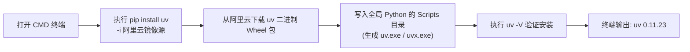

# `uv安装.sh` 源码精讲：使用国内镜像源极速安装 `uv` 并校验版本

---

## 一、文件定位与核心前置知识精讲

### 1.1 文件定位
[`uv安装.sh`](file:///d:/soft/python/Voyage智途A2A/前置知识/1-uv环境管理工具/uv安装.sh) 是整个 `1-uv环境管理工具` 模块的**第 1 步（起点脚本）**。它的作用是在操作系统的命令行终端（Windows `cmd` / PowerShell 或 Linux/macOS 终端）中，通过现有的 `pip` 工具并借助阿里云 PyPI 镜像源，完成 `uv` 环境管理工具本体的安装与版本验证。

### 1.2 核心前置知识
1. **为什么可以用 `pip` 来安装取代 `pip` 的 `uv`？（引导安装 Bootstrap）**
   - `uv` 本体虽然是用 Rust 编译的独立二进制可执行程序（Windows 下为 `uv.exe`），但官方将其打包成了标准的 Python Wheel 包发布在 PyPI 上。
   - 因此，只要你的电脑上装有任何一个基础 Python 环境（自带 `pip`），就可以通过 `pip install uv` 直接把 `uv.exe` 下载并放置到 Python 的 `Scripts` 环境变量目录下，无需手动去 GitHub 下载压缩包或配置系统 `PATH`。
2. **`-i https://mirrors.aliyun.com/pypi/simple/` 镜像源加速参数**
   - PyPI 官方默认源（`https://pypi.org/simple`）服务器位于海外，国内直接访问容易遇到下载速度只有几 KB/s 甚至 `ReadTimeoutError` 超时中断的问题。
   - `-i`（或 `--index-url`）参数用于临时指定本次安装使用的包索引镜像地址。`https://mirrors.aliyun.com/pypi/simple/` 是阿里云提供的国内高速 PyPI 镜像源，可实现满速下载。
3. **`uv -V` 版本校验命令**
   - `-V` 是 `--version` 的简写（注意是大写 `V`）。执行 `uv -V` 既能查看当前安装的 `uv` 具体版本号，又能验证 `uv` 命令是否已经成功加入系统的 `PATH` 环境变量中。

### 1.3 在 Voyage 智途主项目中的关联
- 主项目 [`pyproject.toml`](file:///d:/soft/python/Voyage智途A2A/pyproject.toml#L11-L12) 的第 11~12 行同样配置了本脚本所使用的阿里云镜像源：
  ```toml
  [tool.uv]
  index-url = "https://mirrors.aliyun.com/pypi/simple/"
  ```
- 只有先通过本脚本装好 `uv` 可执行程序，后续才能创建并管理主项目 `Voyage智途A2A` 的 `.venv` 虚拟环境与 `uv.lock` 依赖锁。

---

## 二、执行流程与示意图

### 2.1 执行流程图（Mermaid）



### 2.2 终端与文件系统交互图（ASCII）

```text
[CMD 终端]
   |
   | 1. pip install uv -i https://mirrors.aliyun.com/pypi/simple/
   v
[阿里云 PyPI 镜像服务器] ===(高速下载 uv-*.whl)===> [本地全局 Python 目录]
                                                      |-- Scripts/
                                                            |-- pip.exe
                                                            |-- uv.exe   <-- 新增！
                                                            |-- uvx.exe  <-- 新增！
   |
   | 2. uv -V
   v
[终端输出] ---> uv 0.11.23 (确认 PATH 生效，安装成功！)
```

---

## 三、完整源码与逐行/逐段深度拆解

### 3.1 完整源码（100% 原始文件嵌入）

文件路径：[`前置知识/1-uv环境管理工具/uv安装.sh`](file:///d:/soft/python/Voyage智途A2A/前置知识/1-uv环境管理工具/uv安装.sh)

```bash
# cmd终端
# 安装uv虚拟环境包管理工具【代替pip和虚拟环境】
pip install uv -i https://mirrors.aliyun.com/pypi/simple/

# 查看uv版本
uv -V # uv 0.11.23
```

---

### 3.2 逐行深度拆解

| 行号 | 源码内容 | 深度技术拆解 |
| :--- | :--- | :--- |
| **第 1 行** | `# cmd终端` | 注释说明运行环境：在 Windows 系统中推荐使用 `cmd`（命令提示符）或 PowerShell 终端执行以下指令。 |
| **第 2 行** | `# 安装uv虚拟环境包管理工具【代替pip和虚拟环境】` | 注释点明 `uv` 的核心定位：它不是一个普通的 Python 业务第三方库，而是用来**代替传统 `pip`（包安装）和 `venv`/`conda`（虚拟环境管理）**的基础设施工具。 |
| **第 3 行** | `pip install uv -i https://mirrors.aliyun.com/pypi/simple/` | **核心安装指令**：<br/>• `pip install uv`：调用系统基础 Python 的 `pip` 安装 `uv` 工具包。<br/>• `-i https://mirrors.aliyun.com/pypi/simple/`：通过 `-i` 参数将包下载源指向阿里云 PyPI 镜像（注意末尾的 `/simple/` 遵循 PEP 503 简单仓库协议，不能省略）。 |
| **第 4 行** | *(空行)* | 分隔安装步骤与校验步骤。 |
| **第 5 行** | `# 查看uv版本` | 注释说明下一步用于检验安装结果。 |
| **第 6 行** | `uv -V # uv 0.11.23` | **核心验证指令**：<br/>• `uv -V`：调用刚刚安装好的 `uv` 可执行程序并打印版本号（等价于 `uv --version`）。<br/>• `# uv 0.11.23`：行尾注释记录了课程录制时的标准输出版本号 `uv 0.11.23`。 |

---

### 3.3 沙盘推演（Dry Run）：在终端逐行执行的真实输出过程

假设你刚打开 Windows 的 `cmd.exe` 终端，当前处于 `C:\Users\Administrator>` 目录：

1. **输入并执行第 3 行命令**：
   ```text
   C:\Users\Administrator>pip install uv -i https://mirrors.aliyun.com/pypi/simple/
   ```
   **控制台实时输出演进**：
   ```text
   Looking in indexes: https://mirrors.aliyun.com/pypi/simple/
   Collecting uv
     Downloading https://mirrors.aliyun.com/pypi/packages/.../uv-0.11.23-py3-none-win_amd64.whl (18.5 MB)
        ━━━━━━━━━━━━━━━━━━━━━━━━━━━━━━━━━━━━━━━━ 18.5/18.5 MB 25.4 MB/s eta 0:00:00
   Installing collected packages: uv
   Successfully installed uv-0.11.23
   ```
   **底层状态变化**：`pip` 将预编译好的 Rust 二进制文件 `uv.exe` 和 `uvx.exe` 解压到了你的基础 Python 安装目录下的 `Scripts\` 文件夹中。

2. **输入并执行第 6 行命令**：
   ```text
   C:\Users\Administrator>uv -V
   ```
   **控制台实时输出**：
   ```text
   uv 0.11.23
   ```
   **结论**：返回了明确的版本号，证明 `uv` 已经成功安装且系统环境变量 `PATH` 能够直接找到 `uv.exe`。

---

## 四、常见易错点与对比总结

### 4.1 `uv` 的三种常见安装方式对比

| 安装方式 | 具体命令 | 适用场景 | 优缺点对比 |
| :--- | :--- | :--- | :--- |
| **`pip` + 国内镜像安装（本脚本方式）** | `pip install uv -i https://mirrors.aliyun.com/pypi/simple/` | 电脑上已装有任意版本基础 Python 的国内开发者 | **最稳妥、最快**：无需挂代理，直接走阿里云满速下载，100% 成功。 |
| **Windows 官方独立安装脚本** | `powershell -ExecutionPolicy ByPass -c "irm https://astral.sh/uv/install.ps1 \| iex"` | 电脑上连基础 Python 都没有的全新机器 | 不依赖已有 Python，但从 GitHub (`astral.sh`) 下载，国内网络容易连接超时失败。 |
| **macOS / Linux 官方独立脚本** | `curl -LsSf https://astral.sh/uv/install.sh \| sh` | Linux 服务器或 Mac 裸机部署 | 同样从海外节点拉取二进制包，国内服务器建议先配好基础 Python 再用本脚本的 `pip -i` 方式安装。 |

### 4.2 常见报错与避坑指南

1. **报错 `'uv' 不是内部或外部命令，也不是可运行的程序`**
   - **原因**：虽然 `pip install uv` 显示成功，但基础 Python 的 `Scripts` 目录（或用户级目录 `%APPDATA%\Python\Python3xx\Scripts`）没有添加到系统的 `PATH` 环境变量中，或者安装时出现了黄字警告 `WARNING: The scripts uv.exe and uvx.exe are installed in '...' which is not on PATH.`。
   - **解决**：把警告中提示的 `Scripts` 完整路径复制并添加到 Windows 系统环境变量 `PATH` 中，然后**关闭并重新打开一个 CMD 窗口**再运行 `uv -V`。
2. **大小写写错：`uv -v` 与 `uv -V` 的区别**
   - 小写 `-v` 是 `--verbose`（输出详细调试日志），单独运行 `uv -v` 会提示缺少子命令；**大写 `-V`** 才是 `--version`（查看版本）。

---

## 五、自测思考题（附答案解析）

### 思考题 1
在执行 `pip install uv -i https://mirrors.aliyun.com/pypi/simple/` 时，如果把末尾的 `/simple/` 删掉，写成 `-i https://mirrors.aliyun.com/pypi`，会发生什么？

<details>
<summary>点击查看答案解析</summary>

**答案解析**：
会导致安装失败并报错 `ERROR: Could not find a version that satisfies the requirement uv`。
因为 `pip` 的 `-i` 参数要求传入符合 **PEP 503 Simple Repository API** 规范的索引路径，所有主流镜像站（阿里云、清华源、中科大源等）的索引入口路径都必须以 `/simple` 或 `/simple/` 结尾。
</details>

### 思考题 2
`uv` 是用来管理项目虚拟环境的工具，那么安装 `uv` 本体（即执行本脚本 `pip install uv`）时，我是应该装在系统全局基础 Python 环境里，还是每个新项目都先用 `venv` 建个虚拟环境再去 `pip install uv`？

<details>
<summary>点击查看答案解析</summary>

**答案解析**：
**应该安装在系统全局基础 Python 环境里（只需安装一次）**。
`uv` 是管理所有项目虚拟环境的“母工具”。一旦在全局环境中装好 `uv.exe`，以后电脑上的任何新项目都直接调用全局的 `uv init`、`uv venv`、`uv sync` 来创建和管理各自独立的 `.venv` 虚拟环境，绝不需要在每个项目里重复安装 `uv`。
</details>
