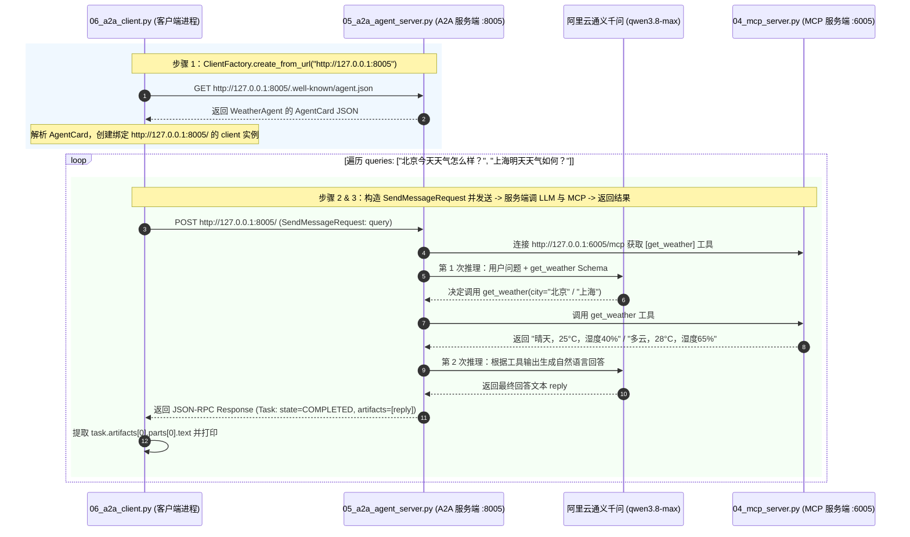

# `06_a2a_client.py` 完全脱离源码级精讲手册：A2A 客户端通信流程与 JSON-RPC 响应层级深度拆解

> **文档定位**：本文是《Voyage 智途 A2A 协议前置知识（12 讲）》的第 6 讲，也是第二阶段（`04` MCP Server + `05` A2A Agent Server + `06` A2A Client 全栈闭环）的收官之战。本手册 **100% 完整嵌入了 `06_a2a_client.py` 的全部源码**，深入剖析 A2A 客户端的四步通信生命周期（拉取名片 → 构造请求 → 发送消息 → 解析产物），并系统对比 `ClientFactory` 与 `A2ACardResolver + A2AClient`、`resp.task.artifacts[0].parts[0].text` 与 `result.parts[0].root.text` 的底层 JSON-RPC 2.0 嵌套结构。无需打开 `.py` 原文件，仅凭本文即可彻底掌握 A2A 客户端开发。

---

## 一、文件定位与核心前置知识精讲

### 1.1 A2A 客户端（Client）在整体架构中扮演什么角色？

在前五讲中，我们一直站在 **服务端（Server Agent）** 的视角：定义名片（`01`）、编写执行器（`02`）、挂载 FastAPI 路由（`03`）、接入 MCP 工具与大模型（`04` & `05`）。
现在，站在 `8005` 端口上的 `WeatherAgent` 已经是一个拥有通义千问大脑和 MCP 天气查询手脚的专家了。那么，**外部程序（或者另一个主控 Agent）该如何通过代码向它发起调用、并把结果取出来呢？**

这就是 `06_a2a_client.py` 要解决的核心问题！

> **再次强化黄金总结**：**MCP 是 Agent 连接 Tool 的协议（手和脚），A2A 是 Agent 连接 Agent 的协议（大脑与大脑协作）**。
> 当我们在 `06_a2a_client.py`（以及后续的 `09_serial_flow.py`、`11_single_intent.py`、`12_multi_intent.py` 主控程序）中使用 `a2a.client` 时，我们就是在编写“上游大脑连接下游专家大脑”的 **A2A 客户端**！

---

### 1.2 A2A 客户端的核心组件与两种 API 范式全面对比

在 `a2a-sdk` 中，构建客户端并发送请求有两套常见的 API 组合（高层工厂模式 vs 底层解析器模式），且服务端返回结果也有两种结构（`Task.artifacts` vs `Message.parts`）。为了让你在阅读本课程代码、官方文档以及 Voyage 主项目代码时都能一眼看懂，我们将它们做一次彻底的横向拆解：

#### 1. 创建客户端的两种方式：`ClientFactory` vs `A2ACardResolver` + `A2AClient`

| 对比维度 | 方式 A：高层工厂模式 `ClientFactory`（本课程 `06`/`09`/`11`/`12` 采用） | 方式 B：底层显式模式 `A2ACardResolver` + `A2AClient` |
| :--- | :--- | :--- |
| **核心组件** | `from a2a.client import ClientFactory, ClientConfig` | `from a2a.client import A2ACardResolver, A2AClient` |
| **典型代码** | `httpx_client = httpx.AsyncClient(timeout=httpx.Timeout(60.0))`<br/>`factory = ClientFactory(ClientConfig(streaming=False, httpx_client=httpx_client))`<br/>`client = await factory.create_from_url("http://127.0.0.1:8005")` | `resolver = A2ACardResolver(httpx_client=httpx_client, base_url="http://127.0.0.1:8005")`<br/>`card = await resolver.get_agent_card()`<br/>`client = A2AClient(httpx_client=httpx_client, agent_card=card)` |
| **底层动作** | `create_from_url(url)` **一行代码自动完成两件事**：<br/>1. 请求 `GET {url}/.well-known/agent.json` 拉取 `AgentCard`；<br/>2. 读取名片中的 `supported_interfaces` 自动实例化客户端。 | 显式分两步走：先用 `A2ACardResolver` 请求 `/.well-known/agent.json` 拿到 `AgentCard`，再把 `card` 传给 `A2AClient`。 |
| **适用场景** | **极简优雅**，适合绝大多数直接连接单个或多个 Agent URL 的场景。 | 适合在实例化客户端前需要先手动检查或修改 `AgentCard` 内容的定制场景。 |

#### 2. 构造请求的两种结构：Protobuf 风格 `SendMessageRequest` vs Pydantic 风格 `MessageSendParams`

- **在本课程（`06_a2a_client.py`）中**：
  我们使用的是 `a2a.types` 下的直接包装结构：
  ```python
  request = SendMessageRequest(
      message=A2AMessage(
          message_id="msg-001",
          role=Role.ROLE_USER,
          parts=[Part(text=query)],
      )
  )
  ```
- **在部分基于 Pydantic JSON-RPC 包装的写法中**：
  你会看到显式指定 JSON-RPC `id` 和 `params=MessageSendParams(...)` 的写法：
  ```python
  request = SendMessageRequest(
      id=str(uuid4()),
      params=MessageSendParams(
          message=Message(role=Role.user, parts=[Part(TextPart(text=query))], messageId=uuid4().hex)
      )
  )
  ```
- **本质相同**：无论外层 Python 对象怎么包装，当它们通过 `httpx` 发送到服务端的 `POST /` 端点时，序列化出来的 **JSON-RPC 2.0 HTTP 请求报文** 都是完全一致的（包含 `"jsonrpc": "2.0"`、`"method": "SendMessage"` 或 `"message/send"`、以及 `"params": {"message": {...}}`）。

#### 3. 响应结构的嵌套层级大拆解：`task.artifacts[0].parts[0].text` vs `result.parts[0].root.text`

初学者在写 A2A 客户端时，最容易对提取文本结果的那一长串 `.xxx.xxx[0].xxx` 感到头晕。其实只要看懂下面这张对照表，你将彻底告别死记硬背：

| 服务端发布结果的方式 | 客户端收到的响应对象结构 | 提取最终文本的 Python 代码路径 | 层级拆解说明 |
| :--- | :--- | :--- | :--- |
| **方式一（本课程标准方式）**：<br/>服务端使用 **`TaskUpdater`**：<br/>`await updater.add_artifact(parts=[Part(text=reply)])`<br/>`await updater.complete()` | `client.send_message(request)` 产出包含 `task` 字段的响应项 `resp`（通过 `resp.HasField("task")` 检查） | **`resp.task.artifacts[0].parts[0].text`** | 1. `resp.task`：取出 `Task` 任务对象<br/>2. `.artifacts[0]`：取出第一个任务产物（对应一次 `add_artifact` 调用）<br/>3. `.parts[0]`：取出该产物的第一个内容分块 `Part`<br/>4. `.text`：取出纯文本字符串 |
| **方式二（轻量级 Message 方式）**：<br/>服务端使用 **`new_agent_text_message`**：<br/>`await event_queue.enqueue_event(new_agent_text_message(reply))` | 返回 Pydantic 包装的 `SendMessageResponse`，其 `result` 直接是一个 `Message` 对象 | **`response.root.result.parts[0].root.text`**<br/>（或 `resp.message.parts[0].text`） | 1. `response.root`：解开 Pydantic RootModel（区分 SuccessResponse 与 ErrorResponse）<br/>2. `.result`：取出 JSON-RPC 的 `result`（即 `Message` 对象）<br/>3. `.parts[0]`：取出消息的第一个 `Part`<br/>4. `.root.text`：解开 `Part` 联合类型的 `root`（`TextPart`）拿到 `.text` |

---

### 1.3 任务状态枚举 `TaskState` 全解

在本文件第 76~90 行，我们通过检查 `task.status.state` 来判断任务执行结果。A2A 协议定义的完整 `TaskState` 状态枚举如下：

1. **`TaskState.TASK_STATE_SUBMITTED`**：任务刚提交给服务端，已入队等待执行。
2. **`TaskState.TASK_STATE_WORKING`**：服务端的 `AgentExecutor.execute()` 正在积极处理中（流式模式下客户端会先收到该状态）。
3. **`TaskState.TASK_STATE_INPUT_REQUIRED`**：服务端发现信息不足（比如用户说“帮我订张火车票”，但没说去哪儿），挂起当前任务并要求客户端补充输入。
4. **`TaskState.TASK_STATE_COMPLETED`**（终态）：服务端调用了 `await updater.complete()`，任务圆满完成，此时可安全从 `task.artifacts` 中提取产物！
5. **`TaskState.TASK_STATE_FAILED`**（终态）：服务端调用了 `await updater.failed(...)`，任务执行出错。
6. **`TaskState.TASK_STATE_CANCELED`**（终态）：任务被取消（服务端调用了 `await updater.cancel()`）。

---

## 二、架构与交互时序图

### 2.1 `06` + `05` + `04` 全链路跨进程通信时序图（Mermaid）

**注意：运行 `06_a2a_client.py` 前，必须确保 `04_mcp_server.py`（`6005` 端口）和 `05_a2a_agent_server.py`（`8005` 端口）已经在后台运行！** 下面展示当你运行 `python 06_a2a_client.py` 时，三个进程之间的完整网络交互：



### 2.2 客户端响应对象 `resp` 的内存结构透视图（ASCII）

```text
async for resp in client.send_message(request):
  │
  └── resp (SendMessage / StreamResponse 对象)
       ├── HasField("task") ──> True
       └── task (Task 对象)
            ├── id: "c8f2b1a0-..." (服务端自动生成的任务 UUID)
            ├── context_id: "9a7d3e12-..." (会话上下文 UUID)
            ├── status (TaskStatus 对象)
            │    └── state: TaskState.TASK_STATE_COMPLETED (状态枚举：已完成)
            └── artifacts (RepeatedCompositeContainer / List[Artifact])
                 └── [0] (第一个 Artifact 产物对象)
                      ├── artifact_id: "f4e1c2b3-..."
                      └── parts (List[Part])
                           └── [0] (第一个 Part 内容块对象)
                                └── text: "北京今天天气晴朗，气温25°C，湿度40%。"  <-- 最终提取目标！
```

---

## 三、完整源码与逐行/逐段深度拆解

### 3.1 `06_a2a_client.py` 100% 完整源码

以下是 `前置知识/6-A2A协议/06_a2a_client.py` 的完整原始代码，一字未改：

```python
# 6.4.3 A2A Client - 客户端调用
#
# 客户端通过 a2a-sdk 与 A2A Server 通信
#
# 通信流程：
#   1. 客户端连接 A2A Server URL → 自动拉取 AgentCard（了解服务端能力）
#   2. 构造 SendMessageRequest → 发送给服务端
#   3. 服务端处理请求 → 返回任务状态和结果
#   4. 客户端解析响应 → 提取 artifacts（产物）
#
# 运行前确保 MCP Server（6005）和 A2A Agent Server（8005）已启动

import asyncio
import httpx # requests
from a2a.client import ClientFactory, ClientConfig
from a2a.types import (
    SendMessageRequest,      # 发送消息的请求结构
    Message as A2AMessage,   # A2A 消息格式
    Part,                    # 消息内容部分（文本/图片等）
    Role,                    # 角色：用户/助手
    TaskState,               # 任务状态枚举
)


async def main():
    # ========== 步骤1：创建客户端 ==========
    # ClientFactory.create_from_url() 会：
    #   1. 请求 GET /.well-known/agent.json 获取 AgentCard
    #   2. 根据 AgentCard 创建对应的客户端实例
    a2a_url = "http://127.0.0.1:8005"  # A2A Server 地址

    # 配置超时时间：LLM + MCP 工具调用链路可能需要 60 秒以上
    # 如果不配置，默认超时较短（约 5-10 秒），容易超时
    httpx_client = httpx.AsyncClient(timeout=httpx.Timeout(60.0))

    # ClientConfig 配置项：
    #   streaming: 是否使用流式模式（False = 等待完整结果）
    #   httpx_client: 自定义 HTTP 客户端（可设置超时等参数）
    factory = ClientFactory(ClientConfig(
        streaming=False,
        httpx_client=httpx_client,  # 传入自定义 httpx 客户端
    ))

    # 创建客户端（异步操作，需要 await）
    client = await factory.create_from_url(a2a_url)

    # ========== 步骤2：发送查询 ==========
    # 准备要查询的问题列表
    queries = ["北京今天天气怎么样？", "上海明天天气如何？"]

    for query in queries:
        print(f"\n[客户端] 发送查询: {query}")

        # 构造 SendMessageRequest：
        #   message: 消息内容
        #     - message_id: 消息唯一标识
        #     - role: 角色（ROLE_USER = 用户发送）
        #     - parts: 消息内容列表（可以是文本、图片等）
        request = SendMessageRequest(
            message=A2AMessage(
                message_id="msg-001",
                role=Role.ROLE_USER,
                parts=[Part(text=query)],  # 纯文本内容
            )
        )

        # ========== 步骤3：收集响应 ==========
        # send_message() 返回异步迭代器，可能返回多个响应（流式场景）
        # 非流式模式下通常只返回一个完整结果
        async for resp in client.send_message(request):
            # 检查响应是否包含 task 字段
            if resp.HasField("task"):
                task = resp.task

                # 根据任务状态处理结果
                if task.status.state == TaskState.TASK_STATE_COMPLETED:
                    # 任务完成：从 artifacts（产物）中提取结果
                    # artifacts[0].parts[0].text 是第一个产物的第一个文本部分
                    result = task.artifacts[0].parts[0].text
                    print(f"[客户端] 收到结果: {result}")

                elif task.status.state == TaskState.TASK_STATE_FAILED:
                    # 任务失败
                    print(f"[客户端] 查询失败")

                # 其他可能的状态：
                #   TASK_STATE_SUBMITTED: 已提交，等待处理
                #   TASK_STATE_WORKING: 处理中
                #   TASK_STATE_INPUT_REQUIRED: 需要用户补充输入
                #   TASK_STATE_CANCELED: 已取消


if __name__ == "__main__":
    asyncio.run(main())
```

---

### 3.2 逐段逐行深度拆解

#### 第一段：客户端核心模块导入（第 13~22 行）

```python
import asyncio
import httpx # requests
from a2a.client import ClientFactory, ClientConfig
from a2a.types import (
    SendMessageRequest,      # 发送消息的请求结构
    Message as A2AMessage,   # A2A 消息格式
    Part,                    # 消息内容部分（文本/图片等）
    Role,                    # 角色：用户/助手
    TaskState,               # 任务状态枚举
)
```

- `import asyncio`：因为 `a2a-sdk` 的客户端从拉取名片到发送消息全部是异步非阻塞 I/O，所以需要使用 `asyncio.run(main())` 启动事件循环。
- `import httpx`：Python 异步 HTTP 客户端库（相当于异步版的 `requests`）。`a2a-sdk` 底层正是基于 `httpx.AsyncClient` 发送网络请求的。
- `from a2a.client import ClientFactory, ClientConfig`：导入客户端配置类与客户端工厂类。
- `Message as A2AMessage`：为什么建议起别名 `A2AMessage`？因为在同时使用 LangChain 和 `a2a-sdk` 的文件（如 `12_multi_intent.py` 或主项目）中，很容易与其他库的 `Message` 类重名，起别名 `A2AMessage` 是非常好的工程习惯。

---

#### 第二段：步骤 1——配置超时与通过 `ClientFactory` 创建客户端（第 26~45 行）

```python
    a2a_url = "http://127.0.0.1:8005"  # A2A Server 地址

    # 配置超时时间：LLM + MCP 工具调用链路可能需要 60 秒以上
    # 如果不配置，默认超时较短（约 5-10 秒），容易超时
    httpx_client = httpx.AsyncClient(timeout=httpx.Timeout(60.0))

    factory = ClientFactory(ClientConfig(
        streaming=False,
        httpx_client=httpx_client,  # 传入自定义 httpx 客户端
    ))

    # 创建客户端（异步操作，需要 await）
    client = await factory.create_from_url(a2a_url)
```

- **第 34 行 `httpx_client = httpx.AsyncClient(timeout=httpx.Timeout(60.0))`**：
  - **实战避坑重中之重**！`httpx.AsyncClient` 默认的超时时间只有 `5.0` 秒。当服务端是像 `07_weather_agent.py` 那样的纯内存 `if-else` 模拟服务时，几毫秒就能返回，不配超时也没事；但当服务端是 `05_a2a_agent_server.py` 或 `10_router_agent.py` 这种**需要调用远程 LLM 甚至再调 MCP 工具**的真智能体时，5 秒极易超时报错 `httpx.ReadTimeout`！因此只要服务端涉及 LLM 推理，客户端一定要传入 `timeout=httpx.Timeout(60.0)`。
- **第 39~42 行 `ClientFactory(ClientConfig(streaming=False, httpx_client=httpx_client))`**：
  - `streaming=False`：告诉客户端采用非流式（同步等待完整结果）模式请求服务端，与 `05` 服务端 `AgentCard` 中的 `AgentCapabilities(streaming=False)` 相呼应。
- **第 45 行 `client = await factory.create_from_url(a2a_url)`**：
  - 为什么这里必须要加 `await`？
  - 因为 `create_from_url("http://127.0.0.1:8005")` 不是单纯在内存里 `new` 一个对象，它在这一行**已经发出了第一次真实的网络请求**：`GET http://127.0.0.1:8005/.well-known/agent.json`！
  - 它下载并校验完服务端的 `AgentCard` 后，才会返回配置好目标 RPC 地址（`http://127.0.0.1:8005/`）的 `client` 实例。如果此时 `8005` 端口没有启动，程序会在第 45 行直接报错退出！

---

#### 第三段：步骤 2——构造 `SendMessageRequest` 请求对象（第 47~65 行）

```python
    queries = ["北京今天天气怎么样？", "上海明天天气如何？"]

    for query in queries:
        print(f"\n[客户端] 发送查询: {query}")

        request = SendMessageRequest(
            message=A2AMessage(
                message_id="msg-001",
                role=Role.ROLE_USER,
                parts=[Part(text=query)],  # 纯文本内容
            )
        )
```

- 每次循环构造一个标准的 `SendMessageRequest`：
  - `message_id="msg-001"`：当前消息的 ID（生产环境中通常使用 `str(uuid.uuid4())` 生成唯一 ID）。
  - `role=Role.ROLE_USER`：声明这条消息是由“用户/调用方”发出的（与之相对，服务端返回错误或消息时使用的是 `Role.ROLE_AGENT`）。
  - `parts=[Part(text=query)]`：将问题字符串封装在 `Part(text=...)` 对象中，并放入 `parts` 列表。

---

#### 第四段：步骤 3——异步迭代接收响应并提取 `artifacts`（第 67~90 行）

```python
        async for resp in client.send_message(request):
            # 检查响应是否包含 task 字段
            if resp.HasField("task"):
                task = resp.task

                # 根据任务状态处理结果
                if task.status.state == TaskState.TASK_STATE_COMPLETED:
                    # 任务完成：从 artifacts（产物）中提取结果
                    # artifacts[0].parts[0].text 是第一个产物的第一个文本部分
                    result = task.artifacts[0].parts[0].text
                    print(f"[客户端] 收到结果: {result}")

                elif task.status.state == TaskState.TASK_STATE_FAILED:
                    # 任务失败
                    print(f"[客户端] 查询失败")
```

- **为什么 `client.send_message(request)` 要用 `async for resp in ...` 而不是 `resp = await client.send_message(request)`？**
  - 这是 `a2a-sdk` 为了统一 **流式（Streaming）** 和 **非流式（Non-streaming）** 两种调用模式的精妙设计！
  - `client.send_message(request)` 返回的是一个 **异步生成器（`AsyncGenerator` / `AsyncIterator`）**：
    - 在**流式模式**下，这个 `async for` 循环会收到多次 `resp`（第一次是 `TASK_STATE_WORKING`，中间是分段产出的 `artifact` 块，最后一次是 `TASK_STATE_COMPLETED`）；
    - 在我们当前的**非流式模式（`streaming=False`）**下，这个 `async for` 循环**只会迭代 1 次**，直接产出包含最终状态和完整产物的 `resp` 对象，然后循环自然结束。
- **`if resp.HasField("task"):`**：
  - 因为 A2A 的响应报文是一个 `oneof` 联合结构（可能返回 `task` 对象，也可能直接返回 `message` 或状态更新事件），由于 `a2a.types` 底层使用 Protobuf 消息描述符，`resp.HasField("task")` 用于安全检查当前响应中是否包含 `task` 字段。
- **`result = task.artifacts[0].parts[0].text`**：
  - 当 `task.status.state == TaskState.TASK_STATE_COMPLETED` 时，说明 `05` 服务端已经顺利执行了 `await updater.add_artifact(parts=[Part(text=reply)])` 和 `await updater.complete()`。
  - 于是我们顺着 `task` → `artifacts[0]`（第 1 个产物）→ `parts[0]`（第 1 个内容块）→ `text`，精准取出大模型回答的字符串！

---

### 3.3 沙盘推演（Dry Run）：三终端联调全过程实录

让我们在脑海中完整预演一次 **`04` + `05` + `06` 三终端联调** 的输入输出：

1. **前置准备**：
   - 终端 1 运行 `python 04_mcp_server.py` → 监听 `http://127.0.0.1:6005`
   - 终端 2 运行 `python 05_a2a_agent_server.py` → 监听 `http://127.0.0.1:8005`
2. **启动客户端**：
   - 终端 3 运行 `python 06_a2a_client.py`
3. **第 1 次循环（`query = "北京今天天气怎么样？"`）**：
   - 终端 3 打印：`[客户端] 发送查询: 北京今天天气怎么样？`
   - 终端 2（`8005`）打印：`[WeatherAgent] 收到查询: 北京今天天气怎么样？`
   - 终端 1（`6005`）打印：`[MCP工具] 查询城市: 北京`
   - 终端 3 收到 JSON-RPC 响应，`resp.HasField("task")` 为 `True`，`task.status.state` 为 `TASK_STATE_COMPLETED`，提取 `task.artifacts[0].parts[0].text` 并打印：
     ```text
     [客户端] 收到结果: 北京今天天气晴朗，气温为 25°C，湿度 40%。
     ```
4. **第 2 次循环（`query = "上海明天天气如何？"`）**：
   - 终端 3 打印：`[客户端] 发送查询: 上海明天天气如何？`
   - 终端 2（`8005`）打印：`[WeatherAgent] 收到查询: 上海明天天气如何？`
   - 终端 1（`6005`）打印：`[MCP工具] 查询城市: 上海`
   - 终端 3 提取结果并打印：
     ```text
     [客户端] 收到结果: 上海天气多云，气温 28°C，湿度为 65%。
     ```

---

## 四、在 12 个递进文件中的承上启下关系 & 常见易错点

### 4.1 承上启下关系

- **承上（完成 `04` + `05` + `06` 全栈闭环）**：
  - 到本文件为止，你已经完整掌握了**单个 A2A 智能体**从名片定义（`01`）、执行器编写（`02`）、服务端组装（`03`）、底层 MCP 工具开发（`04`）、LLM+MCP 智能体服务端（`05`）到客户端调用（`06`）的全部核心技能！
- **启下（开启 `07`~`12` 的多 Agent 协同编排之旅，直通 Voyage 主项目）**：
  - 只有一个 Agent 还不叫“Agent-to-Agent 多智能体协作”。如果系统里同时有 **天气智能体（`WeatherAgent`，`5008` 端口）** 和 **票务智能体（`TicketAgent`，`5009` 端口）**，甚至还有一个 **路由智能体（`RouterAgent`，`5555` 端口）**，它们之间该如何打配合？
  - 请注意观察本文件第 59~80 行发送请求并提取 `task.artifacts[0].parts[0].text` 的这段代码——在接下来的 `09_serial_flow.py`、`11_single_intent.py` 和 `12_multi_intent.py` 中，这段代码被提炼成了一个通用的辅助函数 **`async def send_query(client, query)`**，成为了后续所有多 Agent 编排的基石函数！

### 4.2 常见易错点与避坑指南

1. **易错点 1：把 `async for resp in client.send_message(request):` 误写成 `resp = await client.send_message(request)`**
   - ❌ 错误写法：`resp = await client.send_message(request)`
   - 💥 报错信息：`TypeError: object async_generator can't be used in 'await' expression`
   - ✅ 原因与解决：`client.send_message(request)` 返回的是异步生成器（`async_generator`），必须使用 `async for resp in client.send_message(request):` 进行迭代消费。
2. **易错点 2：忘记 `await factory.create_from_url(a2a_url)` 前面的 `await`**
   - `create_from_url` 是异步方法（内部需要发起 HTTP GET 请求拉取 `/.well-known/agent.json`），漏写 `await` 会导致拿到的 `client` 只是一个 `coroutine` 协程对象，后续调用 `client.send_message` 时直接报 `AttributeError: 'coroutine' object has no attribute 'send_message'`。
3. **易错点 3：在访问 `task.artifacts[0].parts[0].text` 前没有先判断 `task.status.state == TaskState.TASK_STATE_COMPLETED`**
   - 如果服务端执行失败（状态为 `TASK_STATE_FAILED`）或者处于 `TASK_STATE_WORKING` 状态，此时 `task.artifacts` 列表可能是空的（`[]`）。如果不判断状态直接取 `task.artifacts[0]`，会触发 `IndexError: list index out of range`！

---

## 五、自测思考题（附答案解析）

### 思考题 1
**问题**：当执行 `client = await factory.create_from_url("http://127.0.0.1:8005")` 这行代码时，`a2a-sdk` 在底层自动向服务端发送了什么 HTTP 请求？如果此时 `8005` 端口的服务端没有启动，程序会在哪一行报错？
<details>
<summary>点击查看答案解析</summary>

- **答案**：
  - 底层自动发送了 `GET http://127.0.0.1:8005/.well-known/agent.json` 请求，用于拉取服务端的 `AgentCard` 名片。
  - 如果 `8005` 端口未启动，程序不会等到后面 `client.send_message(request)` 才报错，而是会在第 45 行 `await factory.create_from_url(a2a_url)` 时就立即抛出网络连接异常（`httpx.ConnectError`）。
</details>

### 思考题 2
**问题**：为什么在 `06_a2a_client.py` 中我们要专门创建一个 `httpx.AsyncClient(timeout=httpx.Timeout(60.0))` 并传给 `ClientConfig`？如果不传会发生什么？
<details>
<summary>点击查看答案解析</summary>

- **答案**：
  - 因为 `05_a2a_agent_server.py` 在收到请求后，内部需要连接 MCP Server、调用通义千问 LLM 推理、执行 MCP 工具、再调用 LLM 汇总结果，整条工具调用链路耗时较长（通常数秒至十余秒）。
  - 如果不传自定义的 `httpx_client`，默认使用的 `httpx` 超时时间较短（约 5 秒），极易在服务端大模型还在推理时客户端就因超时抛出 `httpx.ReadTimeout` 异常。
</details>

### 思考题 3
**问题**：请写出当服务端使用 `await updater.add_artifact(parts=[Part(text=reply)])` 和 `await updater.complete()` 发布结果时，客户端从 `client.send_message(request)` 的迭代变量 `resp` 中安全提取出 `reply` 文本的完整判断与取值代码。
<details>
<summary>点击查看答案解析</summary>

- **答案**：
  ```python
  async for resp in client.send_message(request):
      if resp.HasField("task"):
          task = resp.task
          if task.status.state == TaskState.TASK_STATE_COMPLETED:
              result = task.artifacts[0].parts[0].text
              print(result)
  ```
</details>
