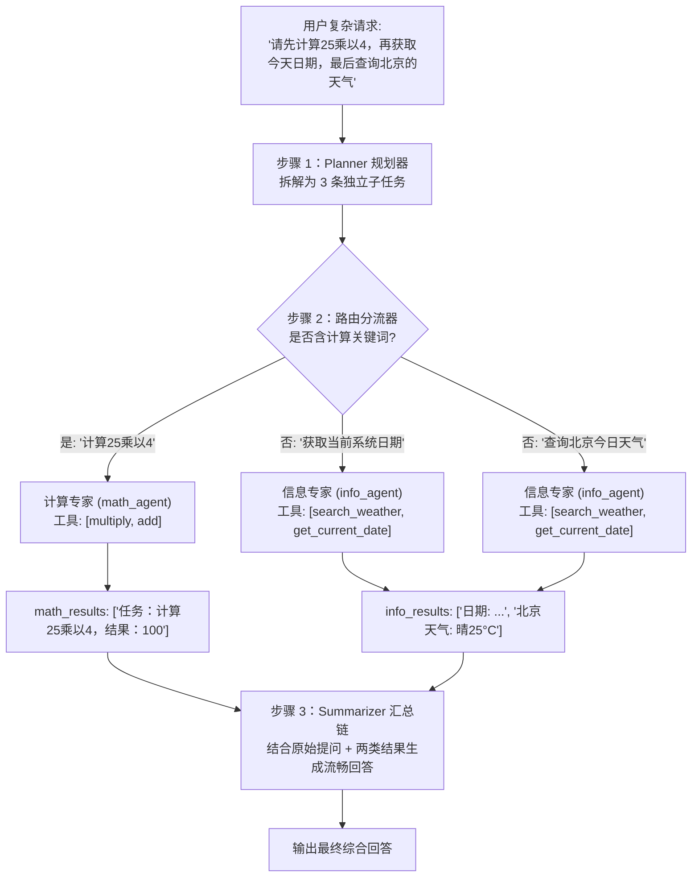

# `05-多智能体模式.py` 代码精讲：规划器 + 多领域专家 Agent 协同与结果汇总

> **源文件位置**：`前置知识/5-Agent智能体/05-多智能体模式.py`  
> **所属模块**：前置知识 — 专题 5：Agent 智能体五大设计模式  
> **一句话定位**：集大成之作！把 **规划模式（Planner）** + **领域分工（Math Agent & Info Agent）** + **结果汇总（Summarizer）** 融合在一个工作流中，构成了 Voyage 智途主项目分布式多智能体架构的“单进程原型”。

---

## 一、文件定位与核心前置知识精讲

### 1.1 为什么要把一个“全能 Agent”拆成多个“领域专家 Agent”？
假设我们要做一个涵盖天气、机票、火车票、酒店、租车、旅游团、高德地图、联网搜索的旅行助手（共 28 个工具）：
- **单智能体痛点**：如果把 28 个工具的 JSON Schema 全部塞进同一个 Agent 的 Prompt，不仅每次请求白白消耗数千个输入 Token，而且大模型在面对几十个相似工具时极易“患上选择困难症”并调错工具！
- **多智能体（Multi-Agent）解法 —— 专人专事、分而治之**：
  - **计算专家 (`math_agent`)**：只挂载 `[multiply, add]` 2 个数学工具，System Prompt 专注精确数值计算；
  - **信息查询专家 (`info_agent`)**：只挂载 `[search_weather, get_current_date]` 2 个查询工具，System Prompt 专注信息检索；
  - **总控编排层（规划 → 路由分发 → 汇总）**：负责拆解用户复杂请求、把子任务精准派给对应专家、最后把零散的子结果润色成一段流畅回复！

### 1.2 从本文件到 Voyage 智途主项目的架构演进对照

| 架构模块 | 本文件 (`05-多智能体模式.py` 单进程版) | Voyage 智途主项目 (分布式 A2A + MCP 版) |
| :--- | :--- | :--- |
| **任务规划器** | `planner_chain`（按行拆解文本） | `core/chat_service_core.py`（拆解为带依赖关系的 JSON 子任务） |
| **路由分发器** | `if any(keyword in task ...)`（关键词硬规则分流） | `core/chat_service_core.py`（基于 `AgentCard` 由 LLM 智能路由） |
| **领域专家 Agent** | 同进程内的 `math_agent`、`info_agent` | 独立部署在 `6001~6004` 端口的 4 个 **A2A 微服务** |
| **底层工具** | 同进程内的 `@tool` 函数 | 独立部署在 `5001~5004` 端口的 4 个 **MCP 工具服务** |
| **最终汇总器** | `summarize_chain`（整合所有子结果） | `core/chat_service_core.py`（反思校验 + 最终汇总生成） |

---

## 二、多智能体协同工作流程图



---

## 三、完整源码与逐段深度拆解

### 3.1 完整源码（100% 原样收录）
```python
import os
import datetime
from langchain_openai import ChatOpenAI
from langchain_core.tools import tool
from langchain_core.prompts import ChatPromptTemplate
from langchain_core.output_parsers import StrOutputParser
from langchain.agents import create_agent

# ====================== 1. 初始化阿里云通义千问模型 ======================
api_key = os.environ.get("AliApiKey")
ali_url = "https://dashscope.aliyuncs.com/compatible-mode/v1"
llm = ChatOpenAI(
    base_url=ali_url,
    api_key=api_key,
    model="qwen3.8-max",
    temperature=0.1
)

# ====================== 2. 定义全部工具 ======================
# 2.1 数学计算工具
@tool
def multiply(a: int, b: int) -> int:
    """用于计算两个整数的乘积。
    参数:
        a (int): 第一个整数。
        b (int): 第二个整数。
    """
    print(f"\n[计算专家] -> 正在执行乘法: {a} * {b}")
    return a * b

@tool
def add(a: int, b: int) -> int:
    """用于计算两个整数的和。
    参数:
        a (int): 第一个整数。
        b (int): 第二个整数。
    """
    print(f"\n[计算专家] -> 正在执行加法: {a} + {b}")
    return a + b

# 2.2 信息查询工具
@tool
def search_weather(city: str) -> str:
    """用于查询指定城市的实时天气。"""
    print(f"正在查询天气: {city}")
    if "北京" in city:
        return "北京今天是晴天，气温25摄氏度。"
    elif "上海" in city:
        return "上海今天是阴天，有小雨，气温22摄氏度。"
    else:
        return f"抱歉，我没有'{city}'的天气信息。"

@tool
def get_current_date() -> str:
    """用于获取当前日期。"""
    print("\n[信息专家] -> 正在获取当前日期...")
    return datetime.date.today().strftime("%Y年%m月%d日")

# ====================== 3. 构建两个独立专业Agent ======================
# 计算专家Agent（仅数学工具）
math_tools = [multiply, add]
math_system_prompt = "你是数学计算专家，可使用加减乘工具完成数值计算，直接给出运算结果。"
math_agent = create_agent(model=llm, tools=math_tools, system_prompt=math_system_prompt)

# 信息查询专家Agent（天气、日期工具）
info_tools = [search_weather, get_current_date]
info_system_prompt = "你是信息查询专家，可查询城市天气、获取当前日期，如实返回查询内容。"
info_agent = create_agent(model=llm, tools=info_tools, system_prompt=info_system_prompt)

# ====================== 4. 新增：任务规划器 Planner（参考第二段代码） ======================
# 规划提示词：拆解复杂需求为独立子任务列表
planner_prompt = ChatPromptTemplate.from_template(
    """你是任务规划师，把用户复杂请求拆成清晰可执行子任务，每行一条，格式：- 任务内容
示例：
用户任务: "先查北京天气，再计算25乘4并获取今天日期"
任务列表:
- 计算25乘以4
- 查询北京今日天气
- 获取当前系统日期

用户任务: {user_input}
任务列表:
"""
)
# 规划链路：提示词 → LLM → 纯文本输出
planner_chain = planner_prompt | llm | StrOutputParser()

# ====================== 5. 整合工作流：规划 → 分类执行 → 汇总 ======================
def planning_multi_agent_workflow(query: str):
    print("===== 启动【规划+多专家Agent】协作流程 =====")
    print(f"用户原始请求：{query}")

    # 步骤1：规划器拆解所有子任务
    print("\n[规划器] 正在拆解任务...")
    plan_text = planner_chain.invoke({"user_input": query})
    # 清洗空行、提取纯任务文本
    task_list = [t.strip("- ").strip() for t in plan_text.split("\n") if t.strip()]
    print("拆解得到全部子任务：")
    for idx, task in enumerate(task_list, 1):
        print(f"  {idx}. {task}")

    # 步骤2：区分计算任务 / 信息查询任务，分别交给对应Agent执行
    math_results = []   # 存放所有计算类结果
    info_results = []   # 存放所有信息查询结果
    print("\n===== 开始分配任务至对应专家Agent =====")
    for task in task_list:
        print(f"\n--- 执行子任务：{task} ---")
        # 判断任务类型，分流执行
        if any(keyword in task for keyword in ["计算", "乘以", "乘", "加法", "加"]):
            # 数学任务交给计算专家
            res = math_agent.invoke({"messages": [("user", task)]})
            ans = res["messages"][-1].content
            math_results.append(f"任务：{task}，结果：{ans}")
            print(f"【计算专家】输出：{ans}")
        else:
            # 天气/日期交给信息专家
            res = info_agent.invoke({"messages": [("user", task)]})
            ans = res["messages"][-1].content
            info_results.append(f"任务：{task}，结果：{ans}")
            print(f"【信息专家】输出：{ans}")

    # 步骤3：LLM汇总全部子任务结果，生成连贯完整回答
    print("\n[汇总模块] 整合所有结果生成最终答案...")
    summarize_prompt = ChatPromptTemplate.from_messages([
        ("system", "你是信息整合助手，结合下面所有子任务结果，给用户一段通顺完整的回答。"),
        ("human",
         f"用户原始提问：{query}\n"
         f"计算类任务结果：{math_results}\n"
         f"信息查询类任务结果：{info_results}\n"
         f"整合全部信息，输出自然流畅的完整回复"
         )
    ])
    summarize_chain = summarize_prompt | llm | StrOutputParser()
    final_answer = summarize_chain.invoke({})

    print("\n===== 全部流程执行完成 =====")
    print(f"\n最终综合回答：\n{final_answer}")
    return final_answer

# ====================== 程序入口测试 ======================
if __name__ == "__main__":
    # 测试用复杂需求（自动规划拆分，无需手动区分math_task/info_task）
    test_query = "请先计算25乘以4，再获取今天日期，最后查询北京的天气"
    planning_multi_agent_workflow(test_query)
```

### 3.2 逐段精讲与沙盘推演（Dry Run）
1. **去除前缀横杠的清洗技巧（第 97 行）**：
   - `task_list = [t.strip("- ").strip() for t in plan_text.split("\n") if t.strip()]`
   - 把 `"- 计算25乘以4"` 两端的 `-` 和空格去掉，得到干净的 `"计算25乘以4"`。
2. **关键词分流判断（第 109 行）**：
   - `any(keyword in task for keyword in ["计算", "乘以", "乘", "加法", "加"])`：只要子任务文本中命中任意一个数学关键词，就派发给 `math_agent`；否则派发给 `info_agent`。
3. **汇总 Prompt 中的 f-string 注意点（第 126~134 行）**：
   - 这里作者直接用 Python 的 f-string 把 `query`、`math_results`、`info_results` 拼进了模板字符串，所以第 134 行调用时传了空字典 `summarize_chain.invoke({})`。
   - **隐患提醒**：如果某个子任务的结果字符串里恰好包含花括号 `{` 或 `}`（例如返回了一段 JSON 字符串 `{"temp": 25}`），`ChatPromptTemplate.from_messages` 会误把 `{temp}` 当成 LangChain 模板变量而报错 `KeyError`！生产代码中更安全的做法是在模板里写 `{math_results}` 占位符，再通过 `summarize_chain.invoke({"math_results": math_results, ...})` 传参！

---

## 四、自测思考题

### 思考题 1
如果用户问：“请问去北京的航班**加**保险多少钱？”，第 109 行的关键词路由代码会把它误判给哪个 Agent？由此说明基于关键词硬规则的路由有什么缺点？
> **参考答案**：因为句子里包含 `"加"` 字，会被第 109 行的 `if any(keyword in task ...)` **错误地路由给 `math_agent`（计算专家）**！这正是为什么在 `6-A2A协议/10_router_agent.py` 和主项目 `core/chat_service_core.py` 中，必须升级为**基于语义理解的 LLM 智能路由**，而不是写死关键词列表。

### 思考题 2
在本文件中，3 个子任务是用普通 `for` 循环串行执行的；如果要改成并发执行以缩短总耗时，需要结合前面学过的哪个异步工具？
> **参考答案**：将 `agent.invoke(...)` 改为异步调用 `await agent.ainvoke(...)`，然后把所有子任务协程放进 **`await asyncio.gather(*coros)`** 中并发执行！
