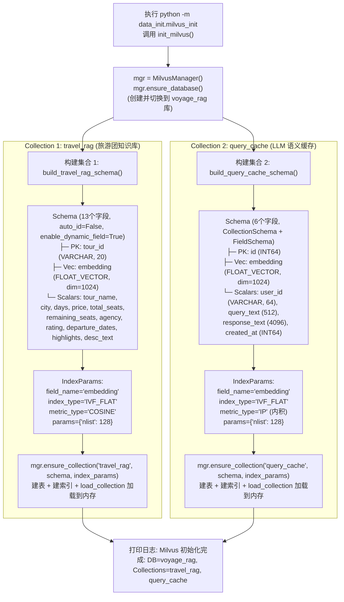

# `data_init/milvus_init.py` 代码精讲学习手册

> **本文档完全自包含（Self-Contained）**：已 100% 完整嵌入 `data_init/milvus_init.py` 的全部 152 行源码与注释，无需打开 `.py` 原文件即可独立掌握 Milvus 向量集合（Collection）的两种 Schema 构建范式、向量索引参数设计以及进阶混合检索 Schema 扩展方法。

---

## 一、文件定位与核心前置知识精讲

### 1.1 文件在项目中的定位
`data_init/milvus_init.py` 是 `Voyage智途A2A` 项目的**向量数据库 Schema 定义与初始化脚本**。  
通过运行 `python -m data_init.milvus_init`，该脚本借助 `MilvusManager` 在 Milvus 的 `voyage_rag` 数据库下创建并加载两个核心 Collection（集合，相当于关系型数据库中的“表”）：
1. **`travel_rag`（旅游团 RAG 语义知识库集合）**：存储旅游团的 1024 维语义向量（`embedding`）及 11 个标量元数据字段（团号、团名、出发城市、天数、价格、总名额、剩余名额、旅行社、评分、出发日期、行程亮点、描述文本），使用 `IVF_FLAT` + `COSINE` 余弦相似度索引，供 `mcp_server/trip_server.py` 进行旅游团语义搜索。
2. **`query_cache`（LLM 语义查询缓存集合）**：存储用户历史提问的 1024 维语义向量（`embedding`）、用户 ID（`user_id`，用于多租户缓存隔离）、原始问题（`query_text`）、缓存回答（`response_text`）及创建时间戳（`created_at`），使用 `IVF_FLAT` + `IP`（内积）索引，供 `core/cache.py` 实现毫秒级语义缓存命中。

---

### 1.2 核心前置知识 1：PyMilvus 构建 Collection Schema 的两种官方范式

在本文件中，`build_travel_rag_schema()` 和 `build_query_cache_schema()` 故意展示了 PyMilvus 中构建 Schema 的**两种等价但风格不同的官方 API 范式**，非常适合对比学习：

| 对比维度 | 范式一：高阶客户端链式 API（`build_travel_rag_schema` 使用） | 范式二：经典 ORM 对象组合 API（`build_query_cache_schema` 使用） |
| :--- | :--- | :--- |
| **创建入口** | `schema = MilvusClient.create_schema(auto_id=False, enable_dynamic_field=True)` | `from pymilvus import CollectionSchema, FieldSchema` |
| **添加字段方式** | 链式调用 `schema.add_field(field_name="...", datatype=DataType.XXX, ...)` | 构造 `fields = [FieldSchema(name="...", dtype=DataType.XXX), ...]` 列表传入 `CollectionSchema(fields)` |
| **参数命名差异** | 字段名参数叫 `field_name`，类型参数叫 `datatype` | 字段名参数叫 `name`，类型参数叫 `dtype` |
| **返回值类型** | 底层返回的**同样是一个 `CollectionSchema` 实例**！ | 返回 `CollectionSchema` 实例 |
| **适用场景** | Milvus 2.4+ 推荐的现代化写法，无需额外导入 `CollectionSchema`/`FieldSchema` | 传统写法或需要将字段列表作为配置数组动态组装的场景 |

---

### 1.3 核心前置知识 2：Milvus 数据类型（`DataType`）与关键 Schema 属性详解

#### （1）`auto_id=False` vs `auto_id=True`
- 在 `travel_rag` 中设置了 `auto_id=False`，主键 `tour_id` 是 `DataType.VARCHAR(max_length=20)`。
  - **原因**：旅游团有明确的业务唯一编号（如 `"TG001"` ~ `"TG018"`）。关闭 `auto_id` 并使用业务主键，才能在调用 `upsert()` 时按 `"TG001"` 自动去重覆盖，并在预订扣减名额时按 `tour_id` 精确定位。
- 在 `query_cache` 中主键 `id` 是 `DataType.INT64`（未设置 `auto_id=True`，由业务侧生成唯一整型 ID 或时间戳 ID 写入）。

#### （2）`enable_dynamic_field=True`（动态字段机制）
在 `build_travel_rag_schema()` 第 15 行开启了 `enable_dynamic_field=True`：
- **什么是动态字段？**
  - 传统关系型数据库一旦建好表，插入未在 Schema 中声明的列会直接报错。
  - Milvus 开启 `enable_dynamic_field=True` 后，除了 Schema 中显式声明的 13 个固定字段外，如果你在 `insert/upsert` 的字典里额外多传了 Schema 中没定义的字段（比如 `"season": "夏季"` 或 `"tags": ["摄影", "徒步"]`），Milvus 不会报错，而是会自动将它们打包存入一个隐藏的 `$meta` JSON 动态列中，并且同样支持在 `filter` 表达式中按 `season == "夏季"` 进行过滤查询！
  - 这为未来旅游团业务扩展新属性提供了极高的 Schema 弹性（Schema Evolution）。

#### （3）Milvus 常用 `DataType` 映射速查表
| Milvus `DataType` | 对应 Python 类型 | 必填附加参数 | 本文件中的代表字段 |
| :--- | :--- | :--- | :--- |
| `DataType.VARCHAR` | `str` | **`max_length`**（最大字节长度，必填！） | `tour_id(20)`、`tour_name(200)`、`response_text(4096)` |
| `DataType.INT64` | `int` | 无 | `days`、`total_seats`、`remaining_seats`、`created_at` |
| `DataType.DOUBLE` | `float` | 无 | `price`、`rating` |
| `DataType.FLOAT_VECTOR` | `list[float]` | **`dim`**（向量维度，必须与 Embedding 模型一致，此处为 `1024`） | `embedding` |

---

### 1.4 进阶拓展知识：如何在 Milvus Schema 中添加 `BM25` Function 实现全文稀疏检索？

在 `utils/milvus_manager.py` 学习手册中我们介绍了稠密向量 + 稀疏向量（BM25）的混合检索原理。如果未来你想将 `travel_rag` 升级为**同时支持稠密语义向量 + BM25 稀疏全文检索**的双向量 Collection，在 `build_travel_rag_schema()` 中只需增加三步（Milvus 2.5+ 原生内置 BM25 特性）：

```python
from pymilvus import Function, FunctionType

# 1. 在存放原始文本的 VARCHAR 字段上开启分词分析器 enable_analyzer=True
schema.add_field(
    field_name="desc_text", datatype=DataType.VARCHAR,
    max_length=500, enable_analyzer=True, description="用于生成向量的描述文本"
)
# 2. 新增一个稀疏向量字段 SPARSE_FLOAT_VECTOR（无需手动传值，由 BM25 Function 自动生成）
schema.add_field(
    field_name="sparse_vector", datatype=DataType.SPARSE_FLOAT_VECTOR,
    description="由 Milvus 内置 BM25 自动生成的稀疏词频向量"
)
# 3. 绑定内置 BM25 Function：输入 desc_text，自动分词并输出稀疏向量到 sparse_vector
bm25_func = Function(
    name="desc_bm25_emb",
    input_field_names=["desc_text"],
    output_field_names=["sparse_vector"],
    function_type=FunctionType.BM25,
)
schema.add_function(bm25_func)
```
这样写入数据时依然只需要传 `desc_text` 字符串，Milvus 服务端会自动在后台分词并计算出 `sparse_vector` 存入 `SPARSE_INVERTED_INDEX` 倒排索引中！

---

## 二、调用关系与执行流程图

### 2.1 Mermaid 两个 Collection 的结构对比与初始化流程图



### 2.2 ASCII 内存与存储布局示意图

```
Milvus 实例 (192.168.88.101:19530)
 └── Database: voyage_rag
      ├── Collection 1: travel_rag  (已 Load 到内存)
      │    ├── [Primary Key] tour_id         : VARCHAR(20)
      │    ├── [Vector+Idx]  embedding       : FLOAT_VECTOR(1024) | IVF_FLAT (COSINE, nlist=128)
      │    └── [11 Scalars]  tour_name, city, days, price, total_seats, remaining_seats,
      │                      agency, rating, departure_dates, highlights, desc_text
      │
      └── Collection 2: query_cache (已 Load 到内存)
           ├── [Primary Key] id              : INT64
           ├── [Vector+Idx]  embedding       : FLOAT_VECTOR(1024) | IVF_FLAT (IP, nlist=128)
           └── [4 Scalars]   user_id (多用户隔离), query_text, response_text, created_at (TTL过期判断)
```

---

## 三、完整源码与逐行/逐段深度拆解

### 3.1 100% 完整源码

```python
"""Milvus 建库建 Collection（使用 MilvusManager）
运行：python -m data_init.milvus_init
"""
from pymilvus import MilvusClient, DataType

from utils import CONFIG
from utils import logger
from utils import MilvusManager


def build_travel_rag_schema():
    """构造 travel_rag Collection 的 Schema 与索引参数"""
    schema = MilvusClient.create_schema(
        auto_id=False,
        enable_dynamic_field=True,
        description="旅游团语义搜索向量库"
    )
    schema.add_field(
        field_name="tour_id", datatype=DataType.VARCHAR,
        is_primary=True, max_length=20, description="旅游团唯一标识"
    )
    schema.add_field(
        field_name="embedding", datatype=DataType.FLOAT_VECTOR,
        dim=CONFIG.EMBEDDING_DIMENSION, description="语义向量"
    )
    schema.add_field(
        field_name="tour_name", datatype=DataType.VARCHAR,
        max_length=200, description="旅游团名称"
    )
    schema.add_field(
        field_name="city", datatype=DataType.VARCHAR,
        max_length=20, description="出发城市"
    )
    schema.add_field(
        field_name="days", datatype=DataType.INT64, description="行程天数"
    )
    schema.add_field(
        field_name="price", datatype=DataType.DOUBLE, description="价格"
    )
    schema.add_field(
        field_name="total_seats", datatype=DataType.INT64, description="总名额"
    )
    schema.add_field(
        field_name="remaining_seats", datatype=DataType.INT64, description="剩余名额"
    )
    schema.add_field(
        field_name="agency", datatype=DataType.VARCHAR,
        max_length=100, description="旅行社名称"
    )
    schema.add_field(
        field_name="rating", datatype=DataType.DOUBLE, description="评分"
    )
    schema.add_field(
        field_name="departure_dates", datatype=DataType.VARCHAR,
        max_length=500, description="可出发日期"
    )
    schema.add_field(
        field_name="highlights", datatype=DataType.VARCHAR,
        max_length=500, description="行程亮点"
    )
    schema.add_field(
        field_name="desc_text", datatype=DataType.VARCHAR,
        max_length=500, description="用于生成向量的描述文本"
    )

    index_params = MilvusClient.prepare_index_params()
    index_params.add_index(
        field_name="embedding",
        index_type="IVF_FLAT",
        metric_type="COSINE",
        params={"nlist": 128}
    )
    return schema, index_params


def build_query_cache_schema():
    """构造 query_cache Collection 的 Schema 与索引参数（IP 度量，用于语义缓存）"""
    from pymilvus import CollectionSchema, FieldSchema
    fields = [
        FieldSchema(
            name="id",
            dtype=DataType.INT64,
            is_primary=True),
        FieldSchema(
            name="user_id",
            dtype=DataType.VARCHAR,
            max_length=64
        ),
        FieldSchema(
            name="query_text",
            dtype=DataType.VARCHAR,
            max_length=512
        ),
        FieldSchema(
            name="response_text",
            dtype=DataType.VARCHAR,
            max_length=4096
        ),
        FieldSchema(
            name="embedding",
            dtype=DataType.FLOAT_VECTOR,
            dim=CONFIG.EMBEDDING_DIMENSION
        ),
        FieldSchema(
            name="created_at",
            dtype=DataType.INT64
        ),
    ]
    schema = CollectionSchema(
        fields,
        description="LLM 语义查询缓存（user_id 隔离）"
    )

    index_params = MilvusClient.prepare_index_params()
    index_params.add_index(
        field_name="embedding",
        index_type="IVF_FLAT",
        metric_type="IP",
        params={"nlist": 128}
    )
    return schema, index_params


def init_milvus():
    """主流程：建库 → 建 travel_rag + query_cache 两个 Collection"""
    mgr = MilvusManager()
    mgr.ensure_database()

    # travel_rag
    schema, index_params = build_travel_rag_schema()
    mgr.ensure_collection(
        CONFIG.DB_MILVUS_COLLECTION,
        schema,
        index_params
    )

    # query_cache
    schema, index_params = build_query_cache_schema()
    mgr.ensure_collection(
        CONFIG.CACHE_MILVUS_COLLECTION,
        schema,
        index_params
    )

    logger.info("Milvus 初始化完成: DB=%s, Collections=%s",
                CONFIG.DB_MILVUS_DB_NAME,
                f"{CONFIG.DB_MILVUS_COLLECTION}, "
                f"{CONFIG.CACHE_MILVUS_COLLECTION}")


if __name__ == "__main__":
    init_milvus()
```

---

### 3.2 逐段深度拆解

#### 第一段：`build_travel_rag_schema()` —— 旅游团 RAG 集合设计（第 11~73 行）
1. **为什么既有 `highlights`（行程亮点）又有 `desc_text`（描述文本）？**
   - `desc_text`（第 61~64 行）：是专门提炼出的高信息密度关键词摘要（如 `"川西高原短途旅行，近距离看雪山四姑娘山，藏族村寨体验，草原骑马"`），在 `testdata_insert_milvus.py` 中专门用 `desc_text` 调用 Embedding API 生成 `embedding` 向量，避免无关噪音词稀释向量语义。
   - `highlights`（第 57~60 行）和其他标量字段（`tour_name`、`price`、`departure_dates`、`remaining_seats`）：作为检索命中后返回给 A2A 行程助手 Agent 的结构化业务详情，供 LLM 生成丰富的推荐语。
2. **索引配置（第 66~72 行）**：
   - `MilvusClient.prepare_index_params()` 创建索引配置容器；
   - 为 `embedding` 字段建立 `IVF_FLAT` 索引，`metric_type="COSINE"`，`params={"nlist": 128}`（与 `MilvusManager.search()` 中默认的 `metric_type="COSINE"` 和 `nprobe=16` 完美匹配）。

#### 第二段：`build_query_cache_schema()` —— 语义缓存集合设计（第 76~121 行）
1. **6 个核心字段的职责**：
   - `id (INT64, is_primary=True)`：缓存记录唯一主键；
   - `user_id (VARCHAR, max_length=64)`：**多租户安全隔离字段**！因为用户 A 的提问可能依赖用户 A 自己的上下文或偏好（如“按我的偏好推荐机票”），绝不能把用户 A 的缓存回答返回给用户 B。检索语义缓存时通过 `filter=f'user_id == "{user_id}"'` 实现严格的租户隔离；
   - `query_text (VARCHAR, max_length=512)`：被缓存的原始用户提问；
   - `response_text (VARCHAR, max_length=4096)`：大模型生成的完整回答文本；
   - `embedding (FLOAT_VECTOR, dim=1024)`：`query_text` 对应的语义向量；
   - `created_at (INT64)`：缓存写入时的 Unix 秒级时间戳，用于在检索时通过 `filter=f'user_id == "{uid}" and created_at >= {now - ttl}'` 过滤掉已超过 `TTL (600秒)` 的过期缓存！
2. **为什么 `query_cache` 选用 `metric_type="IP"`（内积）？（第 118 行）**
   - 阿里云 `qwen3.7-text-embedding` 输出的向量默认经过了 L2 归一化（模长为 1），此时内积 `IP` 的计算结果与余弦相似度 `COSINE` 完全一致（取值同样在 $[-1, 1]$ 之间，可直接与 `CONFIG.CACHE_SIMILARITY_THRESHOLD = 0.92` 比较），且内积省去了模长除法运算，检索延迟更低。

#### 第三段：`init_milvus()` —— 幂等编排主流程（第 124~149 行）
- 与 `mysql_init.py` 的“先 `DROP` 再 `CREATE`”不同，`init_milvus()` 调用的 `mgr.ensure_database()` 和 `mgr.ensure_collection()` 采用的是**非破坏性幂等检查（Non-destructive Idempotency）**：
  - 如果 `voyage_rag` 库、`travel_rag` 集合或 `query_cache` 集合已经存在，它会打印 `"Collection [xxx] 已存在，跳过创建"` 并直接将其 `load_collection` 加载到内存，**不会误删集合中已有的数据**！

---

### 3.3 沙盘推演（Dry Run）：`init_milvus()` 在空 Milvus 实例上的执行轨迹

假设刚部署好一个全新的 Milvus 容器（里面只有默认的 `"default"` 库）：
1. **Step 1**：`mgr = MilvusManager()` 连接 `http://192.168.88.101:19530`。
2. **Step 2**：`mgr.ensure_database()`：
   - `list_databases()` 返回 `["default"]`。
   - `"voyage_rag"` 不在其中 $\rightarrow$ 调用 `create_database("voyage_rag")`，日志打印 `Milvus DB [voyage_rag] 创建成功`。
   - 调用 `use_database("voyage_rag")` 切入该库。
3. **Step 3**：调用 `build_travel_rag_schema()` 构造 13 字段 Schema 与 `COSINE` 索引参数 $\rightarrow$ 传给 `mgr.ensure_collection("travel_rag", ...)`：
   - `has_collection("travel_rag")` 为 `False` $\rightarrow$ 调用 `create_collection` 创建集合与 `IVF_FLAT` 索引。
   - 调用 `load_collection("travel_rag")` 将集合加载进 QueryNode 内存。
4. **Step 4**：调用 `build_query_cache_schema()` 构造 6 字段 Schema 与 `IP` 索引参数 $\rightarrow$ 传给 `mgr.ensure_collection("query_cache", ...)`：
   - 创建 `query_cache` 集合、建立 `IP` 索引并加载进内存。
5. **Step 5**：日志打印 `Milvus 初始化完成: DB=voyage_rag, Collections=travel_rag, query_cache`。

---

## 四、工程细节、潜在注意点与最佳实践

### 4.1 潜在注意点：Milvus `VARCHAR` 的 `max_length` 是字节长度（Bytes）而非字符数
在 Milvus 中，`DataType.VARCHAR` 的 `max_length` 限制的是 **UTF-8 字节数（Bytes）**，而 1 个中文字符在 UTF-8 下占 **3 个字节**！
- 例如 `city` 字段设了 `max_length=20`，最多能存 $\lfloor 20 / 3 \rfloor = 6$ 个汉字（存 `"成都"`、`"张家界"` 绰绰有余）；
- `response_text` 设了 `max_length=4096`，大约能存 $1365$ 个汉字（对应 A2A Agent 提示词中要求的“保持中文，300~500字以内”完全够用）。如果未来有超长回答需要缓存，可将 `max_length` 调大（Milvus 的 `VARCHAR` 最大支持 `max_length=65535`）。

### 4.2 潜在注意点：修改了 `milvus_init.py` 的 Schema 后直接重跑不会生效
因为 `mgr.ensure_collection()` 检测到同名 Collection 已存在时会**直接跳过创建**。因此如果你修改了某个字段的 `max_length` 或增删了字段，必须先运行 `python -m data_init.clear_all`（或调用 `mgr.client.drop_collection(...)`）删除旧集合，再重新运行 `python -m data_init.milvus_init`。

---

## 五、自测思考题（附答案解析）

### 思考题 1
在 `milvus_init.py` 中，`travel_rag` 的索引 `metric_type` 设为了 `"COSINE"`，而 `query_cache` 的索引 `metric_type` 设为了 `"IP"`。请问在使用 `MilvusManager.search()` 搜索 `query_cache` 时，调用方需要注意传什么参数？如果不传会发生什么？

> **答案解析**：
> 在搜索 `query_cache` 时，调用 `mgr.search()` **必须显式传入 `metric_type="IP"`**！
> 因为 `MilvusManager.search()` 的默认参数是 `metric_type: str = "COSINE"`。而在 Milvus 中，**搜索时的 `metric_type` 必须与建索引时的 `metric_type` 严格一致**；如果对一个用 `"IP"` 建索引的集合按默认的 `"COSINE"` 发起搜索，Milvus 会抛出 `MilvusException: metric type not match: invalid parameter[expected=IP][actual=COSINE]`。

### 思考题 2
为什么 `query_cache` 集合的 Schema 中必须要设计 `user_id` 和 `created_at` 这两个标量字段？它们在语义缓存检索时是如何配合向量检索工作的？

> **答案解析**：
> 1. **`user_id` 用于多用户隐私与个性化隔离**：不同用户的对话具有独立的上下文和个人偏好，检索缓存时通过标量过滤阻止跨用户串读缓存。
> 2. **`created_at` 用于实现 TTL（缓存过期淘汰）**：Milvus 不像 Redis 那样原生支持单条 Key 的倒计时自动删除（TTL）。因此在写入缓存时记录 Unix 秒级时间戳 `created_at = int(time.time())`，在搜索缓存时传入标量过滤条件 `expr=f'user_id == "{user_id}" and created_at >= {now - CONFIG.CACHE_MILVUS_TTL}'`，从而在向量相似度计算前自动屏蔽掉已过期的陈旧缓存！
