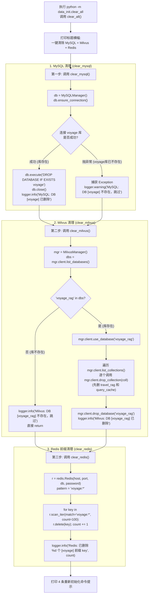

# `data_init/clear_all.py` 代码精讲学习手册

> **本文档完全自包含（Self-Contained）**：已 100% 完整嵌入 `data_init/clear_all.py` 的全部 74 行源码与注释，无需打开 `.py` 原文件即可独立掌握跨三大存储引擎（MySQL + Milvus + Redis）的一键清理重置机制、Milvus 删库前置约束以及 Redis 生产级安全渐进式扫描（`SCAN` vs `KEYS`）原理。

---

## 一、文件定位与核心前置知识精讲

### 1.1 文件在项目中的定位
`data_init/clear_all.py` 是 `Voyage智途A2A` 项目的**跨存储引擎一键清库重置工具（Multi-Storage Reset Utility）**。  
本项目采用了多模存储架构：
1. **MySQL（`voyage` 库）**：存储关系型业务数据、用户账号与长短期记忆；
2. **Milvus（`voyage_rag` 库）**：存储 `travel_rag` 旅游团向量知识库与 `query_cache` 大模型语义缓存；
3. **Redis（`voyage:*` 键空间）**：存储精确查询缓存与高频会话状态。

在开发调试、 schema 升级或自动化集成测试前，如果只清空了 MySQL 而忘了清空 Redis 缓存和 Milvus 语义缓存，系统在收到相同提问时依然会从 Redis 或 Milvus `query_cache` 中返回旧的脏缓存结果！  
通过运行 `python -m data_init.clear_all`，该脚本会按照 **MySQL $\rightarrow$ Milvus $\rightarrow$ Redis** 的顺序一键彻底清除本项目的全部数据，并在终端打印出重新初始化的标准 4 步命令指引。

---

### 1.2 核心前置知识精讲

#### （1）为什么 Milvus 不能像 MySQL 那样直接 `DROP DATABASE`？（Milvus 删库前置约束）
对比 MySQL 和 Milvus 的删库机制：
- **在 MySQL 中**：执行一条 `DROP DATABASE IF EXISTS voyage`，MySQL 会将 `voyage` 库连同里面的 10 张表、所有索引和数据文件**一次性级联删除**。
- **在 Milvus 中**：为了防止误删包含海量向量索引的数据库，Milvus 服务端施加了严格的保护约束——**非空数据库严禁直接删除**！如果一个 Milvus Database 下面还有任何未删除的 Collection（如 `travel_rag` 或 `query_cache`），直接调用 `client.drop_database("voyage_rag")` 会当场报错：
  `MilvusException: database is not empty, must drop all collections before drop database`！
- **标准 Milvus 删库三部曲（本文件 `clear_milvus()` 实现）**：
  1. `client.use_database(db_name)` 切入目标库；
  2. `for coll in client.list_collections(): client.drop_collection(coll)` 遍历并清空所有集合；
  3. `client.drop_database(db_name)` 删除已变为空壳的数据库。

#### （2）Redis 清理的两大生产级铁律：为什么严禁用 `FLUSHDB` 和 `KEYS`？
在 `clear_redis()`（第 41~55 行）中，有两处极具含金量的生产级工程设计：
```python
pattern = f"{CONFIG.CACHE_REDIS_KEY_PREFIX}:*"
count = 0
for key in r.scan_iter(match=pattern, count=100):
    r.delete(key)
    count += 1
```
- **铁律一：按命名空间前缀（`voyage:*`）精准清理，绝不盲目执行 `FLUSHDB` 或 `FLUSHALL`！**
  - 在企业开发或共享云服务器环境中，同一个 Redis 实例的 `db=0` 往往同时被多个不同的微服务或项目共用，大家靠 Key 前缀（Namespace Prefix，如 `voyage:*`、`crm:*`、`order:*`）区分归属。
  - 如果图省事直接调 `r.flushdb()`，会把同一 Redis 库里其他项目的缓存和数据全部误删！按 `f"{CONFIG.CACHE_REDIS_KEY_PREFIX}:*"`（即 `"voyage:*"`）匹配删除，做到了**多项目共享 Redis 时的安全隔离**。
- **铁律二：使用游标渐进式遍历 `scan_iter(match=..., count=100)`，绝不使用 `r.keys("voyage:*")`！**
  - **为什么 Redis 生产环境严禁使用 `KEYS` 命令？**
    - Redis 的核心命令执行器是**单线程事件循环（Single-Threaded Event Loop）**。
    - `r.keys("voyage:*")` 会一次性遍历整个 Redis 数据库中的百万/千万个 Key，在遍历完成前，**Redis 主线程会被完全阻塞（长达数秒甚至数十秒）**，期间所有其他线上请求全部超时卡死，甚至触发主从切换雪崩！
  - **`r.scan_iter(match=pattern, count=100)`（底层 `SCAN` 游标命令）的工作原理**：
    - `SCAN` 采用基于游标（Cursor）的分批非阻塞迭代：每次只向 Redis 请求扫描约 `count=100` 个槽位，耗时仅微秒级，拿到一批匹配的 Key 后立即释放 Redis 主线程去处理其他请求，下一轮再带着新游标继续扫描，直到游标归 `0` 结束。既不阻塞线上业务，又不会在客户端内存中一次性加载百万个 Key 导致 OOM！

---

## 二、调用关系与执行流程图

### 2.1 Mermaid 三大存储引擎一键清理流程图



### 2.2 全套 `data_init` 脚本生命周期闭环图（ASCII）

```
                   ┌────────────────────────────────────────────┐
                   │        python -m data_init.clear_all       │
                   │   (一键清空 MySQL + Milvus + Redis 缓存)    │
                   └─────────────────────┬──────────────────────┘
                                         │ 环境归零
                   ┌─────────────────────┴──────────────────────┐
                   ▼                                            ▼
┌─────────────────────────────────────────┐  ┌─────────────────────────────────────────┐
│ [1] python -m data_init.mysql_init      │  │ [2] python -m data_init.milvus_init     │
│     创建 voyage 库与 10 张空表            │  │     创建 voyage_rag 库与 2 个 Collection │
└────────────────────┬────────────────────┘  └────────────────────┬────────────────────┘
                     ▼                                            ▼
┌─────────────────────────────────────────┐  ┌─────────────────────────────────────────┐
│ [3] python -m data_init.                │  │ [4] python -m data_init.                │
│     testdata_insert_mysql               │  │     testdata_insert_milvus              │
│     灌入 3 账号 + 84 条票务/租车/天气数据 │  │     向量化并 Upsert 18 条旅游团 RAG 数据  │
└─────────────────────────────────────────┘  └─────────────────────────────────────────┘
```

---

## 三、完整源码与逐行/逐段深度拆解

### 3.1 100% 完整源码

```python
"""一键清除项目所有数据：MySQL 库 → Milvus 库 → Redis 缓存
运行：python -m data_init.clear_all
"""
import redis

from utils import CONFIG
from utils import logger
from utils import MySQLManager
from utils import MilvusManager


def clear_mysql():
    """DROP 数据库（含全部表）"""
    try:
        db = MySQLManager()
        db.ensure_connection()
        db.execute(f"DROP DATABASE IF EXISTS {CONFIG.DB_MYSQL_DATABASE}")
        db.close()
        logger.info("MySQL: DB [%s] 已删除", CONFIG.DB_MYSQL_DATABASE)
    except Exception as e:
        logger.warning("MySQL: DB [%s] 不存在，跳过", CONFIG.DB_MYSQL_DATABASE)


def clear_milvus():
    """先删集合再删库（含 travel_rag + query_cache）"""
    # Milvus 要求先删集合才能删库
    mgr = MilvusManager()
    dbs = mgr.client.list_databases()
    if CONFIG.DB_MILVUS_DB_NAME not in dbs:
        logger.info("Milvus: DB [%s] 不存在，跳过", CONFIG.DB_MILVUS_DB_NAME)
        return

    mgr.client.use_database(CONFIG.DB_MILVUS_DB_NAME)
    for coll in mgr.client.list_collections():
        mgr.client.drop_collection(coll)
        logger.info("Milvus: Collection [%s] 已删除", coll)
    mgr.client.drop_database(CONFIG.DB_MILVUS_DB_NAME)
    logger.info("Milvus: DB [%s] 已删除", CONFIG.DB_MILVUS_DB_NAME)


def clear_redis():
    """仅删除本项目前缀的 key（不影响同一 DB 中其他项目）"""
    r = redis.Redis(
        host=CONFIG.CACHE_REDIS_HOST,
        port=CONFIG.CACHE_REDIS_PORT,
        db=CONFIG.CACHE_REDIS_DB,
        password=CONFIG.CACHE_REDIS_PASSWORD,
    )
    pattern = f"{CONFIG.CACHE_REDIS_KEY_PREFIX}:*"
    count = 0
    for key in r.scan_iter(match=pattern, count=100):
        r.delete(key)
        count += 1
    logger.info("Redis: 已删除 %d 个 [%s] 前缀 key", count, CONFIG.CACHE_REDIS_KEY_PREFIX)


def clear_all():
    print("=" * 50)
    print("  一键清除 MySQL + Milvus + Redis")
    print("=" * 50)

    clear_mysql()
    clear_milvus()
    clear_redis()

    print("\n全部清除完成。如需重新初始化，请执行：")
    print("  python -m data_init.mysql_init")
    print("  python -m data_init.milvus_init")
    print("  python -m data_init.testdata_insert_mysql")
    print("  python -m data_init.testdata_insert_milvus")


if __name__ == "__main__":
    clear_all()
```

---

### 3.2 逐段深度拆解

#### 第一段：`clear_mysql()` —— 为什么要用 `try...except` 包裹 `db.ensure_connection()`？（第 12~21 行）
```python
def clear_mysql():
    """DROP 数据库（含全部表）"""
    try:
        db = MySQLManager()
        db.ensure_connection()
        db.execute(f"DROP DATABASE IF EXISTS {CONFIG.DB_MYSQL_DATABASE}")
        db.close()
        logger.info("MySQL: DB [%s] 已删除", CONFIG.DB_MYSQL_DATABASE)
    except Exception as e:
        logger.warning("MySQL: DB [%s] 不存在，跳过", CONFIG.DB_MYSQL_DATABASE)
```
- **深层细节解析**：
  - 既然第 17 行写了 `DROP DATABASE IF EXISTS voyage`，为什么第 20 行还会进入 `except` 报“不存在，跳过”呢？
  - 因为 `MySQLManager._connect()` 在建立连接时传入了 `database=CONFIG.DB_MYSQL_DATABASE`（即 `"voyage"`）！
  - 如果你**连续运行两次** `clear_all.py`：
    - 第 1 次运行时：`voyage` 库存在，`db.ensure_connection()` 成功连入 `voyage` 库，紧接着执行 `DROP DATABASE IF EXISTS voyage` 把库删掉了；
    - 第 2 次运行时：由于 `voyage` 库已经在第 1 次被删掉了，此时 `db.ensure_connection()` 在握手阶段就会抛出 `OperationalError: (1049, "Unknown database 'voyage'")`！
  - 外层的 `try...except Exception as e:` 恰好优雅地接住了这个 `1049 Unknown database` 异常，将其转化为友好的 `MySQL: DB [voyage] 不存在，跳过`，保证了 `clear_all.py` 可以被重复执行任意多次而不会崩溃（完全幂等）！

#### 第二段：`clear_milvus()` —— 利用 `@property client` 操作底层集合与库（第 24~38 行）
```python
mgr = MilvusManager()
dbs = mgr.client.list_databases()
if CONFIG.DB_MILVUS_DB_NAME not in dbs:
    logger.info("Milvus: DB [%s] 不存在，跳过", CONFIG.DB_MILVUS_DB_NAME)
    return

mgr.client.use_database(CONFIG.DB_MILVUS_DB_NAME)
for coll in mgr.client.list_collections():
    mgr.client.drop_collection(coll)
    logger.info("Milvus: Collection [%s] 已删除", coll)
mgr.client.drop_database(CONFIG.DB_MILVUS_DB_NAME)
```
- 这里充分体现了 `MilvusManager` 提供 `@property def client(self) -> MilvusClient` 的价值：`MilvusManager` 自身只封装高频的业务增删查，而低频的销毁类管理操作（`list_collections`、`drop_collection`、`drop_database`）直接通过 `mgr.client` 调用原生 `MilvusClient`。
- 动态遍历 `mgr.client.list_collections()`：无论 `voyage_rag` 库下有 `travel_rag`、`query_cache` 还是未来新增的其他 Collection，都会被自动枚举并逐一 `drop_collection`，随后安全删除 `voyage_rag` 库。

#### 第三段：`clear_redis()` —— 渐进式游标清理本项目的缓存键（第 41~55 行）
- `r = redis.Redis(...)`：根据 `CONFIG.CACHE_REDIS_*` 参数连接 Redis 实例。
- `pattern = f"{CONFIG.CACHE_REDIS_KEY_PREFIX}:*"`：在 `config.yaml` 中 `key_prefix: "voyage"`，因此匹配模式为 `"voyage:*"`。
- `r.scan_iter(match=pattern, count=100)`：以每次 100 个槽位的步长迭代所有 `"voyage:*"` 开头的缓存 Key，逐个删除并统计删除总数 `count`。

---

### 3.3 沙盘推演（Dry Run）：连续两次运行 `python -m data_init.clear_all` 的完整输出

#### 第一次运行（系统中已有完整数据和 3 条 Redis 缓存）：
```text
==================================================
  一键清除 MySQL + Milvus + Redis
==================================================
2026-05-01 10:05:00 [INFO] mysql_manager.py _connect 50: 连接 MySQL 192.168.88.101:3306/voyage ...
2026-05-01 10:05:00 [INFO] mysql_manager.py _connect 61: MySQL 连接成功 [thread=MainThread]
2026-05-01 10:05:00 [INFO] mysql_manager.py close 124: MySQL 连接已关闭 [thread=MainThread]
2026-05-01 10:05:00 [INFO] clear_all.py clear_mysql 19: MySQL: DB [voyage] 已删除
2026-05-01 10:05:01 [INFO] clear_all.py clear_milvus 36: Milvus: Collection [travel_rag] 已删除
2026-05-01 10:05:01 [INFO] clear_all.py clear_milvus 36: Milvus: Collection [query_cache] 已删除
2026-05-01 10:05:01 [INFO] clear_all.py clear_milvus 38: Milvus: DB [voyage_rag] 已删除
2026-05-01 10:05:01 [INFO] clear_all.py clear_redis 54: Redis: 已删除 3 个 [voyage] 前缀 key

全部清除完成。如需重新初始化，请执行：
  python -m data_init.mysql_init
  python -m data_init.milvus_init
  python -m data_init.testdata_insert_mysql
  python -m data_init.testdata_insert_milvus
```

#### 第二次紧接着运行（此时库已全部为空，验证幂等性）：
```text
==================================================
  一键清除 MySQL + Milvus + Redis
==================================================
2026-05-01 10:05:10 [INFO] mysql_manager.py _connect 50: 连接 MySQL 192.168.88.101:3306/voyage ...
2026-05-01 10:05:10 [WARNING] clear_all.py clear_mysql 21: MySQL: DB [voyage] 不存在，跳过
2026-05-01 10:05:10 [INFO] clear_all.py clear_milvus 30: Milvus: DB [voyage_rag] 不存在，跳过
2026-05-01 10:05:10 [INFO] clear_all.py clear_redis 54: Redis: 已删除 0 个 [voyage] 前缀 key
...
```

---

## 四、工程细节、潜在注意点与最佳实践

### 4.1 潜在注意点：如果 `CACHE_MILVUS` 与 `DB_MILVUS` 配置了不同的 `db_name`
在当前 `config.yaml` 中：
- `db.milvus.db_name` = `"voyage_rag"`
- `cache.milvus.db_name` = `"voyage_rag"`
因为两者共用同一个 Milvus Database `"voyage_rag"`，所以 `clear_milvus()` 遍历删除 `"voyage_rag"` 下的所有 Collection 时，会**同时把 `travel_rag` 和 `query_cache` 一起删掉**（正如第 25 行注释 `"""先删集合再删库（含 travel_rag + query_cache）"""` 所述）。  
但如果未来在 `config.yaml` 中把语义缓存配到了另一个独立的 Milvus Database（如 `"voyage_cache_db"`），则需要在 `clear_milvus()` 中对该库也执行一次相同的清理流程。

### 4.2 进阶优化建议：Redis 批量 Pipeline 删除
在 `clear_redis()` 中，当前对 `scan_iter` 扫出的每个 Key 执行一次 `r.delete(key)`。如果缓存 Key 的数量达到数万个，可以用 `r.pipeline()` 批量缓冲删除命令（每 500 个 Key 提交一次 Pipeline），进一步减少网络 RTT 耗时。

---

## 五、自测思考题（附答案解析）

### 思考题 1
在 `clear_milvus()` 中，如果把第 34~36 行的 `for coll in mgr.client.list_collections(): mgr.client.drop_collection(coll)` 删掉，直接执行第 37 行的 `mgr.client.drop_database(CONFIG.DB_MILVUS_DB_NAME)`，程序能不能成功删掉 Milvus 数据库？为什么？

> **答案解析**：
> **不能，会直接抛出 `MilvusException` 异常**！
> 因为 Milvus 的数据库管理机制不允许直接删除非空数据库（Database）。只要 `voyage_rag` 数据库下还存在任何一个 Collection（如 `travel_rag` 或 `query_cache`），`drop_database` 就会被拒绝。必须先通过 `list_collections()` 遍历并 `drop_collection()` 删光里面的所有集合，最后才能调用 `drop_database()` 删库。

### 思考题 2
在清除完了所有数据之后，重新初始化整个项目的 4 个脚本有严格的先后顺序要求吗？请写出正确的执行顺序并说明原因。

> **答案解析**：
> **有严格的先后依赖顺序**：
> 1. **先建表结构（DDL）**：
>    - `python -m data_init.mysql_init`（创建 MySQL `voyage` 库和 10 张表）
>    - `python -m data_init.milvus_init`（创建 Milvus `voyage_rag` 库和 `travel_rag`、`query_cache` 两个集合及向量索引）
>    *(注：1 和 2 之间互不依赖，顺序可互换)*
> 2. **再灌入测试数据（DML）**：
>    - `python -m data_init.testdata_insert_mysql`（依赖第 1 步建好的 MySQL 库表，否则报 `Unknown database` 或 `Table doesn't exist`）
>    - `python -m data_init.testdata_insert_milvus`（依赖第 2 步建好的 Milvus `travel_rag` 集合，否则报 `can't find collection`）
>    *(注：3 和 4 之间互不依赖，顺序可互换，但 3 必须在 1 之后，4 必须在 2 之后)*。
