# `data_init/mysql_init.py` 代码精讲学习手册

> **本文档完全自包含（Self-Contained）**：已 100% 完整嵌入 `data_init/mysql_init.py` 的全部 291 行源码与 SQL DDL 语句，无需打开 `.py` 原文件即可独立掌握全项目 10 张 MySQL 数据库表的 Schema 设计哲学、主键与联合唯一索引、字符集排序规则以及多租户记忆隔离架构。

---

## 一、文件定位与核心前置知识精讲

### 1.1 文件在项目中的定位
`data_init/mysql_init.py` 是 `Voyage智途A2A` 项目的**关系型数据库 Schema 蓝图与初始化引擎**。  
通过运行 `python -m data_init.mysql_init`，该脚本会连接 MySQL 服务器，重建名为 `voyage` 的数据库，并一次性创建支撑整个系统的 **10 张核心表**，涵盖两大业务域：
1. **6 张出行与旅游业务数据表（供 MCP 工具服务查询与预订）**：
   - `train_tickets`（火车票信息表）
   - `flight_tickets`（航班机票信息表）
   - `concert_tickets`（演唱会门票信息表）
   - `weather_data`（和风天气 30 字段精细气象数据表）
   - `car_rentals`（租车信息表）
   - `insurances`（旅行保险信息表）
2. **4 张用户认证与智能体记忆/上下文隔离表（供 `core` 主控层读写）**：
   - `users`（用户账号与盐值哈希密码表）
   - `user_profiles`（长期记忆：用户画像偏好表）
   - `query_history`（长期记忆：结构化意图查询历史表）
   - `short_term_messages`（短期记忆：多轮对话上下文消息表）

---

### 1.2 核心前置知识精讲：企业级 MySQL 表结构（Schema）设计规范

#### （1）为什么必须用 `utf8mb4` 字符集与 `utf8mb4_unicode_ci` 排序规则？
在 `SQL_CREATE_DATABASE` 和每一张表的 `CREATE TABLE` 尾部，都显式指定了：
```sql
CHARACTER SET utf8mb4 COLLATE utf8mb4_unicode_ci
```
- **历史大坑：MySQL 的 `utf8` 不是真正的 UTF-8！**
  - MySQL 早期的 `utf8`（现改称 `utf8mb3`）每个字符最多只支持 **3 个字节**，只能存储基本多文种平面（BMP）的字符。一旦大模型回复、用户昵称或演唱会描述中包含 **Emoji 表情符号（如 `🐼`、`✈️`、`🎉`）或生僻汉字**（需要 4 个字节编码），MySQL 的 `utf8` 就会直接报错 `Incorrect string value: '\xF0\x9F\x90\xBC...'`！
  - **`utf8mb4`（UTF-8 Most Bytes 4）** 才是完整的 4 字节真 UTF-8，完美支持所有中文、外文与 Emoji 表情。
- **`utf8mb4_unicode_ci` 的含义**：
  - `unicode` 表示基于标准 Unicode 排序算法（比古老的 `general_ci` 对多语言字符的比较更准确）；
  - `ci` 是 **Case Insensitive（大小写不敏感）** 的缩写，例如查询航班号 `'ca4116'` 可以自动匹配 `'CA4116'`。

#### （2）主键（Primary Key）、联合主键（Composite PK）与联合唯一索引（`UNIQUE KEY`）的设计巧思
本文件的 10 张表展示了三种极其经典的主键与唯一约束设计模式：

| 模式 | 代表表 | DDL 语法 | 为什么这样设计？（业务与底层原理） |
| :--- | :--- | :--- | :--- |
| **模式 A：自增代理主键 + 业务联合唯一索引** | `train_tickets`<br/>`flight_tickets`<br/>`concert_tickets`<br/>`weather_data`<br/>`car_rentals`<br/>`insurances` | `id INT AUTO_INCREMENT PRIMARY KEY`<br/>+<br/>`UNIQUE KEY unique_train (departure_time, train_number, seat_type)` | 1. InnoDB 表是**聚簇索引组织表（Index-Organized Table）**，用 4 字节单调递增的 `INT AUTO_INCREMENT` 做主键，插入时严格顺序追加，**不会发生 B+ 树页分裂（Page Split）**，写入性能最高。<br/>2. 同时用业务属性建立 `UNIQUE KEY`（如同一发车时间 + 同一车次 + 同一席别只能有一条记录），既从数据库层杜绝了重复录入脏数据，又支持 `INSERT ... ON DUPLICATE KEY UPDATE`（如 `weather_data` 按 `(city, fx_date)` 幂等更新天气缓存）！ |
| **模式 B：自然业务主键** | `users` | `PRIMARY KEY (user_id)` | 用户登录账号 `user_id` 本身就是全局唯一且不可变的查询锚点，直接作为聚簇主键，登录查询 `WHERE user_id = ?` 时无需回表（最快 $O(\log N)$ 直达数据行）。 |
| **模式 C：多租户联合主键** | `user_profiles` | `PRIMARY KEY (user_id, profile_key)` | 用户画像偏好表是典型的 `(用户, 属性名) -> 属性值` 键值结构。将 `(user_id, profile_key)` 设为联合主键：<br/>① 天然保证同一个用户的同一个偏好键（如 `('test_user', 'seat_preference')`）全局唯一，直接支持 `ON DUPLICATE KEY UPDATE` 更新偏好；<br/>② 根据 B+ 树**最左前缀原则（Leftmost Prefix Principle）**，按 `WHERE user_id = ?` 查询某用户的全部画像时，该用户的全部偏好在物理磁盘上紧密相邻存放，一次顺序扫描即可全部取出！ |

#### （3）二级索引（`INDEX`）与最左前缀优化
在 `query_history` 表中定义了联合索引：
```sql
INDEX idx_user_time (user_id, query_time)
```
为什么是 `(user_id, query_time)` 而不是只建 `(user_id)`？  
因为在 `core/memory.py` 中，获取某个用户最近 $N$ 条查询历史的 SQL 是：
```sql
SELECT * FROM query_history WHERE user_id = %s ORDER BY query_time DESC LIMIT 5
```
当建了联合索引 `(user_id, query_time)` 后，B+ 树中同一个 `user_id` 下的数据**已经天然按照 `query_time` 排好序了**！MySQL 定位到该 `user_id` 后直接倒序读最后 5 条即可，**彻底消除了昂贵的内存文件排序（`Using filesort`）**！

---

## 二、调用关系与执行流程图

### 2.1 Mermaid 10 张核心表 ER 关系与领域划分图

```mermaid
erDiagram
    USERS ||--o{ USER_PROFILES : "1对多 (user_id 关联长期偏好)"
    USERS ||--o{ QUERY_HISTORY : "1对多 (user_id 关联查询历史)"
    USERS ||--o{ SHORT_TERM_MESSAGES : "1对多 (user_id 关联短期对话)"

    USERS {
        VARCHAR(50) user_id PK "登录账号"
        VARCHAR(128) password_hash "salt+SHA256"
        VARCHAR(100) nickname "用户昵称"
        TIMESTAMP created_at "注册时间"
        TIMESTAMP updated_at "更新时间"
    }
    USER_PROFILES {
        VARCHAR(36) user_id PK "联合主键1: 用户标识"
        VARCHAR(50) profile_key PK "联合主键2: 偏好键名"
        VARCHAR(200) profile_value "偏好值"
        TIMESTAMP updated_at "自动刷新时间戳"
    }
    QUERY_HISTORY {
        INT id PK "自增主键"
        VARCHAR(36) user_id "idx_user_time联合索引"
        VARCHAR(30) intent_type "weather/flight/train等"
        TEXT query_content "查询内容JSON字符串"
        DATETIME query_time "idx_user_time联合索引"
    }
    SHORT_TERM_MESSAGES {
        INT id PK "自增主键"
        VARCHAR(36) user_id "idx_user索引"
        VARCHAR(10) role "user / assistant"
        TEXT content "对话正文"
        VARCHAR(10) message_time "HH:MM:SS"
        INT message_order "顺序号"
        TIMESTAMP updated_at "更新时间"
    }
    TRAIN_TICKETS {
        INT id PK "自增主键"
        VARCHAR(50) departure_city "出发城市"
        VARCHAR(50) arrival_city "到达城市"
        DATETIME departure_time UK "unique_train(1)"
        DATETIME arrival_time "到达时间"
        VARCHAR(20) train_number UK "unique_train(2)"
        VARCHAR(20) seat_type UK "unique_train(3)"
        INT total_seats "总座位数"
        INT remaining_seats "剩余座位数"
        DECIMAL price "票价(10,2)"
    }
    FLIGHT_TICKETS {
        INT id PK "自增主键"
        VARCHAR(50) departure_city "出发城市"
        VARCHAR(50) arrival_city "到达城市"
        DATETIME departure_time UK "unique_flight(1)"
        DATETIME arrival_time "到达时间"
        VARCHAR(20) flight_number UK "unique_flight(2)"
        VARCHAR(20) cabin_type UK "unique_flight(3)"
        INT total_seats "总座位数"
        INT remaining_seats "剩余座位数"
        DECIMAL price "票价(10,2)"
    }
    CONCERT_TICKETS {
        INT id PK "自增主键"
        VARCHAR(100) artist UK "unique_concert(2)"
        VARCHAR(50) city "举办城市"
        VARCHAR(100) venue "场馆"
        DATETIME start_time UK "unique_concert(1)"
        DATETIME end_time "结束时间"
        VARCHAR(20) ticket_type UK "unique_concert(3)"
        INT total_seats "总座位数"
        INT remaining_seats "剩余座位数"
        DECIMAL price "票价(10,2)"
    }
    CAR_RENTALS {
        INT id PK "自增主键"
        VARCHAR(50) company UK "unique_car(1)"
        VARCHAR(50) pickup_city "取车城市"
        VARCHAR(50) return_city "还车城市"
        DATE pickup_date UK "unique_car(3)"
        VARCHAR(20) car_type "经济型/SUV/豪华型/MPV"
        VARCHAR(50) car_model UK "unique_car(2)"
        DECIMAL price_per_day "日租金(8,2)"
        INT total_available "可租数"
        VARCHAR(20) transmission "自动挡/手动挡"
        INT seats "座位数"
        DECIMAL deposit "押金(8,2)"
    }
    INSURANCES {
        INT id PK "自增主键"
        VARCHAR(20) insurance_type "综合型/意外型/医疗型/境外型"
        VARCHAR(100) name UK "unique_insurance"
        VARCHAR(50) company "保险公司"
        TEXT coverage "保障范围说明"
        DECIMAL price "价格(8,2)"
        INT duration_days "保障天数"
        DECIMAL max_coverage "最高保额(10,2)"
        BOOLEAN flight_delay "是否含延误险"
    }
    WEATHER_DATA {
        INT id PK "自增主键"
        VARCHAR(50) city UK "unique_city_date(1)"
        DATE fx_date UK "unique_city_date(2)"
        TIME sunrise "日出~月落等4个TIME字段"
        INT temp_max "最高/最低温等气象指标"
        DECIMAL precip "降水量(5,1)"
        DATETIME update_time "数据更新时间"
    }
```



### 2.2 ASCII 初始化执行流水线 (`ALL_SQL` 20 条 SQL 顺序)

```
python -m data_init.mysql_init
  │
  ▼
调用 init_database()
  │ 1. 建立不指定 database 的裸连接: pymysql.connect(host, port, user, password, autocommit=True)
  │    (为什么不传 database='voyage'? 因为此时 voyage 库可能还不存在，传了会报 Unknown database!)
  │
  │ 2. 循环执行 ALL_SQL (共 20 条 DDL 语句):
  ├──► [01] DROP DATABASE IF EXISTS voyage           (彻底清理旧库)
  ├──► [02] CREATE DATABASE voyage CHARACTER SET ... (创建新库)
  ├──► [03] USE voyage                               (切换当前会话到 voyage 库)
  ├──► [04~05] DROP & CREATE train_tickets           (建火车票表)
  ├──► [06~07] DROP & CREATE flight_tickets          (建航班机票表)
  ├──► [08~09] DROP & CREATE concert_tickets         (建演唱会门票表)
  ├──► [10~11] DROP & CREATE weather_data            (建天气数据表)
  ├──► [12~13] DROP & CREATE car_rentals             (建租车信息表)
  ├──► [14~15] DROP & CREATE insurances              (建旅行保险表)
  ├──► [16~17] DROP & CREATE users                   (建用户表)
  ├──► [18]    CREATE TABLE IF NOT EXISTS user_profiles       (建用户偏好表)
  ├──► [19]    CREATE TABLE IF NOT EXISTS query_history       (建查询历史表)
  └──► [20]    CREATE TABLE IF NOT EXISTS short_term_messages (建短期对话表)
  │
  │ 3. cursor.close() & conn.close() → 打印 logger.info("数据库初始化完成")
```

---

## 三、完整源码与逐行/逐段深度拆解

### 3.1 100% 完整源码

```python

# 建库
SQL_DROP_DATABASE = "DROP DATABASE IF EXISTS voyage"
SQL_CREATE_DATABASE = (
    "CREATE DATABASE voyage "
    "CHARACTER SET utf8mb4 COLLATE utf8mb4_unicode_ci"
)
SQL_USE_DATABASE = "USE voyage"

# 火车票表
SQL_DROP_TRAIN_TICKETS = "DROP TABLE IF EXISTS train_tickets"
SQL_CREATE_TRAIN_TICKETS = """
CREATE TABLE train_tickets (
    id INT AUTO_INCREMENT PRIMARY KEY
        COMMENT '主键，自增，唯一标识每条记录',
    departure_city VARCHAR(50) NOT NULL COMMENT '出发城市',
    arrival_city VARCHAR(50) NOT NULL COMMENT '到达城市',
    departure_time DATETIME NOT NULL COMMENT '出发时间',
    arrival_time DATETIME NOT NULL COMMENT '到达时间',
    train_number VARCHAR(20) NOT NULL COMMENT '火车车次',
    seat_type VARCHAR(20) NOT NULL COMMENT '座位类型',
    total_seats INT NOT NULL COMMENT '总座位数',
    remaining_seats INT NOT NULL COMMENT '剩余座位数',
    price DECIMAL(10, 2) NOT NULL COMMENT '票价',
    created_at TIMESTAMP DEFAULT CURRENT_TIMESTAMP
        COMMENT '创建时间，自动记录插入时间',
    UNIQUE KEY unique_train
        (departure_time, train_number, seat_type)
) ENGINE=InnoDB
    DEFAULT CHARSET=utf8mb4 COLLATE=utf8mb4_unicode_ci
    COMMENT='火车票信息表'
"""

# 航班机票表
SQL_DROP_FLIGHT_TICKETS = "DROP TABLE IF EXISTS flight_tickets"
SQL_CREATE_FLIGHT_TICKETS = """
CREATE TABLE flight_tickets (
    id INT AUTO_INCREMENT PRIMARY KEY
        COMMENT '主键，自增，唯一标识每条记录',
    departure_city VARCHAR(50) NOT NULL COMMENT '出发城市',
    arrival_city VARCHAR(50) NOT NULL COMMENT '到达城市',
    departure_time DATETIME NOT NULL COMMENT '出发时间',
    arrival_time DATETIME NOT NULL COMMENT '到达时间',
    flight_number VARCHAR(20) NOT NULL COMMENT '航班号',
    cabin_type VARCHAR(20) NOT NULL COMMENT '舱位类型',
    total_seats INT NOT NULL COMMENT '总座位数',
    remaining_seats INT NOT NULL COMMENT '剩余座位数',
    price DECIMAL(10, 2) NOT NULL COMMENT '票价',
    created_at TIMESTAMP DEFAULT CURRENT_TIMESTAMP
        COMMENT '创建时间，自动记录插入时间',
    UNIQUE KEY unique_flight
        (departure_time, flight_number, cabin_type)
) ENGINE=InnoDB
    DEFAULT CHARSET=utf8mb4 COLLATE=utf8mb4_unicode_ci
    COMMENT='航班机票信息表'
"""

# 演唱会票表
SQL_DROP_CONCERT_TICKETS = "DROP TABLE IF EXISTS concert_tickets"
SQL_CREATE_CONCERT_TICKETS = """
CREATE TABLE concert_tickets (
    id INT AUTO_INCREMENT PRIMARY KEY COMMENT '主键，自增',
    artist VARCHAR(100) NOT NULL COMMENT '艺人名称',
    city VARCHAR(50) NOT NULL COMMENT '举办城市',
    venue VARCHAR(100) NOT NULL COMMENT '场馆',
    start_time DATETIME NOT NULL COMMENT '开始时间',
    end_time DATETIME NOT NULL COMMENT '结束时间',
    ticket_type VARCHAR(20) NOT NULL COMMENT '票类型',
    total_seats INT NOT NULL COMMENT '总座位数',
    remaining_seats INT NOT NULL COMMENT '剩余座位数',
    price DECIMAL(10, 2) NOT NULL COMMENT '票价',
    created_at TIMESTAMP DEFAULT CURRENT_TIMESTAMP
        COMMENT '创建时间',
    UNIQUE KEY unique_concert
        (start_time, artist, ticket_type)
) ENGINE=InnoDB
    DEFAULT CHARSET=utf8mb4 COLLATE=utf8mb4_unicode_ci
    COMMENT='演唱会门票信息表'
"""

# 天气数据表
SQL_DROP_WEATHER_DATA = "DROP TABLE IF EXISTS weather_data"
SQL_CREATE_WEATHER_DATA = """
CREATE TABLE IF NOT EXISTS weather_data (
    id INT AUTO_INCREMENT PRIMARY KEY,
    city VARCHAR(50) NOT NULL COMMENT '城市名称',
    fx_date DATE NOT NULL COMMENT '预报日期',
    sunrise TIME COMMENT '日出时间',
    sunset TIME COMMENT '日落时间',
    moonrise TIME COMMENT '月升时间',
    moonset TIME COMMENT '月落时间',
    moon_phase VARCHAR(20) COMMENT '月相名称',
    moon_phase_icon VARCHAR(10) COMMENT '月相图标代码',
    temp_max INT COMMENT '最高温度',
    temp_min INT COMMENT '最低温度',
    icon_day VARCHAR(10) COMMENT '白天天气图标代码',
    text_day VARCHAR(20) COMMENT '白天天气描述',
    icon_night VARCHAR(10) COMMENT '夜间天气图标代码',
    text_night VARCHAR(20) COMMENT '夜间天气描述',
    wind360_day INT COMMENT '白天风向360角度',
    wind_dir_day VARCHAR(20) COMMENT '白天风向',
    wind_scale_day VARCHAR(10) COMMENT '白天风力等级',
    wind_speed_day INT COMMENT '白天风速 (km/h)',
    wind360_night INT COMMENT '夜间风向360角度',
    wind_dir_night VARCHAR(20) COMMENT '夜间风向',
    wind_scale_night VARCHAR(10) COMMENT '夜间风力等级',
    wind_speed_night INT COMMENT '夜间风速 (km/h)',
    precip DECIMAL(5,1) COMMENT '降水量 (mm)',
    uv_index INT COMMENT '紫外线指数',
    humidity INT COMMENT '相对湿度 (%)',
    pressure INT COMMENT '大气压强 (hPa)',
    vis INT COMMENT '能见度 (km)',
    cloud INT COMMENT '云量 (%)',
    update_time DATETIME COMMENT '数据更新时间',
    UNIQUE KEY unique_city_date (city, fx_date)
) ENGINE=InnoDB
    DEFAULT CHARSET=utf8mb4 COLLATE=utf8mb4_unicode_ci
    COMMENT='天气数据表'
"""

# 租车信息表
SQL_DROP_CAR_RENTALS = "DROP TABLE IF EXISTS car_rentals"
SQL_CREATE_CAR_RENTALS = """
CREATE TABLE car_rentals (
    id INT AUTO_INCREMENT PRIMARY KEY COMMENT '主键，自增',
    company VARCHAR(50) NOT NULL COMMENT '租车公司名称',
    pickup_city VARCHAR(50) NOT NULL COMMENT '取车城市',
    return_city VARCHAR(50) NOT NULL COMMENT '还车城市',
    pickup_date DATE NOT NULL COMMENT '取车日期',
    car_type VARCHAR(20) NOT NULL
        COMMENT '车型分类：经济型/SUV/豪华型/MPV',
    car_model VARCHAR(50) NOT NULL COMMENT '具体车型',
    price_per_day DECIMAL(8,2) NOT NULL COMMENT '每日租金（元）',
    total_available INT NOT NULL DEFAULT 0 COMMENT '可租车辆数',
    transmission VARCHAR(20) NOT NULL
        COMMENT '变速箱：自动挡/手动挡',
    seats INT NOT NULL COMMENT '座位数',
    deposit DECIMAL(8,2) NOT NULL DEFAULT 0 COMMENT '押金（元）',
    created_at TIMESTAMP DEFAULT CURRENT_TIMESTAMP
        COMMENT '创建时间',
    UNIQUE KEY unique_car
        (company, car_model, pickup_date)
) ENGINE=InnoDB
    DEFAULT CHARSET=utf8mb4 COLLATE=utf8mb4_unicode_ci
    COMMENT='租车信息表'
"""

# 旅行保险信息表
SQL_DROP_INSURANCES = "DROP TABLE IF EXISTS insurances"
SQL_CREATE_INSURANCES = """
CREATE TABLE insurances (
    id INT AUTO_INCREMENT PRIMARY KEY COMMENT '主键，自增',
    insurance_type VARCHAR(20) NOT NULL
        COMMENT '保险类型：综合型/意外型/医疗型/境外型',
    name VARCHAR(100) NOT NULL COMMENT '保险产品名称',
    company VARCHAR(50) NOT NULL COMMENT '保险公司',
    coverage TEXT NOT NULL COMMENT '保障范围说明',
    price DECIMAL(8,2) NOT NULL COMMENT '价格（元/份）',
    duration_days INT NOT NULL COMMENT '保障天数',
    max_coverage DECIMAL(10,2) NOT NULL
        COMMENT '最高赔付金额（元）',
    medical_coverage DECIMAL(10,2) DEFAULT 0
        COMMENT '医疗保障额度（元）',
    baggage_coverage DECIMAL(10,2) DEFAULT 0
        COMMENT '行李保障额度（元）',
    flight_delay BOOLEAN DEFAULT FALSE
        COMMENT '是否包含航班延误',
    created_at TIMESTAMP DEFAULT CURRENT_TIMESTAMP
        COMMENT '创建时间',
    UNIQUE KEY unique_insurance (name)
) ENGINE=InnoDB
    DEFAULT CHARSET=utf8mb4 COLLATE=utf8mb4_unicode_ci
    COMMENT='旅行保险信息表'
"""

# 用户表（注册登录）
SQL_DROP_USERS = "DROP TABLE IF EXISTS users"
SQL_CREATE_USERS = """
CREATE TABLE users (
    user_id VARCHAR(50) NOT NULL COMMENT '用户ID（登录账号）',
    password_hash VARCHAR(128) NOT NULL COMMENT '密码哈希（salt+SHA256）',
    nickname VARCHAR(100) NOT NULL DEFAULT '' COMMENT '用户昵称',
    created_at TIMESTAMP DEFAULT CURRENT_TIMESTAMP
        COMMENT '注册时间',
    updated_at TIMESTAMP DEFAULT CURRENT_TIMESTAMP
        ON UPDATE CURRENT_TIMESTAMP COMMENT '更新时间',
    PRIMARY KEY (user_id)
) ENGINE=InnoDB
    DEFAULT CHARSET=utf8mb4 COLLATE=utf8mb4_unicode_ci
    COMMENT='用户表'
"""

# 用户偏好表（多用户隔离：联合主键）
SQL_CREATE_USER_PROFILES = """
CREATE TABLE IF NOT EXISTS user_profiles (
    user_id VARCHAR(36) NOT NULL COMMENT '用户唯一标识(UUID)',
    profile_key VARCHAR(50) NOT NULL COMMENT '偏好键名',
    profile_value VARCHAR(200) NOT NULL COMMENT '偏好值',
    updated_at TIMESTAMP DEFAULT CURRENT_TIMESTAMP
        ON UPDATE CURRENT_TIMESTAMP COMMENT '更新时间',
    PRIMARY KEY (user_id, profile_key)
) ENGINE=InnoDB
    DEFAULT CHARSET=utf8mb4 COLLATE=utf8mb4_unicode_ci
    COMMENT='用户偏好'
"""

# 查询历史表（多用户隔离：加 user_id + 联合索引）
SQL_CREATE_QUERY_HISTORY = """
CREATE TABLE IF NOT EXISTS query_history (
    id INT AUTO_INCREMENT PRIMARY KEY COMMENT '主键',
    user_id VARCHAR(36) NOT NULL COMMENT '用户唯一标识(UUID)',
    intent_type VARCHAR(30) NOT NULL
        COMMENT '意图类型：weather/flight/train等',
    query_content TEXT NOT NULL COMMENT '查询内容JSON',
    query_time DATETIME NOT NULL COMMENT '查询时间',
    INDEX idx_user_time (user_id, query_time)
) ENGINE=InnoDB
    DEFAULT CHARSET=utf8mb4 COLLATE=utf8mb4_unicode_ci
    COMMENT='查询历史'
"""

# 短期对话表（多用户隔离：加 user_id + 索引）
SQL_CREATE_SHORT_TERM_MESSAGES = """
CREATE TABLE IF NOT EXISTS short_term_messages (
    id INT AUTO_INCREMENT PRIMARY KEY COMMENT '主键',
    user_id VARCHAR(36) NOT NULL COMMENT '用户唯一标识(UUID)',
    role VARCHAR(10) NOT NULL
        COMMENT '消息角色：user 或 assistant',
    content TEXT NOT NULL COMMENT '消息内容',
    message_time VARCHAR(10) NOT NULL
        COMMENT '时间戳 HH:MM:SS',
    message_order INT NOT NULL COMMENT '消息顺序号',
    updated_at TIMESTAMP DEFAULT CURRENT_TIMESTAMP
        ON UPDATE CURRENT_TIMESTAMP COMMENT '更新时间',
    INDEX idx_user (user_id)
) ENGINE=InnoDB
    DEFAULT CHARSET=utf8mb4 COLLATE=utf8mb4_unicode_ci
    COMMENT='短期对话'
"""

# 按执行顺序排列的全部建库表SQL
ALL_SQL = [
    SQL_DROP_DATABASE,
    SQL_CREATE_DATABASE,
    SQL_USE_DATABASE,
    SQL_DROP_TRAIN_TICKETS,
    SQL_CREATE_TRAIN_TICKETS,
    SQL_DROP_FLIGHT_TICKETS,
    SQL_CREATE_FLIGHT_TICKETS,
    SQL_DROP_CONCERT_TICKETS,
    SQL_CREATE_CONCERT_TICKETS,
    SQL_DROP_WEATHER_DATA,
    SQL_CREATE_WEATHER_DATA,
    SQL_DROP_CAR_RENTALS,
    SQL_CREATE_CAR_RENTALS,
    SQL_DROP_INSURANCES,
    SQL_CREATE_INSURANCES,
    SQL_DROP_USERS,
    SQL_CREATE_USERS,
    SQL_CREATE_USER_PROFILES,
    SQL_CREATE_QUERY_HISTORY,
    SQL_CREATE_SHORT_TERM_MESSAGES,
]

import pymysql
from utils import CONFIG
from utils import logger


def init_database():
    """按顺序执行全部建库建表 SQL"""
    conn = pymysql.connect(
        host=CONFIG.DB_MYSQL_HOST,
        port=CONFIG.DB_MYSQL_PORT,
        user=CONFIG.DB_MYSQL_USER,
        password=CONFIG.DB_MYSQL_PASSWORD,
        charset=CONFIG.DB_MYSQL_CHARSET,
        autocommit=True,
    )
    # 创建游标
    cursor = conn.cursor()
    for sql in ALL_SQL:
        cursor.execute(sql)
    cursor.close()
    conn.close()
    logger.info("数据库初始化完成")

if __name__ == '__main__':
    init_database() # 建库建表
```

---

### 3.2 逐表与关键代码深度拆解

#### 1. 票务三剑客表：`train_tickets`、`flight_tickets`、`concert_tickets`（第 10~79 行）
- **库存双字段设计（`total_seats` + `remaining_seats`）**：
  - 所有票务表都区分了 `total_seats`（总座位数）和 `remaining_seats`（剩余座位数）。
  - 在 MCP 预订工具中，预订 $N$ 张票时执行 `UPDATE xxx_tickets SET remaining_seats = remaining_seats - %s WHERE ... AND remaining_seats >= %s`，利用 InnoDB 行级锁防止超卖！
- **联合唯一键对比**：
  - 火车票：`UNIQUE KEY unique_train (departure_time, train_number, seat_type)`——同一时刻发车的同一车次（如 `G351`）会有二等座、一等座、商务座 3 条记录，靠第 3 列 `seat_type` 区分。
  - 机票：`UNIQUE KEY unique_flight (departure_time, flight_number, cabin_type)`——同理，同一航班（如 `CA4116`）靠 `cabin_type`（经济舱/商务舱/头等舱）区分。
  - 演唱会票：`UNIQUE KEY unique_concert (start_time, artist, ticket_type)`——同一时间同一艺人的演唱会靠 `ticket_type`（VIP内场/看台A区等）区分。

#### 2. 天气数据表：`weather_data`（第 81~119 行）
- 该表的 28 个气象业务字段与**和风天气（QWeather）每日天气预报 API** 返回的 JSON 字段一一对齐（`fx_date`、`sunrise`、`sunset`、`moon_phase`、`temp_max`、`temp_min`、`wind_dir_day`、`precip`、`uv_index` 等）。
- `UNIQUE KEY unique_city_date (city, fx_date)`：保证每个城市每一天最多只有一条天气记录。当 MCP 天气工具调用和风天气 API 拉取到最新预报后，可以通过 `INSERT ... ON DUPLICATE KEY UPDATE` 自动刷新该城市当天的气象数据。

#### 3. 行程服务表：`car_rentals` 与 `insurances`（第 121~174 行）
- `car_rentals`（租车表）：
  - 包含租车公司 `company`、取还车城市 `pickup_city`/`return_city`、取车日期 `pickup_date`、车型分类 `car_type`（经济型/SUV/豪华型/MPV）、具体车型 `car_model`、日租金 `price_per_day`、可租数量 `total_available`、变速箱 `transmission`、座位数 `seats`、押金 `deposit`。
  - 唯一键 `unique_car (company, car_model, pickup_date)`：同一租车公司、同一具体车型在同一天的库存与报价唯一。
- `insurances`（旅行保险表）：
  - 注意第 166 行 `flight_delay BOOLEAN DEFAULT FALSE`：在 MySQL 中，`BOOLEAN` 是 `TINYINT(1)` 的同义词，`FALSE` 存储为 `0`，`TRUE` 存储为 `1`。

#### 4. 用户与智能体记忆四张表：`users`、`user_profiles`、`query_history`、`short_term_messages`（第 176~239 行）
- **`TIMESTAMP DEFAULT CURRENT_TIMESTAMP ON UPDATE CURRENT_TIMESTAMP`**：
  - 在 `users`、`user_profiles`、`short_term_messages` 的 `updated_at` 字段上使用了该特性。当插入新行时自动记录当前时间；当该行任何字段发生 `UPDATE` 修改时，MySQL 引擎自动将 `updated_at` 刷新为最新时间，无需 Python 代码手动传入时间戳！
- **`query_history.query_content TEXT`（JSON 文本存储）**：
  - 将用户每次查询的结构化槽位参数（如 `{"departure": "北京", "destination": "成都", "date": "2026-05-01"}`）序列化为 JSON 字符串存入 `TEXT` 字段，既保留了结构化灵活性，又省去了为每种意图建一张历史表的繁琐。

#### 5. 为什么 `init_database()` 直接用 `pymysql.connect` 而不使用 `MySQLManager`？（第 270~286 行）
对比 `MySQLManager._connect()`（第 51~59 行）和这里的 `init_database()`（第 272~279 行）：
- `MySQLManager._connect()` 在连接时指定了 `database=CONFIG.DB_MYSQL_DATABASE`（即 `database="voyage"`）。
- 如果在 `voyage` 数据库**尚未创建**（或者刚被 `clear_all.py` 删掉）时使用 `MySQLManager`，连接的一瞬间就会因为找不到 `voyage` 库而报错 `pymysql.err.OperationalError: (1049, "Unknown database 'voyage'")`！
- 因此 `init_database()` 必须使用**不带 `database` 参数的裸 `pymysql.connect()`** 先连上 MySQL 实例，执行完 `CREATE DATABASE voyage` 和 `USE voyage` 后，才能在 `voyage` 库下创建各张表。

---

### 3.3 沙盘推演（Dry Run）：运行 `python -m data_init.mysql_init` 的状态变迁

1. **初始状态**：假设 MySQL 中已有旧的 `voyage` 库，里面有被污染的测试数据（比如某张火车票余票被扣成了 0）。
2. **Step 1**：`init_database()` 建立到 `192.168.88.101:3306` 的连接（未绑定具体库）。
3. **Step 2**：执行 `ALL_SQL[0]`：`DROP DATABASE IF EXISTS voyage` $\rightarrow$ 旧的 `voyage` 库及其中所有表被瞬间清空销毁。
4. **Step 3**：执行 `ALL_SQL[1]` 和 `ALL_SQL[2]`：新建 `utf8mb4` 编码的 `voyage` 库，并执行 `USE voyage` 将当前会话切换到 `voyage`。
5. **Step 4**：依次执行 `ALL_SQL[3]` ~ `ALL_SQL[19]`，10 张空表及所有主键、唯一索引、二级索引创建完毕。
6. **Step 5**：关闭游标与连接，日志输出 `2026-05-01 10:00:00 [INFO] mysql_init.py init_database 286: 数据库初始化完成`。

---

## 四、工程细节、潜在注意点与最佳实践

### 4.1 极端警告：`mysql_init.py` 带有破坏性的 `DROP DATABASE IF EXISTS voyage`
请特别注意第 3 行与第 243 行：
`ALL_SQL` 的第一条语句就是 `DROP DATABASE IF EXISTS voyage`！  
这意味着一旦运行 `python -m data_init.mysql_init`，不仅 6 张业务测试表会被重建，**连同 `users`、`user_profiles`、`query_history`、`short_term_messages` 中的所有历史用户数据也会随整個 `voyage` 库的删除而彻底清空**（尽管后面三张记忆表写了 `CREATE TABLE IF NOT EXISTS`，但因为整个库在第一步已经被 `DROP` 了，它们实际上也会被全新创建）。
- **最佳实践**：`mysql_init.py` 仅用于开发环境首次部署或测试重置；在生产环境中，应当将 `DROP DATABASE` 移除，全部改为 `CREATE TABLE IF NOT EXISTS` 或使用 Alembic 等数据库迁移工具。

---

## 五、自测思考题（附答案解析）

### 思考题 1
为什么 `init_database()` 函数在调用 `pymysql.connect()` 时，没有像 `MySQLManager` 那样传入 `database=CONFIG.DB_MYSQL_DATABASE` 参数？如果加上这个参数会发生什么？

> **答案解析**：
> 因为 `mysql_init.py` 是用来**从零创建 `voyage` 数据库**的脚本。在运行该脚本之前，MySQL 服务器上很可能根本不存在名为 `voyage` 的数据库。如果在 `pymysql.connect()` 时传入了 `database="voyage"`，MySQL 服务端在握手鉴权阶段就会直接拒绝连接并抛出 `OperationalError: (1049, "Unknown database 'voyage'")`。因此必须先不指定 `database` 连上 MySQL 服务器，再通过执行 `CREATE DATABASE voyage` 和 `USE voyage` 来创建并切入目标库。

### 思考题 2
在 `user_profiles`（用户偏好表）中，主键被设计为 `PRIMARY KEY (user_id, profile_key)`。请回答：
1. 同一个 `user_id`（如 `'test_user'`）能否在表里存多条记录？
2. 如果要按 `WHERE user_id = 'test_user'` 查询该用户的所有偏好，需不需要额外再给 `user_id` 单独建一个 `INDEX idx_user (user_id)`？为什么？

> **答案解析**：
> 1. **可以存多条不同 `profile_key` 的记录**。联合主键要求的是 `(user_id, profile_key)` 这**两个字段的组合**唯一。所以 `'test_user'` 可以同时拥有 `('test_user', 'city', '成都')`、`('test_user', 'cabin', '经济舱')` 等多条不同偏好键的记录，但同一个偏好键只会有一条最新值。
> 2. **完全不需要额外单独建 `user_id` 索引**！因为根据 InnoDB B+ 树联合索引的**最左前缀匹配原则（Leftmost Prefix Principle）**，联合主键 `(user_id, profile_key)` 的第一列就是 `user_id`，它天然就已经等价于拥有了一个按 `user_id` 排序的索引。如果再建一个 `INDEX(user_id)`，反而属于冗余索引，白白浪费磁盘空间并拖慢插入性能。
