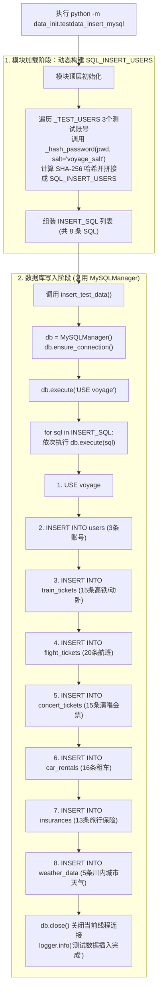

# `data_init/testdata_insert_mysql.py` 代码精讲学习手册

> **本文档完全自包含（Self-Contained）**：已 100% 完整嵌入 `data_init/testdata_insert_mysql.py` 的全部 170 行源码与测试数据 SQL，无需打开 `.py` 原文件即可独立掌握加盐密码哈希（Salt + SHA-256）、Python 生成器表达式动态拼接 SQL、批量多行 `INSERT` 优化以及全套黄金测试数据集的设计逻辑。

---

## 一、文件定位与核心前置知识精讲

### 1.1 文件在项目中的定位
`data_init/testdata_insert_mysql.py` 是 `Voyage智途A2A` 项目的**MySQL 基础业务测试数据灌库脚本**。  
在执行完 `python -m data_init.mysql_init` 创建好 10 张空表后，运行 `python -m data_init.testdata_insert_mysql`，该脚本会使用 `MySQLManager` 向 `voyage` 数据库批量写入 **7 张表、共 87 条精心编排的基准测试数据**，围绕**“2026-05-01 五一黄金周：北京 $\rightarrow$ 成都”**这一核心出行场景构建了一个完整、自洽的闭环业务数据集：
1. **`users`（3 个预置测试账号）**：`test_user`、`student_01`、`student_02`；
2. **`train_tickets`（15 条火车/高铁票）**：2026-05-01 北京 $\rightarrow$ 成都（涵盖 G351、G349、G89、G557、G327 高铁及 D19 动卧，覆盖二等座/一等座/商务座/一等卧）；
3. **`flight_tickets`（20 条航班机票）**：2026-05-01 北京 $\rightarrow$ 成都（涵盖国航 CA、东航 MU、南航 CZ、川航 3U，覆盖经济舱/商务舱/头等舱）；
4. **`concert_tickets`（15 条演唱会门票）**：2026-05-01 成都本地三大场馆（薛之谦、邓紫棋、华晨宇演唱会各档位票型）；
5. **`car_rentals`（16 条租车库存）**：2026-05-01 成都取还车（神州租车、一嗨租车、携程租车，覆盖经济型/SUV/豪华型/MPV、自动挡/手动挡）；
6. **`insurances`（13 条旅行保险产品）**：覆盖综合型、意外型、医疗型、境外型四大类；
7. **`weather_data`（5 条气象预报数据）**：2026-05-01 成都及周边景区城市（成都、都江堰、乐山、德阳、绵阳）的完整 28 项气象指标。

---

### 1.2 核心前置知识精讲

#### （1）密码学安全基础：为什么密码绝不能明文存库？什么是“加盐哈希（Salt + SHA-256）”？
在 `users` 表中，存储的不是明文密码 `"voyage_test_user"`，而是经过 `_hash_password()` 计算出的 64 位十六进制哈希字符串。
- **什么是单向哈希函数（SHA-256）？**
  - SHA-256（Secure Hash Algorithm 256-bit）可以将任意长度的字节流映射为一个固定 256 比特（即 64 个十六进制字符 `0-9a-f`）的摘要。它具有**单向不可逆性**：知道输入可以瞬间算出哈希值，但拿到哈希值无法反推出原始密码。
- **为什么单纯用 `sha256(password)` 还不够，必须“加盐（Salt）”？**
  - 黑客手里有预先计算好的百亿级常用密码哈希对照表——**彩虹表（Rainbow Table）**。如果直接存 `sha256("123456")`，黑客一查彩虹表就能瞬间反查出明文是 `"123456"`。
  - **加盐（Salt）**：在计算哈希前，先给原始密码拼接一段系统专属的字符串（本项目中 `salt = "voyage_salt"`），再去算 SHA-256：
    $$\text{password\_hash} = \text{SHA256}(\text{"voyage\_salt"} + \text{password})$$
  - 这样即使两个用户的密码都是简单的常用词，加上系统专属盐值后，生成的哈希值在公开彩虹表中也根本查不到！
- **与 `core/auth.py` 的契约一致性**：
  - 预置测试账号在灌库时使用的哈希算法与盐值（`"voyage_salt"`），必须与用户登录校验模块 `core/auth.py` 完全一致，否则登录时算出的哈希值与数据库里存的不匹配，会导致永远无法登录。

#### （2）单条多值批量插入（Multi-row `INSERT`）的性能优势
观察本文件中的 `SQL_INSERT_TRAIN_TICKETS`、`SQL_INSERT_FLIGHT_TICKETS` 等语句，它们没有写成 15 条独立的 `INSERT INTO ... VALUES (...)` 循环执行，而是写成了**一条包含 15 组括号的单条批量 SQL**：
```sql
INSERT INTO train_tickets (...) VALUES
('北京', '成都', ...),
('北京', '成都', ...),
...
('北京', '成都', ...);
```
- **为什么要这样写？**
  1. **大幅减少网络往返（RTT）**：15 条记录只需 1 次客户端到 MySQL 服务端的网络通信；
  2. **大幅减少事务与刷盘开销**：在 `MySQLManager` 开启了 `autocommit=True` 的情况下，如果分 15 次执行 `db.execute()`，MySQL 会开启并提交 15 个独立事务（触发 15 次 redo log 刷盘）；合并为 1 条多值 `INSERT` 后，15 行数据在 **1 个原子事务**中一次性写入并刷盘，速度提升数倍至数十倍！

---

## 二、调用关系与执行流程图

### 2.1 Mermaid 测试数据灌库流程图



### 2.2 核心测试数据集全景速查表（五一黄金周：2026-05-01）

```
┌─────────────────────┬───────┬──────────────────────────────────────────────────────────────┐
│ 目标表名             │ 记录数 │ 数据覆盖范围与测试要点                                         │
├─────────────────────┼───────┼──────────────────────────────────────────────────────────────┤
│ users               │  3 条 │ test_user (密码 voyage_test_user), student_01, student_02     │
│ train_tickets       │ 15 条 │ 北京→成都 (2026-05-01), G351/G349/G89/G557/G327/D19(跨夜动卧) │
│ flight_tickets      │ 20 条 │ 北京→成都 (2026-05-01), 国航CA/东航MU/南航CZ/川航3U 全时段舱位 │
│ concert_tickets     │ 15 条 │ 成都 (2026-05-01晚), 薛之谦(东安湖)/邓紫棋(凤凰山)/华晨宇      │
│ car_rentals         │ 16 条 │ 成都 (2026-05-01), 神州/一嗨/携程, 经济型/SUV/豪华型/MPV       │
│ insurances          │ 13 条 │ 综合型(4款)/意外型(3款)/医疗型(3款)/境外型(3款, 14天保障)      │
│ weather_data        │  5 条 │ 2026-05-01 成都(多云)/都江堰(小雨)/乐山(晴)/德阳/绵阳           │
└─────────────────────┴───────┴──────────────────────────────────────────────────────────────┘
```

---

## 三、完整源码与逐行/逐段深度拆解

### 3.1 100% 完整源码

```python

import hashlib
import uuid

def _hash_password(password: str, salt: str = "voyage_salt") -> str:
    """密码哈希：salt + SHA256（与 core/auth.py 保持一致）
    salt 盐：用于增加密码哈希的随机性，防止彩虹表攻击
    """
    return hashlib.sha256((salt + password).encode()).hexdigest()


# ==================== 预置测试账号 ====================
# 密码规则：voyage_{user_id}
_TEST_USERS = [
    ("test_user",  "voyage_test_user",  "测试用户"),
    ("student_01", "voyage_student_01", "学员01"),
    ("student_02", "voyage_student_02", "学员02"),
]

SQL_INSERT_USERS = (
    "INSERT INTO users (user_id, password_hash, nickname) VALUES\n"
    + ",\n".join(
        f"('{uid}', '{_hash_password(pwd)}', '{nick}')"
        for uid, pwd, nick in _TEST_USERS
    )
)

SQL_USE_DATABASE = "USE voyage"

# ==================== 火车票：北京 → 成都（2026-05-01） ====================
SQL_INSERT_TRAIN_TICKETS = """
INSERT INTO train_tickets (departure_city, arrival_city, departure_time, arrival_time, train_number, seat_type, total_seats, remaining_seats, price) VALUES
('北京', '成都', '2026-05-01 06:30:00', '2026-05-01 14:45:00', 'G351', '二等座', 1000, 128, 796.00),
('北京', '成都', '2026-05-01 06:30:00', '2026-05-01 14:45:00', 'G351', '一等座', 400, 35, 1273.50),
('北京', '成都', '2026-05-01 06:30:00', '2026-05-01 14:45:00', 'G351', '商务座', 50, 5, 2389.00),
('北京', '成都', '2026-05-01 08:00:00', '2026-05-01 16:20:00', 'G349', '二等座', 1000, 67, 796.00),
('北京', '成都', '2026-05-01 08:00:00', '2026-05-01 16:20:00', 'G349', '一等座', 400, 18, 1273.50),
('北京', '成都', '2026-05-01 08:00:00', '2026-05-01 16:20:00', 'G349', '商务座', 50, 2, 2389.00),
('北京', '成都', '2026-05-01 10:15:00', '2026-05-01 18:30:00', 'G89',  '二等座', 1000, 203, 796.00),
('北京', '成都', '2026-05-01 10:15:00', '2026-05-01 18:30:00', 'G89',  '一等座', 400, 52, 1273.50),
('北京', '成都', '2026-05-01 10:15:00', '2026-05-01 18:30:00', 'G89',  '商务座', 50, 8, 2389.00),
('北京', '成都', '2026-05-01 13:40:00', '2026-05-01 21:55:00', 'G557', '二等座', 1000, 312, 796.00),
('北京', '成都', '2026-05-01 13:40:00', '2026-05-01 21:55:00', 'G557', '一等座', 400, 89, 1273.50),
('北京', '成都', '2026-05-01 16:00:00', '2026-05-02 00:15:00', 'G327', '二等座', 1000, 156, 796.00),
('北京', '成都', '2026-05-01 16:00:00', '2026-05-02 00:15:00', 'G327', '一等座', 400, 41, 1273.50),
('北京', '成都', '2026-05-01 20:30:00', '2026-05-02 08:10:00', 'D19',  '二等座', 800, 445, 623.00),
('北京', '成都', '2026-05-01 20:30:00', '2026-05-02 08:10:00', 'D19',  '一等卧', 400, 98, 892.00)
"""

# ==================== 航班机票：北京 → 成都（2026-05-01） ====================
SQL_INSERT_FLIGHT_TICKETS = """
INSERT INTO flight_tickets (departure_city, arrival_city, departure_time, arrival_time, flight_number, cabin_type, total_seats, remaining_seats, price) VALUES
('北京', '成都', '2026-05-01 07:20:00', '2026-05-01 10:15:00', 'CA4116', '经济舱', 200, 12, 1580.00),
('北京', '成都', '2026-05-01 07:20:00', '2026-05-01 10:15:00', 'CA4116', '商务舱', 40, 3, 3860.00),
('北京', '成都', '2026-05-01 09:40:00', '2026-05-01 12:30:00', 'CA4108', '经济舱', 220, 28, 1620.00),
('北京', '成都', '2026-05-01 09:40:00', '2026-05-01 12:30:00', 'CA4108', '商务舱', 40, 6, 3980.00),
('北京', '成都', '2026-05-01 09:40:00', '2026-05-01 12:30:00', 'CA4108', '头等舱', 16, 1, 6280.00),
('北京', '成都', '2026-05-01 13:10:00', '2026-05-01 16:00:00', 'CA4112', '经济舱', 200, 45, 1550.00),
('北京', '成都', '2026-05-01 13:10:00', '2026-05-01 16:00:00', 'CA4112', '商务舱', 40, 9, 3780.00),
('北京', '成都', '2026-05-01 08:30:00', '2026-05-01 11:25:00', 'MU5448', '经济舱', 190, 34, 1490.00),
('北京', '成都', '2026-05-01 08:30:00', '2026-05-01 11:25:00', 'MU5448', '商务舱', 36, 7, 3650.00),
('北京', '成都', '2026-05-01 15:50:00', '2026-05-01 18:45:00', 'MU5452', '经济舱', 200, 52, 1420.00),
('北京', '成都', '2026-05-01 15:50:00', '2026-05-01 18:45:00', 'MU5452', '商务舱', 36, 11, 3520.00),
('北京', '成都', '2026-05-01 06:50:00', '2026-05-01 09:40:00', 'CZ6181', '经济舱', 210, 18, 1650.00),
('北京', '成都', '2026-05-01 06:50:00', '2026-05-01 09:40:00', 'CZ6181', '商务舱', 42, 4, 4020.00),
('北京', '成都', '2026-05-01 11:00:00', '2026-05-01 13:50:00', 'CZ6185', '经济舱', 210, 67, 1520.00),
('北京', '成都', '2026-05-01 11:00:00', '2026-05-01 13:50:00', 'CZ6185', '商务舱', 42, 14, 3720.00),
('北京', '成都', '2026-05-01 18:30:00', '2026-05-01 21:25:00', 'CZ6189', '经济舱', 210, 89, 1380.00),
('北京', '成都', '2026-05-01 07:55:00', '2026-05-01 10:50:00', '3U8886', '经济舱', 180, 23, 1460.00),
('北京', '成都', '2026-05-01 07:55:00', '2026-05-01 10:50:00', '3U8886', '商务舱', 32, 5, 3580.00),
('北京', '成都', '2026-05-01 14:20:00', '2026-05-01 17:10:00', '3U8892', '经济舱', 180, 41, 1510.00),
('北京', '成都', '2026-05-01 20:00:00', '2026-05-01 22:55:00', '3U8896', '经济舱', 180, 72, 1350.00)
"""

# ==================== 演唱会票：成都（2026-05-01） ====================
SQL_INSERT_CONCERT_TICKETS = """
INSERT INTO concert_tickets (artist, city, venue, start_time, end_time, ticket_type, total_seats, remaining_seats, price) VALUES
('薛之谦', '成都', '成都东安湖体育公园主体育场', '2026-05-01 19:00:00', '2026-05-01 22:30:00', 'VIP内场', 6000, 89, 1680.00),
('薛之谦', '成都', '成都东安湖体育公园主体育场', '2026-05-01 19:00:00', '2026-05-01 22:30:00', '内场A区', 8000, 234, 1280.00),
('薛之谦', '成都', '成都东安湖体育公园主体育场', '2026-05-01 19:00:00', '2026-05-01 22:30:00', '内场B区', 8000, 456, 980.00),
('薛之谦', '成都', '成都东安湖体育公园主体育场', '2026-05-01 19:00:00', '2026-05-01 22:30:00', '看台A区', 15000, 2345, 780.00),
('薛之谦', '成都', '成都东安湖体育公园主体育场', '2026-05-01 19:00:00', '2026-05-01 22:30:00', '看台B区', 15000, 5678, 580.00),
('薛之谦', '成都', '成都东安湖体育公园主体育场', '2026-05-01 19:00:00', '2026-05-01 22:30:00', '看台C区', 12000, 4321, 380.00),
('邓紫棋', '成都', '凤凰山体育公园综合体育馆', '2026-05-01 19:30:00', '2026-05-01 22:30:00', 'VIP内场', 5000, 67, 1980.00),
('邓紫棋', '成都', '凤凰山体育公园综合体育馆', '2026-05-01 19:30:00', '2026-05-01 22:30:00', '内场', 7000, 345, 1480.00),
('邓紫棋', '成都', '凤凰山体育公园综合体育馆', '2026-05-01 19:30:00', '2026-05-01 22:30:00', '看台A区', 10000, 1234, 880.00),
('邓紫棋', '成都', '凤凰山体育公园综合体育馆', '2026-05-01 19:30:00', '2026-05-01 22:30:00', '看台B区', 12000, 3456, 680.00),
('邓紫棋', '成都', '凤凰山体育公园综合体育馆', '2026-05-01 19:30:00', '2026-05-01 22:30:00', '看台C区', 10000, 5678, 480.00),
('华晨宇', '成都', '成都露天音乐公园', '2026-05-01 18:00:00', '2026-05-01 22:00:00', '火星VIP', 4000, 123, 2180.00),
('华晨宇', '成都', '成都露天音乐公园', '2026-05-01 18:00:00', '2026-05-01 22:00:00', '内场', 10000, 890, 1380.00),
('华晨宇', '成都', '成都露天音乐公园', '2026-05-01 18:00:00', '2026-05-01 22:00:00', '看台', 16000, 4567, 780.00),
('华晨宇', '成都', '成都露天音乐公园', '2026-05-01 18:00:00', '2026-05-01 22:00:00', '站票', 10000, 6789, 380.00)
"""

# ==================== 租车：成都（2026-05-01） ====================
SQL_INSERT_CAR_RENTALS = """
INSERT INTO car_rentals (company, pickup_city, return_city, pickup_date, car_type, car_model, price_per_day, total_available, transmission, seats, deposit) VALUES
('神州租车', '成都', '成都', '2026-05-01', '经济型', '丰田卡罗拉', 168.00, 15, '自动挡', 5, 3000),
('神州租车', '成都', '成都', '2026-05-01', '经济型', '大众朗逸', 158.00, 18, '自动挡', 5, 3000),
('神州租车', '成都', '成都', '2026-05-01', 'SUV', '哈弗H6', 298.00, 10, '自动挡', 5, 5000),
('神州租车', '成都', '成都', '2026-05-01', 'SUV', '丰田RAV4', 338.00, 8, '自动挡', 5, 5500),
('神州租车', '成都', '成都', '2026-05-01', '豪华型', '宝马3系', 520.00, 4, '自动挡', 5, 10000),
('神州租车', '成都', '成都', '2026-05-01', 'MPV', '别克GL8', 458.00, 6, '自动挡', 7, 8000),
('一嗨租车', '成都', '成都', '2026-05-01', '经济型', '长安逸动', 138.00, 20, '自动挡', 5, 2500),
('一嗨租车', '成都', '成都', '2026-05-01', '经济型', '比亚迪秦Plus', 148.00, 16, '自动挡', 5, 2500),
('一嗨租车', '成都', '成都', '2026-05-01', 'SUV', '长安CS75 Plus', 278.00, 12, '自动挡', 5, 5000),
('一嗨租车', '成都', '成都', '2026-05-01', 'SUV', '坦克300', 398.00, 5, '自动挡', 5, 7000),
('一嗨租车', '成都', '成都', '2026-05-01', '豪华型', '蔚来ES6', 518.00, 3, '自动挡', 5, 9000),
('一嗨租车', '成都', '成都', '2026-05-01', 'MPV', '广汽传祺M8', 428.00, 7, '自动挡', 7, 7500),
('携程租车', '成都', '成都', '2026-05-01', '经济型', '大众捷达', 128.00, 22, '手动挡', 5, 2000),
('携程租车', '成都', '成都', '2026-05-01', '经济型', '吉利帝豪', 118.00, 25, '手动挡', 5, 2000),
('携程租车', '成都', '成都', '2026-05-01', 'SUV', '理想L7', 388.00, 4, '自动挡', 5, 6500),
('携程租车', '成都', '成都', '2026-05-01', '豪华型', '奔驰C级', 620.00, 2, '自动挡', 5, 12000)
"""

# ==================== 旅行保险 ====================
SQL_INSERT_INSURANCES = """
INSERT INTO insurances (insurance_type, name, company, coverage, price, duration_days, max_coverage, medical_coverage, baggage_coverage, flight_delay) VALUES
('综合型', '平安旅行综合保障计划', '平安保险', '意外伤害50万+医疗费用10万+行李丢失5000+航班延误800元', 88.00, 7, 500000.00, 100000.00, 5000.00, TRUE),
('综合型', '太平洋全方位旅行保障', '太平洋保险', '意外伤害30万+医疗费用5万+行李丢失3000+航班延误500元+紧急救援', 75.00, 7, 300000.00, 50000.00, 3000.00, TRUE),
('综合型', '中国人寿尊享旅行计划', '中国人寿', '意外伤害100万+医疗费用20万+行李丢失1万+航班延误1000元+紧急救援+住院津贴', 168.00, 7, 1000000.00, 200000.00, 10000.00, TRUE),
('综合型', '人保财险旅行无忧计划', '中国人保', '意外伤害20万+医疗费用3万+航班延误600元', 55.00, 7, 200000.00, 30000.00, 0.00, TRUE),
('意外型', '平安旅行意外伤害保险', '平安保险', '意外伤害30万+意外医疗2万+紧急救援', 35.00, 7, 300000.00, 20000.00, 0.00, FALSE),
('意外型', '太保旅行意外保障', '太平洋保险', '意外伤害20万+意外医疗1万', 25.00, 7, 200000.00, 10000.00, 0.00, FALSE),
('意外型', '国寿出行意外险', '中国人寿', '意外伤害50万+意外医疗5万+骨折保障', 48.00, 7, 500000.00, 50000.00, 0.00, FALSE),
('医疗型', '平安旅行医疗保障', '平安保险', '医疗费用10万+住院津贴100元/天+紧急医疗转运+门诊直付', 55.00, 7, 100000.00, 100000.00, 0.00, FALSE),
('医疗型', '太保海外医疗保障计划', '太平洋保险', '医疗费用50万+住院津贴200元/天+紧急救援+全球SOS服务+门诊直付', 128.00, 7, 500000.00, 500000.00, 0.00, FALSE),
('医疗型', '人保旅行医疗保险', '中国人保', '医疗费用5万+住院津贴50元/天+紧急救援', 38.00, 7, 50000.00, 50000.00, 0.00, FALSE),
('境外型', '安联全球旅行保障计划', '安联保险', '意外伤害50万+医疗费用100万+行李丢失8000+航班延误1000元+全球紧急救援+签证拒签补偿', 198.00, 14, 5000000.00, 1000000.00, 8000.00, TRUE),
('境外型', '美亚万国旅行保障', '美亚保险', '意外伤害30万+医疗费用50万+行李丢失5000+航班延误800元+个人责任+紧急救援', 158.00, 14, 3000000.00, 500000.00, 5000.00, TRUE),
('境外型', '平安境外旅行综合保障', '平安保险', '意外伤害100万+医疗费用200万+行李丢失1万+航班延误1500元+全球SOS+旅行证件丢失', 268.00, 14, 10000000.00, 2000000.00, 10000.00, TRUE)
"""

# ==================== 天气数据：成都及周边（2026-05-01） ====================
SQL_INSERT_WEATHER_DATA = """
INSERT INTO weather_data (city, fx_date, sunrise, sunset, moonrise, moonset, moon_phase, moon_phase_icon, temp_max, temp_min, icon_day, text_day, icon_night, text_night, wind360_day, wind_dir_day, wind_scale_day, wind_speed_day, wind360_night, wind_dir_night, wind_scale_night, wind_speed_night, precip, uv_index, humidity, pressure, vis, cloud) VALUES
('成都', '2026-05-01', '06:18', '19:32', '22:45', '08:12', '盈凸月', 'wx045', 28, 18, '101', '多云', '150', '阴', 135, '东南风', '2级', 14, 180, '南风', '1级', 8, 1.2, 6, 65, 1012, 12, 55),
('都江堰', '2026-05-01', '06:20', '19:34', '22:47', '08:14', '盈凸月', 'wx045', 25, 16, '305', '小雨', '305', '小雨', 120, '东南风', '2级', 15, 150, '南风', '1级', 10, 8.5, 4, 78, 1010, 8, 80),
('乐山', '2026-05-01', '06:16', '19:30', '22:43', '08:10', '盈凸月', 'wx045', 29, 19, '100', '晴', '100', '晴', 160, '南风', '1级', 10, 190, '南风', '1级', 6, 0.0, 7, 55, 1013, 15, 30),
('德阳', '2026-05-01', '06:17', '19:31', '22:44', '08:11', '盈凸月', 'wx045', 27, 17, '101', '多云', '101', '多云', 145, '东南风', '2级', 12, 170, '南风', '1级', 7, 0.3, 6, 60, 1012, 13, 45),
('绵阳', '2026-05-01', '06:15', '19:30', '22:43', '08:09', '盈凸月', 'wx045', 26, 16, '102', '晴间多云', '150', '阴', 130, '东南风', '1级', 9, 160, '南风', '1级', 6, 0.0, 5, 58, 1014, 14, 40)
"""

# 按执行顺序排列的插入 SQL（先切库）
INSERT_SQL = [
    SQL_USE_DATABASE,
    SQL_INSERT_USERS,
    SQL_INSERT_TRAIN_TICKETS,
    SQL_INSERT_FLIGHT_TICKETS,
    SQL_INSERT_CONCERT_TICKETS,
    SQL_INSERT_CAR_RENTALS,
    SQL_INSERT_INSURANCES,
    SQL_INSERT_WEATHER_DATA,
]

from utils import logger
from utils import MySQLManager

def insert_test_data():
    """插入测试数据：检查连接→切库→逐条插入→关闭"""
    db = MySQLManager()
    db.ensure_connection()
    db.execute(SQL_USE_DATABASE)
    for sql in INSERT_SQL:
        db.execute(sql)
    db.close()
    logger.info("测试数据插入完成")

if __name__ == '__main__':
    insert_test_data()
```

---

### 3.2 逐段深度拆解

#### 第一段：`_hash_password` 与动态生成 `SQL_INSERT_USERS`（第 5~26 行）
```python
def _hash_password(password: str, salt: str = "voyage_salt") -> str:
    return hashlib.sha256((salt + password).encode()).hexdigest()

_TEST_USERS = [
    ("test_user",  "voyage_test_user",  "测试用户"),
    ("student_01", "voyage_student_01", "学员01"),
    ("student_02", "voyage_student_02", "学员02"),
]

SQL_INSERT_USERS = (
    "INSERT INTO users (user_id, password_hash, nickname) VALUES\n"
    + ",\n".join(
        f"('{uid}', '{_hash_password(pwd)}', '{nick}')"
        for uid, pwd, nick in _TEST_USERS
    )
)
```
- **三步拆解 `_hash_password("voyage_test_user")`**:
  1. 字符串拼接：`"voyage_salt" + "voyage_test_user"` $\rightarrow$ `"voyage_saltvoyage_test_user"`；
  2. `.encode()`：默认按 UTF-8 编码为字节串 `b"voyage_saltvoyage_test_user"`（`hashlib.sha256()` 只接受 `bytes` 类型，传 `str` 会报 `TypeError: Unicode-objects must be encoded before hashing`）；
  3. `.hexdigest()`：将 32 字节二进制摘要转为 64 位小写十六进制字符串。
- **生成器表达式 + `",\n".join(...)` 动态拼接 SQL**：
  - 遍历 `_TEST_USERS` 三元组 `(uid, pwd, nick)`，生成 3 行 `('test_user', '<64位哈希>', '测试用户')`，用 `,\n` 连接成合法的多行 `INSERT` SQL。

#### 第二段：`insert_test_data()` —— 复用 `MySQLManager` 批量执行（第 159~167 行）
```python
def insert_test_data():
    """插入测试数据：检查连接→切库→逐条插入→关闭"""
    db = MySQLManager()
    db.ensure_connection()
    db.execute(SQL_USE_DATABASE)
    for sql in INSERT_SQL:
        db.execute(sql)
    db.close()
    logger.info("测试数据插入完成")
```
- 因为 `MySQLManager.execute()` 在执行完单条 SQL 后**保持当前线程连接不关闭**，所以 `for sql in INSERT_SQL:` 循环中的所有 8 条 SQL 全都在同一条 TCP 连接上连续高速执行，最后由第 166 行 `db.close()` 统一关闭连接。

---

### 3.3 沙盘推演（Dry Run）：`SQL_INSERT_USERS` 的展开与执行结果

1. **Step 1：在内存中展开 `SQL_INSERT_USERS`**
   - 对 `("test_user", "voyage_test_user", "测试用户")` 计算 `_hash_password("voyage_test_user")`；
   - 拼接生成的 `SQL_INSERT_USERS` 完整字符串为：
     ```sql
     INSERT INTO users (user_id, password_hash, nickname) VALUES
     ('test_user', 'f73784d5e1320c32245f8c8f11c52d260fb847bf7382829098d4ef34085862e3', '测试用户'),
     ('student_01', '73ef859705371c2294978b8c9d039982c01f0791871665e33c61614b9047990a', '学员01'),
     ('student_02', '480f877179f3a36d6a6b48096488a3081643d58989738910212d1d24159c8719', '学员02')
     ```
2. **Step 2：连续执行 `INSERT_SQL`**
   - 依次向 `users`（3 行）、`train_tickets`（15 行）、`flight_tickets`（20 行）、`concert_tickets`（15 行）、`car_rentals`（16 行）、`insurances`（13 行）、`weather_data`（5 行）写入共 87 行数据。
   - 此时打开前端网页，使用账号 `test_user`、密码 `voyage_test_user` 即可直接登录，并提问“帮我查下 2026年5月1日 北京到成都的高铁票和成都的薛之谦演唱会门票”！

---

## 四、工程细节、潜在注意点与最佳实践

### 4.1 潜在注意点：重复运行 `testdata_insert_mysql.py` 会发生什么？
在 `mysql_init.py` 中，我们为所有 7 张表都设计了主键或 `UNIQUE KEY`（如 `users.user_id`、`unique_train`、`unique_flight`、`unique_city_date`）。  
而在本文件 `testdata_insert_mysql.py` 中，使用的是标准的 `INSERT INTO ... VALUES ...`（没有加 `INSERT IGNORE` 或 `ON DUPLICATE KEY UPDATE`）。
- **第一次运行**（紧跟在 `mysql_init.py` 之后）：7 张表全部插入成功。
- **如果不重跑 `mysql_init.py` 而直接第二次运行 `testdata_insert_mysql.py`**：
  - 每条 `INSERT` 都会触发 MySQL 的唯一键冲突异常 `pymysql.err.IntegrityError: (1062, "Duplicate entry ...")`；
  - `MySQLManager.execute()` 会捕获该异常，打印 `WARNING` 日志 `SQL 执行失败: (1062, "Duplicate entry ...")` 并返回 `False`，最后依然打印 `"测试数据插入完成"`。
- **最佳实践**：如果要重置 MySQL 测试数据，标准操作顺序是先运行 `python -m data_init.mysql_init`（重建干净表），再运行 `python -m data_init.testdata_insert_mysql`。

---

## 五、自测思考题（附答案解析）

### 思考题 1
如果我想在前端页面测试登录功能，预置的 3 个测试账号的用户名和明文密码分别是什么？如果我想自己新增一个预置账号 `admin`，应该修改哪几行代码？

> **答案解析**：
> 1. 预置的 3 个测试账号及明文密码分别是：
>    - 账号：`test_user` ，密码：`voyage_test_user`
>    - 账号：`student_01`，密码：`voyage_student_01`
>    - 账号：`student_02`，密码：`voyage_student_02`
> 2. 要新增 `admin` 账号，只需在 `testdata_insert_mysql.py` 第 14~18 行的 `_TEST_USERS` 列表中追加一行元组，例如：
>    `("admin", "voyage_admin", "管理员"),`
>    然后依次运行 `python -m data_init.mysql_init` 和 `python -m data_init.testdata_insert_mysql` 即可。

### 思考题 2
为什么本文件中的测试数据把火车票、机票、演唱会、租车、天气的日期全部统一设定在了 `2026-05-01`，城市聚焦在“北京 $\rightarrow$ 成都”？这对我们调试多 Agent 协同（A2A）有什么重要意义？

> **答案解析**：
> 这是为了方便测试 **A2A 多智能体跨领域协同编排能力**！
> 当用户在一次对话中提出跨越多个领域的复杂长程规划需求，例如：
> *“我打算 2026年5月1日 从北京去成都旅游，帮我查下当天上午的高铁或机票、成都当天的天气、到成都后租一辆 SUV，再看看晚上有没有薛之谦的演唱会门票，顺便推荐一款综合旅行保险。”*
> 由于所有表在 `2026-05-01` 和 `北京/成都` 上都有丰富且互相呼应的数据，主控 Agent 分发给 `TicketAssistant`、`WeatherQueryAssistant`、`TripAssistant` 的所有子任务都能同时命中真实数据，从而完整验证多 Agent 协同规划、汇总与预订的全链路效果。
