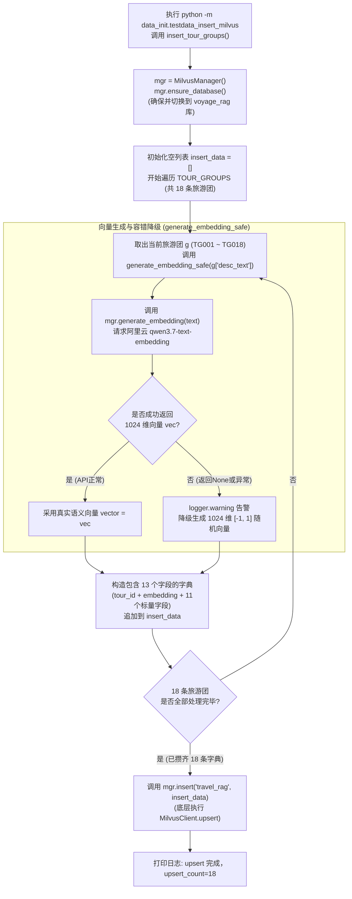

# `data_init/testdata_insert_milvus.py` 代码精讲学习手册

> **本文档完全自包含（Self-Contained）**：已 100% 完整嵌入 `data_init/testdata_insert_milvus.py` 的全部 337 行源码与 18 条旅游团完整测试数据，无需打开 `.py` 原文件即可独立掌握 RAG 知识库文档构建、批量 Embedding 向量化入库、API 失败降级兜底策略以及 `upsert` 幂等去重原理。

---

## 一、文件定位与核心前置知识精讲

### 1.1 文件在项目中的定位
`data_init/testdata_insert_milvus.py` 是 `Voyage智途A2A` 项目的 **RAG 旅游团向量知识库数据构建与灌库脚本（Offline Indexing Pipeline）**。  
在运行完 `python -m data_init.milvus_init` 创建好 `travel_rag` Collection 后，运行 `python -m data_init.testdata_insert_milvus`，该脚本会：
1. 遍历预置的 **18 条精品旅游团数据（`TOUR_GROUPS`，编号 `TG001` ~ `TG018`）**，覆盖成都及川西（5 条）、北京及周边（3 条）、西安（2 条）、杭州及江南（2 条）、三亚海岛（2 条）、云南丽江/大理（2 条）、张家界（1 条）、桂林（1 条）共 8 大热门旅游板块；
2. 针对每条旅游团的语义浓缩描述 `desc_text`，调用阿里云通义千问 Embedding API（`qwen3.7-text-embedding`）生成 **1024 维浮点数语义向量**；
3. 将生成的 `embedding` 向量与 12 个标量业务字段组装为字典列表，通过 `MilvusManager.insert()`（底层 `upsert`）一次性批量写入 Milvus 的 `travel_rag` 集合中。

---

### 1.2 核心前置知识精讲

#### （1）RAG 知识库入库核心技巧：为什么要专门设计 `desc_text` 字段用来生成向量？
观察 `TOUR_GROUPS` 中每条旅游团的数据结构（以 `TG001` 为例）：
```python
{
    "tour_id": "TG001",
    "tour_name": "成都大熊猫基地+宽窄巷子一日游",
    "city": "成都",
    "days": 1,
    "price": 198.00,
    "total_seats": 50,
    "remaining_seats": 32,
    "agency": "四川青旅",
    "rating": 4.8,
    "departure_dates": "2026-06-01,2026-06-05,2026-06-10,2026-06-15,2026-06-20",
    "highlights": "近距离观察大熊猫，品尝成都地道小吃，漫步宽窄巷子感受老成都文化",
    "desc_text": "成都市区一日游，大熊猫繁殖基地看国宝，宽窄巷子品茶吃小吃"
}
```
- **初学者常见误区**：把整个 JSON 字典（包含 `"departure_dates": "2026-06-01,..."`、`"total_seats": 50`、`"tour_id": "TG001"`）直接转成字符串丢给 Embedding 模型。
  - **后果**：大量的数字、日期字符串和字段名噪音会严重稀释核心语义特征（Embedding Dilution），导致向量相似度区分度下降。
- **企业级 RAG 最佳实践（语义索引列与展示列分离）**：
  - **索引列（`desc_text`）**：专门针对用户可能的自然语言搜索习惯（如搜“看国宝”、“高原徒步”、“江南水乡”、“冬季避寒”、“带着孩子玩海岛”），提炼出包含核心景点、主题、体验关键词与同义词的紧凑短句，**只拿 `desc_text` 去生成 `embedding` 向量**；
  - **过滤列（`city`、`days`、`price`、`rating`）**：存为结构化数值或短字符串标量字段，供 Milvus 的 `filter` 表达式做精确区间过滤；
  - **展示列（`tour_name`、`highlights`、`departure_dates`、`agency`、`remaining_seats`）**：命中后随 `output_fields` 原样取出，交给 LLM 组装成详实的用户回复。

#### （2）离线测试环境的降级容错机制（Graceful Degradation）：`generate_embedding_safe()`
在本地学习或离线 CI 测试环境中，开发者可能暂时没有配置阿里云 `AliApiKey` 环境变量，或者处于无外网环境。如果此时运行灌库脚本直接抛异常退出，后续的 Milvus 检索与流程联调就无法进行。  
因此，脚本设计了 `generate_embedding_safe(text)` 包装函数：
1. 优先通过 `MilvusManager.generate_embedding(text)` 调用真实 Embedding API；
2. 若返回 `None` 或抛出异常，打印 `WARNING` 告警日志，并**自动降级生成长度为 `CONFIG.EMBEDDING_DIMENSION`（1024 维）、每个元素在 $[-1, 1]$ 之间均匀分布的随机浮点数向量**：
   ```python
   [random.uniform(-1, 1) for _ in range(CONFIG.EMBEDDING_DIMENSION)]
   ```
   确保即使在离线无 Key 状态下，18 条旅游团数据也能顺利写入 Milvus 并跑通整套检索代码链路！（注：随机向量仅保证程序链路跑通，不具备真实语义相似度；配置好 `AliApiKey` 后重跑本脚本，会通过 `upsert` 自动将随机向量替换为真实语义向量！）

---

## 二、调用关系与执行流程图

### 2.1 Mermaid 批量向量化与 Upsert 入库流程图



### 2.2 18 条旅游团测试数据分布总览表（ASCII）

```
┌──────────────┬───────────────────┬────────────────────────────────────────────────────────┐
│ 区域板块      │ 团号范围 (数量)    │ 代表路线与核心语义标签 (desc_text 覆盖点)                │
├──────────────┼───────────────────┼────────────────────────────────────────────────────────┤
│ 成都及川西线  │ TG001 ~ TG005 (5) │ 大熊猫基地(国宝)/四姑娘山藏寨/九寨沟黄龙/峨眉山乐山/稻城亚丁│
│ 北京及周边    │ TG006 ~ TG008 (3) │ 故宫长城颐和园(皇家古都)/什刹海胡同后海/承德避暑山庄草原  │
│ 西安古都      │ TG009 ~ TG010 (2) │ 秦始皇兵马俑华清池古城墙/大唐不夜城大雁塔盛唐夜游         │
│ 杭州及江南    │ TG011 ~ TG012 (2) │ 西湖灵隐寺龙井茶园采茶/苏州园林(拙政园留园)周庄乌篷船     │
│ 三亚及海岛    │ TG013 ~ TG014 (2) │ 亚龙湾蜈支洲岛潜水(冬季避寒)/亚特兰蒂斯水世界亲子游乐园   │
│ 云南丽江大理  │ TG015 ~ TG016 (2) │ 丽江古城玉龙雪山泸沽湖/大理洱海环湖骑行苍山白族扎染       │
│ 张家界        │ TG017         (1) │ 袁家界悬浮山哈利路亚山/天门山玻璃栈道奇峰仙境            │
│ 桂林山水      │ TG018         (1) │ 漓江竹筏漂流/阳朔十里画廊骑行/喀斯特山水画卷             │
└──────────────┴───────────────────┴────────────────────────────────────────────────────────┘
```

---

## 三、完整源码与逐行/逐段深度拆解

### 3.1 100% 完整源码

```python

# ==================== 旅游团测试数据 ====================
# desc_text: 用于调用 Embedding API 生成向量
# 数据覆盖：成都(含川西)/北京/西安/杭州/三亚等多城市、多主题
TOUR_GROUPS = [
    # ===== 成都及川西线 =====
    {
        "tour_id": "TG001",
        "tour_name": "成都大熊猫基地+宽窄巷子一日游",
        "city": "成都",
        "days": 1,
        "price": 198.00,
        "total_seats": 50,
        "remaining_seats": 32,
        "agency": "四川青旅",
        "rating": 4.8,
        "departure_dates": "2026-06-01,2026-06-05,2026-06-10,2026-06-15,2026-06-20",
        "highlights": "近距离观察大熊猫，品尝成都地道小吃，漫步宽窄巷子感受老成都文化",
        "desc_text": "成都市区一日游，大熊猫繁殖基地看国宝，宽窄巷子品茶吃小吃"
    },
    {
        "tour_id": "TG002",
        "tour_name": "川西小环线三日游（四姑娘山+丹巴藏寨）",
        "city": "成都",
        "days": 3,
        "price": 1680.00,
        "total_seats": 30,
        "remaining_seats": 12,
        "agency": "西部探险国旅",
        "rating": 4.9,
        "departure_dates": "2026-06-03,2026-06-08,2026-06-13,2026-06-18",
        "highlights": "四姑娘山双桥沟观雪山，丹巴甲居藏寨体验藏族文化，塔公草原骑马",
        "desc_text": "川西高原短途旅行，近距离看雪山四姑娘山，藏族村寨体验，草原骑马"
    },
    {
        "tour_id": "TG003",
        "tour_name": "九寨沟+黄龙四日深度游",
        "city": "成都",
        "days": 4,
        "price": 2580.00,
        "total_seats": 25,
        "remaining_seats": 8,
        "agency": "九寨天堂国旅",
        "rating": 4.7,
        "departure_dates": "2026-06-02,2026-06-07,2026-06-12,2026-06-17",
        "highlights": "九寨沟五彩池、诺日朗瀑布，黄龙钙华彩池，川主寺藏族风情",
        "desc_text": "九寨沟黄龙自然风光之旅，五彩池瀑布钙华池，雪山湖泊森林景观"
    },
    {
        "tour_id": "TG004",
        "tour_name": "峨眉山+乐山大佛两日朝圣之旅",
        "city": "成都",
        "days": 2,
        "price": 880.00,
        "total_seats": 40,
        "remaining_seats": 22,
        "agency": "四川青旅",
        "rating": 4.6,
        "departure_dates": "2026-06-01,2026-06-06,2026-06-11,2026-06-16,2026-06-21",
        "highlights": "峨眉山金顶云海日出，乐山大佛凌云栈道，报国寺禅修体验",
        "desc_text": "佛教名山峨眉山朝圣之旅，金顶云海日出，乐山大佛世界遗产"
    },
    {
        "tour_id": "TG005",
        "tour_name": "稻城亚丁五日绝美徒步线",
        "city": "成都",
        "days": 5,
        "price": 3980.00,
        "total_seats": 16,
        "remaining_seats": 5,
        "agency": "西部探险国旅",
        "rating": 4.9,
        "departure_dates": "2026-06-05,2026-06-12,2026-06-19",
        "highlights": "牛奶海、五色海徒步，央迈勇雪山日照金山，洛绒牛场星空露营",
        "desc_text": "稻城亚丁高原徒步，雪山湖泊牛奶海五色海，蓝色星球最后的净土"
    },

    # ===== 北京及周边 =====
    {
        "tour_id": "TG006",
        "tour_name": "北京故宫+长城+颐和园经典三日游",
        "city": "北京",
        "days": 3,
        "price": 1980.00,
        "total_seats": 45,
        "remaining_seats": 25,
        "agency": "中青旅总社",
        "rating": 4.7,
        "departure_dates": "2026-06-01,2026-06-05,2026-06-10,2026-06-15,2026-06-20",
        "highlights": "故宫博物院深度讲解，八达岭长城登城，颐和园昆明湖游船，全聚德烤鸭宴",
        "desc_text": "北京经典历史文化遗产之旅，故宫长城颐和园，感受皇家气派与古都风韵"
    },
    {
        "tour_id": "TG007",
        "tour_name": "北京胡同文化+后海一日体验",
        "city": "北京",
        "days": 1,
        "price": 298.00,
        "total_seats": 30,
        "remaining_seats": 18,
        "agency": "胡同文旅",
        "rating": 4.8,
        "departure_dates": "2026-06-02,2026-06-04,2026-06-07,2026-06-09,2026-06-14",
        "highlights": "什刹海三轮车游胡同，南锣鼓巷文创探店，后海酒吧街夜游，老北京炸酱面",
        "desc_text": "北京老胡同深度文化体验，三轮车游胡同，后海风情，老北京美食之旅"
    },
    {
        "tour_id": "TG008",
        "tour_name": "承德避暑山庄+木兰围场两日避暑之旅",
        "city": "北京",
        "days": 2,
        "price": 1280.00,
        "total_seats": 35,
        "remaining_seats": 20,
        "agency": "中青旅总社",
        "rating": 4.5,
        "departure_dates": "2026-06-03,2026-06-08,2026-06-13,2026-06-18",
        "highlights": "避暑山庄皇家园林，木兰围场草原风光，坝上烤全羊篝火晚会",
        "desc_text": "承德避暑山庄皇家园林之旅，木兰围场草原风光，夏日避暑好去处"
    },

    # ===== 西安 =====
    {
        "tour_id": "TG009",
        "tour_name": "西安兵马俑+华清池+古城墙两日游",
        "city": "西安",
        "days": 2,
        "price": 1280.00,
        "total_seats": 40,
        "remaining_seats": 16,
        "agency": "西安中旅",
        "rating": 4.8,
        "departure_dates": "2026-06-01,2026-06-06,2026-06-11,2026-06-16,2026-06-21",
        "highlights": "兵马俑一二三号坑，华清池骊山，古城墙骑行，回民街美食",
        "desc_text": "西安古都历史文化之旅，秦始皇兵马俑，华清池，古城墙上骑自行车"
    },
    {
        "tour_id": "TG010",
        "tour_name": "西安大唐不夜城+大雁塔夜游半日团",
        "city": "西安",
        "days": 1,
        "price": 158.00,
        "total_seats": 60,
        "remaining_seats": 45,
        "agency": "长安文旅",
        "rating": 4.6,
        "departure_dates": "2026-06-01,2026-06-03,2026-06-05,2026-06-08,2026-06-12,2026-06-15",
        "highlights": "大唐不夜城灯光秀，大雁塔北广场音乐喷泉，唐装体验拍照",
        "desc_text": "西安大唐不夜城夜游，盛唐文化沉浸式体验，大雁塔灯光喷泉秀"
    },

    # ===== 杭州及江南 =====
    {
        "tour_id": "TG011",
        "tour_name": "杭州西湖+灵隐寺+龙井茶园两日闲游",
        "city": "杭州",
        "days": 2,
        "price": 1080.00,
        "total_seats": 35,
        "remaining_seats": 19,
        "agency": "浙江中旅",
        "rating": 4.7,
        "departure_dates": "2026-06-02,2026-06-07,2026-06-12,2026-06-17",
        "highlights": "西湖苏堤春晓游船，灵隐寺祈福，龙井村采茶炒茶体验，楼外楼杭帮菜",
        "desc_text": "杭州西湖江南水乡之旅，灵隐寺禅意，龙井茶园采茶，江南韵味"
    },
    {
        "tour_id": "TG012",
        "tour_name": "苏州园林+周庄水乡两日江南古韵游",
        "city": "杭州",
        "days": 2,
        "price": 1180.00,
        "total_seats": 30,
        "remaining_seats": 13,
        "agency": "江苏国旅",
        "rating": 4.8,
        "departure_dates": "2026-06-01,2026-06-06,2026-06-11,2026-06-16",
        "highlights": "拙政园、留园园林艺术，周庄双桥乌篷船，苏绣体验，松鼠鳜鱼",
        "desc_text": "苏州园林江南水乡之旅，拙政园留园，周庄古镇乌篷船，江南古典美"
    },

    # ===== 三亚及海岛 =====
    {
        "tour_id": "TG013",
        "tour_name": "三亚亚龙湾+蜈支洲岛四日海岛度假",
        "city": "三亚",
        "days": 4,
        "price": 3280.00,
        "total_seats": 30,
        "remaining_seats": 10,
        "agency": "海南椰旅",
        "rating": 4.6,
        "departure_dates": "2026-06-01,2026-06-05,2026-06-10,2026-06-15",
        "highlights": "亚龙湾沙滩日光浴，蜈支洲岛潜水，南山海上观音，海鲜大排档",
        "desc_text": "三亚热带海岛度假，沙滩阳光潜水，碧海蓝天海岛风光，冬季避寒胜地"
    },
    {
        "tour_id": "TG014",
        "tour_name": "三亚亲子欢乐三日游（亚特兰蒂斯+森林公园）",
        "city": "三亚",
        "days": 3,
        "price": 3880.00,
        "total_seats": 20,
        "remaining_seats": 7,
        "agency": "海南椰旅",
        "rating": 4.7,
        "departure_dates": "2026-06-03,2026-06-08,2026-06-13,2026-06-18",
        "highlights": "亚特兰蒂斯水世界，亚龙湾热带天堂森林公园过江龙索桥，亲子赶海",
        "desc_text": "三亚亲子游乐园之旅，亚特兰蒂斯水世界，热带森林公园，带着孩子玩海岛"
    },

    # ===== 云南 =====
    {
        "tour_id": "TG015",
        "tour_name": "丽江古城+玉龙雪山+泸沽湖五日深度游",
        "city": "丽江",
        "days": 5,
        "price": 3680.00,
        "total_seats": 20,
        "remaining_seats": 6,
        "agency": "云南中旅",
        "rating": 4.8,
        "departure_dates": "2026-06-02,2026-06-07,2026-06-12,2026-06-17",
        "highlights": "玉龙雪山大索道登顶，泸沽湖猪槽船游湖，丽江古城四方街夜游，摩梭族篝火晚会",
        "desc_text": "云南丽江雪山湖泊深度游，玉龙雪山登顶，泸沽湖摩梭文化，古城慢生活"
    },
    {
        "tour_id": "TG016",
        "tour_name": "大理洱海骑行+苍山徒步两日文艺之旅",
        "city": "丽江",
        "days": 2,
        "price": 980.00,
        "total_seats": 25,
        "remaining_seats": 14,
        "agency": "云南中旅",
        "rating": 4.7,
        "departure_dates": "2026-06-01,2026-06-05,2026-06-09,2026-06-13,2026-06-17",
        "highlights": "洱海环湖骑行，苍山洗马潭索道，喜洲古镇白族扎染体验，大理古城民谣酒吧",
        "desc_text": "大理洱海苍山文艺之旅，环湖骑行苍山徒步，白族文化体验，风花雪月"
    },

    # ===== 张家界 =====
    {
        "tour_id": "TG017",
        "tour_name": "张家界国家森林公园+天门山三日仙境游",
        "city": "张家界",
        "days": 3,
        "price": 2180.00,
        "total_seats": 30,
        "remaining_seats": 11,
        "agency": "湖南国旅",
        "rating": 4.6,
        "departure_dates": "2026-06-02,2026-06-07,2026-06-12,2026-06-17",
        "highlights": "袁家界哈利路亚山，天门山玻璃栈道，金鞭溪徒步，百龙天梯",
        "desc_text": "张家界奇峰异石仙境之旅，悬浮山哈利路亚山，天门山玻璃栈道刺激体验"
    },

    # ===== 桂林 =====
    {
        "tour_id": "TG018",
        "tour_name": "桂林漓江+阳朔十里画廊三日山水画中游",
        "city": "桂林",
        "days": 3,
        "price": 1880.00,
        "total_seats": 35,
        "remaining_seats": 15,
        "agency": "桂林国旅",
        "rating": 4.7,
        "departure_dates": "2026-06-01,2026-06-06,2026-06-11,2026-06-16",
        "highlights": "漓江竹筏漂流，阳朔十里画廊骑行，印象刘三姐演出，西街啤酒鱼",
        "desc_text": "桂林山水甲天下，漓江竹筏阳朔骑行，喀斯特地貌山水画卷"
    },
]

"""Milvus 旅游团向量库测试数据插入
支持重复执行自动去重（基于 tour_id 主键）
建库建表由 milvus_init.py 负责"""

from utils import CONFIG
from utils import logger
from utils import MilvusManager

# ====== 向量生成（委托 MilvusManager） =======
def generate_embedding_safe(text: str) -> list:
    """调用 Embedding API 生成向量，失败时降级为随机向量"""
    try:
        mgr = MilvusManager()
        vec = mgr.generate_embedding(text)
        if vec:
            return vec
        raise RuntimeError("embedding returned None")
    except Exception as e:
        logger.warning("Embedding API 调用失败(%s)，使用随机向量替代", e)
        import random
        return [
            random.uniform(-1, 1)
            for _ in range(CONFIG.EMBEDDING_DIMENSION)
        ]


# ======插入测试数据（upsert） ======
def insert_tour_groups():
    """仅插入测试数据（建库建表由 milvus_init.py 负责）"""
    mgr = MilvusManager()
    mgr.ensure_database()

    # 为全部旅游团生成向量
    logger.info("共 %d 条旅游团数据，正在生成向量...", len(TOUR_GROUPS))
    insert_data = []
    for g in TOUR_GROUPS:
        vector = generate_embedding_safe(g["desc_text"])
        insert_data.append({
            "tour_id": g["tour_id"],
            "embedding": vector,
            "tour_name": g["tour_name"],
            "city": g["city"],
            "days": g["days"],
            "price": g["price"],
            "total_seats": g["total_seats"],
            "remaining_seats": g["remaining_seats"],
            "agency": g["agency"],
            "rating": g["rating"],
            "departure_dates": g["departure_dates"],
            "highlights": g["highlights"],
            "desc_text": g["desc_text"],
        })

    # upsert：主键不存在则插入，存在则更新
    result = mgr.insert(CONFIG.DB_MILVUS_COLLECTION, insert_data)
    logger.info(
        "upsert 完成，upsert_count=%s",
        result.get("upsert_count", len(TOUR_GROUPS))
    )


if __name__ == "__main__":
    insert_tour_groups()
```

---

### 3.2 逐段深度拆解

#### 第一段：`generate_embedding_safe(text: str)` —— 安全的向量生成包装器（第 284~298 行）
```python
def generate_embedding_safe(text: str) -> list:
    try:
        mgr = MilvusManager()
        vec = mgr.generate_embedding(text)
        if vec:
            return vec
        raise RuntimeError("embedding returned None")
    except Exception as e:
        logger.warning("Embedding API 调用失败(%s)，使用随机向量替代", e)
        import random
        return [
            random.uniform(-1, 1)
            for _ in range(CONFIG.EMBEDDING_DIMENSION)
        ]
```
- **为什么要手动 `raise RuntimeError("embedding returned None")`？**
  - 回顾 `MilvusManager.generate_embedding(text)`（`milvus_manager.py` 第 74~76 行），当 `requests.post` 失败时，它内部已经捕获了异常并返回了 `None`（不会向外抛异常）。
  - 因此这里通过 `if vec: return vec` 判断，如果拿到的是 `None`，主动抛出 `RuntimeError` 进入下方的 `except` 分支，统一打印日志并生成 1024 维随机向量兜底。

#### 第二段：`insert_tour_groups()` —— 批量组装与一次性 `upsert`（第 302~333 行）
- **职责单一原则（Single Responsibility Principle）**：
  - 注释明确强调：`"""仅插入测试数据（建库建表由 milvus_init.py 负责）"""`。
  - 结构创建（DDL，`milvus_init.py`）与数据灌入（DML，`testdata_insert_milvus.py`）严格分离，与 MySQL 侧的 `mysql_init.py` + `testdata_insert_mysql.py` 保持完全对称的工程结构。
- **一次性批量 `mgr.insert(CONFIG.DB_MILVUS_COLLECTION, insert_data)`**：
  - 先在 Python 内存循环中为 18 条数据全部生成好向量，汇总在 `insert_data` 列表中，然后只调用 **1 次** `mgr.insert()`（即 `MilvusClient.upsert()`），将 18 条向量与标量一次性刷入 Milvus。
  - 返回的 `result` 是一个字典（如 `{'upsert_count': 18, 'cost': 0}`），通过 `result.get("upsert_count", len(TOUR_GROUPS))` 提取成功写入的条数并打印日志。

---

### 3.3 沙盘推演（Dry Run）：一条旅游团从字典到 Milvus 实体的完整转换

以第 1 条数据 `TG001` 为例：
1. **输入字典 `g`**：
   - `g["tour_id"] = "TG001"`
   - `g["desc_text"] = "成都市区一日游，大熊猫繁殖基地看国宝，宽窄巷子品茶吃小吃"`
2. **调用 `generate_embedding_safe(g["desc_text"])`**：
   - 调用阿里云 `qwen3.7-text-embedding`，返回 1024 个浮点数：
     `vector = [0.0241, -0.0193, 0.0412, ..., 0.0087]`（长度 1024）。
3. **组装写入实体并追加到 `insert_data`**：
   - 字典包含 13 个 Key，与 `milvus_init.py` 中 `build_travel_rag_schema()` 定义的 13 个 `FieldSchema` 名称、类型（`VARCHAR`、`FLOAT_VECTOR(1024)`、`INT64`、`DOUBLE`）**100% 严格对齐**！
4. **执行 `mgr.insert("travel_rag", insert_data)`**：
   - Milvus 检查主键 `tour_id`（`"TG001" ~ "TG018"`）：
     - 若库中不存在，则插入这 18 条记录；
     - 若之前已经运行过本脚本（或某些团的 `remaining_seats` 在测试预订时被扣减过），则将这 18 条记录恢复为初始测试状态。
   - 终端输出：`2026-05-01 10:01:05 [INFO] testdata_insert_milvus.py insert_tour_groups 330: upsert 完成，upsert_count=18`。

---

## 四、工程细节、潜在注意点与最佳实践

### 4.1 性能优化建议：在 `generate_embedding_safe` 中复用同一个 `MilvusManager` 实例
注意观察第 287 行：
```python
def generate_embedding_safe(text: str) -> list:
    try:
        mgr = MilvusManager()
        vec = mgr.generate_embedding(text)
```
在当前代码中，每次循环调用 `generate_embedding_safe()` 时都会在函数内部新建一个 `MilvusManager()`（从而新建一个 `MilvusClient` 连接），18 条数据会新建并销毁 18 次 `MilvusManager`。
- 虽然对于 18 条离线初始化数据耗时影响微乎其微（约几百毫秒），但在生产级大规模向量灌库（如几万条数据）时，可以将 `insert_tour_groups()` 中已经创建好的 `mgr` 作为参数传给 `generate_embedding_safe(mgr, text)`，或者直接使用 Embedding API 的批量输入特性（`input: [text1, text2, ..., text18]`）一次 HTTP 请求生成全部 18 条向量！

### 4.2 潜在注意点：必须先运行 `milvus_init.py` 再运行本脚本
由于本脚本只调用了 `mgr.ensure_database()`，没有调用 `mgr.ensure_collection()`，如果在运行 `milvus_init.py` 之前直接运行 `testdata_insert_milvus.py`，到第 329 行 `mgr.insert("travel_rag", insert_data)` 时会因为 `travel_rag` 集合不存在而报错 `MilvusException: can't find collection [collection=travel_rag]`。

---

## 五、自测思考题（附答案解析）

### 思考题 1
与 `testdata_insert_mysql.py` 重复运行会报 `Duplicate entry` 唯一键冲突不同，为什么 `testdata_insert_milvus.py` 可以反复运行任意多次而不会报错，也不会在 Milvus 中产生重复的 36 条、54 条数据？

> **答案解析**：
> 因为两点配合：
> 1. 在 `milvus_init.py` 中，`travel_rag` 集合设置了 `auto_id=False`，并将业务编号 `tour_id`（`"TG001" ~ "TG018"`）设为了主键（`is_primary=True`）；
> 2. 在 `MilvusManager.insert()` 底层调用的不是 `client.insert()`，而是 **`client.upsert()`**。当重复运行本脚本时，Milvus 识别到主键 `"TG001" ~ "TG018"` 已经存在，会自动执行原地更新（覆盖旧记录），因此无论运行多少次，集合中始终只有干净的 18 条旅游团数据，并且能把测试过程中被扣减的 `remaining_seats` 重置回初始值！

### 思考题 2
假如你在还没有设置 `AliApiKey` 环境变量的时候就运行了 `testdata_insert_milvus.py`（此时触发了降级策略，入库的是随机向量），后来你配好了 `AliApiKey`，需要删库重建 Milvus 吗？还是直接重跑一次 `python -m data_init.testdata_insert_milvus` 即可？

> **答案解析**：
> **无需删库重建，直接重跑一次 `python -m data_init.testdata_insert_milvus` 即可！**
> 因为配好 `AliApiKey` 后重跑本脚本，`generate_embedding_safe()` 会调用阿里云接口生成真实的 1024 维语义向量，接着通过 `upsert` 按主键 `"TG001" ~ "TG018"` 将之前入库的随机向量无缝覆盖替换为真实语义向量。
