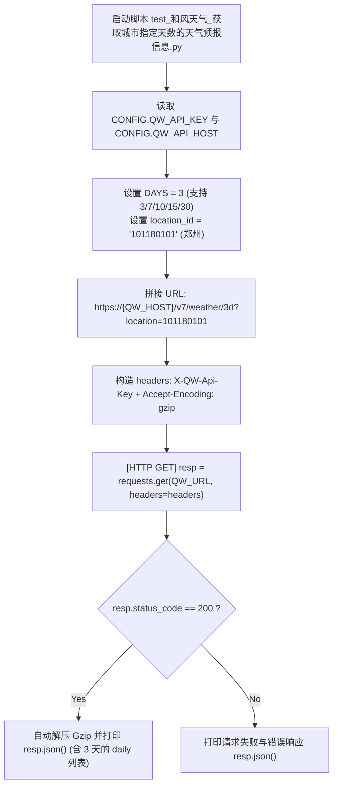

# `mcp_tools/test_和风天气_获取城市指定天数的天气预报信息.py` 代码精讲学习手册

> **阅读指南**：本文档是一份**完全独立（Self-Contained）**的源码精讲手册。文档内已 **100% 完整嵌入 `mcp_tools/test_和风天气_获取城市指定天数的天气预报信息.py` 的全部 21 行源代码**，并从工程定位、和风天气每日天气预报 API (`/v7/weather/{DAYS}d`) 协议规范、响应 JSON `daily` 数组全字段与 MySQL `weather_data` 表列名的映射关系、执行流程图、逐行精讲与沙盘推演（Dry Run）进行了全方位剖析，无需打开源码文件即可独立学习。

---

## 一、文件定位与核心前置知识精讲

### 1.1 在架构与研发流程中的位置

本文件 `mcp_tools/test_和风天气_获取城市指定天数的天气预报信息.py` 是和风天气**多日天气预报接口（`/v7/weather/{DAYS}d`）的最小独立调试脚本**。它在整个天气模块研发中扮演了**数据库表结构设计与定时采集器原型**的关键角色：
1. **验证多日预报接口**：通过动态变量 `DAYS = 3`（支持 `3 / 7 / 10 / 15 / 30` 天）验证 `/v7/weather/{DAYS}d` 接口联通性。
2. **决定 MySQL `weather_data` 表结构**：`weather_tools.py` 中 `weather_data` 表的 31 个字段以及 `save_weather()` 的字段提取逻辑，完全是根据本脚本打印出的 `daily` 数组元素的 JSON 键名一一映射设计的！
3. **孵化生产方法**：直接演化为 `mcp_tools/weather_tools.py` 中的 `WeatherCollector.get_weather_data(self, location_id)`（第 338~360 行，生产环境中将 `DAYS` 设为了 `self.FORECAST_DAYS = 15`）。

```text
┌──────────────────────────────────────────────────────────────────────────────┐
│ 本文件：test_和风天气_获取城市指定天数的天气预报信息.py ★ 原型脚本 (21行) ★   │
│   设置：DAYS = 3, location_id = '101180101' (郑州)                           │
│   请求：GET https://{QW_HOST}/v7/weather/3d?location=101180101               │
│   输出：包含未来 3 天逐日预报的 `daily` 列表 JSON                            │
└──────────────────────────────────────┬───────────────────────────────────────┘
                                       │ 将 DAYS 扩展为 FORECAST_DAYS = 15，并对接 MySQL 入库
                                       ▼
┌──────────────────────────────────────────────────────────────────────────────┐
│ 生产代码：mcp_tools/weather_tools.py                                         │
│   1. WeatherCollector.get_weather_data(loc_id) ──► 拉取 15 天预报字典         │
│   2. WeatherCollector.save_weather(city, dict) ──► 遍历 daily 落盘 MySQL     │
│   3. query_weather(city, start_date, end_date) ──► 从 MySQL 按日期范围查询   │
└──────────────────────────────────────────────────────────────────────────────┘
```

---

### 1.2 核心前置知识科普

#### （1）和风天气“每日天气预报 API (`/v7/weather/{DAYS}d`)”档位说明
和风天气的每日天气预报接口采用**路径参数 `{DAYS}d`** 区分预报天数档位（注意不是 Query 参数，而是直接拼在 URL 路径中）：
- **合法的 `DAYS` 取值（共 5 档）**：
  - `3d`：未来 3 天预报（今天、明天、后天）—— **免费开发版/标准版均支持，响应最快，最适合写测试脚本**（因此本脚本设 `DAYS = 3`）。
  - `7d`：未来 7 天预报。
  - `10d`：未来 10 天预报。
  - `15d`：未来 15 天预报 —— **`weather_tools.py` 生产采集器使用的档位（`self.FORECAST_DAYS = 15`）**，覆盖半个月的出行规划周期。
  - `30d`：未来 30 天预报。
- *(注：如果传入其他数字如 `5d`，和风 API 会直接返回 404 错误)*。

#### （2）响应 JSON `daily` 元素与 MySQL `weather_data` 表字段的一一映射表
运行本脚本后，返回的 JSON 顶层包含 `"code"`、`"updateTime"` 和一个长度为 `DAYS` 的列表 `"daily"`。
对比和风 API 返回的 `daily[i]` 驼峰命名（camelCase）与 `weather_tools.py` 中 MySQL `weather_data` 表的下划线命名（snake_case），你会立刻看懂 `save_weather()` 的设计来源：

| 和风 API `daily[i]` JSON 键名 | 示例值（字符串） | 对应 MySQL `weather_data` 表列名与类型 | 含义说明 |
| :--- | :--- | :--- | :--- |
| `fxDate` | `"2026-05-01"` | `fx_date DATE NOT NULL` | 预报日期（与 `city` 组成联合唯一索引） |
| `sunrise` / `sunset` | `"05:28"` / `"19:08"` | `sunrise TIME` / `sunset TIME` | 日出时间 / 日落时间 |
| `moonrise` / `moonset` | `"11:15"` / `"01:20"` | `moonrise TIME` / `moonset TIME` | 月升时间 / 月落时间 |
| `moonPhase` / `moonPhaseIcon` | `"上弦月"` / `"802"` | `moon_phase VARCHAR(20)` / `moon_phase_icon VARCHAR(10)` | 月相名称与图标代码 |
| `tempMax` / `tempMin` | `"28"` / `"15"` | `temp_max INT` / `temp_min INT` | 当天最高温度 / 最低温度 (`℃`) |
| `iconDay` / `textDay` | `"100"` / `"晴"` | `icon_day VARCHAR(10)` / `text_day VARCHAR(20)` | 白天天气图标与文字描述 |
| `iconNight` / `textNight` | `"150"` / `"晴"` | `icon_night VARCHAR(10)` / `text_night VARCHAR(20)` | 夜间天气图标与文字描述 |
| `wind360Day` / `windDirDay` | `"180"` / `"南风"` | `wind360_day INT` / `wind_dir_day VARCHAR(20)` | 白天风向 360 角度与风向名称 |
| `windScaleDay` / `windSpeedDay` | `"1-3"` / `"12"` | `wind_scale_day VARCHAR(10)` / `wind_speed_day INT` | 白天风力等级与风速 (`km/h`) |
| `wind360Night` / `windDirNight` | `"225"` / `"西南风"` | `wind360_night INT` / `wind_dir_night VARCHAR(20)` | 夜间风向 360 角度与风向名称 |
| `windScaleNight` / `windSpeedNight` | `"1-3"` / `"8"` | `wind_scale_night VARCHAR(10)` / `wind_speed_night INT` | 夜间风力等级与风速 (`km/h`) |
| `precip` | `"0.0"` | `precip DECIMAL(5,1)` | 当天预报总降水量 (`mm`) |
| `uvIndex` | `"8"` | `uv_index INT` | 紫外线强度指数 |
| `humidity` | `"40"` | `humidity INT` | 相对湿度 (`%`) |
| `pressure` | `"1008"` | `pressure INT` | 大气压强 (`hPa`) |
| `vis` | `"25"` | `vis INT` | 能见度 (`km`) |
| `cloud` | `"15"` | `cloud INT` | 云量 (`%`) |
| 顶层 `updateTime` | `"2026-05-01T08:15+08:00"` | `update_time DATETIME` | 数据更新时间（用于判断是否满 1440 分钟） |

---

## 二、所有入口与调用链全景图

### 2.1 脚本执行调用树（ASCII）

```text
python -m mcp_tools.test_和风天气_获取城市指定天数的天气预报信息
  │
  ├── 1. from utils import CONFIG             ──► 读取 QW_API_KEY 与 QW_API_HOST
  ├── 2. DAYS = 3, location_id = '101180101'  ──► 设定查询未来 3 天、目标城市郑州
  ├── 3. 构造 QW_URL 与 headers               ──► https://{QW_HOST}/v7/weather/3d?location=101180101
  │                                               headers 携带 X-QW-Api-Key 与 Accept-Encoding: gzip
  ├── 4. resp = requests.get(QW_URL, headers) ──► [HTTP GET] 请求和风多日天气预报 API
  └── 5. if resp.status_code == 200:          ──► 检查 HTTP 响应状态码
           ├─ True  ──► print('返回结果➡️ ：\n', resp.json())
           └─ False ──► print('请求失败➡️ ：\n', resp.json())
```

### 2.2 执行流程图（Mermaid）



---

## 三、完整源码与逐行深度精讲

### 3.1 完整源代码（100% 原始代码嵌入，共 21 行）

以下是 `mcp_tools/test_和风天气_获取城市指定天数的天气预报信息.py` 的完整源代码，未做任何删减：

```python
import requests
from utils import CONFIG
# 和风天气 密钥，从 控制台-项目管理-项目-凭据-API KEY 获取
QW_API_KEY = CONFIG.QW_API_KEY
# 和风天气 API Host，从 控制台-设置 获取
QW_HOST = CONFIG.QW_API_HOST
# 预报天数，支持3 7 10 15 30天
DAYS = 3
# 城市的 location id
location_id = '101180101' # 郑州
# 和风天气 天气预报接口
QW_URL = f"https://{QW_HOST}/v7/weather/{DAYS}d?location={location_id}"
headers = {"X-QW-Api-Key": QW_API_KEY,
           "Accept-Encoding": "gzip"}
resp = requests.get(QW_URL,
                    headers=headers)
if resp.status_code == 200:
    print('返回结果➡️ ：\n', resp.json())
else:
    print('请求失败➡️ ：\n', resp.json())

```

---

### 3.2 逐行深度精讲与沙盘推演（Dry Run）

#### 1. 配置与天数档位设置（第 1~12 行）
- **第 1~6 行**：导入 `requests` 与 `CONFIG`，提取 `QW_API_KEY` 与 `QW_HOST`。
- **第 7~8 行**：`DAYS = 3`，指定请求 3 天预报。注意注释第 7 行清楚标明了和风天气支持的 5 个合法档位：`3 7 10 15 30`。
- **第 10~12 行**：将 `DAYS` 和 `location_id` 嵌入 URL 模板 `f"https://{QW_HOST}/v7/weather/{DAYS}d?location={location_id}"`，生成最终请求地址 `https://{QW_HOST}/v7/weather/3d?location=101180101`。

#### 2. 请求头与 Gzip 声明（第 13~21 行）
- **第 13~14 行**：
  ```python
  headers = {"X-QW-Api-Key": QW_API_KEY,
             "Accept-Encoding": "gzip"}
  ```
  因为多日天气预报（尤其是 15 天或 30 天预报，每天包含 27 个气象字段）的 JSON 文本体积较大，显式声明 `"Accept-Encoding": "gzip"` 遵循了和风天气官方文档的最佳实践，网络传输体积可压缩 75% 以上。
- **第 15~20 行**：发起 GET 请求并根据 `resp.status_code == 200` 打印结果。这段代码与 `weather_tools.py` 第 338~360 行的 `WeatherCollector.get_weather_data` 完全一致。

#### 3. 沙盘推演（Dry Run）
在项目根目录下运行：
```bash
python -m mcp_tools.test_和风天气_获取城市指定天数的天气预报信息
```
- **实际发出的 HTTP 请求**：
  - `GET https://m5xxxxx.re.qweatherapi.com/v7/weather/3d?location=101180101`
- **控制台标准输出（含 3 天 `daily` 数组）**：
  ```text
  返回结果➡️ ：
   {
     'code': '200',
     'updateTime': '2026-05-01T08:15+08:00',
     'fxLink': 'https://www.qweather.com/weather/zhengzhou-101180101.html',
     'daily': [
       {
         'fxDate': '2026-05-01',
         'sunrise': '05:28', 'sunset': '19:08',
         'moonrise': '11:15', 'moonset': '01:20',
         'moonPhase': '上弦月', 'moonPhaseIcon': '802',
         'tempMax': '28', 'tempMin': '15',
         'iconDay': '100', 'textDay': '晴',
         'iconNight': '150', 'textNight': '晴',
         'wind360Day': '180', 'windDirDay': '南风', 'windScaleDay': '1-3', 'windSpeedDay': '12',
         'wind360Night': '225', 'windDirNight': '西南风', 'windScaleNight': '1-3', 'windSpeedNight': '8',
         'humidity': '40', 'precip': '0.0', 'pressure': '1008', 'vis': '25', 'cloud': '15', 'uvIndex': '8'
       },
       { 'fxDate': '2026-05-02', ... },
       { 'fxDate': '2026-05-03', ... }
     ],
     'refer': {'sources': ['QWeather'], 'license': ['QWeather Developers License']}
   }
  ```

---

## 四、代码走读注意点与潜在 Bug / 改进思考

### 1. 免费订阅 vs 标准订阅的 `DAYS` 权限差异（`code: "403"`）
- 在调试时，很多同学把 `DAYS = 3` 改成 `DAYS = 15` 或 `DAYS = 30` 后发现请求失败（返回 `code: "403"` 或 HTTP 403）。
- **原因**：和风天气的部分免费订阅计划仅开放 `3d` 和 `7d` 预报，`10d / 15d / 30d` 需要开通标准订阅或商业版权限。如果自己的测试 API Key 是免费版，不仅在本脚本中要把 `DAYS` 设为 `3` 或 `7`，在运行 `weather_tools.py` 采集器时，也需要把 `weather_tools.py` 第 134 行的 `self.FORECAST_DAYS = 15` 改为 `7` 或 `3` 才能正常入库！

### 2. 三个和风天气测试脚本的横向对比总结
将 `mcp_tools` 下的 3 个测试脚本放在一起对比，就能完整串联起和风天气 API 的全套调用方法：

| 脚本名称 | 测试接口路径 | 参数传递方式 | 对应 `weather_tools.py` 方法 |
| :--- | :--- | :--- | :--- |
| `test_和风天气_获取城市编码.py` | `/geo/v2/city/lookup` | `params={"location": "郑州"}` | `WeatherCollector.get_city_location_id` |
| `test_和风天气_获取城市实时天气.py` | `/v7/weather/now` | URL 拼接 `?location=101180101` | `WeatherCollector.get_weather_now` |
| `test_和风天气_获取城市指定天数的天气预报信息.py` | `/v7/weather/{DAYS}d` | 路径 `{DAYS}d` + `?location=101180101` | `WeatherCollector.get_weather_data` |

---

## 五、自测思考题（附答案解析）

### 思考题 1：如果把本脚本第 8 行的 `DAYS = 3` 改成 `DAYS = 5`（想查未来 5 天天气），运行脚本会发生什么？如果业务上确实只需要未来 5 天的天气预报，应该怎么做？
- **答案解析**：
  - 改成 `DAYS = 5` 后，拼接出的 URL 是 `/v7/weather/5d`，而和风天气根本没有 `5d` 这个路由端点（只支持 `3 / 7 / 10 / 15 / 30`），服务器会返回 404 错误。
  - 如果业务上需要未来 5 天天气，应该请求 `7d`（或像 `weather_tools.py` 那样请求 `15d` 落库到 MySQL），然后在 Python 中切片 `ret_dict["daily"][:5]`，或者在 MySQL 中用 `WHERE fx_date BETWEEN '2026-05-01' AND '2026-05-05'` 精确查询 5 天。

### 思考题 2：为什么 `daily` 列表里每一天的风力等级 `windScaleDay`（如 `"1-3"`）在存入 MySQL `weather_data` 表时，列类型必须定义为 `VARCHAR(10)` 而不能定义为 `INT`？
- **答案解析**：
  - 因为天气预报对未来某天的风力预测通常是一个**区间范围字符串**（例如 `"1-3"` 表示 1 到 3 级风，`"3-4"` 表示 3 到 4 级风），包含连字符 `"-"`，并不是纯整数，因此 MySQL 表中必须定义为 `VARCHAR(10)`。相反，风向角度 `wind360Day`（如 `"180"`）和风速 `windSpeedDay`（如 `"12"`）始终是整数字符串，MySQL 就可以定义为 `INT`（插入时 MySQL 会自动将数字字符串 `'12'` 隐式转换为整数 `12`）。
