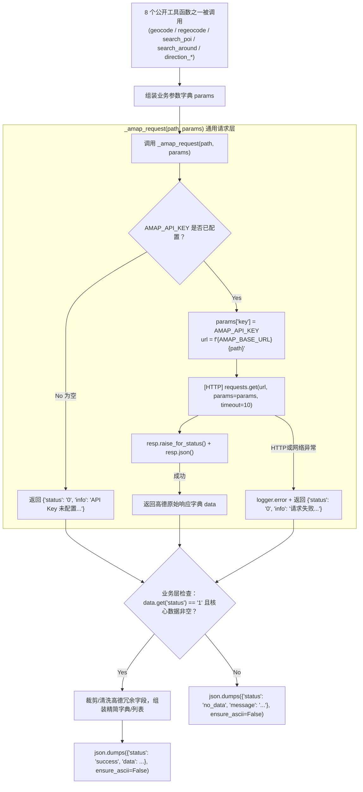

# `mcp_tools/amap_tools.py` 代码精讲学习手册

> **阅读指南**：本文档是一份**完全独立（Self-Contained）**的源码精讲手册。文档内已 **100% 完整嵌入 `mcp_tools/amap_tools.py` 的全部 263 行源代码**，并从架构定位、高德开放平台 Web 服务 API 原理、坐标格式 `"经度,纬度"` 转换规范、全入口调用链、逐函数精讲与沙盘推演（Dry Run）到潜在 Bug 诊断进行了全方位剖析，无需打开源码文件即可独立学习。

---

## 一、文件定位与核心前置知识精讲

### 1.1 在四层架构中的位置

`mcp_tools/amap_tools.py` 是 V8.2-beta 迭代引入的**本地生活服务工具集（第 3 层纯业务逻辑层）**。它封装了高德地图开放平台（AutoNavi / Amap LBS）的 **8 个核心地理信息与路径规划工具**：

```text
┌──────────────────────────────────────────────────────────────────────────────┐
│ 第 1 / 2 层：工具注册中心与统一调度层 (core/tool_init.py → TOOL_REGISTRY)    │
│   职责：启动时调用 init_tools()，将本文件的函数用 FunctionTool 包装并注册到  │
│         "local_life"（本地生活）业务域，受 config.yaml 中 tools 开关控制     │
└──────────────────────────────────────┬───────────────────────────────────────┘
                                       │ Python 函数调用 (同步函数自动丢线程池)
                                       ▼
┌──────────────────────────────────────────────────────────────────────────────┐
│ 第 3 层：MCP Tools 纯业务逻辑层 (mcp_tools/amap_tools.py) ★ 本文件 ★          │
│   职责：提供 1 个通用请求底层函数 `_amap_request` + 8 个业务工具函数：        │
│     - 地理编码类：geocode (地址→经纬度)、regeocode (经纬度→地址)             │
│     - POI 搜索类：search_poi (关键字搜POI)、search_around (周边半径搜POI)     │
│     - 路径规划类：direction_driving (驾车)、direction_transit (公交)、        │
│                   direction_walking (步行)、direction_bicycling (骑行)       │
└──────────────────────────────────────┬───────────────────────────────────────┘
                                       │ [HTTP GET] requests.get (timeout=10)
                                       ▼
┌──────────────────────────────────────────────────────────────────────────────┐
│ 第 4 层（外部第三方 API）：高德开放平台 Web 服务 REST API                    │
│   Base URL: https://restapi.amap.com                                         │
│   认证方式: Query 参数附加 ?key={AmapApiKey}                                 │
└──────────────────────────────────────────────────────────────────────────────┘
```

---

### 1.2 核心前置知识科普

#### （1）高德开放平台 Web 服务 API 体系概览
本文件对接了高德 Web 服务 API 的三大模块共 8 个端点（Endpoint）：

| 模块分类 | 本文件函数名 | 高德 API 路径 | 核心用途 |
| :--- | :--- | :--- | :--- |
| **地理/逆地理编码** | `geocode` | `/v3/geocode/geo` | 将结构化地址（如`"北京市朝阳区阜通东大街6号"`）转为高德经纬度坐标 |
| **地理/逆地理编码** | `regeocode` | `/v3/geocode/regeo` | 将经纬度坐标（如`"116.481488,39.990464"`）反查为省/市/区/街道结构化地址 |
| **POI 搜索** | `search_poi` | `/v3/place/text` | 按关键词（如`"星巴克"`）+ 可选城市/POI类型码搜索兴趣点 |
| **POI 搜索** | `search_around` | `/v3/place/around` | 以某个经纬度为圆心，在指定半径（如 `1000` 米）内按距离排序搜周边 POI |
| **路径规划** | `direction_driving` | `/v3/direction/driving` | 驾车路线规划（返回距离、耗时、策略） |
| **路径规划** | `direction_transit` | `/v3/direction/transit/integrated` | 公共交通（地铁+公交）综合换乘路线规划（返回耗时、票价、夜班车标志、乘车区间列表） |
| **路径规划** | `direction_walking` | `/v3/direction/walking` | 步行路线规划（返回距离、耗时） |
| **路径规划** | `direction_bicycling` | `/v4/direction/bicycling` | 骑行路线规划（注意：高德骑行接口是 **v4** 版本，其余 7 个是 **v3** 版本） |

#### （2）极其重要的坐标格式规范：`"经度,纬度"`（`"longitude,latitude"`）
在使用高德 API 以及编写 Agent 工具链时，有两个最容易踩坑的地理坐标常识：
1. **经度在前，纬度在后（Lon, Lat）**：
   - 日常口语常说“北纬 39.99°，东经 116.48°”，但在高德 API 中，所有 `location`、`origin`（起点）、`destination`（终点）参数**必须严格写成 `"经度,纬度"`**，中间用英文逗号分隔且不能有空格，例如：`"116.481488,39.990464"`（中国境内经度范围约 `73~135`，纬度范围约 `3~53`，即**大数在前，小数在后**）。
2. **工具协同链（先 `geocode` 再 `search_around` / `direction_*`）**：
   - 用户提问时只会说中文地名（例如*“从北京南站怎么坐公交去天安门？附近有什么美食？”*），用户不知道经纬度。
   - 而高德的 `search_around` 和 4 个 `direction_*` 路径规划接口**只接受 `"经度,纬度"` 坐标，不接受中文地名**！
   - 因此 Agent 的标准调用顺序是：
     ```text
     第 1 步：调用 geocode("北京南站", "北京")  ──► 拿到 origin = "116.378517,39.865246"
     第 2 步：调用 geocode("天安门", "北京")    ──► 拿到 destination = "116.397477,39.908692"
     第 3 步：调用 direction_transit(origin, destination, "北京") 或 search_around(destination, "美食")
     ```

#### （3）高德 API 的状态码设计（`status: "1"` vs `"0"`）
与和风天气用 `"code": "200"` 不同，高德 v3 Web 服务 API 的响应 JSON 顶层状态字段是字符串 `"status"`：
- `"status": "1"`：代表请求成功；
- `"status": "0"`：代表请求失败，此时顶层 `"info"` 字段会给出失败原因（如 `"INVALID_USER_KEY"`）。
- 因此本文件在 `_amap_request` 遇到未配置 Key 或网络异常时，也统一构造并返回了 `{"status": "0", "info": "..."}`，与高德原生错误格式保持同构！

---

## 二、所有入口与调用链全景图

### 2.1 函数清单与调用映射表

```text
层级   函数名                                               调用的底层方法 & 高德 API 路径
────────────────────────────────────────────────────────────────────────────────────────────────────
底层   _amap_request(path, params)                        → [HTTP GET] https://restapi.amap.com{path}
────────────────────────────────────────────────────────────────────────────────────────────────────
工具1  geocode(address, city=None)                        → _amap_request("/v3/geocode/geo", ...)
工具2  regeocode(location)                                → _amap_request("/v3/geocode/regeo", ...)
工具3  search_poi(keywords, city=None, types=None, limit) → _amap_request("/v3/place/text", ...)
工具4  search_around(location, keywords, radius, limit)   → _amap_request("/v3/place/around", ...)
工具5  direction_driving(origin, destination)             → _amap_request("/v3/direction/driving", ...)
工具6  direction_transit(origin, destination, city="北京")→ _amap_request("/v3/direction/transit/integrated", ...)
工具7  direction_walking(origin, destination)             → _amap_request("/v3/direction/walking", ...)
工具8  direction_bicycling(origin, destination)           → _amap_request("/v4/direction/bicycling", ...)
```

### 2.2 全工具调用流程图（Mermaid）



---

## 三、完整源码与逐函数深度精讲

### 3.1 完整源代码（100% 原始代码嵌入，共 263 行）

以下是 `mcp_tools/amap_tools.py` 的完整源代码，未做任何删减：

```python
"""
高德（Amap）本地生活工具集 —— 本地生活类

迭代改进新增：从新版 V8.2-beta 引入，按我们的规范重写
- 调用高德地图 REST API 提供本地生活服务
- 8 个工具：地理编码、逆地理编码、POI搜索、周边搜索、
  驾车/公交/步行/骑行路径规划
- API Key 从环境变量 AmapApiKey 读取

API 文档：https://lbs.amap.com/api/webservice/summary
"""
import json
import requests
from utils import logger

import os
AMAP_API_KEY = os.environ.get("AmapApiKey", "")
AMAP_BASE_URL = "https://restapi.amap.com"


def _amap_request(path: str, params: dict) -> dict:
    """高德 API 通用请求函数
    
    参数:
        path: API 路径（如 /v3/geocode/geo）
        params: 请求参数（自动附加 key）
    
    返回:
        dict: API 响应数据
    """
    if not AMAP_API_KEY:
        return {"status": "0", "info": "API Key 未配置，请设置环境变量 AmapApiKey"}

    params["key"] = AMAP_API_KEY
    url = f"{AMAP_BASE_URL}{path}"
    try:
        resp = requests.get(url, params=params, timeout=10)
        resp.raise_for_status()
        data = resp.json()
        return data
    except Exception as e:
        logger.error(f"高德 API 请求失败: {path} - {e}")
        return {"status": "0", "info": f"请求失败: {e}"}


# ===================== 地理编码工具 =====================

def geocode(address: str, city: str = None) -> str:
    """地址文本转经纬度（地理编码）
    
    参数:
        address: 地址文本（如"北京市朝阳区阜通东大街6号"）
        city: 城市名称（可选，提高精度）
    """
    params = {"address": address}
    if city:
        params["city"] = city
    data = _amap_request("/v3/geocode/geo", params)
    if data.get("status") == "1" and data.get("geocodes"):
        geo = data["geocodes"][0]
        return json.dumps({
            "status": "success",
            "data": {
                "formatted_address": geo.get("formatted_address"),
                "province": geo.get("province"),
                "city": geo.get("city"),
                "district": geo.get("district"),
                "location": geo.get("location"),  # "经度,纬度"
            }
        }, ensure_ascii=False)
    return json.dumps({"status": "no_data", "message": "未找到该地址的地理编码"}, ensure_ascii=False)


def regeocode(location: str) -> str:
    """经纬度转结构化地址（逆地理编码）
    
    参数:
        location: 经纬度坐标（"经度,纬度"，如"116.481488,39.990464"）
    """
    data = _amap_request("/v3/geocode/regeo", {"location": location})
    if data.get("status") == "1" and data.get("regeocode"):
        regeo = data["regeocode"]
        addr = regeo.get("addressComponent", {})
        return json.dumps({
            "status": "success",
            "data": {
                "formatted_address": regeo.get("formatted_address"),
                "province": addr.get("province"),
                "city": addr.get("city"),
                "district": addr.get("district"),
                "township": addr.get("township"),
            }
        }, ensure_ascii=False)
    return json.dumps({"status": "no_data", "message": "逆地理编码失败"}, ensure_ascii=False)


# ===================== POI 搜索工具 =====================

def search_poi(keywords: str, city: str = None, types: str = None,
               limit: int = 20) -> str:
    """POI 关键字搜索
    
    参数:
        keywords: 搜索关键词（如"星巴克"、"万达广场"）
        city: 城市名称（可选）
        types: POI 类型编码（可选，如"050000"表示餐饮服务）
        limit: 返回数量上限（默认20，最大25）
    """
    params = {"keywords": keywords, "offset": min(limit, 25)}
    if city:
        params["city"] = city
    if types:
        params["types"] = types
    data = _amap_request("/v3/place/text", params)
    if data.get("status") == "1" and data.get("pois"):
        pois = []
        for poi in data["pois"][:limit]:
            pois.append({
                "name": poi.get("name"),
                "address": poi.get("address"),
                "location": poi.get("location"),
                "tel": poi.get("tel", ""),
                "type": poi.get("type"),
            })
        return json.dumps({"status": "success", "data": pois, "total": len(pois)}, ensure_ascii=False)
    return json.dumps({"status": "no_data", "message": "未找到相关POI"}, ensure_ascii=False)


def search_around(location: str, keywords: str, radius: int = 1000,
                  limit: int = 20) -> str:
    """周边 POI 搜索
    
    参数:
        location: 中心点经纬度（"经度,纬度"）
        keywords: 搜索关键词（如"美食"、"停车场"）
        radius: 搜索半径（米，默认1000）
        limit: 返回数量上限（默认20）
    """
    params = {
        "location": location,
        "keywords": keywords,
        "radius": radius,
        "offset": min(limit, 25),
        "sortrule": "distance",
    }
    data = _amap_request("/v3/place/around", params)
    if data.get("status") == "1" and data.get("pois"):
        pois = []
        for poi in data["pois"][:limit]:
            pois.append({
                "name": poi.get("name"),
                "address": poi.get("address"),
                "distance": poi.get("distance"),
                "location": poi.get("location"),
                "tel": poi.get("tel", ""),
            })
        return json.dumps({"status": "success", "data": pois, "total": len(pois)}, ensure_ascii=False)
    return json.dumps({"status": "no_data", "message": "周边未找到相关结果"}, ensure_ascii=False)


# ===================== 路径规划工具 =====================

def direction_driving(origin: str, destination: str) -> str:
    """驾车路径规划
    
    参数:
        origin: 起点经纬度（"经度,纬度"）
        destination: 终点经纬度（"经度,纬度"）
    """
    data = _amap_request("/v3/direction/driving", {
        "origin": origin,
        "destination": destination,
    })
    if data.get("status") == "1" and data.get("route"):
        route = data["route"]
        paths = route.get("paths", [])
        result = []
        for p in paths[:3]:  # 最多返回3条路线
            result.append({
                "distance": p.get("distance"),  # 米
                "duration": p.get("duration"),  # 秒
                "strategy": p.get("strategy"),
            })
        return json.dumps({"status": "success", "data": result}, ensure_ascii=False)
    return json.dumps({"status": "no_data", "message": "驾车路径规划失败"}, ensure_ascii=False)


def direction_transit(origin: str, destination: str, city: str = "北京") -> str:
    """公交路径规划
    
    参数:
        origin: 起点经纬度
        destination: 终点经纬度
        city: 城市名称（默认北京）
    """
    data = _amap_request("/v3/direction/transit/integrated", {
        "origin": origin,
        "destination": destination,
        "city": city,
    })
    if data.get("status") == "1" and data.get("route"):
        transits = data["route"].get("transits", [])
        result = []
        for t in transits[:5]:  # 最多返回5条路线
            segments = []
            for seg in t.get("segments", []):
                for bus in seg.get("bus", {}).get("buslines", []):
                    segments.append(bus.get("name", ""))
            result.append({
                "duration": t.get("duration"),
                "cost": t.get("cost"),
                "nightflag": t.get("nightflag"),
                "segments": segments,
            })
        return json.dumps({"status": "success", "data": result}, ensure_ascii=False)
    return json.dumps({"status": "no_data", "message": "公交路径规划失败"}, ensure_ascii=False)


def direction_walking(origin: str, destination: str) -> str:
    """步行路径规划
    
    参数:
        origin: 起点经纬度
        destination: 终点经纬度
    """
    data = _amap_request("/v3/direction/walking", {
        "origin": origin,
        "destination": destination,
    })
    if data.get("status") == "1" and data.get("route"):
        paths = data["route"].get("paths", [])
        result = []
        for p in paths[:3]:
            result.append({
                "distance": p.get("distance"),
                "duration": p.get("duration"),
            })
        return json.dumps({"status": "success", "data": result}, ensure_ascii=False)
    return json.dumps({"status": "no_data", "message": "步行路径规划失败"}, ensure_ascii=False)


def direction_bicycling(origin: str, destination: str) -> str:
    """骑行路径规划
    
    参数:
        origin: 起点经纬度
        destination: 终点经纬度
    """
    data = _amap_request("/v4/direction/bicycling", {
        "origin": origin,
        "destination": destination,
    })
    if data.get("status") == "1" and data.get("data"):
        paths = data["data"]
        result = []
        if isinstance(paths, list):
            for p in paths[:3]:
                result.append({
                    "distance": p.get("distance"),
                    "duration": p.get("duration"),
                })
        return json.dumps({"status": "success", "data": result}, ensure_ascii=False)
    return json.dumps({"status": "no_data", "message": "骑行路径规划失败"}, ensure_ascii=False)
```

---

### 3.2 逐函数深度精讲与沙盘推演（Dry Run）

#### 1. `_amap_request(path: str, params: dict) -> dict`（第 21~43 行）
- **核心职责**：统一处理 API Key 检查、附加 `params["key"] = AMAP_API_KEY`、拼接完整 URL、设置 `timeout=10` 秒并捕获网络异常。
- **防御式设计**：
  - 未配置环境变量 `AmapApiKey` 时，不发网络请求，直接返回 `{"status": "0", "info": "API Key 未配置，请设置环境变量 AmapApiKey"}`。
  - 调用方只需统一检查 `if data.get("status") == "1":`，无需自己写 `try...except`。

#### 2. `geocode` 与 `regeocode`（第 48~94 行）
- **`geocode(address, city=None)`**：
  - **沙盘推演（Dry Run）—— `geocode("北京市朝阳区阜通东大街6号", city="北京")`**：
    1. 请求：`GET https://restapi.amap.com/v3/geocode/geo?address=北京市朝阳区阜通东大街6号&city=北京&key=xxx`
    2. 高德返回 `data["geocodes"]` 列表，取第 0 项 `geo = data["geocodes"][0]`。
    3. 返回 JSON 字符串：
       ```json
       {
         "status": "success",
         "data": {
           "formatted_address": "北京市朝阳区阜通东大街6号",
           "province": "北京市",
           "city": "北京市",
           "district": "朝阳区",
           "location": "116.481488,39.990464"
         }
       }
       ```
- **`regeocode(location)`**：
  - **沙盘推演（Dry Run）—— `regeocode("116.481488,39.990464")`**：
    1. 请求：`GET https://restapi.amap.com/v3/geocode/regeo?location=116.481488,39.990464&key=xxx`
    2. 从 `data["regeocode"]["addressComponent"]` 提取省、市、区、街道（`township`，如 `"望京街道"`）。

#### 3. `search_poi` 与 `search_around`（第 99~158 行）
- **分页参数 `offset` 的保护**：高德 `/v3/place/text` 和 `/v3/place/around` 的单页记录数参数名叫 `offset`（注意在高德文档中 `offset` 表示每页条数，最大不超过 25 条，而 `page` 表示页码）。代码中通过 `"offset": min(limit, 25)` 防止调用方传入过大数值导致高德报错，并在遍历时再次用 `data["pois"][:limit]` 精确截断。
- **`search_around` 独有特性**：
  - 传入 `"sortrule": "distance"`（按距离从近到远排序，高德默认是 `"weight"` 综合权重排序）。
  - 返回的每个 POI 字典中比 `search_poi` 多了一个 `"distance"` 字段（离中心点的直线距离，单位：米）。
- **沙盘推演（Dry Run）—— `search_around("116.481488,39.990464", "美食", radius=500, limit=2)`**：
  ```json
  {
    "status": "success",
    "data": [
      {
        "name": "海底捞火锅(望京SOHO店)",
        "address": "阜通东大街1号望京SOHO塔1B座3层",
        "distance": "185",
        "location": "116.480123,39.991234",
        "tel": "010-8478xxxx"
      }
    ],
    "total": 1
  }
  ```

#### 4. 四大路径规划函数：`direction_driving`、`direction_transit`、`direction_walking`、`direction_bicycling`（第 163~263 行）
- **为什么要对高德原始路径规划响应做“瘦身裁剪”？**
  - 高德原始的 `/v3/direction/driving` 或 `transit` 响应体非常庞大（动辄几十 KB，包含每个路口往左转多少米、每段道路的坐标点串 `polyline`），如果原封不动塞给大模型，一次调用就会消耗上万 Token！
  - 因此本文件对返回结果做了**极简提纯**：
    1. **`direction_driving`（驾车）**：只取前 3 条方案（`paths[:3]`），每条保留总距离 `distance`（米）、总耗时 `duration`（秒）、规划策略 `strategy`（如 `"速度最快"`）。
    2. **`direction_transit`（公交地铁换乘）**：只取前 5 条方案（`transits[:5]`），通过双重循环 `for seg in t.get("segments", []): for bus in seg.get("bus", {}).get("buslines", []):` 把每一段乘坐的公交/地铁线路名称（如 `"地铁14号线(善各庄--张郭庄)"`）提取到 `segments` 字符串列表中，连同总耗时 `duration`、总票价 `cost`、是否夜班车 `nightflag` 一起返回！
    3. **`direction_walking`（步行）& `direction_bicycling`（骑行）**：只取前 3 条方案，保留 `distance`（米）和 `duration`（秒）。
- **沙盘推演（Dry Run）—— `direction_transit("116.378517,39.865246", "116.397477,39.908692", "北京")`**：
  ```json
  {
    "status": "success",
    "data": [
      {
        "duration": "1680",
        "cost": "3.0",
        "nightflag": "0",
        "segments": [
          "地铁4号线大兴线(安河桥北--天宫院)",
          "地铁1号线八通线(古城--环球度假区)"
        ]
      }
    ]
  }
  ```

---

## 四、代码走读注意点与潜在 Bug / 改进思考

### 1. 【真实接口协议 Bug】`direction_bicycling`（高德 v4 骑行接口）的响应格式不兼容
- **现象定位**：第 249~263 行的 `direction_bicycling` 调用了 `/v4/direction/bicycling`，随后判断：
  ```python
  if data.get("status") == "1" and data.get("data"):
      paths = data["data"]
      if isinstance(paths, list): ...
  ```
- **高德官方文档真相**：高德的 **v3** 接口返回顶层 `"status": "1"`，但高德的 **v4 骑行接口 (`/v4/direction/bicycling`)** 改用了全新的返回规范！v4 接口顶层**没有 `"status"` 字段**，而是返回 `{"errcode": 0, "errmsg": "OK", "data": {"origin": "...", "destination": "...", "paths": [{"distance": 2100, "duration": 504}]}}`！
- **后果**：
  1. 在调用真实高德 `/v4/direction/bicycling` 时，`data.get("status")` 为 `None`（不等于 `"1"`），会导致永远走第 263 行返回 `"骑行路径规划失败"`！
  2. 即便满足条件，`data["data"]` 是一个 `dict`（里面的 `data["data"]["paths"]` 才是 `list`），`isinstance(paths, list)` 也会为 `False`。
- **修复方案**：
  ```python
  if (data.get("errcode") == 0 or data.get("status") == "1") and data.get("data"):
      raw_data = data["data"]
      paths = raw_data.get("paths", []) if isinstance(raw_data, dict) else raw_data
  ```

### 2. 【直辖市 `city` 空列表陷阱】高德 `geocode`/`regeocode` 中直辖市的 `city` 字段为 `[]`
- **现象说明**：当地址位于北京、上海、天津、重庆四个直辖市时，高德地理编码 API 返回的 `geo.get("city")` **不是字符串 `"北京市"`，而是一个空列表 `[]`**（因为直辖市没有地级市这一级，城市名在 `province: "北京市"` 中）！
- **改进建议**：在提取 `city` 时写作 `geo.get("city") or geo.get("province")`，避免返回给大模型的 JSON 中出现 `"city": []`。

### 3. 【错误吞没】API Key 未配置或网络异常也被返回为 `"no_data"`
- **现象定位**：当 `AMAP_API_KEY` 未配置时，`_amap_request` 返回 `{"status": "0", "info": "API Key 未配置..."}`。但外层 8 个工具函数只判断了 `if data.get("status") == "1":`，一旦不为 `"1"`，全部统一返回了 `{"status": "no_data", "message": "未找到..."}`，把底层宝贵的 `"info"` 错误原因丢弃了！
- **改进建议**：当 `data.get("status") == "0"` 且存在 `data.get("info")`（尤其是未配置 Key 或请求异常）时，应将其透传到返回 JSON 的 `message` 中，方便开发者第一时间发现是环境变量 `AmapApiKey` 没配。

---

## 五、自测思考题（附答案解析）

### 思考题 1：打开 `core/tool_init.py`（第 182~193 行）可以发现，`amap_restaurant`（美食搜索）、`amap_attraction`（景点搜索）、`amap_hotel`（酒店搜索）、`amap_hospital`（医院搜索）注册时绑定的底层函数全都是 `amap_tools.search_poi`！为什么一个 `search_poi` 函数能充当 6 个不同的工具？
- **答案解析**：
  - 因为高德的 `/v3/place/text`（即 `search_poi`）是通用的兴趣点搜索接口，通过传入不同的 `keywords`（如 `"火锅"`、`"故宫"`、`"全季酒店"`、`"协和医院"`）或 `types`（POI 分类码），就能搜出对应垂直领域的 POI。在 `ToolRegistry` 中将它注册为多个语义更具体的工具名，有助于按业务配置灵活开关某一类搜索能力。

### 思考题 2：在 `search_poi` 和 `search_around` 中，如果某个商家没有登记电话号码，高德 API 返回的 JSON 中 `"tel"` 字段会是一个空列表 `[]`（而不是空字符串 `""`）。此时代码中 `poi.get("tel", "")` 会返回什么？
- **答案解析**：
  - **会返回空列表 `[]`！** 因为 Python 字典的 `dict.get(key, default)` 只有在 `key` **不存在**或值为 `None`（视情况）时才考虑默认值；当 `"tel": []` 键存在且值为 `[]` 时，`poi.get("tel", "")` 返回的是 `[]`。如果希望确保返回字符串，应该写成 `poi.get("tel") or ""`。

### 思考题 3：在 `direction_transit`（公交规划）中，如果起点在北京，终点在上海（跨城），调用 `direction_transit(origin, destination, city="北京")` 能规划出跨城公交路线吗？
- **答案解析**：
  - 如果不传终点城市参数 `cityd`，高德 `/v3/direction/transit/integrated` 默认按同城公交规划，跨省市会规划失败。若需支持跨城公交/火车换乘，还需向高德传入终点城市参数 `cityd`。
