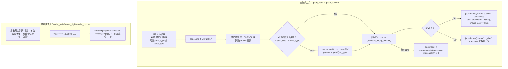

# `mcp_tools/ticket_tools.py` 代码精讲学习手册

> **阅读指南**：本文档是一份**完全独立（Self-Contained）**的源码精讲手册。文档内已 **100% 完整嵌入 `mcp_tools/ticket_tools.py` 的全部 169 行源代码**，并从四层架构定位、核心前置知识（动态 SQL 条件拼接、事务库存扣减对比、统一 JSON 返回规范）、调用链全景图、逐函数精讲与沙盘推演（Dry Run）到潜在改进点进行了全方位剖析，无需打开源码文件即可独立学习。

---

## 一、文件定位与核心前置知识精讲

### 1.1 在四层架构中的位置

`mcp_tools/ticket_tools.py` 是出行交通与演出票务领域的**纯业务逻辑层（第 3 层）**，负责火车票、机票、演唱会门票的查询与预定：

```text
┌────────────────────────────────────────────────────────────────────────────┐
│ 第 1 层：A2A Agent 层 (a2a_server/a2a_ticket.py)                           │
│   职责：接收主控 Agent 的票务查询/预定请求，通过 MCP 客户端调用票务工具    │
└────────────────────────────────────┬───────────────────────────────────────┘
                                     │ MCP 协议 (Streamable-HTTP)
                                     ▼
┌────────────────────────────────────────────────────────────────────────────┐
│ 第 2 层：MCP Server 协议层 (mcp_server/mcp_ticket.py)                      │
│   职责：通过 FastMCP 注册并暴露 5 个工具（均开启 run_in_thread=True）：     │
│         query_train / query_concert / order_train / order_flight /         │
│         order_concert                                                      │
│   旁路：core/tool_init.py 也将这 5 个函数归入 "transport" 域注册进名册     │
└────────────────────────────────────┬───────────────────────────────────────┘
                                     │ Python 函数直接调用
                                     ▼
┌────────────────────────────────────────────────────────────────────────────┐
│ 第 3 层：MCP Tools 纯业务逻辑层 (mcp_tools/ticket_tools.py) ★ 本文件 ★      │
│   职责：零 MCP 依赖！                                                      │
│     - 查询类 (query_train, query_concert)：动态拼接参数化 SQL 查 MySQL      │
│     - 预定类 (order_train, order_flight, order_concert)：模拟下单返回 JSON │
└────────────────────────────────────┬───────────────────────────────────────┘
                                     │ [MySQL] MySQLManager (_db.fetch_all)
                                     ▼
┌────────────────────────────────────────────────────────────────────────────┐
│ 第 4 层（存储）：MySQL (voyage 库)                                         │
│   表：train_tickets (火车票库存表) / concert_tickets (演唱会票务表)        │
└────────────────────────────────────────────────────────────────────────────┘
```

> **注意一个有趣的架构分工**：你会发现本文件有 `order_flight`（机票预定），却**没有 `query_flight`（机票查询）**！为什么？因为在系统迭代升级后，**实时航班与机票价格查询**交给了专门对接飞常准官方 API 的 `mcp_tools/variflight_tools.py`，而机票模拟下单则保留在 `ticket_tools.py` 中。

---

### 1.2 核心前置知识科普

#### （1）动态 SQL 条件拼接与参数化防注入原理
在业务查询中，往往既有**必填条件**（如出发城市、到达城市、出发日期），又有**可选过滤条件**（如座位类型 `seat_type`、票档类型 `ticket_type`）。如果用户没传可选参数，SQL 就不应该限制该字段；如果传了，就要加上 `AND 字段 = 值`。

- **危险的错误写法（字符串直接格式化 — 导致 SQL 注入漏洞）**：
  ```python
  # ❌ 千万不要这样写！如果 seat_type 被传入 "二等座' OR '1'='1"，会导致全表泄露
  sql = f"SELECT ... FROM train_tickets WHERE departure_city = '{departure_city}'"
  if seat_type:
      sql += f" AND seat_type = '{seat_type}'"
  ```
- **标准工程写法（占位符 `%s` 动态拼接 + `params.append` 参数列表同步追加）**：
  1. **基础 SQL 含必填条件**（或无必填条件时用 `WHERE 1=1` 打底）：
     ```python
     sql = """
     SELECT ... FROM train_tickets
     WHERE departure_city = %s
     AND arrival_city = %s
     AND DATE(departure_time) = %s
     """
     params = [departure_city, arrival_city, date]
     ```
  2. **按需追加可选条件**：
     ```python
     if seat_type:
         sql += " AND seat_type = %s"
         params.append(seat_type)
     ```
  3. **交由 `pymysql` 底层预编译绑定**：
     `_db.fetch_all(sql, params)` 会将 `sql` 模板与 `params` 列表分开发送或由驱动安全转义，即使参数中包含单引号、分号或 SQL 关键字，也只会被当作普通字符串字面量处理，**从根源上杜绝 SQL 注入**。
  4. **补充技巧：当所有条件都是可选时怎么办？**
     如果一张表连必填条件都没有，通常会写 `SELECT ... FROM table WHERE 1=1`，这样后续每个可选条件都可以统一无脑写 `sql += " AND col = %s"`，无需操心第一个条件前面是写 `WHERE` 还是写 `AND`。

#### （2）MySQL `DATE(datetime_col)` 函数提取日期
在 `train_tickets` 表中，`departure_time` 存储的是精确到时分秒的 `DATETIME`（例如 `'2026-05-01 08:30:00'`），而用户在查询火车票时传入的是日期字符串 `'2026-05-01'`。
- SQL 中使用 `AND DATE(departure_time) = %s`，MySQL 会先截取 `departure_time` 的年月日部分（`'2026-05-01'`），再与传入的 `'2026-05-01'` 比对，从而查出当天从早到晚的所有车次。

#### （3）模拟预定 vs 真实生产级事务扣减库存（防超卖核心原理）
在本文件的 `order_train` / `order_flight` / `order_concert` 中，当前采用的是**模拟预定逻辑**（仅打印日志并直接返回预定成功的 JSON 提示，未修改数据库 `remaining_seats`）。
但在面试和生产落地时，你必须掌握如何将其改造为**真实的数据库事务扣减库存**，尤其是要理解**“先查后改” vs “原子条件更新”**：

| 方案 | 伪代码 / SQL 逻辑 | 并发安全性（高并发抢票场景） |
| :--- | :--- | :--- |
| **方案 A：先查后改（反面教材）** | 1. `SELECT remaining_seats FROM train_tickets WHERE ...`<br/>2. Python 判断 `if remaining_seats >= number:`<br/>3. `UPDATE train_tickets SET remaining_seats = remaining_seats - %s` | ❌ **存在严重超卖 Bug！**<br/>若余票剩 1 张，两个请求同时执行第 1 步都读到 `1 >= 1`，随后都执行第 3 步，余票变成 `-1`，1 张票卖给了 2 个人！ |
| **方案 B：原子条件扣减（推荐生产方案）** | 直接在一条 `UPDATE` 语句中完成扣减与余量校验：<br/>`UPDATE train_tickets`<br/>`SET remaining_seats = remaining_seats - %s`<br/>`WHERE train_number = %s AND DATE(departure_time) = %s AND seat_type = %s`<br/>**`AND remaining_seats >= %s`** | ✅ **绝对防超卖（InnoDB 行级锁保障）！**<br/>MySQL 执行 `UPDATE` 时会自动对该行加排他锁（X 锁）。第一个事务扣减后余票变为 0；第二个事务拿到锁后再检查 `WHERE remaining_seats >= 1` 不成立，影响行数 `affected_rows == 0`，据此即可判断“余票不足，下单失败”。 |

#### （4）全项目统一 JSON 字符串返回规范
为了方便大模型（LLM）稳定解析工具调用结果，整个 `mcp_tools` 下的数据库查询工具遵循统一的 JSON Schema：
- **查到数据**：`{"status": "success", "data": [ {...}, {...} ]}`
- **未查到数据**：`{"status": "no_data", "message": "未找到xxx数据，请确认查询条件。"}`
- **发生异常**：`{"status": "error", "message": "异常详情字符串"}`
- **中文与特殊类型处理**：
  - `ensure_ascii=False`：保证输出的 JSON 中中文字符原样展示（如 `"北京"`），而不是转义成 `"\u5317\u4eac"`，既节省 Token 又方便大模型阅读。
  - `cls=DateDecimalToString`：将 MySQL 查出的 `datetime.datetime`（如发车时间）和 `decimal.Decimal`（如票价 `553.50`）自动转为字符串，防止 `json.dumps` 抛出 `TypeError: Object of type Decimal is not JSON serializable`。

---

## 二、所有入口与调用链全景图

### 2.1 所有入口总览表

```text
入口 / 公共函数                                      调用的函数或方法          最底层外部动作
──────────────────────────────────────────────────────────────────────────────────────────────────
0. 导入 ticket_tools 模块                          → _db = MySQLManager()     → 创建线程安全DB管理对象
1. query_train(dep, arr, date, seat_type=None)     → _db.fetch_all(sql, params)→ [MySQL] 查 train_tickets 表
2. query_concert(city, artist, date, type=None)    → _db.fetch_all(sql, params)→ [MySQL] 查 concert_tickets 表
3. order_train(date, train_no, seat_type, number)  → json.dumps(...)          → 内存模拟下单，返回成功 JSON
4. order_flight(date, flight_no, cabin, number)    → json.dumps(...)          → 内存模拟下单，返回成功 JSON
5. order_concert(date, artist, venue, type, number)→ json.dumps(...)          → 内存模拟下单，返回成功 JSON
```

### 2.2 全函数执行流程图（Mermaid）



---

## 三、完整源码与逐函数深度精讲

### 3.1 完整源代码（100% 原始代码嵌入，共 169 行）

以下是 `mcp_tools/ticket_tools.py` 的完整源代码，未做任何删减：

```python
"""票务工具函数 —— 纯业务逻辑，无MCP依赖
包含：火车票/演唱会票的查询与预定
"""

import json

from utils import logger
from utils import MySQLManager
from utils import DateDecimalToString

# 全局数据库实例
_db = MySQLManager()


# ========== 查询类工具 ==========

def query_train(
        departure_city: str,
        arrival_city: str,
        date: str,
        seat_type: str = None) -> str:
    """火车票查询接口"""
    logger.info("火车票查询: %s→%s, date=%s, seat=%s",
                departure_city, arrival_city, date, seat_type)
    try:
        sql = """
        SELECT id, departure_city, arrival_city, 
        departure_time, arrival_time,train_number, 
        seat_type, price, remaining_seats
        FROM train_tickets
        WHERE departure_city = %s 
        AND arrival_city = %s 
        AND DATE(departure_time) = %s
        """
        params = [departure_city, arrival_city, date]
        if seat_type:
            sql += " AND seat_type = %s"
            params.append(seat_type)
        # _db = MySQLManager()
        rows = _db.fetch_all(sql, params)
        if rows:
            return json.dumps(
                {"status": "success", "data": rows},
                cls=DateDecimalToString,
                ensure_ascii=False
            )
        return json.dumps(
            {
                "status": "no_data",
                "message": "未找到火车票数据，请确认查询条件。"
             },
            ensure_ascii=False
        )
    except Exception as e:
        logger.error("火车票查询异常: %s", e)
        return json.dumps(
            {"status": "error", "message": str(e)},
            ensure_ascii=False
        )


def query_concert(
        city: str,
        artist: str,
        date: str,
        ticket_type: str = None) -> str:
    """演唱会票务查询接口"""
    logger.info("演唱会查询: city=%s, artist=%s, date=%s, type=%s",
                city, artist, date, ticket_type)
    try:
        sql = """
        SELECT id, artist, city, venue, start_time, 
        end_time, ticket_type, price, remaining_seats
        FROM concert_tickets
        WHERE city = %s 
        AND artist = %s 
        AND DATE(start_time) = %s
        """
        params = [city, artist, date]
        if ticket_type:
            sql += " AND ticket_type = %s"
            params.append(ticket_type)
        rows = _db.fetch_all(sql, params)
        if rows:
            return json.dumps(
                {"status": "success", "data": rows},
                cls=DateDecimalToString,
                ensure_ascii=False
            )
        return json.dumps(
            {
                "status": "no_data",
                "message": "未找到演唱会票数据，请确认查询条件。"
            },
            ensure_ascii=False
        )
    except Exception as e:
        logger.error("演唱会查询异常: %s", e)
        return json.dumps(
            {"status": "error", "message": str(e)},
            ensure_ascii=False
        )


# ========== 预定类工具（模拟预定逻辑） ==========

def order_train(
        departure_date: str,
        train_number: str,
        seat_type: str,
        number: int) -> str:
    """模拟火车票下单预定"""
    logger.info("火车票预定: date=%s, train=%s, seat=%s, num=%d",
                departure_date, train_number, seat_type, number)
    return json.dumps(
        {
            "status": "success",
            "message": f"恭喜，火车票预定成功！"
                       f"日期：{departure_date}，"
                       f"车次：{train_number}，"
                       f"座位：{seat_type}，"
                       f"数量：{number}张。"
        },
        ensure_ascii=False
    )


def order_flight(
        departure_date: str,
        flight_number: str,
        cabin_type: str,
        number: int) -> str:
    """模拟机票下单预定"""
    logger.info("机票预定: date=%s, flight=%s, cabin=%s, num=%d",
                departure_date, flight_number, cabin_type, number)
    return json.dumps(
        {
            "status": "success",
            "message": f"恭喜，机票预定成功！"
                       f"日期：{departure_date}，"
                       f"航班号：{flight_number}，"
                       f"舱位：{cabin_type}，"
                       f"数量：{number}张。"
        },
        ensure_ascii=False
    )


def order_concert(
        start_date: str,
        artist: str,
        venue: str,
        ticket_type: str,
        number: int) -> str:
    """模拟演唱会门票下单预定"""
    logger.info("演出票预定: date=%s, artist=%s, venue=%s, type=%s, num=%d",
                start_date, artist, venue, ticket_type, number)
    return json.dumps(
        {
            "status": "success",
            "message": f"恭喜，演出票预定成功！"
                       f"日期：{start_date}，"
                       f"艺人：{artist}，"
                       f"场馆：{venue}，"
                       f"票类型：{ticket_type}，"
                       f"数量：{number}张。"
        },
        ensure_ascii=False
    )
```

---

### 3.2 逐函数深度精讲与沙盘推演（Dry Run）

#### 1. `query_train(departure_city, arrival_city, date, seat_type=None) -> str`（第 17~59 行）
- **功能说明**：从 `train_tickets` 表中查询指定出发地、目的地、出发日期的火车票余票与价格信息。
- **参数表**：
  | 参数名 | 类型 | 是否必填 | 示例值 | 说明 |
  | :--- | :--- | :--- | :--- | :--- |
  | `departure_city` | `str` | 必填 | `"北京"` | 出发城市名称 |
  | `arrival_city` | `str` | 必填 | `"上海"` | 到达城市名称 |
  | `date` | `str` | 必填 | `"2026-05-01"` | 出发日期（`YYYY-MM-DD`） |
  | `seat_type` | `str` | 可选（默认 `None`） | `"二等座"` / `None` | 席别过滤（如一等座、二等座、商务座） |
- **查询列**：`id, departure_city, arrival_city, departure_time, arrival_time, train_number, seat_type, price, remaining_seats`（共 9 列）。
- **沙盘推演（Dry Run）**：
  - **场景 A（带 `seat_type` 过滤）**：调用 `query_train("北京", "上海", "2026-05-01", "二等座")`
    - 最终执行的 SQL：
      ```sql
      SELECT id, departure_city, arrival_city, 
      departure_time, arrival_time,train_number, 
      seat_type, price, remaining_seats
      FROM train_tickets
      WHERE departure_city = %s 
      AND arrival_city = %s 
      AND DATE(departure_time) = %s
       AND seat_type = %s
      ```
    - 绑定的 `params` 列表：`['北京', '上海', '2026-05-01', '二等座']`
    - 返回的 JSON 字符串：
      ```json
      {
        "status": "success",
        "data": [
          {
            "id": 1,
            "departure_city": "北京",
            "arrival_city": "上海",
            "departure_time": "2026-05-01 08:00:00",
            "arrival_time": "2026-05-01 12:30:00",
            "train_number": "G1",
            "seat_type": "二等座",
            "price": "553.00",
            "remaining_seats": 42
          }
        ]
      }
      ```
  - **场景 B（不带 `seat_type` 过滤）**：调用 `query_train("北京", "上海", "2026-05-01")`
    - `if seat_type:` 为 `False`，`params` 保持 3 个元素 `['北京', '上海', '2026-05-01']`，将该车次的一等座、二等座、商务座全部查出供用户挑选。

#### 2. `query_concert(city, artist, date, ticket_type=None) -> str`（第 62~102 行）
- **功能说明**：从 `concert_tickets` 表中按城市、艺人名称、演出日期及可选票档类型查询演唱会门票。
- **查询列**：`id, artist, city, venue, start_time, end_time, ticket_type, price, remaining_seats`（共 9 列）。
- **沙盘推演（Dry Run）**：
  - 调用：`query_concert("杭州", "周杰伦", "2026-05-02", ticket_type="内场VIP")`
  - 绑定的 `params`：`['杭州', '周杰伦', '2026-05-02', '内场VIP']`
  - 返回 JSON 字符串：
    ```json
    {
      "status": "success",
      "data": [
        {
          "id": 12,
          "artist": "周杰伦",
          "city": "杭州",
          "venue": "杭州奥体中心体育场（大莲花）",
          "start_time": "2026-05-02 19:30:00",
          "end_time": "2026-05-02 22:30:00",
          "ticket_type": "内场VIP",
          "price": "2000.00",
          "remaining_seats": 8
        }
      ]
    }
    ```

#### 3. 三个预定工具：`order_train`、`order_flight`、`order_concert`（第 107~169 行）
- **`order_train(departure_date, train_number, seat_type, number)`**：
  - 沙盘推演：`order_train("2026-05-01", "G1", "二等座", 2)`
  - 返回：`{"status": "success", "message": "恭喜，火车票预定成功！日期：2026-05-01，车次：G1，座位：二等座，数量：2张。"}`
- **`order_flight(departure_date, flight_number, cabin_type, number)`**：
  - 沙盘推演：`order_flight("2026-05-01", "CA1501", "经济舱", 1)`
  - 返回：`{"status": "success", "message": "恭喜，机票预定成功！日期：2026-05-01，航班号：CA1501，舱位：经济舱，数量：1张。"}`
- **`order_concert(start_date, artist, venue, ticket_type, number)`**：
  - 沙盘推演：`order_concert("2026-05-02", "周杰伦", "杭州奥体中心", "看台票", 2)`
  - 返回：`{"status": "success", "message": "恭喜，演出票预定成功！日期：2026-05-02，艺人：周杰伦，场馆：杭州奥体中心，票类型：看台票，数量：2张。"}`

---

## 四、代码走读注意点与潜在 Bug / 改进思考

### 1. 【SQL 索引失效隐患】`WHERE DATE(departure_time) = %s` 导致索引无法命中
- **问题分析**：在第 33 行 `AND DATE(departure_time) = %s` 和第 77 行 `AND DATE(start_time) = %s` 中，对索引列 `departure_time` / `start_time` 套了一层 MySQL 函数 `DATE(...)`。在 MySQL 优化器中，**对列使用函数计算会导致该列的 B+ 树索引失效**，退化为扫描该出发城市和到达城市下的所有历史与未来车次。
- **优化方案**：将函数运算改成**范围查询（Sargable Query）**：
  ```sql
  AND departure_time >= %s AND departure_time < DATE_ADD(%s, INTERVAL 1 DAY)
  ```
  这样就能 100% 走 `(departure_city, arrival_city, departure_time)` 联合索引。

### 2. 【业务闭环】如何将 `order_train` 从“模拟下单”升级为“真实扣减库存”？
如果要在数据库中真正扣减 `train_tickets` 表的 `remaining_seats`，标准的生产级改造代码如下：
```python
def order_train_real(departure_date: str, train_number: str, seat_type: str, number: int) -> str:
    if number <= 0:
        return json.dumps({"status": "error", "message": "购票数量必须大于0"}, ensure_ascii=False)
    sql = """
    UPDATE train_tickets
    SET remaining_seats = remaining_seats - %s
    WHERE train_number = %s
      AND DATE(departure_time) = %s
      AND seat_type = %s
      AND remaining_seats >= %s
    """
    affected = _db.execute(sql, (number, train_number, departure_date, seat_type, number))
    if affected > 0:
        return json.dumps({"status": "success", "message": f"成功预定 {number} 张并扣减库存！"}, ensure_ascii=False)
    else:
        return json.dumps({"status": "error", "message": "预定失败：车次不存在或余票不足！"}, ensure_ascii=False)
```

### 3. 【参数类型容错】`logger.info("..., num=%d", ..., number)` 的类型隐患
- **问题分析**：在第 113、134、157 行，日志格式化字符串使用了 `%d`（要求整数 `int`）。如果大模型通过 JSON 传参时不小心把 `number` 传成了字符串 `"2"`，且未经过 Pydantic 强转（例如通过 `FunctionTool` 直接调用时），`logger.info("... num=%d", ..., "2")` 会直接抛出 `TypeError: %d format: a real number is required, not str`！
- **优化方案**：在日志中使用 `%s` 代替 `%d`，或在函数入口显式执行 `number = int(number)`。

---

## 五、自测思考题（附答案解析）

### 思考题 1：在 `query_train` 中，第 39 行有一句被注释掉的 `# _db = MySQLManager()`。为什么要把它注释掉，改到模块顶层（第 12 行）初始化？
- **答案解析**：
  - 如果在每次调用 `query_train()` 函数内部都实例化一次 `MySQLManager()`，不仅每次调用都要重复读取配置、创建新的 `threading.local()` 实例和对象开销，而且违背了连接管理器复用的设计初衷。将其放在模块顶层 `_db = MySQLManager()`，整个进程生命周期内只创建一个管理器实例，各线程通过它安全地管理各自的数据库连接。

### 思考题 2：如果用户想查询“周杰伦”在杭州的演唱会，但数据库里存的 `artist` 是 `"周杰伦 (Jay Chou)"`，当前 `query_concert` 能查出来吗？应该如何改进？
- **答案解析**：
  - **查不出来**。因为第 76 行使用的是精确匹配 `AND artist = %s`。
  - **改进方法**：可以改为模糊匹配 `AND artist LIKE %s`，并在 `params` 中传入 `f"%{artist}%"`。

### 思考题 3：为什么 `query_train` 的 `json.dumps` 需要传 `cls=DateDecimalToString`，而 `order_train` 的 `json.dumps` 却不需要传？
- **答案解析**：
  - `query_train` 序列化的 `rows` 来自 MySQL 表，其中 `departure_time`/`arrival_time` 是 Python 的 `datetime.datetime` 对象，`price` 是 `decimal.Decimal` 对象，标准 `json.dumps` 无法序列化这两种类型，必须靠自定义的 `DateDecimalToString` 编码器转换为字符串。
  - 而 `order_train` 构造的字典中只有普通的 Python `str`（`"status"` 和 `"message"`），标准 `json.dumps` 原生支持，无需自定义 `cls`。
