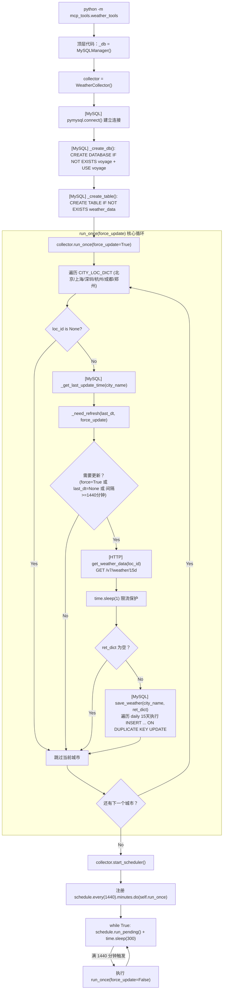
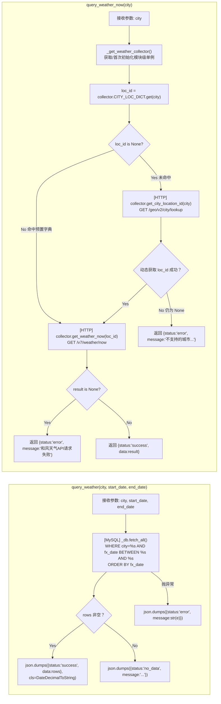

# `mcp_tools/weather_tools.py` 代码精讲学习手册

> **阅读指南**：本文档是一份**完全独立（Self-Contained）**的源码精讲手册。文档内已 **100% 完整嵌入 `mcp_tools/weather_tools.py` 的全部 650 行源代码**，并从架构定位、前置技术原理、全入口调用链、逐行源码拆解、真实数据沙盘推演（Dry Run）到潜在 Bug 诊断进行了全方位剖析。你无需打开任何源码文件即可完成深度学习。

---

## 一、文件定位与核心前置知识精讲

### 1.1 在四层架构中的位置

在 **Voyage 智途 A2A** 系统中，整体工具调用链路遵循清晰的**四层解耦架构**，`mcp_tools/weather_tools.py` 处于第 3 层（**纯业务逻辑层**）：

```text
┌────────────────────────────────────────────────────────────────────────────┐
│ 第 1 层：A2A Agent 层 (a2a_server/a2a_weather.py)                          │
│   职责：接收主控 Agent 的 A2A 协议请求，通过 MultiServerMCPClient 获取工具   │
└────────────────────────────────────┬───────────────────────────────────────┘
                                     │ MCP 协议 (Streamable-HTTP)
                                     ▼
┌────────────────────────────────────────────────────────────────────────────┐
│ 第 2 层：MCP Server 协议层 (mcp_server/mcp_weather.py)                     │
│   职责：通过 FastMCP 暴露 query_weather / query_weather_now，               │
│         并设置 run_in_thread=True 将同步阻塞调用卸载到线程池               │
│   旁路：core/tool_init.py 也会将这两个函数包装为 FunctionTool 注册进名册   │
└────────────────────────────────────┬───────────────────────────────────────┘
                                     │ Python 函数直接调用
                                     ▼
┌────────────────────────────────────────────────────────────────────────────┐
│ 第 3 层：MCP Tools 纯业务逻辑层 (mcp_tools/weather_tools.py) ★ 本文件 ★     │
│   职责：零 MCP 协议依赖！包含：                                            │
│     1. 后台守护进程 WeatherCollector：定时拉取和风天气 15 天预报写入 MySQL │
│     2. query_weather(city, start_date, end_date)：查 MySQL 预报表          │
│     3. query_weather_now(city)：查和风天气 Geo API + 实时天气 API          │
└─────────────────┬──────────────────────────────────────────┬───────────────┘
                  │ [MySQL] pymysql                          │ [HTTP] requests
                  ▼                                          ▼
┌─────────────────────────────────────────┐ ┌────────────────────────────────┐
│ 第 4 层（存储）：MySQL (voyage 库)      │ │ 第 4 层（外部服务）：和风天气  │
│   表：weather_data (UNIQUE: city+date)  │ │   Geo API / 15d API / Now API  │
└─────────────────────────────────────────┘ └────────────────────────────────┘
```

**为什么要把 `mcp_server/mcp_weather.py` 和 `mcp_tools/weather_tools.py` 拆开？**
1. **职责单一（SRP）**：`weather_tools.py` 没有任何 `fastmcp` 导入，既可以被 `mcp_weather.py` 注册为 MCP 工具，也可以被 `core/tool_init.py` 注册进本地 `ToolRegistry`，还能直接通过 `python -m mcp_tools.weather_tools` 作为**独立的数据采集守护进程**在 Docker 容器中运行。
2. **可测试性**：单元测试或脚本调试时可以直接导入 `query_weather` 当普通 Python 函数调用，不需要启动 HTTP 服务器。

---

### 1.2 核心前置知识科普

在读源码前，先掌握本文件涉及的 4 个核心工程知识点：

#### （1）离线定时采集入库 vs 在线实时查询的“混合架构设计”
为什么 `query_weather`（查未来多日天气预报）查的是 **MySQL 数据库**，而 `query_weather_now`（查当前实时天气）查的是 **和风天气 HTTP API**？

| 维度 | 15 天天气预报 (`query_weather`) | 当前实时天气 (`query_weather_now`) |
| :--- | :--- | :--- |
| **业务访问特征** | 用户规划行程时高频查询（如“查北京 5月1日~5月5日 天气”），涉及**日期范围过滤与排序** | 用户关心此时此刻的气温、体感温度、风力，要求**强实时性** |
| **第三方 API 限制** | 和风天气 `/v7/weather/15d` 每次返回整整 15 天的全量数组，不支持传 `start_date ~ end_date` 按区间切片，且有 QPS/调用额度限制 | `/v7/weather/now` 响应体极小，仅返回当前时刻快照 |
| **架构选型** | **离线定时采集 (`WeatherCollector`) + MySQL 落盘 (`weather_data`)**。查询时直接用 SQL `WHERE city=%s AND fx_date BETWEEN %s AND %s`，毫秒级响应且节省 API 额度 | **在线直连 HTTP API** + 预置热点城市 `CITY_LOC_DICT` 缓存，兼顾实时性与非热点城市动态扩展（Geo API） |

#### （2）和风天气（QWeather）三大 API 接口规范
本文件对接了和风天气的三个 RESTful 接口，均使用请求头 `X-QW-Api-Key` 进行认证：
1. **城市编码查询（Geo API）**：
   - 路径：`GET https://{QW_HOST}/geo/v2/city/lookup?location={城市名}`
   - 作用：和风天气的天气接口不直接接收中文城市名（避免重名歧义），必须先转为 9 位数字的 `Location ID`（例如北京是 `'101010100'`，郑州是 `'101180101'`）。
   - 核心返回结构：`{"code": "200", "location": [{"name": "郑州", "id": "101180101", ...}]}`。
2. **15 天每日天气预报 API**：
   - 路径：`GET https://{QW_HOST}/v7/weather/15d?location={location_id}`
   - 作用：返回指定城市未来 15 天的逐日气象预报（最高/最低温、日出日落、昼夜天气现象、风向风力、降水量、紫外线等）。
   - 核心返回结构：`{"code": "200", "updateTime": "2026-06-29T10:20+08:00", "daily": [{"fxDate": "2026-06-29", "tempMax": "33", ...}, ...]}`。
3. **实时天气 API**：
   - 路径：`GET https://{QW_HOST}/v7/weather/now?location={location_id}`
   - 作用：返回当前时刻的实况天气。
   - 核心返回结构：`{"code": "200", "updateTime": "...", "now": {"obsTime": "...", "temp": "28", "feelsLike": "30", "text": "晴", ...}}`。

> **关于 Gzip 压缩**：和风天气接口默认对响应开启 Gzip 压缩。在 Python 的 `requests` 库中，底层 `urllib3` 会自动发送并处理 `Accept-Encoding: gzip`，在调用 `resp.json()` 时**透明完成解压**，无需手动调用 `gzip.decompress()`。

#### （3）MySQL `ON DUPLICATE KEY UPDATE` 幂等更新机制
天气预报是动态变化的（今天预测 5 天后的天气，和明天预测 4 天后的同一天天气，数值可能微调）。因此每天定时采集 15 天预报时，必然会遇到**同一个城市、同一个预报日期 (`fx_date`) 已经存在于表中**的情况。
- **第 1 步（建表约束）**：在 `weather_data` 表中定义联合唯一索引：
  ```sql
  UNIQUE KEY unique_city_date (city, fx_date)
  ```
- **第 2 步（冲突转更新）**：插入时使用：
  ```sql
  INSERT INTO weather_data (city, fx_date, temp_max, ..., update_time)
  VALUES (%s, %s, %s, ..., %s)
  ON DUPLICATE KEY UPDATE
      temp_max = VALUES(temp_max),
      ...,
      update_time = VALUES(update_time)
  ```
  - 当 `(city, fx_date)` 不存在时：正常执行 `INSERT` 新增一行。
  - 当 `(city, fx_date)` 已存在（触发 `unique_city_date` 唯一键冲突）时：不报错，自动转为 `UPDATE`，其中 `VALUES(字段名)` 表示引用本次 `INSERT` 语句尝试传入的新值覆盖旧值。这就实现了**无论定时任务重复跑多少次，表中同一城市同一天永远只有最新的一条记录（幂等性）**。

#### （4）时区感知时间（Timezone-Aware Datetime）与 `schedule` 定时调度
- **Naive vs Aware Datetime**：
  - 从 MySQL `DATETIME` 字段查出来的 `last_dt`（如 `datetime(2026, 6, 29, 10, 20, 0)`）是不带时区信息的 **Naive Datetime**。
  - 如果直接用带时区的当前时间 `datetime.now(tz=self.TZ)`（**Aware Datetime**）去减 Naive Datetime，Python 会直接抛出 `TypeError: can't subtract offset-naive and offset-aware datetimes`。
  - 因此代码中通过 `last_update_time = last_dt.replace(tzinfo=self.TZ)` 为数据库时间贴上相同的时区标签（注：关于 `pytz` 下 `.replace(tzinfo=...)` 与 `ZoneInfo` 的细节差异，我们在第四章“代码走读注意点”中深入剖析）。
- **`schedule` 库心跳机制**：
  - `schedule.every(1440).minutes.do(self.run_once)` 只是在内存中注册了一个计时规则，**不会自己开启后台线程**。
  - 必须配合 `while True: schedule.run_pending(); time.sleep(300)` 循环。每次 `run_pending()` 检查当前时间是否越过了设定的触发时刻，到了就同步执行 `self.run_once()`，`sleep(300)` 防止空转烧满 CPU。

---

## 二、所有入口与调用链全景图

### 2.1 四大入口总览表

```text
入口 / 公共函数                      调用的函数或方法                   最底层外部动作
──────────────────────────────────────────────────────────────────────────────────────────
1. 导入 weather_tools 模块         → _db = MySQLManager()            → 创建管理对象（惰性，暂不建连）
2. python -m mcp_tools.weather_tools → WeatherCollector()            → [MySQL] 连接、建库、建表
   （独立运行入口：采集守护进程）    → collector.run_once(True)      → [MySQL] 查时间 + [HTTP] 查15天预报 + [MySQL] 入库
                                     → collector.start_scheduler()   → 每300秒心跳检测，满1440分钟调 run_once(False)
3. query_weather(city, start, end) → _db.fetch_all(sql, params)      → [MySQL] 参数化查询 weather_data 表
                                     → json.dumps(..., cls=...)      → 返回 JSON 字符串 (success / no_data / error)
4. query_weather_now(city)         → _get_weather_collector()        → 懒加载创建/复用全局 _weather_collector
                                     → get_city_location_id(city)    → [HTTP] 字典未命中时查和风 Geo API
                                     → get_weather_now(loc_id)       → [HTTP] 查和风实时天气 API
```

### 2.2 入口一：离线定时采集守护进程 (`__main__` & `WeatherCollector`)



### 2.3 入口二 & 三：MCP 工具查询函数 (`query_weather` & `query_weather_now`)



---

## 三、完整源码与逐函数深度精讲

### 3.1 完整源代码（100% 原始代码嵌入，共 650 行）

以下是 `mcp_tools/weather_tools.py` 的完整源码，包含原文件中的所有注释与空行：

```python
"""天气查询工具函数 —— 纯业务逻辑，无MCP依赖
包含：
WeatherCollector（数据采集/入库）
query_weather（MySQL历史查询）
query_weather_now（实时查询）
"""
"""
天气查询工具函数 —— 纯业务逻辑，无MCP依赖

═══════════════════════════════════════════════════════════════════════════
                           WeatherCollector 数据采集流程
═══════════════════════════════════════════════════════════════════════════
  [__main__ 入口]
       ↓
  WeatherCollector()                      ← 读 CONFIG，建 pymysql 连接
       ├──► _create_db()                  ← CREATE DATABASE IF NOT EXISTS
       ├──► _create_table()               ← CREATE TABLE IF NOT EXISTS
       ↓
  run_once(force_update=True)             ← 首次强制全量采集
       ├──► for city in CITY_LOC_DICT ←────────┐──────────────────────┐
       │      ├─ loc_id is None? ──Yes──► skip │                      │
       │      ↓                                │                      │
       │      _get_last_update_time(city)      │                      │
       │      ↓                                │                      │
       │      _need_refresh()? ──No────────────┘                      │
       │      │  ┌───────────────────────┐                            │
       │      │  │ _need_refresh 判断逻辑：                            │
       │      │  │   force=True ──────► True                          │
       │      │  │   last_dt=None ────► True                          │
       │      │  │   间隔 ≥ 1440分钟 ──► True                          │
       │      │  │   否则就 ───────────► False                         │
       │      │  └───────────────────────┘                            │
       │      ↓                                                       │
       │      get_weather_data(loc_id)  ← HTTP GET和风天气15天天气预报  │
       │      ├─ API 失败？ ──► skip                                   │
       │      ↓                                                       │
       │      save_weather(city, ret_dict)                            │
       │      ├──► for daily in 15days ──┐                            │
       │      │        ↓                 │                            │
       │      │        INSERT INTO       │                            │
       │      │        ON DUPLICATE      │                            │
       │      │        KEY UPDATE        │                            │
       │      │        └─────────────────┘                            │                           
       │      └──► 下一城市 ───────────────────────────────────────────┘
       ↓
  start_scheduler()
       ├─ schedule.every(1440分钟).do(run_once)
       └─ while True:
               schedule.run_pending()  ← 心跳检测
               sleep(300秒)

═══════════════════════════════════════════════════════════════════════════
                         MCP 工具函数 (供 mcp_server 调用)
═══════════════════════════════════════════════════════════════════════════

  query_weather(city, start_date, end_date)
       │
       ▼
  MySQLManager.fetch_all()
  SELECT FROM weather_data
  WHERE city=%s AND fx_date BETWEEN %s AND %s
       │
       ├─ rows ──► json.dumps({status:"success", data:rows})
       └─ 空   ──► json.dumps({status:"no_data"})

  ───────────────────────────────────────

  query_weather_now(city)
       │
       ▼
  WeatherCollector()
       │
       ├─ city 在 CITY_LOC_DICT?
       │    ├─ Yes ──► loc_id
       │    └─ No  ──► get_city_location_id(city) ← 动态查API
       │                ├─ 成功 ──► loc_id
       │                └─ 失败 ──► return error
       │
       ▼
  collector.get_weather_now(loc_id)   ← HTTP GET 实时天气
       │
       ├─ 成功 ──► json.dumps({status:"success", data:...})
       └─ 失败 ──► json.dumps({status:"error"})

═══════════════════════════════════════════════════════════════════════════
                               数据流总结
═══════════════════════════════════════════════════════════════════════════

  和风天气 API ──► WeatherCollector ──► MySQL (weather_data)
       (外部)         (定时采集)            (持久化)

  MCP Client ──► mcp_server ──► query_weather() ──► MySQL
                            ──► query_weather_now() ──► 和风API (实时)
"""

"""
整篇代码要现实:
1. xxxx
2. xxxx
3. xxxx

具体：
1.1. xxxx
1.2. xxxx


"""


import time
import json
import pytz
import pymysql
import requests
import schedule
from datetime import date
from datetime import datetime

from utils import CONFIG
from utils import logger
from utils import MySQLManager
from utils import DateDecimalToString


# ============================================================
# WeatherCollector —— 和风天气数据采集 & 实时查询
# ============================================================

class WeatherCollector:
    def __init__(self):
        self.TZ = pytz.timezone(CONFIG.QW_TZ) # 时区
        self.REQUEST_TIMEOUT = 30 # 请求超时 秒
        self.SCHEDULER_CHECK_SECONDS = 300 # 调度检查间隔，秒
        self.FORECAST_DAYS = 15 # 预报天数
        # 预报天数，支持3 7 10 15 30天

        # 定时任务的时间间隔，即获取天气数据间隔，分钟
        # self.UPDATE_INTERVAL_MINUTE = 60 # 每 N分钟执行一次
        self.UPDATE_INTERVAL_MINUTE = 1440  # 每一天执行一次

        # 和风天气 密钥
        self.QW_API_KEY = CONFIG.QW_API_KEY
        # 和风天气 API Host，从控制台-设置查看
        self.QW_HOST = CONFIG.QW_API_HOST
        # 和风天气 天气预报接口url
        self.QW_FORECAST_URL = (f"https://{self.QW_HOST}"
                                f"/v7/weather/"
                                f"{self.FORECAST_DAYS}d")
        # 和风天气 实时天气接口url
        self.QW_NOW_URL = (f"https://{self.QW_HOST}"
                           f"/v7/weather/now")
        # 和风天气 获取城市编码接口url
        self.QW_GEO_URL = (f"https://{self.QW_HOST}"
                           f"/geo/v2/city/lookup")

        # 城市-编码 映射字典【城市编码几乎不会变】
        self.CITY_LOC_DICT = {
            '北京': '101010100',
            '上海': '101020100',
            '深圳': '101280601',
            '杭州': '101210101',
            '成都': '101270101',
            '郑州': '101180101'
        }

        # MySQL连接配置
        self.MYSQL_CFG = {
            "host": CONFIG.DB_MYSQL_HOST,
            "port": CONFIG.DB_MYSQL_PORT,
            "user": CONFIG.DB_MYSQL_USER,
            "password": CONFIG.DB_MYSQL_PASSWORD,
            "charset": CONFIG.DB_MYSQL_CHARSET,
            "autocommit": True # 自动提交
        }
        # mysql连接
        self.conn = pymysql.connect(**self.MYSQL_CFG)
        self.cursor = self.conn.cursor() # 游标
        self._create_db() # 不存在就建库，切换库
        self._create_table() # 不存在就建表

    # ========Geo接口：动态获取城市location_id =======
    def get_city_location_id(self, city_name):
        headers = {"X-QW-Api-Key": self.QW_API_KEY}
        params = {"location": city_name}
        try: # 发送get请求
            # API Document :
            # dev.qweather.com/docs/api/geoapi/city-lookup/
            resp = requests.get(
                self.QW_GEO_URL,
                headers=headers,
                params=params,
                timeout=self.REQUEST_TIMEOUT
            )
            ret_dict = resp.json()
            if resp.status_code == 200: # 请求成功
                city_location_id = ret_dict["location"][0]["id"]
                logger.info(f'{city_name}的location_id➡️ ：'
                            f'{city_location_id}')
                return city_location_id # 请求成功
            logger.error(f"[获取 {city_name} location id失败] : "
                         f"{ret_dict}")
            return None # 请求失败
        except Exception as e:
            logger.exception(f"{city_name}获取locationid失败{e}")
            return None

    # ========= 数据库私有工具方法 =========
    def _create_db(self):
        """初始化数据库，不存在则创建"""
        create_sql = (
            "CREATE DATABASE IF not EXISTS voyage "
            "CHARACTER SET utf8mb4 COLLATE utf8mb4_unicode_ci"
        )
        self.cursor.execute(create_sql)
        self.cursor.execute('USE voyage')
        logger.info("数据库初始化完成（已存在则跳过）")

    def _create_table(self):
        """初始化天气数据表，不存在则创建"""
        create_sql = """
        CREATE TABLE IF NOT EXISTS weather_data (
            id INT AUTO_INCREMENT PRIMARY KEY,
            city VARCHAR(50) NOT NULL COMMENT '城市名称',
            fx_date DATE NOT NULL COMMENT '预报日期',
            sunrise TIME COMMENT '日出时间',
            sunset TIME COMMENT '日落时间',
            moonrise TIME COMMENT '月升时间',
            moonset TIME COMMENT '月落时间',
            moon_phase VARCHAR(20) COMMENT '月相名称',
            moon_phase_icon VARCHAR(10) COMMENT '月相图标代码',
            temp_max INT COMMENT '最高温度',
            temp_min INT COMMENT '最低温度',
            icon_day VARCHAR(10) COMMENT '白天天气图标代码',
            text_day VARCHAR(20) COMMENT '白天天气描述',
            icon_night VARCHAR(10) COMMENT '夜间天气图标代码',
            text_night VARCHAR(20) COMMENT '夜间天气描述',
            wind360_day INT COMMENT '白天风向360角度',
            wind_dir_day VARCHAR(20) COMMENT '白天风向',
            wind_scale_day VARCHAR(10) COMMENT '白天风力等级',
            wind_speed_day INT COMMENT '白天风速 (km/h)',
            wind360_night INT COMMENT '夜间风向360角度',
            wind_dir_night VARCHAR(20) COMMENT '夜间风向',
            wind_scale_night VARCHAR(10) COMMENT '夜间风力等级',
            wind_speed_night INT COMMENT '夜间风速 (km/h)',
            precip DECIMAL(5,1) COMMENT '降水量 (mm)',
            uv_index INT COMMENT '紫外线指数',
            humidity INT COMMENT '相对湿度 (%)',
            pressure INT COMMENT '大气压强 (hPa)',
            vis INT COMMENT '能见度 (km)',
            cloud INT COMMENT '云量 (%)',
            update_time DATETIME COMMENT '数据更新时间',
            UNIQUE KEY unique_city_date (city, fx_date)
        ) 
        ENGINE=InnoDB 
        DEFAULT CHARSET=utf8mb4 
        COLLATE=utf8mb4_unicode_ci 
        COMMENT='天气数据表';
        """
        self.cursor.execute(create_sql)
        logger.info("数据表初始化完成（已存在则跳过）")

    def _ensure_connection(self):
        """确保连接存活，否则重新连接"""
        try:
            self.conn.ping(reconnect=False)
        except Exception:
            logger.warn("MySQL 连接已断开，正在重连...")
            self.conn = pymysql.connect(**self.MYSQL_CFG)
            self.cursor = self.conn.cursor()

    def _get_last_update_time(self, city_name):
        """查询单个城市上次更新时间"""
        self._ensure_connection() # 确保连接
        sql = """
        SELECT MAX(update_time) 
        FROM weather_data 
        WHERE city = %s
        """
        self.cursor.execute(sql, (city_name,))
        res = self.cursor.fetchone()
        ret = res[0] if res and res[0] else None
        ''' fetchone() 两种返回：
        1. 表里有数据：返回元组 (2026-06-29 10:20:00,)
        2. 表里该城市无任何记录：返回 None
        '''
        return ret

    def _need_refresh(self, last_dt, force=False):
        """判断城市是否需要重新拉取天气，返回 True/False"""
        if force: # 如果强制更新，直接返回需要更新
            return True
        # 数据库没有这个城市的历史数据，必须更新
        # last_dt 最新时间 _get_last_update_time函数获取
        if last_dt is None:
            return True
        # 获取当前上海时区的时间
        now_time = datetime.now(tz=self.TZ)
        # 把数据库拿出来的旧时间也改成上海时区，避免时区错乱
        last_update_time = last_dt.replace(tzinfo=self.TZ)

        # 计算 现在距离上次更新 过了多少分钟
        time_gap_seconds = (
                now_time - last_update_time
        ).total_seconds()
        time_gap_minutes = time_gap_seconds / 60

        # 如果间隔 >= 配置的时间，就需要更新；否则不用
        if time_gap_minutes >= self.UPDATE_INTERVAL_MINUTE:
            return True
        else:
            return False

    # ======= 和风天气接口：=======
    def get_weather_now(self, location_id):
        '''获取指定城市location_id的实时天气预报
        本方法由 mcp server直接调用'''
        headers = {
            "X-QW-Api-Key": self.QW_API_KEY
        }
        url = f"{self.QW_NOW_URL}?location={location_id}"
        try:
            resp = requests.get(
                url,
                headers=headers,
                timeout=self.REQUEST_TIMEOUT
            )
            if resp.status_code == 200:
                logger.info(f'获取成功➡️ ：{resp.json()}')
                # 返回字典，requests包自带gzip解压
                return resp.json()
            else:
                logger.error(f'请求失败➡️ ：{resp.json()}')
                return None
        except Exception as e:
            logger.exception(f"[获取天气预报失败]: {e}")
            return None

    def get_weather_data(self, location_id):
        '''按FORECAST_DAYS天数，获取指定城市location_id的天气预报数据'''
        headers = {
            "X-QW-Api-Key": self.QW_API_KEY,
            "Accept-Encoding": "gzip"
        }
        url = f"{self.QW_FORECAST_URL}?location={location_id}"
        try:
            resp = requests.get(
                url,
                headers=headers,
                timeout=self.REQUEST_TIMEOUT
            )
            if resp.status_code == 200:
                logger.info(f'获取成功➡️ ：{resp.json()}')
                # 返回字典，requests包自带gzip解压
                return resp.json()
            else:
                logger.error(f'请求失败➡️ ：{resp.json()}')
                return None
        except Exception as e:
            logger.exception(f"[获取天气预报失败]: {e}")
            return None

    # ========= 数据入库 ==========
    def save_weather(self, city, ret_dict):
        '''数据入库'''
        # 获取更新时间
        update_dt = datetime.fromisoformat(
            ret_dict.get("updateTime")
        ).replace(tzinfo=self.TZ)

        insert_sql = """
        INSERT INTO weather_data (
            city, fx_date, sunrise, sunset, moonrise, 
            moonset, moon_phase, moon_phase_icon, 
            temp_max, temp_min, icon_day, text_day, 
            icon_night, text_night, wind360_day, 
            wind_dir_day, wind_scale_day, wind_speed_day,
            wind360_night, wind_dir_night, wind_scale_night,
            wind_speed_night, precip, uv_index, humidity, 
            pressure, vis, cloud, update_time
        ) 
        VALUES (
            %s, %s, %s, %s, %s, %s, %s, %s, %s, %s, %s, 
            %s, %s, %s, %s, %s, %s, %s, %s, %s, %s, %s, 
            %s, %s, %s, %s, %s, %s, %s
        )
        ON DUPLICATE KEY UPDATE
            sunrise = VALUES(sunrise), 
            sunset = VALUES(sunset), 
            moonrise = VALUES(moonrise),
            moonset = VALUES(moonset), 
            moon_phase = VALUES(moon_phase), 
            moon_phase_icon = VALUES(moon_phase_icon),
            temp_max = VALUES(temp_max), 
            temp_min = VALUES(temp_min), 
            icon_day = VALUES(icon_day),
            text_day = VALUES(text_day), 
            icon_night = VALUES(icon_night), 
            text_night = VALUES(text_night),
            wind360_day = VALUES(wind360_day), 
            wind_dir_day = VALUES(wind_dir_day), 
            wind_scale_day = VALUES(wind_scale_day),
            wind_speed_day = VALUES(wind_speed_day), 
            wind360_night = VALUES(wind360_night),
            wind_dir_night = VALUES(wind_dir_night), 
            wind_scale_night = VALUES(wind_scale_night),
            wind_speed_night = VALUES(wind_speed_night), 
            precip = VALUES(precip), 
            uv_index = VALUES(uv_index),
            humidity = VALUES(humidity), 
            pressure = VALUES(pressure), 
            vis = VALUES(vis),
            cloud = VALUES(cloud), 
            update_time = VALUES(update_time)
        """
        '''重复日期自动全部更新为最新天气数据
        1. 建表时有唯一索引 
            UNIQUE KEY unique_city_date (city, fx_date)
            表示 同一个城市同一天只能存一条
        2. 插入时如果重复，就执行 
            ON DUPLICATE KEY UPDATE 字段 = VALUES(字段)：
            用本次新数据覆盖数据库原有该行对应字段
            比如 update_time = VALUES(update_time) 就表示
                新的update_time覆盖旧的update_time
        '''

        # 获取所有天气数据列表
        batch_count = 0
        # 遍历每天的天气数据
        for daily in ret_dict.get("daily", []):
            # 取出当天的日期，转为datetime.date对象
            fx_date = date.fromisoformat(daily["fxDate"])
            # 数据 按表字段顺序
            row = (
                city,
                fx_date,
                daily.get("sunrise"),
                daily.get("sunset"),
                daily.get("moonrise"),
                daily.get("moonset"),
                daily.get("moonPhase"),
                daily.get("moonPhaseIcon"),
                daily.get("tempMax"),
                daily.get("tempMin"),
                daily.get("iconDay"),
                daily.get("textDay"),
                daily.get("iconNight"),
                daily.get("textNight"),
                daily.get("wind360Day"),
                daily.get("windDirDay"),
                daily.get("windScaleDay"),
                daily.get("windSpeedDay"),
                daily.get("wind360Night"),
                daily.get("windDirNight"),
                daily.get("windScaleNight"),
                daily.get("windSpeedNight"),
                daily.get("precip"),
                daily.get("uvIndex"),
                daily.get("humidity"),
                daily.get("pressure"),
                daily.get("vis"),
                daily.get("cloud"),
                update_dt
            )
            self._ensure_connection() # 确保连接
            # 参数化执行SQL
            self.cursor.execute(insert_sql, row)
            batch_count += 1 # 计数+1
        logger.info(f"[入库完成]{city}共{batch_count}天的天气预报")
        return True

    # ======= 一轮全量采集主逻辑 =======
    def run_once(self, force_update=False):
        logger.info(f"\n执行一轮天气采集，强制更新={force_update}")
        try:
            for city_name, loc_id in self.CITY_LOC_DICT.items():
                try:
                    # 城市编码，是None就跳过，说明获取失败
                    if loc_id is None:
                        logger.warn(f"跳过{city_name}："
                                    f"无法获取location编码")
                        continue

                    # 获取最后更新时间
                    last_dt = self._get_last_update_time(
                        city_name
                    )

                    # 判断是否需要跳过，则跳过
                    if not self._need_refresh(
                            last_dt, force_update):
                        logger.info(f"跳过更新{city_name}")
                        continue

                    # 获取天气数据
                    logger.info(f"\n从和风天气获取{city_name}天气")
                    ret_dict = self.get_weather_data(loc_id)
                    time.sleep(1)
                    if not ret_dict:
                        logger.warn(f"跳过入库{city_name}，"
                                    f"天气获取失败")
                        continue

                    # 保存入库
                    self.save_weather(city_name, ret_dict)

                except Exception as e:
                    logger.exception(f"{city_name}获取异常: {e}")

            logger.info("\n本轮天气数据更新执行完毕")
        except Exception as e:
            logger.exception(f"采集全局致命异常: {e}")

    def __del__(self): # 关闭连接 静默处理
        try:
            self.cursor.close()
            self.conn.close()
        except:
            pass

    # ====== 定时任务入口 ======
    def start_scheduler(self):
        # 每 UPDATE_INTERVAL_MINUTE 分钟执行一次 run_once()
        schedule.every(
            self.UPDATE_INTERVAL_MINUTE
        ).minutes.do(self.run_once)

        logger.info(f"定时采集已启动 ➡️ ："
                    f"每{self.UPDATE_INTERVAL_MINUTE}分钟"
                    f"执行一轮")
        while True:
            # 定时任务心跳检测：时间到了或过了定时任务才会执行
            # 时间到了（过了）没？该谁干活了？（干活！）"
            schedule.run_pending()
            # 必须sleep，否则心跳检测会不停地运行，让CPU占用过高
            time.sleep(self.SCHEDULER_CHECK_SECONDS)


# ============================================================
# MCP 工具函数 —— 供 mcp_server 层注册为 MCP tool
# ============================================================

# 天气查询专用数据库实例
_db = MySQLManager()


def query_weather(city: str,
                  start_date: str,
                  end_date: str) -> str:
    """从 weather_data 表查询指定城市、日期范围的天气"""
    logger.info("天气查询: city=%s, %s ~ %s",
                city, start_date, end_date)
    try:
        sql = """
        SELECT city, fx_date, temp_max, temp_min, text_day, text_night,
        humidity, wind_dir_day, wind_scale_day, wind_speed_day,
        sunrise, sunset, precip, uv_index, pressure, vis, cloud
        FROM weather_data
        WHERE city = %s AND fx_date BETWEEN %s AND %s
        ORDER BY fx_date
        """
        # 参数化sql查询(防sql注入)
        rows = _db.fetch_all(
            sql,
            params=(city, start_date, end_date)
        )

        if rows: # 返回json字符串
            return json.dumps(
                {"status": "success", "data": rows},
                cls=DateDecimalToString, # 自定义json解析器
                ensure_ascii=False
            )
        return json.dumps(
            {
                "status": "no_data",
                "message": "未找到天气数据，请确认城市和日期。"
            },
            ensure_ascii=False
        )
    except Exception as e:
        logger.error("天气查询异常: %s", e)
        return json.dumps(
            {"status": "error", "message": str(e)},
            ensure_ascii=False
        )


# 模块级懒加载单例：WeatherCollector 只创建一次（建连+DDL 只执行一次）
# 与 ticket_tools/trip_tools 的模块级 _db 保持一致的设计模式
_weather_collector = None

def _get_weather_collector():
    """懒初始化：首次调用时创建 WeatherCollector，后续复用"""
    global _weather_collector
    if _weather_collector is None:
        _weather_collector = WeatherCollector()
    return _weather_collector


def query_weather_now(city: str) -> str:
    """调用 WeatherCollector.get_weather_now() 获取实时天气"""
    logger.info("实时天气查询: city=%s", city)
    collector = _get_weather_collector()  # 复用全局单例，不重复建连
    try:
        loc_id = collector.CITY_LOC_DICT.get(city)
        if loc_id is None:
            # city不在CITY_LOC_DICT→调get_city_location_id动态获取
            loc_id = collector.get_city_location_id(city)
            if loc_id is None:
                # 还是 None 就返回不支持该城市天气查询
                return json.dumps(
                    {"status": "error", "message": f"不支持的城市: {city}，支持: {list(collector.CITY_LOC_DICT.keys())}"},
                    ensure_ascii=False
                )
        # 获取实时天气
        result = collector.get_weather_now(loc_id)
        if result is None:
            return json.dumps(
                {"status": "error", "message": "和风天气API请求失败"},
                ensure_ascii=False
            )
        return json.dumps(
            {"status": "success", "data": result},
            ensure_ascii=False)
    except Exception as e:
        logger.exception("实时天气查询mcp服务异常")
        return json.dumps(
            {"status": "error", "message": str(e)},
            ensure_ascii=False
        )


# ============================================================
# 独立运行入口 —— 定时采集天气数据
# ============================================================

if __name__ == "__main__":

    collector = WeatherCollector()

    # 程序启动先强制执行一轮
    logger.info("➡️ 程序启动，执行首次全量采集 ")
    collector.run_once(force_update=True)
    # 启动定时任务
    # TODO 定时任务一旦启动，就无法结束，需要手动结束
    collector.start_scheduler()

    '''docker镜像直接规定python命令启动
    CMD ["python", "-m", "mcp_tools.weather_tools"]
    '''
```

---

### 3.2 逐函数深度精讲与沙盘推演（Dry Run）

#### 1. `WeatherCollector.__init__(self)`（第 130~180 行）
- **核心职责**：初始化配置常量、拼接和风天气三大 API URL、定义 6 个预置城市字典、建立 `pymysql` 连接并自动建库建表。
- **关键参数与属性拆解**：
  - `self.TZ = pytz.timezone(CONFIG.QW_TZ)`：通常为 `Asia/Shanghai`。
  - `self.FORECAST_DAYS = 15`：拼接到 `self.QW_FORECAST_URL = f"https://{self.QW_HOST}/v7/weather/15d"`。
  - `self.UPDATE_INTERVAL_MINUTE = 1440`：一天（24 × 60 = 1440 分钟）更新一次。
  - `self.MYSQL_CFG`：注意这里**没有传入 `"database": "voyage"`**（因为怕首次启动时 `voyage` 库还不存在导致连接直接报错），而是设置 `"autocommit": True`，先连上 MySQL Server，再在 `self._create_db()` 中执行 `CREATE DATABASE IF not EXISTS voyage` 和 `USE voyage`。

#### 2. `WeatherCollector.get_city_location_id(self, city_name)`（第 182~205 行）
- **核心职责**：当查询的城市不在 `CITY_LOC_DICT` 的 6 个预置城市中时，向和风天气 Geo API 发送 HTTP GET 请求，动态解析出城市的 `location_id`。
- **HTTP 请求构造**：
  - URL：`https://{self.QW_HOST}/geo/v2/city/lookup`
  - Headers：`{"X-QW-Api-Key": self.QW_API_KEY}`
  - Query Params：`{"location": city_name}`（`requests` 会自动对中文做 URL 编码，如 `西安` → `%E8%A5%BF%E5%AE%89`）
- **解析逻辑**：当 `resp.status_code == 200` 时，取 `ret_dict["location"][0]["id"]`（匹配度最高的第一条记录的 `id`）。失败或异常均返回 `None`。

#### 3. 数据库初始化与保活：`_create_db`、`_create_table`、`_ensure_connection`（第 208~270 行）
- `_create_db()`：建库并执行 `USE voyage` 切换当前会话默认数据库。
- `_create_table()`：创建 `weather_data` 表，包含 31 个列和 1 个联合唯一索引 `UNIQUE KEY unique_city_date (city, fx_date)`。注意 `sunrise/sunset/moonrise/moonset` 是 `TIME` 类型，`fx_date` 是 `DATE` 类型，`precip`（降水量）是 `DECIMAL(5,1)`。
- `_ensure_connection()`：调用 `self.conn.ping(reconnect=False)` 检测 TCP 连接是否被 MySQL Server 因空闲超时（`wait_timeout`）断开；若抛出异常则重新执行 `pymysql.connect(**self.MYSQL_CFG)` 并重建游标。

#### 4. 增量刷新判断：`_get_last_update_time` 与 `_need_refresh`（第 271~312 行）
- `_get_last_update_time(city_name)`：
  - 执行 `SELECT MAX(update_time) FROM weather_data WHERE city = %s`。
  - 注意：`MAX()` 聚合函数在没有任何匹配行时，仍然会返回一行 `(None,)`！因此第 281 行写得非常严谨：`ret = res[0] if res and res[0] else None`。
- `_need_refresh(last_dt, force=False)`：
  - 三个条件满足任意一个即返回 `True`（需要刷新）：
    1. `force == True`（如启动首轮强制更新）；
    2. `last_dt is None`（库里还没有该城市的数据）；
    3. `(now_time - last_update_time).total_seconds() / 60 >= 1440`（距离上次入库数据的更新时间已满或超过 24 小时）。

#### 5. 和风天气 HTTP 请求封装：`get_weather_now` 与 `get_weather_data`（第 314~361 行）
- `get_weather_now(location_id)`：请求 `/v7/weather/now?location={location_id}`，返回解析后的 Python `dict`（含 `"now"` 字典）。
- `get_weather_data(location_id)`：请求 `/v7/weather/15d?location={location_id}`，显式携带 `"Accept-Encoding": "gzip"`，返回解析后的 Python `dict`（含 `"daily"` 列表，共 15 个元素）。

#### 6. `WeatherCollector.save_weather(self, city, ret_dict)`（第 363~470 行）
- **核心职责**：将 `get_weather_data` 返回的 15 天预报 JSON 字典拆解并写入 `weather_data` 表。
- **时间解析**：
  - `update_dt = datetime.fromisoformat(ret_dict.get("updateTime")).replace(tzinfo=self.TZ)`：将和风返回的 `"2026-06-29T10:20+08:00"` 转为 `datetime` 对象。
  - `fx_date = date.fromisoformat(daily["fxDate"])`：将 `"2026-06-29"` 转为 `datetime.date` 对象。
- **沙盘推演（Dry Run）—— `save_weather("北京", ret_dict)`**：
  - **输入**：`city = "北京"`，`ret_dict` 含 `"updateTime": "2026-05-01T08:00+08:00"`，`"daily"` 列表第一项为 `{"fxDate": "2026-05-01", "sunrise": "05:12", "sunset": "19:10", "tempMax": "26", "tempMin": "14", "textDay": "晴", "precip": "0.0", ...}`。
  - **绑定参数 `row`（29 个元素的元组）**：
    ```python
    (
        '北京', datetime.date(2026, 5, 1),
        '05:12', '19:10', '10:22', '01:05', '蛾眉月', '801',
        '26', '14', '100', '晴', '150', '晴',
        '180', '南风', '1-3', '12',
        '200', '西南风', '1-3', '8',
        '0.0', '7', '35', '1012', '25', '10',
        datetime.datetime(2026, 5, 1, 8, 0, tzinfo=...)
    )
    ```
  - **落库行为**：若表中尚无 `('北京', '2026-05-01')`，插入新行；若已有该行，通过 `ON DUPLICATE KEY UPDATE` 将该行除 `id, city, fx_date` 外的全部 27 个气象与时间字段刷新为最新值。

#### 7. `query_weather(city: str, start_date: str, end_date: str) -> str`（第 546~586 行）
- **核心职责**：供 MCP Server (`mcp_weather.py`) 和 `ToolRegistry` 调用的**多日天气预报查询工具**。
- **使用 `_db = MySQLManager()`**：与 `WeatherCollector` 自建连接不同，`query_weather` 使用模块级 `_db`（基于 `threading.local()` 的线程安全连接管理器，完美配合 FastMCP 的 `run_in_thread=True` 多线程并发调用）。
- **沙盘推演（Dry Run）—— `query_weather("北京", "2026-05-01", "2026-05-02")`**：
  1. **构造 SQL 与参数**：
     - SQL：`SELECT city, fx_date, temp_max, ... FROM weather_data WHERE city = %s AND fx_date BETWEEN %s AND %s ORDER BY fx_date`
     - `params`：`('北京', '2026-05-01', '2026-05-02')`
  2. **`_db.fetch_all` 返回字典列表 `rows`**：
     - 注意数据库驱动返回的 `fx_date` 是 `datetime.date(2026, 5, 1)`，`sunrise` 是 `datetime.timedelta(seconds=18720)`，`precip` 是 `Decimal('0.0')`。
  3. **`DateDecimalToString` 序列化输出 JSON 字符串**：
     ```json
     {
       "status": "success",
       "data": [
         {
           "city": "北京",
           "fx_date": "2026-05-01",
           "temp_max": 26,
           "temp_min": 14,
           "text_day": "晴",
           "text_night": "晴",
           "humidity": 35,
           "wind_dir_day": "南风",
           "wind_scale_day": "1-3",
           "wind_speed_day": 12,
           "sunrise": "05:12:00",
           "sunset": "19:10:00",
           "precip": "0.0",
           "uv_index": 7,
           "pressure": 1012,
           "vis": 25,
           "cloud": 10
         }
       ]
     }
     ```
  4. **若未查到任何记录（`rows` 为 `[]`）**：
     ```json
     {
       "status": "no_data",
       "message": "未找到天气数据，请确认城市和日期。"
     }
     ```

#### 8. `_get_weather_collector()` 与 `query_weather_now(city: str) -> str`（第 590~630 行）
- **为什么要用懒加载单例 `_get_weather_collector()`？**
  - 如果在模块顶层直接写 `_weather_collector = WeatherCollector()`，那么哪怕只是导入 `weather_tools` 模块，都会立刻触发 `pymysql.connect()` 和 `CREATE DATABASE/TABLE`。
  - 如果每次调用 `query_weather_now` 都 `WeatherCollector()` 实例化一次，那么每次查实时天气都要重新连一次 MySQL 并执行两次 DDL！
  - 用 `_get_weather_collector()` 实现了**首次调用时初始化一次，后续调用复用同一个实例**。
- **沙盘推演（Dry Run）—— `query_weather_now("西安")`（非预置城市）**：
  1. `collector.CITY_LOC_DICT.get("西安")` 返回 `None`。
  2. 触发 `collector.get_city_location_id("西安")`，向 Geo API 发请求，拿到 `'101110101'`。
  3. 触发 `collector.get_weather_now('101110101')`，向 `/v7/weather/now` 发请求。
  4. 返回 JSON 字符串：
     ```json
     {
       "status": "success",
       "data": {
         "code": "200",
         "updateTime": "2026-05-01T14:30+08:00",
         "now": {
           "obsTime": "2026-05-01T14:25+08:00",
           "temp": "24",
           "feelsLike": "23",
           "text": "多云",
           "windDir": "东风",
           "windScale": "2"
         }
       }
     }
     ```

---

## 四、代码走读注意点与潜在 Bug / 改进思考

在真实生产环境中审视这份代码，有 **5 个非常关键的技术细节与潜在 Bug** 值得深入思考：

### 1. 【严重隐患】`_ensure_connection()` 重连后未执行 `USE voyage`
- **现象定位**：第 167~174 行 `self.MYSQL_CFG` 中**没有配置 `"database": "voyage"`**。首次连接时靠 `__init__` 调用 `_create_db()` 执行了 `self.cursor.execute('USE voyage')`。然而在第 262~270 行的 `_ensure_connection()` 中：
  ```python
  except Exception:
      logger.warn("MySQL 连接已断开，正在重连...")
      self.conn = pymysql.connect(**self.MYSQL_CFG)
      self.cursor = self.conn.cursor()
  ```
- **后果**：当守护进程休眠 24 小时后，MySQL 连接因超过 `wait_timeout`（默认 8 小时）断开。触发 `_ensure_connection()` 重连后，新连接**没有选择任何默认数据库**！紧接着执行 `SELECT MAX(update_time) FROM weather_data` 会立刻抛出 `pymysql.err.OperationalError: (1046, 'No database selected')`。
- **修复方案**：在 `_create_db()` 成功后，执行 `self.MYSQL_CFG["database"] = "voyage"`，或在 `_ensure_connection()` 重连后补一句 `self.cursor.execute('USE voyage')`。

### 2. 【逻辑漏洞】和风天气 HTTP 状态码 `200` 不等于业务状态码 `"200"`
- **现象定位**：在 `get_city_location_id`（第 195 行）、`get_weather_now`（第 327 行）、`get_weather_data`（第 351 行）中，仅判断了 `if resp.status_code == 200:`。
- **后果**：和风天气 API 在遇到诸如“API Key 额度用尽”、“城市不存在（404）”、“无权限访问 15 天预报”等错误时，有时 HTTP 状态码依然返回 `200 OK`，而在响应 JSON 体内返回 `{"code": "404"}` 或 `{"code": "402"}`。
  - 在 `get_city_location_id` 中，若返回 `{"code": "404"}`，没有 `"location"` 字段，第 196 行 `ret_dict["location"][0]["id"]` 会触发 `KeyError` 进入 `except` 返回 `None`（碰巧兜住）。
  - 但在 `get_weather_now` 和 `get_weather_data` 中，错误的 JSON 字典会被当成成功结果返回！甚至在 `save_weather` 中，`ret_dict.get("updateTime")` 为 `None`，会导致 `datetime.fromisoformat(None)` 抛出 `TypeError`。
- **修复方案**：同时校验业务码：`if resp.status_code == 200 and str(ret_dict.get("code")) == "200":`。

### 3. 【架构耦合】`query_weather_now` 强依赖 MySQL 启动 + 未缓存动态查到的 `loc_id`
- **问题 A**：`query_weather_now` 明明是一个纯 HTTP 实时天气查询，但因为它复用了 `WeatherCollector()`，首次调用 `_get_weather_collector()` 时会去连 MySQL 并执行建库建表（而且 `_get_weather_collector()` 写在 `try...except` **外面**，如果此时 MySQL 没启动，`query_weather_now` 会直接崩溃未捕获！）。
- **问题 B**：第 608 行通过 `collector.get_city_location_id(city)` 动态查出非预置城市（如 `"西安"`）的 `loc_id` 后，**没有写回 `collector.CITY_LOC_DICT[city] = loc_id`**，导致每次查西安都要多请求一次 Geo API。
- **问题 C**：第 439 行 `daily.get("moonset")` 等时间字段，在极昼或特定月相日，和风天气会返回空字符串 `""`；将其直接插入 MySQL `TIME` 类型列在严格 SQL 模式下会报 `Incorrect time value: ''`，应将空字符串转为 `None`：`daily.get("moonset") or None`。

### 4. 【时区细节】`pytz` 的 `.replace(tzinfo=self.TZ)` 陷阱
- **现象定位**：第 299 行 `last_update_time = last_dt.replace(tzinfo=self.TZ)`。
- **原理科普**：在旧版 `pytz` 库中，直接调用 `dt.replace(tzinfo=pytz.timezone('Asia/Shanghai'))` 会绑定到该时区历史上的首个 LMT 偏移量（上海为 `+08:06`，差 6 分钟！），`pytz` 官方要求必须用 `self.TZ.localize(last_dt)`。而在 Python 3.9+ 标准库 `zoneinfo.ZoneInfo("Asia/Shanghai")` 中，直接用 `.replace(tzinfo=ZoneInfo(...))` 则是完全正确的（固定 `+08:00`）。这里仅因为误差 6 分钟相对于 1440 分钟很小所以未暴露故障，升级为 `from zoneinfo import ZoneInfo` 会更规范。

---

## 五、自测思考题（附答案解析）

### 思考题 1：为什么 `query_weather` 只能查到北京、上海、深圳、杭州、成都、郑州 6 个城市的天气预报，而 `query_weather_now` 却能查全国任意城市（如西安、三亚）的实时天气？
- **答案解析**：
  1. `query_weather` 查询的是本地 MySQL 的 `weather_data` 表，它自身不会发起任何 HTTP 请求。而向 `weather_data` 表写入数据的后台采集器 `WeatherCollector.run_once()` 只遍历了 `self.CITY_LOC_DICT` 中写死的 6 个城市。
  2. `query_weather_now` 是实时调用和风天气 HTTP API。当传入的城市不在 `CITY_LOC_DICT` 中时（第 606~608 行），它会自动调用 `collector.get_city_location_id(city)` 访问和风 Geo API 动态换取 `location_id`，再请求实时天气接口。

### 思考题 2：在 `save_weather` 方法中，如果某一天和风天气返回了 15 天的数据，其中前 14 天在数据库里已经存在，第 15 天是新的一天。执行完 `save_weather` 后，数据库表里新增了几行？修改了几行？凭什么机制实现的？
- **答案解析**：
  - 表中**新增了 1 行**（第 15 天），**原地更新了 14 行**（前 14 天）。
  - 依靠的是 `weather_data` 表的联合唯一索引 `UNIQUE KEY unique_city_date (city, fx_date)` 配合 SQL 语句 `INSERT INTO ... VALUES (...) ON DUPLICATE KEY UPDATE 字段 = VALUES(字段)`。当 `(city, fx_date)` 唯一键冲突时，MySQL 自动将插入转为更新。

### 思考题 3：当 `mcp_server/mcp_weather.py` 开启 `run_in_thread=True` 并在高并发下同时收到 10 个 `query_weather` 请求时，模块级的 `_db = MySQLManager()` 会出现多个线程共用同一个 `pymysql` 连接导致数据错乱的问题吗？为什么？
- **答案解析**：
  - **不会**。`utils/mysql_manager.py` 中的 `MySQLManager` 内部使用了 `threading.local()`（线程局部存储）来保存数据库连接和游标。虽然 `_db` 是模块级全局对象，但每个工作线程在调用 `_db.fetch_all()` 时，获取和操作的都是各自线程独立的数据库连接，并在 `finally` 块中关闭，保证了多线程并发安全。
