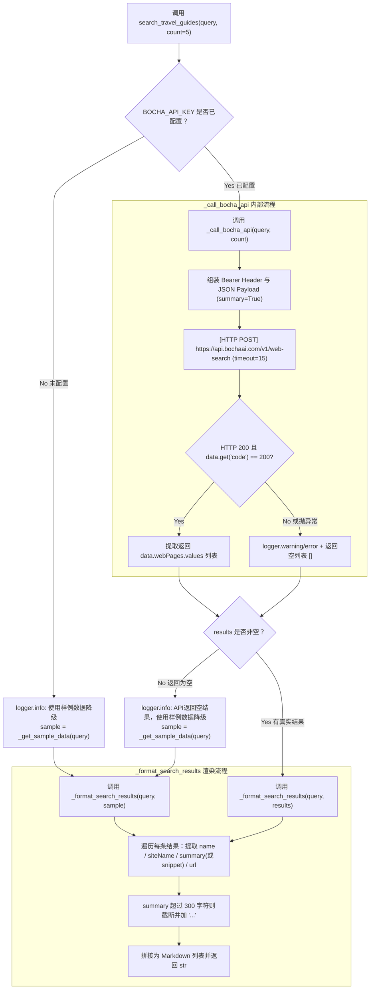

# `mcp_tools/bocha_tools.py` 代码精讲学习手册

> **阅读指南**：本文档是一份**完全独立（Self-Contained）**的源码精讲手册。文档内已 **100% 完整嵌入 `mcp_tools/bocha_tools.py` 的全部 124 行源代码**，并从架构定位、博查（Bocha）AI Web Search API 认证与摘要提取原理、两级优雅降级（Fallback）机制、调用链全景图、逐函数精讲与沙盘推演（Dry Run）到潜在问题诊断进行了全方位剖析，无需打开源码文件即可独立学习。

---

## 一、文件定位与核心前置知识精讲

### 1.1 在四层架构中的位置

`mcp_tools/bocha_tools.py` 是 V8.2-beta 迭代引入的**信息服务类工具（第 3 层纯业务逻辑层）**，负责为 Agent 提供实时互联网旅行攻略与目的地资讯检索能力：

```text
┌──────────────────────────────────────────────────────────────────────────────┐
│ 第 1 / 2 层：工具注册中心与统一调度层 (core/tool_init.py → TOOL_REGISTRY)    │
│   职责：启动时在 init_tools() 中将 search_travel_guides 包装为 FunctionTool  │
│         注册为工具名 "bocha_search"（归属 "info_service" 信息服务域）        │
└──────────────────────────────────────┬───────────────────────────────────────┘
                                       │ Python 函数调用
                                       ▼
┌──────────────────────────────────────────────────────────────────────────────┐
│ 第 3 层：MCP Tools 纯业务逻辑层 (mcp_tools/bocha_tools.py) ★ 本文件 ★        │
│   职责：对外暴露 `search_travel_guides(query, count=5)`：                    │
│     - 主链路：调用 `_call_bocha_api` 请求博查 AI 搜索引擎获取网页摘要        │
│     - 降级链：无 API Key 或请求失败时，调用 `_get_sample_data` 返回预置攻略  │
│     - 格式化：调用 `_format_search_results` 渲染为结构化 Markdown 文本       │
└──────────────────┬────────────────────────────────────────┬──────────────────┘
                   │ [HTTP POST] 有 Key 且网络正常          │ [内存降级] 无 Key 或异常
                   ▼                                        ▼
┌───────────────────────────────────────────┐  ┌───────────────────────────────┐
│ 第 4 层（外部服务）：博查 AI Web Search   │  │ 第 4 层（兜底数据）：         │
│   POST https://api.bochaai.com/v1/web-search│ │   内置丽江/成都/三亚样例字典  │
└───────────────────────────────────────────┘  └───────────────────────────────┘
```

---

### 1.2 核心前置知识科普

#### （1）为什么 AI Agent 需要专门的“AI Web Search API”（博查 Bocha）？
传统的网页搜索（如直接用爬虫抓取百度/Google HTML）面临反爬限制、HTML 噪音标签多、正文提取困难等问题。**博查（Bocha AI）**是专为大模型 RAG 和 Agent 设计的搜索引擎 API（结构兼容 Bing Web Search Schema 并针对中文互联网做了深度优化）：
1. **请求头 Bearer Token 认证**：
   - 使用标准 HTTP 认证头：`"Authorization": f"Bearer {BOCHA_API_KEY}"`
   - 请求体格式为 JSON：`"Content-Type": "application/json"`
2. **关键请求参数 `"summary": True`**：
   ```json
   {
     "query": "丽江旅游攻略",
     "count": 5,
     "summary": true
   }
   ```
   - 当不传或设为 `false` 时，搜索引擎只返回短短一两句话的网页片段 `snippet`。
   - 当设置 `"summary": True` 时，博查后台会抽取网页核心正文并生成一段**高信息密度的长摘要 `summary`**，非常适合直接喂给大模型总结旅游路线！
3. **响应 JSON 的四层嵌套结构**：
   博查 API 返回的 JSON 层次较深，提取网页列表的路径为 `data["data"]["webPages"]["values"]`：
   ```json
   {
     "code": 200,
     "log_id": "...",
     "data": {
       "webPages": {
         "totalEstimatedMatches": 125000,
         "values": [
           {
             "name": "2026丽江古城三天两晚保姆级旅游攻略",
             "url": "https://...",
             "siteName": "马蜂窝",
             "snippet": "简短片段...",
             "summary": "详细正文摘要..."
           }
         ]
       }
     }
   }
   ```

#### （2）两级优雅降级（Graceful Degradation / Fallback）设计模式
在教学、本地开发或 CI 测试环境中，开发者往往还没有申请第三方商业 API Key（如 `BochaApiKey`），或者遇到账户额度耗尽、外网断连。如果工具直接抛异常崩溃，整个旅行规划 Agent 的多步推理就会中断。
本文件在 `search_travel_guides` 中设计了**两级降级防线**：
- **第一级防线（事前静态拦截 — 第 110 行）**：发现环境变量 `BOCHA_API_KEY` 为空字符串时，根本不发起 HTTP 请求，直接调用 `_get_sample_data(query)` 返回内置的样例数据。
- **第二级防线（事后动态兜底 — 第 119 行）**：即便配置了 Key，但如果 `_call_bocha_api` 因超时、Key 失效或无匹配网页返回了空列表 `[]`，同样无缝接管到 `_get_sample_data(query)`，保证上游 Agent **100% 拿到格式一致的 Markdown 攻略文本**。

#### （3）摘要提取的短路或（`or`）技巧与长度截断（Token 保护）
在第 63~65 行格式化每条搜索结果时：
```python
summary = item.get("summary", "") or item.get("snippet", "")
if len(summary) > 300:
    summary = summary[:300] + "..."
```
- **为什么用 `or` 而不是只写 `item.get("summary", "")`？**
  因为部分网页博查可能未能生成长摘要，返回的 JSON 中存在 `"summary": ""`（空字符串）或 `"summary": null`。此时 `item.get("summary", "")` 得到的是假值（`""` 或 `None`），Python 的 `or` 运算符会自动短路求值，退而求其次取简短片段 `item.get("snippet", "")`！
- **为什么要限制 `len(summary) > 300` 截断？**
  如果 5 条搜索结果每条的 `summary` 都有 2000 字，一次工具调用就会向大模型上下文注入 10,000 字，不仅拖慢推理速度还会撑爆 Context Window。截断到 300 字既保留了核心景点与路线信息，又将单次工具输出严格控制在 1500 字以内。

---

## 二、所有入口与调用链全景图

### 2.1 函数清单与调用关系表

```text
层级   函数名                                 调用的函数或方法                      职责与外部动作
────────────────────────────────────────────────────────────────────────────────────────────────────────
公开   search_travel_guides(query, count=5) → _call_bocha_api(query, count)        → 主入口：带两级降级的攻略搜索
                                            → _get_sample_data(query)              → 降级时获取预置样例
                                            → _format_search_results(query, list)  → 将结果列表转为 Markdown
────────────────────────────────────────────────────────────────────────────────────────────────────────
私有1  _call_bocha_api(query, count=5)      → requests.post(BOCHA_API_URL, ...)    → [HTTP POST] 调博查 Web Search
私有2  _get_sample_data(query)              → 遍历内置 samples 字典匹配城市        → 返回丽江/成都/三亚预置列表
私有3  _format_search_results(query, res)   → 字符串截取与拼接                     → 返回 Markdown 格式字符串
```

### 2.2 全链路执行流程图（Mermaid）



---

## 三、完整源码与逐函数深度精讲

### 3.1 完整源代码（100% 原始代码嵌入，共 124 行）

以下是 `mcp_tools/bocha_tools.py` 的完整源代码，未做任何删减：

```python
"""
Bocha（博查）搜索工具 —— 信息服务类

迭代改进新增：从新版 V8.2-beta 引入，按我们的规范重写
- 调用博查 AI 搜索 API 获取实时网络搜索结果
- 支持旅行攻略搜索、目的地信息查询
- API Key 从环境变量 BochaApiKey 读取
- 内置降级策略：API 不可用时返回样例数据

API 文档：https://bochaai.com
"""
import json
import requests
from utils import logger

import os
BOCHA_API_KEY = os.environ.get("BochaApiKey", "")
BOCHA_API_URL = "https://api.bochaai.com/v1/web-search"


def _call_bocha_api(query: str, count: int = 5) -> list:
    """调用博查搜索 API
    
    参数:
        query: 搜索关键词
        count: 返回结果数量（默认5）
    
    返回:
        list: 搜索结果列表，每条包含 name/url/siteName/summary
    """
    headers = {
        "Authorization": f"Bearer {BOCHA_API_KEY}",
        "Content-Type": "application/json",
    }
    payload = {
        "query": query,
        "count": count,
        "summary": True,
    }
    try:
        resp = requests.post(BOCHA_API_URL, json=payload, headers=headers, timeout=15)
        resp.raise_for_status()
        data = resp.json()
        if data.get("code") == 200:
            return data.get("data", {}).get("webPages", {}).get("values", [])
        logger.warning(f"Bocha API 返回异常: code={data.get('code')}")
        return []
    except Exception as e:
        logger.error(f"Bocha API 调用失败: {e}")
        return []


def _format_search_results(query: str, results: list) -> str:
    """格式化搜索结果为 Markdown 文本"""
    if not results:
        return f"未找到关于「{query}」的搜索结果"

    lines = [f"## 「{query}」搜索结果\n"]
    for i, item in enumerate(results, 1):
        name = item.get("name", "无标题")
        url = item.get("url", "")
        site = item.get("siteName", "未知来源")
        summary = item.get("summary", "") or item.get("snippet", "")
        if len(summary) > 300:
            summary = summary[:300] + "..."
        lines.append(f"**{i}. {name}**")
        lines.append(f"   来源：{site}")
        lines.append(f"   摘要：{summary}")
        lines.append(f"   链接：{url}\n")
    return "\n".join(lines)


def _get_sample_data(query: str) -> list:
    """降级兜底：返回预置样例数据"""
    samples = {
        "丽江": [
            {"name": "丽江古城旅游攻略", "url": "https://example.com/lj", "siteName": "马蜂窝",
             "summary": "丽江古城位于云南省丽江市古城区，又名大研镇，始建于宋末元初。古城内街道依山傍水修建，以红色角砾岩铺就，有四方街、木府、五凤楼等景点。"},
            {"name": "丽江必去景点TOP10", "url": "https://example.com/lj2", "siteName": "携程旅行",
             "summary": "玉龙雪山、蓝月谷、泸沽湖、束河古镇、虎跳峡、拉市海湿地公园等是丽江最受欢迎的景点。"},
        ],
        "成都": [
            {"name": "成都三日游最佳路线", "url": "https://example.com/cd", "siteName": "穷游网",
             "summary": "Day1: 宽窄巷子→人民公园→春熙路；Day2: 武侯祠→锦里→九眼桥；Day3: 大熊猫繁育研究基地→东郊记忆。"},
        ],
        "三亚": [
            {"name": "三亚自由行攻略", "url": "https://example.com/sy", "siteName": "去哪儿",
             "summary": "亚龙湾、海棠湾、天涯海角、南山寺、蜈支洲岛是三亚最热门的景点。最佳旅游时间为10月至次年3月。"},
        ],
    }
    # 按关键词匹配城市
    for city, data in samples.items():
        if city in query:
            return data
    # 默认返回丽江数据
    return samples["丽江"]


def search_travel_guides(query: str, count: int = 5) -> str:
    """搜索旅行攻略和目的地信息
    
    参数:
        query: 搜索关键词（如"丽江旅游攻略"、"成都必去景点"）
        count: 返回结果数量（默认5）
    
    返回:
        str: Markdown 格式的搜索结果
    """
    # 降级策略：API Key 未配置 → 返回样例数据
    if not BOCHA_API_KEY:
        logger.info("Bocha API Key 未配置，使用样例数据降级")
        sample = _get_sample_data(query)
        return _format_search_results(query, sample)

    # 调用真实 API
    results = _call_bocha_api(query, count)

    # 降级策略：API 返回空 → 返回样例数据
    if not results:
        logger.info("Bocha API 返回空结果，使用样例数据降级")
        sample = _get_sample_data(query)
        return _format_search_results(query, sample)

    return _format_search_results(query, results)
```

---

### 3.2 逐函数深度精讲与沙盘推演（Dry Run）

#### 1. `_call_bocha_api(query: str, count: int = 5) -> list`（第 21~50 行）
- **链式安全取值（第 45 行）**：
  ```python
  return data.get("data", {}).get("webPages", {}).get("values", [])
  ```
  - 为什么用连续三个 `.get(..., {})`？因为当某次冷门搜索没有任何网页命中时，博查返回的 `data["data"]` 中可能没有 `"webPages"` 键。链式 `.get` 保证了任何一层缺失都会平滑返回空列表 `[]`，绝不会触发 `KeyError` 或 `AttributeError`。

#### 2. `_format_search_results(query: str, results: list) -> str`（第 53~70 行）
- **功能说明**：把字典列表渲染成人类与大模型都易读的 Markdown 列表。
- **使用 `enumerate(results, 1)`**：从 `1` 开始生成序号（`**1. 标题**`、`**2. 标题**`）。

#### 3. `_get_sample_data(query: str) -> list` 与 `search_travel_guides(query: str, count: int = 5) -> str`（第 73~124 行）
- **沙盘推演（Dry Run）—— 场景 A：未配置 `BochaApiKey` 时调用 `search_travel_guides("成都周末两天怎么玩")`**：
  1. `if not BOCHA_API_KEY:` 为 `True`，进入第一级降级。
  2. `_get_sample_data("成都周末两天怎么玩")` 遍历 `samples`，发现 `"成都" in "成都周末两天怎么玩"` 为 `True`，返回成都的样例列表。
  3. `_format_search_results` 输出如下 Markdown 字符串：
     ```markdown
     ## 「成都周末两天怎么玩」搜索结果

     **1. 成都三日游最佳路线**
        来源：穷游网
        摘要：Day1: 宽窄巷子→人民公园→春熙路；Day2: 武侯祠→锦里→九眼桥；Day3: 大熊猫繁育研究基地→东郊记忆。
        链接：https://example.com/cd
     ```
- **沙盘推演（Dry Run）—— 场景 B：已配置 `BochaApiKey` 时调用 `search_travel_guides("西安兵马俑攻略", count=2)`**：
  1. `_call_bocha_api("西安兵马俑攻略", 2)` 向 `https://api.bochaai.com/v1/web-search` 发起 POST 请求。
  2. 收到 HTTP 200 且 `code == 200`，提取出 2 条真实网页字典。
  3. 经过 `_format_search_results` 截断超长摘要并拼接为 Markdown 返回。

---

## 四、代码走读注意点与潜在 Bug / 改进思考

### 1. 【大模型幻觉隐患】`_get_sample_data` 未匹配城市时默认返回“丽江”数据（第 96 行）
- **现象定位**：在第 91~96 行的 `_get_sample_data(query)` 中：
  ```python
  for city, data in samples.items():
      if city in query:
          return data
  # 默认返回丽江数据
  return samples["丽江"]
  ```
  并且 `_format_search_results` 会把标题拼成 `## 「{query}」搜索结果`！
- **后果**：假如在未配置 `BochaApiKey` 的环境下，用户问的是**“哈尔滨冰雪大世界旅游攻略”**，`_get_sample_data` 因为找不到 `"哈尔滨"`，会默认返回**丽江**的攻略，而 `_format_search_results` 却在开头写上 `## 「哈尔滨冰雪大世界旅游攻略」搜索结果\n **1. 丽江古城旅游攻略** ...`！这极易误导大模型产生张冠李戴的幻觉。
- **改进建议**：当 `samples` 未命中查询中的城市时，应动态生成一条通用提示或明确标注“（以下为示例城市丽江的参考攻略，当前未配置实时搜索 API Key）”。

### 2. 【永远走不到的死代码】`_format_search_results` 的第 55~56 行
- **现象定位**：第 55~56 行写了：
  ```python
  if not results:
      return f"未找到关于「{query}」的搜索结果"
  ```
- **原因分析**：在公开入口 `search_travel_guides` 中，当 `results` 为空时（第 119 行 `if not results:`），已经强制替换为 `sample = _get_sample_data(query)`，而 `_get_sample_data` 保底返回 `samples["丽江"]`（非空列表）。因此只要通过 `search_travel_guides` 调用，传给 `_format_search_results` 的列表永远非空，第 55~56 行实际上是防御性的死代码。

### 3. 【返回格式一致性】返回 Markdown 字符串 vs 返回 JSON 字符串
- 注意到 `weather_tools.py`、`ticket_tools.py`、`trip_tools.py`、`amap_tools.py` 均返回 `json.dumps({"status": "success", "data": ...})` 的 JSON 字符串，而 `bocha_tools.py` 直接返回了 **Markdown 文本字符串**（第 12 行虽然 `import json`，但全文件并未使用 `json` 模块）。对于大模型而言，直接阅读 Markdown 格式的搜索结果非常自然，但如果上层调用方强行对所有工具返回值执行 `json.loads()` 则需要留意兼容。

---

## 五、自测思考题（附答案解析）

### 思考题 1：如果博查 API 返回的某条网页数据为 `{"name": "测试", "url": "http://a.com", "siteName": "知乎", "summary": None, "snippet": "这是简短片段"}`，第 63 行 `summary = item.get("summary", "") or item.get("snippet", "")` 执行后 `summary` 的值是什么？如果只写 `summary = item.get("summary", item.get("snippet", ""))` 呢？
- **答案解析**：
  - 原代码 `item.get("summary", "") or item.get("snippet", "")` 执行后，`summary` 的值是 **`"这是简短片段"`**。因为 `item.get("summary", "")` 返回的是 `None`（字典中有 `"summary"` 键且值为 `None`），`None or "这是简短片段"` 会求值为右边的字符串。
  - 如果改成 `item.get("summary", item.get("snippet", ""))`，因为 `"summary"` 键**存在于字典中**，`.get()` 会直接返回它的值 `None` 而不会使用默认值！紧接着第 64 行 `if len(summary) > 300:` 就会抛出 `TypeError: object of type 'NoneType' has no len()`！可见原代码用 `or` 是非常老道且安全的写法。

### 思考题 2：在 `_call_bocha_api` 中，为什么既调用了 `resp.raise_for_status()`（第 42 行），又判断了 `if data.get("code") == 200:`（第 44 行）？
- **答案解析**：
  - `resp.raise_for_status()` 检查的是 **HTTP 传输层状态码**（如果 HTTP 状态码是 401/403/500/502，直接抛出 `HTTPError` 进入 `except`）。
  - `data.get("code") == 200` 检查的是 **博查 API 业务层状态码**（有时 HTTP 响应是 200 OK，但业务层因为参数错误或配额不足在 JSON 体内返回 `{"code": 400, "msg": "..."}`）。双重校验确保了传输层与业务层双双成功。
