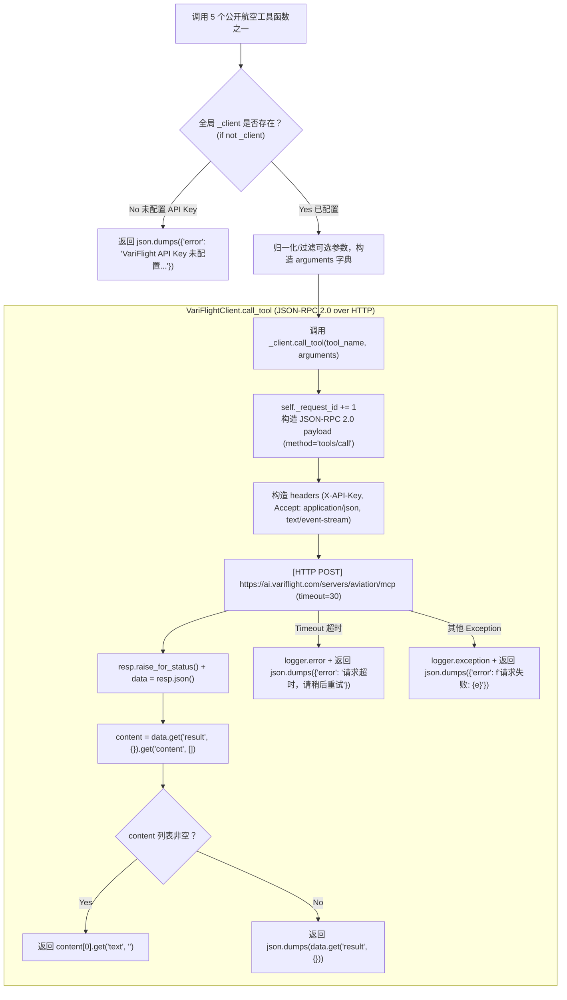

# `mcp_tools/variflight_tools.py` 代码精讲学习手册

> **阅读指南**：本文档是一份**完全独立（Self-Contained）**的源码精讲手册。文档内已 **100% 完整嵌入 `mcp_tools/variflight_tools.py` 的全部 179 行源代码**，并从架构定位、MCP JSON-RPC 2.0 远程工具调用协议原理、航空三字码（IATA Code）常识、全入口调用链、逐函数精讲与沙盘推演（Dry Run）到潜在问题诊断进行了全方位剖析，无需打开源码文件即可独立学习。

---

## 一、文件定位与核心前置知识精讲

### 1.1 在四层架构中的位置

`mcp_tools/variflight_tools.py` 是 V8.2-beta 迭代引入的**出行交通类航空数据工具集（第 3 层纯业务逻辑层）**。它对接了**飞常准（VariFlight）官方 AI MCP 服务**，填补了系统中“实时真实航班查询、机票比价、中转联程规划与航班舒适度评估”的核心能力：

```text
┌──────────────────────────────────────────────────────────────────────────────┐
│ 第 1 / 2 层：工具注册中心与统一调度层 (core/tool_init.py → TOOL_REGISTRY)    │
│   职责：启动时在 init_tools() 中将本文件的 5 个函数包装为 FunctionTool，     │
│         全部注册到 "transport"（出行交通）业务域：                           │
│         - variflight_search  ──► search_flights                              │
│         - variflight_price   ──► get_flight_price                            │
│         - variflight_route   ──► search_flight_itineraries                   │
│         - variflight_airport ──► get_flight_comfort                          │
│         - variflight_status  ──► search_flights_transfer                     │
└──────────────────────────────────────┬───────────────────────────────────────┘
                                       │ Python 函数调用
                                       ▼
┌──────────────────────────────────────────────────────────────────────────────┐
│ 第 3 层：MCP Tools 纯业务逻辑层 (mcp_tools/variflight_tools.py) ★ 本文件 ★   │
│   职责：                                                                     │
│     1. 封装轻量级同步 MCP 客户端 `VariFlightClient` (JSON-RPC 2.0 over HTTP) │
│     2. 提供 5 个航空业务工具函数，完成参数归一化后调用 `_client.call_tool`   │
└──────────────────────────────────────┬───────────────────────────────────────┘
                                       │ [HTTP POST] JSON-RPC 2.0 (method="tools/call")
                                       ▼
┌──────────────────────────────────────────────────────────────────────────────┐
│ 第 4 层（外部远程 MCP Server）：飞常准官方航空 MCP 服务                      │
│   Endpoint: https://ai.variflight.com/servers/aviation/mcp                   │
│   认证方式: Header 携带 X-API-Key: {VariFlightApiKey}                        │
└──────────────────────────────────────────────────────────────────────────────┘
```

---

### 1.2 核心前置知识科普

#### （1）什么是“用 HTTP POST 手写 MCP JSON-RPC 2.0 客户端”？
仔细看第 17 行 `VARIFLIGHT_MCP_URL = "https://ai.variflight.com/servers/aviation/mcp"` 和第 46~53 行的 `payload`，你会发现一个非常惊艳的架构设计：
**飞常准对外提供的不是传统的 REST API，而是一个标准的远程 MCP（Model Context Protocol）Server！**
在 MCP 协议底层，客户端调用服务端的某个 Tool，遵循的是 **JSON-RPC 2.0 规范**。`VariFlightClient.call_tool` 没有引入沉重的异步 MCP SDK，而是直接用 `requests.post` 发送标准的 JSON-RPC 2.0 报文，实现了极简的**同步 MCP Client 桥接**！

让我们拆解一次标准 MCP `tools/call` 的请求与响应报文：
1. **请求头（Headers）**：
   ```http
   Content-Type: application/json
   Accept: application/json, text/event-stream
   X-API-Key: <你的飞常准API_KEY>
   ```
   *(注：MCP 的 Streamable-HTTP 传输规范要求客户端在 `Accept` 头中同时声明支持 `application/json` 和 `text/event-stream`，否则严格校验协议的 MCP Server 会返回 `406 Not Acceptable`！这就是第 56 行为什么要这样写的原因。)*
2. **请求体（JSON-RPC 2.0 Request Payload）**：
   ```json
   {
     "jsonrpc": "2.0",
     "id": 1,
     "method": "tools/call",
     "params": {
       "name": "searchFlightsByDepArr",
       "arguments": {
         "date": "2026-05-01",
         "depcity": "北京",
         "arrcity": "上海"
       }
     }
   }
   ```
   - `"jsonrpc": "2.0"`：协议版本固定为 `"2.0"`。
   - `"id"`：请求唯一递增序号（`self._request_id`），响应会原样带回该 `id`。
   - `"method": "tools/call"`：MCP 协议规定的调用工具固定方法名。
   - `"params.name"`：远端飞常准 MCP Server 上注册的工具名。
   - `"params.arguments"`：传给该工具的 JSON 参数字典。
3. **响应体（JSON-RPC 2.0 Response Payload）与解包路径**：
   标准 MCP 工具调用的响应结构如下：
   ```json
   {
     "jsonrpc": "2.0",
     "id": 1,
     "result": {
       "content": [
         {
           "type": "text",
           "text": "[{\"FlightNo\": \"CA1501\", \"DepTime\": \"08:30\", ...}]"
         }
       ],
       "isError": false
     }
   }
   ```
   因此第 69~71 行通过 `data.get("result", {}).get("content", [])[0].get("text", "")` 精准抽取出里面的核心文本字符串！

#### （2）飞常准 5 大远程 MCP 工具与航空三字码（IATA Code）对照表
本文件的 5 个 Python 函数分别映射了飞常准 MCP Server 上的 5 个远程工具：

| 本文件 Python 函数名 | 映射的飞常准远程 MCP 工具名 | 核心参数说明与 IATA 三字码常识 |
| :--- | :--- | :--- |
| `search_flights` | `searchFlightsByDepArr` | 按出发/到达搜索航班。支持传城市名/城市三字码（`depcity`/`arrcity`，如 `"北京"` 或 `"BJS"`）或具体机场三字码（`dep`/`arr`，如首都机场 `"PEK"`、大兴机场 `"PKX"`）。 |
| `get_flight_price` | `getFlightPriceByCities` | 按出发城市（`dep_city`）、到达城市（`arr_city`）、出发日期（`dep_date`）查询机票最低价格与舱位报价。 |
| `search_flight_itineraries` | `searchFlightItineraries` | 搜索航班行程方案（含直飞与中转联程），要求传入城市/机场三字码 `depCityCode`（如 `"PEK"`）、`arrCityCode`（如 `"SHA"`）和 `depDate`。 |
| `get_flight_comfort` | `flightHappinessIndex` | 查询具体航班号（`fnum`，如 `"CA1234"`）的**飞行幸福指数/舒适度**（机型宽体/窄体、餐食、准点率、座椅间距等）。 |
| `search_flights_transfer` | `getFlightTransferInfo` | 查询两城市间（`depcity` → `arrcity`）在指定日期（`depdate`）的中转航班方案。 |

#### （3）两级 API Key 读取策略（第 18~23 行）
- **优先读配置中心**：`CONFIG.get_api_key("variflight_search") if hasattr(CONFIG, 'get_api_key') else ""`
- **兜底读环境变量**：若配置中心未返回，则通过 `os.environ.get("VariFlightApiKey", "")` 读取系统环境变量。

---

## 二、所有入口与调用链全景图

### 2.1 函数与方法总览表

```text
层级   类/函数名                                               映射的远端 MCP 工具名       外部动作
──────────────────────────────────────────────────────────────────────────────────────────────────────────────────
0. 导入模块: 初始化 VARIFLIGHT_API_KEY 并创建 _client (若無Key则为None)
──────────────────────────────────────────────────────────────────────────────────────────────────────────────────
核心   VariFlightClient.call_tool(tool_name, arguments)      → 任意远端 tool_name         → [HTTP POST] JSON-RPC 2.0
──────────────────────────────────────────────────────────────────────────────────────────────────────────────────
工具1  search_flights(date, depcity, dep, arrcity, arr)      → "searchFlightsByDepArr"    → 调 _client.call_tool
工具2  get_flight_price(dep_city, arr_city, dep_date)        → "getFlightPriceByCities"   → 调 _client.call_tool
工具3  search_flight_itineraries(depCityCode, arrCityCode,..)→ "searchFlightItineraries"  → 调 _client.call_tool
工具4  get_flight_comfort(fnum, date, dep="", arr="")        → "flightHappinessIndex"     → 调 _client.call_tool
工具5  search_flights_transfer(depdate, depcity, arrcity)    → "getFlightTransferInfo"    → 调 _client.call_tool
```

### 2.2 全链路执行流程图（Mermaid）



---

## 三、完整源码与逐函数深度精讲

### 3.1 完整源代码（100% 原始代码嵌入，共 179 行）

以下是 `mcp_tools/variflight_tools.py` 的完整源代码，未做任何删减：

```python
"""
VariFlight（飞常准）航空数据工具集 —— 出行交通类

迭代改进新增：从新版 V8.2-beta 引入，按我们的 tool_base 规范重写
- 通过 MCP JSON-RPC 协议调用飞常准航空数据 API
- 5 个工具：航班搜索、机票价格、航班行程、舒适度指数、中转信息
- API Key 从环境变量 VariFlightApiKey 读取

API 文档：https://ai.variflight.com
"""
import json
import requests
from utils import logger
from utils import CONFIG

# ===================== VariFlight MCP 客户端 =====================
VARIFLIGHT_MCP_URL = "https://ai.variflight.com/servers/aviation/mcp"
VARIFLIGHT_API_KEY = CONFIG.get_api_key("variflight_search") if hasattr(CONFIG, 'get_api_key') else ""

# 兜底：从环境变量直接读取
import os
if not VARIFLIGHT_API_KEY:
    VARIFLIGHT_API_KEY = os.environ.get("VariFlightApiKey", "")


class VariFlightClient:
    """飞常准 MCP 客户端 —— JSON-RPC 2.0 over HTTP POST"""

    def __init__(self, url: str = VARIFLIGHT_MCP_URL, api_key: str = VARIFLIGHT_API_KEY):
        self.url = url
        self.api_key = api_key
        self._request_id = 0

    def call_tool(self, tool_name: str, arguments: dict) -> str:
        """调用飞常准 MCP 工具
        
        参数:
            tool_name: 远程工具名称（如 searchFlightsByDepArr）
            arguments: 工具参数字典
        
        返回:
            str: 工具返回的文本结果
        """
        self._request_id += 1
        payload = {
            "jsonrpc": "2.0",
            "id": self._request_id,
            "method": "tools/call",
            "params": {
                "name": tool_name,
                "arguments": arguments,
            },
        }
        headers = {
            "Content-Type": "application/json",
            "Accept": "application/json, text/event-stream",
            "X-API-Key": self.api_key,
        }
        try:
            resp = requests.post(
                self.url,
                json=payload,
                headers=headers,
                timeout=30,
            )
            resp.raise_for_status()
            data = resp.json()
            # 提取 result.content[0].text
            content = data.get("result", {}).get("content", [])
            if content:
                return content[0].get("text", "")
            return json.dumps(data.get("result", {}), ensure_ascii=False)
        except requests.exceptions.Timeout:
            logger.error(f"VariFlight 请求超时: {tool_name}")
            return json.dumps({"error": "请求超时，请稍后重试"}, ensure_ascii=False)
        except Exception as e:
            logger.exception(f"VariFlight 请求异常: {tool_name}")
            return json.dumps({"error": f"请求失败: {e}"}, ensure_ascii=False)


# 全局客户端实例（API Key 未配置时为 None，工具返回提示信息）
_client = VariFlightClient() if VARIFLIGHT_API_KEY else None


# ===================== 5 个工具函数 =====================

def search_flights(date: str, depcity: str = "", dep: str = "",
                   arrcity: str = "", arr: str = "") -> str:
    """搜索航班（按出发到达城市）
    
    参数:
        date: 日期（YYYY-MM-DD）
        depcity/depcity: 出发城市（中文名或三字码）
        arrcity/arr: 到达城市（中文名或三字码）
    """
    if not _client:
        return json.dumps({"error": "VariFlight API Key 未配置，请设置环境变量 VariFlightApiKey"}, ensure_ascii=False)
    args = {"date": date}
    if depcity:
        args["depcity"] = depcity
    elif dep:
        args["dep"] = dep

    if arrcity:
        args["arrcity"] = arrcity
    elif arr:
        args["arr"] = arr
    return _client.call_tool("searchFlightsByDepArr", args)


def get_flight_price(dep_city: str, arr_city: str, dep_date: str) -> str:
    """查询航班机票价格
    
    参数:
        dep_city: 出发城市
        arr_city: 到达城市
        dep_date: 出发日期（YYYY-MM-DD）
    """
    if not _client:
        return json.dumps({"error": "VariFlight API Key 未配置"}, ensure_ascii=False)
    return _client.call_tool("getFlightPriceByCities", {
        "dep_city": dep_city,
        "arr_city": arr_city,
        "dep_date": dep_date,
    })


def search_flight_itineraries(depCityCode: str, arrCityCode: str,
                              depDate: str) -> str:
    """搜索航班行程（含中转方案）
    
    参数:
        depCityCode: 出发城市三字码（如 PEK）
        arrCityCode: 到达城市三字码（如 SHA）
        depDate: 出发日期（YYYY-MM-DD）
    """
    if not _client:
        return json.dumps({"error": "VariFlight API Key 未配置"}, ensure_ascii=False)
    return _client.call_tool("searchFlightItineraries", {
        "depCityCode": depCityCode,
        "arrCityCode": arrCityCode,
        "depDate": depDate,
    })


def get_flight_comfort(fnum: str, date: str, dep: str = "", arr: str = "") -> str:
    """查询航班舒适度指数
    
    参数:
        fnum: 航班号（如 CA1234）
        date: 日期（YYYY-MM-DD）
        dep: 出发城市（可选）
        arr: 到达城市（可选）
    """
    if not _client:
        return json.dumps({"error": "VariFlight API Key 未配置"}, ensure_ascii=False)
    args = {"fnum": fnum, "date": date}
    if dep:
        args["dep"] = dep
    if arr:
        args["arr"] = arr
    return _client.call_tool("flightHappinessIndex", args)


def search_flights_transfer(depdate: str, depcity: str, arrcity: str) -> str:
    """查询航班中转信息
    
    参数:
        depdate: 出发日期（YYYY-MM-DD）
        depcity: 出发城市
        arrcity: 到达城市
    """
    if not _client:
        return json.dumps({"error": "VariFlight API Key 未配置"}, ensure_ascii=False)
    return _client.call_tool("getFlightTransferInfo", {
        "depdate": depdate,
        "depcity": depcity,
        "arrcity": arrcity,
    })
```

---

### 3.2 逐函数深度精讲与沙盘推演（Dry Run）

#### 1. `VariFlightClient` 类（第 26~79 行）
- **`__init__`**：保存 `url`、`api_key` 并初始化请求计数器 `self._request_id = 0`。
- **`call_tool(self, tool_name: str, arguments: dict) -> str`**：
  - 每次调用自增 `self._request_id += 1`。
  - 异常处理分为两层：
    1. 专门捕获 `requests.exceptions.Timeout`（因为航空实时比价与联程计算较慢，超时时间设为了 30 秒），返回友好的 `{"error": "请求超时，请稍后重试"}`。
    2. 通用 `Exception` 兜底，记录堆栈并返回 `{"error": f"请求失败: {e}"}`。

#### 2. `search_flights(date, depcity="", dep="", arrcity="", arr="") -> str`（第 87~108 行）
- **为什么出发地和目的地各有两套参数名（`depcity` vs `dep`、`arrcity` vs `arr`）？**
  - 这是为了兼容大模型不同习惯的传参以及飞常准 `searchFlightsByDepArr` 的两套检索维度：
    - `depcity` / `arrcity`：按**城市维度**搜索（如北京包含首都机场 `PEK` 和大兴机场 `PKX` 两个机场的所有航班）。
    - `dep` / `arr`：按**具体机场维度**搜索。
  - 代码中用 `if depcity: args["depcity"] = depcity elif dep: args["dep"] = dep` 实现二选一互斥注入（优先使用 `depcity`）。
- **沙盘推演（Dry Run）—— `search_flights(date="2026-05-01", depcity="北京", arrcity="上海")`**：
  1. 组装 `args = {"date": "2026-05-01", "depcity": "北京", "arrcity": "上海"}`。
  2. 发送给飞常准 MCP Server 的 JSON-RPC 请求体：
     ```json
     {
       "jsonrpc": "2.0",
       "id": 1,
       "method": "tools/call",
       "params": {
         "name": "searchFlightsByDepArr",
         "arguments": {
           "date": "2026-05-01",
           "depcity": "北京",
           "arrcity": "上海"
         }
       }
     }
     ```
  3. 飞常准 MCP Server 返回 `result.content[0].text`，`call_tool` 将该文本提取并直接返回给上游 Agent。

#### 3. 其余 4 个工具函数（第 111~179 行）
- **`get_flight_price(dep_city, arr_city, dep_date)`**：
  - 沙盘推演：`get_flight_price("北京", "三亚", "2026-05-01")` → 调用远端 `"getFlightPriceByCities"`。
- **`search_flight_itineraries(depCityCode, arrCityCode, depDate)`**：
  - 沙盘推演：`search_flight_itineraries("PEK", "SHA", "2026-05-01")` → 调用远端 `"searchFlightItineraries"`。
- **`get_flight_comfort(fnum, date, dep="", arr="")`**：
  - 沙盘推演：`get_flight_comfort("CA1501", "2026-05-01", dep="PEK", arr="SHA")` → 组装 `args = {"fnum": "CA1501", "date": "2026-05-01", "dep": "PEK", "arr": "SHA"}` → 调用远端 `"flightHappinessIndex"`。
- **`search_flights_transfer(depdate, depcity, arrcity)`**：
  - 沙盘推演：`search_flights_transfer("2026-05-01", "成都", "乌鲁木齐")` → 调用远端 `"getFlightTransferInfo"`。

---

## 四、代码走读注意点与潜在 Bug / 改进思考

### 1. 【JSON-RPC 错误响应被静默吞没】当远端返回 JSON-RPC `"error"` 字段时返回了 `"{}"`
- **现象定位**：第 67~72 行：
  ```python
  data = resp.json()
  # 提取 result.content[0].text
  content = data.get("result", {}).get("content", [])
  if content:
      return content[0].get("text", "")
  return json.dumps(data.get("result", {}), ensure_ascii=False)
  ```
- **原因分析**：根据 JSON-RPC 2.0 规范，当远程工具调用参数不合法（比如日期格式错误、三字码不存在）或认证失败时，HTTP 状态码往往依然是 `200 OK`，但返回的 JSON 顶层**没有 `"result"` 字段，而是包含 `"error"` 字段**（如 `{"jsonrpc": "2.0", "id": 1, "error": {"code": -32602, "message": "Invalid params"}}`）！
- **后果**：此时 `data.get("result", {})` 返回空字典 `{}`，最终第 72 行会给大模型返回一个莫名其妙的空对象字符串 `"{}"`，把真正的 `"error"` 原因彻底丢弃了！
- **修复方案**：在 `data = resp.json()` 后立即检查 `"error"` 字段：
  ```python
  if "error" in data:
      logger.error(f"VariFlight JSON-RPC 错误: {data['error']}")
      return json.dumps({"error": data["error"]}, ensure_ascii=False)
  ```

### 2. 【SSE 流式响应兼容性隐患】若远端返回 `text/event-stream` 格式，`resp.json()` 会报错
- **现象定位**：第 56 行请求头声明了 `"Accept": "application/json, text/event-stream"`，但第 67 行直接调用了 `data = resp.json()`。
- **原因分析**：如果飞常准 MCP Server 针对某个耗时工具选择了以 SSE（`Content-Type: text/event-stream`，内容形如 `event: message\ndata: {"jsonrpc":"2.0",...}\n\n`）格式返回响应，直接调 `resp.json()` 会抛出 `JSONDecodeError`！
- **改进建议**：检查 `if "text/event-stream" in resp.headers.get("Content-Type", ""):`，若为 SSE 流则先按行提取 `data: ` 后面的 JSON 字符串再解析。

### 3. 【模块导入期静态固化】`_client` 在 `import` 时就固定了是否为 `None`
- **现象定位**：第 82 行 `_client = VariFlightClient() if VARIFLIGHT_API_KEY else None`。
- **原因分析**：如果主程序先 `import mcp_tools.variflight_tools`，然后再通过 `dotenv.load_dotenv()` 加载 `.env` 环境变量，此时 `_client` 已经在导入瞬间被固定为 `None` 了。改成懒加载函数 `_get_client()` 会在运行时动态读取环境变量，更加稳健。

---

## 五、自测思考题（附答案解析）

### 思考题 1：在 `search_flights(date="2026-05-01", depcity="北京", dep="PEK", arrcity="上海", arr="PVG")` 中，如果同时传入了 `depcity="北京"` 和 `dep="PEK"`，最终发给飞常准的 `arguments` 字典里包含哪些键？
- **答案解析**：
  - 包含 `{"date": "2026-05-01", "depcity": "北京", "arrcity": "上海"}`。
  - 因为第 99~107 行使用的是 `if depcity: ... elif dep: ...` 和 `if arrcity: ... elif arr: ...` 的互斥分支结构。当 `depcity` 非空时，`elif dep:` 分支不会执行，`dep="PEK"` 和 `arr="PVG"` 会被忽略。

### 思考题 2：为什么本文件里的 5 个工具函数不需要像 `weather_tools.py`、`ticket_tools.py` 那样使用 `MySQLManager` 或 `DateDecimalToString`？
- **答案解析**：
  - 因为航班时刻、余票动态价格和准点率具有极强的实时性，本文件完全不查本地 MySQL 数据库，而是通过 `VariFlightClient` 实时请求飞常准远程 MCP Server，且远端返回的 `content[0]["text"]` 已经是序列化好的文本字符串，不存在 Python 的 `datetime.date` 或 `decimal.Decimal` 对象序列化问题。
