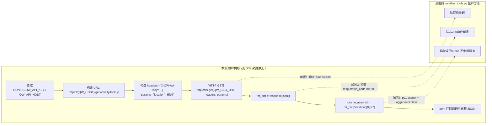

# `mcp_tools/test_和风天气_获取城市编码.py` 代码精讲学习手册

> **阅读指南**：本文档是一份**完全独立（Self-Contained）**的源码精讲手册。文档内已 **100% 完整嵌入 `mcp_tools/test_和风天气_获取城市编码.py` 的全部 25 行源代码**，并从工程定位、最小脚本调试第三方 HTTP 接口的方法论、和风天气 Geo API 响应 JSON 结构全字段拆解、执行流程图、逐行精讲与沙盘推演（Dry Run）到生产级加固方案进行了全方位剖析，无需打开源码文件即可独立学习。

---

## 一、文件定位与核心前置知识精讲

### 1.1 在架构与研发流程中的位置

在开发对接第三方商业 API 的 Agent 工具时，最忌讳一上来就直接把未经验证的 HTTP 请求写进复杂的类或 MCP Server 中（一旦报错，很难分清是 MCP 协议问题、数据库连接问题还是第三方 API 参数问题）。
**标准的工程实践是“先写最小可运行脚本（MRE, Minimal Reproducible Example）独立跑通接口，再封装进生产类”**。

本文件 `mcp_tools/test_和风天气_获取城市编码.py` 正是 `weather_tools.py` 中 `WeatherCollector.get_city_location_id(self, city_name)`（第 182~205 行）的**原型验证脚本**：

```text
┌──────────────────────────────────────────────────────────────────────────────┐
│ 阶段 1：最小原型验证脚本 ★ 本文件 (test_和风天气_获取城市编码.py) ★           │
│   目标：脱离 MySQL、脱离 MCP，用 25 行代码验证：                              │
│         1. CONFIG 中的 QW_API_KEY 和 QW_API_HOST 是否有效？                  │
│         2. Geo API (/geo/v2/city/lookup) 传中文城市名能否拿到 Location ID？  │
│         3. 返回的 JSON 层级结构长什么样？如何写出 `ret_dict["location"][0]["id"]` │
└──────────────────────────────────────┬───────────────────────────────────────┘
                                       │ 验证通过后，加上 timeout + try/except + logger 封装
                                       ▼
┌──────────────────────────────────────────────────────────────────────────────┐
│ 阶段 2：生产级方法 (mcp_tools/weather_tools.py)                              │
│   方法：`WeatherCollector.get_city_location_id(self, city_name)`             │
│   调用点：`query_weather_now(city)` 遇到非预置城市时动态查询 Location ID     │
└──────────────────────────────────────────────────────────────────────────────┘
```

---

### 1.2 核心前置知识科普

#### （1）为什么查天气前必须先查“城市编码（Location ID）”？
和风天气的实时天气（`/v7/weather/now`）和每日天气预报（`/v7/weather/15d`）接口**不支持直接传中文城市名称**（比如不能传 `location=郑州` 或 `location=朝阳`，因为全国既可能有辽宁省朝阳市，也可能有北京市朝阳区、长春市朝阳区）。
因此和风天气将“地名解析”独立成了 **GeoAPI（地理信息接口）**：
- **接口地址**：`GET https://{QW_HOST}/geo/v2/city/lookup`
- **作用**：输入模糊或精确的中文/拼音地名（如 `location=郑州`），返回按匹配相关性排好序的城市列表，其中第一项 `location[0]["id"]` 就是和风天气体系内唯一、无歧义的 9 位数字 **Location ID**（郑州为 `'101180101'`）。

#### （2）HTTP 请求的两种 Query 参数传递方式对比（第 8~17 行）
观察源码第 8~9 行和第 13~17 行，作者特意对比了两种传参方式：
- **方式 A（第 9 行注释掉的写法：直接拼进 URL 字符串）**：
  ```python
  # QW_GEO_URL = f"https://{QW_HOST}/geo/v2/city/lookup?location=郑州"
  ```
  - 缺点：如果城市名里包含空格、特殊符号（如 `&`、`#`、`?`）或者需要同时传多个参数，手动拼接极易出错且存在 URL 注入风险。
- **方式 B（第 13~17 行实际采用的写法：通过 `params` 字典传参）**：
  ```python
  params = {"location": city_name}
  response = requests.get(QW_GEO_URL, headers=headers, params=params)
  ```
  - 优点：`requests` 会在底层自动调用 `urllib.parse.urlencode`，把中文 `'郑州'` 安全地做 UTF-8 URL 编码（Percent-Encoding）为 `%E9%83%91%E5%B7%9E`，并自动在基础 URL 后拼接 `?location=%E9%83%91%E5%B7%9E`。

#### （3）和风天气认证头 `X-QW-Api-Key` 与 Gzip 透明解压
- **请求头认证**：和风天气推荐将 API Key 放在 HTTP Header 的 `X-QW-Api-Key` 字段中（`headers = {"X-QW-Api-Key": f"{QW_API_KEY}"}`），相比把 `key=xxx` 拼在 URL 里，Header 不会暴露在浏览器地址栏或普通 Nginx Access Log 的 URL 列中，安全性更高。
- **Gzip 透明解压**：和风天气所有接口响应默认采用 Gzip 压缩（响应头带 `Content-Encoding: gzip`）。Python 的 `requests` 库默认在请求头中自动带上 `Accept-Encoding: gzip, deflate`，并在收到响应、调用 `response.json()` 或 `response.text` 时**由底层 `urllib3` 自动解压**，开发者完全无感。

#### （4）Geo API 响应 JSON 结构全字段拆解
当请求 `GET /geo/v2/city/lookup?location=郑州` 成功时，返回的完整 JSON 结构及各字段含义如下：

```json
{
  "code": "200",
  "location": [
    {
      "name": "郑州",
      "id": "101180101",
      "lat": "34.75797",
      "lon": "113.66541",
      "adm2": "郑州",
      "adm1": "河南省",
      "country": "中国",
      "tz": "Asia/Shanghai",
      "utcOffset": "+08:00",
      "isDst": "0",
      "type": "city",
      "rank": "15",
      "fxLink": "https://www.qweather.com/weather/zhengzhou-101180101.html"
    },
    {
      "name": "中原",
      "id": "101180109",
      "lat": "34.74828",
      "lon": "113.61293",
      "adm2": "郑州",
      "adm1": "河南省",
      "country": "中国",
      "tz": "Asia/Shanghai",
      "utcOffset": "+08:00",
      "isDst": "0",
      "type": "city",
      "rank": "35",
      "fxLink": "https://www.qweather.com/weather/zhongyuan-101180109.html"
    }
  ],
  "refer": {
    "sources": ["QWeather"],
    "license": ["QWeather Developers License"]
  }
}
```
- **为什么 `location` 是一个列表（`list`）而不是单个字典？**
  因为搜 `"郑州"` 时，除了郑州市主城区（`101180101`）外，它下辖的中原区、二七区、金水区、新郑市等也会作为候选结果一并返回（最多返回 10 条），并按城市权重/匹配度（`rank`）从高到低排序。
- **为什么取 `ret_dict["location"][0]["id"]`？**
  `location[0]` 永远是匹配度最高的主城市对象，其 `"id"` 即为主城区的 Location ID `'101180101'`。

---

## 二、所有入口与调用链全景图

### 2.1 脚本执行调用树（ASCII）

```text
python mcp_tools/test_和风天气_获取城市编码.py
  │
  ├── 1. from utils import CONFIG                ──► 加载项目全局配置 (.env / config)
  ├── 2. 读取 CONFIG.QW_API_KEY 与 QW_API_HOST   ──► 组装 QW_GEO_URL 与 headers
  ├── 3. requests.get(QW_GEO_URL, headers, params)──► [HTTP GET] 请求和风 Geo API
  ├── 4. ret_dict = response.json()              ──► 自动 Gzip 解压并反序列化为 Python dict
  ├── 5. ret_dict["location"][0]["id"]           ──► 提取首位匹配城市的 9 位编码 ('101180101')
  └── 6. print(...)                              ──► 控制台打印 location_id 与完整返回字典
```

### 2.2 执行流程与生产演进对比图（Mermaid）



---

## 三、完整源码与逐行深度精讲

### 3.1 完整源代码（100% 原始代码嵌入，共 25 行）

以下是 `mcp_tools/test_和风天气_获取城市编码.py` 的完整源代码，未做任何删减：

```python
import requests
from utils import CONFIG
# 和风天气 密钥，从 控制台-项目管理-项目-凭据-API KEY 获取
QW_API_KEY = CONFIG.QW_API_KEY
# 和风天气 API Host，从 控制台-设置 获取
QW_HOST = CONFIG.QW_API_HOST
# 和风天气 获取城市编码接口
QW_GEO_URL = f"https://{QW_HOST}/geo/v2/city/lookup"
# QW_GEO_URL = f"https://{QW_HOST}/geo/v2/city/lookup?location=郑州"

headers = {"X-QW-Api-Key": f"{QW_API_KEY}"}
city_name = '郑州'
params = {"location": city_name}
response = requests.get(
    QW_GEO_URL,
    headers=headers,
    params=params,
)
ret_dict = response.json()
city_location_id = ret_dict["location"][0]["id"]

print(f'{city_name}的location_id➡️ ：{city_location_id}')

print('完整返回结果➡️ ：\n', ret_dict)

```

---

### 3.2 逐行深度精讲与沙盘推演（Dry Run）

#### 1. 配置读取与 URL 构造（第 1~10 行）
- **第 1~2 行**：导入 `requests` HTTP 客户端库和项目统一配置单例 `CONFIG`。
- **第 4~6 行**：
  - `QW_API_KEY = CONFIG.QW_API_KEY`：获取和风天气 API 密钥。
  - `QW_HOST = CONFIG.QW_API_HOST`：和风天气自 2024/2025 版起，为每个开发者账户分配了专属的 **API Host**（形如 `abc1234xyz.re.qweatherapi.com`），不再使用旧版统一的 `devapi.qweather.com` 或 `geoapi.qweather.com`。这也正是 Geo API 和 Weather API 能够共用同一个 `QW_HOST` 的原因！
- **第 8 行**：`QW_GEO_URL = f"https://{QW_HOST}/geo/v2/city/lookup"`，使用 HTTPS 协议拼接城市搜索端点路径 `/geo/v2/city/lookup`。

#### 2. 请求组装与发送（第 11~18 行）
- **第 11 行**：`headers = {"X-QW-Api-Key": f"{QW_API_KEY}"}`，将密钥放入请求头。
- **第 12~13 行**：指定待查城市 `city_name = '郑州'`，构造查询参数字典 `params = {"location": city_name}`。
- **第 14~18 行**：调用 `requests.get(QW_GEO_URL, headers=headers, params=params)` 发送同步 HTTP GET 请求。

#### 3. 响应解析与输出（第 19~25 行）
- **第 19 行**：`ret_dict = response.json()`，将返回的 JSON 文本反序列化为 Python 字典。
- **第 20 行**：`city_location_id = ret_dict["location"][0]["id"]`，先取字典的 `"location"` 键（得到城市列表），再取索引 `[0]`（得到匹配度第一的郑州市字典），最后取 `"id"` 键（得到字符串 `'101180101'`）。
- **第 22~24 行**：打印提取出的 `city_location_id` 和完整的 `ret_dict`。

#### 4. 沙盘推演（Dry Run）
假设 `CONFIG.QW_API_HOST = "m5xxxxx.re.qweatherapi.com"`，在项目根目录下运行：
```bash
python -m mcp_tools.test_和风天气_获取城市编码
```
- **实际发出的 HTTP 请求报文**：
  ```http
  GET /geo/v2/city/lookup?location=%E9%83%91%E5%B7%9E HTTP/1.1
  Host: m5xxxxx.re.qweatherapi.com
  User-Agent: python-requests/2.31.0
  Accept-Encoding: gzip, deflate
  Accept: */*
  Connection: keep-alive
  X-QW-Api-Key: <你的真实API_KEY>
  ```
- **控制台标准输出**：
  ```text
  郑州的location_id➡️ ：101180101
  完整返回结果➡️ ：
   {'code': '200', 'location': [{'name': '郑州', 'id': '101180101', 'lat': '34.75797', 'lon': '113.66541', 'adm2': '郑州', 'adm1': '河南省', 'country': '中国', 'tz': 'Asia/Shanghai', 'utcOffset': '+08:00', 'isDst': '0', 'type': 'city', 'rank': '15', 'fxLink': 'https://www.qweather.com/weather/zhengzhou-101180101.html'}, ...], 'refer': {'sources': ['QWeather'], 'license': ['QWeather Developers License']}}
  ```

---

## 四、代码走读注意点与潜在 Bug / 改进思考

对比本测试脚本与 `weather_tools.py` 中的生产方法，可以清晰看到**从“测试脚本”走向“生产代码”必须补齐的 3 个工程要素**：

1. **缺少 `timeout` 超时参数**：
   - 第 14 行 `requests.get(...)` 没有传 `timeout`。在 `requests` 中如果不传 `timeout`，一旦遇到网络丢包或 DNS 卡死，程序会**无限期永久挂起**。生产代码中补上了 `timeout=30`。
2. **未检查 HTTP 状态码与业务 `code` 就直接下标取值**：
   - 第 20 行直接执行 `ret_dict["location"][0]["id"]`。如果 `city_name = "不存在的火星城市"`，和风 Geo API 会返回 `{"code": "404"}`（字典里根本没有 `"location"` 键），第 20 行会直接抛出 `KeyError: 'location'`！
   - **安全写法**：
     ```python
     if response.status_code == 200 and ret_dict.get("code") == "200" and ret_dict.get("location"):
         city_location_id = ret_dict["location"][0]["id"]
     ```
3. **重名区县消歧（`adm` 参数）**：
   - 如果你要查的是“北京市朝阳区”而不是“辽宁省朝阳市”，仅传 `params = {"location": "朝阳"}` 排在第一位的可能是辽宁省朝阳市。和风 Geo API 支持额外传一个上级行政区过滤参数 `adm`，即 `params = {"location": "朝阳", "adm": "北京"}`，可以精确锁定北京市朝阳区。

---

## 五、自测思考题（附答案解析）

### 思考题 1：在 `weather_tools.py` 的 `CITY_LOC_DICT`（第 157~164 行）中，写死了 `'郑州': '101180101'` 等 6 个城市的编码。既然有这个 Geo API 可以动态查编码，为什么生产代码还要把这 6 个热点城市的编码写死在字典里？
- **答案解析**：
  - 因为城市的行政编码（Location ID）是静态常量，几乎永远不会改变。
  - 把高频查询的核心城市编码缓存在内存字典 `CITY_LOC_DICT` 中，每次查询这些城市的实时天气或定时采集 15 天预报时，可以**直接省去一次 Geo API 的 HTTP 网络往返（节省 100~300ms 延迟，且节省 50% 的和风 API 调用配额）**！只有当用户查询字典以外的长尾城市时，才调用 Geo API 动态获取。

### 思考题 2：如果直接双击或在 `mcp_tools` 子目录下运行 `python test_和风天气_获取城市编码.py`，第 2 行 `from utils import CONFIG` 可能会报 `ModuleNotFoundError: No module named 'utils'`，应该怎么运行？
- **答案解析**：
  - 因为 `utils` 包位于项目根目录 `D:\soft\python\Voyage智途A2A\utils` 下。在子目录直接跑脚本时，Python 的 `sys.path[0]` 是 `mcp_tools` 目录而非项目根目录。
  - **正确运行方式**：在项目根目录下使用模块化运行命令 `python -m mcp_tools.test_和风天气_获取城市编码`，或者在项目根目录下执行 `python mcp_tools/test_和风天气_获取城市编码.py`。
