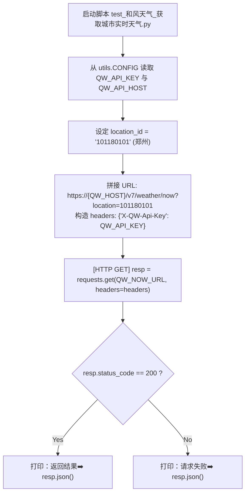

# `mcp_tools/test_和风天气_获取城市实时天气.py` 代码精讲学习手册

> **阅读指南**：本文档是一份**完全独立（Self-Contained）**的源码精讲手册。文档内已 **100% 完整嵌入 `mcp_tools/test_和风天气_获取城市实时天气.py` 的全部 19 行源代码**，并从工程定位、和风天气实时天气 API (`/v7/weather/now`) 协议规范、响应 JSON 全字段拆解、执行流程图、逐行精讲与沙盘推演（Dry Run）到生产级加固方案进行了全方位剖析，无需打开源码文件即可独立学习。

---

## 一、文件定位与核心前置知识精讲

### 1.1 在架构与研发流程中的位置

本文件 `mcp_tools/test_和风天气_获取城市实时天气.py` 是和风天气**实时天气查询接口（`/v7/weather/now`）的最小独立调试脚本**。它在研发流程中承上启下：
1. **承接上一步**：使用 `test_和风天气_获取城市编码.py` 查出的郑州市 Location ID `'101180101'` 作为输入参数。
2. **孵化生产代码**：验证通过后，直接演化为 `mcp_tools/weather_tools.py` 中的 `WeatherCollector.get_weather_now(self, location_id)`（第 314~336 行）以及暴露给 MCP Server 的 `query_weather_now(city)`（第 600~630 行）。

```text
┌──────────────────────────────────────────────────────────────────────────────┐
│ 前置脚本：test_和风天气_获取城市编码.py                                      │
│   输出：郑州的 location_id = '101180101'                                     │
└──────────────────────────────────────┬───────────────────────────────────────┘
                                       │ 作为 location 参数传入
                                       ▼
┌──────────────────────────────────────────────────────────────────────────────┐
│ 本文件：test_和风天气_获取城市实时天气.py ★ 最小独立调试脚本 (19行) ★         │
│   目标：验证 GET https://{QW_HOST}/v7/weather/now?location=101180101         │
│         检查 HTTP 200 状态分支与返回的实时气象 JSON 结构 (`now` 对象)        │
└──────────────────────────────────────┬───────────────────────────────────────┘
                                       │ 封装进类方法并注册为 MCP 工具
                                       ▼
┌──────────────────────────────────────────────────────────────────────────────┐
│ 生产代码：mcp_tools/weather_tools.py                                         │
│   底层方法：WeatherCollector.get_weather_now(self, location_id)              │
│   MCP 工具：query_weather_now(city) ──► 被 mcp_server/mcp_weather.py 暴露    │
└──────────────────────────────────────────────────────────────────────────────┘
```

---

### 1.2 核心前置知识科普

#### （1）和风天气“实时天气 API (`/v7/weather/now`)”请求规范
- **请求方法与路径**：`GET https://{QW_HOST}/v7/weather/now`
- **认证请求头**：`X-QW-Api-Key: {QW_API_KEY}`
- **必填 Query 参数**：`location`（可以是 9 位城市 Location ID，如 `'101180101'`；也可以是以英文逗号分隔的 `"经度,纬度"` 坐标）。
- **可选 Query 参数**：
  - `lang`：多语言设置，默认 `zh`（简体中文）。
  - `unit`：度量衡单位，默认 `m`（公制，摄氏度 `℃`、公里/小时 `km/h`），可选 `i`（英制）。

#### （2）实时天气响应 JSON (`now` 对象) 全字段详解
为什么 `query_weather_now` 查完后不需要自己挑选字段，直接把整个 `resp.json()` 作为 `data` 返回给大模型就能用？因为和风实时天气接口返回的 JSON 非常紧凑且语义清晰。以下是真实返回结构与全字段对照表：

```json
{
  "code": "200",
  "updateTime": "2026-05-01T14:32+08:00",
  "fxLink": "https://www.qweather.com/weather/zhengzhou-101180101.html",
  "now": {
    "obsTime": "2026-05-01T14:28+08:00",
    "temp": "26",
    "feelsLike": "25",
    "icon": "100",
    "text": "晴",
    "wind360": "180",
    "windDir": "南风",
    "windScale": "2",
    "windSpeed": "9",
    "humidity": "38",
    "precip": "0.0",
    "pressure": "1004",
    "vis": "30",
    "cloud": "10",
    "dew": "10"
  },
  "refer": {
    "sources": ["QWeather"],
    "license": ["QWeather Developers License"]
  }
}
```

| 字段路径 | 示例值 | 物理含义与单位说明 |
| :--- | :--- | :--- |
| `code` | `"200"` | 业务状态码（`"200"` 表示成功，`"401"` 认证失败，`"404"` 地区不存在） |
| `updateTime` | `"2026-05-01T14:32+08:00"` | 当前 API 接口数据的最近更新时间（ISO 8601 格式，含时区偏移） |
| `now.obsTime` | `"2026-05-01T14:28+08:00"` | 气象站实况观测时间 |
| `now.temp` | `"26"` | 实时气温（摄氏度 `℃`） |
| `now.feelsLike` | `"25"` | 实时体感温度（摄氏度 `℃`，综合湿度与风速计算，对穿衣建议极重要） |
| `now.text` | `"晴"` | 天气现象文字描述（如：晴、多云、阴、阵雨、雷阵雨、小雪） |
| `now.windDir` / `windScale` / `windSpeed` | `"南风"` / `"2"` / `"9"` | 风向 / 风力等级（2 级） / 风速（9 `km/h`） |
| `now.humidity` | `"38"` | 相对湿度（百分比 `%`） |
| `now.precip` | `"0.0"` | 当前小时累计降水量（毫米 `mm`） |
| `now.pressure` / `vis` / `cloud` / `dew` | `"1004"` / `"30"` / `"10"` / `"10"` | 大气压强（百帕 `hPa`）/ 能见度（公里 `km`）/ 云量（`%`）/ 露点温度（`℃`） |

> **注意数据类型**：和风天气返回的 JSON 中，所有的数值字段（如 `"temp": "26"`、`"precip": "0.0"`）全部是**字符串（`str`）类型**，若在 Python 中需要做温度大小比较，需先使用 `int()` 或 `float()` 转换。

---

## 二、所有入口与调用链全景图

### 2.1 脚本执行调用树（ASCII）

```text
python -m mcp_tools.test_和风天气_获取城市实时天气
  │
  ├── 1. from utils import CONFIG          ──► 导入配置中心，读取 QW_API_KEY / QW_API_HOST
  ├── 2. location_id = '101180101'         ──► 硬编码测试目标：郑州市 Location ID
  ├── 3. 构造 QW_NOW_URL 与 headers        ──► https://{QW_HOST}/v7/weather/now?location=101180101
  ├── 4. resp = requests.get(...)          ──► [HTTP GET] 调用和风实时天气 API (自动 Gzip 解压)
  └── 5. if resp.status_code == 200:       ──► 分支判断 HTTP 状态码
           ├─ True  ──► print('返回结果➡️ ：\n', resp.json())
           └─ False ──► print('请求失败➡️ ：\n', resp.json())
```

### 2.2 执行流程图（Mermaid）



---

## 三、完整源码与逐行深度精讲

### 3.1 完整源代码（100% 原始代码嵌入，共 19 行）

以下是 `mcp_tools/test_和风天气_获取城市实时天气.py` 的完整源代码，未做任何删减：

```python
import requests
from utils import CONFIG
# 和风天气 密钥，从 控制台-项目管理-项目-凭据-API KEY 获取
QW_API_KEY = CONFIG.QW_API_KEY
# 和风天气 API Host，从 控制台-设置 获取
QW_HOST = CONFIG.QW_API_HOST
# 城市的 location id
location_id = '101180101' # 郑州
# 和风天气 实时天气接口
QW_NOW_URL = f"https://{QW_HOST}/v7/weather/now?location={location_id}"
headers = {"X-QW-Api-Key": QW_API_KEY}
resp = requests.get(
    QW_NOW_URL,
    headers=headers
)
if resp.status_code == 200:
    print('返回结果➡️ ：\n', resp.json())
else:
    print('请求失败➡️ ：\n', resp.json())
```

---

### 3.2 逐行深度精讲与沙盘推演（Dry Run）

#### 1. 配置与参数准备（第 1~11 行）
- **第 1~6 行**：导入 `requests` 和 `CONFIG`，读取 `QW_API_KEY` 和 `QW_HOST`。
- **第 8 行**：`location_id = '101180101'`，指定郑州市的城市编码。因为 `'101180101'` 是纯数字 ASCII 字符串，不含中文或特殊字符，所以在第 10 行直接用 f-string 拼接到 URL `?location={location_id}` 中是完全安全的。
- **第 10~11 行**：构造实时天气请求地址 `QW_NOW_URL` 和包含 `X-QW-Api-Key` 的 `headers`。

#### 2. 发送请求与状态码分支判断（第 12~19 行）
- **第 12~15 行**：调用 `requests.get(QW_NOW_URL, headers=headers)` 发起请求。
- **第 16~19 行**：
  - 相比 `test_和风天气_获取城市编码.py`，本脚本增加了 `if resp.status_code == 200:` 的判断分支。
  - 若你在 `weather_tools.py` 的第 314~336 行查看 `WeatherCollector.get_weather_now(self, location_id)`，会发现生产代码正是把这 19 行脚本原封不动地搬了进去，仅仅是把 `print(...)` 替换成了 `logger.info(...)` / `logger.error(...)` 并加上了 `try...except` 和 `timeout=self.REQUEST_TIMEOUT`！

#### 3. 沙盘推演（Dry Run）
- **正常场景（Key 有效且网络畅通）**：
  - 请求：`GET https://m5xxxxx.re.qweatherapi.com/v7/weather/now?location=101180101`
  - `resp.status_code` 为 `200`，进入 `if` 分支，输出：
    ```text
    返回结果➡️ ：
     {'code': '200', 'updateTime': '2026-05-01T14:32+08:00', 'fxLink': 'https://www.qweather.com/weather/zhengzhou-101180101.html', 'now': {'obsTime': '2026-05-01T14:28+08:00', 'temp': '26', 'feelsLike': '25', 'icon': '100', 'text': '晴', 'wind360': '180', 'windDir': '南风', 'windScale': '2', 'windSpeed': '9', 'humidity': '38', 'precip': '0.0', 'pressure': '1004', 'vis': '30', 'cloud': '10', 'dew': '10'}, 'refer': {'sources': ['QWeather'], 'license': ['QWeather Developers License']}}
    ```
- **异常场景（例如 `QW_API_KEY` 填错）**：
  - `resp.status_code` 为 `401`（Unauthorized），进入 `else` 分支，输出：
    ```text
    请求失败➡️ ：
     {'error': {'status': 401, 'type': 'https://dev.qweather.com/docs/resource/error-code/#invalid-authentication', 'title': 'Invalid Authentication', 'detail': 'Authentication failed, please check your key or token.'}}
    ```

---

## 四、代码走读注意点与潜在 Bug / 改进思考

1. **`else` 分支中 `resp.json()` 的潜在 `JSONDecodeError`**：
   - 第 19 行在 `resp.status_code != 200` 时直接调用了 `resp.json()`。如果网关返回的是 `502 Bad Gateway` 或 `504 Gateway Timeout`，响应体通常是 Nginx 的 HTML 错误页面而非 JSON，此时调用 `resp.json()` 会抛出 `requests.exceptions.JSONDecodeError`。在 `else` 分支中打印 `resp.text` 比 `resp.json()` 更稳妥。
2. **业务状态码 `resp.json().get("code") == "200"` 校验**：
   - 当传入一个格式合法但不存在的 `location_id`（如 `'999999999'`）时，和风天气有时返回 HTTP 200，但 JSON 内为 `{"code": "404"}`。调试时应同时确认 `resp.json().get("code") == "200"`。

---

## 五、自测思考题（附答案解析）

### 思考题 1：本脚本没有在 `headers` 中写 `"Accept-Encoding": "gzip"`，而 `test_和风天气_获取城市指定天数的天气预报信息.py` 中却写了 `"Accept-Encoding": "gzip"`。本脚本不写这句，还能收到并解压和风天气的 Gzip 响应吗？
- **答案解析**：
  - **完全可以！** 因为 Python 的 `requests` 库在底层初始化默认请求头（`requests.utils.default_headers()`）时，就已经自动填上了 `'Accept-Encoding': 'gzip, deflate'`。不管你手不手动写 `"Accept-Encoding": "gzip"`，`requests` 都会发送该头并在调用 `resp.json()` 时自动完成 Gzip 解压。

### 思考题 2：在 `weather_tools.py` 中，为什么实时天气 `get_weather_now` 查询出来的结果不像 15 天预报 `get_weather_data` 那样调用 `save_weather` 存入 MySQL 的 `weather_data` 表？
- **答案解析**：
  1. **数据时效性不同**：实时天气（`now`）反映的是当前几分钟内的瞬时气温和体感温度，几十分钟后就过时了，持久化到按“天（`fx_date`）”建立唯一索引的 `weather_data` 预报表里没有意义。
  2. **字段结构不同**：`weather_data` 表存的是全天最高温 `temp_max`、最低温 `temp_min`、白天/夜间天气 `text_day`/`text_night`；而实时天气返回的是当前单一温度 `temp` 和体感温度 `feelsLike`，两者表结构完全不同。
