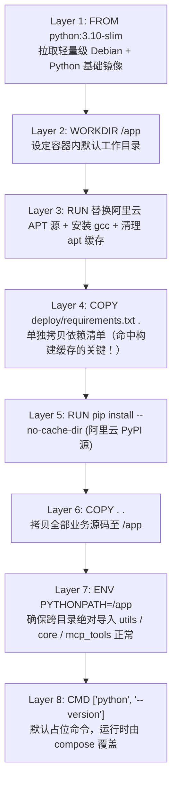

# `Dockerfile` 代码精讲：统一多服务 Python 容器镜像与缓存分层构建

> **源文件位置**：`deploy/Dockerfile`  
> **所属模块**：容器化与生产部署配置层 (`deploy/`)  
> **一句话定位**：定义 Voyage 智途的**统一基础镜像**——主网关、4 个 MCP 服务、4 个 A2A 智能体及天气定时采集器共用这同一个镜像，部署时仅通过 `docker-compose-dev.yml` 覆盖 `command` 即可启动不同角色！

---

## 一、文件定位与核心前置知识精讲

### 1.1 什么是“一镜像多角色（Single Image, Multiple Roles）”模式？
本项目包含 10 个 Python 业务进程（`main_http_api`、4 个 `mcp_*`、4 个 `a2a_*`、`weather_tools`）。如果为每个服务都写一个 `Dockerfile`，就要构建和存储 10 份几乎完全相同的 Python 镜像（浪费数 GB 磁盘和十倍构建时间）。
采用统一镜像后：
- 只构建**一份镜像**，包含全部项目源码与依赖；
- 在 `docker-compose-dev.yml` 中，各容器通过不同的 `command:` 启动不同入口（如 `uvicorn mcp_server.mcp_weather:app --port 5001`）。

### 1.2 Docker 镜像分层缓存（Layer Caching）的核心技巧
为什么本 `Dockerfile` 不直接一上来 `COPY . .` 然后 `pip install`，而是要先 `COPY deploy/requirements.txt`、`RUN pip install`、最后才 `COPY . .`？
- Docker 构建镜像时，**每一条指令都是一层只读缓存**；只要某一层之前的指令和文件没变，Docker 就直接复用缓存（0 秒跳过）；
- 平时开发时业务代码（`COPY . .`）天天在改，但 `requirements.txt` 几个月才改一次！把 `requirements.txt` 提前复制并安装，就能保证每次改完业务代码重新 `docker build` 时，**跳过耗时的 `pip install`，3 秒内瞬间完成构建**！

---

## 二、镜像构建分层流程图



---

## 三、完整源码与逐行深度拆解

### 3.1 完整源码（100% 原样收录）
```dockerfile
# ============================================================
# Voyage 智途 A2A —— 统一 Python 服务镜像
# 所有 8 个 Python 服务共用同一个镜像，启动命令由 docker-compose 指定
# ============================================================

FROM python:3.10-slim

# 设置工作目录
WORKDIR /app

# 系统依赖（pymysql 编译等可能需要）
# 动态检测 Debian 版本，自动匹配阿里云镜像（兼容 bookworm/trixie 等）
RUN CODENAME=$(cat /etc/os-release | grep VERSION_CODENAME | cut -d= -f2) && \
    echo "deb http://mirrors.aliyun.com/debian/ ${CODENAME} main contrib non-free non-free-firmware" > /etc/apt/sources.list && \
    echo "deb http://mirrors.aliyun.com/debian/ ${CODENAME}-updates main contrib non-free non-free-firmware" >> /etc/apt/sources.list && \
    echo "deb http://mirrors.aliyun.com/debian-security/ ${CODENAME}-security main contrib non-free non-free-firmware" >> /etc/apt/sources.list && \
    apt-get update && apt-get install -y --no-install-recommends \
    gcc \
    && rm -rf /var/lib/apt/lists/*

# 先复制依赖文件，利用 Docker 缓存层
COPY deploy/requirements.txt requirements.txt

# 安装 Python 依赖（使用阿里云 pip 镜像加速）
RUN pip install --no-cache-dir -r requirements.txt -i https://mirrors.aliyun.com/pypi/simple/ --trusted-host mirrors.aliyun.com

# 复制项目全部代码
COPY . .

# 设置 Python 模块搜索路径，确保 from utils import CONFIG 等导入正常
ENV PYTHONPATH=/app

# 默认命令（会被 docker-compose.yml 的 command 覆盖）
CMD ["python", "--version"]
```

### 3.2 逐段精讲
1. **`FROM python:3.10-slim`（第 6 行）**：
   - 使用 `-slim` 精简版镜像（约 130MB，远小于完整版 1GB），同时保留了 glibc（比 Alpine Linux 的 musl libc 兼容性好得多，能直接安装 `pymilvus`、`grpcio`、`numpy` 等带 C 扩展的预编译 Wheel 包）。
2. **动态识别 Debian 版本代号换源（第 13~19 行）**：
   - `CODENAME=$(cat /etc/os-release | grep VERSION_CODENAME | cut -d= -f2)` 自动探测当前基础镜像是 Debian 12 (`bookworm`) 还是 Debian 13 (`trixie`)，避免写死版本代号导致 `apt-get update` 报 404；
   - `--no-install-recommends` 拒绝安装非必要推荐包，并在同一条 `RUN` 末尾执行 `rm -rf /var/lib/apt/lists/*` 清理索引文件，极大瘦身镜像体积！
3. **`--no-cache-dir`（第 25 行）**：
   - 告诉 `pip` 安装完后不要在容器里保留 `.whl` 下载缓存，避免镜像白白膨胀几百 MB。
4. **`ENV PYTHONPATH=/app`（第 31 行）**：
   - 当 `docker-compose-dev.yml` 用 `uvicorn mcp_server.mcp_weather:app` 或 `python -m mcp_tools.weather_tools` 启动子目录脚本时，`PYTHONPATH=/app` 保证 Python 永远能从项目根目录 `/app` 找到 `utils`、`core`、`mcp_tools` 等顶层包，彻底杜绝 `ModuleNotFoundError: No module named 'utils'`！

---

## 四、读代码注意点与工程思考
1. **Python 版本差异留意**：根目录 `pyproject.toml` 声明 `requires-python = ">=3.11"`，而 `deploy/Dockerfile` 基础镜像写的是 `python:3.10-slim`。如果代码中用到了 Python 3.11+ 专属特性（或第三方库要求 3.11+），建议将第 6 行同步升级为 `FROM python:3.11-slim`。
2. **Debian 12+ 的 `debian.sources` 文件**：新版 Debian slim 镜像同时存在 `/etc/apt/sources.list.d/debian.sources`（DEB822 格式），若想彻底禁用国外默认源，可顺带清理或替换该文件。

---

## 五、自测思考题

### 思考题 1
为什么第 19 行的 `rm -rf /var/lib/apt/lists/*` 必须用 `&&` 写在与 `apt-get install` **同一条 `RUN` 指令**里，而不是单独另起一行 `RUN rm -rf /var/lib/apt/lists/*`？
> **参考答案**：因为 Docker 镜像采用写时复制（Copy-on-Write）分层文件系统！如果另起一条 `RUN` 删除文件，上一层镜像里已经把几十 MB 的 apt 索引打包固化进去了，下一层删除只是做了一个“隐藏标记”，**镜像总大小丝毫不会减小**！写在同一条 `RUN` 中才能在打包该层前真正把缓存删掉。

### 思考题 2
如果在 `Dockerfile` 中把 `COPY . .` 移到 `RUN pip install` 之前，会对日常开发构建造成什么影响？
> **参考答案**：会导致 Docker 构建缓存彻底失效——以后你哪怕只改了 `main_http_api.py` 里的一行注释，重新构建镜像时都要把 `requirements.txt` 里的所有包重新下载安装一遍，耗时极长。
