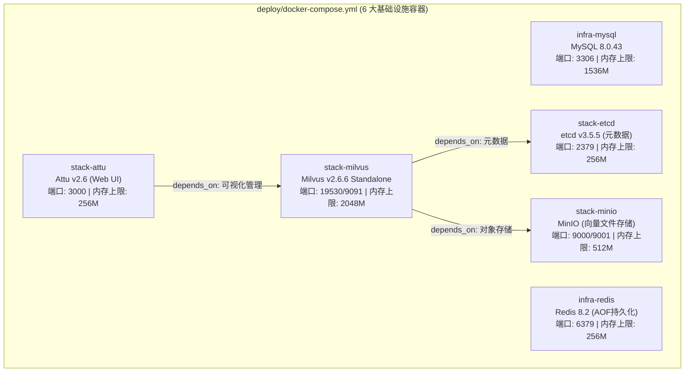

# `docker-compose.yml` 代码精讲：底层数据中间件栈一键编排（MySQL + Redis + Milvus 全家桶）

> **源文件位置**：`deploy/docker-compose.yml`  
> **所属模块**：容器化与生产部署配置层 (`deploy/`)  
> **一句话定位**：一键拉起 Voyage 智途运行所依赖的 **6 大基础设施容器**：MySQL 8.0、Redis 8.2、Milvus 2.6.6 向量数据库及其依赖组件（etcd + MinIO）和可视化管理界面 Attu。

---

## 一、文件定位与核心前置知识精讲

### 1.1 为什么 Milvus 向量数据库需要同时启动 `etcd`、`minio`、`milvus`、`attu` 四个容器？
很多初次部署 Milvus 的开发者会困惑：“我只是想装个向量数据库，为什么一下子起了 4 个容器？”
这是因为 Milvus 采用的是**云原生存储计算分离架构**：
1. **`etcd`（元数据管家，端口 `2379`）**：存储 Milvus 的表结构（Collection Schema）、分区信息和集群节点状态；
2. **`minio`（对象存储硬盘，API 端口 `9000` / 控制台 `9001`）**：兼容 AWS S3 协议的分布式文件存储，用来存放庞大的向量数据文件和倒排索引文件；
3. **`milvus`（计算与检索引擎，gRPC 端口 `19530` / 健康监控 `9091`）**：执行 `milvus run standalone`，负责接收 `pymilvus` 的请求，执行向量相似度计算与 BM25 混合检索；
4. **`attu`（Web 可视化管理界面，端口 `3000`）**：类似 MySQL 的 Navicat，浏览器访问 `http://服务器IP:3000` 即可可视化查看 `travel_rag` 和 `query_cache` 里的每一条向量数据！

### 1.2 为什么要把中间件（`docker-compose.yml`）和业务代码（`docker-compose-dev.yml`）拆成两个文件？
- **生命周期不同**：MySQL、Redis、Milvus 属于**有状态基础设施**，启动一次后往往连续运行几个月不需要重启；而业务 Python 服务每天可能迭代发版几十次；
- 拆开编排后，更新业务代码重启容器时，**完全不影响底层数据库和缓存连接**，且多个项目可以共用同一套 `/root/docker-infra/data/` 数据卷。

---

## 二、中间件拓扑与端口依赖图



---

## 三、完整源码与逐服务深度拆解

### 3.1 完整源码（100% 原样收录）
```yaml
# ============================================================
# SmartVoyage 中间件编排
# MySQL + Redis + Milvus 栈（etcd + MinIO + Milvus + Attu）
# 数据卷：共用 /root/docker-infra/data/（所有项目共享）
# ============================================================

services:

  # ======================== MySQL ========================
  mysql:
    image: mysql:8.0.43
    container_name: infra-mysql
    restart: unless-stopped
    environment:
      MYSQL_ROOT_PASSWORD: "123456"
      MYSQL_DATABASE: voyage
      TZ: Asia/Shanghai
    ports:
      - "3306:3306"
    command:
      - --character-set-server=utf8mb4
      - --collation-server=utf8mb4_unicode_ci
      - --innodb-buffer-pool-size=1G
      - --local-infile=1
    volumes:
      - /root/docker-infra/data/mysql:/var/lib/mysql
    deploy:
      resources:
        limits:
          memory: 1536M
          cpus: '1.0'
        reservations:
          cpus: '0.5'
          memory: 768M

  # ======================== Redis ========================
  redis:
    image: redis:8.2
    container_name: infra-redis
    restart: unless-stopped
    ports:
      - "6379:6379"
    volumes:
      - /root/docker-infra/data/redis:/data
    command: redis-server --appendonly yes --requirepass 123456
    deploy:
      resources:
        limits:
          memory: 256M
          cpus: '0.5'
        reservations:
          cpus: '0.25'
          memory: 128M

  # ======================== etcd（Milvus 依赖）========================
  etcd:
    image: quay.m.daocloud.io/coreos/etcd:v3.5.5
    container_name: stack-etcd
    environment:
      - ETCD_AUTO_COMPACTION_MODE=revision
      - ETCD_AUTO_COMPACTION_RETENTION=1000
      - ETCD_QUOTA_BACKEND_BYTES=4294967296
      - ETCD_SNAPSHOT_COUNT=50000
    volumes:
      - /root/docker-infra/data/etcd:/etcd
    ports:
      - "2379:2379"
    command:
      - etcd
      - --data-dir=/etcd
      - --listen-client-urls=http://0.0.0.0:2379
      - --advertise-client-urls=http://etcd:2379
    restart: unless-stopped
    deploy:
      resources:
        limits:
          memory: 256M
          cpus: '0.5'

  # ======================== MinIO（Milvus 依赖）========================
  minio:
    image: quay.m.daocloud.io/minio/minio:RELEASE.2025-06-13T11-33-47Z
    container_name: stack-minio
    environment:
      - MINIO_ACCESS_KEY=minioadmin
      - MINIO_SECRET_KEY=minioadmin
    command: server /data --console-address ":9001"
    volumes:
      - /root/docker-infra/data/minio:/data
    ports:
      - "9000:9000"
      - "9001:9001"
    restart: unless-stopped
    deploy:
      resources:
        limits:
          memory: 512M
          cpus: '0.5'
        reservations:
          cpus: '0.25'
          memory: 256M

  # ======================== Milvus ========================
  milvus:
    image: milvusdb/milvus:v2.6.6
    container_name: stack-milvus
    depends_on:
      - etcd
      - minio
    ports:
      - "19530:19530"
      - "9091:9091"
    volumes:
      - /root/docker-infra/data/milvus:/var/lib/milvus
    environment:
      - ETCD_ENDPOINTS=etcd:2379
      - MINIO_ADDRESS=minio:9000
      - MINIO_ACCESS_KEY=minioadmin
      - MINIO_SECRET_KEY=minioadmin
      - MILVUS_LOG_LEVEL=info
    command: ["milvus", "run", "standalone"]
    restart: unless-stopped
    deploy:
      resources:
        limits:
          memory: 2048M
          cpus: '2.0'
        reservations:
          cpus: '1.0'
          memory: 1024M

  # ======================== Attu（Milvus Web UI）========================
  attu:
    image: zilliz/attu:v2.6
    container_name: stack-attu
    depends_on:
      - milvus
    environment:
      - MILVUS_URL=milvus:19530
    ports:
      - "3000:3000"
    restart: unless-stopped
    deploy:
      resources:
        limits:
          memory: 256M
          cpus: '0.5'
```

### 3.2 关键配置项精讲
1. **MySQL 调优参数（第 20~24 行）**：
   - `--character-set-server=utf8mb4`：支持完整 4 字节 UTF-8（包含中文和 Emoji 表情）；
   - `--innodb-buffer-pool-size=1G`：给 InnoDB 存储引擎分配 1GB 内存缓存池，大幅加快热数据查询；
   - `MYSQL_DATABASE: voyage`：首次启动时自动创建 `voyage` 数据库。
2. **Redis 持久化与密码（第 45 行）**：
   - `--appendonly yes`：开启 **AOF（Append Only File）日志持久化**，防止容器重启后用户 Token 和缓存数据全部丢失；
   - `--requirepass 123456`：设置访问密码，与 `config.yaml` 中 `cache.redis.password: '123456'` 严格对应。
3. **精细的资源配额限制（`deploy.resources.limits`）**：
   - 6 个容器的内存上限总计约 `1.5G + 0.25G + 0.25G + 0.5G + 2G + 0.25G ≈ 4.75 GB`，防止单个中间件（如 Milvus 加载大索引）发生 OOM（内存溢出）拖垮整台宿主机！
4. **国内镜像源加速**：
   - `etcd` 和 `minio` 专门使用了 DaoCloud 国内加速源 `quay.m.daocloud.io/...`，避免国内拉取 `quay.io` 镜像失败。

---

## 四、自测思考题

### 思考题 1
如果宿主机磁盘被删除，或者你在 Windows 本地电脑直接跑这套 `docker-compose.yml`，哪几行配置需要修改？
> **参考答案**：所有 `volumes:` 中挂载的 Linux 绝对路径（如 `/root/docker-infra/data/mysql:/var/lib/mysql`）在 Windows 宿主机上不存在，建议改为相对路径（如 `./data/mysql:/var/lib/mysql`）或命名卷（Named Volumes）。

### 思考题 2
为什么 `milvus` 的 `environment` 中写的是 `ETCD_ENDPOINTS=etcd:2379` 和 `MINIO_ADDRESS=minio:9000`，而不是 `127.0.0.1:2379`？
> **参考答案**：在 Docker 容器内部，`127.0.0.1` 指的是**容器自己**，而不是宿主机或其他容器！Docker Compose 会自动创建一个内部虚拟网络，容器之间直接用**服务名**（`etcd`、`minio`、`milvus`）作为主机名，Docker 内置 DNS 会自动将其解析为对应容器的内网 IP。
