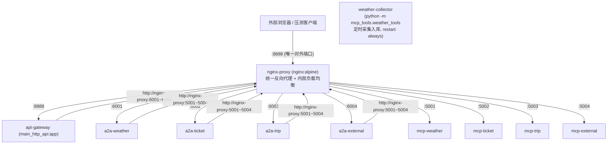

# `docker-compose-dev.yml` 代码精讲：11 个分布式业务微服务容器全编排

> **源文件位置**：`deploy/docker-compose-dev.yml`  
> **所属模块**：容器化与生产部署配置层 (`deploy/`)  
> **一句话定位**：将整个 Voyage 智途的 **1 个 API 网关 + 4 个 MCP 服务 + 4 个 A2A 智能体 + 1 个统一 Nginx 反向代理 + 1 个天气定时采集器（共 11 个容器）** 编排为完整的生产级微服务集群，并且仅对外暴露唯一的 `8888` 端口！

---

## 一、文件定位与核心前置知识精讲

### 1.1 为什么全集群 11 个容器，只对外暴露 `nginx-proxy` 的 `8888` 端口？
仔细观察 `docker-compose-dev.yml` 中所有服务的 `ports:` 字段，你会发现一个非常优雅的安全与负载均衡架构设计：
- **对外零暴露内部端口**：`api-gateway`、`mcp-*`（5001~5004）、`a2a-*`（6001~6004）**全部没有配置 `ports:`**！外部公网完全无法绕过网关直接攻击内部 MCP 或 A2A 服务；
- **内部服务间调用全部走 `nginx-proxy`**：
  - 看 `api-gateway` 的环境变量：`DOCKER_A2A_WEATHER_URL=http://nginx-proxy:6001`；
  - 看 `a2a-weather` 的环境变量：`DOCKER_MCP_WEATHER_URL=http://nginx-proxy:5001`。
  - **为什么不直接连 `http://a2a-weather:6001`，非要绕一层 `nginx-proxy`？**
    - 为了支持 **水平弹性扩容（Horizontal Scaling）**！当你执行 `docker compose up -d --scale a2a-weather=3 --scale mcp-weather=3` 时，Nginx 配合 Docker 内置 DNS 动态解析，会自动把请求轮询负载均衡到 3 个 `a2a-weather` 容器副本上！

### 1.2 环境变量覆盖机制（`DOCKER_*`）与只读配置挂载（`:ro`）
1. **`./code/config.yaml:/app/config.yaml:ro`**：
   - 将宿主机的 `config.yaml` 以**只读模式（Read-Only `:ro`）**挂载进每个容器，修改配置无需重新构建镜像，同时防止容器内程序误改配置；
2. **`DOCKER_DB_MYSQL_HOST=mysql` 等环境变量**：
   - `utils/config.py` 中实现了“环境变量优先覆盖 `config.yaml`”的逻辑。这样同一份 `config.yaml` 在本地开发时连 `127.0.0.1`，放进 Docker 后自动通过 `DOCKER_*` 环境变量无缝切换到容器内网服务名 `mysql`、`redis`、`milvus`、`nginx-proxy`！
3. **`${AliApiKey}` 宿主机密钥透传**：
   - 在 Compose YAML 中写 `AliApiKey=${AliApiKey}`，Docker Compose 启动时会自动从宿主机环境变量（或同目录 `.env` 文件）读取真实密钥并注入容器，绝不把明文 API Key 写死在 YAML 文件里！

---

## 二、11 容器分布式微服务网络拓扑图



---

## 三、完整源码与逐服务深度拆解

### 3.1 完整源码（100% 原样收录）
```yaml
# ============================================================
# SmartVoyage business services
# 10 containers: 9 business + 1 unified nginx proxy
# Only exposed port: 8888 (API gateway)
# Middleware via external docker-compose.yml
# ============================================================

services:

  # ======================== API gateway ========================
  api-gateway:
    build:
      context: ./code
      dockerfile: deploy/Dockerfile
    command: uvicorn main_http_api:app --host 0.0.0.0 --port 8888
    environment:
      - DOCKER_SERVER_HOST=0.0.0.0
      - DOCKER_SERVER_PORT=8888
      - DOCKER_DB_MYSQL_HOST=mysql
      - DOCKER_DB_MYSQL_PORT=3306
      - DOCKER_DB_MILVUS_HOST=milvus
      - DOCKER_DB_MILVUS_PORT=19530
      - DOCKER_CACHE_REDIS_HOST=redis
      - DOCKER_CACHE_REDIS_PORT=6379
      - DOCKER_CACHE_REDIS_PASSWORD=123456
      - DOCKER_MCP_WEATHER_URL=http://nginx-proxy:5001
      - DOCKER_MCP_TICKET_URL=http://nginx-proxy:5002
      - DOCKER_MCP_TRIP_URL=http://nginx-proxy:5003
      - DOCKER_MCP_EXTERNAL_URL=http://nginx-proxy:5004
      - DOCKER_A2A_WEATHER_URL=http://nginx-proxy:6001
      - DOCKER_A2A_TICKET_URL=http://nginx-proxy:6002
      - DOCKER_A2A_TRIP_URL=http://nginx-proxy:6003
      - DOCKER_A2A_EXTERNAL_URL=http://nginx-proxy:6004
      - AliApiKey=${AliApiKey}
      - QwApiKey=${QwApiKey}
      - VariFlightApiKey=${VariFlightApiKey}
      - BochaApiKey=${BochaApiKey}
      - AmapApiKey=${AmapApiKey}
    volumes:
      - ./code/config.yaml:/app/config.yaml:ro

  # ======================== MCP tool services ========================
  mcp-weather:
    build:
      context: ./code
      dockerfile: deploy/Dockerfile
    command: uvicorn mcp_server.mcp_weather:app --host 0.0.0.0 --port 5001
    environment:
      - QwApiKey=${QwApiKey}
    volumes:
      - ./code/config.yaml:/app/config.yaml:ro

  mcp-ticket:
    build:
      context: ./code
      dockerfile: deploy/Dockerfile
    command: uvicorn mcp_server.mcp_ticket:app --host 0.0.0.0 --port 5002
    volumes:
      - ./code/config.yaml:/app/config.yaml:ro

  mcp-trip:
    build:
      context: ./code
      dockerfile: deploy/Dockerfile
    command: uvicorn mcp_server.mcp_trip:app --host 0.0.0.0 --port 5003
    volumes:
      - ./code/config.yaml:/app/config.yaml:ro

  mcp-external:
    build:
      context: ./code
      dockerfile: deploy/Dockerfile
    command: uvicorn mcp_server.mcp_external:app --host 0.0.0.0 --port 5004
    environment:
      - VariFlightApiKey=${VariFlightApiKey}
      - BochaApiKey=${BochaApiKey}
      - AmapApiKey=${AmapApiKey}
    volumes:
      - ./code/config.yaml:/app/config.yaml:ro

  # ======================== A2A agent services ========================
  a2a-weather:
    build:
      context: ./code
      dockerfile: deploy/Dockerfile
    command: uvicorn a2a_server.a2a_weather:app --host 0.0.0.0 --port 6001
    environment:
      - AliApiKey=${AliApiKey}
      - DOCKER_MCP_WEATHER_URL=http://nginx-proxy:5001
    volumes:
      - ./code/config.yaml:/app/config.yaml:ro

  a2a-ticket:
    build:
      context: ./code
      dockerfile: deploy/Dockerfile
    command: uvicorn a2a_server.a2a_ticket:app --host 0.0.0.0 --port 6002
    environment:
      - AliApiKey=${AliApiKey}
      - DOCKER_MCP_TICKET_URL=http://nginx-proxy:5002
    volumes:
      - ./code/config.yaml:/app/config.yaml:ro

  a2a-trip:
    build:
      context: ./code
      dockerfile: deploy/Dockerfile
    command: uvicorn a2a_server.a2a_trip:app --host 0.0.0.0 --port 6003
    environment:
      - AliApiKey=${AliApiKey}
      - DOCKER_MCP_TRIP_URL=http://nginx-proxy:5003
    volumes:
      - ./code/config.yaml:/app/config.yaml:ro

  a2a-external:
    build:
      context: ./code
      dockerfile: deploy/Dockerfile
    command: uvicorn a2a_server.a2a_external:app --host 0.0.0.0 --port 6004
    environment:
      - AliApiKey=${AliApiKey}
      - DOCKER_MCP_EXTERNAL_URL=http://nginx-proxy:5004
      - VariFlightApiKey=${VariFlightApiKey}
      - BochaApiKey=${BochaApiKey}
      - AmapApiKey=${AmapApiKey}
    volumes:
      - ./code/config.yaml:/app/config.yaml:ro

  # ======================== unified nginx proxy ========================
  nginx-proxy:
    image: nginx:alpine
    ports:
      - "8888:8888"
    volumes:
      - ./nginx.conf:/etc/nginx/nginx.conf:ro
    depends_on:
      - api-gateway
      - mcp-weather
      - mcp-ticket
      - mcp-trip
      - mcp-external
      - a2a-weather
      - a2a-ticket
      - a2a-trip
      - a2a-external

  # ======================== scheduled task ========================
  weather-collector:
    build:
      context: ./code
      dockerfile: deploy/Dockerfile
    command: python -m mcp_tools.weather_tools
    environment:
      - DOCKER_DB_MYSQL_HOST=mysql
      - DOCKER_DB_MYSQL_PORT=3306
      - DOCKER_CACHE_REDIS_PASSWORD=123456
      - QwApiKey=${QwApiKey}
    volumes:
      - ./code/config.yaml:/app/config.yaml:ro
    restart: always
```

### 3.2 关键工程细节拆解
1. **按需最小权限注入密钥（最小权限原则）**：
   - `mcp-ticket` 和 `mcp-trip` 只查内部 MySQL 数据库，不调任何第三方 API，因此压根不注入任何 API Key；
   - `mcp-weather` 只注入 `QwApiKey`；`mcp-external` 只注入 `VariFlightApiKey`、`BochaApiKey`、`AmapApiKey`；`a2a-*` 注入 `AliApiKey`。
2. **`weather-collector` 守护进程（第 148~160 行）**：
   - 专门起一个独立容器跑 `python -m mcp_tools.weather_tools` 并设置 `restart: always`，7×24 小时在后台定时采集和风天气 15 天预报写入 MySQL，即便偶发异常退出也会被 Docker 自动拉起！
3. **部署注意事项（跨 Compose 网络打通）**：
   - `docker-compose.yml`（中间件）和 `docker-compose-dev.yml`（业务服务）如果在不同目录下启动，默认会各自创建独立的桥接网络。为了确保 `api-gateway` 能访问到 `mysql`、`redis`、`milvus`，实际部署时需将它们放入同一个外部共享网络（`networks: default: external: true`），或在同一个目录通过 `docker compose -f docker-compose.yml -f docker-compose-dev.yml up -d` 合并启动。

---

## 四、自测思考题

### 思考题 1
为什么所有 `uvicorn` 命令里都写的是 `--host 0.0.0.0`，而不是 `config.yaml` 里的 `127.0.0.1`？
> **参考答案**：在容器里，如果服务只监听 `127.0.0.1`（本地回环地址），那么只有该容器自己内部能访问它，同网络里的 `nginx-proxy` 容器发来的请求会被直接拒绝（Connection Refused）！必须监听 `0.0.0.0`（所有网卡），才能接收来自 `nginx-proxy` 和其他容器的跨容器网络流量。

### 思考题 2
如果 `mcp-weather` 容器在容器化部署时也需要连接 `mysql` 容器，请检查第 43~51 行的 `mcp-weather` 配置，看看是否还缺少了某个关键环境变量？
> **参考答案**：细心看第 48~49 行：`mcp-weather` 只注入了 `QwApiKey`，而没有像 `api-gateway` 和 `weather-collector` 那样注入 `DOCKER_DB_MYSQL_HOST=mysql`！同理 `mcp-ticket`、`mcp-trip`、`mcp-external` 也未显式注入 `DOCKER_DB_MYSQL_HOST` / `DOCKER_DB_MILVUS_HOST`。如果 `config.yaml` 里填的是宿主机局域网 IP（如 `192.168.88.101`）则能直连宿主机映射端口；若希望纯走容器内网服务名 `mysql`/`milvus`，需要为这 4 个 `mcp-*` 服务补上 `DOCKER_DB_MYSQL_HOST=mysql`（以及为 `mcp-external` 补上 `DOCKER_DB_MILVUS_HOST=milvus`）。
