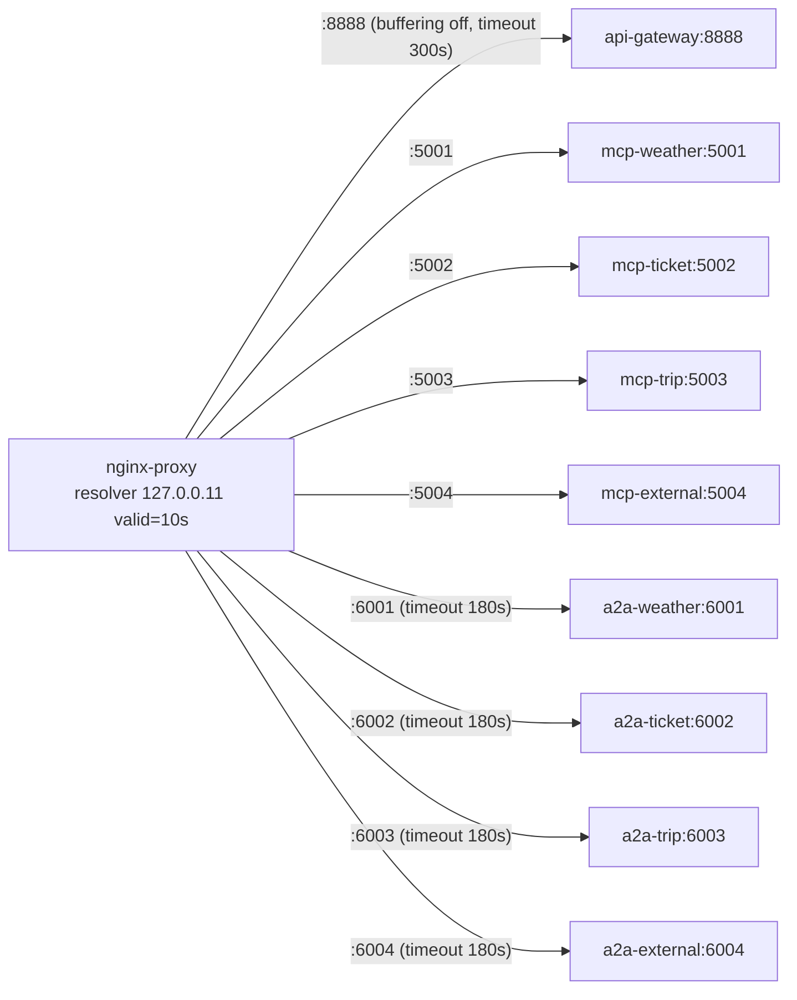

# `nginx.conf` 代码精讲：统一反向代理、Docker 动态 DNS 扩容与 SSE 流式防缓冲配置

> **源文件位置**：`deploy/nginx.conf`  
> **所属模块**：容器化与生产部署配置层 (`deploy/`)  
> **一句话定位**：整个分布式集群的“统一交通枢纽”，同时代理 1 个 API 网关（`8888`）、4 个 MCP 服务（`5001~5004`）与 4 个 A2A 智能体（`6001~6004`），并内置了**防 SSE 卡顿缓冲配置**与 **Docker 动态 DNS 零停机扩容机制**。

---

## 一、文件定位与核心前置知识精讲

读懂这份只有 122 行的 `nginx.conf`，你就掌握了 AI 微服务上线时最容易踩的两个高阶生产级 Nginx 知识点：

### 1.1 知识点一：为什么 Nginx 代理 SSE 流式对话（`/api/chat/stream`）必须加 `proxy_buffering off;`？
- **默认行为（踩坑重灾区）**：为了提升吞吐量，Nginx 默认开启了 **`proxy_buffering on`**！意思是：当后端 FastAPI 每隔 0.03 秒吐出一个字（`data: {"chunk": "北"}\n\n`）时，Nginx 觉得“才几个字节太碎了，先攒在我内存缓冲区里，攒够 4KB 或等后端彻底吐完再一次性发给浏览器吧！”
- **灾难后果**：前端用户彻底看不到打字机逐字流式效果，而是干等 10 秒后整段文字“啪”地一下全蹦出来！
- **解法（第 29~31 行）**：
  - `proxy_buffering off;`：关闭响应缓冲，后端吐 1 个字，Nginx 立刻原样推给浏览器 1 个字；
  - `proxy_cache off;`：关闭代理缓存；
  - `proxy_read_timeout 300s;`：把默认 60 秒的读超时拉长到 300 秒（5 分钟），防止长思考推理或长文本流式输出中途被 Nginx 强行掐断返回 `504 Gateway Timeout`！

### 1.2 知识点二：为什么不用直接写 `proxy_pass http://a2a-weather:6001;`，而要多此一举先 `set $backend` 再 `proxy_pass $backend;`？
这是 Docker + Nginx 生产运维中极其经典的一个**黑科技技巧**（第 17、24~25 行）：
```nginx
resolver 127.0.0.11 valid=10s;
...
set $backend "http://api-gateway:8888";
proxy_pass $backend;
```
- **直接写固定域名 `proxy_pass http://api-gateway:8888;` 的两大坑**：
  1. Nginx **只在启动那一瞬间**解析一次 DNS 并永久缓存该 IP！一旦 `api-gateway` 容器重启换了新 IP，或者你执行 `docker compose --scale api-gateway=3` 扩容了新容器，Nginx 永远不知道新 IP，请求直接 502 报错，除非手动重启 Nginx；
  2. 如果启动 Nginx 时某个后端容器还没就绪，Nginx 直接启动失败崩溃！
- **配合 `resolver 127.0.0.11 valid=10s;` + 变量 `$backend` 的威力**：
  - `127.0.0.11` 是 Docker 引擎内置的 DNS 服务器地址；
  - 当 `proxy_pass` 后面跟的是**变量 `$backend`** 时，Nginx 会在**每次请求到达时**按 `valid=10s` 的缓存周期重新向 `127.0.0.11` 查询最新容器 IP 列表！
  - 结果：**执行 `--scale a2a-weather=3` 动态扩容时，10 秒内自动发现新节点并生效，全程零停机、无需重启 Nginx！**

---

## 二、九端口反向代理路由全景图



---

## 三、完整源码与逐段深度拆解

### 3.1 完整源码（100% 原样收录）
```nginx
# ============================================================
# SmartVoyage unified reverse proxy (dynamic DNS resolution)
# 1 nginx proxy: API gateway + MCP + A2A
# resolver + set $variable: every request re-resolves DNS
# docker compose --scale auto-discovered, no restart needed
# ============================================================

worker_processes auto;

events {
    worker_connections 1024;
}

http {
    # Docker built-in DNS, re-resolve every 10s
    # When containers scale, Docker DNS returns new IPs automatically
    resolver 127.0.0.11 valid=10s;

    # ---------- API gateway (port 8888) ----------
    server {
        listen 8888;

        location / {
            set $backend "http://api-gateway:8888";
            proxy_pass $backend;
            proxy_set_header Host $host;
            proxy_set_header X-Real-IP $remote_addr;
            proxy_set_header X-Forwarded-For $proxy_add_x_forwarded_for;
            proxy_buffering off;
            proxy_cache off;
            proxy_read_timeout 300s;
            proxy_send_timeout 300s;
            proxy_connect_timeout 10s;
        }
    }

    # ---------- MCP tool services ----------
    server {
        listen 5001;
        location / {
            set $backend "http://mcp-weather:5001";
            proxy_pass $backend;
            proxy_set_header Host $host;
            proxy_set_header X-Real-IP $remote_addr;
        }
    }

    server {
        listen 5002;
        location / {
            set $backend "http://mcp-ticket:5002";
            proxy_pass $backend;
            proxy_set_header Host $host;
            proxy_set_header X-Real-IP $remote_addr;
        }
    }

    server {
        listen 5003;
        location / {
            set $backend "http://mcp-trip:5003";
            proxy_pass $backend;
            proxy_set_header Host $host;
            proxy_set_header X-Real-IP $remote_addr;
        }
    }

    server {
        listen 5004;
        location / {
            set $backend "http://mcp-external:5004";
            proxy_pass $backend;
            proxy_set_header Host $host;
            proxy_set_header X-Real-IP $remote_addr;
        }
    }

    # ---------- A2A agent services ----------
    server {
        listen 6001;
        location / {
            set $backend "http://a2a-weather:6001";
            proxy_pass $backend;
            proxy_set_header Host $host;
            proxy_set_header X-Real-IP $remote_addr;
            proxy_read_timeout 180s;
        }
    }

    server {
        listen 6002;
        location / {
            set $backend "http://a2a-ticket:6002";
            proxy_pass $backend;
            proxy_set_header Host $host;
            proxy_set_header X-Real-IP $remote_addr;
            proxy_read_timeout 180s;
        }
    }

    server {
        listen 6003;
        location / {
            set $backend "http://a2a-trip:6003";
            proxy_pass $backend;
            proxy_set_header Host $host;
            proxy_set_header X-Real-IP $remote_addr;
            proxy_read_timeout 180s;
        }
    }

    server {
        listen 6004;
        location / {
            set $backend "http://a2a-external:6004";
            proxy_pass $backend;
            proxy_set_header Host $host;
            proxy_set_header X-Real-IP $remote_addr;
            proxy_read_timeout 180s;
        }
    }
}
```

### 3.2 超时时间阶梯设计精讲（架构师细节）
请对比三层服务的 `proxy_read_timeout` 设计，你会发现非常严谨的**超时递进阶梯**：
1. **底层 MCP 服务（5001~5004）**：使用 Nginx 默认 `60s`，因为纯数据库/外部 HTTP 查询通常在几秒内完成；
2. **中层 A2A 智能体（6001~6004）**：`proxy_read_timeout 180s;` —— 恰好大于主控 `chat_service_core.py` 中 `asyncio.wait_for` 设置的 `150s` 超时，避免 Nginx 抢在应用层之前直接掐断连接；
3. **顶层 API 网关（8888）**：`proxy_read_timeout 300s;` —— 大于所有下游 A2A 串行/重试/汇总的总耗时上限，保证长对话和 SSE 流式输出稳定不断连！

---

## 四、自测思考题

### 思考题 1
如果把 `nginx.conf` 第 29 行的 `proxy_buffering off;` 删掉，调用 `/api/chat`（同步接口）和 `/api/chat/stream`（SSE 流式接口）分别会有什么现象？
> **参考答案**：`/api/chat` 是一次性返回 JSON，几乎没有体感差异；但 `/api/chat/stream` 会因为 Nginx 默认开启缓冲区攒包，导致前端失去逐字打字机效果，卡住等待几秒后整段文本突然一次性显示出来。

### 思考题 2
第 26~28 行配置了 `proxy_set_header X-Real-IP $remote_addr;` 和 `X-Forwarded-For`，如果不配这两行，后端 FastAPI 日志里看到的客户端 IP 会是什么？
> **参考答案**：如果不透传这两个请求头，后端 FastAPI 看到的连接来源 IP 将永远是 `nginx-proxy` 容器的内网 IP，无法追踪真实用户的来源 IP。
