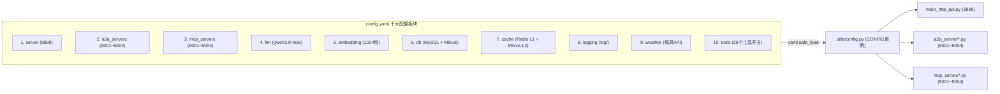

# `config.yaml` 代码精讲：分布式多智能体全局配置中心与 Prompt 模板详解

> **源文件位置**：`config.yaml`  
> **所属模块**：根目录入口与工程配置层  
> **一句话定位**：全项目的“神经中枢配置文件”，集中管理 1 个主网关 + 4 个 MCP 服务 + 4 个 A2A 智能体 + LLM/Embedding 模型 + MySQL/Milvus/Redis 三大数据库 + 28 个可插拔业务工具开关与子智能体总结 Prompt 模板。

---

## 一、文件定位与核心前置知识精讲

### 1.1 为什么要用 `config.yaml` 做配置与代码分离？（十二要素应用规范）
在软件工程的 **Twelve-Factor App（十二要素应用）** 规范中，有一条黄金法则：**严禁在业务代码里硬编码（Hardcode）IP 地址、端口号、数据库账号、模型名称和业务提示词**。
把所有可变参数抽离到根目录的 `config.yaml` 中，由 `utils/config.py` 在启动时统一加载为全局单例 `CONFIG`，带来了三大好处：
1. **一处修改，全局生效**：比如把 `llm.model_name` 从 `qwen3.8-max` 换成 `deepseek-chat`，或者修改 MySQL 服务器 IP，只需改 `config.yaml` 一行，所有 9 个微服务进程都会自动读取新配置。
2. **端口拓扑一目了然**：通过统一规划 `8888`（主网关）、`6001~6004`（A2A 智能体层）、`5001~5004`（MCP 工具层），整个分布式系统的网络拓扑清清楚楚。
3. **安全隔离（环境变量引用 `api_key_env`）**：
   - 请注意看配置文件中的 `api_key_env: "AliApiKey"`、`api_key_env: "QwApiKey"`。
   - **这里写的不是真实的 API Key 字符串，而是操作系统环境变量的名字**！
   - 代码在 `utils/config.py` 中会通过 `os.getenv(cfg["api_key_env"])` 从操作系统的环境变量里取出真正的密钥。这样即使把 `config.yaml` 提交到 GitHub 公开仓库，也绝不会泄露你的阿里云、和风天气或高德地图密钥！

### 1.2 YAML 语法中容易困惑的两个核心知识点
在阅读 `config.yaml` 前，先掌握两个高频 YAML 语法：
1. **层级缩进**：YAML 用 **空格缩进（通常 2 个空格，严禁用 Tab 键）** 表示字典的父子嵌套关系。例如：
   ```yaml
   server:
     host: "127.0.0.1"
     port: 8888
   ```
   被 Python 的 `yaml.safe_load()` 解析后，会变成嵌套字典：`{"server": {"host": "127.0.0.1", "port": 8888}}`。
2. **竖线符号 `|`（多行字面量块标量 Literal Block Scalar）**：
   在 `a2a_servers.weather.prompt: |` 中，你会看到冒号后面有一个竖线 `|`。
   - **作用**：告诉 YAML 解析器，“从下一行开始，凡是缩进对齐的多行文本，请**完整保留其中的换行符 `\n`**，拼成一个长字符串”。这非常适合在配置文件里编写多行的大模型 System Prompt（系统提示词模板）！

---

## 二、配置全景架构与端口映射图



### 全系统 9 大进程端口规划表（背诵级核心拓扑）

| 业务域 | A2A 智能体服务 (`600x`) | A2A Agent 名称 | 对应的 MCP 工具服务 (`500x`) | MCP 服务名称 |
| :--- | :--- | :--- | :--- | :--- |
| **主控网关** | `main_http_api.py` → **`8888`** | - | - | - |
| **天气领域** | `a2a_weather.py` → **`6001`** | `WeatherQueryAssistant` | `mcp_weather.py` → **`5001`** | `WeatherTools` |
| **票务领域** | `a2a_ticket.py` → **`6002`** | `TicketAssistant` | `mcp_ticket.py` → **`5002`** | `TicketTools` |
| **行程领域** | `a2a_trip.py` → **`6003`** | `TripAssistant` | `mcp_trip.py` → **`5003`** | `TripTools` |
| **外部数据与RAG** | `a2a_external.py` → **`6004`** | `ExternalDataAssistant` | `mcp_external.py` → **`5004`** | `ExternalTools` |

> **记忆规律**：`5001~5004` 是底层的 **MCP 工具服务（手和脚）**；往上一层加 1000，即 `6001~6004`，就是对应的 **A2A 领域智能体服务（领域大脑）**；最顶层 `8888` 是面向前端用户的 **FastAPI 主网关（总管大脑）**。

---

## 三、完整源码与十大板块逐段深度拆解

以下分段贴出 `config.yaml` 的 **100% 完整源码**，并对每一处配置项的作用、取值原因及代码消费方进行详解。

### 板块 1~3：主网关 (`server`)、MCP 服务 (`mcp_servers`) 与 A2A 智能体 (`a2a_servers`)

#### 源码（第 1~141 行）
```yaml
# ==================== 智途A2A 配置文件 ====================
#
# 本文件是项目的核心配置，包含所有服务的启动参数、API密钥、数据库连接等
# 修改后需重启相关服务才能生效
#
# 配置结构概览：
#   server       - 主 API 服务入口（FastAPI）
#   mcp_servers  - MCP 工具服务（提供工具能力）
#   a2a_servers  - A2A Agent 服务（智能体代理层）
#   llm          - 大语言模型配置
#   embedding    - 向量嵌入模型配置
#   db           - 数据库配置（MySQL + Milvus）
#   cache        - 缓存配置（Redis + Milvus 语义缓存）
#   logging      - 日志配置
#   weather      - 天气 API 配置
#   tools        - 工具开关配置（可插拔架构）

# ==================== 主 API 服务入口 ====================
# FastAPI 服务监听地址，提供 /api/chat 等接口给前端调用
server:
  host: "127.0.0.1"    # 监听地址（127.0.0.1 = 仅本机访问）
  port: 8888            # 监听端口

# ==================== MCP 工具服务配置 ====================
# MCP (Model Context Protocol) 服务提供工具能力给 A2A Agent 调用
# 每个 MCP 服务对应一个业务领域的工具集合
# 架构：MCP Server → 提供工具 → A2A Agent 调用
mcp_servers:
  # 天气工具服务：提供天气查询能力
  weather:
    host: "127.0.0.1"
    port: 5001          # 监听端口
    name: "WeatherTools"  # 服务名称（用于日志识别）
  # 票务工具服务：提供机票/火车票/演唱会票查询和预订能力
  ticket:
    host: "127.0.0.1"
    port: 5002
    name: "TicketTools"
  # 行程工具服务：提供租车/旅游团/保险查询和预订能力
  trip:
    host: "127.0.0.1"
    port: 5003
    name: "TripTools"
  # 外部工具服务：提供航班搜索/周边搜索/路径规划等能力
  external:
    host: "127.0.0.1"
    port: 5004
    name: "ExternalTools"

# ==================== A2A Agent 服务配置 ====================
# A2A (Agent-to-Agent) 服务是智能体代理层
# 每个 A2A Agent 负责：
#   1. 接收用户请求
#   2. 调用 MCP 工具获取数据
#   3. 用 LLM 整理数据，生成自然语言回复
#
# 关键参数：
#   - host/port: 服务监听地址
#   - name: Agent 名称（用于路由匹配）
#   - prompt: 给子代理的系统提示词，指导如何整理和输出数据
#     · {query} 占位符：用户原始查询
#     · {raw_response} 占位符：MCP 工具返回的原始数据
a2a_servers:
  # 天气助手 Agent：负责天气查询相关
  weather:
    host: "127.0.0.1"
    port: 6001          # 监听端口（与 MCP 服务对应，6xxx = A2A，5xxx = MCP）
    name: "WeatherQueryAssistant"  # Agent 名称
    # 系统提示词：指导 Agent 如何整理天气数据并输出
    prompt: |
      系统提示：您是一位专业的天气预报员，以生动、准确的风格总结天气信息。基于查询和结果：
      - 核心描述点：城市、日期、温度范围、天气描述、湿度、风向、降水等。
      - 如果结果为空或者意思为需要补充数据，则委婉提示"未找到数据，请确认城市/日期"
      - 语气：专业预报，如"根据最新数据，北京2025-07-31的天气预报为..."。
      - 保持中文，100-150字。
      - 如果查询无关，返回"请提供天气相关查询。"

      查询：{query}
      结果：{raw_response}
  # 票务助手 Agent：负责机票/火车票/演唱会票查询和预订
  ticket:
    host: "127.0.0.1"
    port: 6002
    name: "TicketAssistant"
    # 系统提示词：指导 Agent 如何整理票务数据并输出
    prompt: |
      系统提示：您是一位专业的旅行顾问，以热情、精确的风格总结票务信息。基于查询和结果：
      - 核心描述点：
        · 机票：航班号、航空公司、出发/到达城市、起飞降落时间、舱位、价格、余票；
        · 火车/高铁票：车次、出发/到达城市、发车到站时间、座位类型、价格、余票；
        · 演唱会票：艺人/演唱会名称、城市、日期、场馆、票型、价格、余票。
      - 如果结果为空或者意思为需要补充数据，则委婉提示"未找到数据，请确认或修改条件"
      - 如果是预定成功类结果，突出"恭喜，预定成功"，并复述关键信息（日期、类型、数量）。
      - 语气：顾问式，如"为您推荐北京到上海的机票选项..."。
      - 保持中文，300字以内。
      - 如果查询无关，返回"请进一步提供信息"

      查询：{query}
      结果：{raw_response}
  # 行程助手 Agent：负责租车/旅游团/保险查询和预订
  trip:
    host: "127.0.0.1"
    port: 6003
    name: "TripAssistant"
    # 系统提示词：指导 Agent 如何整理行程数据并输出
    prompt: |
      系统提示：您是一位专业的行程管家，以热情、清晰的风格总结行程信息。基于查询和结果：
      - 核心描述点：
        · 租车：租车公司、取还车城市、日期、车型、价格、座位数/变速箱、押金；
        · 旅游团：团名、城市、天数、价格、评分、剩余名额、亮点；
        · 保险：保险类型、公司、保障范围、价格、保额、医疗/行李/延误覆盖。
      - 如果结果为空或者意思为需要补充数据，则委婉提示"未找到数据，请确认或修改条件"
      - 如果是预定、租用，请根据查询query和结果raw_response告知预定或租用的最终结果。
      - 如果是预定成功类结果，突出"恭喜，预定成功"，并复述关键信息（日期、类型、数量）。
      - 语气：管家式推荐，如"为您在成都找到以下租车选项..."。
      - 保持中文，500字以内。
      - 如果查询无关，返回"请提供行程相关查询。"

      查询：{query}
      结果：{raw_response}
  # 外部数据助手 Agent：负责航班搜索/周边搜索/路径规划等
  external:
    host: "127.0.0.1"
    port: 6004
    name: "ExternalDataAssistant"
    # 系统提示词：指导 Agent 如何整理外部数据并输出
    prompt: |
      系统提示：您是一位专业的外部数据源助手，以准确、全面的风格总结查询结果。基于查询和结果：
      - 核心描述点：
        · 航班信息：航班号、航空公司、出发/到达城市、时间、价格、舒适度；
        · 旅行攻略：目的地信息、旅游知识、出行建议；
        · 周边搜索：POI名称、地址、距离、评分、营业时间；
        · 路径规划：出发地、目的地、距离、预计时间、路线详情（支持自驾/公交/步行/骑行）。
      - 如果结果为空或者意思为需要补充数据，则委婉提示"未找到数据，请确认或修改条件"
      - 语气：专业助手，如"为您查询到以下航班信息..."。
      - 保持中文，500字以内。
      - 如果查询无关，返回"请提供相关查询。"

      查询：{query}
      结果：{raw_response}
```

#### 深度精讲：
1. **为什么 `a2a_servers` 里的 `name`（如 `WeatherQueryAssistant`、`TicketAssistant`）极其重要？**
   - 在主控编排器 `core/chat_service_core.py` 进行意图路由时，主控 LLM 会根据每个 A2A 服务的 `AgentCard.name` 来决定把子任务派发给哪个子智能体。
   - 因此这里的 `name` 不仅是一个名字，更是 **A2A 路由表的唯一标识键**！
2. **为什么每个 A2A 子智能体都在 `config.yaml` 中配了一段带 `{query}` 和 `{raw_response}` 占位符的 `prompt`？**
   - 这是本项目非常巧妙的**“工具调用与结果润色分离”两阶段设计**：
     - 第一阶段，子智能体通过 ReAct 模式调用 MCP 工具，从数据库或第三方 API 拿到冷冰冰的 JSON 原始数据（`raw_response`）；
     - 第二阶段，子智能体在 Python 代码中执行 `PROMPT_TEMPLATE.format(query=query, raw_response=raw_response)`，把用户问题和原始 JSON 填入这里的 `prompt` 模板，让大模型按照指定的角色（天气预报员/旅行顾问/行程管家）、必含字段和字数限制（100-150字 / 300字 / 500字）总结出优美的中文回答。
   - 把这段总结 Prompt 放在 `config.yaml` 中，使得产品经理或运营人员无需懂 Python 代码，直接调整 YAML 文件就能改变各个助手的说话语气和字数要求！

---

### 板块 4~9：大模型 (`llm`)、嵌入模型 (`embedding`)、数据库 (`db`)、双层缓存 (`cache`)、日志 (`logging`) 与天气 (`weather`)

#### 源码（第 142~215 行）
```yaml
# ==================== 大语言模型配置 ====================
# 用于 Agent 推理、意图识别、数据整理等
llm:
  model_name: "qwen3.8-max"  # 模型名称（阿里云通义千问）
  base_url: "https://dashscope.aliyuncs.com/compatible-mode/v1"  # API 地址（OpenAI 兼容格式）
  api_key_env: "AliApiKey"      # API Key 从环境变量读取（安全考虑，不直接写在配置里）
  temperature: 0.1              # 温度：越低越确定，0.1 = 几乎确定性输出

# ==================== 向量嵌入模型配置 ====================
# 用于将文本转换为向量，供 Milvus 进行语义检索
embedding:
  model_name: "qwen3.7-text-embedding"  # 嵌入模型名称
  url: "https://dashscope.aliyuncs.com/compatible-mode/v1/embeddings"  # 嵌入 API 地址
  api_key_env: "AliApiKey"      # API Key 从环境变量读取
  dimension: 1024               # 向量维度（必须与 Milvus collection 配置一致）

# ==================== 数据库配置 ====================
# 项目使用两种数据库：
#   - MySQL: 存储结构化数据（用户信息、订单、工具配置等）
#   - Milvus: 向量数据库，存储嵌入向量，用于语义检索（RAG）
db:
  # MySQL 关系型数据库
  mysql:
    host: "192.168.88.101"    # 数据库服务器地址
    port: 3306                # MySQL 默认端口
    user: "root"              # 用户名
    password: "123456"        # 密码（生产环境应使用环境变量）
    database: "voyage"        # 数据库名称
    charset: "utf8mb4"        # 字符集（支持 emoji 等 Unicode 字符）
  # Milvus 向量数据库（用于 RAG 语义检索）
  milvus:
    host: "192.168.88.101"    # Milvus 服务器地址
    port: 19530               # Milvus 默认端口
    db_name: "voyage_rag"     # 数据库名称
    collection: "travel_rag"  # Collection 名称（存储旅游知识的向量集合）

# ==================== 缓存配置 ====================
# 项目使用双层缓存架构：
#   - Redis: 精确缓存，存储完全相同的查询结果
#   - Milvus: 语义缓存，存储相似查询的结果（向量相似度匹配）
cache:
  # Redis 精确缓存
  redis:
    host: "192.168.88.101"    # Redis 服务器地址
    port: 6379                # Redis 默认端口
    db: 0                     # 使用的数据库编号（0-15）
    password: '123456'        # 密码
    key_prefix: "voyage"      # Key 前缀（避免与其他应用冲突）
    ttl: 600                  # 缓存过期时间（秒），600 = 10分钟
  # Milvus 语义缓存（基于向量相似度）
  milvus:
    host: "192.168.88.101"    # Milvus 服务器地址
    port: 19530               # Milvus 默认端口
    db_name: "voyage_rag"     # 数据库名称
    cache_collection: "query_cache"  # 缓存 Collection 名称
    similarity_threshold: 0.92  # 相似度阈值：0.92 = 92% 相似才命中缓存
    ttl: 600                  # 缓存过期时间（秒）

# ==================== 日志配置 ====================
# 日志输出到文件和控制台，方便调试和监控
logging:
  log_dir: "log"              # 日志文件目录
  log_file: "voyage"          # 日志文件名前缀（实际文件名会加日期后缀）
  file_level: "DEBUG"         # 文件日志级别（DEBUG = 最详细，包含所有调试信息）
  console_level: "INFO"       # 控制台日志级别（INFO = 只输出关键信息，避免刷屏）

# ==================== 天气 API 配置 ====================
# 和风天气 API，用于获取实时天气和预报
weather:
  source: "qweather.com和风天气api"  # 数据源说明
  api_key_env: "QwApiKey"            # API Key 从环境变量读取
  api_host: "mx49vkdvd9.re.qweatherapi.com"  # API 主机地址
  timezone: "Asia/Shanghai"          # 时区设置
```

#### 深度精讲：
1. **`llm.temperature: 0.1`（为什么温度设得这么低？）**：
   - 大模型的 `temperature`（温度参数，范围通常 0~2）控制输出的随机性与创造力。
   - 如果是写诗、写小说，温度可以设为 `0.8~1.0`；但在 **Multi-Agent 意图分类、JSON 格式输出和工具参数提取** 场景下，如果温度太高，模型容易“自由发挥”导致 JSON 格式损坏或幻觉出不存在的参数。因此设为 `0.1`，让模型输出高度稳定、接近确定性结果。
2. **`embedding.dimension: 1024`（向量维度一致性铁律）**：
   - 文本嵌入模型（Embedding Model）会把一段文字（比如 `"成都三日游攻略"`）压缩成一个由 1024 个浮点数构成的数组 `[0.012, -0.045, ...]`。
   - **铁律**：这里的 `dimension: 1024` 必须与 `data_init/milvus_init.py` 和 `core/cache_manager.py` 在 Milvus 中建表（Collection）时的向量列维度严格一致！如果换了 1536 维的 OpenAI Embedding 模型，不仅要改这里的 `1024`，还必须重建 Milvus 的 Collection。
3. **同一个 Milvus 数据库 `voyage_rag` 下的两个不同 Collection**：
   - `db.milvus.collection: "travel_rag"`：用于**旅游攻略知识库 RAG 检索**（由 `mcp_external.py` 调用）；
   - `cache.milvus.cache_collection: "query_cache"`：用于**用户历史提问的 L2 语义缓存**（由 `core/cache_manager.py` 调用）。
   - **`similarity_threshold: 0.92`**：为什么阈值设为 `0.92`？因为余弦相似度范围是 `[-1, 1]`。如果阈值太低（比如 `0.75`），用户问“北京明天天气”和“上海明天天气”的向量相似度可能高达 `0.85`，就会发生**张冠李戴的错误缓存命中**！设为 `0.92` 的高阈值，只有当两句话语义几乎等价（如“明天北京天气怎么样”与“查一下北京明天的天气”）时才会命中语义缓存。

---

### 板块 10：可插拔工具配置 (`tools`)

#### 源码（第 216~365 行）
```yaml
# ==================== 工具配置（可插拔架构）====================
# 按业务领域分类，每个工具可以独立启用/禁用
# 新增工具只需在此添加一段配置，设置 enabled 开关和 api_key_env（如需）
#
# 业务领域说明：
#   - transport: 出行交通（机票、火车票、租车等）
#   - accommodation: 住宿（酒店查询/预订）
#   - info_service: 信息服务（天气、搜索等）
#   - local_life: 本地生活（餐厅、景点、加油站等）
tools:
  # ==================== 出行交通类 ====================
  # 火车票查询（模拟数据）
  query_train:
    enabled: true           # 是否启用
    domain: "transport"     # 业务领域
  # 演唱会票查询（模拟数据）
  query_concert:
    enabled: true
    domain: "transport"
  # 机票预订（模拟数据）
  order_flight:
    enabled: true
    domain: "transport"
  # 火车票预订（模拟数据）
  order_train:
    enabled: true
    domain: "transport"
  # 演唱会票预订（模拟数据）
  order_concert:
    enabled: true
    domain: "transport"
  # 飞常准航班搜索（真实 API）
  variflight_search:
    enabled: true
    domain: "transport"
    api_key_env: "VariFlightApiKey"  # API Key 从环境变量读取
  # 飞常准航班状态查询
  variflight_status:
    enabled: true
    domain: "transport"
    api_key_env: "VariFlightApiKey"
  # 飞常准航班路线查询
  variflight_route:
    enabled: true
    domain: "transport"
    api_key_env: "VariFlightApiKey"
  # 飞常准机场信息查询
  variflight_airport:
    enabled: true
    domain: "transport"
    api_key_env: "VariFlightApiKey"
  # 飞常准机票价格查询
  variflight_price:
    enabled: true
    domain: "transport"
    api_key_env: "VariFlightApiKey"

  # ==================== 住宿类 ====================
  # 酒店查询（模拟数据）
  query_hotel:
    enabled: true
    domain: "accommodation"
  # 酒店预订（模拟数据）
  order_hotel:
    enabled: true
    domain: "accommodation"

  # ==================== 行程管家类 ====================
  # 租车查询（模拟数据）
  query_car_rental:
    enabled: true
    domain: "transport"
  # 旅游团查询（模拟数据）
  query_tour_group:
    enabled: true
    domain: "local_life"
  # 保险查询（模拟数据）
  query_insurance:
    enabled: true
    domain: "info_service"
  # 租车预订（模拟数据）
  order_car_rental:
    enabled: true
    domain: "transport"
  # 旅游团预订（模拟数据）
  order_tour_group:
    enabled: true
    domain: "local_life"
  # 保险预订（模拟数据）
  order_insurance:
    enabled: true
    domain: "info_service"

  # ==================== 信息服务类 ====================
  # 天气预报查询（调用和风天气 API）
  query_weather:
    enabled: true
    domain: "info_service"
  # 实时天气查询（调用和风天气 API）
  query_weather_now:
    enabled: true
    domain: "info_service"
  # 博查搜索（真实 API，用于网络搜索）
  bocha_search:
    enabled: true
    domain: "info_service"
    api_key_env: "BochaApiKey"  # API Key 从环境变量读取

  # ==================== 本地生活类（高德地图 API）====================
  # 周边搜索（餐厅、景点、加油站等）
  amap_nearby_search:
    enabled: true
    domain: "local_life"
    api_key_env: "AmapApiKey"  # 高德地图 API Key
  # 餐厅搜索
  amap_restaurant:
    enabled: true
    domain: "local_life"
    api_key_env: "AmapApiKey"
  # 景点搜索
  amap_attraction:
    enabled: true
    domain: "local_life"
    api_key_env: "AmapApiKey"
  # 酒店搜索
  amap_hotel:
    enabled: true
    domain: "local_life"
    api_key_env: "AmapApiKey"
  # 加油站搜索
  amap_gas_station:
    enabled: true
    domain: "local_life"
    api_key_env: "AmapApiKey"
  # 医院搜索
  amap_hospital:
    enabled: true
    domain: "local_life"
    api_key_env: "AmapApiKey"
  # 停车场搜索
  amap_parking:
    enabled: true
    domain: "local_life"
    api_key_env: "AmapApiKey"
  # 公交/地铁路线规划
  amap_transit:
    enabled: true
    domain: "local_life"
    api_key_env: "AmapApiKey"
```

#### 深度精讲：
1. **`tools` 板块列出了 28 个工具配置项**，涵盖四大业务域（`transport` 出行交通、`accommodation` 住宿、`info_service` 信息服务、`local_life` 本地生活）。
2. **谁在读取 `tools` 板块？**
   - `core/tool_config.py` 中的 `ToolConfig` 类专门读取这里的 `tools` 节点：
     - `TOOL_CONFIG.is_enabled(tool_name)` 读取 `enabled` 布尔值；
     - `TOOL_CONFIG.get_api_key(tool_name)` 读取 `api_key_env` 对应的系统环境变量（被 `mcp_tools/amap_tools.py`、`bocha_tools.py`、`variflight_tools.py` 调用来获取高德、博查、飞常准的 API Key！）。
   - `core/tool_init.py` 在 `main_http_api.py` 启动时，会依据这里的 `enabled` 开关决定是否把工具注册进 `TOOL_REGISTRY`（供 `GET /api/tools` 接口查询）。

---

## 四、本项目需要配置哪些操作系统环境变量？

从 `config.yaml` 中所有以 `_env` 结尾的字段可以汇总出，运行完整系统前需要在系统中配置的 5 个环境变量：

| 环境变量名 (`api_key_env`) | 所属配置节点 | 用途说明 |
| :--- | :--- | :--- |
| **`AliApiKey`** | `llm.api_key_env` & `embedding.api_key_env` | **最核心必填**：阿里云百炼（DashScope）API Key，用于驱动 `qwen3.8-max` 大模型和 `qwen3.7-text-embedding` 向量模型。 |
| **`QwApiKey`** | `weather.api_key_env` | 和风天气 API Key，用于 `weather_tools.py` 查询实时天气与 15 天预报。 |
| **`AmapApiKey`** | `tools.amap_*.api_key_env` | 高德开放平台 Web 服务 API Key，用于 `amap_tools.py` 周边 POI 与路径规划。 |
| **`BochaApiKey`** | `tools.bocha_search.api_key_env` | 博查 Web Search API Key，用于 `bocha_tools.py` 联网搜索。 |
| **`VariFlightApiKey`** | `tools.variflight_*.api_key_env` | 飞常准 MCP / API Key，用于 `variflight_tools.py` 查询真实航班信息。 |

---

## 五、自测思考题

### 思考题 1
如果你在本地部署了 MySQL、Redis 和 Milvus（都在本机 `127.0.0.1`），直接运行项目报错连接不上 `192.168.88.101`，你应该修改 `config.yaml` 的哪几个地方？
> **参考答案**：需要修改 4 处 `host`：
> 1. `db.mysql.host`（第 164 行）改为 `"127.0.0.1"`；
> 2. `db.milvus.host`（第 173 行）改为 `"127.0.0.1"`；
> 3. `cache.redis.host`（第 185 行）改为 `"127.0.0.1"`；
> 4. `cache.milvus.host`（第 193 行）改为 `"127.0.0.1"`。

### 思考题 2
把 `config.yaml` 中的 `tools.query_weather.enabled` 改成 `false`，会同时禁用 `GET /api/tools` 列表里的 `query_weather` 和 `mcp_server/mcp_weather.py` 暴露给天气 Agent 的 `query_weather` 吗？
> **参考答案**：**不会同时禁用**！这也是读代码时极易忽略的架构细节：
> - 改为 `false` 后，`core/tool_init.py` 的 `_register_if_enabled` 会跳过注册，因此主网关的 `GET /api/tools` 不会再列出 `query_weather`；
> - 但 `mcp_server/mcp_weather.py` 是直接导入 `mcp_tools/weather_tools.py` 的 `query_weather` 并调用 `mcp.add_tool(query_weather)`，没有经过 `TOOL_CONFIG.is_enabled()` 检查，所以天气 MCP 服务仍然会暴露该工具。如果希望 MCP 服务也受开关控制，可在 `mcp_weather.py` 的 `add_tool` 前加上 `if TOOL_CONFIG.is_enabled("query_weather"):` 判断。
