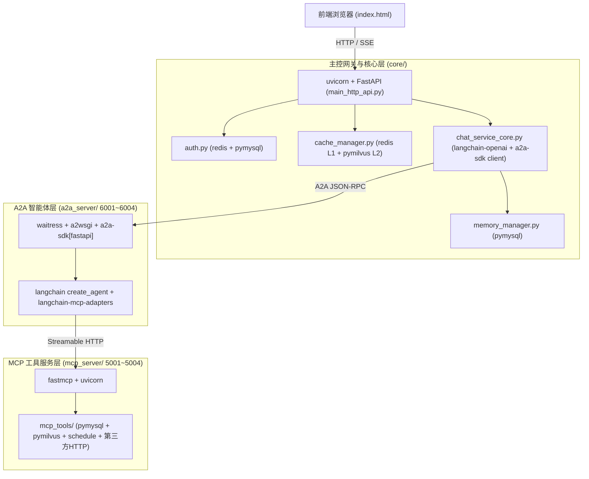

# `requirements.txt` 代码精讲：项目核心技术栈与依赖包全景解析

> **源文件位置**：`requirements.txt`  
> **所属模块**：根目录入口与工程配置层  
> **一句话定位**：定义 Voyage 智途分布式多智能体系统运行所需的 12 个核心 Python 第三方库及其精确锁定版本号。

---

## 一、文件定位与核心前置知识精讲

### 1.1 什么是 `requirements.txt`？为什么要精确锁定版本号（Pinning Versions）？
在 Python 工程特别是大模型（LLM）与智能体（Agent）应用开发中，开源生态迭代极快（如 `langchain`、`fastmcp`、`a2a-sdk` 几乎每周都在发新版，且不同小版本之间的类名、导入路径甚至协议字段经常发生破坏性变更 Breaking Changes）。

如果在 `requirements.txt` 中只写包名不写版本号（例如只写 `langchain`），那么今天能跑通的代码，下个月别人执行 `pip install -r requirements.txt` 时就会安装最新版，极大概率出现 `ImportError` 或属性找不到的问题。因此，生产级项目必须使用 `==` **精确锁定每一个核心依赖包的版本号**。

### 1.2 什么是包名后面的方括号 `a2a-sdk[fastapi]`？（Extras 可选扩展依赖）
在源码第 5 行你会看到一种特殊写法：
```text
a2a-sdk[fastapi]==1.1.2
```
- **概念解释**：方括号 `[fastapi]` 在 Python 打包规范中叫做 **Extras（可选特性扩展依赖）**。
- **为什么需要它？**  
  `a2a-sdk` 的基础包只包含最核心的数据结构（如 `AgentCard`），以便只需要做客户端调用的人不必安装庞大的 Web 服务器。而当我们需要用 `a2a-sdk` **搭建 A2A 服务端**（用到了 `A2AFastAPIApplication`）时，写上 `[fastapi]` 就会通知包管理器：“请不仅安装 `a2a-sdk` 本体，还要把它在服务端运行所需的 `fastapi`、`starlette`、`sse-starlette` 等附属依赖一并安装好！”

---

## 二、完整源码展示

不用打开原文件，以下为根目录 `requirements.txt` 的 100% 完整源码：

```text
langchain==1.3.10
langchain-mcp-adapters==0.3.2
langchain-openai==1.3.2
fastmcp==3.4.7
a2a-sdk[fastapi]==1.1.2
pymysql==1.2.0
pymilvus==2.6.15
a2wsgi==1.10.10
modelscope==1.37.1
uvicorn==0.49.0
redis==8.0.1
schedule==1.2.2
```

---

## 三、十二大核心依赖包逐行精讲与项目映射表

为了让读者一眼看懂“每个包是干什么的、在项目哪个文件里被谁调用”，我们按技术分层对这 12 行代码做深度拆解：

### 第一层：大模型与 Agent 编排层（第 1~3 行）

| 行号 | 依赖声明 | 核心职责原理 | 在本项目中的使用位置 |
| :--- | :--- | :--- | :--- |
| **1** | `langchain==1.3.10` | **大模型应用编排核心框架**。提供 `@tool` 工具装饰器、`HumanMessage`/`AIMessage`/`ToolMessage` 消息体系，以及 `create_agent`（底层基于 LangGraph 构建 ReAct 循环智能体）。 | `前置知识/2-Function Call/`、`前置知识/5-Agent智能体/`、`a2a_server/a2a_*.py`、`core/chat_service_core.py` |
| **2** | `langchain-mcp-adapters==0.3.2` | **LangChain 与 MCP 协议的桥接适配器**。核心提供 `MultiServerMCPClient`，能够连接一个或多个远端 MCP Server，自动拉取其暴露的工具并转换为 LangChain Agent 可直接调用的 Tool 对象。 | `前置知识/4-MCP协议/`、`前置知识/6-A2A协议/`、`a2a_server/a2a_*.py` |
| **3** | `langchain-openai==1.3.2` | **OpenAI 兼容接口客户端**。提供 `ChatOpenAI` 类。因为阿里云百炼（DashScope 通义千问 `qwen`）、DeepSeek 等国内外主流模型均提供 OpenAI 兼容的 `/v1/chat/completions` 接口，只需把 `base_url` 指向阿里云即可无缝调用通义千问。 | 所有涉及调用 LLM 的文件（`core/chat_service_core.py`、`a2a_server/`、`前置知识/`） |

### 第二层：分布式多智能体通信协议层（第 4~5 行）

| 行号 | 依赖声明 | 核心职责原理 | 在本项目中的使用位置 |
| :--- | :--- | :--- | :--- |
| **4** | `fastmcp==3.4.7` | **MCP (Model Context Protocol) 高效开发框架**。类似 FastAPI 的极简风格，只需通过 `FastMCP("服务名")` 和 `@mcp.tool()` / `mcp.add_tool()`，就能把普通 Python 函数一键暴露为支持 `stdio`、`sse` 或 `streamable-http` 的标准 MCP 工具服务器。 | `mcp_server/mcp_weather.py`、`mcp_ticket.py`、`mcp_trip.py`、`mcp_external.py` 及 `前置知识/4-MCP协议/` |
| **5** | `a2a-sdk[fastapi]==1.1.2` | **Google A2A (Agent-to-Agent) 官方协议 SDK**。提供智能体名片 `AgentCard`、技能声明 `AgentSkill`、任务执行器 `AgentExecutor`、请求处理器 `DefaultRequestHandler`、服务端 `A2AFastAPIApplication` 以及客户端 `A2ACardResolver` 与 `A2AClient`。 | `a2a_server/a2a_*.py`、`core/chat_service_core.py`、`前置知识/6-A2A协议/` |

### 第三层：数据存储与双层缓存层（第 6、7、11 行）

| 行号 | 依赖声明 | 核心职责原理 | 在本项目中的使用位置 |
| :--- | :--- | :--- | :--- |
| **6** | `pymysql==1.2.0` | **纯 Python 实现的 MySQL 数据库驱动**。用于执行结构化 SQL 查询（天气数据、机票/高铁/酒店/租车/旅游团业务数据、用户账号表、四维对话记忆持久化表）。 | `utils/mysql_manager.py`、`data_init/mysql_init.py`、`mcp_tools/weather_tools.py` |
| **7** | `pymilvus==2.6.15` | **Milvus 向量数据库官方 Python SDK**。支持稠密向量检索（语义相似度）、BM25 稀疏向量检索、混合检索（Hybrid Search + RRF 重排）。在本项目中承担两大重任：<br>1. `travel_rag` 集合：存储旅游攻略知识库（RAG）；<br>2. `query_cache` 集合：实现 L2 语义缓存（相似度 ≥ 0.92 即命中）。 | `utils/milvus_manager.py`、`core/cache_manager.py`、`data_init/milvus_init.py`、`mcp_server/mcp_external.py` |
| **11** | `redis==8.0.1` | **Redis 内存数据库客户端**。在本项目中承担两大核心职责：<br>1. **L1 精确缓存**：以 `user_id + 问题 MD5` 为 Key 毫秒级返回完全一致的提问结果及异步任务轮询结果；<br>2. **Token 会话存储**：存储用户登录后的 Bearer Token 并通过 TTL 控制自动过期。 | `core/cache_manager.py`、`core/auth.py` |

### 第四层：Web 服务器、协议转换与后台辅助层（第 8、9、10、12 行）

| 行号 | 依赖声明 | 核心职责原理 | 在本项目中的使用位置 |
| :--- | :--- | :--- | :--- |
| **8** | `a2wsgi==1.10.10` | **ASGI 到 WSGI 的协议转换桥接器**。提供 `ASGIMiddleware`，将 `A2AFastAPIApplication` 构建出的异步 ASGI 应用包装成传统 WSGI 接口，从而可以交给生产级多线程 WSGI 服务器 `waitress` 托管运行。 | `a2a_server/a2a_*.py`、`前置知识/6-A2A协议/` |
| **9** | `modelscope==1.37.1` | **阿里魔搭社区 (ModelScope) SDK**。提供模型下载、本地数据集加载或特定推理管道辅助能力。 | 环境预置依赖 |
| **10** | `uvicorn==0.49.0` | **基于 uvloop 的高性能异步 ASGI Web 服务器**。负责启动主网关 `main_http_api.py`（端口 8888）以及 `FastMCP` 的 HTTP 服务（端口 5001~5004）。 | `main_http_api.py`、`mcp_server/mcp_*.py` |
| **12** | `schedule==1.2.2` | **轻量级 Python 定时任务调度库**。语法极其直观（如 `schedule.every(1440).minutes.do(...)`），用于天气采集器后台定时拉取和风天气 15 天预报并更新至 MySQL。 | `mcp_tools/weather_tools.py` |

---

## 四、架构全景：这 12 个库是如何协同工作的？



---

## 五、自测思考题

### 思考题 1
为什么本项目同时用到了 `uvicorn` 和 `a2wsgi`（配合 `waitress`）两种服务器运行方式？
> **参考答案**：
> - 主网关 `main_http_api.py`（8888 端口）和四个 `mcp_server`（5001~5004 端口）原生作为异步 ASGI 服务直接由 **`uvicorn`** 启动；
> - 而四个 `a2a_server`（6001~6004 端口）为了演示如何在跨平台（尤其是 Windows 环境）下使用极其稳定的多线程生产级服务器 `waitress` 托管 ASGI 应用，采用了 **`a2wsgi.ASGIMiddleware`** 将 `A2AFastAPIApplication` 转换为 WSGI 应用后交由 `waitress.serve()` 启动。

### 思考题 2
如果只想单独测试 `mcp_tools/weather_tools.py` 的定时天气采集入库功能，至少需要用到 `requirements.txt` 中的哪几个库？
> **参考答案**：需要 `pymysql`（连接 MySQL 建库建表与写入天气数据）和 `schedule`（执行 `schedule.every(...).minutes.do(...)` 定时采集循环），以及 `requests` / `pyyaml`（作为上面大包的传递依赖已自动安装，用于请求和风天气 API 和读取 `config.yaml`）。
