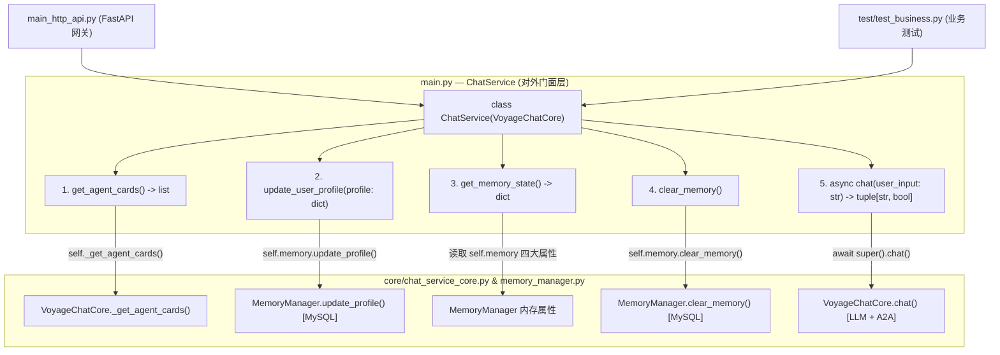

# `main.py` 代码精讲：对外服务门面层（Facade 模式）与类继承封装

> **源文件位置**：`main.py`  
> **所属模块**：根目录入口与工程配置层  
> **一句话定位**：继承核心大脑 `VoyageChatCore`，运用面向对象中的**门面模式（Facade Pattern）**，向 `main_http_api.py` 和测试脚本暴露最简洁、稳定的 5 个公开业务方法。

---

## 一、文件定位与核心前置知识精讲

### 1.1 为什么已经有了 `core/chat_service_core.py`，还要单独写一个 `main.py`？
很多初学者看到 `main.py` 只有 60 行，而 `core/chat_service_core.py` 有 1200 多行时，会疑惑：“为什么不直接让 `main_http_api.py` 导入 `VoyageChatCore`，而是要在中间隔一层 `ChatService(VoyageChatCore)`？”

这是大型工程中非常经典的 **门面模式（Facade Pattern）与内外职责隔离设计**：
1. **隐藏内部复杂性（封装私有方法）**：
   - 父类 `VoyageChatCore` 内部有十几个以下划线 `_` 开头的内部辅助方法（如 `_get_agent_cards`、`_analyze_intent`、`_decompose_and_route`、`_call_a2a_agent`、`_reflect_and_summarize`、`_extract_and_update_memory` 等）。
   - 外部调用者（如 FastAPI 路由层 `main_http_api.py` 或自动化测试 `test_business.py`）**根本不需要也不应该关心内部是怎么拆解意图或怎么调 A2A 的**。
2. **统一对外契约（5 大公开接口）**：
   - 子类 `ChatService` 只向外暴露清晰、稳定的 5 个核心动作：
     1. `get_agent_cards()`：查所有子代理名片；
     2. `update_user_profile(profile)`：更新用户画像偏好；
     3. `get_memory_state()`：查当前用户的四维记忆状态；
     4. `clear_memory()`：一键清空内存与 MySQL 中的全部记忆；
     5. `await chat(user_input)`：发起一轮对话。
   - 即使未来 `VoyageChatCore` 内部重构了意图识别算法，只要 `ChatService` 这 5 个方法的签名和返回值不变，上层 `main_http_api.py` 一行代码都不用改！

### 1.2 Python 面向对象核心语法回顾：子类不写 `__init__` 与 `super()` 调用
在本文件中用到了两个高频 Python 继承特性：
1. **子类不定义 `__init__` 方法时发生什么？**
   - `class ChatService(VoyageChatCore):` 内部没有写 `def __init__(self, ...):`。
   - 根据 Python 的方法解析顺序（MRO, Method Resolution Order），当你执行 `svc = ChatService("user_001")` 时，Python 在 `ChatService` 中找不到 `__init__`，会**自动调用父类 `VoyageChatCore.__init__(self, user_id="user_001")`**！
   - 因此，父类初始化时创建的 `self.user_id`、`self.memory`（`MemoryManager` 实例）、`self.messages`、`self.conversation_history` 等所有实例属性，`ChatService` 的实例 `svc` 全部自动拥有。
2. **`await super().chat(user_input)` 是什么意思？**
   - `ChatService` 定义了 `async def chat(self, user_input: str)`，与父类的 `chat` 方法同名。
   - 在子类方法内部通过 `super().chat(user_input)`，明确调用父类 `VoyageChatCore` 中实现的 `async def chat(...)` 核心对话流水线，并把父类返回的元组 `(response_text, cacheable_bool)` 原样返回给外部。

---

## 二、调用关系与架构位置图



---

## 三、完整源码与逐方法深度精讲

不用打开原文件，以下为 `main.py` 的 **100% 完整源码**（共 60 行）：

```python
"""
Voyage智途 - 对外服务层
继承 VoyageChatCore，仅封装对外调用入口，无底层业务逻辑
包含指定对外方法：
get_agent_cards
update_user_profile
get_memory_state
clear_memory
chat
"""
import asyncio
import json
from utils import logger
from core.chat_service_core import VoyageChatCore


class ChatService(VoyageChatCore):
    """对外服务入口，所有外部调用API集中存放"""
    # 无__init__初始化函数，继承父类初始化

    # 1. Agent卡片对外接口
    def get_agent_cards(self) -> list:
        """返回所有子代理名片"""
        return self._get_agent_cards()

    # 2. 用户偏好更新对外接口
    def update_user_profile(self, profile: dict):
        """更新用户偏好"""
        self.memory.update_profile(profile)
        logger.info(f"[user_id={self.user_id}] 用户偏好已更新: {profile}")

    # 3. 当前记忆状态对外接口
    def get_memory_state(self) -> dict:
        """返回当前记忆状态摘要"""
        return {
            "short_term_messages": [
                {
                    "role": "用户" if m["role"] == "user" else "助手",
                    "content": m["content"],
                    "timestamp": m["timestamp"],
                }
                for m in self.memory.short_term_messages[-5:]
            ],
            "user_profile": self.memory.user_profile,
            "current_task": self.memory.current_task,
            "entity_history": self.memory.entity_history[-10:],
        }

    # 4. 清空记忆对外接口
    def clear_memory(self):
        """清空内存+MySQL持久化全部记忆"""
        self.memory.clear_memory()
        self.messages.clear()
        self.conversation_history = ""

    # 5. 对话主入口对外接口
    async def chat(self, user_input: str) -> tuple[str, bool]:
        """对外标准对话入口"""
        return await super().chat(user_input)
```

---

### 逐段拆解与沙盘推演（Dry Run）

#### 1. 导入与类声明（第 11~20 行）
- `from utils import logger`：导入全局日志器，用于记录用户画像更新等关键操作日志。
- `from core.chat_service_core import VoyageChatCore`：导入核心对话引擎基类。
- `class ChatService(VoyageChatCore):`：声明 `ChatService` 继承自 `VoyageChatCore`。
  - 当外部执行 `svc = ChatService("zhangsan")` 时，底层自动执行 `VoyageChatCore.__init__(self, user_id="zhangsan")`：
    1. 初始化 LLM 客户端；
    2. 创建 `self.memory = MemoryManager(user_id="zhangsan")`，从 MySQL 加载张三的历史记忆；
    3. 初始化当前会话上下文列表 `self.messages` 和字符串 `self.conversation_history`。

#### 2. 方法一：`get_agent_cards(self) -> list`（第 21~24 行）
```python
    def get_agent_cards(self) -> list:
        """返回所有子代理名片"""
        return self._get_agent_cards()
```
- **作用**：转调父类的私有方法 `self._get_agent_cards()`，向 4 个 A2A 子服务（6001 天气、6002 票务、6003 行程、6004 外部数据）获取或读取已缓存的智能体名片信息。
- **被谁调用**：`main_http_api.py` 中的 `GET /api/agents` 接口，用于在前端网页右侧展示“当前在线的 A2A 子智能体及其技能列表”。

#### 3. 方法二：`update_user_profile(self, profile: dict)`（第 26~30 行）
```python
    def update_user_profile(self, profile: dict):
        """更新用户偏好"""
        self.memory.update_profile(profile)
        logger.info(f"[user_id={self.user_id}] 用户偏好已更新: {profile}")
```
- **作用**：接收一个字典 `profile`（例如 `{"budget": "5000元以内", "seat_preference": "靠窗", "food": "不吃辣"}`），调用 `self.memory.update_profile(profile)` 将其合并到用户的长期画像中，并同步写入 MySQL 的 `user_memory` 表。
- **被谁调用**：`main_http_api.py` 中的 `POST /api/memory/profile` 接口。

#### 4. 方法三：`get_memory_state(self) -> dict`（第 32~47 行）
```python
    def get_memory_state(self) -> dict:
        """返回当前记忆状态摘要"""
        return {
            "short_term_messages": [
                {
                    "role": "用户" if m["role"] == "user" else "助手",
                    "content": m["content"],
                    "timestamp": m["timestamp"],
                }
                for m in self.memory.short_term_messages[-5:]
            ],
            "user_profile": self.memory.user_profile,
            "current_task": self.memory.current_task,
            "entity_history": self.memory.entity_history[-10:],
        }
```
- **作用**：整理当前用户的**四维记忆快照**，返回给前端记忆可视化面板展示。
- **关键代码细节拆解**：
  1. **列表切片 `[-5:]` 与 `[-10:]`**：
     - `self.memory.short_term_messages[-5:]`：只截取**最近 5 条**短期对话消息（如果不足 5 条则返回全部），避免前端面板被过长的历史消息撑爆；
     - `self.memory.entity_history[-10:]`：只截取**最近 10 个**提取出的关键实体（如提起过的城市 `"成都"`、日期 `"2026-05-01"`）。
  2. **列表推导式与三元表达式转换角色名称**：
     - 底层存储的角色是英文 `"user"` 或 `"assistant"`；
     - `"role": "用户" if m["role"] == "user" else "助手"` 将其转换为中文 `"用户"` 和 `"助手"`，方便前端直接渲染展示。
- **沙盘推演返回值示例**：
  ```json
  {
    "short_term_messages": [
      {"role": "用户", "content": "帮我查一下明天北京的天气", "timestamp": "2026-11-24 13:20:00"},
      {"role": "助手", "content": "根据最新数据，北京明天的天气预报为晴，气温 2°C~12°C...", "timestamp": "2026-11-24 13:20:05"}
    ],
    "user_profile": {"home_city": "上海", "budget_level": "经济型"},
    "current_task": {"intent": "weather_query", "city": "北京", "date": "2026-11-25"},
    "entity_history": [{"type": "city", "value": "北京"}, {"type": "date", "value": "2026-11-25"}]
  }
  ```

#### 5. 方法四：`clear_memory(self)`（第 49~54 行）
```python
    def clear_memory(self):
        """清空内存+MySQL持久化全部记忆"""
        self.memory.clear_memory()
        self.messages.clear()
        self.conversation_history = ""
```
- **为什么清空记忆要做三件事？**
  1. `self.memory.clear_memory()`：清空 `MemoryManager` 中的四维记忆对象，并执行 SQL `DELETE` / 重置 MySQL 中的持久化记忆记录；
  2. `self.messages.clear()`：清空当前 `ChatService` 实例持有的 LangChain 消息列表；
  3. `self.conversation_history = ""`：清空当前实例拼接的对话历史文本。
  - 这三步确保了无论该 `ChatService` 实例是否被继续复用，其内存态和数据库持久化态都彻底归零。

#### 6. 方法五：`async def chat(self, user_input: str) -> tuple[str, bool]`（第 56~59 行）
```python
    async def chat(self, user_input: str) -> tuple[str, bool]:
        """对外标准对话入口"""
        return await super().chat(user_input)
```
- **作用**：异步调用父类 `VoyageChatCore.chat(user_input)`。
- **为什么返回值类型是 `tuple[str, bool]`（一个二元组）？**
  - 第一个元素 `str` (`response`)：给用户的最终自然语言回复文本；
  - 第二个元素 `bool` (`cacheable`)：**告诉网关层“本次回复是否允许写入 Redis/Milvus 缓存”**！
    - 例如：如果是普通的单轮天气查询且拿到了正常数据，`cacheable` 为 `True`；
    - 如果本次回复是“追问用户缺失参数（如：请问您哪天出发？）”，或者是预订下单操作、或者调用报错，`cacheable` 为 `False`，防止把追问或错误结果缓存起来坑害下一次提问！

---

## 四、自测思考题

### 思考题 1
在 `get_memory_state()` 中，`self.memory.short_term_messages[-5:]` 如果在用户刚注册、一条消息都没有（列表为空 `[]`）时执行，会报 `IndexError` 越界错误吗？
> **参考答案**：**不会**！在 Python 中，列表切片（Slicing，如 `lst[-5:]`）与单个索引访问（`lst[-5]`）不同：切片操作非常安全，当列表长度小于 5 甚至为空列表 `[]` 时，`[][-5:]` 只会安静地返回空列表 `[]`，绝不会抛出 `IndexError`。

### 思考题 2
为什么 `chat` 方法前面有 `async def`，而 `get_memory_state`、`update_user_profile`、`clear_memory` 都是普通的 `def` 同步方法？
> **参考答案**：因为 `chat` 方法内部需要发起异步网络 I/O（调用异步 A2A 客户端 `A2AClient.send_message` 以及大模型异步接口 `ainvoke`），因此必须声明为 `async def` 协程函数；而其余几个方法只涉及本地内存读取或基于同步驱动 `pymysql` 的操作，因此在 `ChatService` 中被定义为普通同步方法（在 `main_http_api.py` 的高并发接口中，可以配合 `asyncio.to_thread` 放入线程池执行）。
