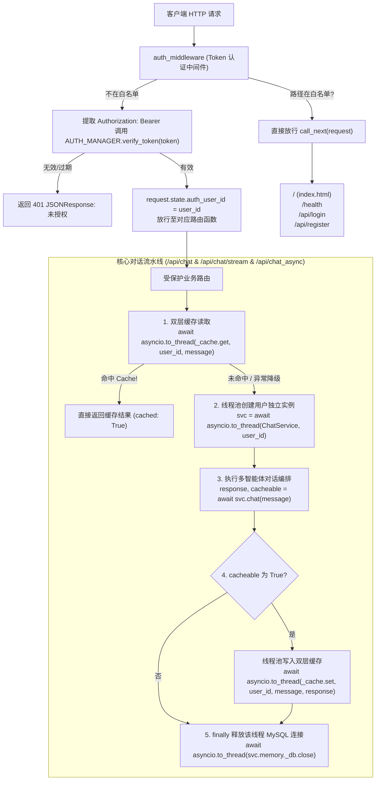

# `main_http_api.py` 代码精讲：FastAPI 网关服务器、三种对话模式与非阻塞并发架构

> **源文件位置**：`main_http_api.py`  
> **所属模块**：根目录入口与工程配置层（系统总网关，监听端口 `8888`）  
> **一句话定位**：整个 Voyage 智途系统的 HTTP 流量总入口，基于 FastAPI 构建，集成 Bearer Token 认证中间件、L1+L2 双层缓存拦截、线程池异步防阻塞调度（`asyncio.to_thread`），并同时提供**同步对话**、**SSE 流式对话**与**后台任务异步轮询对话**三种企业级交互接口。

---

## 一、文件定位与核心前置知识精讲

读懂 `main_http_api.py`，你就掌握了 Python 工业级 AI 后端网关的四大核心架构模式：

### 1.1 前置知识一：为什么在 FastAPI (`async def`) 里调同步数据库必须用 `asyncio.to_thread()`？
在源码第 141~143 行和第 286~288 行，作者写下了非常关键的工程注释：
> `Redis/Milvus/pymysql 全是同步阻塞调用，直接调用会卡住 uvicorn 事件循环。用 asyncio.to_thread() 把阻塞调用丢进线程池，事件循环保持响应。`

让我们彻底搞懂背后的原理：
1. **FastAPI + Uvicorn 的单线程事件循环（Event Loop）模型**：
   - Uvicorn 的主线程运行着一个异步事件循环（就像一个手脚极快的服务员，同时照看 100 桌客人）。
   - 如果在 `async def` 路由函数中使用的是异步库（遇到 `await` 就挂起让出 CPU），服务员就能在等待某桌客人点菜时去服务下一桌。
2. **如果在 `async def` 里直接调用同步阻塞函数会发生什么？**
   - 本项目的 `pymysql`（查 MySQL）、`redis`（查 Redis）、`pymilvus`（查 Milvus）以及 `requests`（调 Embedding API）都是**同步阻塞（Blocking I/O）**调用！
   - 如果直接在 `async def chat()` 里写 `_cache.get(...)`（内部要调 HTTP 算向量 + 查 Milvus，耗时约 200ms），由于没有 `await` 让出控制权，**整个 Uvicorn 主线程事件循环会被彻底卡死 200ms**！在这 200ms 内，其他所有用户的请求连进都进不来！
3. **`await asyncio.to_thread(func, *args)` 的救场原理**：
   - `asyncio.to_thread` 会把同步阻塞函数 `func(*args)` 扔进 Python 后台的 **ThreadPoolExecutor（工作线程池）** 的子线程里去跑，同时立刻把一个可等待对象返回给事件循环主线程。
   - 这样，子线程在后台等待 MySQL/Redis/Milvus 响应时，主线程事件循环依然生龙活虎地并发接收成百上千个新请求！

```text
【错误写法：直接调用同步阻塞函数】
Uvicorn 主线程: [请求A: _cache.get 阻塞卡死 200ms] -> [请求B 被迫排队等待...]

【正确写法：await asyncio.to_thread(_cache.get, ...)】
Uvicorn 主线程: [请求A 派发线程池] -> [立即处理请求B] -> [立即处理请求C] -> [收到A完成通知返回]
后台工作线程 1:       └──> [在子线程执行 _cache.get 200ms] ──┘
```

### 1.2 前置知识二：三种对话接口模式对比（同步 vs SSE 流式 vs 异步轮询）
本项目在 `main_http_api.py` 中一口气实现了大模型后端最经典的三种通信模式：

| 模式名称 | 路由端点 | 核心技术机制 | 适用场景与优缺点 |
| :--- | :--- | :--- | :--- |
| **1. 同步对话** | `POST /api/chat` | 客户端发请求后一直等待，后端算完完整回复后一次性返回 JSON。 | 实现最简单；但如果多 Agent 调用耗时 15 秒，用户盯着空白屏幕干等 15 秒体验较差，且容易触发网关超时。 |
| **2. SSE 流式对话** | `POST /api/chat/stream` | `StreamingResponse` + 异步生成器 `yield "data: ...\n\n"` (`text/event-stream`)。 | **ChatGPT 同款打字机效果**！建立一条 HTTP 长连接，后端每隔 0.03~0.05 秒吐出一个字，最后吐出 `data: [DONE]\n\n` 结束。 |
| **3. 异步提交 + 轮询** | `POST /api/chat_async` + `POST /api/chat_result` | `asyncio.create_task(_run())` 在后台执行，立刻返回 `processing`；客户端每隔 1~2 秒调 `/api/chat_result` 查 Redis。 | 适合**超长耗时任务**或**弱网移动端**（不怕中途网络抖动断开连接），且天然自带**防重复提交锁（`_tasks` 字典）**！ |

> **注：什么是本项目的“假流式（伪流式）”？**  
> 在 `sse_generator`（第 176 行）中，后端先通过 `await svc.chat(message)` 拿到了多智能体协同汇总后的完整字符串 `full_response`，然后用 `for char in full_response:` 配合 `await asyncio.sleep(0.03)` 逐字 `yield` 给前端。为什么这样做？因为多智能体架构下，子 Agent 的原始输出还要经过主控 Agent 的“反思校验与汇总重写”，只有汇总完成后才能确定最终呈现给用户的文字，逐字推送既保证了多智能体反思的准确性，又给前端提供了流畅的 SSE 打字机交互体验。

### 1.3 前置知识三：FastAPI HTTP 中间件 (`@app.middleware("http")`)
中间件（Middleware）就像是办公大楼一楼的**安检闸机**：
- 任何发往 FastAPI 的 HTTP 请求，在到达具体的 `@app.get` / `@app.post` 路由函数之前，**都必须先经过 `auth_middleware`**；
- 如果请求路径在白名单 `_AUTH_WHITELIST` 中（如首页 `/`、登录 `/api/login`、注册 `/api/register`、健康检查 `/health`），闸机直接放行（`await call_next(request)`）；
- 否则，闸机检查请求头 `Authorization: Bearer <token>`，校验不通过直接拦截并返回 `HTTP 401 Unauthorized`！

---

## 二、网关全景架构与请求生命周期图



---

## 三、完整源码与分模块深度精讲

不用打开原文件，以下将 `main_http_api.py` 的 **363 行完整源码** 按 6 个逻辑模块 100% 完整贴出并逐段拆解。

### 模块 1：导入、全局双层缓存初始化与 Token 认证中间件（第 1~90 行）

#### 完整源码
```python
"""
需求：SmartVoyage FastAPI后端服务器，提供REST API接口
多用户隔离：每个请求携带 user_id，每次创建独立 ChatService 实例

核心 API：
  /api/chat           → 同步对话（带双层缓存）
  /api/chat/stream     → SSE 流式对话（假流式，逐字 yield）
  /api/chat_async      → 异步提交 + 轮询结果
  /api/chat_result     → 查询异步任务结果
  /api/memory          → 查看用户记忆状态
  /api/memory/clear    → 清空用户记忆
  /api/memory/profile  → 更新用户偏好
  /api/agents          → 查看所有子代理名片
  /health              → 健康检查
"""
import os
import json
import asyncio
from fastapi import FastAPI
from fastapi.responses import FileResponse
from fastapi.responses import StreamingResponse
from pydantic import BaseModel

from utils import CONFIG
from utils import logger
from main import ChatService
from core.cache_manager import CacheManager
from core.auth import AUTH_MANAGER
from core.tool_init import init_tools
from core.tool_registry import TOOL_REGISTRY
# 启动时即创建全局缓存实例（Redis + Milvus 双层缓存）
_cache = CacheManager()

app = FastAPI(title="SmartVoyage API", description="基于A2A的旅行智能助手")

# ===================== Token 认证中间件 =====================
# 白名单：这些接口不需要 Token 认证
_AUTH_WHITELIST = {"/", "/health", "/api/login", "/api/register", "/docs", "/openapi.json", "/redoc"}


@app.middleware("http")
async def auth_middleware(request, call_next):
    """Token 认证中间件
    
    迭代改进新增：借鉴新版 V8.2-beta 的认证机制
    - 白名单接口（/、/health、/api/login）不需要认证
    - 其余接口需要 Authorization header 携带有效 Token
    """
    path = request.url.path
    
    # 白名单放行
    if path in _AUTH_WHITELIST:
        return await call_next(request)
    
    # 从 header 提取 Token
    token = request.headers.get("Authorization", "")
    if token.startswith("Bearer "):
        token = token[7:]  # 去掉 "Bearer " 前缀
    
    # 校验 Token
    is_valid, user_id = AUTH_MANAGER.verify_token(token)
    if not is_valid:
        from fastapi.responses import JSONResponse
        return JSONResponse(
            status_code=401,
            content={"status": "error", "message": "未授权，请先登录获取 Token"}
        )
    
    # Token 有效，将 user_id 注入 request state（后续接口可用）
    request.state.auth_user_id = user_id
    return await call_next(request)


class LoginRequest(BaseModel):
    user_id: str
    password: str

class RegisterRequest(BaseModel):
    user_id: str
    password: str
    nickname: str = ""

class ChatRequest(BaseModel):
    user_id: str
    message: str

class ProfileRequest(BaseModel):
    user_id: str
    profile: dict
```

#### 逐行精讲：
1. **`_cache = CacheManager()`（第 32 行）**：
   - 在模块加载时就创建了全局唯一的 `CacheManager` 实例（连接 Redis L1 精确缓存和 Milvus L2 语义缓存）。所有请求共享同一个 `_cache` 管理器，但缓存 Key 内部带有 `user_id` 隔离。
2. **`_AUTH_WHITELIST` 集合（第 38 行）**：
   - 使用 Python `set` 集合（哈希表查找时间复杂度为 `O(1)`）存放免登录路径。
   - 除了 `/`、`/health`、`/api/login`、`/api/register` 外，还贴心地放行了 FastAPI 自动生成的接口文档路径 `/docs`（Swagger UI）、`/openapi.json` 和 `/redoc`。
3. **`if token.startswith("Bearer "): token = token[7:]`（第 57~58 行）**：
   - 遵循 HTTP 标准 Bearer 认证规范，前端传来的请求头格式为 `Authorization: Bearer a1b2c3d4...`。
   - `"Bearer "` 恰好是 7 个字符（6 个字母 + 1 个空格），因此切片 `token[7:]` 即可精准截取纯 Token 字符串。
4. **4 个 Pydantic 请求体模型（第 74~89 行）**：
   - `LoginRequest`、`RegisterRequest`、`ChatRequest`、`ProfileRequest` 均继承自 `pydantic.BaseModel`。
   - FastAPI 会自动利用它们解析前端发来的 JSON 请求体并做类型校验（例如 `RegisterRequest` 中 `nickname: str = ""` 表示昵称选填，默认为空字符串；而 `user_id` 和 `password` 必填，缺失则自动返回 422 参数错误）。

---

### 模块 2：前端页面托管与用户认证接口（第 91~134 行）

#### 完整源码
```python
# 创建静态文件目录
os.makedirs("./static", exist_ok=True)
# 前后端不分离：前端(页面)通过后端返回给浏览器（前端没有自己的服务器）
# 前后端分离：前端（页面）通过自己服务器返回给浏览器

@app.get("/")
async def index():
    """返回前端页面"""
    return FileResponse("static/index.html")


# ===================== Token 认证接口 =====================
@app.post("/api/login")
async def login(request: LoginRequest):
    """登录接口 —— 获取 Token"""
    token = AUTH_MANAGER.login(request.user_id, request.password)
    if token:
        return {"status": "success", "token": token, "user_id": request.user_id}
    return {"status": "error", "message": "登录失败，请检查用户名和密码"}


@app.post("/api/register")
async def register(request: RegisterRequest):
    """注册接口 —— 创建新用户"""
    ok, msg = AUTH_MANAGER.register(request.user_id, request.password, request.nickname)
    if ok:
        return {"status": "success", "message": msg}

    return {"status": "error", "message": msg}


@app.post("/api/logout")
async def logout(request: ChatRequest):
    """注销接口 —— 销毁 Token
    
    注意：前端需要在 logout 时把当前 Token 传过来
    """
    token = request.headers.get("Authorization", "")
    if token.startswith("Bearer "):
        token = token[7:]
    AUTH_MANAGER.logout(token)
    return {"status": "success", "message": "已注销"}
# ===================== Token 认证接口👆 =====================
```

#### 逐段精讲：
1. **`GET /` 返回 `FileResponse("static/index.html")`**：
   - 用户在浏览器访问 `http://127.0.0.1:8888/` 时，FastAPI 直接把 `static/index.html` 单页应用返回给浏览器，无需额外部署 Node.js 前端服务器即可开箱即用。
2. **`POST /api/login` 与 `POST /api/register`**：
   - 调用 `core/auth.py` 中的 `AUTH_MANAGER` 完成 MySQL 用户密码校验/注册，登录成功后在 Redis 中生成有效 Token 并返回给前端存入 `localStorage`。
3. **读代码留意点（第 123 行 `logout` 接口的一处隐藏细节）**：
   - 请看第 123 行：`async def logout(request: ChatRequest):`，然后在第 128 行写了 `token = request.headers.get("Authorization", "")`。
   - **这里其实有一个小 Bug**：参数 `request` 的类型被声明为了 Pydantic 模型 `ChatRequest(BaseModel)`，而不是 FastAPI 的 `fastapi.Request` 对象！如果真调用 `/api/logout` 并传入 `{"user_id": "...", "message": "..."}`，`ChatRequest` 对象是没有 `.headers` 属性的，会报 `AttributeError: 'ChatRequest' object has no attribute 'headers'`（前端 `index.html` 目前退出登录是直接清除本地 `localStorage` 中的 token，没有调用后端的 `/api/logout`，所以平时不会触发这个报错）。如果要在后端修复它，只需把参数改为 `request: fastapi.Request` 即可。

---

### 模块 3：同步对话接口 `/api/chat` 与 SSE 流式对话接口 `/api/chat/stream`（第 135~222 行）

#### 完整源码
```python
@app.post("/api/chat")
async def chat(request: ChatRequest):
    """
    同步对话接口
    流程：Cache 命中 → 直接返回 | Cache 未命中 → ChatService → 双写缓存 → 返回

    Redis/Milvus/pymysql 全是同步阻塞调用，直接调用会卡住 uvicorn 事件循环。
        用 asyncio.to_thread() 把阻塞调用丢进线程池，事件循环保持响应。
    """
    # ── 1. 双层缓存检查（丢线程池 + 容错降级）──
    try:
        cached = await asyncio.to_thread(
            _cache.get,
            request.user_id, request.message
        )
    except Exception as e:
        logger.warning("缓存读取失败，降级直连: %s", e)
        cached = None
    if cached:
        return {"status": "success", "message": cached, "cached": True}

    # ── 2. 缓存未命中，创建 ChatService（构造含 yaml读取+MySQL记忆加载）──
    svc = await asyncio.to_thread(ChatService, request.user_id)
    try:
        response, cacheable = await svc.chat(request.message)

        # ── 3. 写入双层缓存（丢线程池 + 容错降级）──
        if cacheable:
            try:
                await asyncio.to_thread(
                    _cache.set,
                    request.user_id, request.message, response
                )
            except Exception as e:
                logger.warning("缓存写入失败: %s", e)
    finally:
        await asyncio.to_thread(svc.memory._db.close)  # 释放 MySQL 连接

    return {"status": "success", "message": response}


async def sse_generator(user_id: str, message: str):
    """
    SSE 流式生成器
    - 缓存命中：逐字 yield 缓存内容（模拟打字机效果）
    - 缓存未命中：调用 chat() 拿完整结果 → 逐字 yield → 写入缓存
    """
    # ── 1. 尝试读取双层缓存（丢线程池 + 容错降级）──
    try:
        # 阻塞调用丢线程池。
        cached_response = await asyncio.to_thread(_cache.get, user_id, message)
    except Exception:
        cached_response = None
    if cached_response:
        for char in cached_response:
            yield f"data: {json.dumps({'chunk': char}, ensure_ascii=False)}\n\n"
            await asyncio.sleep(0.05)
        yield "data: [DONE]\n\n"
        return

    # ── 2. 缓存未命中，调用 chat 拿完整结果，逐字推送模拟流式 ──
    svc = await asyncio.to_thread(ChatService, user_id)
    try:
        full_response, cacheable = await svc.chat(message)
        for char in full_response:
            yield f"data: {json.dumps({'chunk': char}, ensure_ascii=False)}\n\n"
            await asyncio.sleep(0.03)

        # ── 3. 流式结束后，写入双层缓存 ──
        if cacheable:
            try:
                await asyncio.to_thread(_cache.set, user_id, message, full_response)
            except Exception:
                pass
    finally:
        await asyncio.to_thread(svc.memory._db.close)  # 释放 MySQL 连接

    yield "data: [DONE]\n\n"


@app.post("/api/chat/stream")
async def chat_stream(request: ChatRequest):
    """发送消息，流式获取回复（SSE）"""
    return StreamingResponse(
        sse_generator(request.user_id, request.message),
        media_type="text/event-stream"
    )
```

#### 深度拆解与沙盘推演：
1. **高可用容错降级设计（Graceful Degradation）**：
   - 看第 145~152 行：读取缓存被包裹在 `try ... except Exception as e:` 中。如果此时 Redis 或 Milvus 突然宕机了，系统**绝不会直接崩溃报错 500**，而是打印一条 `warning` 日志，令 `cached = None`，自动降级走后面的 `ChatService` 实时对话！写入缓存同理。这就是生产级系统的“缓存雪崩/宕机防卫”。
2. **多用户会话隔离机制**：
   - 为什么不在全局只创建一个 `svc = ChatService()`，而是每次请求都执行 `svc = await asyncio.to_thread(ChatService, request.user_id)`？
   - 因为 `ChatService` 实例内部持有当前用户的 `self.user_id`、`self.memory`、`self.messages`。如果多用户共用一个全局 `svc`，张三问的“去成都的机票”就会串到李四的记忆里！每次请求按 `user_id` 创建独立实例，保证了多用户并发时 100% 的状态隔离。
3. **SSE 协议帧格式拆解（为什么必须是 `data: ...\n\n`？）**：
   - W3C 的 Server-Sent Events (SSE) 标准规定：服务器推送给浏览器的每一条事件流消息，必须以 `data: ` 开头，以**两个连续换行符 `\n\n`** 结尾！
   - 假设计算出的回复是 `"晴天"`，那么 `sse_generator` 会依次 `yield` 三帧数据：
     ```text
     第 1 帧: data: {"chunk": "晴"}\n\n
     (等待 0.03 秒)
     第 2 帧: data: {"chunk": "天"}\n\n
     (等待 0.03 秒)
     第 3 帧: data: [DONE]\n\n
     ```
   - 为什么要把单个字符 `char` 包装进 `json.dumps({'chunk': char}, ensure_ascii=False)`？
     - 因为如果回复中包含**换行符 `\n`**，直接裸发 `data: \n\n\n` 会破坏 SSE 协议的双换行分隔符结构！包装成 JSON 后，换行符会被安全转义为 `{"chunk": "\n"}`，前端 `JSON.parse` 后就能完美还原 Markdown 换行与表格格式！

---

### 模块 4：用户记忆管理与子代理名片接口（第 224~253 行）

#### 完整源码
```python
@app.get("/api/memory")
async def get_memory(user_id: str):
    """获取指定用户的记忆状态"""
    svc = ChatService(user_id)
    return {"status": "success", "data": svc.get_memory_state()}


@app.post("/api/memory/clear")
async def clear_memory(user_id: str):
    """清空指定用户的记忆 + 双层缓存"""
    svc = ChatService(user_id)
    svc.clear_memory()
    _cache.flush_user(user_id)  # 👈 连带清空该用户的双层缓存
    return {"status": "success", "message": "记忆与缓存已清空"}


@app.post("/api/memory/profile")
async def update_profile(request: ProfileRequest):
    """更新指定用户的偏好"""
    svc = ChatService(request.user_id)
    svc.update_user_profile(request.profile)
    return {"status": "success", "message": "用户偏好已更新"}


@app.get("/api/agents")
async def get_agents():
    """查看所有子代理名片 — 无用户维度，使用 system 身份"""
    svc = ChatService(user_id="system")
    return {"status": "success", "data": svc.get_agent_cards()}
```

#### 深度精讲：
- **为什么 `POST /api/memory/clear` 不仅要调 `svc.clear_memory()`，还要调 `_cache.flush_user(user_id)`？**
  - 假设用户之前问过一个问题，答案已经被缓存在 Redis (L1) 和 Milvus `query_cache` (L2) 中。
  - 当用户点击前端的“清空记忆”按钮时，他期望系统彻底忘掉之前的一切重新开始计算。如果只清了 MySQL 记忆而不清双层缓存，用户再问同样的问题还是会直接命中旧缓存！因此必须连带调用 `_cache.flush_user(user_id)` 删除该用户在 Redis 和 Milvus 中的所有缓存条目。

---

### 模块 5：异步任务提交与轮询接口 `/api/chat_async` & `/api/chat_result`（第 255~317 行）

#### 完整源码
```python
# 后台异步任务跟踪：redis_key → asyncio.Task
# 用于避免同一请求重复提交后台任务
_tasks: dict[str, asyncio.Task] = {}

@app.post("/api/chat_async")
async def chat_async(request: ChatRequest):
    """
    异步提交任务
    - 缓存命中 → 直接返回结果
    - 已有进行中任务 → 返回 redis_key 让前端轮询
    - 无缓存无任务 → 创建后台 Task 执行，返回 redis_key
    """
    # ── 1. 双层缓存检查（丢线程池）──
    try:
        cached = await asyncio.to_thread(_cache.get, request.user_id, request.message)
    except Exception:
        cached = None
    if cached:
        return {"status": "completed", "message": cached, "cached": True}

    # ── 2. 构造唯一标识 key ──
    redis_key = CacheManager._k(request.user_id, request.message)

    # ── 3. 已有进行中的任务则直接返回 ──
    # _tasks[redis_key].done() 判断asyncio.Task任务是否完成
    if redis_key in _tasks and not _tasks[redis_key].done():
        return {"status": "processing", "redis_key": redis_key}

    # ── 4. 启动后台任务：chat → 写缓存 ──
    async def _run():
        """asyncio.Task后台任务：chat → 写缓存"""
        # 虽然是在后台运行，但它仍然运行在事件循环线程上
        # 后台 asyncio.Task 内部仍有阻塞 DB/Redis/Milvus 调用，会卡事件循环。
        # 用 asyncio.to_thread() 把阻塞调用丢线程池，与其他请求并行。
        svc = await asyncio.to_thread(ChatService, request.user_id)
        try:
            response, cacheable = await svc.chat(request.message)
            if cacheable:
                try:
                    await asyncio.to_thread(_cache.set, request.user_id, request.message, response)
                except Exception:
                    pass
        except Exception as e:
            logger.error("[user_id=%s] 异步任务异常: %s", request.user_id, e)
            _cache.set(request.user_id, request.message, 'error')
        finally:
            await asyncio.to_thread(svc.memory._db.close)  # 释放 MySQL 连接
            # _tasks.pop()不需要to_thread，纯内存操作 纳秒级完成 不会阻塞
            _tasks.pop(redis_key, None)

    # 创建并启动后台任务
    _tasks[redis_key] = asyncio.create_task(_run())
    return {"status": "processing", "redis_key": redis_key}


@app.post("/api/chat_result")
async def chat_result(request: ChatRequest):
    """轮询异步任务结果 — 查询 Redis 精确缓存"""
    result = _cache.exact_get(request.user_id, request.message)
    if result:
        return {"status": "completed", "message": result}
    return {"status": "processing"}
```

#### 深度拆解与沙盘推演：
这套“异步提交 + 轮询”机制的设计非常精妙，用 **Redis 精确缓存充当了异步任务的结果暂存箱**！我们来推演一次完整的时间线：
1. **T = 0.0 秒（用户提交任务）**：
   - 客户端请求 `POST /api/chat_async`，参数 `{"user_id": "u1", "message": "推荐成都3日游"}`。
   - 步骤 1：查双层缓存，未命中。
   - 步骤 2：计算唯一键 `redis_key = CacheManager._k("u1", "推荐成都3日游")`（形如 `"voyage:cache:u1:e8a9f..."`）。
   - 步骤 3：检查内存字典 `_tasks`，发现当前没有正在跑的相同任务。
   - 步骤 4：通过 `asyncio.create_task(_run())` 把 `_run()` 协程挂到后台事件循环上执行，**不 `await` 它**，而是把 Task 引用存入 `_tasks[redis_key]`，并在 **几毫秒内立刻返回**：
     ```json
     {"status": "processing", "redis_key": "voyage:cache:u1:e8a9f..."}
     ```
2. **T = 0.5 秒（用户手抖又点了一次发送，重复提交）**：
   - 相同的 `redis_key` 再次进入 `chat_async`。
   - 走到第 280 行：`if redis_key in _tasks and not _tasks[redis_key].done():` 成立！
   - 后端**不会重复启动第二个大模型任务**（省钱且防并发写冲突），直接返回 `{"status": "processing", "redis_key": ...}`。
3. **T = 2.0 秒（客户端第 1 次轮询 `/api/chat_result`）**：
   - 后台 `_run()` 还在调 A2A 智能体，尚未写缓存。
   - `_cache.exact_get("u1", "推荐成都3日游")` 查 Redis 返回 `None`。
   - `/api/chat_result` 返回 `{"status": "processing"}`。
4. **T = 5.0 秒（后台任务执行完毕）**：
   - `_run()` 拿到回复 `response`，调用 `_cache.set("u1", "推荐成都3日游", response)` 将结果写入 Redis；
   - 在 `finally` 块中，关闭 MySQL 连接，并执行 `_tasks.pop(redis_key, None)` 把已完成的任务从 `_tasks` 字典中移除（防止内存泄漏）。
5. **T = 6.0 秒（客户端第 3 次轮询 `/api/chat_result`）**：
   - `_cache.exact_get("u1", "推荐成都3日游")` 从 Redis 中查到了刚才写入的 `response`！
   - 返回 `{"status": "completed", "message": "为您规划成都3日游行程如下..."}`，轮询结束！

> **代码走读思考点（第 292 行）**：  
> 注意在 `_run()` 的第 292 行，只有 `if cacheable:` 为 `True` 时才会执行 `_cache.set(...)`。如果某次异步对话返回的 `cacheable` 为 `False`（例如触发了追问逻辑，不允许写入缓存），那么结果就不会写入 Redis，客户端轮询 `/api/chat_result` 时 `_cache.exact_get` 会一直返回 `None`（一直处于 `processing` 状态直到前端轮询超时）。这是异步轮询复用缓存通道时的一个边界注意点。

---

### 模块 6：健康检查、可插拔工具发现接口与服务启动入口（第 319~363 行）

#### 完整源码
```python
@app.get("/health")
async def health():
    return {"status": "healthy"}


@app.get("/api/tools")
async def get_tools(domain: str = None):
    """查看所有已注册的工具（可按业务域过滤）
    
    迭代改进新增：可插拔架构的工具发现接口
    """
    tools = TOOL_REGISTRY.discover(domain)
    return {
        "status": "success",
        "total": len(tools),
        "tools": [
            {
                "name": t.name,
                "description": t.description,
                "domain": t.domain,
                "enabled": t.enabled,
            }
            for t in tools
        ],
    }


@app.on_event("startup")
async def startup_event():
    """启动时初始化工具注册中心"""
    init_tools()
    logger.info(f"工具注册中心初始化完成: {TOOL_REGISTRY}")


if __name__ == "__main__":
    import uvicorn

    uvicorn.run(
        app,
        host=CONFIG.SERVER_HOST,
        port=CONFIG.SERVER_PORT,
    )

    # python main_http_api.py
    # python -m uvicorn main_http_api:app --host 0.0.0.0 --port 8888 --workers 2
```

#### 逐段精讲：
1. **`@app.on_event("startup")` 启动钩子（第 346~350 行）**：
   - 当 Uvicorn 启动 FastAPI 应用时，会自动触发 `startup_event()`。
   - 它调用 `core/tool_init.py` 中的 `init_tools()`，根据 `config.yaml` 中的 `tools` 开关配置，把所有启用的业务函数包装为 `FunctionTool` 并注册进全局 `TOOL_REGISTRY` 单例中。
2. **`GET /api/tools?domain=transport`（第 324~343 行）**：
   - 支持可选的查询参数 `domain`（如 `/api/tools` 查全部，或 `/api/tools?domain=local_life` 只查本地生活类工具）。
   - 调用 `TOOL_REGISTRY.discover(domain)` 返回已注册工具的元信息列表。
3. **两种启动方式对比（第 353~363 行）**：
   - 开发单进程模式：`python main_http_api.py`（读取 `config.yaml` 中的 `127.0.0.1:8888`）；
   - 生产多进程模式：`python -m uvicorn main_http_api:app --host 0.0.0.0 --port 8888 --workers 2`（开启 2 个 Worker 进程充分利用多核 CPU）。

---

## 四、自测思考题

### 思考题 1
在 `/api/chat` 的 `finally` 块中，有一行 `await asyncio.to_thread(svc.memory._db.close)`，表面上看它是在线程池的子线程里关闭连接，而 `MySQLManager` 使用的是 `threading.local()`（每个线程只管自己的连接）。这行代码真能关掉 `svc` 刚才创建时打开的那个线程的 MySQL 连接吗？
> **参考答案**：这是一个非常深刻的并发细节！
> - `svc = await asyncio.to_thread(ChatService, request.user_id)` 是在线程池的某个线程（假设是 `Thread-1`）里初始化并查询了 MySQL；
> - 而 `MySQLManager.fetch_all` / `execute` 方法在设计时，默认参数是 `close_conn=True`，即**每次执行完单条 SQL 的 `finally` 块里就已经主动调用 `self.close()` 关闭了当前线程的连接**！
> - 至于外层 `main_http_api.py` 的 `await asyncio.to_thread(svc.memory._db.close)`，如果被分配到了 `Thread-2`，它关的其实是 `Thread-2` 上的局部连接。真正保证连接不泄漏的核心功臣，其实是 `utils/mysql_manager.py` 中每个数据库操作方法自带的 `finally: if close_conn: self.close()`。

### 思考题 2
为什么在 `sse_generator` 中，发送每个字符使用的是 `yield f"data: {json.dumps({'chunk': char}, ensure_ascii=False)}\n\n"`，而不是 `return`？
> **参考答案**：`return` 会立刻终止函数并一次性返回单个值；而在 Python 函数中使用 `yield` 会将该 `async def` 函数变成一个**异步生成器（Async Generator）**。每次执行到 `yield`，它会把当前的一帧 SSE 数据推送给 `StreamingResponse` 并通过网络发给浏览器，然后暂停在原地；等 `await asyncio.sleep(0.03)` 后继续循环 `yield` 下一个字符，从而实现源源不断的流式推送。
