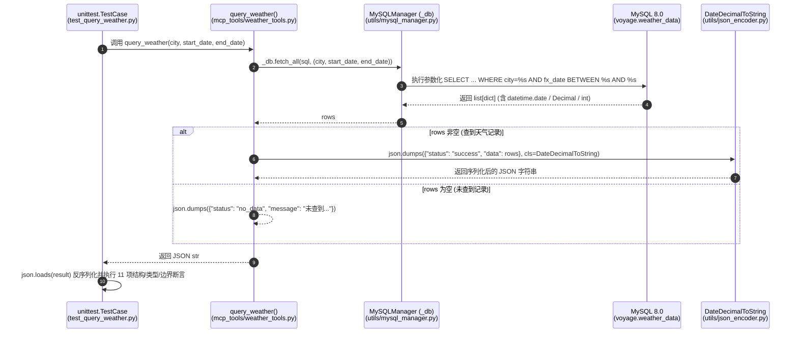

# `test/test_query_weather.py` 代码精讲学习手册 —— `query_weather` MCP 工具与 MySQL 集成测试

---

## 一、文件定位与核心前置知识精讲

### 1.1 文件在系统中的定位
`test/test_query_weather.py` 是针对 `mcp_tools/weather_tools.py` 中的核心工具函数 `query_weather(city, start_date, end_date)` 的**数据库集成测试（Database Integration Test）**。

与纯内存单元测试（`test_json_encoder.py`）不同，本文件在测试金字塔中位于 **L2 集成测试层**：它不经过 HTTP / A2A / FastMCP 网络传输，而是直接导入底层 Python 工具函数 `query_weather`，并连接真实的 **MySQL `voyage.weather_data` 表**，端到端验证：
1. **SQL 参数化查询逻辑**：`WHERE city=%s AND fx_date BETWEEN %s AND %s ORDER BY fx_date ASC` 是否正确执行。
2. **自定义 JSON 编码器集成效果**：MySQL 表中的 `fx_date`（`DATE` 类型）和温度/降水字段是否通过 `DateDecimalToString` 被正确序列化为 JSON 字符串。
3. **工具返回契约（Schema Contract）完备性**：无论查询命中数据（`status == "success"`）还是未命中数据（`status == "no_data"`），返回的 JSON 字符串结构、必填字段（`city`, `fx_date`, `temp_max`, `temp_min`, `text_day`）与提示信息（`message`）是否严格符合下游 A2A 天气智能体（`a2a_weather.py`）的解析预期。

---

### 1.2 核心前置知识 1：被测函数 `mcp_tools.weather_tools.query_weather` 的内部实现原理
为了透彻理解本测试文件的 11 个测试用例，我们先看被测函数 `query_weather` 在 `mcp_tools/weather_tools.py` 中的真实逻辑：
```python
def query_weather(city: str, start_date: str, end_date: str) -> str:
    sql = """
    SELECT city, fx_date, temp_max, temp_min, text_day, text_night,
           wind_dir_day, wind_scale_day, humidity, precip, uv_index, vis
    FROM weather_data
    WHERE city=%s AND fx_date BETWEEN %s AND %s
    ORDER BY fx_date ASC
    """
    rows = _db.fetch_all(sql, (city, start_date, end_date))
    if rows:
        return json.dumps({"status": "success", "data": rows},
                          cls=DateDecimalToString, ensure_ascii=False)
    return json.dumps({"status": "no_data",
                       "message": f"未查到 {city} 在 {start_date}~{end_date} 的天气数据"},
                      ensure_ascii=False)
```
我们可以清晰地看到 `query_weather` 的两条返回分支：
- **分支 A（查到记录 `rows` 非空）**：返回 `{"status": "success", "data": [ {12个天气字段}, ... ]}` 的 JSON 字符串。
- **分支 B（未查到记录 `rows` 为空列表）**：返回 `{"status": "no_data", "message": "未查到 ... 的天气数据"}` 的 JSON 字符串。

---

### 1.3 核心前置知识 2：数据库集成测试的“数据不确定性”与防御式断言设计
在编写依赖真实数据库的集成测试时，最大的挑战是：**数据库里的天气数据是随时间动态变化的**（例如 `weather-collector` 定时任务每天采集的是“今天及未来几天”的天气，或者开发者只运行了 `mysql_init.py` 写入了特定种子日期的数据）。
如果测试代码写死断言 `assert data["status"] == "success"`，那么当数据库里恰好没有今天北京的天气数据时，测试就会误报失败（False Negative）。

`test/test_query_weather.py` 展示了非常老练的**防御式集成测试设计模式**：
1. **针对必然无数据的边界输入（确定性断言）**：
   - 查询不存在的城市 `"不存在的城市XYZ"`（`test_query_weather_unknown_city_no_data`）或远古日期 `"1900-01-01"`（`test_query_weather_empty_result_for_ancient_date`）。
   - 此时数据库中**绝对不可能有数据**，因此使用强断言：`self.assertEqual(data["status"], "no_data")`。
2. **针对可能有数据也可能无数据的真实城市查询（条件式契约断言）**：
   - 查询 `"北京"` 在 `today`（今天）或 `"2020-01-01"~"2020-01-05"` 的天气。
   - 第一层断言状态合法性：`self.assertIn(data["status"], ("success", "no_data"))`（只要不抛异常、不返回 `"error"` 即说明 SQL 执行正常）。
   - 第二层条件契约断言：`if data["status"] == "success" and data["data"]:` —— **一旦命中数据**，则严格校验 `data` 必须是 `list`、列表长度不超过日期跨度、每条记录必须包含 `["city", "fx_date", "temp_max", "temp_min", "text_day"]` 五大核心字段，且 `fx_date` 已转为 `str`、`temp_max` 已转为 `(int, float)`！

---

## 二、架构图与执行流程图

### 2.1 `test_query_weather.py` 集成测试调用链路图（Mermaid）


### 2.2 11 个测试用例的维度拆解图（ASCII）
```
TestQueryWeatherIntegration (11 个集成测试用例)
 │
 ├── [维度 1：基础返回格式与顶层契约]
 │    ├── 1. test_query_weather_returns_json_string       : 返回值是 str 且能被 json.loads 解析为 dict
 │    └── 2. test_query_weather_status_field              : 顶层字典必含 "status" 键
 │
 ├── [维度 2：命中数据分支 (status == "success") 契约验证]
 │    ├── 3. test_query_weather_known_city_has_data       : 查"北京"今天天气，status 属于 ("success", "no_data")
 │    ├── 4. test_query_weather_success_has_data_field    : 若 success，必含 "data" 键且类型为 list
 │    ├── 7. test_query_weather_data_fields_structure     : 每行记录必含 city/fx_date/temp_max/temp_min/text_day
 │    └── 8. test_query_weather_date_types_serialized     : fx_date 必为 str，temp_max 必为 int 或 float
 │
 ├── [维度 3：未命中数据分支 (status == "no_data") 契约验证]
 │    ├── 5. test_query_weather_unknown_city_no_data      : 查"不存在的城市XYZ" -> status == "no_data"
 │    ├── 6. test_query_weather_no_data_has_message       : no_data 时必含非空字符串 "message"
 │    └── 9. test_query_weather_empty_result_for_ancient_date : 查"1900-01-01"远古日期 -> status == "no_data"
 │
 └── [维度 4：日期区间边界条件 (BETWEEN start AND end)]
      ├── 10. test_query_weather_multiple_day_range       : 查 5 天跨度 ("2020-01-01"~"2020-01-05") -> len(data) <= 5
      └── 11. test_query_weather_same_start_end           : 单日查询 (start_date == end_date) 正常执行
```

---

## 三、完整源码与逐段/逐行深度拆解

### 3.1 `test/test_query_weather.py` 100% 完整源码

```python
"""query_weather 集成测试 —— 测试 MySQL 天气数据查询
运行：python -m test.test_query_weather
前提：MySQL 在线 + 库表已建立（执行过 data_init/mysql_init.py）
"""
import sys
import os
import json
import unittest
from datetime import date

# 项目根目录加入 sys.path
PROJECT_ROOT = os.path.dirname(os.path.dirname(os.path.abspath(__file__)))
sys.path.insert(0, PROJECT_ROOT)

from mcp_tools.weather_tools import query_weather


class TestQueryWeatherIntegration(unittest.TestCase):
    """query_weather 集成测试（依赖 MySQL 和测试数据）"""

    def test_query_weather_returns_json_string(self):
        """query_weather 返回 JSON 字符串"""
        result = query_weather("北京", "2000-01-01", "2000-01-02")
        self.assertIsInstance(result, str)
        # 可正常解析为字典
        data = json.loads(result)
        self.assertIsInstance(data, dict)

    def test_query_weather_status_field(self):
        """返回 JSON 必须包含 status 字段"""
        result = query_weather("北京", "2000-01-01", "2000-01-02")
        data = json.loads(result)
        self.assertIn("status", data)

    def test_query_weather_known_city_has_data(self):
        """查询有数据的城市（如北京）应返回 success 或 no_data"""
        today = date.today().strftime("%Y-%m-%d")
        result = query_weather("北京", today, today)
        data = json.loads(result)
        self.assertIn(data["status"], ("success", "no_data"),
                      f"预期 success/no_data, 实际 {data['status']}")

    def test_query_weather_success_has_data_field(self):
        """status=success 时必须包含 data 字段"""
        today = date.today().strftime("%Y-%m-%d")
        result = query_weather("北京", today, today)
        data = json.loads(result)
        if data["status"] == "success":
            self.assertIn("data", data)
            self.assertIsInstance(data["data"], list)

    def test_query_weather_unknown_city_no_data(self):
        """查不存在的城市返回 no_data"""
        result = query_weather("不存在的城市XYZ", "2000-01-01", "2000-01-01")
        data = json.loads(result)
        self.assertEqual(data["status"], "no_data")

    def test_query_weather_no_data_has_message(self):
        """no_data 时必须包含 message 提示"""
        result = query_weather("不存在的城市", "2000-01-01", "2000-01-01")
        data = json.loads(result)
        self.assertIn("message", data)
        self.assertIsInstance(data["message"], str)
        self.assertGreater(len(data["message"]), 0)

    def test_query_weather_data_fields_structure(self):
        """success 时 data 中每条记录包含关键天气字段"""
        today = date.today().strftime("%Y-%m-%d")
        result = query_weather("北京", today, today)
        data = json.loads(result)
        if data["status"] == "success" and data["data"]:
            row = data["data"][0]
            required_fields = ["city", "fx_date", "temp_max", "temp_min", "text_day"]
            for field in required_fields:
                self.assertIn(field, row, f"缺少字段 {field}")

    def test_query_weather_date_types_serialized(self):
        """日期和 Decimal 字段通过 DateDecimalToString 正确序列化"""
        today = date.today().strftime("%Y-%m-%d")
        result = query_weather("北京", today, today)
        data = json.loads(result)
        if data["status"] == "success" and data["data"]:
            row = data["data"][0]
            # fx_date 应为字符串 "YYYY-MM-DD"
            self.assertIsInstance(row["fx_date"], str)
            # temp_max 应为数字
            self.assertIsInstance(row["temp_max"], (int, float))

    def test_query_weather_empty_result_for_ancient_date(self):
        """查询远古日期应返回 no_data"""
        result = query_weather("北京", "1900-01-01", "1900-01-01")
        data = json.loads(result)
        self.assertEqual(data["status"], "no_data")

    def test_query_weather_multiple_day_range(self):
        """查询多天范围返回多条记录或 no_data"""
        result = query_weather("北京", "2020-01-01", "2020-01-05")
        data = json.loads(result)
        self.assertIn(data["status"], ("success", "no_data"))
        if data["status"] == "success":
            self.assertIsInstance(data["data"], list)
            # 天数范围内最多 5 条
            self.assertLessEqual(len(data["data"]), 5)

    def test_query_weather_same_start_end(self):
        """start_date == end_date 正常查询"""
        result = query_weather("北京", "2020-06-15", "2020-06-15")
        data = json.loads(result)
        self.assertIn("status", data)


if __name__ == "__main__":
    unittest.main()
```

---

### 3.2 逐段深度拆解与沙盘推演（Dry Run）

#### 1. 导入阶段的底层连接建立（第 15 行）
- 当执行到第 15 行 `from mcp_tools.weather_tools import query_weather` 时，`mcp_tools/weather_tools.py` 模块顶层会初始化 `_db = MySQLManager()`，读取 `config.yaml` 中的 MySQL 配置（主机、端口、用户名、密码、`voyage` 库）并建立 PyMySQL 连接。
- 如果此时 MySQL 服务未启动或 `voyage.weather_data` 表不存在，测试会在导入阶段或第一个 `test_` 方法执行 `_db.fetch_all` 时立即暴露出数据库连接错误。

#### 2. 返回类型与基础结构验证（第 21~34 行）
- **`test_query_weather_returns_json_string`**：为什么 `query_weather` 返回的是 JSON 字符串（`str`）而不是 Python 字典（`dict`）？
  - 因为在 FastMCP 框架中，注册为 `@mcp.tool()` 的函数返回值会作为 MCP 协议中的 `TextContent(type="text", text=...)` 载荷传输给客户端。将结构化字典预先通过 `DateDecimalToString` 序列化为标准 JSON 字符串，既能避免 FastMCP 默认序列化器遇到 `date`/`Decimal` 崩溃，又能让下游 A2A 智能体统一通过 `json.loads()` 解析。

#### 3. 命中数据与字段级 Schema 校验（第 35~51、66~88 行）
- **沙盘推演**：假设今天是 `2026-07-07`，且 MySQL `weather_data` 表中已采集了今天北京的天气记录：
  - `today = "2026-07-07"`。
  - `query_weather("北京", "2026-07-07", "2026-07-07")` 返回：
    `'{"status": "success", "data": [{"city": "北京", "fx_date": "2026-07-07", "temp_max": 33, "temp_min": 22, "text_day": "晴", ...}]}'`
  - 在 `test_query_weather_data_fields_structure`（第 73~75 行）中，循环遍历 `["city", "fx_date", "temp_max", "temp_min", "text_day"]`，验证这 5 个核心字段无一遗漏。如果有人不小心在 SQL 语句中改错了列名（例如把 `fx_date` 起别名成了 `date`），这里的 `self.assertIn(field, row, f"缺少字段 {field}")` 会立刻精准报错！
  - 在 `test_query_weather_date_types_serialized`（第 77~88 行）中，验证反序列化后的 `row["fx_date"]` 是 `str`（`"2026-07-07"`），`row["temp_max"]` 是 `(int, float)`（`33` 或 `33.0`）。

#### 4. 未命中数据与区间边界验证（第 52~65、89~110 行）
- **`test_query_weather_multiple_day_range`（第 95~103 行）**：
  - 查询 `"2020-01-01"` 到 `"2020-01-05"`（闭区间 `BETWEEN ... AND ...`，共 5 天）。
  - 因为 `weather_data` 表存在唯一键 `(city, fx_date)`（每个城市每天最多一条天气记录），所以 5 天跨度内查询出的列表长度必定满足 `len(data["data"]) <= 5`（第 103 行 `self.assertLessEqual(len(data["data"]), 5)`）。

---

## 四、关键工程细节与常见易错点

### 4.1 易错点 1：SQL 的 `BETWEEN start_date AND end_date` 是闭区间（包含首尾两天）
- 在 `test_query_weather_same_start_end`（第 105~110 行）中，传入了 `start_date == end_date == "2020-06-15"`。
- 在 MySQL 中，`fx_date BETWEEN '2020-06-15' AND '2020-06-15'` 等价于 `fx_date >= '2020-06-15' AND fx_date <= '2020-06-15'`，即精确查询 `'2020-06-15'` 当天的数据。这也是第 38 行 `query_weather("北京", today, today)` 能够查出今天单日天气的原因。

### 4.2 易错点 2：未运行 `data_init/mysql_init.py` 导致 `weather_data` 表中无种子数据
- 如果数据库刚建好空表，没有执行 `python -m data_init.mysql_init` 或定时采集器，那么 `weather_data` 表是空的。
- 得益于本测试文件的防御式断言设计，即便 `weather_data` 表是空表，全部 11 个测试用例依然能 `OK` 通过（因为查不到数据时返回 `status="no_data"`，符合 `self.assertIn(data["status"], ("success", "no_data"))`）。但为了充分触发 `if data["status"] == "success":` 内部的字段结构断言，建议在运行测试前先确保 MySQL 中有当天或种子日期（如 `2026-05-01` 成都市）的天气数据。

---

## 五、自测思考题（附答案解析）

### 思考题 1：在 `test_query_weather_unknown_city_no_data` 中，如果把城市名传成带有 SQL 注入特征的字符串 `"北京' OR '1'='1"`，`query_weather` 会被注入并返回所有城市的天气吗？
> **答案解析**：
> **绝对不会！仍然会安全地返回 `status: "no_data"`。**
> 因为 `query_weather` 内部调用 `_db.fetch_all(sql, (city, start_date, end_date))` 使用的是 **PyMySQL 参数化查询（Parameterized Query，占位符 `%s`）**，而不是 Python 字符串拼接。PyMySQL 会将 `"北京' OR '1'='1"` 中的单引号进行严格转义后作为普通字符串字面量传给 MySQL，MySQL 只会去查找名字叫 `"北京' OR '1'='1"` 的城市，查不到任何记录，从而返回 `no_data`。

### 思考题 2：如果想要在 `TestQueryWeatherIntegration` 中确定性地测试 `status == "success"` 分支（即使今天没有采集北京天气也能 100% 测到 `data` 字段结构），结合项目初始化脚本 `data_init/mysql_init.py`，应该查询哪个城市和哪个日期？
> **答案解析**：
> 根据项目的种子数据规范（也可参见 `test/压力测试/test_samples.json` 的 `_metadata.data_constraints`），`data_init/mysql_init.py` 预置了 **成都市（以及都江堰、乐山、德阳、绵阳）在 `2026-05-01` 前后** 的天气种子数据。因此调用 `query_weather("成都", "2026-05-01", "2026-05-01")` 可以 100% 确定性地触发 `status == "success"` 分支。
