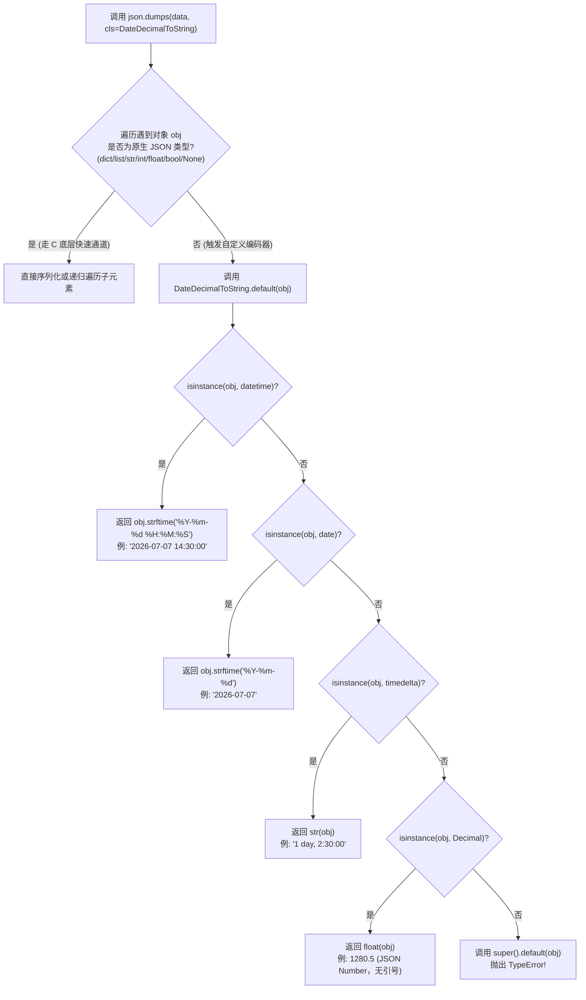

# `test/test_json_encoder.py` 代码精讲学习手册 —— 自定义 JSON 编码器 `DateDecimalToString` 单元测试

---

## 一、文件定位与核心前置知识精讲

### 1.1 文件在系统中的定位
`test/test_json_encoder.py` 是针对 `utils/json_encoder.py` 中定义的 `DateDecimalToString` 自定义 JSON 编码器的**纯单元测试（Unit Test）**文件。
在 `Voyage智途A2A` 架构中，MCP 工具层（`mcp_tools/`）通过 `PyMySQL`（配合 `DictCursor`）从 MySQL 数据库查询天气（`weather_data`）、火车票（`train_tickets`）、机票（`flight_tickets`）、演唱会（`concert_tickets`）、租车（`car_rentals`）、保险（`travel_insurance`）等业务表数据后，必须将查询结果序列化为 JSON 字符串返回给 FastMCP 服务端与 A2A 智能体。

然而，PyMySQL 从 MySQL 读取出的字典中包含四类 **Python 标准 `json.dumps()` 默认无法序列化** 的数据类型：
1. `datetime.datetime`（对应 MySQL 的 `DATETIME` / `TIMESTAMP` 字段，如航班起降时间 `departure_time`）
2. `datetime.date`（对应 MySQL 的 `DATE` 字段，如天气预报日期 `fx_date`）
3. `datetime.timedelta`（对应 MySQL 的 `TIME` 字段或时间差计算结果，如行程耗时）
4. `decimal.Decimal`（对应 MySQL 的 `DECIMAL(10, 2)` 字段，如机票价格 `price`、温度 `temp_max`）

如果直接调用原生 `json.dumps(rows)`，Python 会立即抛出：
`TypeError: Object of type datetime is not JSON serializable` 或 `TypeError: Object of type Decimal is not JSON serializable`。
为此，项目编写了 `DateDecimalToString(json.JSONEncoder)`，而本文件 `test/test_json_encoder.py` 则通过 **9 个正交完备的单元测试方法**，对 `DateDecimalToString` 的各种单一类型、混合列表、嵌套字典、未知类型异常兜底以及常规 JSON 类型兼容性进行了 100% 覆盖验证。

---

### 1.2 核心前置知识 1：`json.JSONEncoder.default(self, obj)` 的钩子触发机制
很多初学者误以为：只要传了 `json.dumps(data, cls=DateDecimalToString)`，所有的字典、列表、字符串、整数都会经过 `DateDecimalToString.default()` 方法。**这是完全错误的！**

Python 标准库 `json` 模块（底层由 C 语言加速模块 `_json.c` 实现）的序列化流程如下：
1. **原生类型快速通道（Fast Path）**：当 `json.dumps()` 遇到 `dict`、`list`、`tuple`、`str`、`int`、`float`、`bool`（`True`/`False`）、`None` 这 8 种原生类型时，**根本不会调用 `default()` 方法**，而是直接按 JSON 规范递归序列化。
2. **未知类型降级钩子（Fallback Hook）**：**只有**当 `json.dumps()` 在递归遍历数据结构（无论嵌套多深，在列表里还是字典里）遇到了上述 8 种原生类型之外的对象 `obj` 时，它才会调用自定义编码器的 `self.default(obj)` 方法！
3. **`default(self, obj)` 的返回值要求**：
   - `default(obj)` 应当把 `obj` 转换成上述 8 种原生可序列化类型之一（比如把 `datetime` 转为 `str`，把 `Decimal` 转为 `float`）并返回。
   - 如果 `default(obj)` 也不认识这个类型（例如自定义的 `UnknownObj`），就必须调用父类 `super().default(obj)`，由父类统一抛出标准的 `TypeError: Object of type UnknownObj is not JSON serializable`。

让我们对照被测目标 `utils/json_encoder.py` 的核心实现来理解：
```python
# 被测目标：utils/json_encoder.py
class DateDecimalToString(json.JSONEncoder):
    def default(self, obj):
        if isinstance(obj, datetime):
            return obj.strftime("%Y-%m-%d %H:%M:%S")
        if isinstance(obj, date):
            return obj.strftime("%Y-%m-%d")
        if isinstance(obj, timedelta):
            return str(obj)
        if isinstance(obj, Decimal):
            return float(obj)
        return super().default(obj)
```
> **特别注意 `datetime` 与 `date` 的判断顺序**：在 Python 标准库中，**`datetime` 是 `date` 的子类**（`issubclass(datetime, date) == True`）！因此 `if isinstance(obj, datetime):` **必须**写在 `if isinstance(obj, date):` 前面！如果顺序写反，`datetime(2026, 7, 7, 14, 30, 0)` 会先命中 `isinstance(obj, date)`，导致时分秒 `14:30:00` 被丢弃！本测试文件中的 `test_datetime_serialization` 和 `test_date_serialization` 正是守护这一关键顺序的防线。

---

### 1.3 核心前置知识 2：Python `unittest` 测试框架核心断言与生命周期
在本文件中，测试类 `TestDateDecimalToString` 继承自 `unittest.TestCase`，用到了以下核心断言方法：
- `self.assertEqual(a, b)`：断言 `a == b`，若不等则打印出期望值与实际值的详细 diff。
- `self.assertIn(member, container)`：断言子串 `member` 包含在字符串 `container` 中。
- `with self.assertRaises(TypeError):`：上下文管理器断言——代码块内部**必须**抛出 `TypeError` 异常才算测试通过；如果代码块正常执行没有抛异常，或者抛出了其他类型的异常，测试反而会失败（FAIL/ERROR）！这称为**负向测试（Negative Testing）**。

---

## 二、架构图与执行流程图

### 2.1 `json.dumps(..., cls=DateDecimalToString)` 内部调度流程图（Mermaid）


### 2.2 9 大单元测试用例覆盖矩阵图（ASCII）
```
TestDateDecimalToString (9 个测试用例)
 ├── [1] 单一特殊类型验证
 │    ├── test_datetime_serialization  : datetime(2026,7,7,14,30,0) -> "2026-07-07 14:30:00"
 │    ├── test_date_serialization      : date(2026,7,7)             -> "2026-07-07"
 │    ├── test_timedelta_serialization : timedelta(days=1,h=2,m=30) -> 包含 "day" 的字符串
 │    ├── test_decimal_serialization   : Decimal("1280.50")         -> 1280.5 (float)
 │    └── test_decimal_integer         : Decimal("100")             -> 100.0  (float)
 ├── [2] 复合嵌套容器验证
 │    ├── test_mixed_types_in_list     : [datetime, date, Decimal]  -> JSON 数组
 │    └── test_nested_dict             : 模拟真实机票表记录 (9个字段 + ensure_ascii=False)
 └── [3] 边界异常与向后兼容验证
      ├── test_unsupported_type_raises : UnknownObj()               -> 断言抛出 TypeError
      └── test_normal_types_still_work : 纯原生类型 dict 往返 dumps/loads 无损还原
```

---

## 三、完整源码与逐段/逐行深度拆解

### 3.1 `test/test_json_encoder.py` 100% 完整源码

```python
"""DateDecimalToString JSON 编码器单元测试
运行：python -m test.test_json_encoder
"""
import sys
import os
import json
import unittest
from datetime import datetime, date, timedelta
from decimal import Decimal

# 项目根目录加入 sys.path
sys.path.insert(0, os.path.dirname(os.path.dirname(os.path.abspath(__file__))))

from utils.json_encoder import DateDecimalToString


class TestDateDecimalToString(unittest.TestCase):
    """DateDecimalToString 自定义 JSON 编码器测试"""

    def test_datetime_serialization(self):
        """datetime 序列化为 'YYYY-MM-DD HH:MM:SS' 字符串"""
        dt = datetime(2026, 7, 7, 14, 30, 0)
        result = json.dumps({"time": dt}, cls=DateDecimalToString)
        self.assertEqual(result, '{"time": "2026-07-07 14:30:00"}')

    def test_date_serialization(self):
        """date 序列化为 'YYYY-MM-DD' 字符串"""
        d = date(2026, 7, 7)
        result = json.dumps({"day": d}, cls=DateDecimalToString)
        self.assertEqual(result, '{"day": "2026-07-07"}')

    def test_timedelta_serialization(self):
        """timedelta 序列化为字符串"""
        td = timedelta(days=1, hours=2, minutes=30)
        result = json.dumps({"duration": td}, cls=DateDecimalToString)
        self.assertIn("day", result)  # timedelta 字符串包含 "day"

    def test_decimal_serialization(self):
        """Decimal 序列化为 float（不带引号）"""
        d = Decimal("1280.50")
        result = json.dumps({"price": d}, cls=DateDecimalToString)
        self.assertEqual(result, '{"price": 1280.5}')

    def test_decimal_integer(self):
        """整数 Decimal 也转为 float"""
        d = Decimal("100")
        result = json.dumps({"count": d}, cls=DateDecimalToString)
        self.assertEqual(result, '{"count": 100.0}')

    def test_mixed_types_in_list(self):
        """列表中混合 datetime、date、Decimal 均正常序列化"""
        data = [
            datetime(2026, 7, 7, 8, 0, 0),
            date(2026, 7, 8),
            Decimal("99.99"),
        ]
        result = json.dumps(data, cls=DateDecimalToString)
        expected = '["2026-07-07 08:00:00", "2026-07-08", 99.99]'
        self.assertEqual(result, expected)

    def test_nested_dict(self):
        """嵌套字典中的各类型均正常序列化"""
        data = {
            "departure": datetime(2026, 7, 7, 8, 30),
            "arrival": datetime(2026, 7, 7, 11, 45),
            "duration": timedelta(hours=3, minutes=15),
            "ticket_date": date(2026, 7, 7),
            "price": Decimal("1280.00"),
            "seats": 300,
            "available": True,
            "passenger": None,
            "company": "国航",
        }
        result = json.dumps(data, cls=DateDecimalToString, ensure_ascii=False)
        # 无异常即为通过；验证关键字段
        self.assertIn('"departure": "2026-07-07 08:30:00"', result)
        self.assertIn('"price": 1280.0', result)
        self.assertIn('"company": "国航"', result)

    def test_unsupported_type_raises(self):
        """不支持的复杂对象应抛出 TypeError"""
        class UnknownObj:
            pass
        with self.assertRaises(TypeError):
            json.dumps({"obj": UnknownObj()}, cls=DateDecimalToString)

    def test_normal_types_still_work(self):
        """普通 JSON 类型不加 cls 也能正常工作"""
        data = {
            "name": "test",
            "age": 25,
            "active": True,
            "score": None,
            "tags": ["a", "b"],
        }
        result = json.dumps(data, cls=DateDecimalToString, ensure_ascii=False)
        parsed = json.loads(result)
        self.assertEqual(parsed, data)


if __name__ == "__main__":
    unittest.main()
```

---

### 3.2 逐段深度拆解

#### 第一段：路径注入与模块导入（第 1~14 行）
- **第 12 行**：`sys.path.insert(0, os.path.dirname(os.path.dirname(os.path.abspath(__file__))))`
  - `__file__` 是当前文件 `D:\soft\python\Voyage智途A2A\test\test_json_encoder.py`。
  - 第一次 `os.path.dirname` 得到 `D:\soft\python\Voyage智途A2A\test`。
  - 第二次 `os.path.dirname` 得到项目根目录 `D:\soft\python\Voyage智途A2A`。
  - 将其插入到 `sys.path[0]`，保证了无论是使用推荐的 `python -m test.test_json_encoder` 还是直接运行 `python test/test_json_encoder.py`，第 14 行的 `from utils.json_encoder import DateDecimalToString` 都能 100% 成功导入。

#### 第二段：时间与日期家族测试（第 20~36 行）
- **`test_datetime_serialization`（第 20~24 行）**：
  - 构造 `datetime(2026, 7, 7, 14, 30, 0)`，验证格式化输出为 `"2026-07-07 14:30:00"`（注意月份和日期的零填充 `%m`、`%d`，以及 24 小时制 `%H:%M:%S`）。
- **`test_date_serialization`（第 26~30 行）**：
  - 构造 `date(2026, 7, 7)`，验证格式化输出为 `"2026-07-07"`（不含时分秒）。
- **`test_timedelta_serialization`（第 32~36 行）**：
  - 为什么 PyMySQL 会返回 `timedelta`？因为 MySQL 中的 `TIME` 类型列（既可表示一天内的时间，也可表示超过 24 小时的时间间隔，范围 `-838:59:59` 到 `838:59:59`）在 PyMySQL 中会被统一映射为 Python 的 `datetime.timedelta` 对象！
  - `timedelta(days=1, hours=2, minutes=30)` 经 `str(obj)` 转换后为 `"1 day, 2:30:00"`，因此 `self.assertIn("day", result)` 验证通过。

#### 第三段：`Decimal` 数值序列化测试（第 38~48 行）
- **`test_decimal_serialization` 与 `test_decimal_integer`**：
  - 为什么 `DateDecimalToString` 把 `Decimal("1280.50")` 转为 `float(obj)`（即 `1280.5`，在 JSON 中是**不带双引号的数字类型**），而不是 `str(obj)`（`"1280.50"`）？
  - 因为在智途 A2A 的 MCP 工具返回结果中，大模型或调用方需要对票价 `price`、最高最低温度 `temp_max`/`temp_min` 进行数值大小比较或算术计算（例如 `test_query_weather.py` 第 87 行专门断言了 `self.assertIsInstance(row["temp_max"], (int, float))`）。转为 `float` 后，JSON 反序列化出来直接就是原生数字类型。
  - 注意：`float(Decimal("1280.50"))` 在 Python 中是 `1280.5`（末尾无意义的 0 会被浮点数标准省略），而 `float(Decimal("100"))` 在 Python 中是 `100.0`（保留一位 `.0` 表示浮点数）。第 42 行和第 48 行的断言精确验证了这一行为。

#### 第四段：复合数据结构与真实业务场景模拟（第 50~78 行）
- **`test_mixed_types_in_list`（第 50~59 行）**：验证 JSON 数组 `[datetime, date, Decimal]` 中的每个元素都能被递归触发 `default()`。
- **`test_nested_dict`（第 61~78 行）**：
  - 构造了一个完全仿真 MySQL `flight_tickets`（机票表）查询结果的字典，同时包含 `datetime`、`timedelta`、`date`、`Decimal`、`int`、`bool`、`None`、`str`（中文 `"国航"`）。
  - 配合 `ensure_ascii=False`（防止中文 `"国航"` 被转义成 `\u56fd\u822a`），验证了在真实数据库行字典场景下的完整可用性。

#### 第五段：异常边界与向后兼容性测试（第 80~102 行）
- **`test_unsupported_type_raises`（第 80~85 行）**：在方法内部临时定义一个空类 `class UnknownObj: pass`，传入 `json.dumps()`，验证 `DateDecimalToString.default()` 最后一行 `return super().default(obj)` 确实生效，没有静默吞掉未知对象，而是规范地抛出了 `TypeError`。
- **`test_normal_types_still_work`（第 87~98 行）**：验证经过 `json.dumps` 再 `json.loads` 的往返（Round-trip）一致性：`self.assertEqual(parsed, data)`。

---

### 3.3 沙盘推演（Dry Run）：运行 `python -m test.test_json_encoder`
当我们在终端执行 `python -m test.test_json_encoder` 时：
1. `unittest.main()` 自动扫描当前模块中的 `TestDateDecimalToString` 类。
2. 按方法名的字母序（Alphabetical Order）依次执行 9 个测试方法：
   - `test_date_serialization` -> `.`
   - `test_datetime_serialization` -> `.`
   - `test_decimal_integer` -> `.`
   - `test_decimal_serialization` -> `.`
   - `test_mixed_types_in_list` -> `.`
   - `test_nested_dict` -> `.`
   - `test_normal_types_still_work` -> `.`
   - `test_timedelta_serialization` -> `.`
   - `test_unsupported_type_raises` -> `.`
3. 终端输出：
   ```text
   .........
   ----------------------------------------------------------------------
   Ran 9 tests in 0.002s

   OK
   ```

---

## 四、关键工程细节与常见易错点

### 4.1 易错点 1：把 `Decimal` 构造参数写成浮点数 `Decimal(1280.50)` 而非字符串 `Decimal("1280.50")`
- **观察代码**：在第 40、46、55、68 行，作者全部使用了**字符串**作为 `Decimal` 的构造参数（如 `Decimal("99.99")`）。
- **原因**：如果写 `Decimal(99.99)`，由于二进制浮点数 `99.99` 在内存中本身就是不精确的 `99.9899999999999948840923025272786617279052734375`，传给 `Decimal` 会保留这串误差；而传入字符串 `Decimal("99.99")` 则是十进制精确表示。这是 Python 金融/票务开发的基本功。

### 4.2 易错点 2：忘记传 `ensure_ascii=False` 导致断言中文子串失败
- **观察代码**：第 74 行 `result = json.dumps(data, cls=DateDecimalToString, ensure_ascii=False)`。
- **原因**：`json.dumps` 的 `ensure_ascii` 参数默认值为 `True`，会将所有非 ASCII 字符（如 `"国航"`）转义为 `"\u56fd\u822a"`。如果不加 `ensure_ascii=False`，第 78 行的 `self.assertIn('"company": "国航"', result)` 就会断言失败！

---

## 五、自测思考题（附答案解析）

### 思考题 1：如果字典的 Key（键）是 `date(2026, 7, 7)`，即 `json.dumps({date(2026, 7, 7): "晴"}, cls=DateDecimalToString)`，能正常序列化吗？为什么？
> **答案解析**：
> **不能！会直接抛出 `TypeError: keys must be str, int, float, bool or None, not date`！**
> 原因在于：`json.JSONEncoder.default(self, obj)` **只会在序列化字典的 Value（值）或列表元素时被调用**，而**不会**在序列化字典的 Key（键）时被调用！JSON 标准强制要求对象的 Key 必须是字符串，Python 的 `json.dumps` 只允许原生 `str/int/float/bool/None` 作为字典的 Key。由于 PyMySQL 的 `DictCursor` 返回的字典 Key 永远是数据库列名（`str` 类型），只有 Value 才是 `datetime/date/Decimal`，因此 `DateDecimalToString` 完美契合数据库查询结果的序列化需求。

### 思考题 2：在 `DateDecimalToString.default()` 中，如果把 `if isinstance(obj, date):` 挪到 `if isinstance(obj, datetime):` 前面，本测试文件中的哪几个测试方法会失败？报错信息是什么？
> **答案解析**：
> 因为 `datetime` 是 `date` 的子类（`isinstance(datetime(...), date)` 为 `True`），如果把 `date` 的判断放前面，所有 `datetime` 对象都会被当成 `date` 按 `"%Y-%m-%d"` 格式化，丢失时分秒。
> 本测试文件中会有 **3 个测试方法立即失败**：
> 1. `test_datetime_serialization`：实际输出 `'{"time": "2026-07-07"}'`，与期望的 `'{"time": "2026-07-07 14:30:00"}'` 不符。
> 2. `test_mixed_types_in_list`：列表第一个元素变成 `"2026-07-07"`，丢失 `" 08:00:00"`。
> 3. `test_nested_dict`：`self.assertIn('"departure": "2026-07-07 08:30:00"', result)` 失败。
