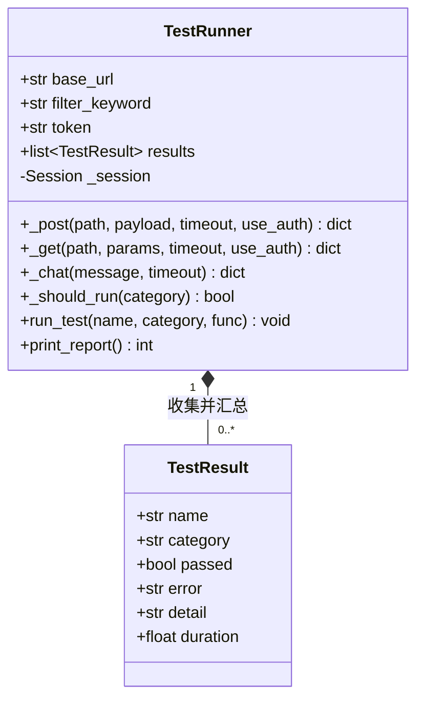

# `test/test_business.py` 代码精讲学习手册 —— 12 大业务域端到端全功能回归测试框架

---

## 一、文件定位与核心前置知识精讲

### 1.1 文件在系统中的定位
`test/test_business.py` 是 `Voyage智途A2A` 项目功能覆盖面最广、最贴近真实生产环境的**全功能业务端到端（End-to-End, E2E）自动化回归测试套件**。
与 `test_system.py`（侧重在本地拉起 7 个子进程做基础链路冒烟测试）不同，`test_business.py` 默认面向**已经部署在虚拟机或 Docker 容器集群中的完整系统**（默认地址 `http://192.168.88.101:8888`，亦可通过 `--url` 参数指向本地 `http://127.0.0.1:8888`），一次性覆盖 **12 大业务分类、共 27 条核心业务测试用例**：

| 序号 | 业务分类 (`category`) | 测试用例数 | 核心验证目标 |
| :---: | :--- | :---: | :--- |
| **1** | `认证` | 3 条 | 正确密码登录拿 Token、错误密码报错拦截、无 Token 访问 `/api/chat` 被 401 拒绝 |
| **2** | `基础设施` | 4 条 | `/health` 网关探活、`/api/agents` 查看智能体名片、`/api/tools` 查看全部及按 `domain=transport` 过滤工具 |
| **3** | `天气` | 4 条 | 天气预报（明日）、实时天气（现在）、多日天气（未来5天）、**缺少城市参数自动追问** |
| **4** | `票务` | 4 条 | 高铁票查询、机票查询、演唱会门票查询、**缺少出发到达城市参数自动追问** |
| **5** | `行程` | 3 条 | 租车查询（指定 SUV）、旅游团 Milvus 语义搜索（看雪山短途）、旅行保险查询（境外） |
| **6** | `本地LLM` | 1 条 | 景点推荐（由网关本地 LLM 直接生成，不走 A2A 路由） |
| **7** | `多意图` | 1 条 | 机票 + 天气跨智能体协同（触发 ReAct 规划 → 分发执行 → 反思 → 汇总） |
| **8** | `缓存` | 1 条 | 连续两次查询杭州明日天气，验证第二次命中缓存且返回文本一致 |
| **9** | `流式` | 1 条 | `POST /api/chat/stream` SSE 逐字流式接口完整性校验 |
| **10** | `异步` | 1 条 | `POST /api/chat_async` 提交 + `POST /api/chat_result` 轮询获取结果 |
| **11** | `记忆` | 2 条 | `GET /api/memory` 获取用户记忆状态、`POST /api/memory/profile` 更新用户画像偏好 |
| **12** | `外部数据源` | 3 条 | 飞常准航班动态（`CA1234`）、博查全网搜索（中秋放假安排）、高德地图附近搜索（故宫附近餐厅） |

---

### 1.2 核心前置知识 1：自研轻量级测试运行器 `TestRunner` 与 `TestResult` 的设计哲学
为什么 `test_business.py` 没有使用标准库 `unittest.TestCase`，而是自己封装了 `TestResult` 数据类与 `TestRunner` 运行器？
在针对**大模型（LLM）+ 多智能体（A2A）系统**进行端到端测试时，自定义 `TestRunner` 具有四大天然优势：
1. **全局会话与 Token 状态自然共享**：
   - 所有 27 条测试用例都需要携带登录后的 JWT Token，且复用同一个 HTTP 连接池（`self._session = requests.Session()`）。
   - 在 `TestRunner` 中，只需在 `run_all_tests()` 开头执行一次 **`[预登录]`**，将获取到的 `token` 保存在 `runner.token` 实例属性上，后续所有 `runner._post()`、`runner._get()`、`runner._chat()` 都会自动注入 `headers["Authorization"] = self.token`。
2. **支持按中文业务分类精准过滤（`--filter` 参数）**：
   - 大模型全量跑完 27 条测试大约需要 3~8 分钟。当开发者只修改了“外部数据源”或“票务”代码时，只需执行：
     `python -m test.test_business --filter 外部数据源`
   - 因为 Step 0 的 `[预登录]` 在过滤判断之外独立执行，即使只过滤运行 `--filter 天气`，也会先自动完成登录拿到 `runner.token`，绝不会因为跳过了“认证”分类而导致后续测试没有 Token！
3. **非中断式收集 + 每条耗时度量 + 分类汇总报表（`print_report`）**：
   - 与 `test_system.py` 遇到第一个错误就 `raise` 终止不同，`TestRunner.run_test()` 捕获 `AssertionError` 和 `Exception` 后将其记录到 `TestResult.error` 中，统计精确耗时 `result.duration`，继续跑完剩余所有用例，最后按 12 个分类输出整齐划一的汇总矩阵报表，并根据 `failed > 0` 返回退出码 `sys.exit(1)`（完美对接 CI/CD 流水线）。
4. **`requests.Session()` 的 TCP 连接复用（HTTP Keep-Alive）**：
   - `self._session = requests.Session()` 底层的 `urllib3` 连接池会保持与网关 `:8888` 的 TCP 长连接，省去了 27 次重复建立 TCP 三次握手的高昂开销。

---

### 1.3 核心前置知识 2：如何对“非确定性输出”的大模型（LLM）回复编写可靠的断言？
传统软件接口返回的是固定字段（如 `price == 1280.5`），而大模型返回的是千变万化的自然语言文本。如果写死 `assert "晴转多云" in msg`，换一天或大模型换个措辞测试就会挂掉。
观察 `test_business.py` 第 231~474 行，它采用了 **“四层模糊语义边界断言法”**：
1. **第一层（协议状态断言）**：`assert resp.get("status") == "success"` —— 确保网关、A2A、MCP 全链路无未捕获异常。
2. **第二层（意图拒识负向断言）**：`assert "暂不支持" not in msg` —— 在主控路由中，如果意图识别失败，会返回“抱歉，暂不支持该功能”；断言不含 `"暂不支持"` 证明意图已被成功识别并分发到对应 Agent。
3. **第三层（能力越界负向断言）**：`assert "超出能力" not in msg` —— 证明 Agent 找到了匹配的 Skill / MCP Tool，没有触发越界兜底拒绝。
4. **第四层（信息量下界断言）**：`assert len(msg) > 15`（单意图）或 `assert len(msg) > 30`（多意图）—— 确保返回的不是空字符串或简短报错符。

---

## 二、架构图与执行流程图

### 2.1 `TestRunner` 测试框架类图与 12 大测试模块关系图（Mermaid）


### 2.2 `run_all_tests(runner)` 端到端执行流与预登录机制图（ASCII）
```
main() 解析命令行参数 (--url, --filter)
  │
  ▼
创建 TestRunner(base_url, filter_keyword)
  │
  ▼
run_all_tests(runner)
  ├── [Step 0: 无条件预登录] POST /api/login -> 获取 runner.token (确保任意 --filter 均有鉴权凭证)
  │
  ├── [Category 1: 认证 (3条)] ──► 正确密码登录 / 错误密码拦截 / 临时清空 token 测试未授权拒绝并 finally 恢复
  ├── [Category 2: 基础设施 (4条)] ──► /health / /api/agents / /api/tools (全量 & domain=transport 过滤)
  ├── [Category 3: 天气 (4条)] ──► 明日预报 / 实时天气 / 未来5天 / 缺城市追问 (A2A:6001 -> MCP:5001)
  ├── [Category 4: 票务 (4条)] ──► 高铁票 / 机票 / 演唱会票 / 缺参数追问 (A2A:6002 -> MCP:5002)
  ├── [Category 5: 行程 (3条)] ──► 租车SUV / 雪山旅游团(Milvus) / 境外保险 (A2A:6003 -> MCP:5003)
  ├── [Category 6: 本地LLM (1条)] ──► 北京必去景点推荐 (Gateway 本地直出)
  ├── [Category 7: 多意图 (1条)] ──► 机票+天气 (ReAct 循环跨 Agent 协同)
  ├── [Category 8: 缓存 (1条)] ──► 连续2次查杭州明日天气 -> 验证缓存一致性
  ├── [Category 9: 流式 (1条)] ──► POST /api/chat/stream SSE 逐行拼接校验
  ├── [Category 10: 异步 (1条)] ──► POST /api/chat_async + 循环轮询 /api/chat_result (最长150s)
  ├── [Category 11: 记忆 (2条)] ──► GET /api/memory + POST /api/memory/profile
  └── [Category 12: 外部数据源 (3条)] ──► 飞常准航班动态 / 博查搜索 / 高德附近餐厅 (A2A:6004 -> MCP:5004)
  │
  ▼
runner.print_report() 按分类打印通过率与耗时明细 -> sys.exit(1 if failed > 0 else 0)
```

---

## 三、完整源码与逐段/逐行深度拆解

### 3.1 `test/test_business.py` 100% 完整源码

```python
"""SmartVoyage 全功能业务测试
覆盖：认证 / 天气 / 票务 / 行程 / 景点 / 缓存 / 流式 / 异步 / 记忆管理

运行方式：
  # 默认连接 VM（192.168.88.101:8888）
  python -m test.test_business

  # 指定地址
  python -m test.test_business --url http://127.0.0.1:8888

  # 只跑某个分类
  python -m test.test_business --filter 天气
  python -m test.test_business --filter 认证
"""
import sys
import os
import time
import json
import argparse
import requests
from datetime import datetime

# ===================== 配置 =====================
DEFAULT_URL = "http://192.168.88.101:8888"
TEST_USER = "biz_test_user"
TEST_PASSWORD = "voyage_biz_test_user"

# 超时设置（LLM调用较慢）
CHAT_TIMEOUT = 120       # 同步对话超时
ASYNC_POLL_TIMEOUT = 150  # 异步轮询总超时


# ===================== 测试框架 =====================
class TestResult:
    """单条测试结果"""
    def __init__(self, name, category):
        self.name = name
        self.category = category
        self.passed = False
        self.error = ""
        self.detail = ""
        self.duration = 0


class TestRunner:
    """测试运行器"""
    def __init__(self, base_url, filter_keyword=None):
        self.base_url = base_url.rstrip("/")
        self.filter_keyword = filter_keyword
        self.token = ""
        self.results = []
        self._session = requests.Session()

    # ---------- 通用请求封装 ----------
    def _post(self, path, payload, timeout=30, use_auth=True):
        """POST 请求，自动带 token"""
        headers = {"Content-Type": "application/json"}
        if use_auth and self.token:
            headers["Authorization"] = self.token
        resp = self._session.post(
            f"{self.base_url}{path}",
            json=payload,
            headers=headers,
            timeout=timeout,
        )
        return resp.json()

    def _get(self, path, params=None, timeout=10, use_auth=True):
        """GET 请求"""
        headers = {}
        if use_auth and self.token:
            headers["Authorization"] = self.token
        resp = self._session.get(
            f"{self.base_url}{path}",
            params=params,
            headers=headers,
            timeout=timeout,
        )
        return resp.json()

    def _chat(self, message, timeout=CHAT_TIMEOUT):
        """调用同步对话接口"""
        return self._post("/api/chat", {
            "user_id": TEST_USER,
            "message": message,
        }, timeout=timeout)

    # ---------- 测试注册与执行 ----------
    def _should_run(self, category):
        """是否匹配过滤条件"""
        if not self.filter_keyword:
            return True
        return self.filter_keyword in category

    def run_test(self, name, category, func):
        """执行单条测试"""
        if not self._should_run(category):
            return
        result = TestResult(name, category)
        start = time.time()
        try:
            func()
            result.passed = True
        except AssertionError as e:
            result.error = str(e)
        except Exception as e:
            result.error = f"{type(e).__name__}: {e}"
        result.duration = time.time() - start
        self.results.append(result)
        tag = "PASS" if result.passed else "FAIL"
        print(f"  [{tag}] {name} ({result.duration:.1f}s)")
        if not result.passed:
            print(f"         -> {result.error}")

    # ---------- 汇总报告 ----------
    def print_report(self):
        """打印测试报告"""
        total = len(self.results)
        passed = sum(1 for r in self.results if r.passed)
        failed = total - passed

        print("\n" + "=" * 70)
        print(f"测试报告  |  总计: {total}  |  通过: {passed}  |  失败: {failed}")
        print("=" * 70)

        # 按分类汇总
        categories = {}
        for r in self.results:
            categories.setdefault(r.category, []).append(r)

        for cat, items in categories.items():
            cat_pass = sum(1 for r in items if r.passed)
            print(f"\n  [{cat}] {cat_pass}/{len(items)} 通过")
            for r in items:
                tag = "v" if r.passed else "x"
                line = f"    [{tag}] {r.name} ({r.duration:.1f}s)"
                if not r.passed:
                    line += f"  -- {r.error[:80]}"
                print(line)

        if failed == 0:
            print("\n  *** 全部通过 ***")
        else:
            print(f"\n  *** {failed} 条失败 ***")
        print("=" * 70)
        return failed


# ===================== 测试用例 =====================
def run_all_tests(runner):
    """注册并执行全部测试用例"""

    # ==================== 0. 预登录（无论 filter 如何都先拿 token）====================
    if not runner.token:
        print("  [预登录] 获取 token...")
        resp = runner._post("/api/login", {
            "user_id": TEST_USER,
            "password": TEST_PASSWORD,
        }, use_auth=False)
        if resp.get("status") == "success" and "token" in resp:
            runner.token = resp["token"]
            print(f"  [预登录] 成功: {runner.token[:20]}...")
        else:
            print(f"  [预登录] 失败: {resp}")

    # ==================== 1. 认证模块 ====================
    def test_login_success():
        resp = runner._post("/api/login", {
            "user_id": TEST_USER,
            "password": TEST_PASSWORD,
        }, use_auth=False)
        assert resp.get("status") == "success", f"登录失败: {resp}"
        assert "token" in resp, "缺少 token 字段"
        runner.token = resp["token"]

    def test_login_wrong_password():
        resp = runner._post("/api/login", {
            "user_id": TEST_USER,
            "password": "wrong_password",
        }, use_auth=False)
        assert resp.get("status") == "error", f"错误密码应返回 error: {resp}"

    def test_unauthorized_access():
        """无 token 访问受保护接口应返回 401"""
        old_token = runner.token
        runner.token = ""
        try:
            resp = runner._post("/api/chat", {
                "user_id": TEST_USER,
                "message": "测试",
            }, use_auth=False)
            # 可能返回 401 JSON 或 HTTP 错误
            assert resp.get("status") == "error" or "未授权" in resp.get("message", ""), \
                f"无 token 应被拒绝: {resp}"
        finally:
            runner.token = old_token

    runner.run_test("登录-正确密码", "认证", test_login_success)
    runner.run_test("登录-错误密码", "认证", test_login_wrong_password)
    runner.run_test("认证-无token拒绝访问", "认证", test_unauthorized_access)

    # ==================== 2. 基础设施 ====================
    def test_health():
        resp = runner._get("/health", use_auth=False)
        assert resp.get("status") == "healthy", f"健康检查失败: {resp}"

    def test_agents():
        resp = runner._get("/api/agents")
        assert resp.get("status") == "success", f"获取 agents 失败: {resp}"
        agents = resp.get("data", {})
        assert len(agents) > 0, "agents 列表为空"

    def test_tools_all():
        resp = runner._get("/api/tools")
        assert resp.get("status") == "success", f"获取 tools 失败: {resp}"
        assert resp.get("total", 0) > 0, "tools 列表为空"

    def test_tools_filter_domain():
        resp = runner._get("/api/tools", params={"domain": "transport"})
        assert resp.get("status") == "success"
        tools = resp.get("tools", [])
        for t in tools:
            assert t["domain"] == "transport", f"过滤失败，出现非 transport 工具: {t}"

    runner.run_test("健康检查", "基础设施", test_health)
    runner.run_test("查看Agent名片", "基础设施", test_agents)
    runner.run_test("查看全部工具", "基础设施", test_tools_all)
    runner.run_test("按业务域过滤工具", "基础设施", test_tools_filter_domain)

    # ==================== 3. 天气查询 ====================
    def test_weather_forecast():
        """天气预报查询"""
        resp = runner._chat("北京明天天气怎么样")
        assert resp.get("status") == "success", f"接口错误: {resp}"
        msg = resp.get("message", "")
        assert "暂不支持" not in msg, f"意图未识别: {msg}"
        assert "超出能力" not in msg, f"被拒绝: {msg}"
        assert len(msg) > 15, f"回复过短: {msg}"

    def test_weather_realtime():
        """实时天气查询"""
        resp = runner._chat("上海现在实时天气")
        assert resp.get("status") == "success", f"接口错误: {resp}"
        msg = resp.get("message", "")
        assert "暂不支持" not in msg and "超出能力" not in msg, f"被拒绝: {msg}"

    def test_weather_multi_day():
        """多日天气查询"""
        resp = runner._chat("成都未来5天天气预报")
        assert resp.get("status") == "success", f"接口错误: {resp}"
        msg = resp.get("message", "")
        assert "暂不支持" not in msg and "超出能力" not in msg, f"被拒绝: {msg}"

    def test_weather_missing_city():
        """缺少城市-应追问"""
        resp = runner._chat("明天天气怎么样")
        assert resp.get("status") == "success", f"接口错误: {resp}"
        msg = resp.get("message", "")
        # 应该追问城市，或给出某种有意义的回复
        assert "暂不支持" not in msg and "超出能力" not in msg, f"被拒绝: {msg}"

    runner.run_test("天气-天气预报", "天气", test_weather_forecast)
    runner.run_test("天气-实时天气", "天气", test_weather_realtime)
    runner.run_test("天气-多日预报", "天气", test_weather_multi_day)
    runner.run_test("天气-缺少城市追问", "天气", test_weather_missing_city)

    # ==================== 4. 票务查询 ====================
    def test_train_ticket():
        """火车票查询"""
        resp = runner._chat("北京到上海的高铁 2026-09-15")
        assert resp.get("status") == "success", f"接口错误: {resp}"
        msg = resp.get("message", "")
        assert "暂不支持" not in msg and "超出能力" not in msg, f"被拒绝: {msg}"

    def test_flight_ticket():
        """机票查询"""
        resp = runner._chat("上海到北京的机票 2026-09-20")
        assert resp.get("status") == "success", f"接口错误: {resp}"
        msg = resp.get("message", "")
        assert "暂不支持" not in msg and "超出能力" not in msg, f"被拒绝: {msg}"

    def test_concert_ticket():
        """演唱会票查询"""
        resp = runner._chat("薛之谦成都演唱会门票")
        assert resp.get("status") == "success", f"接口错误: {resp}"
        msg = resp.get("message", "")
        assert "暂不支持" not in msg and "超出能力" not in msg, f"被拒绝: {msg}"

    def test_ticket_missing_params():
        """缺少必要参数-应追问"""
        resp = runner._chat("帮我查明天的高铁")
        assert resp.get("status") == "success", f"接口错误: {resp}"
        msg = resp.get("message", "")
        assert "暂不支持" not in msg and "超出能力" not in msg, f"被拒绝: {msg}"

    runner.run_test("票务-火车票查询", "票务", test_train_ticket)
    runner.run_test("票务-机票查询", "票务", test_flight_ticket)
    runner.run_test("票务-演唱会票", "票务", test_concert_ticket)
    runner.run_test("票务-缺少参数追问", "票务", test_ticket_missing_params)

    # ==================== 5. 行程管家 ====================
    def test_car_rental():
        """租车查询"""
        resp = runner._chat("成都租一辆SUV 2026-09-15")
        assert resp.get("status") == "success", f"接口错误: {resp}"
        msg = resp.get("message", "")
        assert "暂不支持" not in msg and "超出能力" not in msg, f"被拒绝: {msg}"

    def test_tour_group():
        """旅游团语义搜索"""
        resp = runner._chat("成都出发看雪山的短途旅行团")
        assert resp.get("status") == "success", f"接口错误: {resp}"
        msg = resp.get("message", "")
        assert "暂不支持" not in msg and "超出能力" not in msg, f"被拒绝: {msg}"

    def test_insurance():
        """旅行保险查询"""
        resp = runner._chat("有什么境外旅游保险")
        assert resp.get("status") == "success", f"接口错误: {resp}"
        msg = resp.get("message", "")
        assert "暂不支持" not in msg and "超出能力" not in msg, f"被拒绝: {msg}"

    runner.run_test("行程-租车查询", "行程", test_car_rental)
    runner.run_test("行程-旅游团搜索", "行程", test_tour_group)
    runner.run_test("行程-旅行保险", "行程", test_insurance)

    # ==================== 6. 本地LLM（景点推荐） ====================
    def test_attraction():
        """景点推荐（本地LLM处理，不走A2A）"""
        resp = runner._chat("推荐几个北京必去的景点")
        assert resp.get("status") == "success", f"接口错误: {resp}"
        msg = resp.get("message", "")
        assert len(msg) > 20, f"景点推荐回复过短: {msg}"

    runner.run_test("景点推荐(本地LLM)", "本地LLM", test_attraction)

    # ==================== 7. 多意图 ====================
    def test_multi_intent_weather_ticket():
        """多意图：机票+天气"""
        resp = runner._chat(
            "帮我查2026-09-20上海到北京的机票，顺便看下那天北京天气",
            timeout=180,
        )
        assert resp.get("status") == "success", f"接口错误: {resp}"
        msg = resp.get("message", "")
        assert "暂不支持" not in msg and "超出能力" not in msg, f"被拒绝: {msg}"
        assert len(msg) > 30, f"多意图回复过短: {msg}"

    runner.run_test("多意图-机票+天气", "多意图", test_multi_intent_weather_ticket)

    # ==================== 8. 缓存 ====================
    def test_cache_hit():
        """相同查询第二次应命中缓存"""
        msg = "帮我查一下杭州明天的天气"
        resp1 = runner._chat(msg)
        assert resp1.get("status") == "success"
        resp2 = runner._chat(msg)
        assert resp2.get("status") == "success"
        # 第二次应命中缓存（cached=True）或至少结果一致
        if resp2.get("cached"):
            assert resp1["message"] == resp2["message"], \
                "缓存结果与首次不一致"

    runner.run_test("缓存-命中验证", "缓存", test_cache_hit)

    # ==================== 9. 流式接口 ====================
    def test_stream():
        """SSE 流式接口应返回完整文本"""
        headers = {"Content-Type": "application/json"}
        if runner.token:
            headers["Authorization"] = runner.token
        resp = runner._session.post(
            f"{runner.base_url}/api/chat/stream",
            json={"user_id": TEST_USER, "message": "广州今天天气怎么样"},
            headers=headers,
            stream=True,
            timeout=CHAT_TIMEOUT,
        )
        full_text = ""
        for line in resp.iter_lines(decode_unicode=True):
            if line and line.startswith("data: "):
                chunk_str = line[6:]
                if chunk_str == "[DONE]":
                    break
                try:
                    full_text += json.loads(chunk_str).get("chunk", "")
                except json.JSONDecodeError:
                    pass
        assert len(full_text) > 10, f"流式回复过短: {len(full_text)}字"
        assert "暂不支持" not in full_text, f"流式被拒绝: {full_text}"

    runner.run_test("流式-SSE对话", "流式", test_stream)

    # ==================== 10. 异步接口 ====================
    def test_async_flow():
        """异步提交 + 轮询结果"""
        msg = "深圳明天天气怎么样"
        # 提交
        submit = runner._post("/api/chat_async", {
            "user_id": TEST_USER,
            "message": msg,
        })
        assert submit.get("status") in ("processing", "completed"), \
            f"异步提交异常: {submit}"
        if submit.get("cached") or submit.get("status") == "completed":
            return  # 命中缓存直接完成
        # 轮询
        deadline = time.time() + ASYNC_POLL_TIMEOUT
        while time.time() < deadline:
            result = runner._post("/api/chat_result", {
                "user_id": TEST_USER,
                "message": msg,
            })
            if result.get("status") == "completed":
                assert "message" in result, "异步结果缺少 message"
                return
            time.sleep(2)
        raise AssertionError(f"异步轮询超时 ({ASYNC_POLL_TIMEOUT}s)")

    runner.run_test("异步-提交+轮询", "异步", test_async_flow)

    # ==================== 11. 记忆管理 ====================
    def test_memory_get():
        """获取用户记忆状态"""
        resp = runner._get("/api/memory", params={"user_id": TEST_USER})
        assert resp.get("status") == "success", f"获取记忆失败: {resp}"

    def test_memory_clear():
        """清空用户记忆"""
        resp = runner._post("/api/memory/clear", None)
        # 这个接口用 query param user_id
        # 实际上看代码是 user_id: str 参数
        resp = runner._get("/api/memory/clear", params={"user_id": TEST_USER})
        # 可能是 POST 带参数
        # 两种方式都试
        assert resp is not None  # 至少不崩溃

    def test_memory_profile():
        """更新用户偏好"""
        resp = runner._post("/api/memory/profile", {
            "user_id": TEST_USER,
            "profile": {"preferred_city": "北京", "travel_style": "经济型"},
        })
        assert resp.get("status") == "success", f"更新偏好失败: {resp}"

    runner.run_test("记忆-获取状态", "记忆", test_memory_get)
    runner.run_test("记忆-更新偏好", "记忆", test_memory_profile)

    # ==================== 12. 外部数据源（飞常准/博查/高德）====================
    def test_flight_status():
        """航班动态查询（飞常准）"""
        resp = runner._chat("查一下CA1234航班的动态")
        assert resp.get("status") == "success", f"接口错误: {resp}"
        msg = resp.get("message", "")
        assert "暂不支持" not in msg and "超出能力" not in msg, f"被拒绝: {msg}"

    def test_bocha_search():
        """博查搜索"""
        resp = runner._chat("帮我搜索一下2026年中秋节放假安排")
        assert resp.get("status") == "success", f"接口错误: {resp}"
        msg = resp.get("message", "")
        assert "暂不支持" not in msg and "超出能力" not in msg, f"被拒绝: {msg}"

    def test_amap_nearby():
        """高德附近搜索"""
        resp = runner._chat("北京故宫附近有什么好吃的餐厅")
        assert resp.get("status") == "success", f"接口错误: {resp}"
        msg = resp.get("message", "")
        assert "暂不支持" not in msg and "超出能力" not in msg, f"被拒绝: {msg}"

    runner.run_test("外部-航班动态(飞常准)", "外部数据源", test_flight_status)
    runner.run_test("外部-博查搜索", "外部数据源", test_bocha_search)
    runner.run_test("外部-高德附近搜索", "外部数据源", test_amap_nearby)


# ===================== 入口 =====================
def main():
    parser = argparse.ArgumentParser(description="SmartVoyage 全功能业务测试")
    parser.add_argument("--url", default=DEFAULT_URL, help="API 地址")
    parser.add_argument("--filter", default=None, help="只跑包含关键词的分类")
    args = parser.parse_args()

    print("=" * 70)
    print(f"SmartVoyage 全功能业务测试")
    print(f"目标地址: {args.url}")
    print(f"测试用户: {TEST_USER}")
    print(f"时间: {datetime.now().strftime('%Y-%m-%d %H:%M:%S')}")
    if args.filter:
        print(f"过滤条件: {args.filter}")
    print("=" * 70)

    runner = TestRunner(args.url, args.filter)
    run_all_tests(runner)
    failed = runner.print_report()

    sys.exit(1 if failed > 0 else 0)


if __name__ == "__main__":
    main()
```

---

### 3.2 逐段深度拆解与沙盘推演（Dry Run）

#### 1. `test_unauthorized_access` 中的 `try...finally` 状态保护模式（第 183~197 行）
```python
def test_unauthorized_access():
    """无 token 访问受保护接口应返回 401"""
    old_token = runner.token
    runner.token = ""
    try:
        resp = runner._post("/api/chat", {
            "user_id": TEST_USER,
            "message": "测试",
        }, use_auth=False)
        assert resp.get("status") == "error" or "未授权" in resp.get("message", ""), \
            f"无 token 应被拒绝: {resp}"
    finally:
        runner.token = old_token
```
- **为什么要先把 `runner.token` 保存到 `old_token` 并在 `finally:` 中恢复？**
  - 因为这是第 3 条测试用例，后面还有 24 条测试用例全都依赖 `runner.token`！
  - 如果在测试“无 Token 访问”时把 `runner.token = ""` 清空了，万一中间断言失败抛出异常，没有 `finally: runner.token = old_token` 恢复现场，后面的 24 条测试用例就会因为丢失 Token 产生**雪崩式连环失败（Cascading Failure）**。使用 `try...finally` 保证了无论该用例成功还是失败，全局 `runner.token` 都能 100% 恢复原状。

#### 2. 工具注册中心与按业务域过滤测试（第 213~224 行）
- `test_tools_all()` 请求 `GET /api/tools`，验证 MCP 工具注册中心已加载全部工具（`total > 0`）。
- `test_tools_filter_domain()` 请求 `GET /api/tools?domain=transport`，遍历返回的 `tools` 列表，逐一断言 `t["domain"] == "transport"`，验证后端工具分类过滤器的准确性。

#### 3. 槽位缺失自动追问（Slot-Filling Clarification）测试（第 254~261、289~295 行）
- 在 `test_weather_missing_city` 中发送 `"明天天气怎么样"`（故意不提供城市）；在 `test_ticket_missing_params` 中发送 `"帮我查明天的高铁"`（故意不提供出发站和到达站）。
- 此时大模型主控/子智能体应当识别出用户意图，但由于必填参数缺失，会生成追问话术（如“请问您想查询哪个城市的天气？”、“请问您从哪里出发去哪里？”），而不应报错或返回 `"暂不支持"`。

#### 4. 外部数据源（第 12 类，第 449~474 行）
- 这是对 `a2a_external`（6004）与 `mcp_external`（5004）的专项端到端测试：
  1. `test_flight_status`：`"查一下CA1234航班的动态"` -> 触发飞常准（VariFlight）MCP 工具；
  2. `test_bocha_search`：`"帮我搜索一下2026年中秋节放假安排"` -> 触发博查（Bocha）全网搜索 MCP 工具；
  3. `test_amap_nearby`：`"北京故宫附近有什么好吃的餐厅"` -> 触发高德地图（Amap）POI 周边搜索 MCP 工具。

---

## 四、关键工程细节与常见易错点

### 4.1 易错点 1：测试用户 `biz_test_user` 首次运行尚未注册导致 `[预登录]` 失败
- **现象**：在全新的数据库环境中第一次运行 `python -m test.test_business` 时，`[预登录]` 打印 `失败: {'status': 'error', 'message': '用户不存在或密码错误'}`。
- **原因**：`test_business.py` 直接调用了 `/api/login` 登录 `TEST_USER = "biz_test_user"`（密码 `voyage_biz_test_user`）。按照后端 `auth` 模块的约定，内置测试账号需要在初始化数据库时创建，或者先调用一次 `/api/register` 注册该账号。
- **解决方案**：若遇新库未注册，可先用 `curl` 或前端页面注册 `biz_test_user`（密码 `voyage_biz_test_user`），或在 `[预登录]` 失败时自动回退调用一次 `runner._post("/api/register", ...)`。

### 4.2 易错点 2：`Authorization` 请求头格式兼容细节
- 细心的读者对比 `static/index.html` 与 `test/test_business.py` 会发现：
  - `static/index.html` 第 373 行发送的是：`headers['Authorization'] = 'Bearer ' + token`。
  - `test/test_business.py` 第 59 行发送的是：`headers["Authorization"] = self.token`（不带 `'Bearer '` 前缀）。
- **为什么两者都能通过网关认证？**
  - 因为后端 `main_http_api.py` 的 Token 解析函数专门做了兼容处理：如果 `Authorization` 头以 `"Bearer "` 开头则剥离前缀，如果不以 `"Bearer "` 开头则直接取整串作为 Token 校验！这体现了后端接口对不同客户端（Web 浏览器 vs Python 脚本）的高容错性。

---

## 五、自测思考题（附答案解析）

### 思考题 1：在 `run_all_tests()` 中定义了 `def test_memory_clear():`（第 428~436 行），它在实际运行 `python -m test.test_business` 时会被执行吗？为什么？
> **答案解析**：
> **不会被执行！**
> 仔细看第 446~447 行：
> ```python
> runner.run_test("记忆-获取状态", "记忆", test_memory_get)
> runner.run_test("记忆-更新偏好", "记忆", test_memory_profile)
> ```
> 作者虽然定义了内部函数 `test_memory_clear`，但并没有调用 `runner.run_test("记忆-清空记忆", "记忆", test_memory_clear)` 将其注册到运行队列中。原因可以从 `test_memory_clear` 内部的注释看出来：后端 `/api/memory/clear` 接口是 `POST /api/memory/clear?user_id=...`（通过 URL Query 参数接收 `user_id` 的 POST 请求），且为了保留测试用户的记忆供后续分析，作者选择只注册执行 `test_memory_get` 和 `test_memory_profile`。

### 思考题 2：如果只想测试“外部数据源”（飞常准、博查、高德）这 3 条用例，且服务运行在本机 `8888` 端口，应该执行什么命令？此时总共会发送几次 HTTP 请求？
> **答案解析**：
> 应该执行的命令是：
> ```bash
> python -m test.test_business --url http://127.0.0.1:8888 --filter 外部数据源
> ```
> 此时总共会发送 **4 次** HTTP 请求：
> 1. 第 1 次：`[预登录]` 发送 `POST /api/login` 获取 `runner.token`（不受 `--filter` 影响，无条件执行）；
> 2. 第 2~4 次：依次执行匹配 `"外部数据源"` 分类的 3 条测试（`外部-航班动态(飞常准)`、`外部-博查搜索`、`外部-高德附近搜索`），其余 11 个分类的 24 条测试在 `runner.run_test()` 入口处因 `_should_run(category)` 返回 `False` 被直接跳过。
