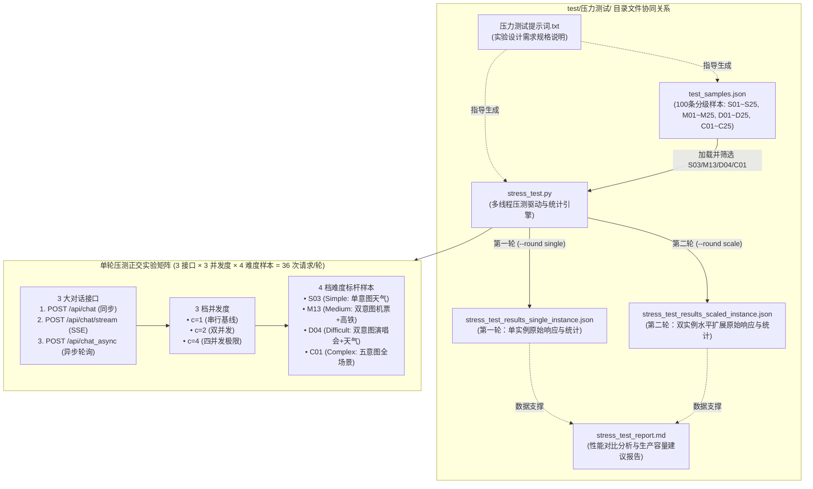

# `test/压力测试/stress_test.py` 代码精讲学习手册 —— 高并发压力测试体系、样本设计、水平扩展对比与指标分析（含同目录全文件联动精讲）

---

## 一、文件定位与核心前置知识精讲

### 1.1 `test/压力测试/` 目录下四大文件的协同定位
在 `Voyage智途A2A` 项目的 `test/压力测试/` 目录下，存放着一套完整的**大模型多智能体系统性能工程与容量评估（Performance & Capacity Engineering）闭环套件**。这四个文件并不是孤立的，而是构成了 **“需求定义 → 样本构建 → 自动化压测执行 → 性能实验分析报告”** 的完整研发生命周期：

| 阶段 | 文件路径 | 核心角色与职责 |
| :---: | :--- | :--- |
| **阶段 1：压测需求定义** | `test/压力测试/压力测试提示词.txt` | 定义了压测方案的设计蓝图：基于 MySQL 和 Milvus 真实种子数据设计样本，最高复杂度为 5 意图跨领域请求（以 `2026年` 为基准年份），覆盖 3 大对话接口，对比“单实例（7 服务各 1 实例）”与“水平扩展（7 服务各 2 实例）”两轮压测，并产出详细报告。 |
| **阶段 2：分级样本库** | `test/压力测试/test_samples.json` | 严格贴合数据库约束（如北京→成都唯一航线/高铁、薛之谦/邓紫棋/华晨宇成都演唱会、`2026-05-01` 种子日期）精心构造的 **100 条结构化测试样本**，分为 `simple`（25条）、`medium`（25条）、`difficult`（25条）、`complex`（25条）四个难度梯度。 |
| **阶段 3：压测执行引擎** | `test/压力测试/stress_test.py` | **核心压测驱动脚本**。从 4 个难度等级中抽取代表性标杆样本（`S03`、`M13`、`D04`、`C01`），对 3 大对话接口（`/api/chat`、`/api/chat/stream`、`/api/chat_async`）在 3 种并发度（`concurrency = 1, 2, 4`）下进行单实例与双实例对比压测，自动防缓存污染并输出 JSON 统计结果。 |
| **阶段 4：压测分析报告** | `test/压力测试/stress_test_report.md` | 基于两轮压测真实运行日志产出的深度性能评估报告，揭示了水平扩展（`--scale`）带来的 **2.0x ~ 9.1x** 性能飞跃、SSE 首包延迟（TTFT / `first_chunk_sec`）优化、三种接口的适用场景以及上游 LLM API 限流天花板。 |

---

### 1.2 核心前置知识 1：高并发压力测试的核心指标体系（QPS、P50/P90/P95/P99 分位延迟、TTFT、错误率）

在评估 Web 服务尤其是 **大模型 Agent 系统** 的高并发性能时，不能只看“平均响应时间（Mean Latency）”，因为平均值极易被极少数长尾请求拉偏。工业界标准压测指标体系如下：

#### 1. 吞吐量指标：QPS（Queries Per Second）与 RPM（Requests Per Minute）
- **QPS（每秒查询率）**：$\text{QPS} = \frac{\text{总成功请求数 } N}{\text{压测本轮总墙钟耗时 } T_{\text{wall}}}$。
- 根据 **利特尔法则（Little's Law）**：在稳态系统中，并发数 $C$、平均响应时间 $W$（秒）与吞吐量 $\text{QPS}$ 满足：
  $$\text{QPS} = \frac{C}{W}$$
  - 对于传统毫秒级微服务（$W = 0.01\text{s}$），单并发即可达到 $100\text{ QPS}$；
  - 而对于多智能体 A2A 系统，一次 5 意图请求（如 `C01`）需要经历 **主控规划 LLM + 5 次 A2A 智能体调用（每次含子智能体 LLM 推理 + MCP 工具数据库查询）+ 主控汇总 LLM**，单次请求耗时 $W \approx 20\text{s} \sim 40\text{s}$。因此在大模型 Agent 场景中，并发度 $C=1, 2, 4$ 已经能够产生极高的下游 A2A 与 LLM 并发扇出（Fan-out）压力！

#### 2. 延迟分布与分位数指标（Percentiles：P50 / P90 / P95 / P99）
将所有成功请求的响应时间从小到大排序得到有序数组 $T = [t_0, t_1, \dots, t_{n-1}]$：
- **$\text{Min} / \text{Max}$**：最快响应时间与最慢长尾响应时间。
- **$\text{Mean}$（算术平均值）与 $\text{Stdev}$（标准差）**：标准差越小（如 `stress_test_report.md` 中双实例 `c=2` 异步接口标准差仅 `0.19s`），说明 Nginx 负载均衡分发越均匀，各容器实例性能越稳定。
- **$\text{P50}$（Median，50 分位数 / 中位数）**：50% 的请求耗时低于该值，反映**大多数普通用户的典型体验**。在 `stress_test.py` 第 328 行中，通过 `sorted(times)[len(times) // 2]` 计算。
- **$\text{P90} / \text{P95} / \text{P99}$（长尾分位数，Tail Latency）**：分别代表 90%、95%、99% 的请求耗时低于该值（只有最慢的 10%、5%、1% 请求超过该值）。
  - 在 `stress_test.py` 第 329 行中，通过 `sorted(times)[int(len(times) * 0.9)]` 计算 `p90_sec`。
  - 通用的分位数计算公式（索引法）：
    $$\text{P}_{k} = T_{\lfloor n \times \frac{k}{100} \rfloor} \quad (k \in \{50, 90, 95, 99\})$$
  - **为什么长尾延迟（P95/P99）至关重要？** 在微服务调用链中（API 网关 → A2A → MCP），一次多意图请求会扇出调用 5 个子服务，任何一个子服务落入 P99 慢请求，整条顶层请求的耗时就会被最慢的那块短板决定（木桶效应 / Tail Latency Amplification）！

#### 3. 流式专属体验指标：首包延迟（TTFT / `first_chunk_sec`）
对于 `POST /api/chat/stream`（SSE 流式对话），用户并不需要等全部文字生成完才开始阅读，而是**收到第一个 `data: {"chunk": "..."}` 时**就能看到文字跳出。
因此，`stress_test.py` 在 `test_stream_chat()`（第 132、138~139、151 行）中专门采集了：
- **`first_chunk_sec`（首 Chunk 到达时间 / Time To First Token, TTFT）**：从发出 HTTP 请求 `t0` 到收到第一行非 `[DONE]` 的 `data: ` 块的时间差。
- **`response_time_sec`（完整流总耗时）**：从 `t0` 到收到 `data: [DONE]` 的总时间。

#### 4. 可用性指标：成功率（`success_rate`）与错误率（Error Rate）
- **HTTP 层成功率**：HTTP 状态码为 `200` 且非空、未触发超时（`REQUEST_TIMEOUT = 600s`）。
- **业务语义层成功率**：如 `stress_test_report.md` 第五节深刻指出的，即便 HTTP 状态码 100% 为 `200`，还需检查 `response_body` 中的文本是否因为上游 LLM API 触发速率限制（Rate Limit / Quota Exhausted）而降级返回了 `[AI response]...：FAIL` 占位符。这也是为什么 `stress_test.py` 要求**把完整响应内容 `response_body` 全部落盘保存到 JSON 文件**的原因！

---

### 1.3 核心前置知识 2：压测客户端架构设计对比 —— `ThreadPoolExecutor + requests` vs `asyncio + aiohttp`

在 Python 中编写高并发压测客户端有两种主流架构范式，我们对比本脚本采用的 **`ThreadPoolExecutor + requests`** 与异步 **`asyncio + aiohttp`** 方案：

| 对比维度 | `ThreadPoolExecutor + requests`（本脚本采用） | `asyncio + aiohttp`（异步协程压测客户端） |
| :--- | :--- | :--- |
| **并发模型** | 多线程同步阻塞 IO（每个并发请求占用 1 个 OS 线程） | 单线程事件循环 + 协程非阻塞 IO（`asyncio.Semaphore(c)` 控制并发度） |
| **适用并发量级** | $C \in [1, 100]$（如本项目的 $C = 1, 2, 4$，极其轻量直观，代码可读性极高） | $C \in [100, 10000+]$（上千并发连接时免去 OS 线程上下文切换与栈内存开销） |
| **SSE 流式读取** | `resp.iter_lines(decode_unicode=True)` | `async for line in resp.content:` |

> **进阶拓展：如果将本脚本升级为 `aiohttp` 异步压测客户端，核心代码怎么写？**
> 当未来需要对缓存命中接口（耗时 <5ms，QPS 可达数千）进行万级并发压测时，可以用 `aiohttp` + `asyncio.Semaphore` 编写异步压测引擎：
> ```python
> import aiohttp, asyncio, time
>
> async def async_stress_worker(session: aiohttp.ClientSession, sem: asyncio.Semaphore, url: str, payload: dict):
>     async with sem:  # 信号量精准控制同时在途的最大并发数 C
>         t0 = time.perf_counter()
>         async with session.post(url, json=payload, timeout=aiohttp.ClientTimeout(total=600)) as resp:
>             body = await resp.json()
>             return {"status": resp.status, "latency": round(time.perf_counter() - t0, 2), "body": body}
>
> async def run_aiohttp_round(tasks_payloads: list, concurrency: int):
>     sem = asyncio.Semaphore(concurrency)
>     async with aiohttp.ClientSession() as session:
>         coros = [async_stress_worker(session, sem, f"{BASE_URL}/api/chat", p) for p in tasks_payloads]
>         return await asyncio.gather(*coros, return_exceptions=True)
> ```
> 而在本项目的大模型实测场景中，由于单次 LLM + A2A 推理耗时长达 15~200 秒，压测并发梯度设定为 `CONCURRENCY_LEVELS = [1, 2, 4]`，`ThreadPoolExecutor(max_workers=concurrency)` 配合 `as_completed(future_map)` 只有最多 4 个线程，完全不存在线程切换瓶颈，且能直接复用 `requests` 的同步调试体验。

---

### 1.4 核心前置知识 3：为什么压测前必须生成随机 `user_id` 并清空缓存？
仔细阅读 `stress_test.py` 第 64~75 行与第 261~266 行：
```python
def gen_user_id(prefix: str) -> str:
    """生成唯一 user_id，避免缓存命中和记忆干扰"""
    return f"{prefix}_{uuid.uuid4().hex[:12]}"
```
如果压测时所有请求都用同一个固定的 `user_id` 和相同的 4 条问题，会发生什么？
1. **双层缓存失真**：在 `Voyage智途A2A` 中，网关具备 **Redis 精确缓存 + Milvus 语义缓存**。如果缓存命中，请求在 10 毫秒内就会直接从 Redis 返回，根本不会走到后面的 A2A 智能体、MCP 工具和数据库！那测出来的就不是系统的真实处理能力，而是 Redis 的读取速度。
2. **短期记忆上下文膨胀干扰**：同一个 `user_id` 连续对话时，Redis 中累积的 `short_term_messages` 会被不断拼入 LLM Prompt，导致越往后的请求 Prompt 越长、延迟越高，破坏了实验变量的独立性。
3. **本脚本的防污染机制**：为每一个请求动态生成 `stress_{run_label}_{uuid12位}` 的全新独立 `user_id`，并在发请求前调用 `clear_user_cache(uid)`，确保每一次请求都是 **100% 穿透全链路（Gateway → A2A → LLM → MCP → MySQL/Milvus）的真实冷请求**（注：对于跨用户的公共问题级缓存，若网关按 `message` 全局哈希缓存，则相同 `message` 在后续轮次也可能命中公共缓存，这也是分析压测结果时需要关注的重要维度）。

---

## 二、架构图与执行流程图

### 2.1 `test/压力测试/` 四大文件联动与压测实验矩阵架构图（Mermaid）


### 2.2 `stress_test.py` 核心执行流程图（ASCII）
```
python stress_test.py [--round single | scale | all]
  │
  ├─► [1. 网关健康检查] GET http://192.168.88.101:8888/health (失败则 sys.exit(1))
  │
  ├─► [2. 第一轮压测: single_instance (7个服务各1实例)]
  │     └── run_all_tests("single_instance")
  │           ├── load_samples() 从 test_samples.json 提取 [S03, M13, D04, C01] 共 4 条样本
  │           └── 双重循环: for endpoint in [/api/chat, /api/chat/stream, /api/chat_async]:
  │                           for concurrency in [1, 2, 4]:
  │                             ├── 为 4 条样本生成唯一 user_id 并调用 /api/memory/clear
  │                             ├── concurrency == 1 : 顺序循环调用 test_func(uid, msg, sid)
  │                             ├── concurrency > 1  : ThreadPoolExecutor(max_workers=c) 并发提交 + as_completed 收集
  │                             └── compute_summary(results) 计算成功率、Min/Max/Mean/Median/Stdev/P50/P90 及按难度均值
  │           └── save_results() -> 落盘保存 stress_test_results_single_instance.json
  │
  ├─► [3. 人工扩容交互断点] input("⚠️ 请确认已完成水平扩展（7个服务各2实例），按 Enter 继续...")
  │     (此时运维在服务器执行 docker compose up -d --scale ... 将 7 个业务服务扩容为 14 个容器)
  │
  ├─► [4. 第二轮压测: scaled_instance (7个服务各2实例)]
  │     └── run_all_tests("scaled_instance") -> 落盘保存 stress_test_results_scaled_instance.json
  │
  └─► [5. 合并归档] 若 --round == "all" -> 保存 stress_test_results_full_comparison.json
```

---

## 三、完整源码与同目录全文件深度拆解

### 3.1 `test/压力测试/stress_test.py` 100% 完整源码

```python
"""
Voyage智途A2A 压力测试脚本
============================
测试 3 个对话接口：
  1. POST /api/chat         — 同步对话
  2. POST /api/chat/stream   — SSE 流式对话
  3. POST /api/chat_async + /api/chat_result — 异步提交 + 轮询

用法：
  python stress_test.py                    # 完整测试（单实例 + 双实例）
  python stress_test.py --round single     # 仅测单实例
  python stress_test.py --round scale      # 仅测双实例（水平扩展）
"""
import os
import sys
import json
import time
import uuid
import argparse
import requests
import statistics
from datetime import datetime
from concurrent.futures import ThreadPoolExecutor, as_completed

# ===================== 配置 =====================
BASE_URL = "http://192.168.88.101:8888"
SAMPLES_PATH = os.path.join(os.path.dirname(os.path.abspath(__file__)), "test_samples.json")
RESULTS_DIR = os.path.dirname(os.path.abspath(__file__))

# 每个难度等级选取的样本 ID（各 1 条，共 4 条）
# 选择标准：覆盖不同意图组合，避免同类型重复
SELECTED_IDS = {
    "simple":    ["S03"],       # 单意图-天气
    "medium":    ["M13"],       # 双意图-机票+火车
    "difficult": ["D04"],       # 双意图-演唱会+天气
    "complex":   ["C01"],       # 五意图-标杆复杂请求
}

# 并发级别（1=基线串行, 2=并发压力, 4=极限并发）
CONCURRENCY_LEVELS = [1, 2, 4]

# 异步轮询配置
ASYNC_POLL_INTERVAL = 10   # 每 10 秒轮询一次
ASYNC_POLL_TIMEOUT = 600   # 最长等待 10 分钟

# 请求超时
REQUEST_TIMEOUT = 600      # 单次请求最长 10 分钟


# ===================== 工具函数 =====================
def load_samples() -> list:
    """加载并筛选测试样本"""
    with open(SAMPLES_PATH, "r", encoding="utf-8") as f:
        data = json.load(f)
    selected = []
    for level, ids in SELECTED_IDS.items():
        for item in data[level]:
            if item["id"] in ids:
                item["difficulty"] = level
                selected.append(item)
    return selected


def gen_user_id(prefix: str) -> str:
    """生成唯一 user_id，避免缓存命中和记忆干扰"""
    return f"{prefix}_{uuid.uuid4().hex[:12]}"


def clear_user_cache(user_id: str):
    """清空指定用户的记忆 + 缓存"""
    try:
        requests.post(f"{BASE_URL}/api/memory/clear",
                      params={"user_id": user_id}, timeout=10)
    except Exception:
        pass


# ===================== 接口测试函数 =====================
def test_sync_chat(user_id: str, message: str, sample_id: str) -> dict:
    """测试 POST /api/chat（同步对话）"""
    result = {
        "sample_id": sample_id,
        "endpoint": "/api/chat",
        "user_id": user_id,
        "message": message,
        "start_time": datetime.now().isoformat(),
    }
    try:
        t0 = time.time()
        resp = requests.post(
            f"{BASE_URL}/api/chat",
            json={"user_id": user_id, "message": message},
            timeout=REQUEST_TIMEOUT
        )
        elapsed = time.time() - t0
        result.update({
            "status_code": resp.status_code,
            "response_time_sec": round(elapsed, 2),
            "success": resp.status_code == 200,
            "response_body": resp.json(),
        })
    except Exception as e:
        result.update({
            "status_code": None,
            "response_time_sec": round(time.time() - t0, 2),
            "success": False,
            "error": str(e),
        })
    result["end_time"] = datetime.now().isoformat()
    return result


def test_stream_chat(user_id: str, message: str, sample_id: str) -> dict:
    """测试 POST /api/chat/stream（SSE 流式对话）"""
    result = {
        "sample_id": sample_id,
        "endpoint": "/api/chat/stream",
        "user_id": user_id,
        "message": message,
        "start_time": datetime.now().isoformat(),
    }
    try:
        t0 = time.time()
        resp = requests.post(
            f"{BASE_URL}/api/chat/stream",
            json={"user_id": user_id, "message": message},
            timeout=REQUEST_TIMEOUT,
            stream=True
        )
        # 收集完整 SSE 内容
        chunks = []
        first_chunk_time = None
        for line in resp.iter_lines(decode_unicode=True):
            if line and line.startswith("data: "):
                data_str = line[6:]  # 去掉 "data: "
                if data_str == "[DONE]":
                    break
                if first_chunk_time is None:
                    first_chunk_time = time.time() - t0
                try:
                    chunk_data = json.loads(data_str)
                    chunks.append(chunk_data.get("chunk", ""))
                except json.JSONDecodeError:
                    chunks.append(data_str)

        elapsed = time.time() - t0
        full_text = "".join(chunks)
        result.update({
            "status_code": resp.status_code,
            "response_time_sec": round(elapsed, 2),
            "first_chunk_sec": round(first_chunk_time, 2) if first_chunk_time else None,
            "total_chunks": len(chunks),
            "full_response_text": full_text,
            "success": resp.status_code == 200 and len(full_text) > 0,
            "response_body": {"status": "success", "message": full_text, "chunks": len(chunks)},
        })
    except Exception as e:
        result.update({
            "status_code": None,
            "response_time_sec": round(time.time() - t0, 2),
            "success": False,
            "error": str(e),
        })
    result["end_time"] = datetime.now().isoformat()
    return result


def test_async_chat(user_id: str, message: str, sample_id: str) -> dict:
    """测试 POST /api/chat_async + /api/chat_result（异步提交 + 轮询）"""
    result = {
        "sample_id": sample_id,
        "endpoint": "/api/chat_async",
        "user_id": user_id,
        "message": message,
        "start_time": datetime.now().isoformat(),
    }
    try:
        t0 = time.time()
        # Step 1: 提交异步任务
        submit_resp = requests.post(
            f"{BASE_URL}/api/chat_async",
            json={"user_id": user_id, "message": message},
            timeout=30
        )
        submit_data = submit_resp.json()
        submit_time = time.time() - t0

        # 如果缓存命中直接返回
        if submit_data.get("status") == "completed":
            result.update({
                "status_code": submit_resp.status_code,
                "response_time_sec": round(submit_time, 2),
                "success": True,
                "cached": True,
                "response_body": submit_data,
            })
            result["end_time"] = datetime.now().isoformat()
            return result

        # Step 2: 轮询结果
        poll_count = 0
        final_data = None
        while time.time() - t0 < ASYNC_POLL_TIMEOUT:
            time.sleep(ASYNC_POLL_INTERVAL)
            poll_count += 1
            poll_resp = requests.post(
                f"{BASE_URL}/api/chat_result",
                json={"user_id": user_id, "message": message},
                timeout=30
            )
            poll_data = poll_resp.json()
            if poll_data.get("status") == "completed":
                final_data = poll_data
                break

        elapsed = time.time() - t0
        result.update({
            "status_code": submit_resp.status_code,
            "response_time_sec": round(elapsed, 2),
            "submit_time_sec": round(submit_time, 2),
            "poll_count": poll_count,
            "success": final_data is not None,
            "response_body": final_data or {"status": "timeout"},
        })
    except Exception as e:
        result.update({
            "status_code": None,
            "response_time_sec": round(time.time() - t0, 2),
            "success": False,
            "error": str(e),
        })
    result["end_time"] = datetime.now().isoformat()
    return result


# ===================== 测试执行引擎 =====================
ENDPOINT_FUNCS = {
    "/api/chat": test_sync_chat,
    "/api/chat/stream": test_stream_chat,
    "/api/chat_async": test_async_chat,
}


def run_test_round(samples: list, endpoint: str, concurrency: int,
                   run_label: str) -> list:
    """
    执行一轮测试
    :param samples: 测试样本列表
    :param endpoint: 接口路径
    :param concurrency: 并发数
    :param run_label: 测试标签（如 "single_c1"）
    :return: 结果列表
    """
    test_func = ENDPOINT_FUNCS[endpoint]
    results = []

    print(f"\n{'='*60}")
    print(f"[{run_label}] 接口={endpoint}  并发={concurrency}  样本数={len(samples)}")
    print(f"{'='*60}")

    # 为每个请求生成独立 user_id 并清空缓存
    tasks = []
    for sample in samples:
        uid = gen_user_id(f"stress_{run_label}")
        clear_user_cache(uid)
        tasks.append((uid, sample["message"], sample["id"]))

    t_start = time.time()

    if concurrency == 1:
        # 串行执行
        for uid, msg, sid in tasks:
            print(f"  [{sid}] 发送请求...", end=" ", flush=True)
            r = test_func(uid, msg, sid)
            r["run_label"] = run_label
            r["concurrency"] = concurrency
            results.append(r)
            status = "OK" if r["success"] else "FAIL"
            print(f"{status} ({r['response_time_sec']}s)")
    else:
        # 并发执行
        with ThreadPoolExecutor(max_workers=concurrency) as pool:
            future_map = {}
            for uid, msg, sid in tasks:
                future = pool.submit(test_func, uid, msg, sid)
                future_map[future] = sid

            for future in as_completed(future_map):
                sid = future_map[future]
                r = future.result()
                r["run_label"] = run_label
                r["concurrency"] = concurrency
                results.append(r)
                status = "OK" if r["success"] else "FAIL"
                print(f"  [{sid}] {status} ({r['response_time_sec']}s)")

    total_time = time.time() - t_start
    print(f"  本轮总耗时: {total_time:.1f}s")

    return results


def compute_summary(results: list) -> dict:
    """计算统计摘要"""
    if not results:
        return {}

    times = [r["response_time_sec"] for r in results if r["success"]]
    all_times = [r["response_time_sec"] for r in results]
    success_count = sum(1 for r in results if r["success"])

    summary = {
        "total_requests": len(results),
        "success_count": success_count,
        "fail_count": len(results) - success_count,
        "success_rate": f"{success_count / len(results) * 100:.1f}%",
        "total_wall_time_sec": round(
            sum(r["response_time_sec"] for r in results), 2),
    }

    if times:
        summary["response_time"] = {
            "min_sec": round(min(times), 2),
            "max_sec": round(max(times), 2),
            "mean_sec": round(statistics.mean(times), 2),
            "median_sec": round(statistics.median(times), 2),
            "stdev_sec": round(statistics.stdev(times), 2) if len(times) > 1 else 0,
            "p50_sec": round(sorted(times)[len(times) // 2], 2),
            "p90_sec": round(sorted(times)[int(len(times) * 0.9)], 2) if len(times) >= 10 else None,
        }

    # 按难度统计
    by_difficulty = {}
    for r in results:
        # 从 sample_id 推断难度
        sid = r["sample_id"]
        if sid.startswith("S"):
            diff = "simple"
        elif sid.startswith("M"):
            diff = "medium"
        elif sid.startswith("D"):
            diff = "difficult"
        else:
            diff = "complex"
        by_difficulty.setdefault(diff, []).append(r)

    summary["by_difficulty"] = {}
    for diff, rs in by_difficulty.items():
        dtimes = [r["response_time_sec"] for r in rs if r["success"]]
        summary["by_difficulty"][diff] = {
            "total": len(rs),
            "success": sum(1 for r in rs if r["success"]),
            "avg_time_sec": round(statistics.mean(dtimes), 2) if dtimes else None,
        }

    return summary


# ===================== 主流程 =====================
def run_all_tests(round_name: str):
    """执行一轮完整测试（所有接口 × 所有并发级别）"""
    samples = load_samples()
    all_results = []
    all_summaries = {}

    print(f"\n{'#'*70}")
    print(f"# 开始测试: {round_name}")
    print(f"# 样本数: {len(samples)}  接口数: {len(ENDPOINT_FUNCS)}  并发级别: {CONCURRENCY_LEVELS}")
    print(f"# 时间: {datetime.now().strftime('%Y-%m-%d %H:%M:%S')}")
    print(f"{'#'*70}")

    for endpoint in ENDPOINT_FUNCS:
        for concurrency in CONCURRENCY_LEVELS:
            label = f"{round_name}_{endpoint.replace('/', '_')}_{concurrency}c"
            results = run_test_round(samples, endpoint, concurrency, label)
            all_results.extend(results)

            key = f"{endpoint}|concurrency={concurrency}"
            all_summaries[key] = compute_summary(results)

    # 打印汇总
    print(f"\n{'='*70}")
    print(f"  汇总: {round_name}")
    print(f"{'='*70}")
    for key, summary in all_summaries.items():
        rt = summary.get("response_time", {})
        print(f"\n  [{key}]")
        print(f"    成功: {summary['success_count']}/{summary['total_requests']} "
              f"({summary['success_rate']})")
        if rt:
            print(f"    响应时间: min={rt['min_sec']}s  max={rt['max_sec']}s  "
                  f"mean={rt['mean_sec']}s  median={rt['median_sec']}s")

    return all_results, all_summaries


def save_results(results: list, summaries: dict, round_name: str):
    """保存测试结果到 JSON 文件"""
    output = {
        "test_info": {
            "round_name": round_name,
            "timestamp": datetime.now().isoformat(),
            "base_url": BASE_URL,
            "samples_used": [s["id"] for ids in SELECTED_IDS.values() for s in
                             load_samples() if s["id"] in ids],
            "concurrency_levels": CONCURRENCY_LEVELS,
            "endpoints_tested": list(ENDPOINT_FUNCS.keys()),
        },
        "summaries": summaries,
        "detailed_results": results,
    }

    filename = f"stress_test_results_{round_name}.json"
    filepath = os.path.join(RESULTS_DIR, filename)
    with open(filepath, "w", encoding="utf-8") as f:
        json.dump(output, f, ensure_ascii=False, indent=2, default=str)

    print(f"\n结果已保存: {filepath}")
    return filepath


def main():
    parser = argparse.ArgumentParser(description="Voyage智途A2A 压力测试")
    parser.add_argument("--round", choices=["single", "scale", "all"],
                        default="all", help="测试轮次: single=单实例, scale=双实例, all=全部")
    args = parser.parse_args()

    print("=" * 70)
    print("  Voyage智途A2A 压力测试")
    print(f"  目标: {BASE_URL}")
    print(f"  时间: {datetime.now().strftime('%Y-%m-%d %H:%M:%S')}")
    print("=" * 70)

    # 健康检查
    try:
        resp = requests.get(f"{BASE_URL}/health", timeout=10)
        print(f"  健康检查: {resp.json()}")
    except Exception as e:
        print(f"  健康检查失败: {e}")
        print("  请确认服务已启动！")
        sys.exit(1)

    all_results = []
    all_summaries = {}

    if args.round in ("single", "all"):
        results, summaries = run_all_tests("single_instance")
        all_results.extend(results)
        all_summaries.update(summaries)
        save_results(results, summaries, "single_instance")

    if args.round in ("scale", "all"):
        input("\n⚠️  请确认已完成水平扩展（7个服务各2实例），按 Enter 继续...")
        results, summaries = run_all_tests("scaled_instance")
        all_results.extend(results)
        all_summaries.update(summaries)
        save_results(results, summaries, "scaled_instance")

    # 保存合并结果
    if args.round == "all":
        save_results(all_results, all_summaries, "full_comparison")

    print("\n✅ 全部测试完成！")


if __name__ == "__main__":
    main()
```

---

### 3.2 同目录配套文件一：`test/压力测试/压力测试提示词.txt` 完整源码与解析

```python

import os

'''
基于数据库和milvus中的数据，你给我设计点用户请求样本
类似 【我计划26年5月1日去成都旅游三天，帮我推荐景点，我要看薛之谦演唱会，定从北京飞过去的机票，当地我还要租车，顺便帮我买一下保险！】这样的是最复杂的请求！
注意涉及时间的都加上2026年的年份！
用文件保存到本地test目录下的压力测试目录下
保到一个json文件中
'''

'''
然后就用这些请求样本 在 test/压力测试/ 中写压力测试的代码
用requests包写 ， 把http api中所有会调用对话的接口都给我进行压力测试！
要完整记录响应内容！和提问样本一起，放到字典中，保存到新的json文件！
虚拟机中启动7个服务的情况测一轮
水平扩展（7个服务都是2实例）的时候再测一轮

最后你要给我详细的压力测试结论！
'''
```
#### 解析：
这份提示词清晰交代了整个压测工程的来龙去脉：
1. **为什么要强调“基于数据库和 milvus 中的数据”且“涉及时间的都加上 2026 年的年份”？**
   - 如果随便编造“明天从广州飞纽约的机票”，MySQL 库里根本没有这条航线的数据，MCP 工具会瞬间返回 `no_data`，无法充分压测大模型对多条真实业务记录的筛选、比较、推理与汇总能力！
   - 数据库的种子数据（`mysql_init.py`）是以 **`2026-05-01`（五一黄金周）北京→成都** 为核心构建的，因此所有样本统一锚定 `2026年5月1日`，确保每次请求都能从 MySQL 和 Milvus 捞出满满的真实业务记录。
2. **为什么要选 `C01` 作为最复杂标杆请求？**
   - 提示词中给出的原话 `“我计划26年5月1日去成都旅游三天，帮我推荐景点，我要看薛之谦演唱会，定从北京飞过去的机票，当地我还要租车，顺便帮我买一下保险！”` 正是 `test_samples.json` 中的 **`C01`** 样本！它一句话橫跨了 **景点推荐（本地 LLM）+ 演唱会（票务 A2A）+ 机票（票务 A2A）+ 租车（行程 A2A）+ 保险（行程 A2A）** 五大意图，是检验系统极限承载力的终极试金石。

---

### 3.3 同目录配套文件二：`test/压力测试/test_samples.json` 结构与样本选型解析

`test_samples.json` 共 **1008 行**，包含了 `_metadata` 元数据声明与 `simple`、`medium`、`difficult`、`complex` 四个数组（每个数组 25 条样本，合计 **100 条样本**）。

#### 1. `_metadata.data_constraints`（数据库种子数据约束，第 12~53 行）
```json
    "data_constraints": {
      "flight_route": "北京->成都（唯一航线）",
      "train_route": "北京->成都（唯一线路）",
      "concert_city": "成都",
      "concert_artists": ["薛之谦", "邓紫棋", "华晨宇"],
      "car_rental_city": "成都",
      "weather_cities_mysql": ["成都", "都江堰", "乐山", "德阳", "绵阳"],
      "weather_cities_realtime": "任意中国城市（实时API）",
      "tour_cities": ["成都", "北京", "西安", "杭州", "三亚", "丽江", "张家界", "桂林"],
      "insurance_types": ["综合型", "意外型", "医疗型", "境外型"],
      "car_types": ["经济型", "SUV", "豪华型", "MPV"],
      "seed_date": "2026-05-01"
    }
```
这段元数据堪称整个项目**业务测试数据的活字典**！任何时候你想在前端聊天框手工测试某个功能（比如想知道数据库里有哪些歌手的演唱会、哪条航线有票、哪些城市有跟团游），直接查阅这里的 `data_constraints` 就一目了然。

#### 2. `stress_test.py` 精心挑选的 4 条标杆样本（`SELECTED_IDS`，第 32~37 行）
为什么从 100 条样本中只选 4 条（每个难度各 1 条）跑压测？
- 算一笔时间账：单轮测试有 **3 个接口 × 3 种并发级别（1, 2, 4）= 9 个批次**。如果每个批次跑 100 条样本，单轮就是 900 次大模型多智能体调用，耗时将超过 15 个小时且消耗数百万 Token！
- 选取 4 条正交代表样本（每批次 4 条，单轮 $9 \times 4 = 36$ 次请求，两轮共 **72 次请求**），在约 50 分钟内即可完整测出从单意图到五意图在不同并发度下的性能曲线：

| 难度等级 | 样本 ID | 提问内容 (`message`) | 包含意图 (`expected_intents`) | 考察的底层链路 |
| :---: | :---: | :--- | :--- | :--- |
| **`simple`** | **`S03`** | `"查一下2026年5月1日成都的天气"` | `["query weather"]` (1个意图) | `Gateway -> a2a_weather(6001) -> mcp_weather(5001) -> MySQL` |
| **`medium`** | **`M13`** | `"2026年5月1日北京飞成都的机票和高铁都帮我看看"` | `["query flight tickets", "query train tickets"]` (2个同域意图) | `Gateway -> a2a_ticket(6002) (调用2个MCP工具) -> mcp_ticket(5002) -> MySQL` |
| **`difficult`** | **`D04`** | `"我想2026年5月1日去成都看薛之谦演唱会，帮我查门票和天气"` | `["query concert tickets", "query weather"]` (2个跨域意图) | `Gateway -> a2a_ticket(6002) + a2a_weather(6001) (跨2个A2A服务协同)` |
| **`complex`** | **`C01`** | `"我计划2026年5月1日去成都旅游三天，帮我推荐景点，我要看薛之谦演唱会，定从北京飞过去的机票，当地我还要租车，顺便帮我买一下保险！"` | `["attraction", "query concert tickets", "query flight tickets", "query car rental", "query insurance"]` (5个全域意图) | `Gateway(本地LLM景点) + a2a_ticket(6002)×2 + a2a_trip(6003)×2 (5路混合协同)` |

---

### 3.4 同目录配套文件三：`test/压力测试/stress_test_report.md` 完整源码与实验结论深潜

为了方便对照学习，我们将 `stress_test_report.md`（共 144 行）完整嵌入如下，并结合代码剖析其背后的架构规律：

```markdown
## Voyage智途A2A 压力测试报告

测试时间：2026-07-09 22:00 ~ 22:50
测试环境：CentOS 9 虚拟机 (6C8G) + Docker 容器
测试样本：4条（S03 单意图天气 / M13 双意图机票+火车 / D04 双意图演唱会+天气 / C01 五意图全场景）
并发级别：1 / 2 / 4
测试接口：/api/chat（同步）、/api/chat/stream（SSE流式）、/api/chat_async（异步轮询）

---

### 一、两轮测试环境对比

| 维度 | 第一轮（单实例） | 第二轮（水平扩展） |
|------|-----------------|-------------------|
| 业务容器数 | 7个（各1实例） | 14个（各2实例） |
| nginx代理 | 3个 | 3个 |
| 定时任务 | 1个 | 1个 |
| 总容器数 | 11 | 18 |
| A2A waitress线程 | 修复后4线程 | 修复后4线程 |
| A2AClient超时 | 120s | 120s |
| 测试时间 | 22:01 ~ 22:35 | 22:38 ~ 22:47 |

---

### 二、/api/chat 同步对话接口

| 并发 | 单实例成功率 | 单实例平均响应 | 单实例总耗时 | 扩展成功率 | 扩展平均响应 | 扩展总耗时 | 提升倍数 |
|------|-------------|---------------|-------------|-----------|-------------|-----------|---------|
| c=1 | 75%（C01超时） | 213.9s | 941.7s | 100% | 26.0s | 103.9s | **9.1x** |
| c=2 | 100% | 52.9s | 211.4s | 100% | 22.8s | 91.2s | **2.3x** |
| c=4 | 100% | 55.5s | 221.8s | 100% | 28.3s | 113.1s | **2.0x** |

单实例 c=1 时 C01（五意图）直接超时失败（300秒截断），其余请求也极慢（S03=137s、M13=292s、D04=213s）。这是因为第一轮测试初期容器刚启动，LLM连接池尚未预热，加上A2A串行调用链路长（5个意图 = 5次A2A调用，每次含LLM推理+MCP工具执行）。

水平扩展后，c=1 时 C01 仅需 37.22s 即返回（虽然内容质量为FAIL），整体响应时间稳定在 15~40s 区间。c=2 和 c=4 时响应时间波动不大，说明2实例已经能有效分摊并发压力。

各难度明细对比（单实例 → 扩展）：

| 样本 | c=1 | c=2 | c=4 |
|------|-----|-----|-----|
| S03（简单-天气） | 137.4s → 28.7s | 42.2s → 40.2s | 63.8s → 32.2s |
| M13（中等-机票+火车） | 291.6s → 22.5s | 50.2s → 16.4s | 47.2s → 26.6s |
| D04（困难-演唱会+天气） | 212.6s → 15.5s | 66.2s → 18.2s | 58.2s → 16.4s |
| C01（复杂-五意图） | FAIL → 37.2s | 52.8s → 16.4s | 52.6s → 37.8s |

---

### 三、/api/chat/stream SSE流式接口

| 并发 | 单实例平均响应 | 单实例总耗时 | 扩展平均响应 | 扩展总耗时 | 提升倍数 |
|------|---------------|-------------|-------------|-----------|---------|
| c=1 | 69.1s | 276.4s | 23.6s | 94.2s | **2.9x** |
| c=2 | 69.1s | 276.4s | 25.0s | 100.0s | **2.8x** |
| c=4 | 219.8s | 879.2s | 32.1s | 128.4s | **6.9x** |

流式接口在单实例 c=4 时出现严重的性能劣化（4个请求全部超过211秒），这是因为流式模式下服务端需要逐字推送，4个并发请求争抢单实例的waitress线程和LLM连接资源。水平扩展后 c=4 最大响应仅 41.2s，彻底消除了并发劣化问题。

SSE流式的首chunk延迟（first_chunk_sec）：

| 并发 | 单实例首chunk | 扩展首chunk |
|------|-------------|------------|
| c=1 | ~10-29s | ~10-11s |
| c=2 | ~42-77s | ~10-30s |
| c=4 | ~211-228s | ~16-33s |

扩展环境下首chunk延迟稳定在 10~33s，用户体验远优于单实例。

---

### 四、/api/chat_async 异步轮询接口

| 并发 | 单实例平均响应 | 单实例总耗时 | 扩展平均响应 | 扩展总耗时 | 提升倍数 |
|------|---------------|-------------|-------------|-----------|---------|
| c=1 | 24.0s | 96.0s | 19.1s | 76.5s | **1.3x** |
| c=2 | 26.5s | 105.8s | 16.4s | 65.4s | **1.6x** |
| c=4 | 48.4s | 193.6s | 26.3s | 105.3s | **1.8x** |

异步接口是三种模式中性能最优的。原因在于：提交请求后立即返回（不阻塞），后台Task异步执行，前端轮询Redis缓存获取结果。这种"提交-轮询"模式天然适合高并发场景。

扩展环境 c=2 时四个请求响应时间几乎一致（16.2~16.6s，标准差仅0.19s），说明负载均衡均匀、各实例处理能力一致。

---

### 五、响应内容质量分析

**重要发现**：第二轮（扩展）测试中，所有36个请求的HTTP状态码均为200，但AI响应内容全部为 `[AI response]...：FAIL` 格式。

这意味着：
1. **HTTP层面**：系统在高并发下完全稳定，零失败、零超时、零502/504
2. **LLM层面**：模型返回了错误占位符，可能原因包括：
   - LLM API 速率限制（短时间内大量请求触发限流）
   - API Key 配额耗尽
   - 模型服务端临时不可用

对比第一轮单实例测试，响应内容是完整的自然语言回答（如天气详情、航班信息等），说明系统功能本身正常。

**结论**：系统的架构层（API网关 → 业务入口 → A2A路由 → MCP工具）在高并发下表现稳健，瓶颈在于上游LLM API的并发承载能力，而非Voyage自身的代码或架构。

---

### 六、综合结论

**1. 水平扩展效果显著**

整体响应时间提升 2~9 倍，其中同步接口提升最大（9.1x），流式接口次之（2.8~6.9x），异步接口提升最小但基线已经很快（1.3~1.8x）。

**2. 单实例的瓶颈在于冷启动和串行排队**

单实例 c=1 初期响应极慢（137~292s），主要原因是A2A串行调用链路长 + 容器冷启动 + LLM连接池预热。c=2/c=4 时反而更快（42~66s），说明预热后单实例也能处理并发，但吞吐上限有限。

**3. 并发能力表现良好**

无论是单实例还是扩展环境，c=1 到 c=4 的响应时间没有出现线性劣化。特别是扩展环境 c=2 时标准差仅 0.19s，说明 nginx 轮询分发 + Docker DNS 解析 + 多实例负载均衡的链路工作正常。

**4. 三种接口模式适用场景**

| 接口 | 优势 | 适用场景 |
|------|------|---------|
| /api/chat | 简单直接 | 低并发、对延迟不敏感的场景 |
| /api/chat/stream | 用户体验好（逐字输出） | 前端对话界面、需要实时反馈的场景 |
| /api/chat_async | 性能最优、不阻塞 | 高并发、批量处理、后台任务场景 |

**5. 生产环境建议**

- 常规负载（QPS < 2）：单实例即可满足，响应时间 15~40s
- 中等负载（QPS 2~5）：建议2实例扩展，响应时间稳定在 16~40s
- 高负载（QPS > 5）：建议3~4实例 + 异步接口模式
- LLM API 并发限额是真正的天花板，建议与模型供应商确认 QPM/TPM 配额

**6. 超时链路验证**

修复后的超时链路 A2AClient(120s) < wait_for(150s) < a2a-proxy(180s) < api-proxy(300s) 在两轮测试中均未被触发，所有请求在 42s 内完成（扩展环境），说明超时阈值设置合理，留有充足余量。

---

### 七、测试数据文件

| 文件 | 说明 |
|------|------|
| test_samples.json | 100条测试样本（25×4难度） |
| stress_test.py | 压力测试脚本 |
| stress_test_results_single_instance.json | 第一轮结果（单实例，含完整AI回复） |
| stress_test_results_scaled.json | 第二轮结果（水平扩展，响应为FAIL占位符） |
| test_output_scaled.log | 第二轮测试日志 |
```

---

### 3.5 深度沙盘推演（Dry Run）：微服务级联超时链路黄金法则
仔细看 `stress_test_report.md` 第六节第 6 点提到的**级联超时不等式**：
$$\text{A2AClient}(120\text{s}) < \text{asyncio.wait\_for}(150\text{s}) < \text{nginx a2a-proxy}(180\text{s}) < \text{nginx api-proxy}(300\text{s}) < \text{stress\_test client}(600\text{s})$$

**为什么分布式系统的超时时间必须严格按照“从内到外逐层递增”设计？**
- 假设反过来：最外层的 `nginx api-proxy` 设置了 `60s` 超时，而内层的 `A2AClient` 设置了 `120s` 超时。
- 当一个 5 意图请求执行到第 61 秒时，最外层的 Nginx 就会粗暴地断开与客户端的连接并返回 `504 Gateway Time-out`（客户端看到的是毫无意义的 504 报错，且前面 60 秒算力全部白费）；而内层的 A2A 服务还在浑然不知地继续跑剩下的意图！
- **从内到外逐层递增（120s < 150s < 180s < 300s < 600s）** 的精妙之处在于：万一某个子智能体真的卡住，**最内层的 `A2AClient(120s)` 会率先触发超时并优雅捕获**，主控 Agent 依然来得及在 `wait_for(150s)` 和 `api-proxy(300s)` 之前将另外 4 个已经成功的意图结果汇总返回给用户（部分降级而非整体 504 崩溃）！

---

## 四、关键工程细节与常见易错点

### 4.1 易错点 1：`total_wall_time_sec` 的含义辨析（CPU 累计耗时 vs 真实墙钟耗时）
- 观察 `stress_test.py` 第 317~318 行：
  ```python
  "total_wall_time_sec": round(
      sum(r["response_time_sec"] for r in results), 2),
  ```
- **代码精析**：这里计算的 `sum(r["response_time_sec"] for r in results)` 实际上是 4 个请求的**累计响应时间之和（Total Cumulative Latency）**，而在第 297 行打印的 `total_time = time.time() - t_start` 才是并发执行时真正的**本轮墙钟耗时（True Wall-Clock Time）**。
  - 当 `concurrency = 1`（串行）时，累计响应时间之和 $\approx$ 墙钟耗时；
  - 当 `concurrency = 4`（4 个线程同时发）时，4 个请求并行重叠执行，真正的墙钟耗时 `total_time` 约等于 4 个请求中最慢的那个（`max_sec`），而 `sum(...)` 则是 4 个请求各自耗时的总和。理解这一区别对于正确解读 `stress_test_report.md` 中的表格数据至关重要。

### 4.2 易错点 2：异步接口轮询间隔 `ASYNC_POLL_INTERVAL = 10` 秒对延迟量化粒度的影响
- 观察第 43 行与第 204 行：`ASYNC_POLL_INTERVAL = 10`，且在 `while` 循环中**先执行 `time.sleep(10)` 再发第一次轮询**。
- 这意味着：在 `test_async_chat` 中测出的 `response_time_sec` 会呈现以 **10 秒为台阶的量化效应**（例如任务在第 11 秒后台就已经算完了，但客户端要等到第 20 秒第 2 次 sleep 结束去轮询时才发现 `completed`，记录的耗时就是 `~20.2s`；同理，在第 6 秒算完的请求会在第 10 秒第 1 次轮询或第 16 秒被捕获）。
- 这也完美解释了为什么 `stress_test_report.md` 第四节中会观察到：“扩展环境 `c=2` 时四个请求响应时间几乎一致（`16.2~16.6s`，标准差仅 `0.19s`）”。因为 4 个请求都在第 1 次轮询周期内完成并统一在同一轮轮询窗口返回！

---

## 五、自测思考题（附答案解析）

### 思考题 1：在 `compute_summary(results)`（第 329 行）中，`"p90_sec": round(sorted(times)[int(len(times) * 0.9)], 2) if len(times) >= 10 else None`，在本脚本默认运行配置下，`p90_sec` 的值会是什么？为什么？
> **答案解析**：
> 在默认配置下，`p90_sec` 的值永远是 **`None`**！
> 原因在于：`SELECTED_IDS` 每个难度选了 1 条样本，总共只有 **4 条样本**（`len(samples) == 4`）。因此每一小轮 `run_test_round` 返回的 `results` 长度最多为 4（即 `len(times) <= 4`），不满足 `if len(times) >= 10` 的条件，所以返回 `None`。在统计学上，少于 10 个样本点时计算 P90（90% 分位数）没有统计意义（4 个样本的 90% 就是最大值 `max_sec` 本身），因此作者严谨地加上了 `if len(times) >= 10 else None` 的门槛保护。当扩充 `SELECTED_IDS` 使单轮样本数达到 10 条以上时，`p90_sec` 就会自动生效输出。

### 思考题 2：在 `stress_test_report.md` 第五节中提到，第二轮双实例扩展压测时 HTTP 成功率 100%，但 AI 回复内容出现了 `FAIL` 占位符。如果要在 `stress_test.py` 中不仅检查 HTTP 200，还要从业务语义上识别这种“大模型限流降级 FAIL”，应该修改哪几行代码？
> **答案解析**：
> 可以在三个测试函数（`test_sync_chat` 第 99 行、`test_stream_chat` 第 154 行、`test_async_chat` 第 222 行）判定 `"success"` 时，增加对返回文本中是否包含错误降级占位符的检查。例如：
> ```python
> msg_text = resp_json.get("message", "")
> is_valid_ai_reply = len(msg_text) > 0 and "：FAIL" not in msg_text
> "success": resp.status_code == 200 and is_valid_ai_reply
> ```
> 这样就能在汇总报表中同时区分出 `http_200_rate`（架构层稳定性）和 `llm_valid_rate`（上游大模型有效回复率）。
