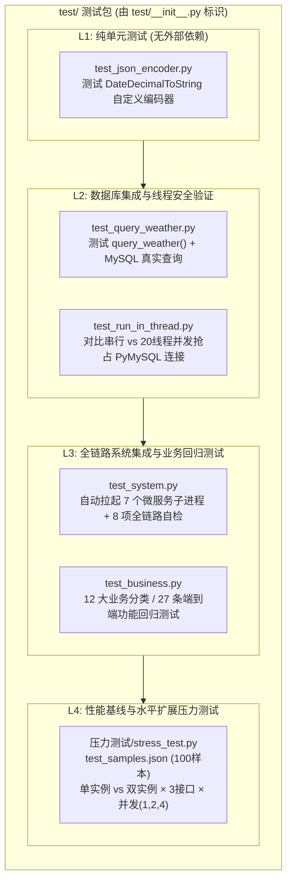

# `test/__init__.py` 代码精讲学习手册 —— 测试包初始化与 Python `unittest` 模块发现机制

---

## 一、文件定位与核心前置知识精讲

### 1.1 文件在系统中的定位
`test/__init__.py` 是 `Voyage智途A2A` 项目测试目录 `test/` 下的 **Python 包标识文件（Regular Package Marker）**。尽管该文件的字节数为 `0`（空文件），但它在整个项目的测试工程体系中扮演着不可或缺的基础设施角色：
1. **将 `test/` 声明为标准 Python 包（Regular Package）**：使得开发者可以在项目根目录下统一使用 `python -m test.test_json_encoder`、`python -m test.test_query_weather`、`python -m test.test_run_in_thread`、`python -m test.test_system`、`python -m test.test_business` 等模块化命令（`-m` 参数）启动任意测试脚本。
2. **支撑 `unittest discover` 自动测试发现机制**：Python 标准库 `unittest` 在递归扫描测试目录时，要求目标目录及其子目录必须是一个合法的可导入包（包含 `__init__.py`），否则 `python -m unittest discover -s test` 将无法自动识别或正确导入测试模块。
3. **统一 `test/` 测试金字塔的命名空间**：在 `Voyage智途A2A` 项目中，`test/` 目录构建了从底向上完整的四层测试金字塔：
   - **L1 单元测试（Unit Test）**：`test_json_encoder.py`（纯内存无外部依赖，测试 `DateDecimalToString` 序列化）。
   - **L2 组件/并发机制验证测试（Component & Concurrency Test）**：`test_query_weather.py`（MCP 工具 + MySQL 集成测试）、`test_run_in_thread.py`（FastMCP `run_in_thread=False` 线程安全验证）。
   - **L3 系统与全功能端到端测试（System & E2E Business Test）**：`test_system.py`（本地拉起 7 个微服务进程并跑通全链路）、`test_business.py`（针对远端/容器集群的 12 大业务域 27 项全功能回归测试）。
   - **L4 高并发压力与水平扩展测试（Stress & Scalability Test）**：`test/压力测试/stress_test.py`（单实例 vs 双实例水平扩展、3 大对话接口 × 3 种并发度 × 4 档难度样本压测）。

---

### 1.2 核心前置知识 1：为什么在项目根目录下推荐使用 `python -m test.xxx` 而不是 `python test/xxx.py`？

在 Python 工程实践中，运行子目录下的测试脚本有两种方式，它们的底层 `sys.path`（模块搜索路径）行为截然不同：

| 运行方式 | `sys.path[0]` 的值 | 能否直接 `from utils import ...`？ | 是否依赖 `test/__init__.py`？ |
| :--- | :--- | :--- | :--- |
| **方式 A（直接运行脚本）**：<br>`python test/test_run_in_thread.py` | `D:\soft\python\Voyage智途A2A\test`（**子目录本身**！） | **不能！** 如果脚本里没写 `sys.path.insert(0, PROJECT_ROOT)`，会立即抛出 `ModuleNotFoundError: No module named 'utils'` | 不依赖 |
| **方式 B（以模块方式运行）**：<br>`python -m test.test_run_in_thread` | `D:\soft\python\Voyage智途A2A`（**当前工作目录，即项目根目录**！） | **能！** 因为项目根目录已经在 `sys.path[0]` 中，`utils`、`mcp_tools`、`a2a_server` 均可直接导入 | **强依赖** `test/__init__.py` 将 `test` 声明为包 |

> **关键印证**：打开同目录下的 `test/test_run_in_thread.py` 可以看到，该文件第 14 行直接写了 `from utils import MySQLManager`，而**没有写** `sys.path.insert(...)`！之所以能正常导入 `utils`，正是因为注释里规定的运行方式是 `python -m test.test_run_in_thread`，依靠 `-m` 参数把项目根目录加入 `sys.path` 并通过 `test/__init__.py` 解析 `test` 包。

---

### 1.3 核心前置知识 2：Python `unittest` 测试框架的自动发现（Test Discovery）原理
当我们在命令行执行：
```bash
python -m unittest discover -s test -p "test_*.py"
```
`unittest.TestLoader.discover()` 的底层执行步骤如下：
1. 检查起始目录 `test` 是否包含 `__init__.py`。
2. 匹配所有符合 `test_*.py` 模式的文件（如 `test_json_encoder.py`、`test_query_weather.py`）。
3. 将文件路径转换为包点号路径（如 `test.test_json_encoder`），调用 `__import__()` 动态导入。
4. 反射遍历模块中所有继承自 `unittest.TestCase` 的类（如 `TestDateDecimalToString`、`TestQueryWeatherIntegration`），收集其中所有以 `test_` 开头的方法，组装成 `TestSuite` 并交由 `TextTestRunner` 执行。

---

## 二、架构图与执行流程图

### 2.1 `Voyage智途A2A` 四层测试体系全景架构图（Mermaid）


### 2.2 `python -m test.<module>` 模块加载与路径解析流程图（ASCII）
```
开发者在根目录 D:\soft\python\Voyage智途A2A 执行:
  $ python -m test.test_run_in_thread
          │
          ▼
[1] Python 解释器初始化 sys.path
    sys.path[0] = "D:\\soft\\python\\Voyage智途A2A" (当前工作目录 CWD)
          │
          ▼
[2] 解析模块名 "test.test_run_in_thread"
    ├── 查找顶层包 "test" -> 发现 D:\soft\python\Voyage智途A2A\test\__init__.py
    └── 执行 test/__init__.py (空文件，初始化 test 包命名空间)
          │
          ▼
[3] 加载子模块 "test/test_run_in_thread.py" 并设 __name__ == "__main__"
    └── 执行 "from utils import MySQLManager"
        └── 在 sys.path[0] 下成功找到 D:\soft\python\Voyage智途A2A\utils\__init__.py！
```

---

## 三、完整源码与逐段/逐行深度拆解

### 3.1 `test/__init__.py` 100% 完整源码
```python
```
*(注：`test/__init__.py` 源码为空文件，共 0 行、0 字节。)*

### 3.2 深度拆解与沙盘推演（Dry Run）
为什么保持 `test/__init__.py` 为空文件是最佳实践？
1. **避免非必要的副作用（Zero Side-Effects）**：
   - `test/` 目录下既有无需任何外部服务的纯单元测试（如 `test_json_encoder.py`），也有需要连接 MySQL 的集成测试（`test_query_weather.py`），还有会自动杀端口并启动 7 个子进程的系统测试（`test_system.py`）。
   - 如果在 `test/__init__.py` 中导入了任何子模块或初始化了数据库连接，那么哪怕用户只想跑一个 0.01 秒的纯内存 JSON 编码器单元测试（`python -m test.test_json_encoder`），Python 也会先执行 `test/__init__.py`，从而无端触发数据库连接甚至报错。
   - 保持 `test/__init__.py` 为空，确保了**按需加载（Lazy / On-Demand Loading）**：跑哪个测试模块，就只加载哪个模块依赖的组件。

---

## 四、关键工程细节与常见易错点

### 4.1 易错点 1：`unittest discover` 把非 `unittest` 脚本也当成测试导入并触发执行
- **现象**：如果某个测试脚本在模块顶层（没有放在 `if __name__ == "__main__":` 保护块内）直接写了执行代码，运行 `python -m unittest discover -s test` 时会在导入阶段直接跑起来。
- **规范检查**：在本项目 `test/` 下，所有 5 个测试脚本（`test_json_encoder.py`、`test_query_weather.py`、`test_run_in_thread.py`、`test_system.py`、`test_business.py`）全部严格遵守了将入口逻辑包裹在 `if __name__ == "__main__":` 中的工程规范。

### 4.2 易错点 2：测试包名 `test` 与 Python 标准库内置的 `test` 包同名冲突
- **背景**：Python 标准库自身带有一个内部自测包也叫 `test`（例如 `import test.support`）。
- **为什么本项目不会冲突？**：因为通过 `python -m test.xxx` 在项目根目录下运行时，当前项目根目录处于 `sys.path[0]`（最高优先级），且项目下的 `test/` 目录包含了 `__init__.py`（是一个完整的 Regular Package 而非 Namespace Package），因此 Python 的 `importlib` 会优先命中本地项目的 `test/` 目录，不会被标准库的 `test` 劫持。反过来，如果删掉了 `test/__init__.py`，使本地 `test/` 退化为隐式命名空间包（Namespace Package），在某些 Python 环境下就可能被标准库的 `test` Regular Package 抢先覆盖！这也是 `test/__init__.py` 必须存在的另一个深层原因。

---

## 五、自测思考题（附答案解析）

### 思考题 1：在 Python 3.3+ 支持隐式命名空间包（PEP 420，即没有 `__init__.py` 也能导入目录）之后，为什么本项目的 `test/` 目录仍然必须保留 `__init__.py`？
> **答案解析**：
> 1. **防标准库同名包劫持**：Python 标准库自带了一个名为 `test` 的常规包（Regular Package）。在 Python 的导入优先级中，Regular Package（含 `__init__.py`）高于 Namespace Package（无 `__init__.py`）。如果删掉 `test/__init__.py`，执行 `import test` 时可能会导入 Python 安装目录下的标准库 `test`，导致找不到项目的测试模块。
> 2. **兼容 `unittest discover`**：Python 3.10 的 `unittest` 测试发现机制在扫描子目录时仍然检查 `__init__.py` 以确认它是一个可导入的测试包。

### 思考题 2：如何在项目根目录下一次性运行 `test/` 目录中所有基于 `unittest.TestCase` 编写的测试？
> **答案解析**：
> 在项目根目录 `D:\soft\python\Voyage智途A2A` 下执行：
> ```bash
> python -m unittest discover -s test -p "test_*.py" -v
> ```
> 该命令会自动发现并执行 `test_json_encoder.py`（9 个单元测试用例）和 `test_query_weather.py`（11 个数据库集成测试用例），而 `test_run_in_thread.py`、`test_system.py`、`test_business.py` 因为没有定义 `unittest.TestCase` 子类且执行入口受 `if __name__ == "__main__":` 保护，在 discover 时会被安全跳过。
