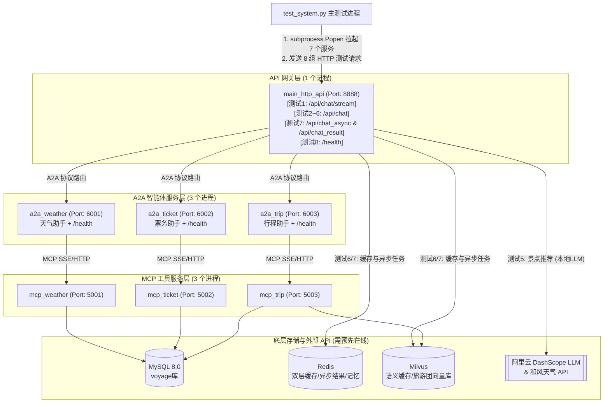

# `test/test_system.py` 代码精讲学习手册 —— 本地 7 微服务自动编排与全链路系统集成测试

---

## 一、文件定位与核心前置知识精讲

### 1.1 文件在系统中的定位
`test/test_system.py` 是 `Voyage智途A2A` 项目的**本地全链路自动化系统集成测试（System Integration Test）与微服务进程编排器**。
在没有使用 Docker 容器集群的本地 Windows 开发环境中，开发者如果想要测试一次完整的对话，需要手动打开 7 个终端窗口，分别启动 3 个 MCP 服务（5001~5003）、3 个 A2A 智能体服务（6001~6003）和 1 个主 HTTP API 网关（8888），测试完还要手动逐个关闭，极其繁琐且容易残留僵尸进程占用端口。

`test/test_system.py` 一举解决了这一痛点，它将 **“进程生命周期管理 + 端口探活等待 + 8 大核心全链路端到端测试 + 自动清理回收”** 浓缩在一个一键脚本中：
1. **战前清场（`_stop_all` + `_kill_port`）**：利用 Windows `netstat -ano` 与 `taskkill /F /PID` 强行清理残留进程，释放 5001~5003、6001~6003、8888 共 7 个端口。
2. **自动拉起 7 大核心服务（`_start_service`）**：使用 `subprocess.Popen([sys.executable, "-m", module])` 在后台拉起 7 个微服务子进程。
3. **TCP 握手探活栅栏（`_wait_ready` + `_port_free`）**：使用 `socket.create_connection(("127.0.0.1", port))` 循环探测全部 7 个端口，直到所有服务在 30 秒内进入 `LISTENING` 状态才开始发请求。
4. **8 大全链路冒烟测试（Fail-Fast 快速失败机制）**：
   - 测试 1：SSE 流式接口全链路测试（`POST /api/chat/stream`）
   - 测试 2：多意图 ReAct 循环测试（机票 + 天气，触发规划 → 执行 → 反思 → 汇总）
   - 测试 3：高铁票务查询测试（`TicketAssistant` -> `mcp_ticket` -> MySQL）
   - 测试 4：旅游团语义搜索测试（`TripAssistant` -> `mcp_trip` -> Milvus 向量检索 + MySQL）
   - 测试 5：景点推荐本地 LLM 测试（网关本地 LLM 直接回复，不走 A2A）
   - 测试 6：双层缓存读写命中测试（连续两次相同提问，验证第二次 `cached == True`）
   - 测试 7：异步任务提交 + 轮询完整流程测试（`/api/chat_async` + `/api/chat_result`）
   - 测试 8：各服务 `/health` 健康检查端点测试（6001、6002、6003、8888）
5. **命令行便捷停服模式（`--stop` 参数）**：支持运行 `python -m test.test_system --stop` 仅清理停止所有后台服务。

---

### 1.2 核心前置知识 1：Python `subprocess.Popen` 子进程编排与 `sys.executable`
在 Python 中启动另一个后台服务进程（非阻塞），使用的是 `subprocess.Popen`：
```python
proc = subprocess.Popen(
    [sys.executable, "-m", module],
    cwd=PROJECT_ROOT,
    stdout=subprocess.DEVNULL,
    stderr=subprocess.DEVNULL,
)
```
这里有三个至关重要的工程细节：
1. **为什么第一个参数用 `sys.executable` 而不是写死 `"python"`？**
   - 在开发者的电脑上，往往同时安装了系统 Python、Anaconda 基础环境以及项目的 Conda/venv 虚拟环境（如 `D:\conda\envs\voyage\python.exe`）。
   - 如果写死 `"python"`，`subprocess.Popen` 可能会去调用系统 `PATH` 里没有安装 `fastapi`/`pymilvus` 的默认 Python，导致子进程瞬间崩溃！
   - `sys.executable` 永远返回**当前正在运行本测试脚本的那同一个 Python 解释器的绝对路径**，保证了 7 个子进程与主测试进程处于 100% 相同的虚拟环境中。
2. **为什么要指定 `cwd=PROJECT_ROOT` 并配合 `"-m", module`？**
   - 确保无论用户从哪个目录启动脚本，子进程的工作目录永远是项目根目录，使得 `-m mcp_server.mcp_weather` 能正确解析项目内的所有包（`utils`、`mcp_tools`、`a2a_server`）。
3. **为什么要把 `stdout` 和 `stderr` 重定向到 `subprocess.DEVNULL`？**
   - 这是一个**防管道死锁（OS Pipe Buffer Deadlock）**的关键设计！
   - 如果把 `stdout=subprocess.PIPE`，而父进程又不去持续 `proc.stdout.read()` 读取子进程输出，当 7 个微服务打印的日志填满操作系统的管道缓冲区（Windows/Linux 下通常仅 **4KB ~ 64KB**）时，子进程的 `print()` / `logging` 调用就会被操作系统永久阻塞挂起，导致微服务假死！
   - 重定向到 `subprocess.DEVNULL`（相当于丢入黑洞 `/dev/null` 或 `nul`），既彻底消除了管道缓冲区填满死锁的风险，又保持了主测试终端输出的整洁。

---

### 1.3 核心前置知识 2：基于 TCP Socket 握手的端口探活（`_port_free` 与 `_wait_ready`）
`subprocess.Popen` 返回仅仅意味着操作系统**创建了进程**，但 Python 解释器加载 `torch`/`langchain`/`fastapi` 以及 Uvicorn/Waitress 绑定端口还需要 **3~15 秒**。如果 `Popen` 一返回就立刻发 HTTP 请求，必然报错 `ConnectionRefusedError`！

本文件通过底层 `socket.create_connection` 实现了优雅的端口就绪探活：
```python
def _port_free(host: str, port: int) -> bool:
    try:
        s = socket.create_connection((host, port), timeout=1.0)
        s.close()
        return False  # 能连上 -> 说明端口已被服务监听（不空闲）
    except (ConnectionRefusedError, OSError, socket.timeout):
        return True   # 连不上 -> 说明端口还没被监听（空闲）
```
- **在启动前（第 170 行）**：`if _port_free("127.0.0.1", port):` 为 `True` 时才启动子进程，避免端口冲突。
- **在启动后（第 84~93 行 `_wait_ready`）**：在 `max_wait=30` 秒的截止时间（`deadline = time.time() + max_wait`）内，每秒调用一次 `not _port_free("127.0.0.1", port)`。一旦返回 `True`（TCP 三次握手成功，说明服务已绑定端口开始监听），立即宣布该端口就绪！

---

### 1.4 核心前置知识 3：Windows 端口占用强杀机制（`netstat -ano` + `taskkill`）与优雅停机
为什么关闭服务时，除了对 `_processes` 列表中的 `Popen` 对象调用 `proc.terminate()` / `proc.kill()` 外，还要额外调用 `_kill_port(port)`？
1. **跨次运行残留**：如果上一次运行测试时用户按 `Ctrl+C` 强行中断了测试脚本，`_processes` 内存列表早已丢失，但上次启动的 7 个微服务子进程还留在后台继续监听着 5001~8888 端口。
2. **孙子进程问题**：某些 Web 服务器或启动器会派生子进程，仅 `proc.terminate()` 顶层句柄可能无法干净释放端口。
3. **`_kill_port(port)` 的解析原理（第 54~62 行）**：
   - 执行 `netstat -ano | findstr :5001`，Windows 输出形如：
     `  TCP    0.0.0.0:5001           0.0.0.0:0              LISTENING       18432`
   - `parts = line.split()` 切分空白符后，`parts` 长度为 5，且 `"LISTENING" in parts`，最后一个元素 `parts[-1]`（即 `18432`）就是监听该端口的进程 PID！
   - 随后执行 `taskkill /F /PID 18432 > nul 2>&1` 强制（`/F`）杀死该 PID，并将输出静默丢弃。

---

## 二、架构图与执行流程图

### 2.1 `test_system.py` 拉起的 7 个本地微服务拓扑与全链路测试覆盖图（Mermaid）


### 2.2 `test_system.py` 执行生命周期流程图（ASCII）
```
python -m test.test_system
  │
  ├─► 是否传入 "--stop" 参数？
  │     ├── 是 ──► 执行 _stop_all() 强杀 7 个端口进程并退出
  │     └── 否 ──► 进入 main() 全链路测试流程：
  │
  ├─► [步骤 1] 战前清场：_stop_all() + time.sleep(2) 确保 7 个端口干净无残留
  │
  ├─► [步骤 2] 依次拉起 7 个服务进程：
  │     ├── mcp_weather (5001) -> mcp_ticket (5002) -> mcp_trip (5003)
  │     ├── a2a_weather (6001) -> a2a_ticket (6002) -> a2a_trip (6003)
  │     └── main_api    (8888) (每个间隔 1s 启动)
  │
  ├─► [步骤 3] 端口探活等待：对 7 个端口依次调用 _wait_ready(port, max_wait=30)
  │     └── 若任一端口 30s 未就绪 ──► _stop_all() 清理并 sys.exit(1) 终止！
  │
  ├─► [步骤 4] 顺序执行 8 大全链路测试用例 (run_test_case，任一失败立即 raise 终止)：
  │     ├── 测试 1: 天气查询流式全链路测试 (_call_stream -> /api/chat/stream)
  │     ├── 测试 2: 多意图 ReAct 循环测试 (_call_api -> 机票+天气)
  │     ├── 测试 3: 高铁票务查询测试 (_call_api -> TicketAssistant)
  │     ├── 测试 4: 旅游团语义搜索测试 (_call_api -> TripAssistant + Milvus)
  │     ├── 测试 5: 景点推荐(本地LLM)测试 (_call_api -> 不走 A2A)
  │     ├── 测试 6: 双层缓存读写命中测试 (连续2次相同请求，断言 res2["cached"] == True)
  │     ├── 测试 7: 异步任务提交+轮询测试 (/api/chat_async + 循环 120 次 /api/chat_result)
  │     └── 测试 8: 各服务健康检查测试 (GET 6001/6002/6003/8888 的 /health)
  │
  └─► [步骤 5] 全部通过！调用 _stop_all() 自动关闭所有服务并释放端口
```

---

## 三、完整源码与逐段/逐行深度拆解

### 3.1 `test/test_system.py` 100% 完整源码

```python
"""系统集成测试：启动7个服务，测试 HTTP → A2A → MCP → DB 全链路
运行：python -m test.test_system
前提：MySQL/Milvus/Redis 在线 + 库表已建立（执行过 data_init/mysql_init.py 和 data_init/milvus_init.py）
       + LLM API Key 已设置 + 和风天气 API Key 已设置
注意：不清除测试数据，保留脏数据供后续分析
支持参数：--stop 仅停止所有服务（不执行测试）
"""
import subprocess
import sys
import os
import time
import json
import socket
import requests

PROJECT_ROOT = os.path.dirname(os.path.dirname(os.path.abspath(__file__)))
BASE_URL = "http://127.0.0.1:8888"
TEST_USER = "system_test_user_001"

# 7个待启动服务：名称、端口、模块路径
SERVICES = [
    ("mcp_weather", 5001, "mcp_server.mcp_weather"),
    ("mcp_ticket",  5002, "mcp_server.mcp_ticket"),
    ("mcp_trip",    5003, "mcp_server.mcp_trip"),
    ("a2a_weather", 6001, "a2a_server.a2a_weather"),
    ("a2a_ticket",  6002, "a2a_server.a2a_ticket"),
    ("a2a_trip",    6003, "a2a_server.a2a_trip"),
    ("main_api",    8888, "main_http_api"),
]

_processes = []

# 检查端口是否空闲
def _port_free(host: str, port: int) -> bool:
    try:
        s = socket.create_connection((host, port), timeout=1.0)
        s.close()
        return False
    except (ConnectionRefusedError, OSError, socket.timeout):
        return True

# 启动单个服务进程
def _start_service(name: str, module: str) -> subprocess.Popen:
    print(f"【启动】{name} 模块：{module}")
    proc = subprocess.Popen(
        [sys.executable, "-m", module],
        cwd=PROJECT_ROOT,
        stdout=subprocess.DEVNULL,
        stderr=subprocess.DEVNULL,
    )
    return proc

# Windows强制杀掉占用端口进程
def _kill_port(port: int):
    try:
        for line in os.popen(f'netstat -ano | findstr :{port}').readlines():
            parts = line.split()
            if len(parts) >= 5 and "LISTENING" in parts:
                pid = parts[-1]
                os.system(f'taskkill /F /PID {pid} > nul 2>&1')
    except Exception:
        pass

# 停止所有服务、释放端口
def _stop_all():
    print("\n【清理】关闭所有服务，释放端口")
    # 先杀端口占用
    for name, port, _ in SERVICES:
        _kill_port(port)
    # 终止进程
    for proc in _processes:
        try:
            proc.terminate()
            proc.wait(timeout=3)
        except Exception:
            try:
                proc.kill()
            except Exception:
                pass
    _processes.clear()
    print("【清理完成】所有服务已关闭")

# 循环等待端口就绪，超时返回False
def _wait_ready(port: int, max_wait: int = 30) -> bool:
    print(f"【等待端口{port}】最长等待{max_wait}秒...")
    deadline = time.time() + max_wait
    while time.time() < deadline:
        if not _port_free("127.0.0.1", port):
            print(f"【就绪】端口 {port} 服务正常监听")
            return True
        time.sleep(1)
    print(f"【超时】端口 {port} 启动失败")
    return False

# 同步对话接口调用
def _call_api(msg: str, timeout: int = 120) -> dict:
    print(f"\n【调用同步接口】发送提问：{msg}")
    payload = {"user_id": TEST_USER, "message": msg}
    resp = requests.post(f"{BASE_URL}/api/chat", json=payload, timeout=timeout)
    print(f"【接口原始返回】{resp.json()}")
    return resp.json()

# 流式 SSE 接口（假流式逐字推送）
def _call_stream(msg: str, timeout: int = 120) -> str:
    print(f"\n【调用流式接口】发送提问：{msg}")
    payload = {"user_id": TEST_USER, "message": msg}
    resp = requests.post(f"{BASE_URL}/api/chat/stream", json=payload, stream=True, timeout=timeout)
    full = ""
    for line in resp.iter_lines(decode_unicode=True):
        if line and line.startswith("data: "):
            s = line[6:]
            if s == "[DONE]":
                break
            full += json.loads(s).get("chunk", "")
    print(f"【流式回复】{full[:80]}...")
    return full


# health 检查
def _check_health(name: str, url: str) -> bool:
    try:
        r = requests.get(f"{url}/health", timeout=5)
        ok = r.status_code == 200
        tag = "OK" if ok else "FAIL"
        print(f"【健康检查】{name} ({url}) -> {tag}")
        return ok
    except Exception as e:
        print(f"【健康检查】{name} ({url}) -> FAIL: {e}")
        return False


# 异步任务提交接口
def _call_async(msg: str) -> dict:
    print(f"\n【提交异步任务】提问：{msg}")
    payload = {"user_id": TEST_USER, "message": msg}
    resp = requests.post(f"{BASE_URL}/api/chat_async", json=payload, timeout=30)
    print(f"【异步提交返回】{resp.json()}")
    return resp.json()

# 轮询异步结果接口
def _poll_result(msg: str) -> dict:
    payload = {"user_id": TEST_USER, "message": msg}
    resp = requests.post(f"{BASE_URL}/api/chat_result", json=payload, timeout=10)
    return resp.json()

# 单条测试用例执行封装，打印完整过程，失败直接抛出异常终止
def run_test_case(test_name: str, test_func):
    print("\n========================================")
    print(f"开始执行测试：{test_name}")
    print("========================================")
    try:
        test_func()
        print(f"\n✅ {test_name} —— 执行通过")
    except Exception as err:
        print(f"\n❌ {test_name} —— 执行失败，错误信息：{str(err)}")
        raise err

# 全部测试逻辑
def main():
    print("==================== Voyage全链路集成测试开始 ====================")

    # 步骤1：清理残留服务
    print("\n步骤1：清理之前残留运行的服务")
    _stop_all()
    time.sleep(2)

    # 步骤2：循环启动7个服务
    print("\n步骤2：启动全部7个微服务")
    for name, port, module in SERVICES:
        if _port_free("127.0.0.1", port):
            proc = _start_service(name, module)
            _processes.append(proc)
            time.sleep(1)
        else:
            print(f"【跳过】{name}:{port} 端口已被占用，无需重复启动")

    # 步骤3：逐个等待所有服务端口就绪
    print("\n步骤3：检测所有服务是否正常启动")
    service_start_success = True
    for name, port, _ in SERVICES:
        ok = _wait_ready(port)
        if not ok:
            service_start_success = False

    if not service_start_success:
        print("\n❌ 存在服务启动超时，终止测试程序")
        _stop_all()
        sys.exit(1)
    print("\n✅ 全部7个服务启动完成，准备开始接口测试")

    # 测试1：天气查询（单意图——流式接口，测试 SS 假流式全链路）
    def test_weather_stream():
        full = _call_stream("北京明天天气怎么样")
        assert len(full) > 20, f"流式回复内容过短：{len(full)}字"
        print(f"  流式回复长度：{len(full)} 字")

    run_test_case("天气查询流式全链路测试", test_weather_stream)

    # 测试2：多意图 ReAct 循环（机票+天气，触发规划→执行→反思→汇总）
    def test_multi_intent():
        res = _call_api("帮我查2026年5月1日北京到成都的机票，再看下明天那边天气怎么样", timeout=180)
        assert res["status"] == "success", f"接口状态异常：{res['status']}"
        assert len(res["message"]) > 30, f"多意图回复内容过短：{len(res['message'])}字"

    run_test_case("多意图ReAct循环测试", test_multi_intent)

    # 测试3：票务查询（单意图，测试 TicketAssistant）
    def test_train_ticket():
        res = _call_api("帮我查北京到上海的高铁票，明天出发")
        assert res["status"] == "success", f"接口状态异常：{res['status']}"
        assert len(res["message"]) > 10

    run_test_case("高铁票务查询测试", test_train_ticket)

    # 测试4：行程查询（单意图，测试 TripAssistant——旅游团语义搜索）
    def test_tour_search():
        res = _call_api("成都出发看雪山的短途旅行团")
        assert res["status"] == "success", f"接口状态异常：{res['status']}"
        assert len(res["message"]) > 15

    run_test_case("旅游团语义搜索测试", test_tour_search)

    # 测试5：景点推荐（本地 LLM 处理，不经过 A2A）
    def test_attraction():
        res = _call_api("推荐几个北京必去景点")
        assert res["status"] == "success"
        assert len(res["message"]) > 30

    run_test_case("景点推荐（本地LLM）测试", test_attraction)

    # 测试6：双层缓存命中验证
    def test_cache_hit():
        # 使用简单天气查询（可缓存意图+不会触发追问→cacheable=True）
        test_msg = "帮我查一下北京明天的天气怎么样"
        # 第一次调用，缓存未命中
        res1 = _call_api(test_msg)
        # 第二次相同消息，应命中 Redis 精确缓存
        res2 = _call_api(test_msg)
        print(f"  第一次 cached={res1.get('cached')}，第二次 cached={res2.get('cached')}")
        assert res2.get("cached") == True, "第二次相同请求应命中缓存"
        assert res1["message"] == res2["message"], "缓存命中的消息应与原始一致"

    run_test_case("双层缓存读写命中测试", test_cache_hit)

    # 测试7：异步任务提交 + 轮询结果（测试 /api/chat_async + /api/chat_result）
    def test_async_flow():
        test_msg = "帮我查一下上海明天的天气怎么样"
        submit_res = _call_async(test_msg)
        if submit_res.get("cached"):
            print("  异步接口命中缓存，流程正常")
            return
        redis_key = submit_res.get("redis_key", "")
        assert redis_key, "异步提交未返回 redis_key"
        print(f"  任务标识 redis_key={redis_key}，开始轮询，最多 120 秒")
        for poll_times in range(1, 121):
            poll_data = _poll_result(test_msg)
            if poll_data.get("status") == "completed":
                assert "message" in poll_data, "异步结果缺少 message 字段"
                print(f"  第 {poll_times} 次轮询完成，回复长度：{len(poll_data['message'])} 字")
                return
            time.sleep(1)
        raise Exception("轮询 120 秒未拿到完成结果，异步任务超时")

    run_test_case("异步任务提交+轮询完整流程测试", test_async_flow)

    # 测试8：健康检查（验证各 A2A 服务 /health 端点）
    def test_health_endpoints():
        all_ok = True
        all_ok &= _check_health("A2A天气", f"http://127.0.0.1:{6001}")
        all_ok &= _check_health("A2A票务", f"http://127.0.0.1:{6002}")
        all_ok &= _check_health("A2A行程", f"http://127.0.0.1:{6003}")
        all_ok &= _check_health("API网关", f"http://127.0.0.1:{8888}")
        assert all_ok, "存在服务 health 检查失败"

    run_test_case("各服务健康检查测试", test_health_endpoints)

    # 所有用例全部执行完毕
    print("\n==================== 所有测试全部执行完成，无失败用例 ====================")
    print("\n自动关闭所有服务...")
    _stop_all()
    print("程序执行结束")

# 单独执行停止服务命令
if __name__ == "__main__":
    if "--stop" in sys.argv:
        _stop_all()
    else:
        main()
```

---

### 3.2 逐段深度拆解与沙盘推演（Dry Run）

#### 1. `SERVICES` 启动顺序的深意（第 21~29 行）
观察 `SERVICES` 列表的排列顺序：
1. **先启动底层 MCP 工具服务**（`5001`、`5002`、`5003`）；
2. **再启动中层 A2A 智能体服务**（`6001`、`6002`、`6003`）；
3. **最后启动顶层 API 网关**（`8888`）。
为什么严格按自底向上的顺序启动？因为顶层 API 网关或 A2A 服务在初始化或首次探活时可能会连接下游服务，自底向上启动（每个间隔 `time.sleep(1)`）确保了当上游服务启动完成时，下游被依赖的服务已经处于就绪或即将就绪状态。

#### 2. Python `requests` 客户端消费 SSE 流式接口（第 103~116 行 `_call_stream`）
在前面的 `static/index.html` 中，我们学过了浏览器端如何用 `fetch` + `ReadableStream` 解析 SSE。而在 Python 客户端中，`_call_stream` 展示了用 `requests` 库消费 SSE 流的标准写法：
```python
resp = requests.post(f"{BASE_URL}/api/chat/stream", json=payload, stream=True, timeout=timeout)
full = ""
for line in resp.iter_lines(decode_unicode=True):
    if line and line.startswith("data: "):
        s = line[6:]
        if s == "[DONE]":
            break
        full += json.loads(s).get("chunk", "")
```
- **`stream=True`**：告诉 `requests` 不要一次性把整个响应体下载到内存，而是保持 HTTP 连接打开，按需读取流。
- **`resp.iter_lines(decode_unicode=True)`**：`requests` 内置的流式按行生成器（自动替我们处理了刚才在 JS 里手写的 `buffer.split('\n')` 粘包/半包逻辑！），每收到完整的一行就产出解码后的字符串 `line`。
- 截取 `line[6:]`（去掉 `"data: "` 前缀），如果遇到 `"[DONE]"` 则 `break` 退出循环，否则 `json.loads(s).get("chunk", "")` 拼接到 `full` 中。

#### 3. 测试 6：双层缓存读写命中测试（第 231~243 行 `test_cache_hit`）
- **为什么注释特别强调“使用简单天气查询（可缓存意图+不会触发追问→cacheable=True）”？**
  - 在 `Voyage智途A2A` 的主控智能体中，并不是所有回答都会写入 Redis/Milvus 缓存！只有满足两个条件时才会写入缓存：
    1. 意图属于可缓存意图（如查询天气、景点推荐；而买票下单等写操作不可缓存）；
    2. 回答**不是**向用户反问补充参数的追问（例如用户只问“明天天气怎么样”没说城市，助手反问“请问您想查哪个城市？”，这种半截追问 `cacheable=False` 绝不能缓存）。
  - 因此这里传入了参数齐全的 `"帮我查一下北京明天的天气怎么样"`：
    - 第 1 次调用 `_call_api(test_msg)`：走完整 LLM + A2A + MCP 链路（耗时约 10~20 秒），并将结果写入 Redis 精确缓存与 Milvus 语义缓存。
    - 第 2 次调用 `_call_api(test_msg)`：在网关入口直接命中 Redis 精确缓存（耗时 < 50 毫秒！），返回 `{"status": "success", "message": "...", "cached": True}`！

#### 4. 测试 8：位与运算符 `&=` 在健康检查中的巧妙应用（第 266~275 行 `test_health_endpoints`）
注意第 268~272 行的写法：
```python
all_ok = True
all_ok &= _check_health("A2A天气", f"http://127.0.0.1:{6001}")
all_ok &= _check_health("A2A票务", f"http://127.0.0.1:{6002}")
all_ok &= _check_health("A2A行程", f"http://127.0.0.1:{6003}")
all_ok &= _check_health("API网关", f"http://127.0.0.1:{8888}")
assert all_ok, "存在服务 health 检查失败"
```
**为什么作者用按位与赋值 `all_ok &= _check_health(...)`，而不是写 `all_ok = all_ok and _check_health(...)`？**
- 因为 Python 的逻辑与 `and` 具有**短路求值（Short-Circuit Evaluation）**特性！如果写 `all_ok = all_ok and _check_health(...)`，一旦第一个服务（6001）健康检查返回 `False`，后面的 6002、6003、8888 的 `_check_health()` 就**根本不会被调用**，你也看不到后面三个服务到底健不健康！
- 而使用 `all_ok &= _check_health(...)`（在 `bool` 类型上按位与等同于**非短路逻辑与**），会强制把 4 个服务的 `_check_health()` **全部执行一遍并打印出各自的状态（OK / FAIL）**，只要其中任何一个为 `False`，最终 `all_ok` 就是 `False`！这是一个非常地道的测试工程技巧。

---

## 四、关键工程细节与常见易错点

### 4.1 易错点 1：测试用例中途断言失败（`raise err`）时，后台 7 个微服务未自动关闭
- **代码观察**：在 `run_test_case`（第 154~156 行）中，一旦某个测试函数抛出 `AssertionError` 或超时异常，`run_test_case` 会直接 `raise err`，导致 `main()` 函数提前异常退出，不会执行到第 280 行的 `_stop_all()`。
- **为什么这样设计 & 如何手动清理？**
  - 文件头部注释第 5~6 行明确说明了原因：当某条测试失败时，保留现场和正在运行的服务有助于开发者立刻排查问题；排查完毕后，只需在终端执行：
    ```bash
    python -m test.test_system --stop
    ```
    即可一键调用 `_stop_all()` 杀掉所有 7 个服务进程并释放端口！

### 4.2 易错点 2：本地运行 `test_system.py` 时的认证开关配置（`auth.enabled`）
- 观察 `_call_api`、`_call_stream`、`_call_async`（第 96~145 行）：它们发送请求时**没有携带 `Authorization` Token 请求头**。
- 这意味着：在本地运行 `python -m test.test_system` 时，`config.yaml` 中的认证配置 `auth.enabled` 应当处于关闭状态（或本地免认证模式）；如果 `config.yaml` 中开启了强制 JWT 认证（`auth.enabled: true`），则应使用带自动预登录功能的 `python -m test.test_business --url http://127.0.0.1:8888` 进行测试。

---

## 五、自测思考题（附答案解析）

### 思考题 1：在 `SERVICES` 列表中定义了 7 个服务（`mcp_weather/ticket/trip`、`a2a_weather/ticket/trip`、`main_api`），对比 `deploy/docker-compose-dev.yml`，哪两个后期扩展的微服务没有包含在 `test_system.py` 的本地启动列表中？
> **答案解析**：
> 没有包含的是负责外部数据源（飞常准航班动态、博查全网搜索、高德地图周边）的 **`mcp_external`（端口 5004）** 和 **`a2a_external`（端口 6004）**。这两个外部数据源服务的端到端测试被放在了下一篇我们要精讲的 `test/test_business.py`（第 12 节“外部数据源”）中。如果要在本地 `test_system.py` 中也一起拉起它们，只需在 `SERVICES` 列表中追加 `("mcp_external", 5004, "mcp_server.mcp_external")` 和 `("a2a_external", 6004, "a2a_server.a2a_external")` 即可。

### 思考题 2：在 `_stop_all()`（第 64~81 行）中，终止子进程时为什么先调 `proc.terminate()` 并 `proc.wait(timeout=3)`，在 `except` 里再调 `proc.kill()`？
> **答案解析**：
> 这是操作系统进程管理的**优雅停机（Graceful Shutdown）两阶段范式**：
> 1. 第一阶段调用 `proc.terminate()`（在 POSIX 系统发送 `SIGTERM` 信号），请求子进程自行执行清理逻辑（如关闭数据库连接、刷盘日志）后退出，并最多等待 3 秒（`proc.wait(timeout=3)`）。
> 2. 如果子进程卡死在某个阻塞调用中，3 秒内仍未退出，`proc.wait(timeout=3)` 会抛出 `subprocess.TimeoutExpired` 异常，此时进入第二阶段 `except` 块，调用 `proc.kill()`（发送不可捕获的强制终止信号 `SIGKILL` / `TerminateProcess`）强行兜底回收进程。
