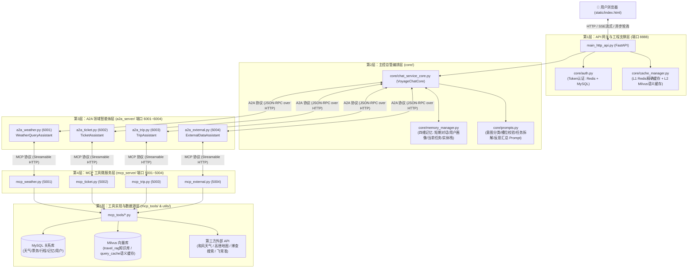
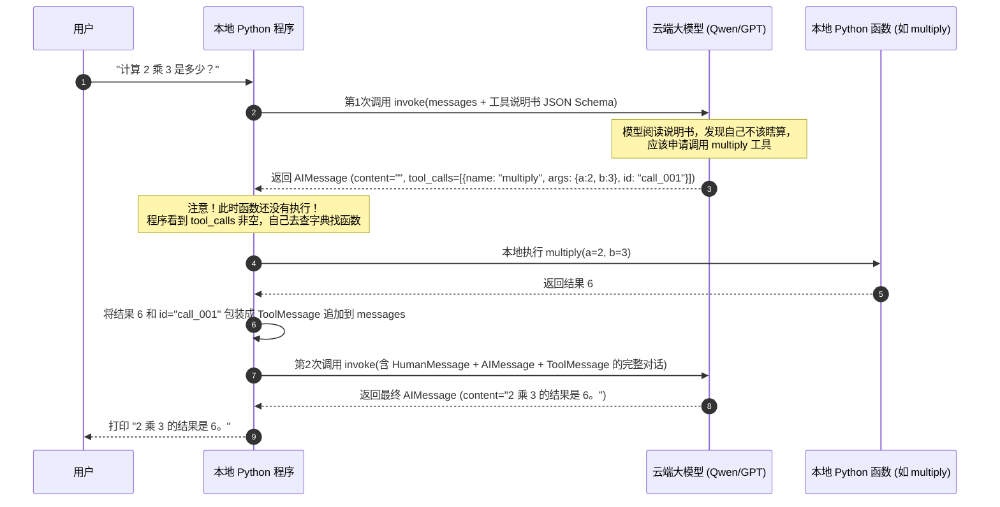
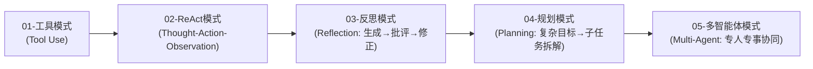
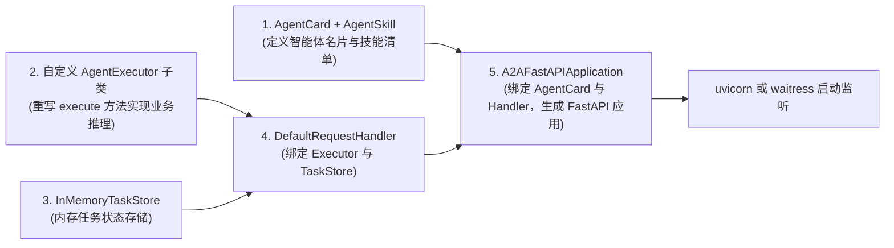

# 00-核心前置知识与架构全解：从零构建 A2A + MCP 分布式多智能体系统

> **文档定位**：本手册是整套《Voyage 智途 A2A 代码精讲学习手册》的**理论总纲与前置知识百科全书**。  
> **适用目标**：哪怕你是第一次接触 `uv`、`Function Calling`、`asyncio`、`MCP 协议`、`Agent 五大设计模式`、`A2A 协议`、`Milvus 混合检索 RAG` 或 `双层缓存与四维记忆`，只要按顺序读完本文，就能打通所有概念关节，毫无障碍地看懂本项目的每一行代码！

---

## 一、全局视野：Voyage 智途究竟是一个什么样的系统？

### 1.1 用一个生活比喻秒懂整个系统架构
想象你走进了一家顶级的**私人旅行管家中心（Voyage 智途）**：

1. **前台接待大厅（`main_http_api.py`，端口 `8888`）**：
   - 你走进去先刷会员卡（`auth.py` **Token 认证**）；
   - 前台秘书先翻看《高频问答速查手册》（`cache_manager.py` **L1 Redis 精确缓存 + L2 Milvus 语义缓存**），如果一分钟前刚有人问过一模一样或意思完全相同的问题，前台 10 毫秒内直接把答案给你，不用惊动后面的专家；
2. **首席总管家（`core/chat_service_core.py`）**：
   - 如果缓存没命中，首席总管家接手你的问题。他先打开你的《专属客户档案本》（`memory_manager.py` **四维记忆系统**：你刚才聊了什么、你平时喜欢住什么价位酒店、你正在规划哪个城市的行程）；
   - 如果你只说了一句没头没尾的“帮我订张明天去上海的票”，总管家会立刻礼貌地**主动追问**：“请问您从哪个城市出发？想坐高铁还是飞机？”（**意图识别与必填参数槽位检查**）；
   - 如果你一次性提出了复合需求：“帮我查明天北京的天气，再查一下北京到上海的高铁票，顺便推荐一下上海外滩附近的餐厅”，总管家会把这句话**拆解成 3 个独立的子任务**（**多意图规划分解**）。
3. **四位领域专家顾问（`a2a_server/`，端口 `6001~6004`，使用 A2A 协议通信）**：
   - 总管家自己不去查数据库，他通过公司内部的标准跨部门协作电话（**A2A 协议：Agent-to-Agent**），同时呼叫四位领域专家：
     - **天气专家 (`6001` `WeatherQueryAssistant`)**
     - **票务专家 (`6002` `TicketAssistant`)**
     - **行程专家 (`6003` `TripAssistant`)**
     - **外部资讯与地图专家 (`6004` `ExternalDataAssistant`)**
4. **四个专业工具箱机房（`mcp_server/`，端口 `5001~5004`，使用 MCP 协议通信）**：
   - 每位领域专家手头也不直接写 SQL 或调第三方接口，他们通过标准工具插槽（**MCP 协议：Model Context Protocol**）连接到各自对应的工具机房（`5001~5004`），机房里的具体工具函数（`mcp_tools/`）再去查 MySQL 数据库、Milvus 向量知识库或请求和风天气/高德地图/博查搜索/飞常准 API。



---

## 二、六大核心前置知识专题精讲（对应 `前置知识/` 目录）

项目中专门提供了一个 `前置知识/` 文件夹，由浅入深分为 6 个台阶。读懂下面 6 节核心原理，再去读对应的代码文件就会势如破竹！

---

### 专题 1：`uv` 现代 Python 环境与依赖管理（对应 `前置知识/1-uv环境管理工具`）

#### 1.1 为什么用 `uv` 替代传统的 `pip` + `venv` + `conda`？
- **`uv`** 是由 Astral 团队（也是极速代码检查工具 `ruff` 的作者）用 **Rust 语言**编写的新一代 Python 包与虚拟环境管理器。
- **快 10~100 倍**：传统 `pip` 安装几十个包可能要几分钟，`uv` 利用全局缓存与 Rust 并发下载解析，通常只需几秒钟。
- **一站式全能**：一个 `uv` 命令同时顶替了 `pyenv`（管理 Python 版本）、`venv`/`virtualenv`（创建虚拟环境 `.venv`）、`pip`（安装包）、`poetry`（管理 `pyproject.toml` 和 `uv.lock` 锁文件）。

#### 1.2 核心命令速查表
| 命令 | 作用 | 生成/修改什么文件 |
| :--- | :--- | :--- |
| `uv init` | 在当前目录初始化一个标准 Python 项目 | 生成 `pyproject.toml`、`.python-version`、`main.py` |
| `uv python pin 3.11` | 将当前项目的 Python 版本锁定为 3.11 | 修改 `.python-version` 为 `3.11` |
| `uv add <包名>==<版本>` | 添加项目依赖并安装到 `.venv` 虚拟环境中 | 自动创建 `.venv/`，更新 `pyproject.toml` 和 `uv.lock` |
| `uv pip install -r requirements.txt` | 兼容传统 `pip` 模式批量安装依赖清单 | 将包安装进 `.venv/`（不修改 `pyproject.toml`） |
| `uv run python xxx.py` | 自动使用当前项目的 `.venv` 虚拟环境运行脚本 | 无需手动 `source .venv/bin/activate` |

---

### 专题 2：Function Calling 工具调用机制（对应 `前置知识/2-Function Call`）

#### 2.1 最核心的铁律：**“模型只提请求，程序执行函数”**
很多初学者误以为：“把 Python 函数绑定给大模型后，大模型在云端服务器里自己运行了我的 Python 代码。”
**这是完全错误的！** 大模型运行在阿里云/OpenAI 的 GPU 服务器上，而你的 Python 函数和数据库运行在你自己的电脑上，大模型怎么可能直接运行你电脑里的函数？

真实的 **Function Calling（工具调用）** 是一场**“两轮接力赛”**：



#### 2.2 四种定义与调用工具的方式演进（`01` → `04`）
在 `前置知识/2-Function Call/` 的 4 个脚本中，展示了从最原始手写到全自动 Agent 的四步进化：

| 演进阶段 | 对应文件 | 如何定义工具描述 (Schema) | 如何执行工具 | 是否自动循环多轮工具调用 |
| :--- | :--- | :--- | :--- | :--- |
| **第 1 阶段：纯手写 JSON Schema** | `01-基本调用.py` | 手写几十行嵌套字典 `{"type": "function", "function": {"name": ..., "parameters": ...}}` | 普通函数需用 `**` 解包参数字典：`selected_tool(**tool_call["args"])` | 否（手写单轮 `if ai_msg.tool_calls:`） |
| **第 2 阶段：`@tool` 装饰器** | `02-装饰器方式.py` | 在函数上加 `@tool`，LangChain 自动从**函数名、类型注解 (`a: int`)、文档字符串 (`"""..."""`)** 提取描述 | 变成了 `StructuredTool` 对象，直接传整个字典：`selected_tool.invoke(tool_call["args"])` | 否（手写单轮 `if`） |
| **第 3 阶段：`Pydantic` 参数模型** | `03-pydantic方式.py` | 定义 `class AddInput(BaseModel): a: int = Field(description=...)`，用 `@tool(args_schema=AddInput)` 强校验复杂参数 | `selected_tool.invoke(tool_call["args"])` | 否（手写单轮 `if`） |
| **第 4 阶段：`create_agent` 全托管** | `04-agent_tools.py` | `@tool` 装饰器 | **框架自动查找并执行工具、自动打包 `ToolMessage`、自动循环调用模型直到无需调用工具为止！** | **是！（全自动多轮工具循环）** |

---

### 专题 3：Python `asyncio` 异步编程（对应 `前置知识/3-异步编程`）

#### 3.1 为什么多智能体系统必须用异步编程 (`async` / `await`)？
多智能体系统是典型的 **高 I/O 密集型（I/O-Bound）** 应用：
- 调用一次大模型 API 要等 1~3 秒；
- 调用一次远端 A2A 子智能体要等 2~5 秒；
- 查询外部天气/地图/数据库也要等待网络响应。

如果用传统的**同步阻塞编程**，当主控 Agent 需要同时调用“天气 Agent”和“票务 Agent”时，只能先干等天气 Agent 3 秒，再干等票务 Agent 4 秒，总共耗时 **7 秒**；而且在等待期间，整个线程被卡死，无法服务其他用户。

而使用 **`asyncio` 异步非阻塞编程**：
- 当一个协程遇到 `await`（等待网络 I/O 返回）时，它会主动挂起自己，把 CPU 控制权交还给 **事件循环（Event Loop）**；
- 事件循环立刻去并发执行其他协程！“天气 Agent”和“票务 Agent”同时发出请求，总耗时取决于最慢的那个（`max(3s, 4s) = 4秒`），且能单进程轻松支撑数百用户并发！

#### 3.2 八大核心异步原语速查表（对应 `01` ~ `08` 代码文件）

| 序号 | 文件名 | 核心语法 / API | 一句话搞懂它的原理与项目用途 |
| :--- | :--- | :--- | :--- |
| **01** | `01-async_basic.py` | `async def` 与 `await` | `async def` 定义的是协程函数，直接调用 `fn()` **不会执行代码**，只会返回一个协程对象；必须在前面加 `await fn()` 或交给事件循环才会真正执行。 |
| **02** | `02-asyncio_run.py` | `asyncio.run(main())` | 从普通同步代码进入异步世界的**总开关**：自动创建事件循环 → 运行顶层协程 `main()` → 结束后关闭事件循环。 |
| **03** | `03-async_for.py` | `async for item in aiter:` | **异步迭代器**（实现 `__aiter__` 和 `async def __anext__`）。每次取下一个元素时都可以 `await` 网络数据，用于流式接收大模型输出或 SSE 事件流。 |
| **04** | `04-async_with.py` | `async with cm as x:` | **异步上下文管理器**（实现 `async def __aenter__` 和 `async def __aexit__`）。在进入和退出 `with` 块时都需要异步等待网络握手与安全断连（如 `httpx.AsyncClient()`、MCP 的 `ClientSession`）。 |
| **05** | `05-asyncio_gather.py` | `await asyncio.gather(t1, t2)` | **并发汇聚神器**：同时启动多个协程任务并等待它们全部完成，按传入顺序返回结果列表。主项目用它同时并发请求多个 A2A 子智能体！ |
| **06** | `06-asyncio_to_thread.py` | `await asyncio.to_thread(sync_fn, arg)` | **同步转异步桥接器**：把不支持 `async` 的同步阻塞函数（如 `pymysql`、`redis`、`pymilvus`、`time.sleep`）丢进后台线程池执行，防止卡死主线程事件循环（`main_http_api.py` 核心技巧！）。 |
| **07** | `07-asyncio_wait_for.py` | `await asyncio.wait_for(coro, timeout=5.0)` | **超时熔断保护**：给异步操作套上倒计时闹钟，超过 `timeout` 秒还没返回就主动取消任务并抛出 `asyncio.TimeoutError`，防止某个外部接口卡死拖垮全系统。 |
| **08** | `08-asyncio_create_task.py` | `task = asyncio.create_task(coro)` | **后台非阻塞调度**：把协程包装成 `Task` 立即投入事件循环后台开跑，当前代码不必原地等待它完成（`main_http_api.py` 的 `/api/chat_async` 异步任务提交就是用它实现的！）。 |

---

### 专题 4：MCP 协议 —— 模型上下文协议（对应 `前置知识/4-MCP协议`）

#### 4.1 已经有了 Function Calling，为什么 Anthropic 还要发明 MCP (Model Context Protocol)？
假设你在写一个智能体，写了 20 个 `@tool` 工具函数（查天气、查数据库、发邮件、搜地图）。
- **痛点**：这 20 个工具函数和你的 Agent 代码紧紧耦合在同一个 Python 进程里！如果明天另一个团队用 Java 或 Node.js 写另一个 Agent，或者你有 4 个不同的 Agent 都要用这套工具，你难道把这 20 个函数的代码和数据库连接配置复制粘贴 4 遍吗？
- **MCP 的解决方案（AI 界的 USB-C 统一接口）**：
  - 把“工具的实现与运行”彻底从 Agent 进程中剥离出来，变成独立的 **MCP Server（工具服务器）**！
  - Agent 只需要内嵌一个通用的 **MCP Client（客户端）**，连接上 MCP Server 后：
    1. 问一句 `session.list_tools()`（“你有哪些工具？说明书发我”）；
    2. 当大模型决定调用某工具时，发一句 `session.call_tool(name, arguments)`（“帮我执行这个工具，把结果发我”）。

#### 4.2 MCP 的三种传输模式全面对比（`stdio` vs `SSE` vs `Streamable HTTP`）
在 `前置知识/4-MCP协议/` 的 9 个文件中，按 **3 种传输协议 × 3 种角色（Server / 原生 Client / LangChain Agent）** 进行了完整矩阵演示：

| 传输模式 | 对应代码文件 | 底层通信原理 | 启动方式差异 | 适用场景 |
| :--- | :--- | :--- | :--- | :--- |
| **1. `stdio`（标准输入输出管道）** | `01-mcp-stdio-server.py`<br>`02-mcp-stdio-client.py`<br>`03-mcp-stdio-agent.py` | Client 启动时**自动把 Server 脚本作为本地子进程拉起**，双方通过操作系统的 `stdin` / `stdout` 管道收发 JSON-RPC 消息。 | **不需要**提前单独运行 `01-server`！直接运行 `02-client` 或 `03-agent`，它们会自动拉起 `01-server` 子进程。 | 本地桌面软件（如 Claude Desktop、Cursor IDE 调用本机脚本），无法跨机器访问。 |
| **2. `sse`（Server-Sent Events）** | `04-mcp-sse-server.py`<br>`05-mcp-sse-client.py`<br>`06-mcp-sse-agent.py` | 基于 HTTP 协议（MCP 早期网络传输标准）：使用一条 GET `/sse` 长连接接收服务端推送，配合 POST `/messages/` 发送客户端请求。 | **必须先**在终端 1 启动 `04-server` 监听端口（如 `8000`），再去终端 2 运行 `05-client` 或 `06-agent` 连接 `http://127.0.0.1:8000/sse`。 | 跨进程、跨服务器网络调用（早期 MCP 版本）。 |
| **3. `streamable_http`（流式 HTTP）** | `07-mcp-streamable-server.py`<br>`08-mcp-streamable-client.py`<br>`09-mcp-streamable-agent.py` | **MCP 新一代推荐标准，也是 Voyage 主项目采用的模式**！统一使用单一端点 `/mcp`，按需升级流式响应，支持无状态集群扩展，比双通道 SSE 更轻量稳定。 | **必须先**启动 `07-server` 监听端口，再运行 `08-client` 或 `09-agent` 连接 `http://127.0.0.1:8000/mcp`。 | **企业级微服务架构（Voyage 主项目的 `5001~5004` 四个 MCP 服务全部采用 `streamable-http`！）** |

---

### 专题 5：Agent 智能体五大经典设计模式（对应 `前置知识/5-Agent智能体`）

吴恩达（Andrew Ng）教授总结过 Agent 智能体的核心设计范式。本项目在 `前置知识/5-Agent智能体/` 中用 5 个脚本逐一实现了这五大模式，并在 Voyage 主项目中将它们融会贯通：



| 序号 | 模式名称 | 核心工作原理 | 在 Voyage 智途主项目中的落地位置 |
| :--- | :--- | :--- | :--- |
| **01** | **工具模式 (Tool Use)** | 给大模型配备外部函数（如查天气、查数据库），突破大模型静态训练语料的时空限制。 | `mcp_tools/` 下的 28 个业务工具函数。 |
| **02** | **ReAct 模式 (Reasoning + Acting)** | 让模型遵循 **“Thought（思考）→ Action（调用工具）→ Observation（观察工具返回结果）→ 再思考...”** 的多轮闭环，直到信息充足再给出 Final Answer。 | `a2a_server/a2a_*.py` 中每个子智能体使用 `create_agent` + `REACT_SYSTEM_PROMPT` 调用 MCP 工具。 |
| **03** | **反思模式 (Reflection)** | **“初稿生成者 (Generator) + 挑刺审核员 (Reflector)”** 双角色循环：先生成结果，再检查结果是否遗漏了用户问题、数据是否合理；若不合格则打回重做或润色。 | `core/chat_service_core.py` 在收到各 A2A 子智能体的返回后，使用反思校验与汇总 Prompt 检查结果质量并整合成最终回复。 |
| **04** | **规划模式 (Planning)** | 面对用户的复杂长句子（如“先查北京天气，再订高铁票，最后推荐酒店”），**先制定结构化执行计划（拆解出子任务列表 `tasks`）**，再按计划逐个或并发执行。 | `core/chat_service_core.py` 的多意图识别与子任务拆解路由阶段。 |
| **05** | **多智能体模式 (Multi-Agent)** | 不让一个全能 Agent 挂载上百个工具（工具太多会导致大模型选择困难和上下文爆炸），而是按领域拆分成多个专职子 Agent（天气、票务、行程、外部数据），由主控 Router Agent 统一调度。 | 整个 Voyage 智途的 **1 个主控网关 + 4 个 A2A 领域子智能体** 分布式架构！ |

---

### 专题 6：A2A 协议 —— 智能体间通信协议（对应 `前置知识/6-A2A协议`）

#### 6.1 终极灵魂拷问：MCP 协议和 A2A 协议到底有什么区别？为什么一个系统里既要用 MCP 又要用 A2A？
这是面试与架构设计中最核心的问题！请记住下面这张对比图和黄金口诀：

> **黄金口诀**：
> - **MCP（Model Context Protocol）是“智能体连接工具（Agent-to-Tool）”的协议** —— 给智能体装上**手和脚**（确定性的函数：输入固定参数 `city="北京"`，执行固定 SQL/API，返回固定 JSON）。工具自己**没有大脑**，不会自己思考或规划。
> - **A2A（Agent-to-Agent Protocol）是“智能体连接智能体（Agent-to-Agent）”的协议** —— 让**大脑与大脑对话**（非确定性的自然语言委托：主控总管对票务 Agent 说一句自然语言“帮用户找明天下午性价比最高的北京到上海高铁并推荐”，票务 Agent 自己有独立的大模型大脑、自己的 Prompt、自己的多轮推理循环！）。

| 对比维度 | MCP 协议 (`fastmcp`) | A2A 协议 (`a2a-sdk`) |
| :--- | :--- | :--- |
| **通信双方** | Agent (大脑) ───> MCP Server (工具箱) | 主控 Agent (总管大脑) ───> 子 Agent (专家大脑) |
| **暴露的能力单元** | **Tool（函数）**：严格的参数 JSON Schema（如 `query_weather(city: str, start_date: str)`） | **AgentCard（智能体名片）与 Skill（技能）**：描述我是一个懂什么领域的专家、能解决什么类型的自然语言任务 |
| **交互输入内容** | 结构化函数名 + 精确参数字典 `{"city": "北京"}` | 自然语言任务消息 `Message`（如 `"查询北京明天天气并给出穿衣建议"`） |
| **服务端内部是否有 LLM** | **没有 LLM**！只是纯粹执行 Python 函数/查数据库 | **有独立的 LLM 和 ReAct 循环**！自己思考调哪个 MCP 工具、自己总结润色结果 |
| **在本项目的端口** | `5001` (天气)、`5002` (票务)、`5003` (行程)、`5004` (外部) | `6001` (天气)、`6002` (票务)、`6003` (行程)、`6004` (外部) |

#### 6.2 Google `a2a-sdk` 的五大核心组件装配链
在 `前置知识/6-A2A协议/`（`01` ~ `12`）和主项目的 `a2a_server/` 中，任何一个 A2A 智能体服务端都是由以下 5 个积木块像乐高一样拼装起来的：



1. **`AgentCard` & `AgentSkill`（名片与技能）**：
   - 当 A2A 服务启动后，会自动在 `GET http://host:port/.well-known/agent.json` 暴露这张 JSON 名片。
   - 任何 A2A 客户端只需访问这个标准路径，就能自动发现该智能体的名字、URL、能力（如是否支持流式 `streaming`）和技能列表（`skills`）。
2. **`AgentExecutor`（核心业务逻辑执行器）**：
   - 继承 `a2a.server.agent_execution.AgentExecutor`，重写 `async def execute(self, context: RequestContext, event_queue: EventQueue)`：
     - 从 `context.get_user_input()` 取出上游主控 Agent 发来的查询文本；
     - 调用自身的 LangChain Agent + MCP 工具 + LLM 总结，得到回复字符串 `result_text`；
     - 调用 `await event_queue.enqueue_event(new_agent_text_message(result_text))` 把回复塞进事件队列返回给客户端。
3. **`A2ACardResolver` & `A2AClient`（客户端调用器）**：
   - 客户端先用 `A2ACardResolver(httpx_client, base_url).get_agent_card()` 拉取名片；
   - 再用 `A2AClient(httpx_client, agent_card).send_message(request)` 发送 JSON-RPC 消息；
   - 从返回的 `response.model_dump()["result"]["parts"][0]["text"]`（或对象属性 `response.root.result.parts[0].root.text`）中取出子智能体的回复文本。

---

## 三、主项目四大工程级核心机制深度拆解

除了上面的协议基础，Voyage 智途之所以被称为**“生产级工程架构”**而非玩具 Demo，是因为它在 `core/` 和 `utils/` 中实现了四大硬核工程机制：

### 3.1 机制一：L1 Redis 精确缓存 + L2 Milvus 向量语义缓存（`core/cache_manager.py`）
为什么需要两层缓存？
- **L1 Redis 精确缓存**：
  - 把 `user_id` 和问题文本 `query` 做 MD5 哈希，生成 Key `voyage:cache:{user_id}:{md5}`。
  - **优点**：速度极快（1~2 毫秒），无需调用任何模型。
  - **缺点**：只要用户多打了一个标点符号，或者把“北京明天天气怎么样”换成了“查一下明天北京的天气”，MD5 就会完全不同，L1 缓存直接失效！
- **L2 Milvus 语义缓存**：
  - 当 L1 未命中时，调用阿里云 `qwen3.7-text-embedding` 将用户问题转为 **1024 维浮点数向量**；
  - 到 Milvus 的 `query_cache` 集合中搜索该用户（`user_id` 过滤且未超过 TTL 600 秒）最相似的历史问题向量；
  - 计算 **余弦相似度（Cosine Similarity）**：如果最高得分 **$\ge 0.92$**（92% 以上的语义相似度），说明两句话问的是同一件事！直接命中 L2 语义缓存返回历史答案，并**顺手回填一份到 L1 Redis**，下次连向量都不用算了！

```mermaid
flowchart TD
    Q["用户提问: '查一下明天北京的天气'"] --> L1{"L1: Redis 精确缓存\n按 MD5(user_id + query) 查找"}
    L1 -->|命中! (~1ms)| Ret["直接返回缓存答案"]
    L1 -->|未命中| Emb["调用 Embedding 模型\n生成 1024 维语义向量"]
    Emb --> L2{"L2: Milvus query_cache 集合\n按 user_id + 未过期过滤，检索 Top1 余弦相似度"}
    L2 -->|"相似度 >= 0.92 (如命中 '北京明天天气怎么样')"| Backfill["回填 L1 Redis 缓存"] --> Ret
    L2 -->|"相似度 < 0.92 (未命中)"| Agent["进入 VoyageChatCore 多智能体推理流程"]
    Agent -->|"若 cacheable=True"| WriteBoth["同时写入 L1 Redis + L2 Milvus"] --> Ret
```

### 3.2 机制二：Milvus 稠密向量 + BM25 稀疏向量混合检索 RAG（`utils/milvus_manager.py`）
在 `mcp_server/mcp_external.py` 提供给外部数据 Agent 的旅游攻略知识库检索（`travel_rag` 集合）中，本项目没有使用单一的向量检索，而是实现了先进的 **Hybrid Search（双路混合检索 + RRF 倒数秩融合重排）**：
1. **第一路：稠密向量检索（Dense Vector，1024 维，COSINE 相似度）**：
   - 擅长**语义泛化匹配**（比如用户搜“适合带老人孩子轻松逛的巴蜀景点”，能匹配到写着“成都宽窄巷子与熊猫基地平缓休闲亲子游”的文档）。
2. **第二路：BM25 稀疏向量检索（Sparse Vector，Milvus 内置 BM25 Function）**：
   - 擅长**精确关键词/专有名词匹配**（比如特定的景点名、门票价格数字、路线编号）。
3. **RRF (Reciprocal Rank Fusion) 倒数秩融合**：
   - 使用 `RRFRanker(k=60)` 将稠密检索和稀疏检索两路召回的排名进行融合打分：
     $$\text{RRF\_Score}(d) = \frac{1}{k + \text{rank}_{\text{dense}}(d)} + \frac{1}{k + \text{rank}_{\text{sparse}}(d)}$$
   - 既不漏掉精确关键词，又兼顾深层语义理解！

### 3.3 机制三：四维记忆系统与 MySQL 持久化（`core/memory_manager.py`）
为了让智能体在多轮对话中像真人管家一样“懂你、记事、不健忘”，`MemoryManager` 维护了四个维度的记忆结构，并在每次对话后同步持久化到 MySQL 的 `user_memory` 表中：

| 记忆维度 | 属性名 | 数据结构 | 记忆内容举例与作用 |
| :--- | :--- | :--- | :--- |
| **1. 短期对话记忆** | `short_term_messages` | `list[dict]`（滑动窗口，最多保留最近 N 条） | 记录最近几轮的用户原话与助手回复，提供直接对话上下文。 |
| **2. 长期用户画像** | `user_profile` | `dict` | 记录跨会话的个人偏好（如 `{"budget": "5000以内", "seat": "靠窗", "hotel_star": "四星级"}`），在推荐票务和行程时自动带入。 |
| **3. 当前任务状态** | `current_task` | `dict` | 记录正在进行中的未完成任务槽位（例如上一轮用户说“订机票”，系统追问“哪天出发？”，这里就暂存当前任务状态，等下一轮用户回答日期时自动拼合！）。 |
| **4. 历史实体栈** | `entity_history` | `list[dict]` | 记录对话中提取出的城市、日期、景点、交通方式等实体（当用户下一轮问“**那里**后天天气呢？”时，用于**指代消解**，把“那里”还原为刚聊过的“成都”！）。 |

### 3.4 机制四：`threading.local()` 线程本地 MySQL 连接隔离（`utils/mysql_manager.py`）
- `pymysql` 的连接对象（`Connection`）**不是线程安全的**。如果多个线程同时在一个 `Connection` 上执行 `cursor.execute()`，MySQL 协议数据包序号会立刻错乱并报错崩溃。
- 本项目在 `MySQLManager` 中使用了 `self._local = threading.local()`：
  - 将 `conn` 和 `cursor` 绑定在 `self._local.conn` 和 `self._local.cursor` 上；
  - 这样当 `main_http_api.py` 通过 `asyncio.to_thread` 把数据库操作派发给线程池中的 10 个不同工作线程时，**每个线程看到的 `self._local.conn` 都是属于该线程自己独立的物理数据库连接**，从根源上消除了多线程并发冲突！

---

## 四、建议阅读顺序（脱离源码学习路线图）

为了获得最佳的学习体验，建议你按照以下顺序阅读本文件夹（`代码精讲学习手册/`）下的 Markdown 文档：

1. **第一阶段：打牢六大前置基本功（阅读 `前置知识/` 目录）**
   - `1-uv环境管理工具/` → `2-Function Call/` → `3-异步编程/` → `4-MCP协议/` → `5-Agent智能体/` → `6-A2A协议/`
2. **第二阶段：看懂全局配置与底层基建（阅读 `根目录入口与配置/`、`utils/`、`data_init/`）**
   - `config.yaml.md` → `utils/config.py.md` → `utils/log.py.md` → `utils/json_encoder.py.md` → `utils/mysql_manager.py.md` → `utils/milvus_manager.py.md` → `data_init/*.md`
3. **第三阶段：自底向上打通业务工具与分布式服务（阅读 `mcp_tools/`、`mcp_server/`、`a2a_server/`）**
   - 先看 `mcp_tools/weather_tools.py.md`、`ticket_tools.py.md`、`trip_tools.py.md`、`amap_tools.py.md` 等工具实现；
   - 再看 `mcp_server/mcp_*.py.md` 如何把工具暴露为 5001~5004 端口的 MCP 服务；
   - 再看 `a2a_server/a2a_*.py.md` 如何连接 5001~5004 并暴露为 6001~6004 端口的 A2A 智能体。
4. **第四阶段：攻克主控核心大脑与网关（阅读 `core/` 与 `根目录入口与配置/`）**
   - `core/auth.py.md` → `core/cache_manager.py.md` → `core/memory_manager.py.md` → `core/prompts.py.md` → `core/tool_*.py.md` → **`core/chat_service_core.py.md`** → `main.py.md` → **`main_http_api.py.md`**
5. **第五阶段：前端交互、自动化测试压测与容器化部署（阅读 `static/`、`test/`、`deploy/`）**
   - `static/index.html.md` → `test/*.md` → `deploy/*.md`
