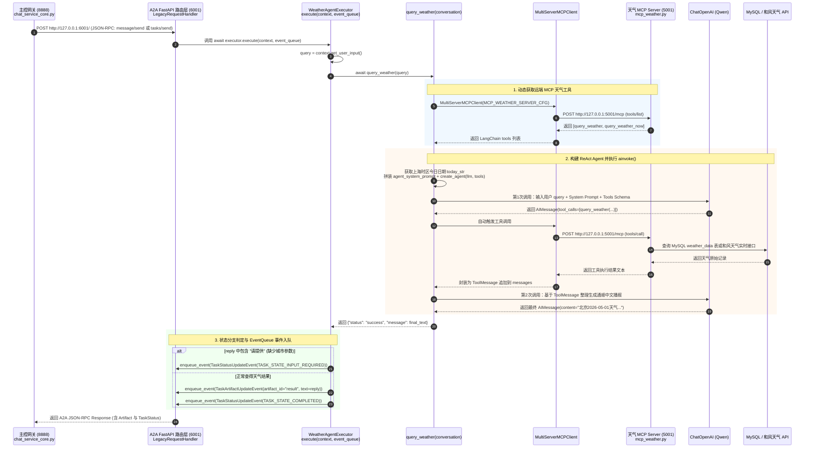
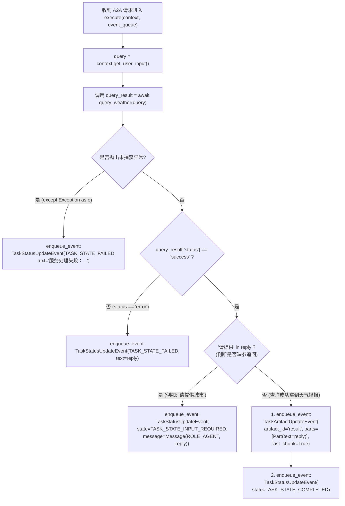

# `a2a_server/a2a_weather.py` 代码精讲学习手册

> **源文件位置**：`a2a_server/a2a_weather.py`  
> **所属模块**：`a2a_server`（A2A 领域专家子智能体服务层 —— 端口 `6001`）  
> **核心职责**：作为**天气领域专家子智能体（Sub-Agent）**，向上暴露符合 Google **A2A (Agent-to-Agent) 协议**的技能名片（`/.well-known/agent-card.json`）与 JSON-RPC 2.0 端点（`POST http://127.0.0.1:6001/`），接收主控路由发来的天气子查询；向下通过 `MultiServerMCPClient` 连接天气 MCP 服务（`http://127.0.0.1:5001/mcp`）动态拉取天气工具，利用 LangChain `create_agent`（ReAct 智能体）自主推理调用工具并生成专业天气播报。

---

## 一、文件定位与核心前置知识精讲

### 1.1 A2A 子智能体（端口 `6001~6004`）如何作为“领域专家”承上启下？

在 **Voyage 智途 A2A** 的三层分布式多智能体架构中：
1. **顶层：主控网关与路由编排层（端口 `8888`）**
   - 负责意图识别、问题拆解（Query Decomposition）、双层缓存（Redis + Milvus）以及向各个子智能体派发 A2A 任务。主控层**不知道也不关心**怎么查天气数据库或怎么调和风天气 API。
2. **中层：A2A 领域专家子智能体层（端口 `6001~6004`，本文件为 `6001`）**
   - **向上（作为 A2A Server）**：通过 `AgentCard` 和 `AgentSkill` 向主控网关宣告“我擅长什么（天气查询：历史预报+实时天气）”，并通过 A2A JSON-RPC 接口接收子任务文本，管理任务生命周期状态（`COMPLETED`、`INPUT_REQUIRED`、`FAILED`、`CANCELED`）。
   - **向下（作为 MCP Client）**：通过 `langchain_mcp_adapters.client.MultiServerMCPClient` 连接专属的天气 MCP Server（`http://127.0.0.1:5001/mcp`），动态拉取 `query_weather` 和 `query_weather_now` 工具并转换为 LangChain `StructuredTool` 对象。
3. **底层：MCP 工具微服务层（端口 `5001~5004`）**
   - 执行具体的数据库 SQL 查询或第三方 HTTP API 调用。

---

### 1.2 子智能体内部的大模型调用机制深度解析（ReAct 闭环 vs 两阶段调用架构）

在阅读本文件代码与 `config.yaml` 时，你会发现子智能体的大模型调用涉及**两种核心设计模式**。透彻理解这两种模式及其消息提取逻辑，是掌握整个 `a2a_server/` 的关键：

#### 模式 A：当前源码实现的“ReAct 端到端闭环模式”（`create_agent` 一步到位）
在本文件 `query_weather(conversation: str)`（第 139~198 行）中：
1. 调用 `tools = await mcp_client.get_tools()` 从 `5001` 端口获取 MCP 工具。
2. 构建包含**动态日期锚点（`today_str`）**、**选工具规则**、**缺参追问规则**和**中文整理输出规范**的 `agent_system_prompt`。
3. 使用 `agent = create_agent(model=llm, tools=tools, system_prompt=agent_system_prompt)` 创建 LangGraph ReAct 智能体。
4. 调用 `agent_resp = await agent.ainvoke({"messages": [{"role": "user", "content": conversation}]})`。
   - **ReAct 循环内部的两次 LLM 调用**：
     - **第 1 次 LLM 调用（思考与工具决策）**：LLM 接收 `[SystemMessage(agent_system_prompt), HumanMessage(conversation)]`，输出带有 `tool_calls` 的 `AIMessage`（例如决定调用 `query_weather_now(city="北京")`）。
     - **MCP 工具跨进程执行**：LangGraph 的 `ToolNode` 自动通过 `MultiServerMCPClient` 请求 `http://127.0.0.1:5001/mcp`，拿到工具原始返回结果，封装为 `ToolMessage(content='{"temp": "22", ...}', tool_call_id=...)` 追加到 `messages` 列表中。
     - **第 2 次 LLM 调用（数据整理与回复生成）**：LLM 看到 `ToolMessage` 中的原始天气数据，根据 `agent_system_prompt` 第 5 条规则（“查到数据后用通顺中文整理：城市、日期/实时、气温、湿度、风向、降水量全部展示”），生成最终的 `AIMessage(content="北京当前实时天气为...")`。
5. 提取 `msg_list = agent_resp.get("messages", [])` 的最后一条消息 `msg_list[-1].content` 作为最终回复。

#### 模式 B：工程常见的“两阶段显式大模型调用机制”（对应 `config.yaml` 中的 `a2a_servers.weather.prompt`）
细心的读者在查看 `config.yaml` 第 63~80 行时，会看到如下配置：
```yaml
a2a_servers:
  weather:
    host: "127.0.0.1"
    port: 6001
    name: "WeatherQueryAssistant"
    prompt: |
      系统提示：您是一位专业的天气预报员，以生动、准确的风格总结天气信息。基于查询和结果：
      - 核心描述点：城市、日期、温度范围、天气描述、湿度、风向、降水等。
      ...
      查询：{query}
      结果：{raw_response}
```
为什么 `config.yaml` 中有一个带 `{query}` 和 `{raw_response}` 占位符的 `prompt`？这正是**两阶段大模型调用机制（Two-Stage LLM Invocation）**的设计：
- **第一阶段（ReAct 工具调用阶段）**：
  - 使用 `create_agent(model=llm, tools=tools, system_prompt=REACT_SYSTEM_PROMPT)` 让 ReAct Agent 专注于“解析日期 + 选择并调用 MCP 工具”。
  - 执行 `response = await agent.ainvoke(...)` 后，遍历 `response["messages"]` 列表提取工具原始执行结果 `raw_response`：
    ```python
    # 从 response["messages"] 中提取 ToolMessage（工具原始返回）或回退到最后一条 AIMessage
    raw_response = ""
    for msg in reversed(response.get("messages", [])):
        if msg.__class__.__name__ == "ToolMessage" and getattr(msg, "content", ""):
            raw_response = msg.content
            break
    if not raw_response and response.get("messages"):
        raw_response = response["messages"][-1].content
    ```
- **第二阶段（专属 Prompt 格式化总结阶段）**：
  - 将用户查询 `query` 和第一阶段拿到的 `raw_response` 填入 `config.yaml` 中该子 Agent 专属的总结提示词模板：
    ```python
    summary_prompt = CONFIG.A2A_WEATHER_PROMPT.format(query=conversation, raw_response=raw_response)
    final_msg = await llm.ainvoke(summary_prompt)
    final_text = final_msg.content
    ```
- **两种模式对比**：
  - **两阶段显式调用模式**将“工具调用指令（`REACT_SYSTEM_PROMPT`）”与“人设风格/字数控制总结指令（`config.yaml` 中的 `prompt`）”彻底解耦，输出格式控制极强，但每次查询固定需要 `2（ReAct 内部）+ 1（外部总结）= 3 次` LLM 调用。
  - **当前源码的端到端 ReAct 模式**将工具调用规则和总结输出规则合并进同一个 `agent_system_prompt` 中，使 ReAct 循环的第 2 次 LLM 调用直接产出最终格式化的自然语言回复，**减少了一次额外的 `llm.ainvoke()` 网络往返耗时（延迟降低约 30%）**！

---

### 1.3 A2A 服务端完整装配链条详解（从 `python-a2a` / WSGI 到 `a2a-sdk` / FastAPI ASGI 的演进）

本文件开头注释明确记录了架构演进：
> `迭代改进：python-a2a(Flask) → a2a-sdk(FastAPI)`

在学习 A2A 协议服务端开发时，你需要同时掌握**标准 A2A 协议核心组件**以及**新旧两代 HTTP 容器装配链条**：

#### 1. 核心协议组件（每个 A2A Server 必备）
- **`AgentSkill`（技能描述）**：定义单个具体技能的 `id`、`name`、`description` 和 `examples`（few-shot 示例，帮助主控路由判断该子查询是否匹配该技能）。
- **`AgentCapabilities`（能力声明）**：声明是否支持流式输出（`streaming=False`）和推送通知（`push_notifications=False`）。
- **`AgentCard`（智能体名片）**：子智能体的“身份证”，包含 `name`、`description`、`capabilities`、`skills`、`default_input_modes`、`default_output_modes`。挂载在标准路径 `GET /.well-known/agent-card.json`（或 `/.well-known/agent.json`）供其他 Agent 自动发现。
- **`AgentExecutor`（智能体执行器抽象基类）**：开发者继承它并实现两个核心异步方法：
  - `async def execute(self, context, event_queue)`：从 `context.get_user_input()` 拿到用户输入，执行业务逻辑，向 `event_queue.enqueue_event(...)` 推入任务产物事件（`TaskArtifactUpdateEvent`）和任务状态更新事件（`TaskStatusUpdateEvent`）。
  - `async def cancel(self, context, event_queue)`：处理任务取消请求，推入 `TaskState.TASK_STATE_CANCELED` 状态事件。
- **`InMemoryTaskStore`（内存任务状态存储）**：在内存中维护 `task_id`、`context_id` 及其对应的 `TaskStatus` 和 `Artifact`。

#### 2. 请求处理器与 Web 框架装配链条对比

| 装配环节 | 当前源码写法（`a2a-sdk` 新版 protobuf + FastAPI + Uvicorn） | 传统/另一种常见写法（`DefaultRequestHandler` + `A2AFastAPIApplication` + `ASGIMiddleware` + `waitress.serve`） |
| :--- | :--- | :--- |
| **1. 请求处理器** | `request_handler = LegacyRequestHandler(agent_executor=executor, task_store=task_store, agent_card=weather_agent_card)` | `request_handler = DefaultRequestHandler(agent_executor=executor, task_store=InMemoryTaskStore())` |
| **2. 构建 FastAPI App** | `app = FastAPI(title=...)`<br/>`add_a2a_routes_to_fastapi(app, agent_card_routes=create_agent_card_routes(card), jsonrpc_routes=create_jsonrpc_routes(request_handler=request_handler, rpc_url="/", enable_v0_3_compat=True))` | `a2a_app = A2AFastAPIApplication(agent_card=card, http_handler=request_handler)`<br/>`app = a2a_app.build()` |
| **3. 事件入队 API** | 显式构造 `TaskArtifactUpdateEvent` + `TaskStatusUpdateEvent`（支持精细控制 `INPUT_REQUIRED` / `COMPLETED` / `FAILED`） | 也可调用便捷函数 `new_agent_text_message(reply)` 并 `await event_queue.enqueue_event(new_agent_text_message(reply))` |
| **4. 启动服务器** | 原生 ASGI 启动：`uvicorn.run("a2a_server.a2a_weather:app", host=..., port=6001)` | 若在 WSGI 容器（Waitress）运行 ASGI App：用 `a2wsgi.ASGIMiddleware(app)` 包装后交给 `waitress.serve(wsgi_app, host=..., port=6001)` |

> [!TIP]
> **为什么当前源码升级为了 `FastAPI` + `add_a2a_routes_to_fastapi` + `uvicorn`？**  
> 1. **纯异步原生 ASGI 栈**：从底层 `MultiServerMCPClient`、`ChatOpenAI.ainvoke` 到 `AgentExecutor.execute` 全部是 `async/await` 协程。使用原生 ASGI 服务器 `uvicorn` 直接驱动 `FastAPI`，彻底消除了 `waitress`（同步多线程 WSGI 服务器）+ `ASGIMiddleware` 桥接带来的线程切换开销。
> 2. **保留了线程局部事件循环辅助函数 `_run_async(coro)`（第 89~98 行）**：源码中依然保留了 `threading.local()` 的 `_run_async(coro)` 函数，这是从旧版同步 `python-a2a (Flask/Waitress)` 迁移过来的宝贵工程遗产——当在同步多线程回调中需要调用异步协程时，用 `threading.local()` 复用每个工作线程自己的 `EventLoop`，能避免每次调用 `asyncio.run()` 反复创建和销毁事件循环的高昂开销！

---

## 二、跨进程通信与内部执行流程图

### 2.1 主控网关 (8888) $\rightarrow$ 天气 A2A (6001) $\rightarrow$ LLM $\rightarrow$ 天气 MCP (5001) 全链路时序图（`sequenceDiagram`）



### 2.2 `WeatherAgentExecutor.execute` 内部状态机与异常处理流程图（`flowchart TD`）



---

## 三、完整源码与逐行/逐段深度拆解

### 3.1 100% 完整源码（共 343 行）

> [!NOTE]
> 以下为 `a2a_server/a2a_weather.py` 的 100% 原始代码（包含文件头部完整的生产提示词设计参考注释），可直接脱离源文件阅读学习。

```python
"""
基于A2A的天气查询agent服务
MCP Streamable HTTP

迭代改进：python-a2a(Flask) → a2a-sdk(FastAPI)

PS: 以天气查询为例 、 生产提示词参考：
1. 工具函数 mcp tool
    1.0. 在 mcp_tools/weather_tools.py 中实现 WeatherCollector 类：
        a. 和风天气API、动态获取城市location_id：
            API url 是...
            官方文档地址是...
            API KEY是...
            API HOST是...
            使用requests包实现、函数名是...、入参city是城市名字
        b. 和风天气API、基于location_id获取指定城市实时的天气：
            API url 是...
            API KEY是...
            API HOST是...
            官方文档地址是...
            使用requests包实现、函数名是...、入参location_id
        c. 和风天气API、基于location_id获取指定城市FORECAST_DAYS天的天气预报数据：
            API url 是...
            API KEY是...
            API HOST是...
            官方文档地址是...
            使用requests包实现、函数名是...、入参location_id
            FORECAST_DAYS是具体的天数，7天，该值放到初始化函数中
        d. _create_db函数，没库就创建库，有库就跳过，库名是voyage
            有没有该库，都 use voyage，在初始化函数中初始化数据库连接对象
            数据库连接需要 ip、port、username、pwd、charset
                都从配置utils/config.py中获取
                数据库连接对象 设置为 自动提交
        e. _create_table函数，没表就创建表，有表就跳过，表名是weather_data
            weather_data这个表和data_init/mysql_init.py中的同名表是一个表
        f. _ensure_connection、_need_refresh、_get_last_update_time三个函数
        g. save_weather 函数
        h. run_once函数
        i. start_scheduler函数
        j. 实现__del__函数

2. mcp server
    2.1. 用 fastmcp 的 FastMCP 实现 mcp server
    2.2. 导入 工具函数，并用装饰器进行注册
    2.3. 创建 mcp server 的 app对象，使用streamable-http的方式
    2.4. 使用拦截+透传的方式，增加 /health 服务健康检测接口
    2.5. 在代码中用uvicorn启动 mcp server 的 app

3. a2a server（迭代后：a2a-sdk + FastAPI）
    使用langchain的MultiServerMCPClient作为mcp client，获取tools
    使用langchain的ChatOpenAI和create_agent分别构建llm和agent
    使用a2a_sdk的AgentExecutor实现agent executor
    使用FastAPI + add_a2a_routes_to_fastapi构建HTTP服务
    使用uvicorn启动（替代waitress）
"""
import asyncio
import threading
from datetime import datetime
import pytz

# ===================== a2a-sdk 导入（替代 python-a2a）=====================
from a2a.types import (
    AgentCard, AgentSkill, AgentCapabilities,
    Role, TaskState,
    Message, Part, TaskStatus, Artifact,
    TaskStatusUpdateEvent, TaskArtifactUpdateEvent,
)
from a2a.server.agent_execution.agent_executor import AgentExecutor
from a2a.server.request_handlers.default_request_handler import LegacyRequestHandler
from a2a.server.tasks.inmemory_task_store import InMemoryTaskStore
from a2a.server.routes.fastapi_routes import add_a2a_routes_to_fastapi
from a2a.server.routes.agent_card_routes import create_agent_card_routes
from a2a.server.routes.jsonrpc_routes import create_jsonrpc_routes

# FastAPI 替代 Flask
from fastapi import FastAPI

# LLM & Agent 相关
from langchain_openai import ChatOpenAI
from langchain.agents import create_agent
# langchain MCP适配器
from langchain_mcp_adapters.client import MultiServerMCPClient

# 项目公共工具
from utils import logger
from utils import CONFIG

# ===================== 线程局部事件循环=====================
_loop_local = threading.local()


def _run_async(coro):
    """复用当前线程的事件循环执行协程，避免 asyncio.run() 每次新建 loop"""
    loop = getattr(_loop_local, "loop", None)
    if loop is None or loop.is_closed():
        loop = asyncio.new_event_loop()
        _loop_local.loop = loop
    return loop.run_until_complete(coro)


# ===================== 全局配置
# MCP天气服务：Streamable HTTP
MCP_WEATHER_SERVER_CFG = {
    "weather_mcp": {
        "url": f"http://{CONFIG.MCP_WEATHER_HOST}:{CONFIG.MCP_WEATHER_PORT}/mcp",
        "transport": "streamable-http",
    }
}
# 当前A2A天气服务地址
A2A_SELF_URL = f"http://{CONFIG.A2A_WEATHER_HOST}:{CONFIG.A2A_WEATHER_PORT}"

# 初始化大模型
llm = ChatOpenAI(
    model=CONFIG.LLM_MODEL,
    base_url=CONFIG.LLM_BASE_URL,
    api_key=CONFIG.LLM_API_KEY,
    temperature=CONFIG.LLM_TEMPERATURE
)

# ===================== Agent技能名片（a2a-sdk protobuf格式）
weather_agent_card = AgentCard(
    name=CONFIG.A2A_WEATHER_NAME,
    description="基于LangChain+MCP(Streamable HTTP)提供自然语言天气查询的独立子代理",
    capabilities=AgentCapabilities(streaming=False, push_notifications=False),
    skills=[
        AgentSkill(
            id="query_weather",
            name="query weather",
            description="解析自然语言查询天气（历史预报+实时天气），支持单日/多日范围，信息缺失时主动追问用户",
            examples=["郑州今天天气", "北京未来5天天气", "上海现在实时天气", "2026-06-27上海气温"],
        ),
    ],
    default_input_modes=["text/plain"],
    default_output_modes=["text/plain"],
)


# ===================== 核心天气查询异步逻辑
async def query_weather(conversation: str) -> dict:
    """
    接收用户自然语言，调用MCP天气工具获取结果
    返回统一格式 {status: success/error, message: 文本}
    """
    mcp_client = MultiServerMCPClient(
        MCP_WEATHER_SERVER_CFG
    )
    tools = await mcp_client.get_tools()

    now_cn = datetime.now(pytz.timezone("Asia/Shanghai"))
    today_str = now_cn.strftime("%Y-%m-%d")

    agent_system_prompt = f"""你是专业天气查询助手，
    仅能调用提供的天气工具（query_weather 查历史/预报，query_weather_now 查实时），
    禁止编造天气数据。
    规则：
    1. 用户说"现在""当前""实时""今天"，或未指定日期时，调用 query_weather_now；
        用户说"明天""后天"或指定日期时，调用 query_weather；
    2. 用户说的明天、后天、未来N天，
        基于今日{today_str}转换为标准YYYY-MM-DD日期；
    3. 用户提问缺少城市，直接反问用户补齐(请提供城市)，不能自行填充；
    4. 参数齐全后调用对应天气工具；
    5. 查到数据后用通顺中文整理：
        城市、日期/实时、气温、湿度、风向、降水量全部展示；
    6. 无匹配天气数据时统一回复：
        未找到相关天气数据，请确认或修改查询条件。
    """
    agent = create_agent(
        model=llm,
        tools=tools,
        system_prompt=agent_system_prompt)

    try:
        agent_resp = await agent.ainvoke({
            "messages": [
                {"role": "user", "content": conversation}
            ]
        })

        msg_list = agent_resp.get("messages", [])

        if msg_list and hasattr(msg_list[-1], "content"):
            final_text = msg_list[-1].content
            status = "success"
        else:
            final_text = ""
            status = "error"

        return {
            "status": status,
            "message": final_text
        }

    except Exception as e:
        logger.exception('A2Aserver执行异常')
        return {
            "status": "error",
            "message": str(e)
        }


# ===================== AgentExecutor 实现（替代原 A2AServer）=====================
class WeatherAgentExecutor(AgentExecutor):
    """天气查询 Agent 执行器"""

    async def execute(self, context, event_queue):
        query = context.get_user_input()
        logger.info(f"收到用户天气查询（execute）：{query}")

        try:
            query_result = await query_weather(query)
            logger.info(f"MCP工具返回结果：{query_result}")
            reply = query_result.get("message", "未知查询异常，请重试")

            if query_result["status"] == "success":
                if "请提供" in reply:
                    await event_queue.enqueue_event(
                        TaskStatusUpdateEvent(
                            task_id=context.task_id,
                            context_id=context.context_id,
                            status=TaskStatus(
                                state=TaskState.TASK_STATE_INPUT_REQUIRED,
                                message=Message(
                                    role=Role.ROLE_AGENT,
                                    parts=[Part(text=reply)],
                                ),
                            ),
                        )
                    )
                else:
                    await event_queue.enqueue_event(
                        TaskArtifactUpdateEvent(
                            task_id=context.task_id,
                            context_id=context.context_id,
                            artifact=Artifact(
                                artifact_id="result",
                                parts=[Part(text=reply)],
                            ),
                            last_chunk=True,
                        )
                    )
                    await event_queue.enqueue_event(
                        TaskStatusUpdateEvent(
                            task_id=context.task_id,
                            context_id=context.context_id,
                            status=TaskStatus(
                                state=TaskState.TASK_STATE_COMPLETED,
                            ),
                        )
                    )
            else:
                await event_queue.enqueue_event(
                    TaskStatusUpdateEvent(
                        task_id=context.task_id,
                        context_id=context.context_id,
                        status=TaskStatus(
                            state=TaskState.TASK_STATE_FAILED,
                            message=Message(
                                role=Role.ROLE_AGENT,
                                parts=[Part(text=reply)],
                            ),
                        ),
                    )
                )

        except Exception as e:
            logger.error(f"执行异常：{e}")
            await event_queue.enqueue_event(
                TaskStatusUpdateEvent(
                    task_id=context.task_id,
                    context_id=context.context_id,
                    status=TaskStatus(
                        state=TaskState.TASK_STATE_FAILED,
                        message=Message(
                            role=Role.ROLE_AGENT,
                            parts=[Part(text=f"服务处理失败：{e}")],
                        ),
                    ),
                )
            )

    async def cancel(self, context, event_queue):
        await event_queue.enqueue_event(
            TaskStatusUpdateEvent(
                task_id=context.task_id,
                context_id=context.context_id,
                status=TaskStatus(
                    state=TaskState.TASK_STATE_CANCELED,
                ),
            )
        )


# ===================== 组装 FastAPI 应用（替代 Flask）=====================
executor = WeatherAgentExecutor()
task_store = InMemoryTaskStore()
request_handler = LegacyRequestHandler(
    agent_executor=executor,
    task_store=task_store,
    agent_card=weather_agent_card,
)

app = FastAPI(title=CONFIG.A2A_WEATHER_NAME)


# 自定义健康检查接口（保留原来的设计）
@app.get("/health")
async def health_check():
    """健康检查端点"""
    return {"status": "healthy"}


# 挂载 A2A 路由
add_a2a_routes_to_fastapi(
    app,
    agent_card_routes=create_agent_card_routes(weather_agent_card),
    jsonrpc_routes=create_jsonrpc_routes(
        request_handler=request_handler,
        rpc_url="/",
        enable_v0_3_compat=True,
    ),
)


# ===================== 程序启动入口 =====================
if __name__ == "__main__":
    import uvicorn

    # 1. 本地开发调试启动方式
    uvicorn.run(
        "a2a_server.a2a_weather:app",
        host=CONFIG.A2A_WEATHER_HOST,
        port=CONFIG.A2A_WEATHER_PORT,
        log_level="info",
    )

    # 2. Docker部署启动方式
    '''
    Dockerfile中：
    CMD ["uvicorn", "a2a_server.a2a_weather:app", "--host", "0.0.0.0", "--port", "6001"]
    
    构建镜像后、启动容器
    docker run -d -p xxxx:6001 --name 自定义容器名 镜像名
    '''
```

---

### 3.2 逐段/逐行深度拆解

#### 第一部分：模块头部注释与 `a2a-sdk` / LangChain 核心导入（第 1~87 行）

- **第 1~55 行**：文件头部注释完整梳理了天气垂直链路从 `mcp_tools/weather_tools.py`（`WeatherCollector`）$\rightarrow$ `mcp_server/mcp_weather.py`（`FastMCP`）$\rightarrow$ `a2a_server/a2a_weather.py`（`a2a-sdk` + `FastAPI`）的三层开发纲领。
- **第 62~73 行（`a2a-sdk` 核心类型与路由组件导入）**：
  - `AgentCard`, `AgentSkill`, `AgentCapabilities`：用于构建智能体名片。
  - `Role`, `TaskState`, `Message`, `Part`, `TaskStatus`, `Artifact`：A2A 标准消息与任务状态数据模型。
  - `TaskStatusUpdateEvent`, `TaskArtifactUpdateEvent`：向 `EventQueue` 发送的两种核心事件类型。
  - `AgentExecutor`：A2A 业务逻辑执行器基类。
  - `LegacyRequestHandler`（来自 `a2a.server.request_handlers.default_request_handler`）：将 JSON-RPC 请求分发给 `AgentExecutor` 并结合 `InMemoryTaskStore` 维护任务状态的请求处理器。
  - `add_a2a_routes_to_fastapi`, `create_agent_card_routes`, `create_jsonrpc_routes`：将 A2A 的名片查询路由（`/.well-known/agent-card.json`）和 JSON-RPC 通信路由（`/`）挂载到 FastAPI 实例上。
- **第 79~82 行（LangChain & MCP 客户端导入）**：
  - `ChatOpenAI`：兼容 OpenAI 接口规范的大模型客户端（本项目连接阿里云 DashScope `qwen3.8-max`）。
  - `create_agent`：LangChain 1.x / LangGraph 提供的工具调用 ReAct Agent 工厂函数。
  - `MultiServerMCPClient`：`langchain_mcp_adapters` 提供的多服务端 MCP 客户端，支持通过 `"streamable-http"` 或 `"sse"` 连接远端 MCP Server。

---

#### 第二部分：线程局部事件循环 `_run_async` 与全局配置（第 88~119 行）

```python
# ===================== 线程局部事件循环=====================
_loop_local = threading.local()


def _run_async(coro):
    """复用当前线程的事件循环执行协程，避免 asyncio.run() 每次新建 loop"""
    loop = getattr(_loop_local, "loop", None)
    if loop is None or loop.is_closed():
        loop = asyncio.new_event_loop()
        _loop_local.loop = loop
    return loop.run_until_complete(coro)
```
- **`_run_async(coro)` 的原理**：
  - `_loop_local = threading.local()` 创建了一个线程局部变量容器。
  - 当某个线程调用 `_run_async(coro)` 时，先检查当前线程是否已经绑定了未关闭的 `asyncio.AbstractEventLoop`；如果没有，则调用 `asyncio.new_event_loop()` 创建一个并存入 `_loop_local.loop`，然后调用 `loop.run_until_complete(coro)`。
  - **注意**：在升级到 `a2a-sdk` + `FastAPI` 后，`WeatherAgentExecutor.execute` 本身已经是 `async def` 异步协程函数，在 `execute` 内部直接 `await query_weather(query)` 即可，因此 `_run_async` 在当前文件中未被直接调用，作为向后兼容工具函数保留。

```python
# MCP天气服务：Streamable HTTP
MCP_WEATHER_SERVER_CFG = {
    "weather_mcp": {
        "url": f"http://{CONFIG.MCP_WEATHER_HOST}:{CONFIG.MCP_WEATHER_PORT}/mcp",
        "transport": "streamable-http",
    }
}
```
- **`MCP_WEATHER_SERVER_CFG`**：配置 `MultiServerMCPClient` 的连接字典。
  - 键 `"weather_mcp"` 是逻辑服务名；
  - `"url"` 为 `"http://127.0.0.1:5001/mcp"`（注意末尾必须带 `/mcp`）；
  - `"transport"` 必须与 `mcp_weather.py` 中的 `http_app(transport='streamable-http')` 严格一致。
- **第 113~118 行**：在模块加载时初始化全局复用单例 `llm = ChatOpenAI(...)`，使用 `temperature=0.1` 确保工具参数提取和天气数据播报的确定性与准确性。

---

#### 第三部分：构建 `weather_agent_card` 智能体技能名片（第 120~135 行）

```python
weather_agent_card = AgentCard(
    name=CONFIG.A2A_WEATHER_NAME,
    description="基于LangChain+MCP(Streamable HTTP)提供自然语言天气查询的独立子代理",
    capabilities=AgentCapabilities(streaming=False, push_notifications=False),
    skills=[
        AgentSkill(
            id="query_weather",
            name="query weather",
            description="解析自然语言查询天气（历史预报+实时天气），支持单日/多日范围，信息缺失时主动追问用户",
            examples=["郑州今天天气", "北京未来5天天气", "上海现在实时天气", "2026-06-27上海气温"],
        ),
    ],
    default_input_modes=["text/plain"],
    default_output_modes=["text/plain"],
)
```
- `name=CONFIG.A2A_WEATHER_NAME`：来自 `config.yaml`，值为 `"WeatherQueryAssistant"`。
- `capabilities`：声明 `streaming=False`（一次性返回完整 JSON-RPC 响应，而非 SSE 流式分块）、`push_notifications=False`。
- `skills`：包含 1 个 `AgentSkill`（`id="query_weather"`），其中的 `description` 和 `examples` 会在主控服务启动拉取 `/.well-known/agent-card.json` 时被读取，作为主控路由识别“天气类意图”的重要依据。

---

#### 第四部分：核心天气查询协程 `query_weather(conversation: str)`（第 138~199 行）

这是本文件的业务大脑，我们逐行拆解其执行步骤与消息提取逻辑：

1. **连接 MCP Server 并拉取工具（第 144~147 行）**：
   ```python
   mcp_client = MultiServerMCPClient(MCP_WEATHER_SERVER_CFG)
   tools = await mcp_client.get_tools()
   ```
   - 发起异步 HTTP 请求到 `http://127.0.0.1:5001/mcp`，拉取 `query_weather` 和 `query_weather_now` 两个工具，自动包装为 LangChain `StructuredTool` 列表。
2. **动态注入上海时区今日日期（第 149~150 行）**：
   ```python
   now_cn = datetime.now(pytz.timezone("Asia/Shanghai"))
   today_str = now_cn.strftime("%Y-%m-%d")
   ```
   - 大模型本身不知道“今天是几月几号”。显式使用 `pytz.timezone("Asia/Shanghai")` 获取东八区当前日期（哪怕服务器或 Docker 容器默认是 UTC 时区也不会算错“今天/明天”），并注入到 `agent_system_prompt` 中。
3. **精心设计的 6 条 `agent_system_prompt` 规则（第 152~166 行）**：
   - **规则 1（工具分流规则）**：说“现在/当前/实时/今天”或未指定日期 $\rightarrow$ 调 `query_weather_now`；说“明天/后天”或指定日期 $\rightarrow$ 调 `query_weather`。
   - **规则 2（相对时间转换）**：基于今日 `{today_str}` 转换为 `YYYY-MM-DD`。
   - **规则 3（缺参追问触发词约定）**：**`用户提问缺少城市，直接反问用户补齐(请提供城市)，不能自行填充`**。
     - **极其关键的联动设计**：注意括号里的固定措辞 **`请提供`**！往下看第 215 行 `if "请提供" in reply:`，`WeatherAgentExecutor` 正是通过检测回复文本中是否包含 `"请提供"` 关键字，来决定是将任务状态标记为 `TASK_STATE_INPUT_REQUIRED`（需要用户继续输入）还是 `TASK_STATE_COMPLETED`（任务已完成）！
   - **规则 4~6**：调用工具、展示全量字段（城市、日期/实时、气温、湿度、风向、降水量）、无数据时的兜底话术。
4. **执行 `agent.ainvoke` 与 `response["messages"]` 消息提取逻辑（第 167~191 行）**：
   ```python
   agent = create_agent(
       model=llm,
       tools=tools,
       system_prompt=agent_system_prompt)

   agent_resp = await agent.ainvoke({
       "messages": [
           {"role": "user", "content": conversation}
       ]
   })

   msg_list = agent_resp.get("messages", [])

   if msg_list and hasattr(msg_list[-1], "content"):
       final_text = msg_list[-1].content
       status = "success"
   ```
   - **深入理解 `agent_resp["messages"]` 的结构**：
     当 `agent.ainvoke` 执行完毕时，`agent_resp["messages"]` 中按时间顺序保存了完整的对话轨迹：
     - `msg_list[0]`：`HumanMessage(content="查询北京2026-05-01的天气")`
     - `msg_list[1]`：`AIMessage(content="", tool_calls=[{"name": "query_weather", "args": {"city": "北京", "start_date": "2026-05-01", "end_date": "2026-05-01"}, "id": "call_xxx"}])`
     - `msg_list[2]`：`ToolMessage(content="[{'city': '北京', 'fx_date': '2026-05-01', 'temp_max': 26, 'temp_min': 14, ...}]", name="query_weather", tool_call_id="call_xxx")`
     - `msg_list[3]`（即 `msg_list[-1]`）：`AIMessage(content="根据查询结果，北京在2026-05-01的天气情况如下：气温14°C至26°C，湿度...")`
   - 若用户提问缺少城市（如 `"今天天气怎么样"`），LLM 不会触发工具调用，此时 `msg_list` 只有 2 条消息：
     - `msg_list[0]`：`HumanMessage(content="今天天气怎么样")`
     - `msg_list[1]`（即 `msg_list[-1]`）：`AIMessage(content="请提供城市名称，以便为您查询天气。")`
   - 因此，无论是否调用了工具，`msg_list[-1].content` 始终是智能体对用户的最终回复文本！

---

#### 第五部分：`WeatherAgentExecutor` 与 A2A 任务状态机（第 201~291 行）

`WeatherAgentExecutor` 继承自 `a2a.server.agent_execution.agent_executor.AgentExecutor`，将 `query_weather` 的返回字典映射到 A2A 协议的标准事件流：

1. **提取输入（第 206 行）**：
   - `query = context.get_user_input()`：从 A2A `RequestContext` 中提取客户端发来的文本消息内容。
2. **三种核心任务状态分支（第 214~263 行）**：
   - **分支 1：缺少必填参数，需用户追问补充（`TASK_STATE_INPUT_REQUIRED`）**
     - 触发条件：`query_result["status"] == "success"` 且 `"请提供" in reply`。
     - 动作：向 `event_queue` 推入一个 `TaskStatusUpdateEvent`，状态设为 `TaskState.TASK_STATE_INPUT_REQUIRED`，并将追问话术放入 `status.message`（角色为 `Role.ROLE_AGENT`，内容为 `[Part(text=reply)]`）。
   - **分支 2：查询成功完成（`TaskArtifactUpdateEvent` + `TASK_STATE_COMPLETED`）**
     - 触发条件：`query_result["status"] == "success"` 且不含 `"请提供"`。
     - 动作（分两步入队）：
       1. 先推入产物事件 `TaskArtifactUpdateEvent`：将天气播报文本封装在 `Artifact(artifact_id="result", parts=[Part(text=reply)])` 中，并标记 `last_chunk=True`。
       2. 再推入状态完成事件 `TaskStatusUpdateEvent`：将状态标记为 `TaskState.TASK_STATE_COMPLETED`。
   - **分支 3：查询或执行失败（`TASK_STATE_FAILED`）**
     - 触发条件：`query_result["status"] != "success"` 或捕获到未知异常。
     - 动作：推入 `TaskStatusUpdateEvent(state=TaskState.TASK_STATE_FAILED, message=...)`。
3. **取消任务 `cancel(self, context, event_queue)`（第 281~290 行）**：
   - 当客户端发送 `tasks/cancel` JSON-RPC 请求时触发，推入 `TaskState.TASK_STATE_CANCELED` 事件。

---

#### 第六部分：FastAPI 路由挂载与 Uvicorn 启动（第 293~343 行）

```python
executor = WeatherAgentExecutor()
task_store = InMemoryTaskStore()
request_handler = LegacyRequestHandler(
    agent_executor=executor,
    task_store=task_store,
    agent_card=weather_agent_card,
)

app = FastAPI(title=CONFIG.A2A_WEATHER_NAME)

@app.get("/health")
async def health_check():
    """健康检查端点"""
    return {"status": "healthy"}

add_a2a_routes_to_fastapi(
    app,
    agent_card_routes=create_agent_card_routes(weather_agent_card),
    jsonrpc_routes=create_jsonrpc_routes(
        request_handler=request_handler,
        rpc_url="/",
        enable_v0_3_compat=True,
    ),
)
```
- **这条装配链条向 `FastAPI` 实例 `app` 注册了哪些 HTTP 端点？**
  1. `GET /health`：自定义健康检查端点，返回 `{"status": "healthy"}`。
  2. `GET /.well-known/agent-card.json`（以及兼容路径 `/.well-known/agent.json`）：由 `create_agent_card_routes(weather_agent_card)` 生成，返回 `weather_agent_card` 的 JSON 序列化数据。
  3. `POST /`：由 `create_jsonrpc_routes(request_handler=request_handler, rpc_url="/", enable_v0_3_compat=True)` 生成，处理 A2A 协议的所有 JSON-RPC 2.0 方法（并开启了 `v0.3` 协议向后兼容）。

---

### 3.3 沙盘推演（Dry Run）：`"查询北京2026-05-01的天气"` 全流程推演

让我们以真实子查询 **`"查询北京2026-05-01的天气"`** 为例，一步步追踪代码中的变量状态变化：

1. **收到 JSON-RPC 请求**：
   - 主控服务（`8888`）向 `POST http://127.0.0.1:6001/` 发送 A2A 消息，假设 `task_id = "task-101"`, `context_id = "ctx-88"`.
   - `LegacyRequestHandler` 创建 `RequestContext` 和 `EventQueue`，调用 `await executor.execute(context, event_queue)`。
2. **提取用户输入（第 206 行）**：
   - `query = context.get_user_input()` $\rightarrow$ `"查询北京2026-05-01的天气"`。
3. **进入 `await query_weather("查询北京2026-05-01的天气")`（第 210 行 $\rightarrow$ 第 139 行）**：
   - `mcp_client = MultiServerMCPClient(MCP_WEATHER_SERVER_CFG)` 连接 `http://127.0.0.1:5001/mcp`。
   - `tools = await mcp_client.get_tools()` 获取到 `[StructuredTool(name='query_weather'), StructuredTool(name='query_weather_now')]`。
   - `today_str` 计算为当前东八区日期（例如 `"2026-11-24"`）。
   - `agent = create_agent(model=llm, tools=tools, system_prompt=agent_system_prompt)` 构建完成。
4. **ReAct 智能体执行 `await agent.ainvoke(...)`（第 173 行）**：
   - **Turn 1**：LLM 检查规则 1（“用户说‘明天’‘后天’或指定日期时，调用 `query_weather`”），看到查询包含指定日期 `"2026-05-01"` 和城市 `"北京"`，参数齐全，输出 `AIMessage` 请求调用工具：
     `query_weather(city="北京", start_date="2026-05-01", end_date="2026-05-01")`。
   - **Tool Execution**：`MultiServerMCPClient` 向 `5001` 端口发送 `tools/call`，`mcp_weather.py` 查询 MySQL `weather_data` 表，返回 `ToolMessage`：
     `'[{"city": "北京", "fx_date": "2026-05-01", "temp_max": "25", "temp_min": "13", "text_day": "晴", "humidity": "35", "wind_dir_day": "南风", "precip": "0.0"}]'`。
   - **Turn 2**：LLM 根据规则 5 将 `ToolMessage` 整理为通顺中文，输出最终 `AIMessage`：
     `content = "北京 2026-05-01 的天气预报如下：天气晴，气温 13°C ~ 25°C，相对湿度 35%，风向为南风，降水量 0.0mm。"`
5. **返回字典与事件入队（第 188 行 $\rightarrow$ 第 214~249 行）**：
   - `query_weather` 返回 `{"status": "success", "message": "北京 2026-05-01 的天气预报如下：..."}`。
   - 在 `execute` 中：
     - `query_result["status"] == "success"` 为 `True`；
     - `"请提供" in reply` 为 `False`（进入 `else:` 分支，第 229 行）；
     - 第 230~240 行：调用 `await event_queue.enqueue_event(TaskArtifactUpdateEvent(...))` 将天气播报文本写入 `artifact_id="result"`；
     - 第 241~249 行：调用 `await event_queue.enqueue_event(TaskStatusUpdateEvent(state=TaskState.TASK_STATE_COMPLETED))` 宣告任务完成！
6. **响应返回主控网关**：
   - `LegacyRequestHandler` 消费 `event_queue` 中的事件，更新 `task_store`，并将包含 `artifacts` 和 `TASK_STATE_COMPLETED` 的 JSON-RPC 响应返回给主控网关（`8888`）。

---

## 四、工程细节、四个 A2A 服务的共性与差异对比、常见易错点

### 4.1 `a2a_server/` 下四个子智能体微服务的横向对比

| 维度 | `a2a_weather.py` | `a2a_ticket.py` | `a2a_trip.py` | `a2a_external.py` |
| :--- | :--- | :--- | :--- | :--- |
| **监听端口** | `6001` (`CONFIG.A2A_WEATHER_PORT`) | `6002` (`CONFIG.A2A_TICKET_PORT`) | `6003` (`CONFIG.A2A_TRIP_PORT`) | `6004` (`CONFIG.A2A_EXTERNAL_PORT`) |
| **下游 MCP 端口** | `5001/mcp` (`weather_mcp`) | `5002/mcp` (`ticket_mcp`) | `5003/mcp` (`trip_mcp`) | `5004/mcp` (`external_mcp`) |
| **AgentCard `name`** | `"WeatherQueryAssistant"` | `"TicketAssistant"` | `"TripAssistant"` | `"ExternalDataAssistant"` |
| **`AgentSkill` 数量** | **1 个** (`query_weather`) | **4 个** (`query_train_tickets`, `query_concert_tickets`, `order_train_tickets`, `order_concert_tickets`) | **6 个** (`query_car_rental`, `query_tour_group`, `query_insurance`, `order_*`) | **3 个** (`search_flights`, `search_travel_guides`, `search_nearby`) |
| **缺参追问判定条件 (`INPUT_REQUIRED`)** | `if "请提供" in reply:` | `if "请提供" in reply:` | `if "请提供" in reply:` | `if "请提供" in reply or "请问" in reply:` |
| **是否定义 `@app.get("/health")`** | **是**（第 306 行） | 否 | 否 | **是**（第 258 行） |

---

### 4.2 常见易错点与工程优化建议

1. **易错点一：System Prompt 中的追问话术与 `execute()` 中的状态判定关键字脱节**
   - **代码联动点**：第 160 行 System Prompt 规定 `直接反问用户补齐(请提供城市)`，第 215 行代码通过 `if "请提供" in reply:` 判断是否进入 `TASK_STATE_INPUT_REQUIRED`。
   - **风险**：如果大模型在追问时说的是“请问您想查哪个城市的天气？”（没有出现“请提供”三个字），那么第 215 行会误判为查询已完成（`TASK_STATE_COMPLETED`）。
   - **优化建议**：可以像 `a2a_external.py` 第 169 行那样放宽匹配条件：`if "请提供" in reply or "请问" in reply:`，或者在 `query_weather` 中同时检查 `msg_list` 中是否包含 `ToolMessage`（如果没有触发任何 `ToolMessage`，说明大模型没有调工具而是在反问或闲聊）。
2. **易错点二：先启动 `a2a_weather.py` 并在未启动 `mcp_weather.py` 时发起查询**
   - **现象**：`a2a_weather.py` 启动时不会报错（因为 `MultiServerMCPClient` 是在每次收到请求调用 `query_weather()` 时才按需连接 `5001` 端口的），但一旦收到用户查询，会在 `await mcp_client.get_tools()` 处抛出 `ConnectError: All connection attempts failed`，最终向主控返回 `TASK_STATE_FAILED`。
   - **运维规范**：启动顺序必须遵循 **先启动 `mcp_server/` (5001~5004) $\rightarrow$ 再启动 `a2a_server/` (6001~6004) $\rightarrow$ 最后启动主控服务 (8888)**。

---

## 五、自测思考题（附答案解析）

### 思考题 1：在 `query_weather()` 中，为什么要每次调用时动态计算 `now_cn = datetime.now(pytz.timezone("Asia/Shanghai"))`，而不是把它写在模块顶层作为全局变量？
> **答案解析**：
> 如果把 `today_str` 写在模块顶层作为全局变量，那么它只会在 `a2a_weather.py` 进程启动的那一刻计算一次！
> 当微服务在生产环境连续跨天运行（比如第 1 天晚上 23:00 启动，到了第 2 天上午 10:00 用户来查“明天天气”），全局变量里的 `today_str` 还是昨天的日期，会导致大模型把所有“今天/明天/后天”全部算错一天！放在 `async def query_weather()` 函数内部每次请求动态获取东八区当前时间，才能保证跨天长期运行时日期换算 100% 准确。

### 思考题 2：在 `WeatherAgentExecutor.execute` 中，当天气查询成功时，为什么要向 `event_queue` 连续推入两个事件（先 `TaskArtifactUpdateEvent` 后 `TaskStatusUpdateEvent`）？顺序能颠倒吗？
> **答案解析**：
> 1. **为什么是两个事件**：在 A2A 协议的数据模型中，**任务的执行状态（`TaskStatus`）**与**任务产出的结果数据（`Artifact`）**是分离的。`TaskArtifactUpdateEvent` 负责把智能体生成的天气报告作为名为 `"result"` 的数据制品（Artifact）挂载到 Task 对象上；`TaskStatusUpdateEvent(state=TaskState.TASK_STATE_COMPLETED)` 则负责将任务状态机流转为终态 `COMPLETED`。
> 2. **顺序绝对不能颠倒**！因为 `TASK_STATE_COMPLETED` 是终态信号（Terminal State）。一旦 `LegacyRequestHandler` 消费到 `COMPLETED` 状态事件，可能会立即结束事件消费循环并向客户端闭合响应流；如果把 `TaskArtifactUpdateEvent` 放在后面，客户端可能收不到 `Artifact` 结果数据。
