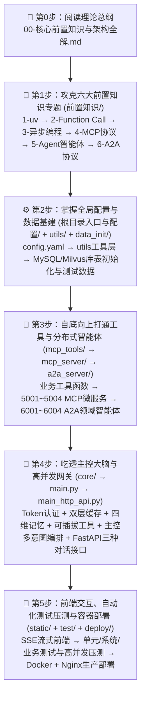

# Voyage 智途 A2A —— 脱离源码独立学习手册（全量代码逐篇精讲总目录）

> **手册设计目标**：
> 1. **100% 脱离源码独立学习**：本文件夹下的每一篇 `.md` 文档都**完整内嵌了对应代码文件的 100% 原始代码**，并配有**逐段/逐行深度拆解**与**代入真实数据的沙盘推演（Dry Run）**。你无需再一边打开 `.py` 代码文件一边对照，仅凭本文件夹即可随时随地（包括平板、离线阅读器）学透整个项目！
> 2. **前置知识与新概念零基础全覆盖**：不仅有专门的《[00-核心前置知识与架构全解.md](./00-核心前置知识与架构全解.md)》理论总纲，而且在每一篇代码精讲的开头，都针对该文件涉及的新概念、底层机制、协议规范进行了深入浅出的专题科普。
> 3. **严格对应原工程目录结构**：所有 `.md` 文件按原项目目录结构分类归档，脉络清晰。

---

## 一、推荐学习路线图（五步通关法）

---

## 二、全量代码精讲文档分类索引目录

### 📘 00. 理论总纲与架构导读
| 文档链接 | 核心内容简介 |
| :--- | :--- |
| [00-核心前置知识与架构全解.md](./00-核心前置知识与架构全解.md) | **必读总纲**：全系统 5 层架构比喻、MCP 与 A2A 本质区别、Function Calling 铁律、`asyncio` 八大原语、Agent 五大模式、Redis+Milvus 双层缓存、稠密+BM25 混合检索 RAG、四维记忆系统与 `threading.local()` 线程安全连接全解。 |

---

### 🧱 第一部分：`前置知识/` 六大专题代码逐篇精讲（共 46 篇）

#### 1.1 `1-uv环境管理工具/`（8 篇）
| 文档链接 | 对应源文件 | 核心知识点 |
| :--- | :--- | :--- |
| [README.md](./前置知识/1-uv环境管理工具/README.md) | 目录总览 | Rust 极速包管理器 `uv` 原理、与 `pip`/`conda` 对比、`pyproject.toml` 与 `uv.lock` 协同机制 |
| [uv安装.sh.md](./前置知识/1-uv环境管理工具/uv安装.sh.md) | `前置知识/1-uv环境管理工具/uv安装.sh` | Windows PowerShell 与 macOS/Linux 下安装 `uv` 的官方脚本解析 |
| [uv初始化.sh.md](./前置知识/1-uv环境管理工具/uv初始化.sh.md) | `前置知识/1-uv环境管理工具/uv初始化.sh` | `uv init` 项目脚手架生成机制与目录结构初始化 |
| [uv锁定Python版本.sh.md](./前置知识/1-uv环境管理工具/uv锁定Python版本.sh.md) | `前置知识/1-uv环境管理工具/uv锁定Python版本.sh` | `uv python pin 3.11` 与 `.python-version` 版本锁定机制 |
| [uv添加依赖.sh.md](./前置知识/1-uv环境管理工具/uv添加依赖.sh.md) | `前置知识/1-uv环境管理工具/uv添加依赖.sh` | `uv add` 自动创建 `.venv`、更新 `pyproject.toml` 与生成 `uv.lock` |
| [uv添加setuptools.sh.md](./前置知识/1-uv环境管理工具/uv添加setuptools.sh.md) | `前置知识/1-uv环境管理工具/uv添加setuptools.sh` | Python 3.12+ 移除内置 `pkg_resources` 后显式安装 `setuptools` 的原因 |
| [uv安装requirements.sh.md](./前置知识/1-uv环境管理工具/uv安装requirements.sh.md) | `前置知识/1-uv环境管理工具/uv安装requirements.sh` | `uv pip install -r requirements.txt` 传统依赖清单兼容安装模式 |
| [requirements.txt.md](./前置知识/1-uv环境管理工具/requirements.txt.md) | `前置知识/1-uv环境管理工具/requirements.txt` | 前置教学环境的最小依赖集合解析 |

#### 1.2 `2-Function Call/`（4 篇）
| 文档链接 | 对应源文件 | 核心知识点 |
| :--- | :--- | :--- |
| [01-基本调用.py.md](./前置知识/2-Function%20Call/01-基本调用.py.md) | `前置知识/2-Function Call/01-基本调用.py` | 手写 OpenAI JSON Schema 工具描述、`bind_tools`、`tool_calls` 解析、`**kwargs` 解包调用与 `ToolMessage` 回传全流程 |
| [02-装饰器方式.py.md](./前置知识/2-Function%20Call/02-装饰器方式.py.md) | `前置知识/2-Function Call/02-装饰器方式.py` | LangChain `@tool` 装饰器自动提取函数名/类型注解/文档字符串，以及 `.invoke(dict)` 与 `**` 解包的本质区别 |
| [03-pydantic方式.py.md](./前置知识/2-Function%20Call/03-pydantic方式.py.md) | `前置知识/2-Function Call/03-pydantic方式.py` | 使用 Pydantic `BaseModel` + `Field` + `@tool(args_schema=...)` 构建强类型约束与精细参数描述 |
| [04-agent_tools.py.md](./前置知识/2-Function%20Call/04-agent_tools.py.md) | `前置知识/2-Function Call/04-agent_tools.py` | 使用 `create_agent` 让框架接管多轮“模型请求 → 执行工具 → 包装 ToolMessage → 再次请求模型”闭环 |

#### 1.3 `3-异步编程/`（8 篇）
| 文档链接 | 对应源文件 | 核心知识点 |
| :--- | :--- | :--- |
| [01-async_basic.py.md](./前置知识/3-异步编程/01-async_basic.py.md) | `前置知识/3-异步编程/01-async_basic.py` | 同步阻塞 vs 异步非阻塞、`async def` 协程函数与 `await` 挂起让出 CPU 的底层机制 |
| [02-asyncio_run.py.md](./前置知识/3-异步编程/02-asyncio_run.py.md) | `前置知识/3-异步编程/02-asyncio_run.py` | 事件循环（Event Loop）生命周期与 `asyncio.run()` 顶层入口 |
| [03-async_for.py.md](./前置知识/3-异步编程/03-async_for.py.md) | `前置知识/3-异步编程/03-async_for.py` | 异步迭代器协议（`__aiter__` / `async def __anext__` / `StopAsyncIteration`）与 `async for` 流式消费 |
| [04-async_with.py.md](./前置知识/3-异步编程/04-async_with.py.md) | `前置知识/3-异步编程/04-async_with.py` | 异步上下文管理器协议（`__aenter__` / `__aexit__`）与 `async with` 异步资源安全释放 |
| [05-asyncio_gather.py.md](./前置知识/3-异步编程/05-asyncio_gather.py.md) | `前置知识/3-异步编程/05-asyncio_gather.py` | `asyncio.gather()` 并发执行多个 I/O 任务、总耗时缩减原理与返回值保序特性 |
| [06-asyncio_to_thread.py.md](./前置知识/3-异步编程/06-asyncio_to_thread.py.md) | `前置知识/3-异步编程/06-asyncio_to_thread.py` | `asyncio.to_thread()` 将同步阻塞函数（如 `time.sleep`、`pymysql`）丢进后台线程池防止卡死事件循环 |
| [07-asyncio_wait_for.py.md](./前置知识/3-异步编程/07-asyncio_wait_for.py.md) | `前置知识/3-异步编程/07-asyncio_wait_for.py` | `asyncio.wait_for()` 超时控制、`asyncio.TimeoutError` 捕获与慢任务自动取消 |
| [08-asyncio_create_task.py.md](./前置知识/3-异步编程/08-asyncio_create_task.py.md) | `前置知识/3-异步编程/08-asyncio_create_task.py` | `asyncio.create_task()` 后台并发任务调度与“即发即忘/按需等待”模式 |

#### 1.4 `4-MCP协议/`（9 篇）
| 文档链接 | 对应源文件 | 核心知识点 |
| :--- | :--- | :--- |
| [01-mcp-stdio-server.py.md](./前置知识/4-MCP协议/01-mcp-stdio-server.py.md) | `前置知识/4-MCP协议/01-mcp-stdio-server.py` | `FastMCP` 构建 `stdio` 标准输入输出管道模式 MCP 工具服务端 |
| [02-mcp-stdio-client.py.md](./前置知识/4-MCP协议/02-mcp-stdio-client.py.md) | `前置知识/4-MCP协议/02-mcp-stdio-client.py` | `stdio_client` 自动拉起服务端子进程、`ClientSession` 握手、`list_tools` 与 `call_tool` 原生调用 |
| [03-mcp-stdio-agent.py.md](./前置知识/4-MCP协议/03-mcp-stdio-agent.py.md) | `前置知识/4-MCP协议/03-mcp-stdio-agent.py` | LangChain Agent 结合 `stdio` MCP 工具完成大模型自主工具调用 |
| [04-mcp-sse-server.py.md](./前置知识/4-MCP协议/04-mcp-sse-server.py.md) | `前置知识/4-MCP协议/04-mcp-sse-server.py` | `FastMCP` 构建 `sse` (Server-Sent Events) 网络传输模式 MCP 服务端 |
| [05-mcp-sse-client.py.md](./前置知识/4-MCP协议/05-mcp-sse-client.py.md) | `前置知识/4-MCP协议/05-mcp-sse-client.py` | `sse_client` 跨进程连接远端 `/sse` 端点并调用工具 |
| [06-mcp-sse-agent.py.md](./前置知识/4-MCP协议/06-mcp-sse-agent.py.md) | `前置知识/4-MCP协议/06-mcp-sse-agent.py` | 使用 `MultiServerMCPClient` (`transport="sse"`) 将远端 MCP 服务接入 LangChain Agent |
| [07-mcp-streamable-server.py.md](./前置知识/4-MCP协议/07-mcp-streamable-server.py.md) | `前置知识/4-MCP协议/07-mcp-streamable-server.py` | `FastMCP` 构建新一代 `streamable-http`（单一 `/mcp` 端点）MCP 服务端（主项目采用模式） |
| [08-mcp-streamable-client.py.md](./前置知识/4-MCP协议/08-mcp-streamable-client.py.md) | `前置知识/4-MCP协议/08-mcp-streamable-client.py` | `streamablehttp_client` 连接 `/mcp` 端点进行工具发现与调用 |
| [09-mcp-streamable-agent.py.md](./前置知识/4-MCP协议/09-mcp-streamable-agent.py.md) | `前置知识/4-MCP协议/09-mcp-streamable-agent.py` | `MultiServerMCPClient` (`transport="streamable_http"`) 驱动智能体调用远端工具 |

#### 1.5 `5-Agent智能体/`（5 篇）
| 文档链接 | 对应源文件 | 核心知识点 |
| :--- | :--- | :--- |
| [01-工具模式.py.md](./前置知识/5-Agent智能体/01-工具模式.py.md) | `前置知识/5-Agent智能体/01-工具模式.py` | Agent 模式一：Tool Use（工具使用模式）原理与完整闭环 |
| [02-ReAct模式.py.md](./前置知识/5-Agent智能体/02-ReAct模式.py.md) | `前置知识/5-Agent智能体/02-ReAct模式.py` | Agent 模式二：ReAct（Thought 思考 → Action 行动 → Observation 观察）多步推理循环 |
| [03-反思模式.py.md](./前置知识/5-Agent智能体/03-反思模式.py.md) | `前置知识/5-Agent智能体/03-反思模式.py` | Agent 模式三：Reflection（生成初稿 → 自我批判审查 → 迭代重写优化） |
| [04-规划模式.py.md](./前置知识/5-Agent智能体/04-规划模式.py.md) | `前置知识/5-Agent智能体/04-规划模式.py` | Agent 模式四：Planning（复杂目标结构化拆解为子任务序列并逐步执行汇总） |
| [05-多智能体模式.py.md](./前置知识/5-Agent智能体/05-多智能体模式.py.md) | `前置知识/5-Agent智能体/05-多智能体模式.py` | Agent 模式五：Multi-Agent（主控路由 Agent + 多个领域专家子 Agent 分工协作） |

#### 1.6 `6-A2A协议/`（12 篇）
| 文档链接 | 对应源文件 | 核心知识点 |
| :--- | :--- | :--- |
| [01_agent_card.py.md](./前置知识/6-A2A协议/01_agent_card.py.md) | `前置知识/6-A2A协议/01_agent_card.py` | `AgentCard`（智能体名片）、`AgentSkill`（技能声明）与 `AgentCapabilities` 结构详解 |
| [02_a2a_executor.py.md](./前置知识/6-A2A协议/02_a2a_executor.py.md) | `前置知识/6-A2A协议/02_a2a_executor.py` | `AgentExecutor` 抽象基类、`execute(context, event_queue)` 与 `new_agent_text_message` |
| [03_a2a_server.py.md](./前置知识/6-A2A协议/03_a2a_server.py.md) | `前置知识/6-A2A协议/03_a2a_server.py` | `InMemoryTaskStore`、`DefaultRequestHandler`、`A2AFastAPIApplication` 与 `waitress` 服务端装配 |
| [04_mcp_server.py.md](./前置知识/6-A2A协议/04_mcp_server.py.md) | `前置知识/6-A2A协议/04_mcp_server.py` | 供 A2A 智能体调用的底层 MCP 工具服务示例 |
| [05_a2a_agent_server.py.md](./前置知识/6-A2A协议/05_a2a_agent_server.py.md) | `前置知识/6-A2A协议/05_a2a_agent_server.py` | **A2A + MCP 融合架构**：在 A2A `AgentExecutor` 内部通过 `MultiServerMCPClient` 调用 MCP 工具 |
| [06_a2a_client.py.md](./前置知识/6-A2A协议/06_a2a_client.py.md) | `前置知识/6-A2A协议/06_a2a_client.py` | `A2ACardResolver` 拉取 `/.well-known/agent.json` 名片与 `A2AClient.send_message` 请求解析 |
| [07_weather_agent.py.md](./前置知识/6-A2A协议/07_weather_agent.py.md) | `前置知识/6-A2A协议/07_weather_agent.py` | 独立 A2A 天气领域智能体服务构建示例 |
| [08_ticket_agent.py.md](./前置知识/6-A2A协议/08_ticket_agent.py.md) | `前置知识/6-A2A协议/08_ticket_agent.py` | 独立 A2A 票务领域智能体服务构建示例 |
| [09_serial_flow.py.md](./前置知识/6-A2A协议/09_serial_flow.py.md) | `前置知识/6-A2A协议/09_serial_flow.py` | 多个 A2A 智能体的串行流水线编排（先查天气，再据此查票） |
| [10_router_agent.py.md](./前置知识/6-A2A协议/10_router_agent.py.md) | `前置知识/6-A2A协议/10_router_agent.py` | 基于 AgentCard 名片列表的 LLM 智能路由分发器实现 |
| [11_single_intent.py.md](./前置知识/6-A2A协议/11_single_intent.py.md) | `前置知识/6-A2A协议/11_single_intent.py` | 单意图识别、路由匹配与 A2A 调用完整链路 |
| [12_multi_intent.py.md](./前置知识/6-A2A协议/12_multi_intent.py.md) | `前置知识/6-A2A协议/12_multi_intent.py` | **主项目核心雏形**：复合多意图拆解、并发 A2A 调度与结果聚合汇总 |

---

### ⚙️ 第二部分：`根目录入口与配置/`（5 篇）
| 文档链接 | 对应源文件 | 核心知识点 |
| :--- | :--- | :--- |
| [pyproject.toml.md](./根目录入口与配置/pyproject.toml.md) | `pyproject.toml` & `.python-version` | PEP 621 项目元数据、Python 版本约束、`uv` 阿里云镜像源配置 |
| [requirements.txt.md](./根目录入口与配置/requirements.txt.md) | `requirements.txt` | 12 大核心第三方库功能分层详解与 `a2a-sdk[fastapi]` 可选扩展语法 |
| [config.yaml.md](./根目录入口与配置/config.yaml.md) | `config.yaml` | 9 大微服务端口拓扑、环境变量安全注入 `api_key_env`、子 Agent 总结 Prompt 模板、28 个可插拔工具配置 |
| [main.py.md](./根目录入口与配置/main.py.md) | `main.py` | `ChatService(VoyageChatCore)` 门面模式（Facade）设计与 5 大对外公开 API 详解 |
| [main_http_api.py.md](./根目录入口与配置/main_http_api.py.md) | `main_http_api.py` | FastAPI 网关（8888端口）、Token 认证中间件、`asyncio.to_thread` 防阻塞架构、同步/SSE流式/异步轮询三种对话接口 |

---

### 🛠️ 第三部分：`utils/` 基础支撑与数据库管理层（6 篇）
| 文档链接 | 对应源文件 | 核心知识点 |
| :--- | :--- | :--- |
| [__init__.py.md](./utils/__init__.py.md) | `utils/__init__.py` | Python 包初始化、`__all__` 导出控制与统一导入门面 |
| [config.py.md](./utils/config.py.md) | `utils/config.py` | `Config` 类解析 `config.yaml`、`os.getenv` 读取系统环境变量 API Key、全局单例 `CONFIG` |
| [log.py.md](./utils/log.py.md) | `utils/log.py` | 双通道日志（控制台 INFO + 文件 DEBUG）、`RotatingFileHandler` 轮转、按启动脚本名自动分文件记录 |
| [json_encoder.py.md](./utils/json_encoder.py.md) | `utils/json_encoder.py` | `DateDecimalToString(json.JSONEncoder)` 解决 MySQL `date`/`datetime`/`timedelta`/`Decimal` JSON 序列化报错 |
| [mysql_manager.py.md](./utils/mysql_manager.py.md) | `utils/mysql_manager.py` | `threading.local()` 线程本地连接隔离、断线重连 `ping(reconnect=True)`、参数化 SQL 防注入与字典结果集转换 |
| [milvus_manager.py.md](./utils/milvus_manager.py.md) | `utils/milvus_manager.py` | Milvus 向量数据库管理、1024维稠密向量检索 + BM25 稀疏全文检索 + `RRFRanker` 倒数秩融合混合检索 (Hybrid Search) |

---

### 🗄️ 第四部分：`data_init/` 数据库初始化与测试数据层（5 篇）
| 文档链接 | 对应源文件 | 核心知识点 |
| :--- | :--- | :--- |
| [mysql_init.py.md](./data_init/mysql_init.py.md) | `data_init/mysql_init.py` | 初始化 `voyage` 库及 10+ 张核心业务表/记忆表/用户表的 DDL 表结构与索引设计详解 |
| [milvus_init.py.md](./data_init/milvus_init.py.md) | `data_init/milvus_init.py` | 初始化 `voyage_rag` 库与 `travel_rag` 集合 Schema、内置 `BM25` Function 及 `HNSW`/`SPARSE_INVERTED_INDEX` 索引 |
| [testdata_insert_mysql.py.md](./data_init/testdata_insert_mysql.py.md) | `data_init/testdata_insert_mysql.py` | 批量写入机票、高铁、演唱会、酒店、租车、旅游团、保险等结构化仿真测试数据 |
| [testdata_insert_milvus.py.md](./data_init/testdata_insert_milvus.py.md) | `data_init/testdata_insert_milvus.py` | 调用阿里云 Embedding 接口将多城市旅游攻略文档批量向量化并写入 Milvus `travel_rag` 集合 |
| [clear_all.py.md](./data_init/clear_all.py.md) | `data_init/clear_all.py` | 一键清空并重置 MySQL、Milvus、Redis 全量数据的运维脚本解析 |

---

### 🔧 第五部分：`mcp_tools/` 业务工具与外部 API 实现层（9 篇）
| 文档链接 | 对应源文件 | 核心知识点 |
| :--- | :--- | :--- |
| [weather_tools.py.md](./mcp_tools/weather_tools.py.md) | `mcp_tools/weather_tools.py` | `WeatherCollector` 定时采集和风天气 15 天预报入库 (`ON DUPLICATE KEY UPDATE`)、`query_weather` 查库与 `query_weather_now` 实时 HTTP 查询 |
| [ticket_tools.py.md](./mcp_tools/ticket_tools.py.md) | `mcp_tools/ticket_tools.py` | 机票/火车票/演唱会票动态多条件 SQL 查询 (`query_*`) 与余票校验扣减预订 (`order_*`) |
| [trip_tools.py.md](./mcp_tools/trip_tools.py.md) | `mcp_tools/trip_tools.py` | 酒店/租车/旅游团/保险动态查询与库存扣减预订实现 |
| [amap_tools.py.md](./mcp_tools/amap_tools.py.md) | `mcp_tools/amap_tools.py` | 高德地图开放平台 API 封装：地理编码、周边 POI 搜索（餐厅/景点/酒店/加油站/医院/停车场）、驾车/公交/步行/骑行路径规划 |
| [bocha_tools.py.md](./mcp_tools/bocha_tools.py.md) | `mcp_tools/bocha_tools.py` | 博查 (Bocha) AI 联网搜索 API 封装，获取实时互联网资讯与旅行攻略摘要 |
| [variflight_tools.py.md](./mcp_tools/variflight_tools.py.md) | `mcp_tools/variflight_tools.py` | 飞常准真实航班搜索、航班动态、舒适度与最低票价查询工具封装 |
| [test_和风天气_获取城市编码.py.md](./mcp_tools/test_和风天气_获取城市编码.py.md) | `mcp_tools/test_和风天气_获取城市编码.py` | 独立调试和风天气 Geo API (`/geo/v2/city/lookup`) 根据城市名查 `location_id` |
| [test_和风天气_获取城市实时天气.py.md](./mcp_tools/test_和风天气_获取城市实时天气.py.md) | `mcp_tools/test_和风天气_获取城市实时天气.py` | 独立调试和风天气实时天气 API (`/v7/weather/now`) |
| [test_和风天气_获取城市指定天数的天气预报信息.py.md](./mcp_tools/test_和风天气_获取城市指定天数的天气预报信息.py.md) | `mcp_tools/test_和风天气_获取城市指定天数的天气预报信息.py` | 独立调试和风天气 15 天预报 API (`/v7/weather/15d`) |

---

### 📡 第六部分：`mcp_server/` MCP 工具微服务层（端口 5001~5004，共 4 篇）
| 文档链接 | 对应源文件 | 监听端口 | 核心知识点 |
| :--- | :--- | :--- | :--- |
| [mcp_weather.py.md](./mcp_server/mcp_weather.py.md) | `mcp_server/mcp_weather.py` | `5001` | 使用 `FastMCP` 暴露 `query_weather` 与 `query_weather_now` 工具 (`streamable-http`) |
| [mcp_ticket.py.md](./mcp_server/mcp_ticket.py.md) | `mcp_server/mcp_ticket.py` | `5002` | 使用 `FastMCP` 暴露火车票、演唱会票查询与机票/火车票/演唱会票预订共 5 个票务工具 |
| [mcp_trip.py.md](./mcp_server/mcp_trip.py.md) | `mcp_server/mcp_trip.py` | `5003` | 使用 `FastMCP` 暴露酒店、租车、旅游团、保险的查询与预订共 8 个行程管家工具 |
| [mcp_external.py.md](./mcp_server/mcp_external.py.md) | `mcp_server/mcp_external.py` | `5004` | 集成 Milvus RAG 旅游知识库检索、飞常准航班查询、博查联网搜索与高德地图周边/路线规划工具 |

---

### 🤖 第七部分：`a2a_server/` A2A 领域智能体服务层（端口 6001~6004，共 4 篇）
| 文档链接 | 对应源文件 | 监听端口 | 核心知识点 |
| :--- | :--- | :--- | :--- |
| [a2a_weather.py.md](./a2a_server/a2a_weather.py.md) | `a2a_server/a2a_weather.py` | `6001` | `WeatherQueryAssistant`：连接 `5001` MCP 服务，ReAct 调用天气工具 + 预报员风格 Prompt 二次总结 |
| [a2a_ticket.py.md](./a2a_server/a2a_ticket.py.md) | `a2a_server/a2a_ticket.py` | `6002` | `TicketAssistant`：连接 `5002` MCP 服务，处理票务查询与下单，顾问风格总结 |
| [a2a_trip.py.md](./a2a_server/a2a_trip.py.md) | `a2a_server/a2a_trip.py` | `6003` | `TripAssistant`：连接 `5003` MCP 服务，处理酒店/租车/跟团/保险，管家风格总结 |
| [a2a_external.py.md](./a2a_server/a2a_external.py.md) | `a2a_server/a2a_external.py` | `6004` | `ExternalDataAssistant`：连接 `5004` MCP 服务，处理真实航班、RAG 攻略、POI 周边与路线规划 |

---

### 🧠 第八部分：`core/` 核心编排、记忆、缓存与鉴权层（9 篇）
| 文档链接 | 对应源文件 | 核心知识点 |
| :--- | :--- | :--- |
| [auth.py.md](./core/auth.py.md) | `core/auth.py` | `AuthManager`：SHA-256 密码哈希、MySQL 用户表注册校验、Redis Bearer Token 会话生成与 TTL 续期/注销 |
| [cache_manager.py.md](./core/cache_manager.py.md) | `core/cache_manager.py` | `CacheManager`：**L1 Redis 精确缓存 + L2 Milvus 向量语义缓存（相似度 ≥ 0.92）**、L2 命中回填 L1、按用户清空缓存 |
| [memory_manager.py.md](./core/memory_manager.py.md) | `core/memory_manager.py` | `MemoryManager`：**四维记忆系统**（短期对话滑窗、长期用户画像、当前任务槽位、历史实体栈）与 MySQL JSON 持久化 |
| [prompts.py.md](./core/prompts.py.md) | `core/prompts.py` | 全系统核心 Prompt 模板库：意图分类与必填参数追问、多意图任务分解路由、ReAct 工具调用约束、结果反思与汇总生成、实体提取 |
| [tool_base.py.md](./core/tool_base.py.md) | `core/tool_base.py` | 可插拔工具框架基石：`ToolBase` 抽象基类、`validate_params`、`safe_execute` 与同步/异步自适应包装器 `FunctionTool` |
| [tool_config.py.md](./core/tool_config.py.md) | `core/tool_config.py` | `ToolConfig`：读取 `config.yaml` 的 `tools` 节点，提供 `is_enabled()` 开关判断与 `get_api_key()` 环境变量密钥提取 |
| [tool_registry.py.md](./core/tool_registry.py.md) | `core/tool_registry.py` | `ToolRegistry`：工具注册表中心，支持工具注册、按名称获取、按业务域 `discover(domain)` 动态发现 |
| [tool_init.py.md](./core/tool_init.py.md) | `core/tool_init.py` | `init_tools()`：网关启动时读取配置开关，将 `mcp_tools/` 下的业务函数批量装配进 `TOOL_REGISTRY` |
| [chat_service_core.py.md](./core/chat_service_core.py.md) | `core/chat_service_core.py` | **全项目最核心总管大脑 (`VoyageChatCore`)**：1200+ 行完整源码逐模块精讲（指代消解、意图识别、追问拦截、多子任务拆解、A2A 并发调度、反思重试、记忆更新全流程） |

---

### 🖥️ 第九部分：`static/` 前端单页应用层（1 篇）
| 文档链接 | 对应源文件 | 核心知识点 |
| :--- | :--- | :--- |
| [index.html.md](./static/index.html.md) | `static/index.html` | 登录注册弹窗、Bearer Token 管理、`fetch` + `ReadableStream` 解析 POST SSE 流式打字机响应、异步任务轮询、四维记忆与 A2A 名片可视化面板 |

---

### 🧪 第十部分：`test/` 单元测试、系统测试与高并发压测层（7 篇）
| 文档链接 | 对应源文件 | 核心知识点 |
| :--- | :--- | :--- |
| [__init__.py.md](./test/__init__.py.md) | `test/__init__.py` | 测试包标识文件说明 |
| [test_json_encoder.py.md](./test/test_json_encoder.py.md) | `test/test_json_encoder.py` | 单元测试：验证 `DateDecimalToString` 对 `date`/`datetime`/`timedelta`/`Decimal` 的序列化正确性 |
| [test_query_weather.py.md](./test/test_query_weather.py.md) | `test/test_query_weather.py` | 单元测试：验证 `query_weather` 与 `query_weather_now` 的返回值格式与数据库/API 连通性 |
| [test_run_in_thread.py.md](./test/test_run_in_thread.py.md) | `test/test_run_in_thread.py` | 并发对比测试：用实验数据证明 `asyncio.to_thread()` 将多个阻塞调用从串行耗时变为并行耗时 |
| [test_system.py.md](./test/test_system.py.md) | `test/test_system.py` | 全链路基础设施体检测试：一键检测配置、MySQL、Redis、Milvus、4个MCP服务、4个A2A服务及主网关是否正常在线 |
| [test_business.py.md](./test/test_business.py.md) | `test/test_business.py` | 端到端业务场景集成测试：覆盖单意图、多意图并发、多轮指代消解、缺参追问、用户画像记忆与缓存命中 |
| [压力测试/stress_test.py.md](./test/压力测试/stress_test.py.md) | `test/压力测试/stress_test.py` | 基于 `aiohttp` 的高并发压力测试框架：并发协程池、QPS 吞吐量、P50/P90/P95/P99 分位延迟统计及压测报告生成 |

---

### 🐳 第十一部分：`deploy/` 容器化与生产部署配置层（4 篇）
| 文档链接 | 对应源文件 | 核心知识点 |
| :--- | :--- | :--- |
| [Dockerfile.md](./deploy/Dockerfile.md) | `deploy/Dockerfile` | Python 应用容器镜像构建指令、国内镜像源加速、依赖分层缓存与启动命令解析 |
| [docker-compose.yml.md](./deploy/docker-compose.yml.md) | `deploy/docker-compose.yml` | 底层基础设施编排：一键拉起 MySQL 8.0、Redis 8.2、Milvus 2.6.6 全家桶（etcd + MinIO + Milvus + Attu） |
| [docker-compose-dev.yml.md](./deploy/docker-compose-dev.yml.md) | `deploy/docker-compose-dev.yml` | 分布式业务微服务编排：编排 API 网关、4 个 MCP 服务、4 个 A2A 智能体、统一 Nginx 代理与天气采集器共 11 个容器 |
| [nginx.conf.md](./deploy/nginx.conf.md) | `deploy/nginx.conf` | Nginx 反向代理配置、负载均衡，以及针对 `/api/chat/stream` SSE 流式接口的关键配置（`proxy_buffering off`） |
