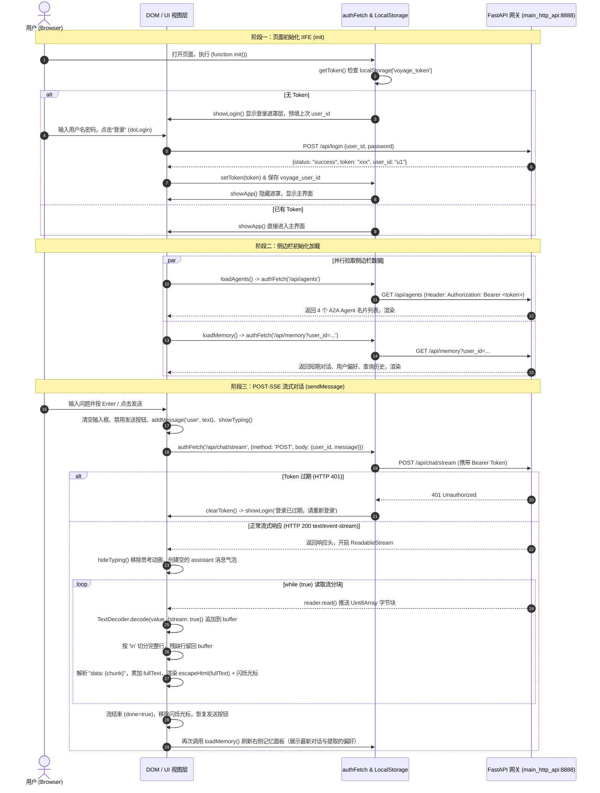

# `static/index.html` 代码精讲学习手册 —— 单页富交互智能对话前端（含 JWT 鉴权、POST-SSE 流式解析与记忆管理）

---

## 一、文件定位与核心前置知识精讲

### 1.1 文件在系统中的定位
`static/index.html` 是 **SmartVoyage 智途 v7.9（基于 A2A 协议的旅行智能助手）** 的单页 Web 前端（SPA, Single Page Application）。它采用**零第三方框架依赖（Vanilla HTML5 + CSS3 + ES6+ JavaScript）**的原生架构编写，由 FastAPI 网关（`main_http_api.py`）通过静态文件挂载或根路由直接托管对外提供服务。

该文件在一个高内聚的 HTML 文件中完成了以下五大核心职责：
1. **全屏登录/注册拦截层（Login Overlay）与 JWT/Token 鉴权生命周期管理**：利用浏览器 `localStorage` 持久化存储 `voyage_token` 与 `voyage_user_id`，并通过高阶封装函数 `authFetch()` 统一注入 `Authorization: Bearer <token>` 请求头，以及统一拦截 `HTTP 401 Unauthorized` 实现自动退登。
2. **基于 `fetch` + `ReadableStream` 的 POST-SSE 流式对话引擎**：连接后端 `POST /api/chat/stream` 接口，使用 `response.body.getReader()` 与 `TextDecoder` 实现二进制分块（Chunk）流式解码、粘包/半包缓冲区（Buffer）切分、打字机闪烁光标（Streaming Cursor）动态渲染。
3. **A2A 多智能体名片（Agent Cards）动态展示面板**：调用 `GET /api/agents` 拉取后端注册的各个领域 A2A 智能体（天气助手、票务助手、行程管家、外部数据源助手）的元数据、技能列表（Skills）与在线状态。
4. **分层记忆可视化与用户画像（User Profile）在线编辑器**：调用 `GET /api/memory`、`POST /api/memory/profile`、`POST /api/memory/clear` 实现短期对话记忆、实体查询历史、当前用户 ID 的折叠面板展示，以及用户偏好键值对（Key-Value）的动态增删改保存。
5. **前后端三大对话交互模式的架构支撑**：前端与网关支持同步对话（`/api/chat`）、SSE 流式对话（`/api/chat/stream`）以及异步提交+轮询模式（`/api/chat_async` + `/api/chat_result`）。

---

### 1.2 核心前置知识 1：为什么不能用浏览器原生的 `EventSource`？如何用 `fetch` + `ReadableStream` 解析 POST-SSE？

在传统的 Web 开发中，提起 Server-Sent Events（SSE，服务端推送事件），很多人的第一反应是使用浏览器内置的 `new EventSource(url)` API。然而在 **大模型（LLM）对话系统** 中，几乎所有生产级前端都**放弃了原生 `EventSource`**，转而使用 **`fetch` + `response.body.getReader()` + `TextDecoder`**。原因如下：

| 对比维度 | 浏览器原生 `EventSource` | `fetch` + `ReadableStream` (`getReader()`) |
| :--- | :--- | :--- |
| **HTTP 请求方法** | **仅支持 `GET` 请求**，无法发送 `POST` | 支持任意方法（`POST`、`GET`、`PUT` 等） |
| **请求体（Payload）** | 无法携带 JSON Body；若把长对话放入 URL Query 参数，极易触发 URL 长度限制（通常 2KB~8KB）且暴露隐私 | 可通过 `body: JSON.stringify({ user_id, message })` 发送任意长度的复杂 JSON 数据 |
| **自定义请求头（Headers）** | **不支持自定义 Header**，无法携带 `Authorization: Bearer <token>` 鉴权头 | 完全支持自定义 `headers`，可无缝集成 JWT / Bearer Token 认证 |
| **错误状态码控制** | 遇到 `401`、`500` 只触发笼统的 `onerror`，难以读取响应体或精确拦截 401 跳转登录 | 可先读取 `resp.status`（如 `resp.status === 401`），再决定是否开启流式读取 |
| **重连控制** | 默认无脑自动重连，在大模型接口报错时会导致无限重复扣费调用 | 由开发者完全掌控重试与异常处理逻辑 |

#### `fetch` + `ReadableStream` + `TextDecoder` 解析 SSE 的底层机制
当后端 FastAPI 返回 `StreamingResponse(..., media_type="text/event-stream")` 时，HTTP 响应头包含 `Transfer-Encoding: chunked`。浏览器收到响应头后，`await fetch(...)` 就会立即 resolve 返回 `Response` 对象，此时响应体（Body）尚未传输完毕，而是以一个 **`ReadableStream`（可读字节流）** 的形式暴露在 `response.body` 上：

1. **获取流读取器**：`const reader = response.body.getReader();` 锁定该字节流并创建一个读取器。
2. **循环拉取字节块（Uint8Array）**：每次调用 `const { done, value } = await reader.read();`：
   - 如果流结束（后端关闭连接），`done` 为 `true`。
   - 如果收到新的网络数据包，`value` 是一个 `Uint8Array`（原始 UTF-8 字节数组）。
3. **多字节 UTF-8 字符的跨包截断问题（为什么必须传 `{ stream: true }`？）**：
   - 一个中文字符在 UTF-8 编码下占 **3 个字节**（例如“智”的 UTF-8 字节是 `E6 99 BA`）。
   - TCP 分包传输时，完全有可能第一个数据包末尾只传了 `E6 99`，剩下的 `BA` 在下一个数据包开头到达。
   - 如果直接调用 `decoder.decode(value)`（不带 `{ stream: true }`），`TextDecoder` 会把末尾不完整的字节当成损坏字符替换为乱码符号 ``！
   - 当传入 `decoder.decode(value, { stream: true })` 时，`TextDecoder` 内部会**自动暂存末尾不完整的 UTF-8 字节**，等下一次 `decode` 收到后续字节时拼接成完整汉字输出！
4. **SSE 行协议粘包/半包缓冲区（Line Buffer）算法**：
   - SSE 协议规范要求每条消息以 `data: {...}\n\n` 格式发送。
   - 一次 `reader.read()` 可能包含多行 `data: ...`（**粘包**），也可能一行 `data: {"chunk": "你好"}` 被劈成了两半（**半包**）。
   - 因此代码中维护了 `let buffer = '';`：
     ```javascript
     buffer += decoder.decode(value, { stream: true });
     const lines = buffer.split('\n');
     buffer = lines.pop() || ''; // 把最后一个（可能还没收到 \n 的残缺行）留回 buffer！
     ```
     只有明确遇到 `\n` 换行符的前置完整行才会在本轮循环中被解析，最后一个元素被 `lines.pop()` 弹出重新赋给 `buffer`，等待下一个 chunk 拼齐换行符。这是网络编程中最经典的**流式按行拆包范式**。

---

### 1.3 核心前置知识 2：前端 Token 登录态管理（`localStorage`）与多用户隔离
1. **`localStorage` 双键持久化**：
   - `voyage_token`：存放后端 `/api/login` 签发的认证 Token。
   - `voyage_user_id`：存放当前用户的唯一标识。
2. **匿名兜底与实名绑定双模式**：
   - 页面加载时，`getOrCreateUserId()` 会检查 `localStorage` 中是否有 `voyage_user_id`。若没有，则利用浏览器密码学安全随机数 API `crypto.getRandomValues(new Uint8Array(4))` 生成形如 `u-a1b2c3d4` 的随机 ID。
   - 当用户通过登录窗口成功登录（`doLogin()`）后，`USER_ID` 会被覆写为后端返回的真实 `data.user_id` 并持久化到 `localStorage.setItem('voyage_user_id', USER_ID)`，确保后续聊天、记忆查询、偏好修改全部与该登录账号严格绑定。
3. **统一认证拦截器 `authFetch(url, options)`**：
   - 自动从 `localStorage` 读取 `voyage_token`，注入 `options.headers['Authorization'] = 'Bearer ' + token`。
   - 当存在请求体 `options.body` 且未指定 `Content-Type` 时，自动补充 `application/json`。
   - 当收到后端 `resp.status === 401`（Token 失效、未登录或被踢出）时，自动调用 `clearToken()` 清空本地凭证，调用 `showLogin('登录已过期，请重新登录')` 切回登录遮罩层，并抛出 `new Error('Unauthorized')` 中断后续业务渲染。

---

### 1.4 核心前置知识 3：三种对话模式（同步、SSE 流式、异步轮询 `/api/chat_async` + `/api/chat_result`）对比
在 SmartVoyage 系统中，后端网关提供了三套对话接口，前端主聊天窗口默认使用体验最好的 **SSE 流式接口（`/api/chat/stream`）**，同时系统架构还支持**异步轮询模式（`/api/chat_async` + `/api/chat_result`）**。我们在前端视角对比这三种模式的实现机理：

```
模式一：同步阻塞模式 (POST /api/chat)
前端 authFetch ──────────────────────────(等待 15~60s)──────────────────────────> 收到完整 JSON 一次性渲染

模式二：SSE 流式模式 (POST /api/chat/stream) 【index.html 默认采用】
前端 authFetch ──> 建立流 ──> reader.read() 收到 chunk1 ──> 收到 chunk2 ──> ... ──> [DONE] 移除闪烁光标

模式三：异步提交+轮询模式 (POST /api/chat_async + POST /api/chat_result)
前端 ──(1) POST /api/chat_async──> 立即返回 {"status": "processing", "redis_key": "..."} (耗时 <50ms)
前端 ──(2) setInterval / 循环 POST /api/chat_result──> {"status": "processing"}
前端 ──(3) 再次轮询 POST /api/chat_result───────────> {"status": "completed", "message": "完整回答"}
```

如果要在前端用 JavaScript 调用异步轮询模式（例如在弱网移动端或防网关 504 超时场景），其标准前端实现逻辑如下：
```javascript
// 前端对接 /api/chat_async + /api/chat_result 的标准范式
async function sendMessageAsyncPoll(text) {
    // 第一步：提交异步任务（瞬时返回，不占长连接）
    const submitResp = await authFetch('/api/chat_async', {
        method: 'POST',
        body: JSON.stringify({ user_id: USER_ID, message: text })
    });
    const submitData = await submitResp.json();
    // 若命中缓存，submit 阶段直接返回 completed
    if (submitData.status === 'completed' || submitData.cached) {
        return submitData.message;
    }
    // 第二步：定时轮询 /api/chat_result
    while (true) {
        await new Promise(r => setTimeout(r, 2000)); // 每 2 秒轮询一次
        const pollResp = await authFetch('/api/chat_result', {
            method: 'POST',
            body: JSON.stringify({ user_id: USER_ID, message: text })
        });
        const pollData = await pollResp.json();
        if (pollData.status === 'completed') {
            return pollData.message;
        }
    }
}
```

---

### 1.5 核心前置知识 4：XSS 防御与 `escapeHtml()` 的巧妙实现
由于大模型返回的内容以及用户自己输入的文本可能包含 `<script>`、`` 或尖括号标签，如果直接将原始字符串拼接到 `bubble.innerHTML` 中，会引发严重的 **DOM 型 XSS（跨站脚本攻击）** 或破坏 HTML 标签结构。
`index.html` 编写了一个极其精巧的原生转义函数：
```javascript
function escapeHtml(text) {
    const div = document.createElement('div');
    div.textContent = text;
    return div.innerHTML;
}
```
- **原理**：将任意字符串赋给离屏 DOM 节点的 `textContent` 时，浏览器底层 C++ 渲染引擎会自动将 `&`、`<`、`>` 等特殊字符作为纯文本对待；紧接着读取 `div.innerHTML`，浏览器会自动返回实体转义后的安全字符串（如 `&lt;script&gt;`）。这样既能安全地赋值给 `bubble.innerHTML`，又能方便地在末尾拼接 `<span class="cursor"></span>` 光标元素！

---

## 二、架构图与执行流程图

### 2.1 页面 UI 布局与组件层次结构图（ASCII）
```
+-----------------------------------------------------------------------------------+
| [Login Overlay] (#loginOverlay, position: fixed, z-index: 1000, 未登录时全屏遮罩)  |
|   +-------------------------------------------+                                   |
|   |        SmartVoyage 智途 登录/注册卡片       |                                   |
|   |  [用户名输入框 #loginUserId]               |                                   |
|   |  [昵称输入框 #loginNickname (注册时显示)]  |                                   |
|   |  [密码输入框 #loginPassword]               |                                   |
|   |  [登录 / 注册 按钮 #loginBtn]              |                                   |
|   |  [没有账号？去注册 #toggleAuthMode]        |                                   |
|   +-------------------------------------------+                                   |
+-----------------------------------------------------------------------------------+

======================= 登录成功后 (#loginOverlay 添加 .hidden) =======================

+-----------------------------------------------------------------------------------+
| Header (#appHeader): SmartVoyage智途v7.9 | 基于A2A的旅行智能助手 | [user_id] [退出] |
+----------------------------------------------------+------------------------------+
| Chat Area (.chat-area, flex: 2)                    | Sidebar (.sidebar, max:380px)|
| +------------------------------------------------+ | +--------------------------+ |
| | Chat Messages (#chatMessages)                  | | | Section: Agent Cards     | |
| |                                                | | |  +--------------------+  | |
| |                                  [用户消息气泡] | | |  | 天气查询助手       |  | |
| |                                                | | |  | • 实时天气/预报    |  | |
| |  [助手流式回复气泡 + 闪烁光标▌]                | | |  | ● online           |  | |
| |                                                | | |  +--------------------+  | |
| |  [••• 思考中，请等待... (#typingIndicator)]    | | |  [清空记忆 按钮]          | |
| |                                                | | +--------------------------+ |
| +------------------------------------------------+ | | Section: Memory          | |
| +------------------------------------------------+ | |  ▼ 短期对话 (messages)   | |
| | Input Area (.chat-input-area)                  | | |  ▼ 用户偏好 (KV在线编辑) | |
| | [ #chatInput 请输入您的问题...       ] [发送]  | | |  ▶ 当前用户ID            | |
| +------------------------------------------------+ | |  ▶ 查询历史 (entities)   | |
|                                                    | +--------------------------+ |
+----------------------------------------------------+------------------------------+
| Footer (#appFooter): Powered by 黑马程序员 | SmartVoyage智途 v7.9                 |
+-----------------------------------------------------------------------------------+
```

### 2.2 前端初始化、鉴权与流式对话全链路时序图（Mermaid）


---

## 三、完整源码与逐段/逐行深度拆解

为了实现**100% 脱离源码文件即可独立学习**，下面我们将 `static/index.html` 的全部 **788 行源码** 按 **模块一：HTML 头部与 CSS 样式体系（第 1~291 行）**、**模块二：HTML 视图骨架结构（第 292~349 行）**、**模块三：JavaScript 鉴权与登录注册逻辑（第 350~550 行）**、**模块四：JavaScript 流式对话、Agent 名片与记忆管理逻辑（第 551~788 行）** 四个连续部分**一字不差地完整贴出**，并在每个模块后紧跟逐行深度拆解。

---

### 3.1 模块一：HTML 头部与 CSS 样式体系（第 1~291 行完整源码）

```html
<!DOCTYPE html>
<html lang="zh-CN">
<head>
    <meta charset="UTF-8">
    <meta name="viewport" content="width=device-width, initial-scale=1.0">
    <title>SmartVoyage智途v7.9 — 基于A2A的旅行智能助手</title>
    <style>
        * { margin: 0; padding: 0; box-sizing: border-box; }
        body {
            font-family: -apple-system, BlinkMacSystemFont, "Segoe UI", Roboto, "Helvetica Neue", Arial, sans-serif;
            background: #1a1a2e;
            color: #e0e0e0;
            height: 100vh;
            display: flex;
            flex-direction: column;
        }

        /* ========== Login Overlay ========== */
        .login-overlay {
            position: fixed; inset: 0; z-index: 1000;
            background: #1a1a2e;
            display: flex; align-items: center; justify-content: center;
        }
        .login-overlay.hidden { display: none; }
        .login-card {
            background: #16213e;
            border: 1px solid #0f3460;
            border-radius: 16px;
            padding: 40px 36px 32px;
            width: 380px;
            box-shadow: 0 8px 32px rgba(0,0,0,.4);
        }
        .login-card h2 {
            text-align: center;
            color: #e94560;
            font-size: 22px;
            margin-bottom: 4px;
        }
        .login-card .subtitle {
            text-align: center;
            color: #888;
            font-size: 13px;
            margin-bottom: 28px;
        }
        .login-card label {
            display: block;
            font-size: 13px;
            color: #aaa;
            margin-bottom: 6px;
        }
        .login-card input {
            width: 100%;
            padding: 10px 14px;
            border-radius: 8px;
            border: 1px solid #0f3460;
            background: #1a1a2e;
            color: #e0e0e0;
            font-size: 14px;
            outline: none;
            margin-bottom: 16px;
        }
        .login-card input:focus { border-color: #e94560; }
        .login-btn {
            width: 100%;
            padding: 12px;
            border-radius: 8px;
            border: none;
            background: #e94560;
            color: white;
            font-size: 15px;
            cursor: pointer;
            transition: background 0.2s;
            margin-top: 4px;
        }
        .login-btn:hover { background: #c73550; }
        .login-btn:disabled { background: #555; cursor: not-allowed; }
        .login-error {
            color: #e94560;
            font-size: 13px;
            text-align: center;
            margin-top: 12px;
            min-height: 20px;
        }
        .login-hint {
            color: #666;
            font-size: 11px;
            text-align: center;
            margin-top: 16px;
            line-height: 1.6;
        }

        /* ========== Header ========== */
        .header {
            background: #16213e;
            padding: 16px 24px;
            border-bottom: 1px solid #0f3460;
            display: flex;
            align-items: center;
            gap: 12px;
        }
        .header h1 { font-size: 20px; color: #e94560; }
        .header p { font-size: 13px; color: #888; flex: 1; }
        .header .user-info {
            font-size: 12px; color: #888;
            display: flex; align-items: center; gap: 10px;
        }
        .logout-btn {
            padding: 4px 12px;
            border-radius: 6px;
            border: 1px solid #0f3460;
            background: transparent;
            color: #aaa;
            font-size: 12px;
            cursor: pointer;
        }
        .logout-btn:hover { border-color: #e94560; color: #e94560; }

        /* Layout */
        .main {
            display: flex;
            flex: 1;
            overflow: hidden;
        }
        /* Chat Area */
        .chat-area {
            flex: 2;
            display: flex;
            flex-direction: column;
            border-right: 1px solid #0f3460;
        }
        .chat-messages {
            flex: 1;
            overflow-y: auto;
            padding: 20px;
        }
        .message {
            margin-bottom: 16px;
            display: flex;
        }
        .message.user { justify-content: flex-end; }
        .message.assistant { justify-content: flex-start; }
        .message-bubble {
            max-width: 70%;
            padding: 12px 16px;
            border-radius: 12px;
            font-size: 14px;
            line-height: 1.6;
            white-space: pre-wrap;
            word-break: break-word;
        }
        .message.user .message-bubble {
            background: #0f3460;
            color: #e0e0e0;
            border-bottom-right-radius: 4px;
        }
        .message.assistant .message-bubble {
            background: #16213e;
            color: #e0e0e0;
            border-bottom-left-radius: 4px;
            border: 1px solid #0f3460;
        }
        /* Input Area */
        .chat-input-area {
            padding: 16px 20px;
            background: #16213e;
            border-top: 1px solid #0f3460;
            display: flex;
            gap: 10px;
        }
        .chat-input-area input {
            flex: 1;
            padding: 12px 16px;
            border-radius: 8px;
            border: 1px solid #0f3460;
            background: #1a1a2e;
            color: #e0e0e0;
            font-size: 14px;
            outline: none;
        }
        .chat-input-area input:focus { border-color: #e94560; }
        .chat-input-area button {
            padding: 12px 24px;
            border-radius: 8px;
            border: none;
            background: #e94560;
            color: white;
            font-size: 14px;
            cursor: pointer;
            transition: background 0.2s;
        }
        .chat-input-area button:hover { background: #c73550; }
        .chat-input-area button:disabled { background: #555; cursor: not-allowed; }

        /* Sidebar */
        .sidebar {
            flex: 1;
            max-width: 380px;
            overflow-y: auto;
            padding: 16px;
            background: #16213e;
        }
        .section-title {
            font-size: 15px;
            font-weight: 600;
            color: #e94560;
            margin-bottom: 12px;
            padding-bottom: 8px;
            border-bottom: 1px solid #0f3460;
        }
        .agent-card, .memory-item {
            background: #1a1a2e;
            border-radius: 8px;
            padding: 12px;
            margin-bottom: 10px;
            border: 1px solid #0f3460;
        }
        .agent-card h3 { font-size: 13px; color: #e0e0e0; margin-bottom: 6px; }
        .agent-card p { font-size: 12px; color: #888; margin-bottom: 4px; }
        .agent-card .skill { font-size: 11px; color: #aaa; padding: 2px 0; }
        .agent-card .status { font-size: 11px; color: #4caf50; }
        .memory-section { margin-bottom: 16px; }
        .memory-section summary {
            cursor: pointer;
            font-size: 13px;
            color: #ccc;
            padding: 6px 0;
        }
        .memory-section summary:hover { color: #e94560; }
        .memory-item p { font-size: 12px; color: #aaa; margin-bottom: 4px; }
        .memory-item .timestamp { font-size: 10px; color: #666; }

        /* Clear Button */
        .clear-btn {
            width: 100%;
            padding: 8px;
            margin-top: 12px;
            margin-bottom: 16px;
            border-radius: 6px;
            border: 1px solid #e94560;
            background: transparent;
            color: #e94560;
            font-size: 12px;
            cursor: pointer;
        }
        .clear-btn:hover { background: #e94560; color: white; }

        /* Loading */
        .loading { color: #888; font-size: 13px; text-align: center; padding: 12px; }
        .typing-indicator { display: inline-flex; gap: 4px; align-items: center; }
        .typing-indicator span {
            width: 6px; height: 6px; background: #888; border-radius: 50%;
            animation: blink 1.4s infinite both;
        }
        .typing-indicator span:nth-child(2) { animation-delay: 0.2s; }
        .typing-indicator span:nth-child(3) { animation-delay: 0.4s; }
        @keyframes blink {
            0%, 80%, 100% { opacity: 0; }
            40% { opacity: 1; }
        }

        /* Streaming cursor */
        .cursor {
            display: inline-block;
            width: 2px;
            height: 1em;
            background: #e94560;
            margin-left: 2px;
            animation: cursor-blink 0.8s infinite;
            vertical-align: text-bottom;
        }
        @keyframes cursor-blink {
            0%, 100% { opacity: 1; }
            50% { opacity: 0; }
        }

        /* Footer */
        .footer {
            background: #16213e;
            text-align: center;
            padding: 8px;
            font-size: 12px;
            color: #666;
            border-top: 1px solid #0f3460;
        }

        /* Scrollbar */
        ::-webkit-scrollbar { width: 6px; }
        ::-webkit-scrollbar-track { background: #1a1a2e; }
        ::-webkit-scrollbar-thumb { background: #0f3460; border-radius: 3px; }
    </style>
</head>
```

#### 模块一深度拆解：CSS 视觉与交互设计亮点
1. **深色科技感配色体系（Dark Theme Palette）**：
   - 主背景色 `#1a1a2e`（深邃午夜蓝）、卡片与顶栏底色 `#16213e`（海军深蓝）、边框与用户气泡底色 `#0f3460`（宝石蓝）、主题强调色 `#e94560`（珊瑚霓虹红）、在线状态色 `#4caf50`（翠绿）。
2. **全屏一屏式 Flexbox 布局（无外层滚动条）**：
   - `body` 设置 `height: 100vh; display: flex; flex-direction: column;`，将整页锁定为视口高度。
   - `.main` 设置 `display: flex; flex: 1; overflow: hidden;`，撑满除 Header 和 Footer 之外的全部高度，且禁止 `.main` 自身溢出滚动。
   - 左侧 `.chat-area`（`flex: 2`）内部的 `.chat-messages`（`flex: 1; overflow-y: auto`）和右侧 `.sidebar`（`flex: 1; max-width: 380px; overflow-y: auto`）各自独立滚动，互不干扰。
3. **消息气泡排版细节（`.message-bubble`）**：
   - **`white-space: pre-wrap;`**（第 148 行）：这是大模型聊天界面**最关键的一行 CSS**！大模型输出的回复中包含大量换行符 `\n` 和缩进空格。如果不写 `pre-wrap`，HTML 默认会把所有连续空格和换行折叠成一个空格，导致多段行程规划挤成一团；而 `pre-wrap` 既保留了源码中的换行符和空格，又允许长文本自动换行。
   - **`word-break: break-word;`**（第 149 行）：防止超长 URL 或 JSON 字符串撑破 70% 宽度的气泡容器。
4. **两大微交互动画**：
   - **思考中三点跳动动画（`.typing-indicator`）**：三个 `6px × 6px` 的圆点共用 `@keyframes blink`（1.4 秒周期），通过 `:nth-child(2)` 延迟 `0.2s`、`:nth-child(3)` 延迟 `0.4s`，营造出波浪式呼吸等待效果。
   - **流式打字机光标（`.cursor`）**：一个宽 `2px`、高 `1em` 的珊瑚红竖条，通过 `@keyframes cursor-blink` 每 `0.8s` 闪烁一次，在流式输出过程中紧跟在最后一个字后面，流式结束时移除。

---

### 3.2 模块二：HTML 视图骨架结构（第 292~349 行完整源码）

```html
<body>
    <!-- ========== Login Overlay ========== -->
    <div class="login-overlay" id="loginOverlay">
        <div class="login-card">
            <h2>SmartVoyage 智途</h2>
            <p class="subtitle">基于A2A的旅行智能助手</p>
            <label for="loginUserId">用户名</label>
            <input type="text" id="loginUserId" placeholder="输入用户名" autocomplete="username">
            <label for="loginNickname" id="nicknameLabel" style="display:none;">昵称</label>
            <input type="text" id="loginNickname" placeholder="输入昵称（可选）" style="display:none;">
            <label for="loginPassword">密码</label>
            <input type="password" id="loginPassword" placeholder="输入密码" autocomplete="current-password">
            <button class="login-btn" id="loginBtn" onclick="doLogin()">登 录</button>
            <div class="login-error" id="loginError"></div>
            <div class="login-hint">
                <a href="#" id="toggleAuthMode" onclick="toggleMode(event)" style="color:#e94560;text-decoration:none;">没有账号？去注册</a>
            </div>
        </div>
    </div>

    <!-- ========== Main App (hidden until login) ========== -->
    <div class="header" id="appHeader" style="display:none;">
        <h1>SmartVoyage智途v7.9</h1>
        <p>基于A2A的旅行智能助手</p>
        <div class="user-info">
            <span id="headerUserId"></span>
            <button class="logout-btn" onclick="doLogout()">退出</button>
        </div>
    </div>

    <div class="main" id="appMain" style="display:none;">
        <!-- Chat Area -->
        <div class="chat-area">
            <div class="chat-messages" id="chatMessages">
                <div class="loading">欢迎体验智能对话！输入问题即可开始</div>
            </div>
            <div class="chat-input-area">
                <input type="text" id="chatInput" placeholder="请输入您的问题..." autocomplete="off">
                <button id="sendBtn" onclick="sendMessage()">发送</button>
            </div>
        </div>

        <!-- Sidebar -->
        <div class="sidebar">
            <div class="section-title">Agent Cards</div>
            <div id="agentCards"></div>

            <button class="clear-btn" onclick="clearMemory()">清空记忆</button>

            <div class="section-title">Memory</div>
            <div id="memoryPanel">
                <div class="loading">加载中...</div>
            </div>
        </div>
    </div>

    <div class="footer" id="appFooter" style="display:none;">Powered by 黑马程序员 | SmartVoyage智途 v7.9</div>
```

#### 模块二深度拆解：HTML 视图状态切换设计
1. **登录/注册同卡复用设计（`#loginOverlay`）**：
   - 登录和注册没有拆分成两个冗余弹窗，而是共用 `.login-card`。
   - 默认状态下，`#nicknameLabel` 与 `#loginNickname` 设置了 `style="display:none;"`，主按钮 `#loginBtn` 绑定 `onclick="doLogin()"`。当点击底部 `#toggleAuthMode`（“没有账号？去注册”）时，由 JS 动态切换昵称框的显隐与按钮绑定的处理函数。
2. **默认隐藏主应用，防未授权闪屏（FOUC）**：
   - `#appHeader`、`#appMain`、`#appFooter` 在 HTML 标签上直接硬编码了内联样式 `style="display:none;"`。
   - 这保证了在 JS 脚本执行完毕前，未登录用户绝不会看到哪怕一毫秒的后台主界面框架。

---

### 3.3 模块三：JavaScript 鉴权与登录注册逻辑（第 350~550 行完整源码）

```html
    <script>
        // ── Token 管理 ──
        function getToken() { return localStorage.getItem('voyage_token'); }
        function setToken(t) { localStorage.setItem('voyage_token', t); }
        function clearToken() { localStorage.removeItem('voyage_token'); }

        // ── 多用户隔离：生成持久化 user_id ──
        function getOrCreateUserId() {
            let id = localStorage.getItem('voyage_user_id');
            if (!id) {
                const arr = new Uint8Array(4);
                crypto.getRandomValues(arr);
                id = 'u-' + Array.from(arr, b => b.toString(16).padStart(2, '0')).join('');
                localStorage.setItem('voyage_user_id', id);
            }
            return id;
        }
        let USER_ID = getOrCreateUserId();

        // ── 带认证的 fetch 封装 ──
        async function authFetch(url, options = {}) {
            const token = getToken();
            if (!options.headers) options.headers = {};
            if (token) options.headers['Authorization'] = 'Bearer ' + token;
            if (options.body && !options.headers['Content-Type']) {
                options.headers['Content-Type'] = 'application/json';
            }
            const resp = await fetch(url, options);
            // Token 过期 → 自动跳回登录
            if (resp.status === 401) {
                clearToken();
                showLogin('登录已过期，请重新登录');
                throw new Error('Unauthorized');
            }
            return resp;
        }

        // ── 登录 / 登出 ──
        function showLogin(errorMsg) {
            document.getElementById('loginOverlay').classList.remove('hidden');
            document.getElementById('appHeader').style.display = 'none';
            document.getElementById('appMain').style.display = 'none';
            document.getElementById('appFooter').style.display = 'none';
            if (errorMsg) document.getElementById('loginError').textContent = errorMsg;
        }

        function showApp() {
            document.getElementById('loginOverlay').classList.add('hidden');
            document.getElementById('appHeader').style.display = '';
            document.getElementById('appMain').style.display = '';
            document.getElementById('appFooter').style.display = '';
            document.getElementById('headerUserId').textContent = USER_ID;
        }

        async function doLogin() {
            const userIdInput = document.getElementById('loginUserId').value.trim();
            const password = document.getElementById('loginPassword').value;
            const errEl = document.getElementById('loginError');
            const btn = document.getElementById('loginBtn');

            if (!userIdInput || !password) {
                errEl.textContent = '请输入用户名和密码';
                return;
            }

            btn.disabled = true;
            errEl.textContent = '';
            errEl.style.color = '#e94560';

            try {
                const resp = await fetch('/api/login', {
                    method: 'POST',
                    headers: { 'Content-Type': 'application/json' },
                    body: JSON.stringify({ user_id: userIdInput, password })
                });
                const data = await resp.json();
                if (data.status === 'success') {
                    setToken(data.token);
                    // 登录成功后把 user_id 固定下来（和 token 绑定）
                    USER_ID = data.user_id;
                    localStorage.setItem('voyage_user_id', USER_ID);
                    showApp();
                    // 加载数据
                    loadAgents();
                    loadMemory();
                } else {
                    errEl.textContent = data.message || '登录失败';
                }
            } catch (e) {
                errEl.textContent = '网络错误，请检查后端是否启动';
            } finally {
                btn.disabled = false;
            }
        }

        // ── 登录/注册模式切换 ──
        let isRegisterMode = false;

        function toggleMode(e) {
            e.preventDefault();
            isRegisterMode = !isRegisterMode;
            const nicknameLabel = document.getElementById('nicknameLabel');
            const nicknameInput = document.getElementById('loginNickname');
            const btn = document.getElementById('loginBtn');
            const toggle = document.getElementById('toggleAuthMode');
            const errEl = document.getElementById('loginError');
            errEl.textContent = '';

            if (isRegisterMode) {
                nicknameLabel.style.display = '';
                nicknameInput.style.display = '';
                btn.textContent = '注 册';
                btn.onclick = doRegister;
                toggle.textContent = '已有账号？去登录';
            } else {
                nicknameLabel.style.display = 'none';
                nicknameInput.style.display = 'none';
                btn.textContent = '登 录';
                btn.onclick = doLogin;
                toggle.textContent = '没有账号？去注册';
            }
        }

        async function doRegister() {
            const userIdInput = document.getElementById('loginUserId').value.trim();
            const nickname = document.getElementById('loginNickname').value.trim();
            const password = document.getElementById('loginPassword').value;
            const errEl = document.getElementById('loginError');
            const btn = document.getElementById('loginBtn');

            if (!userIdInput || !password) {
                errEl.textContent = '请输入用户名和密码';
                return;
            }

            btn.disabled = true;
            errEl.textContent = '';

            try {
                const resp = await fetch('/api/register', {
                    method: 'POST',
                    headers: { 'Content-Type': 'application/json' },
                    body: JSON.stringify({ user_id: userIdInput, password, nickname })
                });
                const data = await resp.json();
                if (data.status === 'success') {
                    errEl.style.color = '#4caf50';
                    errEl.textContent = '注册成功，请登录';
                    // 切回登录模式
                    toggleMode(new Event('click'));
                } else {
                    errEl.style.color = '#e94560';
                    errEl.textContent = data.message || '注册失败';
                }
            } catch (e) {
                errEl.style.color = '#e94560';
                errEl.textContent = '网络错误，请检查后端是否启动';
            } finally {
                btn.disabled = false;
            }
        }

        async function doLogout() {
            try {
                await authFetch('/api/logout', { method: 'POST' });
            } catch (e) { /* ignore */ }
            clearToken();
            showLogin();
            // 清空登录表单
            document.getElementById('loginPassword').value = '';
            document.getElementById('loginError').textContent = '';
        }

        // ── 页面初始化 ──
        (function init() {
            const token = getToken();
            if (token) {
                // 有 token，直接显示主界面
                showApp();
                loadAgents();
                loadMemory();
            } else {
                // 无 token，显示登录界面
                // 预填上次登录的用户名
                const savedId = localStorage.getItem('voyage_user_id');
                if (savedId) document.getElementById('loginUserId').value = savedId;
                showLogin();
            }
        })();

        // ── 登录表单回车提交 ──
        document.getElementById('loginPassword').addEventListener('keydown', (e) => {
            if (e.key === 'Enter') { e.preventDefault(); doLogin(); }
        });
        document.getElementById('loginUserId').addEventListener('keydown', (e) => {
            if (e.key === 'Enter') {
                e.preventDefault();
                document.getElementById('loginPassword').focus();
            }
        });
```

#### 模块三深度拆解：鉴权与表单状态机
1. **密码学随机 ID 生成（第 360~362 行）**：
   - `const arr = new Uint8Array(4); crypto.getRandomValues(arr);` 生成 4 个 0~255 的随机字节。
   - `Array.from(arr, b => b.toString(16).padStart(2, '0')).join('')` 将每个字节转为 2 位十六进制字符串（不足两位补 0），拼成 8 位十六进制后缀，例如 `u-3f8a09c2`。
2. **注册成功后的状态流转细节（第 495~500 行）**：
   - 注意第 499 行：当 `doRegister()` 注册成功时，先设置 `errEl.textContent = '注册成功，请登录'`，紧接着调用 `toggleMode(new Event('click'))` 切回登录模式。
   - 这里有一个微妙的代码细节：`toggleMode()` 内部第 456 行执行了 `errEl.textContent = '';`，因此第 497 行设置的“注册成功，请登录”文本会在切回登录模式时被瞬间清空（我们在第四章“常见易错点”中会专门剖析这个细节）。
3. **键盘无障碍交互（第 540~549 行）**：
   - 在用户名输入框按回车（`Enter`），不会直接报错提交，而是贴心地调用 `document.getElementById('loginPassword').focus()` 将焦点平滑移到密码框；在密码框按回车才触发提交。

---

### 3.4 模块四：JavaScript 流式对话、Agent 名片与记忆管理逻辑（第 551~788 行完整源码）

```html
        // ── 以下为原有聊天逻辑（fetch 全部替换为 authFetch） ──
        const chatMessages = document.getElementById('chatMessages');
        const chatInput = document.getElementById('chatInput');
        const sendBtn = document.getElementById('sendBtn');

        chatInput.addEventListener('keydown', (e) => {
            if (e.key === 'Enter' && !e.shiftKey) {
                e.preventDefault();
                sendMessage();
            }
        });

        function addMessage(role, content) {
            const loading = chatMessages.querySelector('.loading');
            if (loading) loading.remove();

            const div = document.createElement('div');
            div.className = `message ${role}`;
            const bubble = document.createElement('div');
            bubble.className = 'message-bubble';
            bubble.innerHTML = escapeHtml(content);
            div.appendChild(bubble);
            chatMessages.appendChild(div);
            chatMessages.scrollTop = chatMessages.scrollHeight;
            return bubble;
        }

        function showTyping() {
            const div = document.createElement('div');
            div.className = 'message assistant';
            div.id = 'typingIndicator';
            div.innerHTML = `<div class="message-bubble"><div class="typing-indicator"><span></span><span></span><span></span></div> 思考中，请等待...</div>`;
            chatMessages.appendChild(div);
            chatMessages.scrollTop = chatMessages.scrollHeight;
        }

        function hideTyping() {
            const indicator = document.getElementById('typingIndicator');
            if (indicator) indicator.remove();
        }

        function escapeHtml(text) {
            const div = document.createElement('div');
            div.textContent = text;
            return div.innerHTML;
        }

        async function sendMessage() {
            const text = chatInput.value.trim();
            if (!text) return;

            chatInput.value = '';
            sendBtn.disabled = true;
            addMessage('user', text);
            showTyping();

            let fullText = '';
            try {
                const response = await authFetch('/api/chat/stream', {
                    method: 'POST',
                    body: JSON.stringify({ user_id: USER_ID, message: text })
                });

                hideTyping();
                const bubble = addMessage('assistant', '');

                const reader = response.body.getReader();
                const decoder = new TextDecoder();
                let buffer = '';

                while (true) {
                    const { done, value } = await reader.read();
                    if (done) break;

                    buffer += decoder.decode(value, { stream: true });
                    const lines = buffer.split('\n');
                    buffer = lines.pop() || '';

                    for (const line of lines) {
                        const trimmed = line.trim();
                        if (!trimmed.startsWith('data: ')) continue;
                        const data = trimmed.slice(6);
                        if (data === '[DONE]') continue;

                        try {
                            const parsed = JSON.parse(data);
                            if (parsed.chunk) {
                                fullText += parsed.chunk;
                                bubble.innerHTML = escapeHtml(fullText) + '<span class="cursor"></span>';
                                chatMessages.scrollTop = chatMessages.scrollHeight;
                            }
                        } catch (e) { /* skip parse errors */ }
                    }
                }

                bubble.innerHTML = escapeHtml(fullText);
                if (!fullText) {
                    bubble.innerHTML = '<span style="color:#888;">（未收到回复）</span>';
                }

            } catch (err) {
                hideTyping();
                if (err.message !== 'Unauthorized') {
                    addMessage('assistant', '请求失败，请检查网络连接。');
                }
            } finally {
                sendBtn.disabled = false;
                chatInput.focus();
            }

            loadMemory();
        }

        async function loadAgents() {
            try {
                const response = await authFetch('/api/agents');
                const data = await response.json();
                const container = document.getElementById('agentCards');
                container.innerHTML = data.data.map(agent => `
                    <div class="agent-card">
                        <h3>${escapeHtml(agent.name)}</h3>
                        <p>${escapeHtml(agent.description)}</p>
                        ${agent.skills.map(s => `<div class="skill">• ${escapeHtml(s)}</div>`).join('')}
                        <div class="status">● ${escapeHtml(agent.status)}</div>
                    </div>
                `).join('');
            } catch (err) {
                console.error('Failed to load agents:', err);
            }
        }

        async function loadMemory() {
            try {
                const response = await authFetch('/api/memory?user_id=' + encodeURIComponent(USER_ID));
                const data = await response.json();
                const m = data.data;
                const container = document.getElementById('memoryPanel');
                container.innerHTML = `
                    <details class="memory-section" open>
                        <summary>短期对话</summary>
                        ${m.short_term_messages.map(msg => `
                            <div class="memory-item">
                                <p><strong>${escapeHtml(msg.role)}:</strong> ${escapeHtml(msg.content)}</p>
                                <div class="timestamp">${escapeHtml(msg.timestamp)}</div>
                            </div>
                        `).join('') || '<div class="memory-item"><p>无</p></div>'}
                    </details>
                    <details class="memory-section" open>
                        <summary>用户偏好</summary>
                        <div id="profileEditor">
                            ${Object.keys(m.user_profile).length > 0
                                ? Object.entries(m.user_profile).map(([k, v]) => `
                                    <div class="memory-item" style="display:flex;gap:8px;align-items:center;">
                                        <input type="text" class="profile-key" value="${escapeHtml(k)}" placeholder="键名" style="flex:1;min-width:0;box-sizing:border-box;padding:4px 8px;border-radius:4px;border:1px solid #0f3460;background:#1a1a2e;color:#e0e0e0;font-size:12px;">
                                        <input type="text" class="profile-value" value="${escapeHtml(v)}" placeholder="值" style="flex:1;min-width:0;box-sizing:border-box;padding:4px 8px;border-radius:4px;border:1px solid #0f3460;background:#1a1a2e;color:#e0e0e0;font-size:12px;">
                                        <button onclick="removeProfileItem(this)" style="padding:2px 8px;border-radius:4px;border:1px solid #e94560;background:transparent;color:#e94560;font-size:12px;cursor:pointer;">&times;</button>
                                    </div>
                                `).join('')
                                : ''}
                            <div style="display:flex;gap:8px;margin:8px 0;">
                                <button onclick="addProfileRow()" style="flex:1;padding:6px;border-radius:4px;border:1px dashed #0f3460;background:transparent;color:#888;font-size:12px;cursor:pointer;">+ 添加偏好</button>
                                <button onclick="saveProfile()" style="flex:1;padding:6px;border-radius:4px;border:1px solid #e94560;background:transparent;color:#e94560;font-size:12px;cursor:pointer;">保存全部</button>
                            </div>
                        </div>
                    </details>
                    <details class="memory-section">
                        <summary>当前用户ID</summary>
                        <div class="memory-item"><p style="word-break:break-all;">${escapeHtml(USER_ID)}</p></div>
                    </details>
                    <details class="memory-section">
                        <summary>查询历史</summary>
                        ${m.entity_history.map(e => `
                            <div class="memory-item">
                                <p><strong>${escapeHtml(e.type)}:</strong> ${escapeHtml(e.query)}</p>
                                <div class="timestamp">${escapeHtml(e.timestamp)}</div>
                            </div>
                        `).join('') || '<div class="memory-item"><p>无</p></div>'}
                    </details>
                `;
            } catch (err) {
                console.error('Failed to load memory:', err);
            }
        }

        async function clearMemory() {
            if (!confirm('确定要清空所有记忆吗？')) return;
            try {
                await authFetch('/api/memory/clear?user_id=' + encodeURIComponent(USER_ID), { method: 'POST' });
                chatMessages.innerHTML = '<div class="loading">记忆已清空，欢迎体验智能对话！</div>';
                loadMemory();
            } catch (err) {
                console.error('Failed to clear memory:', err);
            }
        }

        // ========== 用户偏好编辑 ==========

        function addProfileRow() {
            const editor = document.getElementById('profileEditor');
            const row = document.createElement('div');
            row.className = 'memory-item';
            row.style.cssText = 'display:flex;gap:8px;align-items:center;';
            row.innerHTML = `
                <input type="text" class="profile-key" placeholder="键名" style="flex:1;min-width:0;box-sizing:border-box;padding:4px 8px;border-radius:4px;border:1px solid #0f3460;background:#1a1a2e;color:#e0e0e0;font-size:12px;">
                <input type="text" class="profile-value" placeholder="值" style="flex:1;min-width:0;box-sizing:border-box;padding:4px 8px;border-radius:4px;border:1px solid #0f3460;background:#1a1a2e;color:#e0e0e0;font-size:12px;">
                <button onclick="removeProfileItem(this)" style="padding:2px 8px;border-radius:4px;border:1px solid #e94560;background:transparent;color:#e94560;font-size:12px;cursor:pointer;">&times;</button>
            `;
            editor.insertBefore(row, editor.lastElementChild);
            row.querySelector('.profile-key').focus();
        }

        function removeProfileItem(btn) {
            btn.parentElement.remove();
        }

        async function saveProfile() {
            const editor = document.getElementById('profileEditor');
            const keys = editor.querySelectorAll('.profile-key');
            const values = editor.querySelectorAll('.profile-value');
            const profile = {};
            for (let i = 0; i < keys.length; i++) {
                const k = keys[i].value.trim();
                const v = values[i].value.trim();
                if (k && v) profile[k] = v;
            }
            try {
                await authFetch('/api/memory/profile', {
                    method: 'POST',
                    body: JSON.stringify({ user_id: USER_ID, profile })
                });
                loadMemory();
            } catch (err) {
                console.error('Failed to save profile:', err);
            }
        }
    </script>
</body>
</html>
```

---

### 3.5 沙盘推演（Dry Run）：一次流式对话的完整字节流转过程

假设用户 `USER_ID = "user_01"` 在输入框输入 `"北京天气"` 并回车，我们逐步推演 `sendMessage()` 内部变量的真实变化：

1. **前置 UI 状态锁定（第 599~605 行）**：
   - `text = "北京天气"`。
   - 清空 `chatInput.value`，设置 `sendBtn.disabled = true`（防重复点击）。
   - `addMessage('user', '北京天气')`：首次发消息时移除 `#chatMessages` 中的 `.loading` 欢迎语，插入右侧蓝色用户气泡。
   - `showTyping()`：插入 `#typingIndicator`（三个闪烁圆点 + “思考中，请等待...”）。
2. **发起流式请求并切换气泡（第 609~615 行）**：
   - `authFetch('/api/chat/stream', ...)` 发出 POST 请求。
   - 当后端准备完毕返回 HTTP 200 响应头时，`hideTyping()` 销毁“思考中”气泡，接着 `const bubble = addMessage('assistant', '')` 创建一个空的助手气泡并拿到其 DOM 引用 `bubble`。
3. **第 1 次 `reader.read()`（正常粘包场景）**：
   - 假设网络层收到第一个数据包，解码后得到字符串：
     `"data: {\"chunk\": \"北京\"}\n\ndata: {\"chunk\": \"明天" `（注意：第二条消息由于网络分包，只传了一半，末尾没有 `\n`！）
   - `buffer` 变为上述字符串。
   - `const lines = buffer.split('\n')` 切分出数组：
     `['data: {"chunk": "北京"}', '', 'data: {"chunk": "明天']`
   - `buffer = lines.pop() || ''`：弹出最后一个元素 `'data: {"chunk": "明天'` 留回 `buffer`！此时 `lines` 仅剩前两个完整行。
   - `for (const line of lines)` 遍历：
     - 第 1 行 `trimmed` 以 `'data: '` 开头，`data = '{"chunk": "北京"}'`，`JSON.parse(data)` 得到 `{chunk: "北京"}`。
     - `fullText` 变为 `"北京"`。
     - `bubble.innerHTML` 渲染为 `北京<span class="cursor"></span>`，滚动条自动滚到底部。
     - 第 2 行是空行 `""`，不以 `'data: '` 开头，`continue` 跳过。
4. **第 2 次 `reader.read()`（半包拼接与结束标记）**：
   - 收到第二个数据包，解码得到：`"晴朗\"}\n\ndata: [DONE]\n\n"`。
   - `buffer += ...` 与上一轮残留的 `'data: {"chunk": "明天'` 拼接后变为：
     `'data: {"chunk": "明天晴朗"}\n\ndata: [DONE]\n\n'`
   - `split('\n')` 并 `pop()` 后，完整解析出 `{chunk: "明天晴朗"}`，`fullText` 变为 `"北京明天晴朗"`。
   - 紧接着遇到 `data: [DONE]`，`if (data === '[DONE]') continue;` 跳过。
5. **第 3 次 `reader.read()`（流关闭与收尾）**：
   - 返回 `{ done: true, value: undefined }`，`if (done) break;` 跳出 `while` 循环。
   - 第 646 行：`bubble.innerHTML = escapeHtml(fullText);` 将刚才末尾的 `<span class="cursor"></span>` 光标彻底移除，定格最终回复文本。
   - `finally` 块恢复发送按钮 `sendBtn.disabled = false` 并自动聚焦输入框 `chatInput.focus()`。
   - 第 661 行：调用 `loadMemory()` 重新拉取 `/api/memory`，将刚刚这轮对话和后台异步提取出的用户偏好（如 `{"关注城市": "北京"}`）实时刷新到右侧面板！

---

## 四、关键工程细节与常见易错点

### 4.1 易错点 1：Nginx 反向代理导致前端 SSE 流式退化为“一次性蹦出”
- **现象**：本地直连 `127.0.0.1:8888` 时前端有丝滑的逐字打字机效果；但一旦经过 Nginx 反向代理，前端会卡顿几十秒，然后整段话瞬间一次性蹦出来。
- **根因**：这并非 `index.html` 的前端 Bug，而是 Nginx 默认开启了 `proxy_buffering on;`。Nginx 会先把后端吐出的小 chunk 攒在自己的内存缓冲区里，直到缓冲区满（4KB/8KB）或流关闭才一次性发给浏览器。
- **解决方案**：必须在 `deploy/nginx.conf` 的 `8888` 端口配置中显式声明 `proxy_buffering off;` 和 `proxy_cache off;`。

### 4.2 易错点 2：`doRegister()` 注册成功提示语被 `toggleMode()` 瞬间清空
- **代码位置**：第 496~499 行与第 456 行。
- **问题剖析**：
  在 `doRegister()` 中：
  ```javascript
  errEl.style.color = '#4caf50';
  errEl.textContent = '注册成功，请登录';
  // 切回登录模式
  toggleMode(new Event('click'));
  ```
  紧接着执行的 `toggleMode()` 第 456 行写了 `errEl.textContent = '';`！这会导致绿色的“注册成功，请登录”提示被立刻清空。
- **优化建议**：若在生产环境中优化，应当把 `errEl.style.color = '#4caf50'; errEl.textContent = '注册成功，请登录';` 放到 `toggleMode(new Event('click'))` **之后**执行。

### 4.3 易错点 3：在注册模式下按回车键（Enter）会误触发 `doLogin()`
- **代码位置**：第 541~543 行：
  ```javascript
  document.getElementById('loginPassword').addEventListener('keydown', (e) => {
      if (e.key === 'Enter') { e.preventDefault(); doLogin(); }
  });
  ```
- **问题剖析**：当用户点击“没有账号？去注册”切换到注册模式（`isRegisterMode === true`）后，虽然按钮的 `onclick` 被动态改成了 `doRegister`，但密码框的 `keydown` 事件监听器依然写死调用了 `doLogin()`！如果用户在注册填写完密码后直接按键盘回车，会发送登录请求而非注册请求。
- **优化建议**：将第 542 行改为 `if (e.key === 'Enter') { e.preventDefault(); isRegisterMode ? doRegister() : doLogin(); }`。

### 4.4 工程亮点：`<details>` 与 `<summary>` 原生折叠面板及 `insertBefore` 动态表单
- 右侧记忆面板（第 689~728 行）没有编写复杂的 JS 手风琴折叠逻辑，而是直接使用 HTML5 原生语义标签 `<details class="memory-section" open><summary>短期对话</summary>...</details>`，既轻量又自带无障碍折叠动画。
- 在用户偏好编辑器 `#profileEditor` 中，点击 `+ 添加偏好` 调用 `addProfileRow()` 时，使用 `editor.insertBefore(row, editor.lastElementChild)`（第 758 行），精确地将新的一行输入框插入到操作按钮栏（`lastElementChild`）的上方，并自动调用 `row.querySelector('.profile-key').focus()` 聚焦新行。

---

## 五、自测思考题（附答案解析）

### 思考题 1：在 `sendMessage()` 解析 SSE 字节流时，为什么要写 `buffer = lines.pop() || '';`？如果直接对 `decoder.decode(value).split('\n')` 的每一行做 `JSON.parse` 会发生什么？
> **答案解析**：
> 网络传输中的 TCP 数据包分片（Chunk）与业务层的 SSE 消息换行符（`\n`）边界并不是对齐的。一次 `reader.read()` 拿到的字节块末尾很可能是一条截断了一半的 JSON（例如 `data: {"chunk": "成`）。
> 当调用 `const lines = buffer.split('\n')` 时，数组中前面的元素都是已经遇到 `\n` 的完整行，而**最后一个元素**是最后一个 `\n` 之后的内容：
> - 如果当前数据包恰好以 `\n` 结尾，`split('\n')` 的最后一个元素是空字符串 `""`，`lines.pop()` 把 `""` 放回 `buffer`，不影响任何数据。
> - 如果当前数据包末尾是半截未收到 `\n` 的行，`lines.pop()` 会把这半截残缺行从本轮解析列表中拿出来存回 `buffer`，等下一次 `reader.read()` 收到后半截数据并拼上 `\n` 后再一起解析。
> 如果不写 `lines.pop()` 直接解析，遇到半包时 `JSON.parse()` 就会抛出 `SyntaxError` 异常并被 `catch` 吞掉，导致前端聊天出现**随机吞字、漏字**的严重 Bug。

### 思考题 2：在 `escapeHtml(text)` 函数中，如果流式返回了 100 个 chunk，为什么每次渲染是 `bubble.innerHTML = escapeHtml(fullText) + '<span class="cursor"></span>'`，而不是 `bubble.innerHTML += escapeHtml(parsed.chunk)`？
> **答案解析**：
> 有两个原因：
> 1. **闪烁光标的位置维护**：流式输出过程中，气泡末尾始终带有一个 `<span class="cursor"></span>` 标签。如果直接用 `bubble.innerHTML += ...`，新追加的文字会排在光标后面，导致气泡里出现多个光标或光标留在第一个字后面。
> 2. **完整状态幂等性**：始终维护纯净的原始累加字符串 `fullText`，每次用 `escapeHtml(fullText) + '<span class="cursor"></span>'` 整体覆写 `bubble.innerHTML`，并在流结束时用 `bubble.innerHTML = escapeHtml(fullText)` 移除光标，状态清晰且绝不会残留多余的 DOM 节点。

### 思考题 3：当后端 JWT Token 过期（返回 HTTP 401）时，`sendMessage()` 是如何避免在聊天框里同时弹出“登录界面”和“请求失败，请检查网络连接”两条错误提示的？
> **答案解析**：
> 在 `authFetch()`（第 379~383 行）中，检测到 `resp.status === 401` 时，除了执行 `clearToken()` 和 `showLogin('登录已过期，请重新登录')` 外，还显式抛出了特定错误 `throw new Error('Unauthorized')`。
> 而在 `sendMessage()` 的 `catch (err)` 块（第 651~655 行）中，专门做了判断：`if (err.message !== 'Unauthorized') { addMessage('assistant', '请求失败，请检查网络连接。'); }`，从而优雅地区分了“401 鉴权过期跳转”与“真正的网络/服务端异常”。
