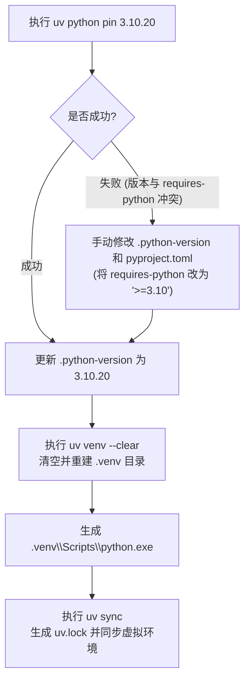

# `uv锁定Python版本.sh` 源码精讲：锁定 Python 解释器版本并创建 `.venv` 虚拟环境

---

## 一、文件定位与核心前置知识精讲

### 1.1 文件定位
`前置知识/1-uv环境管理工具/uv锁定Python版本.sh` 是 `1-uv环境管理工具` 模块的**第 3 步（最关键的环境构建脚本）**。在完成 `uv init` 初始化项目骨架后，本脚本负责：
1. 强制将当前项目的 Python 解释器版本锁定为 `3.10.20`（通过 `uv python pin`）；
2. 指明双配置文件（`.python-version` 与 `pyproject.toml`）版本冲突时的排查与修复方案；
3. 创建干净的隔离虚拟环境 `.venv`（`uv venv --clear`）并完成依赖与锁文件的首次同步（`uv sync`）。

### 1.2 核心前置知识
1. **`uv python pin <版本号>` 的底层工作原理**
   - 当你执行 `uv python pin 3.10.20` 时，`uv` 会先把当前目录下的 `.python-version` 文件内容改写为 `3.10.20`。
   - 同时，`uv` 会校验 `3.10.20` 是否满足 `pyproject.toml` 中 `requires-python` 字段的版本范围约束（例如如果 `requires-python = ">=3.12"`，那么 pin 到 `3.10.20` 就会因违反约束而报错，这正是脚本第 3 行注释重点提醒的易错点！）。
   - 更强大的是：如果本地电脑上根本没有安装 Python `3.10.20`，后续执行 `uv venv` 或 `uv sync` 时，`uv` 具备自动按需下载并管理独立 Python 解释器的能力。
2. **`uv venv --clear`：创建/重置虚拟环境**
   - `uv venv` 会在当前项目根目录下创建一个名为 `.venv` 的隔离虚拟环境文件夹，并在其中放入指定版本的 Python 解释器（Windows 下路径为 `项目文件夹\.venv\Scripts\python.exe`）。
   - `--clear` 参数表示：如果当前目录下已经存在旧的 `.venv` 文件夹，**先将其彻底清空删除，再按当前锁定的 Python 版本全新重建**，避免旧版本残留文件污染环境。
3. **`uv sync`：同步环境与生成锁文件**
   - `uv sync` 会读取 `pyproject.toml` 中的依赖声明，解析整棵依赖树，生成/更新 `uv.lock` 锁文件，并确保 `.venv` 虚拟环境中已安装的包与 `uv.lock` **100% 严格一致**（多退少补）。

### 1.3 在 Voyage 智途主项目中的关联
- 主项目根目录下的 `.python-version` 与 [`pyproject.toml`](../../根目录入口与配置/pyproject.toml.md)（`requires-python = ">=3.11"`）正是遵循本脚本的双文件对齐原则进行维护的。
- 当你在 PyCharm 或 VSCode 中打开 `Voyage智途A2A` 主项目时，选择的项目 Python 解释器路径正是本脚本第 5 行注释所写的：`Voyage智途A2A\.venv\Scripts\python.exe`。

---

## 二、执行流程与示意图

### 2.1 执行与故障排查流程图（Mermaid）



### 2.2 双配置文件对齐与 `.venv` 生成示意图（ASCII）

```text
+-------------------------------------------------------------------+
| 重点排错：两个文件的 Python 版本约束必须兼容对齐！                 |
+-------------------------------------------------------------------+
  [文件 1: .python-version]           [文件 2: pyproject.toml]
  +-----------------------+           +-----------------------------+
  | 3.10.20               | <=======> | [project]                   |
  +-----------------------+  必须满足 | requires-python = ">=3.10"  |
                             版本范围 +-----------------------------+
                                 |
                                 | 1. uv venv --clear
                                 | 2. uv sync
                                 v
  +-----------------------------------------------------------------+
  | 生成项目专属虚拟环境与锁文件                                     |
  |  ├── .venv\Scripts\python.exe  (IDE 解释器配置指向这里！)        |
  |  └── uv.lock                   (依赖树精确锁定文件)              |
  +-----------------------------------------------------------------+
```

---

## 三、完整源码与逐行/逐段深度拆解

### 3.1 完整源码（100% 原始文件嵌入）

文件路径：`前置知识/1-uv环境管理工具/uv锁定Python版本.sh`

```bash
# 强制锁定（指定）要使用的python版本
uv python pin 3.10.20
# 如果不成功: 俩文件 .python-version  pyproject.toml  改python版本后再执行

# python位置：项目文件夹\.venv\Scripts\python.exe 

# 建立环境 
uv venv --clear 
uv sync
```

---

### 3.2 逐行深度拆解

| 行号 | 源码内容 | 深度技术拆解 |
| :--- | :--- | :--- |
| **第 1 行** | `# 强制锁定（指定）要使用的python版本` | 注释说明下一步的目标：为当前项目指定确切的 Python 解释器版本。 |
| **第 2 行** | `uv python pin 3.10.20` | **锁定 Python 版本指令**：<br/>• `uv python pin`：将当前项目的 Python 版本固定为 `3.10.20`，并写入 `.python-version` 文件。 |
| **第 3 行** | `# 如果不成功: 俩文件 .python-version  pyproject.toml  改python版本后再执行` | **核心避坑注释（黄金经验）**：<br/>• 为什么会不成功？因为如果上一步 `uv init` 时系统默认 Python 是 3.11 或 3.12，`pyproject.toml` 里会自动写上 `requires-python = ">=3.11"`。此时你 `pin 3.10.20` 小于 `3.11`，`uv` 就会拒绝并报错！<br/>• 解决方法：手动打开 `.python-version` 改为 `3.10.20`（或 `3.10`），同时打开 `pyproject.toml` 把 `requires-python` 改为 `">=3.10"`，然后再继续执行下面的命令。 |
| **第 4 行** | *(空行)* | 逻辑分隔。 |
| **第 5 行** | `# python位置：项目文件夹\.venv\Scripts\python.exe ` | **关键路径提示注释**：告诉开发者在 Windows 系统下，`uv` 创建的虚拟环境 Python 解释器可执行文件固定位于项目根目录下的 `.venv\Scripts\python.exe`。在 PyCharm 中添加 Existing Virtualenv Interpreter 时就选这个路径。 |
| **第 6 行** | *(空行)* | 逻辑分隔。 |
| **第 7 行** | `# 建立环境 ` | 注释说明接下来两条命令用于正式构建并同步虚拟环境。 |
| **第 8 行** | `uv venv --clear ` | **创建/清理重建虚拟环境指令**：<br/>• 根据 `.python-version` 锁定的版本，在当前目录下创建 `.venv` 虚拟环境目录。<br/>• `--clear` 确保如果之前建过残缺或错误版本的 `.venv`，会先清空再全新创建。 |
| **第 9 行** | `uv sync` | **同步项目依赖指令**：<br/>• 根据 `pyproject.toml` 解析依赖并生成 `uv.lock` 锁文件，将依赖包安装同步到 `.venv` 中。 |

---

### 3.3 沙盘推演（Dry Run）：遇到版本冲突并解决的完整实战过程

假设你电脑上原本装过 Python 3.12，刚执行完 `uv init --name myproject`：

1. **初始状态检查**：
   - `.python-version` 内容为：`3.12`
   - `pyproject.toml` 中第 5 行为：`requires-python = ">=3.12"`

2. **第一次尝试执行 `uv python pin 3.10.20`（触发报错）**：
   ```text
   > uv python pin 3.10.20
   error: The requested Python version `3.10.20` is incompatible with the project's Python requirement `>=3.12`.
   ```
   **原因分析**：正如脚本第 3 行注释所预料，`3.10.20` 不满足 `>=3.12`！

3. **按第 3 行注释修改两个文件**：
   - 打开 `pyproject.toml`，将 `requires-python = ">=3.12"` 修改为 `requires-python = ">=3.10"`；
   - 打开 `.python-version`，将其内容修改为 `3.10.20`（或再次运行 `uv python pin 3.10.20`，此时不再报错，终端输出 `Pinned `.python-version` to `3.10.20``）。

4. **执行第 8 行 `uv venv --clear`**：
   ```text
   > uv venv --clear
   Using CPython 3.10.20
   Creating virtual environment at: .venv
   Activate with: .venv\Scripts\activate
   ```
   **目录变化**：项目下正式生成 `.venv\` 目录，里面包含 `.venv\Scripts\python.exe`（版本为 3.10.20）。

5. **执行第 9 行 `uv sync`**：
   ```text
   > uv sync
   Resolved 1 package in 2ms
   Audited in 0.01ms
   ```
   **目录变化**：项目下正式生成 `uv.lock` 锁文件，基础虚拟环境构建圆满完成！

---

## 四、常见易错点与对比总结

### 4.1 `uv venv` 与 `uv sync` 的职责对比

| 命令 | 核心职责 | 是否会安装 `pyproject.toml` 中的第三方依赖包？ | 是否会更新 `uv.lock`？ |
| :--- | :--- | :--- | :--- |
| **`uv venv --clear`** | 仅负责清空并创建纯净的 `.venv` 虚拟环境目录与 Python 解释器 | **否**（建出来的是不含任何第三方包的纯净空环境） | **否** |
| **`uv sync`** | 根据 `pyproject.toml` 和 `uv.lock` 同步安装所有依赖包（若 `.venv` 不存在也会自动创建） | **是**（自动安装缺失的包，卸载多余的包） | **是** |

### 4.2 新手最容易踩的 2 个坑

1. **改了 `.python-version` 却忘了运行 `uv venv --clear`**：
   - 修改 `.python-version` 只是改了文本配置，如果原先已经存在一个 Python 3.12 的 `.venv` 文件夹，不执行 `uv venv --clear` 重新创建，`.venv\Scripts\python.exe` 里可能依然保留着旧解释器的残留配置。
2. **不同操作系统下 Python 解释器路径的差异**：
   - **Windows**：`项目文件夹\.venv\Scripts\python.exe`（本脚本第 5 行注释所示）
   - **macOS / Linux**：`项目文件夹/.venv/bin/python`
   - 在跨平台部署（如后续将 Voyage 智途部署到 Linux Docker 容器中）时，要注意 `Scripts` 与 `bin` 目录名的区别。

---

## 五、自测思考题（附答案解析）

### 思考题 1
为什么执行 `uv python pin 3.10.20` 有时候会失败报错？报错时应该修改哪两个文件中的什么位置？

<details>
<summary>点击查看答案解析</summary>

**答案解析**：
- **失败原因**：当锁定的目标版本（如 `3.10.20`）低于 `pyproject.toml` 中 `requires-python` 字段所要求的最低版本（如 `">=3.11"` 或 `">=3.12"`）时，`uv` 的版本兼容检查会拦截并报错。
- **修改位置**：
  1. 修改 **`pyproject.toml`** 中的 `requires-python` 字段，使其兼容目标版本（例如改为 `requires-python = ">=3.10"` 或 `requires-python = "==3.10.20"`）；
  2. 修改 **`.python-version`** 文件中的版本号为 `3.10.20`。
</details>

### 思考题 2
在执行 `uv venv --clear` 时，`--clear` 参数起什么作用？如果不加 `--clear`，而当前目录下已经有一个旧的 `.venv` 目录，会发生什么？

<details>
<summary>点击查看答案解析</summary>

**答案解析**：
`--clear` 参数的作用是**强制清除已有的 `.venv` 目录并从头新建**。在较新版本的 `uv` 中，如果目录里已经存在 `.venv` 且你不加 `--clear`，执行 `uv venv` 时可能会在终端交互询问你是否覆盖，或者保留部分已有状态；加上 `--clear` 可以确保在切换 Python 版本后，旧版本的所有文件被 100% 干净地抹除并重建。
</details>
