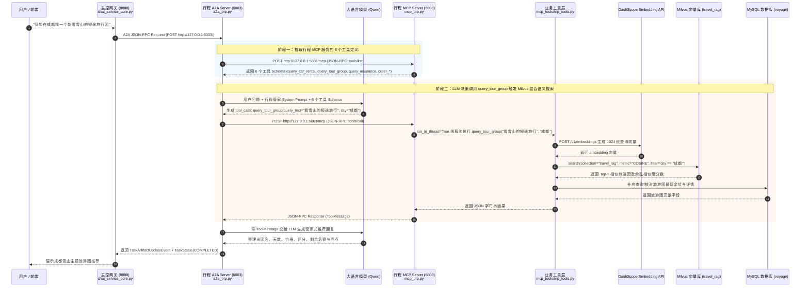
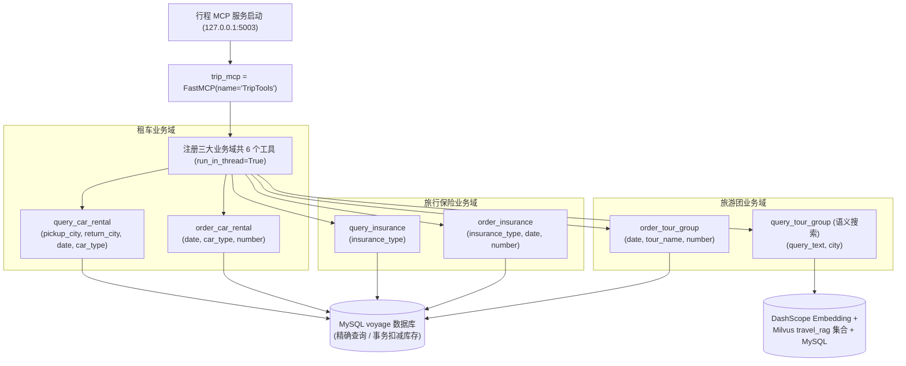

# `mcp_server/mcp_trip.py` 代码精讲学习手册

> **源文件位置**：`mcp_server/mcp_trip.py`  
> **所属模块**：`mcp_server`（MCP 协议服务端层 —— 端口 `5003`）  
> **核心职责**：将 `mcp_tools/trip_tools.py` 中的 6 个行程管家业务函数（租车查询 `query_car_rental`、旅游团向量语义搜索 `query_tour_group`、旅行保险查询 `query_insurance`、租车预定 `order_car_rental`、旅游团报名 `order_tour_group`、保险购买 `order_insurance`）通过 `FastMCP` 封装并暴露为符合 **MCP Streamable HTTP** 规范的独立微服务（默认监听 `127.0.0.1:5003`）。

---

## 一、文件定位与核心前置知识精讲

### 1.1 `mcp_trip.py` 在系统中的架构角色

在 **Voyage 智途 A2A** 旅行多智能体架构中，“行程管家”涵盖了目的地落地后的三大核心服务：**当地租车、跟团游（旅游团）、旅行保险**。
- **上游调用方**：行程管家子智能体 `a2a_server/a2a_trip.py`（监听 `6003` 端口），通过 `MultiServerMCPClient` 连接 `http://127.0.0.1:5003/mcp`。
- **当前协议层**：`mcp_server/mcp_trip.py`（监听 `5003` 端口），负责 `FastMCP("TripTools")` 实例化、6 个工具函数的协议元数据包装（`name`、`description`、`run_in_thread=True`）、导出 ASGI `app` 并使用 Uvicorn 启动。
- **下游业务与数据层**：`mcp_tools/trip_tools.py`，它不仅操作 **MySQL 关系型数据库**（租车表、保险表、旅游团详情与订单表），还集成了 **DashScope Embedding API + Milvus 向量数据库**（用于 `query_tour_group` 旅游团混合语义检索）。

---

### 1.2 核心亮点：`query_tour_group` 如何将 Milvus 混合语义检索（RAG）封装为标准 MCP 工具？

对比本文件中的 3 个查询工具，你会发现它们的底层检索范式截然不同：

1. **结构化精确查询（MySQL SQL `WHERE` 过滤）**：
   - `query_car_rental(pickup_city, return_city, date, car_type)`：用户需求是结构化的（如“5月1日在成都租一辆 SUV”），直接映射为 SQL `WHERE pickup_city='成都' AND car_type='SUV'`。
   - `query_insurance(insurance_type)`：直接映射为 SQL 枚举过滤（`综合型/意外型/医疗型/境外型`）。
2. **非结构化语义检索 + 标量过滤（Milvus 向量混合检索）**：
   - 用户的跟团游需求往往是模糊的自然语言描述，例如：**“想看雪山的短途旅行”**、**“带老人小孩轻松看大熊猫的一日游”**。如果用传统的 SQL `LIKE '%雪山%'`，当数据库里的团名叫“川西四姑娘山双桥沟3日精品游”时，SQL `LIKE` 会彻底漏检！
   - 因此，`mcp_trip.py` 第 36~42 行注册了 `query_tour_group` 工具：
     ```python
     trip_mcp.tool(
         name="query_tour_group",
         description="查询旅游团（语义搜索），参数："
                     "query_text(查询描述，如'想看雪山的短途旅行'), "
                     "city(城市过滤，可选)",
         run_in_thread=True  # 使用线程池
     )(query_tour_group)
     ```
   - **底层执行链路（`mcp_tools/trip_tools.py`）**：
     1. 调用阿里云 DashScope `qwen3.7-text-embedding` 接口，将 `query_text`（如 `'想看雪山的短途旅行'`）编码为 `1024` 维稠密向量；
     2. 如果传入了可选参数 `city`（如 `'成都'`），构造 Milvus 标量过滤表达式 `filter_expr = 'city == "成都"'`；
     3. 调用 `_milvus_client.search(collection_name="travel_rag", data=[ vector ], ann_field="embedding", metric_type="COSINE", filter=filter_expr, limit=5)` 执行**标量过滤 + 向量余弦相似度混合检索**；
     4. 再根据召回的 `tour_id` 关联 MySQL 查询实时余位（`remaining_seats`）和价格返回。
   - **协议层透明化**：对于上游 `a2a_trip.py` 的 LLM 而言，它完全不需要知道底层有 Embedding API、Milvus 和 MySQL 的协同，它看到的只是一个入参为 `(query_text, city)` 的标准 MCP 工具！这就是 MCP 协议层抽象的威力。

---

### 1.3 `FastMCP` 的 `tool()` 注册器与 `add_tool` 的关系

在 `mcp_trip.py` 中，6 个工具均通过 `trip_mcp.tool(name=..., description=..., run_in_thread=True)(fn)` 注册：
- **`trip_mcp.tool(...)` vs `@trip_mcp.tool(...)`**：
  - Python 装饰器 `@decorator` 是 `fn = decorator(fn)` 的语法糖。因为 6 个业务函数定义在 `mcp_tools/trip_tools.py` 中，本文件导入函数对象后，直接调用 `trip_mcp.tool(...)(fn)` 完成非侵入式注册。
- **`trip_mcp.tool(...)` vs `trip_mcp.add_tool(fn, ...)`**：
  - `FastMCP.tool()` 内部会构造 `Tool.from_function(fn, name=name, description=description, ...)` 并注册到内部的 `_tool_manager`，与调用 `trip_mcp.add_tool()` 效果完全一致。
- **为什么 6 个工具全部设置 `run_in_thread=True`？**
  - 尤其是 `query_tour_group`，一次调用包含：**1 次外部 HTTPS 请求（DashScope Embedding API，耗时约 150~300ms）+ 1 次 Milvus gRPC/HTTP 向量检索 + 1 次 MySQL 查询**，全部是同步阻塞调用。开启 `run_in_thread=True` 将其放到后台线程池执行，避免阻塞 Uvicorn 的主 `asyncio` 事件循环。

---

## 二、跨进程通信与内部执行流程图

### 2.1 行程管家（含 Milvus 向量检索与 MySQL 交互）全链路时序图（`sequenceDiagram`）



### 2.2 `mcp_trip.py` 工具矩阵与内部路由流程图（`flowchart TD`）



---

## 三、完整源码与逐行/逐段深度拆解

### 3.1 100% 完整源码（共 92 行）

> [!NOTE]
> 以下为 `mcp_server/mcp_trip.py` 的 100% 原始代码，可直接脱离源码文件阅读学习。

```python
"""行程管家 MCP(streamable) 服务 —— 纯协议层
只负责：FastMCP 实例化 + 工具注册 + ASGI app 导出 + 启动入口
业务逻辑全部在 mcp_tools.trip_tools 中"""

from fastmcp import FastMCP

from utils import CONFIG
from utils import logger
from mcp_tools.trip_tools import (
    query_car_rental,
    query_tour_group,
    query_insurance,
    order_car_rental,
    order_tour_group,
    order_insurance,
)

# ==================== FastMCP 实例化 ====================
trip_mcp = FastMCP(
    name=CONFIG.MCP_TRIP_NAME,
    instructions="行程管家工具，"
                 "支持租车、旅游团(语义搜索)、保险的查询与预定",
)

# ==================== 工具注册 ====================
trip_mcp.tool(
    name="query_car_rental",
    description="查询租车，参数："
                "pickup_city(取车城市), "
                "return_city(还车城市), "
                "date(日期YYYY-MM-DD), "
                "car_type(车型，可选：经济型/SUV/豪华型/MPV)",
    run_in_thread=True  # 使用线程池
)(query_car_rental)

trip_mcp.tool(
    name="query_tour_group",
    description="查询旅游团（语义搜索），参数："
                "query_text(查询描述，如'想看雪山的短途旅行'), "
                "city(城市过滤，可选)",
    run_in_thread=True  # 使用线程池
)(query_tour_group)

trip_mcp.tool(
    name="query_insurance",
    description="查询旅行保险，参数："
                "insurance_type"
                "(保险类型，可选：综合型/意外型/医疗型/境外型)",
    run_in_thread=True  # 使用线程池
)(query_insurance)

trip_mcp.tool(
    name="order_car_rental",
    description="预定租车，参数："
                "date(日期), "
                "car_type(车型), "
                "number(数量)",
    run_in_thread=True  # 使用线程池
)(order_car_rental)

trip_mcp.tool(
    name="order_tour_group",
    description="报名旅游团，参数："
                "date(出发日期), "
                "tour_name(团名), "
                "number(人数)",
    run_in_thread=True  # 使用线程池
)(order_tour_group)

trip_mcp.tool(
    name="order_insurance",
    description="购买旅行保险，参数："
                "insurance_type(保险类型), "
                "date(生效日期), "
                "number(份数)",
    run_in_thread=True  # 使用线程池
)(order_insurance)

# ==================== ASGI app 导出 ====================
app = trip_mcp.http_app(transport='streamable-http')

# ==================== 启动入口 ====================
if __name__ == "__main__":
    logger.info("行程MCP服务器启动: %s:%d",
                CONFIG.MCP_TRIP_HOST,
                CONFIG.MCP_TRIP_PORT)
    import uvicorn
    uvicorn.run(
        app,
        host=CONFIG.MCP_TRIP_HOST,
        port=CONFIG.MCP_TRIP_PORT
    )
```

---

### 3.2 逐段/逐行深度拆解

#### 第一部分：模块文档与依赖导入（第 1~16 行）

```python
from fastmcp import FastMCP

from utils import CONFIG
from utils import logger
from mcp_tools.trip_tools import (
    query_car_rental,
    query_tour_group,
    query_insurance,
    order_car_rental,
    order_tour_group,
    order_insurance,
)
```
- **第 7~8 行**：导入全局配置 `CONFIG` 和日志器 `logger`。对应 `config.yaml` 中 `mcp_servers.trip` 配置项：
  - `CONFIG.MCP_TRIP_HOST` = `"127.0.0.1"`
  - `CONFIG.MCP_TRIP_PORT` = `5003`
  - `CONFIG.MCP_TRIP_NAME` = `"TripTools"`
- **第 9~16 行**：从 `mcp_tools.trip_tools` 导入 3 个查询函数（`query_car_rental`, `query_tour_group`, `query_insurance`）和 3 个预定函数（`order_car_rental`, `order_tour_group`, `order_insurance`）。
  - 注意：在 `import mcp_tools.trip_tools` 时，`trip_tools.py` 模块顶层会初始化 `_db = MySQLManager()` 和 `_milvus_client = MilvusClient(...)`。

---

#### 第二部分：FastMCP 实例化（第 18~23 行）

```python
# ==================== FastMCP 实例化 ====================
trip_mcp = FastMCP(
    name=CONFIG.MCP_TRIP_NAME,
    instructions="行程管家工具，"
                 "支持租车、旅游团(语义搜索)、保险的查询与预定",
)
```
- 在 `instructions` 中特别标注了 `旅游团(语义搜索)`，提示消费端该服务支持自然语言语义检索。

---

#### 第三部分：6 个行程工具的注册与枚举提示技巧（第 25~77 行）

请重点观察各工具 `description` 的撰写技巧：

1. **`query_car_rental`（第 26~34 行）**：
   - `description` 中明确列出了 `car_type` 的有效枚举值：`"(车型，可选：经济型/SUV/豪华型/MPV)"`。
   - **工程意义**：如果用户说“我想租一辆越野车”或“商务车”，大模型看到 `description` 中的枚举候选值 `经济型/SUV/豪华型/MPV`，就会自动把“越野车”映射为 `"SUV"`，把“商务车”映射为 `"MPV"`，大大提升了数据库查询命中率！
2. **`query_tour_group`（第 36~42 行）**：
   - `description` 中给出了 few-shot 示例：`query_text(查询描述，如'想看雪山的短途旅行')`。
   - 这引导大模型不要把用户的句子拆成孤立关键词，而是保留完整的语义短语传给 Embedding 模型。
3. **`query_insurance`（第 44~50 行）**：
   - 同样给出了枚举值：`"(保险类型，可选：综合型/意外型/医疗型/境外型)"`。而且因为该参数可选，当用户问“你们有哪些旅行保险？”时，LLM 可以不传 `insurance_type`（默认为 `None`），直接查出全部保险产品。
4. **`order_car_rental` / `order_tour_group` / `order_insurance`（第 52~77 行）**：
   - 分别对应租车预订、旅游团报名和保险购买的数据库写入操作，均开启 `run_in_thread=True`。

---

#### 第四部分：ASGI App 导出与启动入口（第 79~92 行）

```python
# ==================== ASGI app 导出 ====================
app = trip_mcp.http_app(transport='streamable-http')

# ==================== 启动入口 ====================
if __name__ == "__main__":
    logger.info("行程MCP服务器启动: %s:%d",
                CONFIG.MCP_TRIP_HOST,
                CONFIG.MCP_TRIP_PORT)
    import uvicorn
    uvicorn.run(
        app,
        host=CONFIG.MCP_TRIP_HOST,
        port=CONFIG.MCP_TRIP_PORT
    )
```
- 导出 `streamable-http` 模式的 ASGI `app` 对象，并通过 `uvicorn.run` 绑定在 `127.0.0.1:5003` 启动服务。

---

### 3.3 沙盘推演（Dry Run）：异地还车租车查询 + 保险查询

假设用户提问：**“5月1日我想在成都租一辆越野车去重庆还车，另外顺便看看有什么境外或意外旅行保险”**。

1. **工具发现**：`a2a_trip.py`（`6003`）通过 `MultiServerMCPClient` 从 `http://127.0.0.1:5003/mcp` 获取到 `mcp_trip.py` 注册的 6 个工具。
2. **LLM 参数提取与枚举对齐**：
   - 针对前半句“5月1日成都租越野车去重庆还车”，LLM 读取 `query_car_rental` 的 `description`，将“越野车”对齐为枚举值 `"SUV"`，构造第一个工具调用：
     `query_car_rental(pickup_city="成都", return_city="重庆", date="2026-05-01", car_type="SUV")`
   - 针对后半句“看看有什么意外旅行保险”，LLM 构造第二个工具调用：
     `query_insurance(insurance_type="意外型")`
3. **MCP Server 并发线程池执行**：
   - `mcp_trip.py` 收到两个 `tools/call` 请求，由于 `run_in_thread=True`，两个同步数据库查询在后台线程池中并发执行，互不阻塞。
   - 查询结果通过 JSON-RPC 响应返回给 `a2a_trip.py`，最终由 LLM 汇总成管家式推荐方案。

---

## 四、工程细节、四个服务的共性与差异对比、常见易错点

### 4.1 为什么 `mcp_trip.py` 启动时可能会比 `mcp_ticket.py` 慢或更容易因环境报错？

- **原因剖析**：
  - `mcp_trip.py` 第 9 行执行 `from mcp_tools.trip_tools import ...` 时，会立即触发 `trip_tools.py` 第 50~54 行的模块级初始化：
    ```python
    _milvus_client = MilvusClient(
        uri=f"http://{CONFIG.DB_MILVUS_HOST}:{CONFIG.DB_MILVUS_PORT}",
        db_name=CONFIG.DB_MILVUS_DB_NAME
    )
    ```
  - 这意味着：**启动 `mcp_trip.py` 时，Milvus 向量数据库（`192.168.88.101:19530`）必须已经处于运行状态且创建了 `voyage_rag` 库**！如果 Milvus 未启动，`mcp_trip.py` 在 `import` 阶段就会直接抛出连接异常退出，甚至连租车和保险工具都无法提供服务。
- **生产级优化建议（懒加载 Lazy Initialization）**：
  - 在 `trip_tools.py` 中将 `_milvus_client` 改为懒加载单例（仅在第一次调用 `query_tour_group` 时才连接 Milvus），这样即使 Milvus 临时维护，`mcp_trip.py` 依然能正常启动并提供租车和保险服务。

---

## 五、自测思考题（附答案解析）

### 思考题 1：在 `mcp_trip.py` 中，`query_car_rental` 和 `query_insurance` 的 `description` 为什么要把可选的枚举值（如 `经济型/SUV/豪华型/MPV`、`综合型/意外型/医疗型/境外型`）写进字符串里？
> **答案解析**：
> 因为在 `mcp_tools/trip_tools.py` 中，`car_type: str = None` 和 `insurance_type: str = None` 的 Python 类型注解只是普通的 `str`（而不是 `Literal["经济型", "SUV", "豪华型", "MPV"]`）。
> `FastMCP` 自动生成的 JSON Schema 中该字段类型仅为 `{"type": "string"}`，不包含 `enum` 约束。通过在 `description` 中显式写出所有合法枚举值，LLM 在进行 Function Calling 参数生成时就能看到完整的候选集合，自动将用户的口语表达（如“商务车”、“越野车”、“出国险”）归一化为数据库能识别的标准枚举值（`"MPV"`、`"SUV"`、`"境外型"`）。

### 思考题 2：`query_tour_group` 既然用了 Milvus 向量语义搜索，为什么还需要一个可选的 `city` 参数？
> **答案解析**：
> 这是典型的**混合检索（Hybrid Search：Scalar Filtering + Vector Similarity Search）**设计：
> 纯向量语义搜索容易出现“语义相近但地理位置错误”的召回（比如用户搜“成都看雪山的短途游”，如果只算余弦相似度，“丽江玉龙雪山一日游”的向量相似度可能也非常高）。通过把 `city` 作为独立的标量过滤参数（Milvus `filter='city == "成都"'`），先在标量倒排索引层严格锁定出发/目的地城市为“成都”，再在子集中计算向量余弦相似度，既保证了硬性条件 100% 准确，又保留了软性需求的语义泛化能力。
