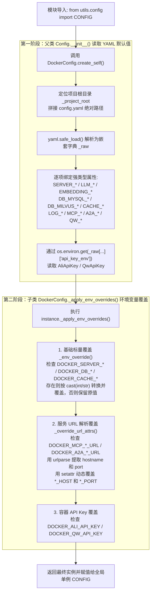

# `utils/config.py` 代码精讲学习手册

> **本文档完全自包含（Self-Contained）**：已 100% 完整嵌入 `utils/config.py` 的全部源码与注释，并结合项目根目录 `config.yaml` 的真实结构逐行拆解，无需打开 `.py` 原文件即可独立掌握配置中心的设计与实现。

---

## 一、文件定位与核心前置知识精讲

### 1.1 文件在项目中的定位
`utils/config.py` 是 `Voyage智途A2A` 项目的**全局配置中心（Configuration Center）**。  
一个完整的企业级多 Agent 系统涉及众多外部组件与微服务节点：FastAPI 主控入口、4 个 MCP 工具服务端、4 个 A2A 智能体服务端、阿里云通义千问 LLM 与 Embedding 接口、MySQL 关系型数据库、Milvus 向量数据库、Redis 缓存以及和风天气 API。  
`utils/config.py` 负责在进程启动时，将分散在 `config.yaml` 文件与操作系统环境变量（Environment Variables）中的配置项统一加载、做显式类型转换，并封装为全局唯一的强属性单例对象 `CONFIG`，供全项目所有模块安全读取。

---

### 1.2 核心前置知识精讲

#### （1）跨目录路径定位原理：为什么不能直接写 `open("config.yaml")`？
在 Python 中，如果写相对路径 `open("config.yaml")`，它是相对于**当前工作目录（Current Working Directory, CWD，即执行 `python` 命令时所在的终端目录）**去寻找文件的。
- 如果你在项目根目录执行 `python main.py`，相对路径能找到；
- 但如果你进入子目录执行 `cd data_init && python mysql_init.py`，CWD 变成了 `.../Voyage智途A2A/data_init`，此时 `open("config.yaml")` 就会直接报 `FileNotFoundError`！

**工程级解决方案：基于 `__file__` 动态锚定项目根目录**
```python
_project_root = os.path.dirname(os.path.dirname(os.path.abspath(__file__)))
_yaml_path = os.path.join(_project_root, "config.yaml")
```
```
__file__ 的位置:
Voyage智途A2A\utils\config.py
                                │
  os.path.abspath(__file__)     ▼
Voyage智途A2A\utils\config.py
                                │
  第 1 次 os.path.dirname()     ▼
Voyage智途A2A\utils          （utils 包目录）
                                │
  第 2 次 os.path.dirname()     ▼
Voyage智途A2A                （项目根目录 _project_root）
                                │
  os.path.join(..., "config.yaml") ▼
Voyage智途A2A\config.yaml    （无论在哪个目录启动脚本，永远精准定位！）
```
> **补充对比（`os.path` vs `pathlib.Path`）**：在现代 Python 3 中，`os.path.dirname(os.path.dirname(os.path.abspath(__file__)))` 等价于 `Path(__file__).resolve().parent.parent`。两者原理完全相同，都是以当前源码文件在磁盘上的真实物理位置为基准向上回溯两级目录。

#### （2）YAML 配置文件解析与 `yaml.safe_load()`
YAML（YAML Ain't Markup Language）是比 JSON 更适合人类阅读和编写的配置文件格式（支持注释、层级缩进清晰）。
- **为什么必须用 `yaml.safe_load(_f)` 而不是 `yaml.load(_f)`？**
  - PyYAML 的原生 `yaml.load()` 支持反序列化任意 Python 对象标签（例如 `!!python/object/apply:os.system ["rm -rf /"]`），如果配置文件被恶意篡改，会导致任意代码执行漏洞（RCE）。
  - `yaml.safe_load()` 只允许解析标准的 YAML 基础数据类型（字符串 `str`、整数 `int`、浮点数 `float`、布尔值 `bool`、列表 `list`、字典 `dict` 和 `None`），从根源上杜绝反序列化安全风险。

#### （3）敏感凭据（API Key）的环境变量隔离机制（`os.environ.get`）
在 `config.yaml` 中，LLM、Embedding 和和风天气的 API Key 并没有直接写明文密钥，而是写了一个**环境变量名**：
```yaml
llm:
  api_key_env: "AliApiKey"
weather:
  api_key_env: "QwApiKey"
```
然后在 `config.py` 中通过二次间接读取：
```python
self.LLM_API_KEY = os.environ.get(_raw["llm"]["api_key_env"], "")
```
- **为什么要这样设计？（十二要素应用 Twelve-Factor App 安全铁律）**
  - 代码和 `config.yaml` 是要提交到 Git 仓库（如 GitHub / GitLab）的。如果把真实的阿里云 API Key 写在 `config.yaml` 里，一旦代码开源或仓库泄露，黑客会在几分钟内刷爆你的 API 额度。
  - 将密钥保存在操作系统的环境变量 `AliApiKey` 中，`config.yaml` 只记录变量名 `"AliApiKey"`，实现了**代码仓库与敏感密钥的物理隔离**。

#### （4）双层配置架构：本地 YAML 默认值 + Docker 环境变量动态覆盖（`Config` → `DockerConfig`）
本项目在开发阶段通常在宿主机本地直接运行（连接固定的开发机 IP 或 `127.0.0.1`），而在生产或容器化部署（Docker / Docker Compose / Kubernetes）时，MySQL、Milvus、Redis 以及各个 MCP/A2A 容器的网络地址是由容器编排引擎通过环境变量（如 `DOCKER_DB_MYSQL_HOST=mysql-container`、`DOCKER_MCP_WEATHER_URL=http://mcp-weather:5001`）注入的。
为此，`config.py` 采用了非常优雅的**继承 + 模板覆盖模式**：
1. 父类 `Config`：在 `__init__` 中从 `config.yaml` 读取全部默认配置，所有属性显式声明（支持 IDE 自动补全）；
2. 子类 `DockerConfig(Config)`：继承 `Config`，在实例化后调用 `_apply_env_overrides()`，检查是否存在 `DOCKER_*` 环境变量——**有则覆盖，无则保留 YAML 默认值**，从而做到一套代码无缝兼容“本地直接运行”与“Docker 容器化部署”。

---

## 二、调用关系与执行流程图

### 2.1 Mermaid 类继承与初始化流程图



### 2.2 ASCII 配置优先级瀑布流

```
[最高优先级] Docker 容器环境变量 (DOCKER_*)
     │  例如: DOCKER_DB_MYSQL_HOST="mysql_service"
     │        DOCKER_MCP_WEATHER_URL="http://mcp-weather:5001"
     │        DOCKER_ALI_API_KEY="sk-xxxx"
     ▼ (若未设置该环境变量，则自动回退 ↓)
[中等优先级] 本地系统环境变量 (由 config.yaml 中 api_key_env 指定)
     │  例如: os.environ.get("AliApiKey")
     │        os.environ.get("QwApiKey")
     ▼ (普通配置项直接读取 ↓)
[基础默认值] 项目根目录 config.yaml
     │  例如: server.host="127.0.0.1", server.port=8888
     │        db.mysql.host="192.168.88.101", db.mysql.port=3306
```

---

## 三、完整源码与逐行/逐段深度拆解

### 3.1 100% 完整源码

```python
import os
import yaml


class Config:
    """全局配置 —— 初始化时从 config.yaml 读取，属性逐行硬编码"""

    def __init__(self):
        _project_root = os.path.dirname(os.path.dirname(os.path.abspath(__file__)))
        _yaml_path = os.path.join(_project_root, "config.yaml")
        with open(_yaml_path, "r", encoding="utf-8") as _f:
            _raw = yaml.safe_load(_f)

        # ==================== Server ====================
        self.SERVER_HOST = _raw["server"]["host"]
        self.SERVER_PORT = int(_raw["server"]["port"])

        # ==================== LLM ====================
        self.LLM_MODEL = _raw["llm"]["model_name"]
        self.LLM_BASE_URL = _raw["llm"]["base_url"]
        self.LLM_API_KEY = os.environ.get(_raw["llm"]["api_key_env"], "")
        self.LLM_TEMPERATURE = float(_raw["llm"]["temperature"])

        # ==================== Embedding ====================
        self.EMBEDDING_MODEL = _raw["embedding"]["model_name"]
        self.EMBEDDING_URL = _raw["embedding"]["url"]
        self.EMBEDDING_API_KEY = os.environ.get(_raw["embedding"]["api_key_env"], "")
        self.EMBEDDING_DIMENSION = int(_raw["embedding"]["dimension"])

        # ==================== MySQL ====================
        self.DB_MYSQL_HOST = _raw["db"]["mysql"]["host"]
        self.DB_MYSQL_PORT = int(_raw["db"]["mysql"]["port"])
        self.DB_MYSQL_USER = _raw["db"]["mysql"]["user"]
        self.DB_MYSQL_PASSWORD = _raw["db"]["mysql"]["password"]
        self.DB_MYSQL_DATABASE = _raw["db"]["mysql"]["database"]
        self.DB_MYSQL_CHARSET = _raw["db"]["mysql"]["charset"]

        # ==================== Milvus ====================
        self.DB_MILVUS_HOST = _raw["db"]["milvus"]["host"]
        self.DB_MILVUS_PORT = int(_raw["db"]["milvus"]["port"])
        self.DB_MILVUS_DB_NAME = _raw["db"]["milvus"]["db_name"]
        self.DB_MILVUS_COLLECTION = _raw["db"]["milvus"]["collection"]

        # ==================== Cache ====================
        self.CACHE_REDIS_HOST = _raw["cache"]["redis"]["host"]
        self.CACHE_REDIS_PORT = int(_raw["cache"]["redis"]["port"])
        self.CACHE_REDIS_DB = int(_raw["cache"]["redis"]["db"])
        self.CACHE_REDIS_PASSWORD = _raw["cache"]["redis"].get("password", None)
        self.CACHE_REDIS_KEY_PREFIX = _raw["cache"]["redis"]["key_prefix"]
        self.CACHE_REDIS_TTL = int(_raw["cache"]["redis"].get("ttl", 600))
        self.CACHE_MILVUS_HOST = _raw["cache"]["milvus"]["host"]
        self.CACHE_MILVUS_PORT = int(_raw["cache"]["milvus"]["port"])
        self.CACHE_MILVUS_DB_NAME = _raw["cache"]["milvus"]["db_name"]
        self.CACHE_MILVUS_COLLECTION = _raw["cache"]["milvus"]["cache_collection"]
        self.CACHE_SIMILARITY_THRESHOLD = float(_raw["cache"]["milvus"]["similarity_threshold"])
        self.CACHE_MILVUS_TTL = int(_raw["cache"]["milvus"].get("ttl", 600))

        # ==================== Logging ====================
        self.LOG_DIR = os.path.join(_project_root, _raw["logging"]["log_dir"])
        self.LOG_FILE = _raw["logging"]["log_file"]
        self.LOG_FILE_LEVEL = _raw["logging"]["file_level"]
        self.LOG_CONSOLE_LEVEL = _raw["logging"]["console_level"]

        # ==================== MCP Servers ====================
        self.MCP_WEATHER_HOST = _raw["mcp_servers"]["weather"]["host"]
        self.MCP_WEATHER_PORT = int(_raw["mcp_servers"]["weather"]["port"])
        self.MCP_WEATHER_NAME = _raw["mcp_servers"]["weather"]["name"]
        self.MCP_TICKET_HOST = _raw["mcp_servers"]["ticket"]["host"]
        self.MCP_TICKET_PORT = int(_raw["mcp_servers"]["ticket"]["port"])
        self.MCP_TICKET_NAME = _raw["mcp_servers"]["ticket"]["name"]
        self.MCP_TRIP_HOST = _raw["mcp_servers"]["trip"]["host"]
        self.MCP_TRIP_PORT = int(_raw["mcp_servers"]["trip"]["port"])
        self.MCP_TRIP_NAME = _raw["mcp_servers"]["trip"]["name"]
        self.MCP_EXTERNAL_HOST = _raw["mcp_servers"]["external"]["host"]
        self.MCP_EXTERNAL_PORT = int(_raw["mcp_servers"]["external"]["port"])
        self.MCP_EXTERNAL_NAME = _raw["mcp_servers"]["external"]["name"]

        # ==================== A2A Servers ====================
        self.A2A_WEATHER_HOST = _raw["a2a_servers"]["weather"]["host"]
        self.A2A_WEATHER_PORT = int(_raw["a2a_servers"]["weather"]["port"])
        self.A2A_WEATHER_NAME = _raw["a2a_servers"]["weather"]["name"]
        self.A2A_TICKET_HOST = _raw["a2a_servers"]["ticket"]["host"]
        self.A2A_TICKET_PORT = int(_raw["a2a_servers"]["ticket"]["port"])
        self.A2A_TICKET_NAME = _raw["a2a_servers"]["ticket"]["name"]
        self.A2A_TRIP_HOST = _raw["a2a_servers"]["trip"]["host"]
        self.A2A_TRIP_PORT = int(_raw["a2a_servers"]["trip"]["port"])
        self.A2A_TRIP_NAME = _raw["a2a_servers"]["trip"]["name"]
        self.A2A_EXTERNAL_HOST = _raw["a2a_servers"]["external"]["host"]
        self.A2A_EXTERNAL_PORT = int(_raw["a2a_servers"]["external"]["port"])
        self.A2A_EXTERNAL_NAME = _raw["a2a_servers"]["external"]["name"]

        # ==================== 和风天气数据采集工具 ====================
        self.QW_API_KEY = os.environ.get(_raw["weather"]["api_key_env"], "")
        self.QW_API_HOST = _raw["weather"]["api_host"]
        self.QW_TZ = _raw["weather"]["timezone"]


# 全局单例
CONFIG = Config()

# TODO 上边是原来的配置类
# --------------------------------------------------------
# TODO 下边新增：从环境变量读取属性，覆盖父类原属性
from urllib.parse import urlparse
class DockerConfig(Config):
    """Docker部署配置：从环境变量读取属性，覆盖父类原属性
    继承 Config，不重写 __init__
    通过 _apply_env_overrides() 方法仅覆盖需要从环境变量读取的属性
    未设置环境变量的属性保持 yaml 原值不变，本地也能直接运行
    """
    def _env_override(self, env_var: str, cast=None, default=None):
        """优先读取环境变量，读不到则返回当前属性值（yaml 默认值）
        env_var参数：环境变量中的变量名
        cast参数：类型转换函数，如int/float/bool；默认None
            字符串不用传入转换函数，环境变量读取出来的都是str
        """
        v = os.environ.get(env_var)
        if v:  # cast=str
            return cast(v) if cast else v
        return default

    def _override_url_attrs(self, env_var: str, attr_prefix: str):
        """从完整 URL 环境变量中解析host和port，覆盖对应属性
        env_var参数：环境变量中的变量名
        attr_prefix参数：配置项的属性名、没有_HOST、_PORT后缀
        """
        url = os.environ.get(env_var, "")
        if not url:
            return
        try:
            # urllib.parse.urlparse是python内置、解析URL的方法
            parsed = urlparse(url)
            if parsed.hostname: # 获取 host
                # setattr(obj, 属性名, 值)：
                # 设置类对象的{attr_prefix}_HOST属性
                setattr(self,
                        f"{attr_prefix}_HOST",
                        parsed.hostname)
            if parsed.port: # 获取 port
                setattr(self,
                        f"{attr_prefix}_PORT",
                        parsed.port)
        except Exception:
            pass # 报错就啥也不干，原属性用配置文件中的默认值

    def _apply_env_overrides(self):
        """重写覆盖：仅对需要从环境变量获取的属性进行重写覆盖
        读不到环境变量时保持父类 __init__ 从 yaml 读取的默认值
        """

        # --- Server ---
        # 读取环境变量中DOCKER_SERVER_HOST的值，转为str
        # 如果获取不到就用原来父类的
        self.SERVER_HOST = self._env_override("DOCKER_SERVER_HOST", str, self.SERVER_HOST)
        self.SERVER_PORT = self._env_override("DOCKER_SERVER_PORT", int, self.SERVER_PORT)

        # --- MySQL ---
        self.DB_MYSQL_HOST = self._env_override("DOCKER_DB_MYSQL_HOST", str, self.DB_MYSQL_HOST)
        self.DB_MYSQL_PORT = self._env_override("DOCKER_DB_MYSQL_PORT", int, self.DB_MYSQL_PORT)
        self.DB_MYSQL_USER = self._env_override("DOCKER_DB_MYSQL_USER", str, self.DB_MYSQL_USER)
        self.DB_MYSQL_PASSWORD = self._env_override("DOCKER_DB_MYSQL_PASSWORD", str, self.DB_MYSQL_PASSWORD)
        self.DB_MYSQL_DATABASE = self._env_override("DOCKER_DB_MYSQL_DATABASE", str, self.DB_MYSQL_DATABASE)

        # --- Milvus ---
        self.DB_MILVUS_HOST = self._env_override("DOCKER_DB_MILVUS_HOST", str, self.DB_MILVUS_HOST)
        self.DB_MILVUS_PORT = self._env_override("DOCKER_DB_MILVUS_PORT", int, self.DB_MILVUS_PORT)

        # --- Cache Redis ---
        self.CACHE_REDIS_HOST = self._env_override("DOCKER_CACHE_REDIS_HOST", str, self.CACHE_REDIS_HOST)
        self.CACHE_REDIS_PORT = self._env_override("DOCKER_CACHE_REDIS_PORT", int, self.CACHE_REDIS_PORT)
        self.CACHE_REDIS_PASSWORD = self._env_override("DOCKER_CACHE_REDIS_PASSWORD", str, self.CACHE_REDIS_PASSWORD)

        # --- Cache Milvus ---
        self.CACHE_MILVUS_HOST = self._env_override("DOCKER_CACHE_MILVUS_HOST", str, self.CACHE_MILVUS_HOST)
        self.CACHE_MILVUS_PORT = self._env_override("DOCKER_CACHE_MILVUS_PORT", int, self.CACHE_MILVUS_PORT)

        # --- MCP Servers（完整 URL，自动解析 host + port） ---
        self._override_url_attrs("DOCKER_MCP_WEATHER_URL", "MCP_WEATHER")
        self._override_url_attrs("DOCKER_MCP_TICKET_URL", "MCP_TICKET")
        self._override_url_attrs("DOCKER_MCP_TRIP_URL", "MCP_TRIP")
        self._override_url_attrs("DOCKER_MCP_EXTERNAL_URL", "MCP_EXTERNAL")

        # --- A2A Servers（完整 URL，自动解析 host + port） ---
        self._override_url_attrs("DOCKER_A2A_WEATHER_URL", "A2A_WEATHER")
        self._override_url_attrs("DOCKER_A2A_TICKET_URL", "A2A_TICKET")
        self._override_url_attrs("DOCKER_A2A_TRIP_URL", "A2A_TRIP")
        self._override_url_attrs("DOCKER_A2A_EXTERNAL_URL", "A2A_EXTERNAL")

        # --- API Keys ---
        ali_key = os.environ.get("DOCKER_ALI_API_KEY")
        if ali_key:
            self.LLM_API_KEY = ali_key
            self.EMBEDDING_API_KEY = ali_key

        # 和风天气三方接口API Key！
        qw_key = os.environ.get("DOCKER_QW_API_KEY")
        if qw_key:
            self.QW_API_KEY = qw_key

    @classmethod
    def create_self(cls):
        """工厂方法：创建实例并应用环境变量覆盖"""
        instance = cls() # 实例化类对象
        # 执行环境变量覆盖方法
        instance._apply_env_overrides()
        return instance # 返回实例对象


# TODO 覆盖父类单例，实现：
#   启动时自动应用环境变量覆盖，没有环境变量时，使用yaml默认值
#   父类的单例对象其实可以注释掉，为了教学演示，才保留
CONFIG = DockerConfig.create_self()

# TODO 新增代码结束
# ----------------------------------------------------

if __name__ == '__main__':
    # 测试
    print(CONFIG.SERVER_HOST)
    print(type(CONFIG.SERVER_PORT))
    print(CONFIG.QW_API_HOST)
    print(CONFIG.QW_TZ)
```

---

### 3.2 逐段深度拆解

#### 第一段：`Config.__init__` —— 逐行硬编码映射与显式类型转换（第 5~96 行）
1. **为什么要“属性逐行硬编码”而不是用 `setattr` 动态遍历 YAML 字典生成属性？**
   - 如果用动态遍历生成属性，IDE（PyCharm / VSCode）做静态代码分析时根本不知道 `CONFIG` 对象上有哪些属性，写 `CONFIG.` 时没有任何代码补全提示，拼错属性名要到运行时才会崩溃。
   - 像第 15~95 行这样逐行显式写成 `self.SERVER_HOST = ...`，IDE 能 100% 识别出 `CONFIG` 的全部 57 个属性及每个属性的推断类型（`int`、`float`、`str`），极大提升了大型项目的开发体验与安全性。
2. **显式类型转换（Defensive Type Casting）**：
   - 注意所有端口号（`int(...)`）、向量维度（`int(...)`）、TTL（`int(...)`）、温度与相似度阈值（`float(...)`）都包裹了显式类型转换函数。
   - **原因**：防止有人在编辑 `config.yaml` 时不小心给数字加了引号（例如把 `port: 3306` 写成 `port: "3306"`），而 `pymysql.connect(port=...)` 严格要求 `port` 必须是 `int` 类型（传字符串会直接抛 `TypeError`）。显式 `int()` 转换起到了运行时类型校验与兜底的双重作用。
3. **必填项 `[]` vs 可选项 `.get()` 的区分**：
   - 对于核心必填配置（如 `_raw["db"]["mysql"]["host"]`），直接使用字典下标 `[]` 访问。如果 `config.yaml` 漏配了，启动时立刻抛出 `KeyError`，符合 **Fail-Fast（快速失败）** 原则。
   - 对于可选配置（如 Redis 密码 `_raw["cache"]["redis"].get("password", None)` 和缓存过期时间 `.get("ttl", 600)`），使用 `.get(key, default)` 提供合理的默认值。
4. **日志目录的绝对路径拼接（第 59 行）**：
   - `self.LOG_DIR = os.path.join(_project_root, _raw["logging"]["log_dir"])`
   - `config.yaml` 中配置的 `log_dir: "log"` 是相对名，这里直接将其与 `_project_root` 拼接成绝对路径 `Voyage智途A2A\log`，确保无论从哪个目录启动子服务，日志文件都统一写到项目根目录的 `log/` 文件夹下。

#### 第二段：`DockerConfig._env_override` —— 标量环境变量覆盖器（第 111~120 行）
```python
def _env_override(self, env_var: str, cast=None, default=None):
    v = os.environ.get(env_var)
    if v:  # cast=str
        return cast(v) if cast else v
    return default
```
- **工作原理**：
  - 操作系统环境变量中读取出的值**永远是字符串 `str` 类型**（或者 `None`）。
  - 当环境变量 `env_var` 存在且非空字符串时：若传入了类型转换函数 `cast`（如 `int`），则调用 `cast(v)` 将字符串转为目标类型（如 `int("3306") -> 3306`）后返回；
  - 当环境变量未设置或为空字符串 `""` 时：直接返回传入的 `default`（即父类从 `config.yaml` 读取的原始属性值）。

#### 第三段：`DockerConfig._override_url_attrs` —— URL 自动拆解与反射赋值（第 122~144 行）
```python
def _override_url_attrs(self, env_var: str, attr_prefix: str):
    url = os.environ.get(env_var, "")
    if not url:
        return
    try:
        parsed = urlparse(url)
        if parsed.hostname:
            setattr(self, f"{attr_prefix}_HOST", parsed.hostname)
        if parsed.port:
            setattr(self, f"{attr_prefix}_PORT", parsed.port)
    except Exception:
        pass
```
- **为什么 MCP 和 A2A 服务要用完整 URL 环境变量？**
  - 在 `docker-compose.yml` 中，配置微服务地址时写一个 `DOCKER_MCP_WEATHER_URL=http://mcp-weather:5001` 比拆成 `DOCKER_MCP_WEATHER_HOST` 和 `DOCKER_MCP_WEATHER_PORT` 两个变量直观得多，避免了环境变量数量爆炸（8 个服务少写 8 个环境变量）。
- **核心技术点**：
  1. `urllib.parse.urlparse("http://mcp-weather:5001")`：Python 标准库 URL 解析器，返回的 `ParseResult` 对象中，`parsed.hostname` 为 `"mcp-weather"`（自动去掉了协议头和端口），`parsed.port` 为整数 `5001`（自动转为了 `int`！）。
  2. `setattr(self, f"{attr_prefix}_HOST", parsed.hostname)`：Python 内置反射赋值函数。当 `attr_prefix="MCP_WEATHER"` 时，`setattr(self, "MCP_WEATHER_HOST", "mcp-weather")` 完全等价于执行 `self.MCP_WEATHER_HOST = "mcp-weather"`。

#### 第四段：工厂方法 `create_self()` 与单例替换（第 200~213 行）
```python
@classmethod
def create_self(cls):
    """工厂方法：创建实例并应用环境变量覆盖"""
    instance = cls() # 实例化类对象（自动调用父类 Config.__init__）
    instance._apply_env_overrides()
    return instance

CONFIG = DockerConfig.create_self()
```
- **为什么不重写 `DockerConfig.__init__`，而是用 `@classmethod def create_self(cls)` 工厂方法？**
  - 这展示了面向对象设计中的**开闭原则（Open-Closed Principle）**：保持父类 `__init__` 的纯粹性（只管读取 `config.yaml`），子类通过工厂方法编排“先实例化（走父类 `__init__`）→ 再执行 `_apply_env_overrides()` 钩子”，逻辑层次极其清晰。

---

### 3.3 沙盘推演（Dry Run）

假设当前处于 Docker 容器环境中，容器启动时注入了以下 3 个环境变量：
- `DOCKER_DB_MYSQL_HOST = "mysql-prod"`
- `DOCKER_DB_MYSQL_PORT = "3307"`
- `DOCKER_MCP_TICKET_URL = "http://ticket-mcp-svc:5012"`
而其余 `DOCKER_*` 环境变量均未设置。

让我们跟踪 `CONFIG = DockerConfig.create_self()` 的执行过程：

1. **Step 1：执行 `instance = cls()`（触发 `Config.__init__`）**
   - 读取 `config.yaml`：
     - `instance.DB_MYSQL_HOST` = `"192.168.88.101"`
     - `instance.DB_MYSQL_PORT` = `3306` (`int`)
     - `instance.MCP_TICKET_HOST` = `"127.0.0.1"`
     - `instance.MCP_TICKET_PORT` = `5002` (`int`)
     - `instance.MCP_WEATHER_HOST` = `"127.0.0.1"`
     - `instance.MCP_WEATHER_PORT` = `5001` (`int`)
2. **Step 2：执行 `instance._apply_env_overrides()`**
   - 检查 `DOCKER_SERVER_HOST` → `os.environ.get` 返回 `None` → 返回默认值 `"127.0.0.1"`（保持不变）。
   - 检查 `DOCKER_DB_MYSQL_HOST` → 命中 `"mysql-prod"` → `instance.DB_MYSQL_HOST` 被覆盖为 `"mysql-prod"`。
   - 检查 `DOCKER_DB_MYSQL_PORT` → 命中 `"3307"` → 执行 `int("3307")` → `instance.DB_MYSQL_PORT` 被覆盖为整数 `3307`。
   - 执行 `self._override_url_attrs("DOCKER_MCP_WEATHER_URL", "MCP_WEATHER")` → 环境变量为空，直接 `return`，`MCP_WEATHER_HOST` 保持 `"127.0.0.1"`。
   - 执行 `self._override_url_attrs("DOCKER_MCP_TICKET_URL", "MCP_TICKET")`：
     - `urlparse("http://ticket-mcp-svc:5012")` 解析出 `hostname="ticket-mcp-svc"`, `port=5012`。
     - `setattr(self, "MCP_TICKET_HOST", "ticket-mcp-svc")` → `instance.MCP_TICKET_HOST` 变为 `"ticket-mcp-svc"`。
     - `setattr(self, "MCP_TICKET_PORT", 5012)` → `instance.MCP_TICKET_PORT` 变为 `5012`。
3. **Step 3：最终 `CONFIG` 状态**
   - MySQL 连接参数和 Ticket MCP 地址已无缝切换为容器内网地址，而未设置环境变量的其余配置项全部平滑保留 `config.yaml` 的值。

---

## 四、工程细节、潜在注意点与最佳实践

### 4.1 潜在注意点：`_env_override` 中 `if v:` 的布尔陷阱与转换注意
在 `_env_override` 中：
```python
v = os.environ.get(env_var)
if v:
    return cast(v) if cast else v
return default
```
1. **为什么 `if v:` 比 `if v is not None:` 更适合环境变量？**
   - 在 `docker-compose.yml` 中，有时会写 `DOCKER_DB_MYSQL_HOST: ${MYSQL_HOST:-}`，当宿主机未定义该变量时，容器内环境变量会被设为空字符串 `""`。使用 `if v:` 可以把 `None` 和空字符串 `""` 一并视为“未配置”，安全回退到 `default`。
2. **如果未来新增 `bool` 类型的环境变量，千万不要传 `cast=bool`！**
   - 因为在 Python 中，`bool("false")` 或 `bool("0")` 的结果是 **`True`**（任何非空字符串转 `bool` 都是 `True`）！如果未来需要解析布尔环境变量，应当传自定义 lambda：`cast=lambda x: x.lower() in ("1", "true", "yes")`。

### 4.2 潜在注意点：`urlparse` 必须带协议头（Scheme）
在 `_override_url_attrs` 中使用了 `urlparse(url)`。注意 `urllib.parse.urlparse` 的一个经典特性：
- 如果传入 `"http://mcp-weather:5001"`（带 `http://`），`parsed.hostname` 是 `"mcp-weather"`，`parsed.port` 是 `5001`；
- 如果传入 `"mcp-weather:5001"`（**不带 `http://`**），`urlparse` 会把 `"mcp-weather"` 误认为是协议头（`scheme`），此时 `parsed.hostname` 和 `parsed.port` 都会是 `None`！
- 因此，在配置 `DOCKER_MCP_*_URL` 和 `DOCKER_A2A_*_URL` 环境变量时，**必须带上 `http://` 协议前缀**。

---

## 五、自测思考题（附答案解析）

### 思考题 1
在 `config.py` 中，第 99 行写了 `CONFIG = Config()`，第 212 行又写了 `CONFIG = DockerConfig.create_self()`。请问外部模块执行 `from utils import CONFIG` 时，拿到的是 `Config` 实例还是 `DockerConfig` 实例？为什么源码要保留第 99 行？

> **答案解析**：
> 外部模块拿到的是 **`DockerConfig` 的实例**。
> 因为 Python 模块是从上到下顺序执行的：第 99 行先将全局变量 `CONFIG` 绑定到一个 `Config` 实例，紧接着在第 212 行将同一个变量名 `CONFIG` 重新绑定到 `DockerConfig.create_self()` 返回的子类实例上（旧的 `Config` 实例引用计数归零被垃圾回收）。而 `from utils import CONFIG` 是在 `utils/config.py` 全部 222 行执行完毕后才从模块命名空间取出 `CONFIG` 的最终值。源码保留第 99 行是为了教学演进对比，直观展示如何从纯本地版 `Config` 平滑升级为支持容器化的 `DockerConfig`。

### 思考题 2
为什么 `LLM_API_KEY` 和 `EMBEDDING_API_KEY` 在 `Config.__init__` 中是通过 `os.environ.get(_raw["llm"]["api_key_env"], "")` 读取的，而在 `DockerConfig._apply_env_overrides` 中又加了一段 `os.environ.get("DOCKER_ALI_API_KEY")`？

> **答案解析**：
> 这是为了兼容两种不同的运行方式：
> 1. **本地开发模式**：开发者在自己的 Windows/macOS 系统环境变量里按照 `config.yaml` 的约定配置了 `AliApiKey`（此时 `Config.__init__` 会自动读到它）。
> 2. **Docker Compose 部署模式**：在 `docker-compose.yml` 中，所有容器环境变量统一遵循 `DOCKER_*` 命名规范（即 `DOCKER_ALI_API_KEY`）。如果容器内注入了 `DOCKER_ALI_API_KEY`，`DockerConfig` 会将其同时赋给 `self.LLM_API_KEY` 和 `self.EMBEDDING_API_KEY`；如果没有注入，则保留第 1 步从 `AliApiKey` 读到的值。
