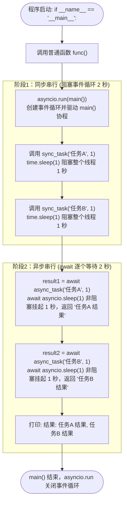

# `01-async_basic.py` 源码精讲：`async/await` 协程基础语法与同步阻塞 vs 异步非阻塞核心机制

---

## 一、文件定位与核心前置知识精讲

### 1.1 文件定位
`前置知识/3-异步编程/01-async_basic.py` 是 `3-异步编程` 模块的**第 1 课（异步编程入门基石篇）**。
在开发多智能体系统（A2A + MCP + FastAPI）时，90% 以上的时间都花在**网络 I/O 等待**上（等待大模型推理返回、等待远程 A2A 子智能体响应、等待高德/和风天气 HTTP 接口返回）。如果使用传统的同步编程，每一次网络等待都会把整个线程卡死。
本文件通过直观对比**同步函数（`def` + `time.sleep`）**与**异步协程函数（`async def` + `await asyncio.sleep`）**，带你迈出 Python `asyncio` 异步编程的第一步，并揭示一个新手最容易困惑的核心真相：**为什么只写 `await` 逐个等待，异步代码执行起来依然是“串行”的？**

---

### 1.2 核心前置知识

#### （1）同步阻塞（Synchronous Blocking） vs 异步非阻塞（Asynchronous Non-blocking）
我们可以用“**餐厅服务员点餐**”来比喻单线程下的两种模式：
- **同步阻塞（`def sync_task` + `time.sleep(seconds)`）**：
  - 服务员（当前线程）把客人 A 的菜单交给后厨后，**站在出餐口一动不动地死等 1 秒**（`time.sleep(1)` 阻塞了整个操作系统线程），期间任何其他客人都无法点餐；直到客人 A 的菜做好端上桌，服务员才能去招呼客人 B。
- **异步非阻塞（`async def async_task` + `await asyncio.sleep(seconds)`）**：
  - 服务员把客人 A 的菜单交给后厨后，看到需要等待 1 秒（遇到 `await` 关键字），**立刻主动交出控制权（挂起当前协程）**！
  - 此时**事件循环（Event Loop）**这位“大堂经理”就可以安排服务员去处理其他已经准备好的协程任务；当 1 秒计时结束，事件循环再通知该协程从刚才 `await` 挂起的地方恢复执行！

#### （2）三大核心概念：`async def`、协程对象（Coroutine Object）与 `await`
1. **`async def`（定义协程函数）**：
   - 在 `def` 前面加上 `async` 关键字，这个函数就不再是普通函数，而是**协程函数（Coroutine Function）**。
2. **调用协程函数不会立即执行函数体！**
   - 当你写 `coro = async_task("任务A", 1)` 时，**函数体里的第一行 `print` 根本不会执行**！它仅仅是返回了一个处于“待命状态”的**协程对象（Coroutine Object）**。
3. **`await`（挂起等待协程执行完毕）**：
   - 要让协程对象真正运行并拿到它的 `return` 返回值，必须在它前面加上 `await`（如 `result1 = await async_task("任务A", 1)`），或者把它交给 `asyncio.run()` / `asyncio.gather()` / `asyncio.create_task()`。
   - **语法铁律**：`await` 关键字**只能写在 `async def` 函数内部**！如果写在普通 `def` 函数或全局顶层代码中，Python 会直接报语法错误 `SyntaxError: 'await' outside async function`。

#### （3）深度解惑：为什么本文件中“异步版本”跑完两个 1 秒的任务，总耗时依然是 2 秒（异步串行）？
看本文件第 34~35 行：
```python
result1 = await async_task("任务A", 1)
result2 = await async_task("任务B", 1)
```
- 很多初学者以为：“只要用了 `async` 和 `await`，两个任务就会自动并行！”——**大错特错！**
- 在第 34 行，你先创建了 `"任务A"` 的协程，并立刻用 `await` **原地等待 `"任务A"` 彻底执行完毕拿到 `result1`**。此时虽然 `await asyncio.sleep(1)` 让出了事件循环控制权，但**当时事件循环里根本还没有创建 `"任务B"`**（因为代码还没走到第 35 行）！
- 等 1 秒过去，`"任务A"` 跑完了，代码才走到第 35 行去创建并等待 `"任务B"`。所以这叫**“异步串行（`await` 逐个等待）”**，总耗时依然是 $1 + 1 = 2$ 秒！
- （剧透：要想让任务 A 和任务 B 真正同时并发跑、1 秒内全部完成，需要用到第 5 课 [`05-asyncio_gather.py`](./05-asyncio_gather.py.md) 的 `asyncio.gather()` 或第 8 课的 `asyncio.create_task()`！）

---

### 1.3 在 Voyage 智途主项目中的关联
- 主项目几乎所有核心业务方法都是用 `async def` 和 `await` 编写的协程函数：
  - [`main_http_api.py`](../../根目录入口与配置/main_http_api.py.md) 中的所有 FastAPI 路由处理函数（如 `async def chat(request: ChatRequest):`、`response, cacheable = await svc.chat(request.message)`）；
  - [`core/chat_service_core.py`](../../core/chat_service_core.py.md) 中的主入口 `async def chat(self, user_input: str)`、意图识别 `await self._intent_agent(user_input)`、单意图执行 `await self._run_single_intent(...)` 以及 ReAct 循环 `await self._react_loop(...)`。
  - 在 `chat()` 方法中，“先做意图识别（`await _intent_agent`），拿到意图后再去执行意图（`await _run_single_intent`）”正是本文件第 34~35 行演示的**异步串行（有先后因果依赖的 `await` 逐个等待）**！

---

## 二、执行流程与示意图

### 2.1 `main()` 协程完整执行流程图（Mermaid）



### 2.2 `time.sleep` vs `await asyncio.sleep` 底层线程行为对比图（ASCII）

```text
【1. 同步阻塞: time.sleep(1)】
主线程 / 事件循环: [打印开始] ══════(CPU线程被焊死阻塞 1.0s，无法响应任何事)══════> [打印完成]

【2. 异步非阻塞: await asyncio.sleep(1)】
协程 async_task:   [打印开始] ──(await 主动挂起让出控制权)──> · · · (休眠1.0s) · · · ──(唤醒恢复)──> [打印完成]
                                       │                                                ▲
                                       ▼                                                │
事件循环 EventLoop:             (线程完全自由！可调度其他已注册的 Task) ───(1秒定时器到期)──┘
```

---

## 三、完整源码与逐行/逐段深度拆解

### 3.1 完整源码（100% 原始文件嵌入）

文件路径：`前置知识/3-异步编程/01-async_basic.py`

```python
# 3.1 async/await 基础语法
# async def 定义协程函数，await 等待异步操作完成

import asyncio
import time


# ---- 同步版本（对比用） ----
def sync_task(name, seconds):
    """同步：阻塞等待"""
    print(f"[同步] {name} 开始")
    time.sleep(seconds)
    print(f"[同步] {name} 完成")
    return f"{name} 结果"


# ---- 异步版本 ----
async def async_task(name, seconds):
    """异步：等待期间不阻塞，其他协程可以运行"""
    print(f"[异步] {name} 开始")
    await asyncio.sleep(seconds)  # 模拟异步IO（网络请求、数据库查询等）
    print(f"[异步] {name} 完成")
    return f"{name} 结果"


async def main():
    # 1. 同步执行两个任务（串行，总耗时 = 1 + 1 = 2秒）
    print("=== 同步串行 ===")
    sync_task("任务A", 1)
    sync_task("任务B", 1)

    # 2. 异步运行两个任务（也是串行，因为没有用 gather）
    print("\n=== 异步串行（await 逐个等待） ===")
    result1 = await async_task("任务A", 1)
    result2 = await async_task("任务B", 1)
    print(f"结果: {result1}, {result2}")


if __name__ == "__main__":
    def func():
        asyncio.run(main()) # 创建异步事件循环对象，循环对象运行main函数 —— 协程
    func()
```

---

### 3.2 分段逐行深度拆解

#### 第一段：模块导入与同步函数 `sync_task` 定义（第 1~15 行）
- **第 4~5 行**：
  - `import asyncio`：导入 Python 标准库内置的异步 I/O 框架 `asyncio`（无需额外 `uv add` 安装，Python 自带）。
  - `import time`：导入标准时间模块，使用其中的 `time.sleep()` 作为同步阻塞 I/O 的代表。
- **第 9~14 行**：定义普通同步函数 `def sync_task(name, seconds):`
  - 第 11 行打印开始信息；
  - **第 12 行**：`time.sleep(seconds)` 会让当前操作系统线程直接进入休眠阻塞状态；
  - 第 13~14 行打印完成信息并返回字符串 `f"{name} 结果"`。

#### 第二段：异步协程函数 `async_task` 定义（第 17~24 行）
- **第 18 行**：`async def async_task(name, seconds):`
  - 开头加上 `async` 关键字，将其声明为**异步协程函数**。
- **第 20 行**：打印 `[异步] {name} 开始`。
- **第 21 行**：`await asyncio.sleep(seconds)`
  - **`asyncio.sleep(seconds)`**：是一个异步非阻塞休眠协程，用来模拟耗时的异步网络 I/O（如调用大模型 API、请求远程 A2A 服务）。
  - **`await`**：挂起当前的 `async_task` 协程，把 CPU 执行权交还给 `asyncio` 事件循环，直到 `seconds` 秒倒计时结束后，再接着往下执行第 22 行！
- **第 22~23 行**：恢复执行后打印 `[异步] {name} 完成`，并返回 `f"{name} 结果"`（该返回值会作为外层 `await async_task(...)` 表达式的结果）。

#### 第三段：主协程 `main()` 中的同步串行与异步串行对比（第 26~37 行）
- **第 26 行**：`async def main():` 因为内部第 34~35 行要使用 `await`，所以 `main` 函数自身也必须定义为 `async def` 协程函数！
- **第 28~30 行（同步串行演示）**：
  - 依次调用普通函数 `sync_task("任务A", 1)` 和 `sync_task("任务B", 1)`（普通函数不需要也不能加 `await`），耗时 $1 + 1 = 2$ 秒。
- **第 33~36 行（异步串行演示）**：
  - 第 34 行：`result1 = await async_task("任务A", 1)`：启动 `"任务A"` 协程，并原地等待 1 秒直到它返回 `"任务A 结果"` 赋值给 `result1`。
  - 第 35 行：`result2 = await async_task("任务B", 1)`：等第 34 行彻底结束后，才启动 `"任务B"` 协程，再等待 1 秒直到它返回 `"任务B 结果"` 赋值给 `result2`。
  - 第 36 行：打印两个返回值 `结果: 任务A 结果, 任务B 结果`。

#### 第四段：程序入口与事件循环启动（第 39~42 行）
- **第 39~42 行**：
  ```python
  if __name__ == "__main__":
      def func():
          asyncio.run(main()) # 创建异步事件循环对象，循环对象运行main函数 —— 协程
      func()
  ```
  - 为什么要写 `asyncio.run(main())`？因为 `main()` 是一个 `async def` 协程函数，如果你直接写 `main()`，它只会返回一个 `<coroutine object main at 0x...>` 并抛出 `RuntimeWarning: coroutine 'main' was never awaited` 警告，里面一行代码都不会跑！
  - 这里特意套了一层普通同步函数 `def func():`，是为了向你证明：**在普通的同步函数（`func`）里，不能直接写 `await main()`，但可以通过 `asyncio.run(main())` 启动事件循环来运行顶层协程 `main()`！**

---

### 3.3 沙盘推演（Dry Run）：按秒级时间轴（`T=0.0s` ~ `T=4.0s`）推演执行过程

让我们用高精度秒表追踪程序从启动到结束的 4 秒钟内，每一刻发生的事件与控制台输出：

| 时间轴 (秒) | 正在执行的代码行 | 变量状态变化 | 控制台实时打印输出 |
| :--- | :--- | :--- | :--- |
| **`T = 0.0s`** | 第 42 行 `func()` $\rightarrow$ 第 41 行 `asyncio.run(main())` $\rightarrow$ 第 28~29 行 | 事件循环启动，进入 `sync_task("任务A", 1)` | `=== 同步串行 ===`<br/>`[同步] 任务A 开始` |
| **`T = 0.0s ~ 1.0s`** | 第 12 行 `time.sleep(1)` | 线程阻塞死等 1 秒 | *(等待中...)* |
| **`T = 1.0s`** | 第 13~14 行（任务A返回）$\rightarrow$ 第 30 行进入 `sync_task("任务B", 1)` | 任务A返回 `"任务A 结果"`（未接返回值），任务B开始 | `[同步] 任务A 完成`<br/>`[同步] 任务B 开始` |
| **`T = 1.0s ~ 2.0s`** | 第 12 行 `time.sleep(1)` | 线程再次阻塞死等 1 秒 | *(等待中...)* |
| **`T = 2.0s`** | 第 13~14 行（任务B返回）$\rightarrow$ 第 33~34 行 `await async_task("任务A", 1)` | 进入异步阶段，启动异步任务A，在第 21 行 `await asyncio.sleep(1)` 挂起 | `[同步] 任务B 完成`<br/>*(空行)*<br/>`=== 异步串行（await 逐个等待） ===`<br/>`[异步] 任务A 开始` |
| **`T = 2.0s ~ 3.0s`** | 第 21 行 `await asyncio.sleep(1)` | `async_task("任务A")` 挂起，事件循环空闲等待 1 秒 | *(等待中...)* |
| **`T = 3.0s`** | 第 22~23 行 $\rightarrow$ 第 34 行完成 $\rightarrow$ 第 35 行 `await async_task("任务B", 1)` | **`result1 = "任务A 结果"`**；随后启动异步任务B并在第 21 行挂起 | `[异步] 任务A 完成`<br/>`[异步] 任务B 开始` |
| **`T = 3.0s ~ 4.0s`** | 第 21 行 `await asyncio.sleep(1)` | `async_task("任务B")` 挂起，事件循环等待 1 秒 | *(等待中...)* |
| **`T = 4.0s`** | 第 22~23 行 $\rightarrow$ 第 35~36 行 | **`result2 = "任务B 结果"`**；`main()` 执行完毕，事件循环关闭 | `[异步] 任务B 完成`<br/>`结果: 任务A 结果, 任务B 结果` |

---

## 四、常见易错点与对比总结

### 4.1 同步函数 vs 异步协程函数全方位对比表

| 对比维度 | 同步函数（`sync_task`） | 异步协程函数（`async_task`） |
| :--- | :--- | :--- |
| **定义关键字** | `def sync_task(name, seconds):` | **`async def async_task(name, seconds):`** |
| **直接加括号调用 `fn()` 的返回值** | 立即执行函数体，返回最终结果 `"任务A 结果"` | **不执行函数体！** 仅返回协程对象 `<coroutine object>` |
| **如何执行并获取返回值** | `res = sync_task("任务A", 1)` | **`res = await async_task("任务A", 1)`**（或在最外层用 `asyncio.run()`） |
| **内部模拟耗时/等待应使用** | `time.sleep(seconds)`（阻塞整个线程） | **`await asyncio.sleep(seconds)`**（非阻塞挂起，让出事件循环） |

### 4.2 新手最容易踩的 3 个坑

1. **调用 `async def` 协程函数时忘了写 `await`**：
   - 错误写法：`result1 = async_task("任务A", 1)`
   - **后果**：`async_task` 内部的代码**一行都不会执行**！`result1` 拿到的只是一个 `<coroutine object async_task at 0x...>` 对象，且程序退出时 Python 会报 `RuntimeWarning: coroutine 'async_task' was never awaited`。
2. **在 `async def` 异步函数里误用了同步的 `time.sleep(1)`**：
   - 如果在 `async_task` 里写 `time.sleep(1)` 而不是 `await asyncio.sleep(1)`，那么即使函数头顶写了 `async def`，在 `time.sleep(1)` 那 1 秒钟内，整个事件循环线程依然会被彻底卡死，其他所有协程都无法运行！
3. **在 `await asyncio.sleep(seconds)` 中漏写了 `await`**：
   - `asyncio.sleep(seconds)` 本身也是一个协程函数！如果只写 `asyncio.sleep(1)` 不加 `await`，它根本不会等待 1 秒，而是瞬间跳过并报 `RuntimeWarning: coroutine 'sleep' was never awaited`。

---

## 五、自测思考题（附答案解析）

### 思考题 1
如果把第 34 行 `result1 = await async_task("任务A", 1)` 中的 `await` 删掉，改成 `result1 = async_task("任务A", 1)`，控制台还会打印 `[异步] 任务A 开始` 和 `[异步] 任务A 完成` 吗？第 36 行打印的 `result1` 会是什么？

<details>
<summary>点击查看答案解析</summary>

**答案解析**：
1. 控制台**不会**打印 `[异步] 任务A 开始` 和 `[异步] 任务A 完成`！因为直接调用 `async_task("任务A", 1)` 只是创建了一个协程对象，没有 `await`（也没交给事件循环调度）时，它的函数体根本不会开始运行。
2. 第 36 行打印的 `result1` 会是一个协程对象的内存地址描述：`<coroutine object async_task at 0x...>`，并且控制台会弹出一条 `RuntimeWarning: coroutine 'async_task' was never awaited` 警告。
</details>

### 思考题 2
既然 `async_task` 已经用了 `async def` 和 `await asyncio.sleep(1)`，为什么第 33~36 行的“异步版本”执行完任务 A 和任务 B 还是要花 $1 + 1 = 2$ 秒，而不是 1 秒？

<details>
<summary>点击查看答案解析</summary>

**答案解析**：
因为第 34 行 `result1 = await async_task("任务A", 1)` 使用了 `await` 直接等待任务 A 完成。在任务 A 完成（1 秒结束）之前，代码执行流被挂起在第 34 行，根本还没有执行到第 35 行去创建和启动任务 B！因此任务 A 和任务 B 是“先等 A 彻底跑完、再启动并等 B 跑完”的**异步串行**关系。要想让它们同时启动并发运行（总耗时 1 秒），需要使用 `await asyncio.gather(async_task("任务A", 1), async_task("任务B", 1))`。
</details>
