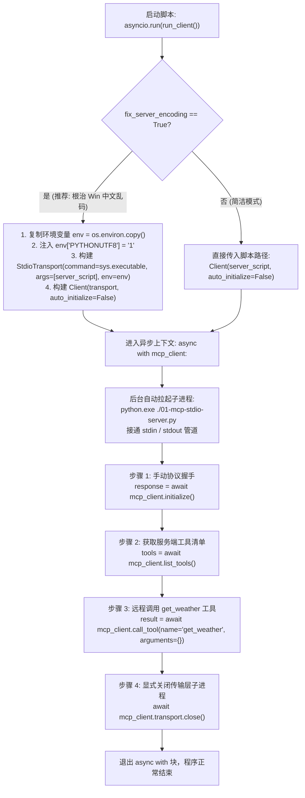

# `02-mcp-stdio-client.py` 深度精讲：原生 FastMCP Client 的 Stdio 进程通信、Windows 中文乱码根治与异步生命周期

> **本篇导读**：在上一篇 `01-mcp-stdio-server.py` 中，我们编写了一个基于 `stdio` 的 MCP 服务端。本篇我们将站在**客户端（MCP Client）**视角，不借助大模型，直接使用 `fastmcp.Client` 手动拉起 `01` 子进程，完整走通 **Windows 子进程 UTF-8 编码治理 (`StdioTransport`) $\rightarrow$ 建立异步上下文 (`async with`) $\rightarrow$ 协议握手 (`initialize`) $\rightarrow$ 工具发现 (`list_tools`) $\rightarrow$ 工具调用 (`call_tool`) $\rightarrow$ 管道关闭 (`close`)** 的全链路。阅读本文档**完全无需打开原 `.py` 文件**，全部源码与作者原注已 100% 完整嵌入。

---

## 一、文件定位与核心前置知识精讲

### 1.1 为什么在接入大模型 Agent 之前，要先学原生 `mcp_client`？

在实际开发中，很多同学一上来就用 LangChain 的 `MultiServerMCPClient` 把 MCP 绑给大模型，一旦遇到报错（如子进程启动失败、中文乱码、工具没加载出来、管道未关闭告警），往往无从排查，因为不清楚底下到底发生了什么。

`02-mcp-stdio-client.py` 就是帮助你**剥离大模型干扰、直击 MCP 通信本质**的“显微镜”：
- 它展示了任何 MCP 客户端（无论是 Claude Desktop、Cursor，还是 LangChain 的 MCP 适配器）在底层连接 MCP Server 时**必做的三步标准动作**：
  1. **`await mcp_client.initialize()`**：发送握手请求，确认双方协议版本（Protocol Version）与支持的能力（Capabilities）；
  2. **`await mcp_client.list_tools()`**：向服务端拉取所有已注册工具的 Schema 清单；
  3. **`await mcp_client.call_tool(name=..., arguments=...)`**：按工具名和参数字典远程触发服务端函数执行，并获取结构化返回值。

---

### 1.2 Windows 下 Python `stdio` 子进程中文乱码的底层成因与 `StdioTransport` 根治方案

本文件用了整整一半的篇幅（第 8~52 行）讲解并解决了一个在 Windows 系统下开发 MCP `stdio` 应用时**必踩的经典大坑——子进程中文乱码**。我们来把它的底层操作系统与 Python 解释器机理彻底讲透：

1. **为什么会乱码？（UTF-8 与 GBK 的错配）**
   - 在 `stdio` 模式下，`02-mcp-stdio-client.py`（父进程）会通过操作系统管道（Pipe）启动 `01-mcp-stdio-server.py`（子进程），并读取子进程 `stdout` 的字节流。
   - 在 Windows 中文版系统中，操作系统的历史默认活动代码页（ANSI Code Page）是 **CP936（即 GBK 编码）**。
   - 当 Python 子进程在没有连接真实终端控制台（而是连接了父子进程管道 Pipe）的情况下启动时，如果不做特殊配置，Python 的标准流（或父进程读取管道时的解码器）很容易回退到 Windows 默认的 `gbk` 编码；而 MCP 协议规范强制要求 JSON-RPC 消息使用 **UTF-8** 编码传输。
   - 当 UTF-8 编码的中文字符（如 `"郑州的天气是多云"`）被按照 GBK 编码规则去解码（或者反过来）时，就会产生经典的“涓枃涔辩爜”或直接抛出 `UnicodeDecodeError`！
2. **如何从根源上解决？（`PYTHONUTF8=1` + `StdioTransport`）**
   - Python 从 3.7+ 开始支持了 **PEP 540（UTF-8 Mode）**：只要在启动 Python 解释器进程前，向环境变量注入 `PYTHONUTF8="1"`，Python 解释器就会忽略 Windows 系统的区域 GBK 设置，将所有的标准输入输出流（`stdin`/`stdout`/`stderr`）、文件读写、管道通信**全部强制锁定为 UTF-8 编码**。
   - 但是，如果我们直接写 `Client("./01-mcp-stdio-server.py")`，FastMCP 虽然会自动帮我们启动子进程，却没有暴露传入自定义环境变量 `env` 的入口。
   - 因此，我们必须显式实例化传输层对象 **`StdioTransport(command=sys.executable, args=[server_script], env=env)`**，把带有 `env["PYTHONUTF8"] = '1'` 的环境变量字典传给即将拉起的子进程！

---

### 1.3 Python 异步编程（`async` / `await` / `async with`）在 MCP 中的核心作用

为什么 MCP 的客户端代码全都是 `async def`、`async with` 和 `await`？
- 因为无论是跨进程管道通信（`stdio`）还是跨网络 HTTP 通信（`sse` / `streamable-http`），本质上都是**高耗时的 I/O 等待操作**（等待服务端计算并回传数据包）。
- 如果使用同步阻塞（Synchronous）模式，在等待某个慢速工具（例如查数据库耗时 2 秒）返回期间，整个 Python 线程会被死死卡住，无法并发调用其他 MCP Server 的工具。
- 使用 `asyncio` 异步协程架构后：
  - **`async with mcp_client:`**：在进入代码块时自动异步启动子进程、建立读写管道流；在离开代码块时自动异步清理会话资源。
  - **`await mcp_client.call_tool(...)`**：在等待子进程返回结果的这段时间里，主动交出 CPU 控制权，让事件循环（Event Loop）可以同时处理其他并发任务。

---

## 二、架构交互与执行流程图

### 2.1 `02-mcp-stdio-client.py` 完整生命周期流程图



### 2.2 客户端与服务端子进程方法映射 ASCII 图

```text
02-mcp-stdio-client.py (Client 父进程)                 01-mcp-stdio-server.py (Server 子进程)
=======================================               =======================================
async with mcp_client:
  └─ 启动子进程 (command + args + env)  ------------->  if __name__ == "__main__":
                                                          mcp.run(transport="stdio")

await mcp_client.initialize()          --[stdin]--->  读取 FastMCP("stdio-server") 元信息
  <-- 打印 session response            <-[stdout]---  返回 InitializeResult (protocolVersion, serverInfo)

await mcp_client.list_tools()          --[stdin]--->  扫描所有 @mcp.tool 装饰器
  <-- 打印 MCP stdio tools             <-[stdout]---  返回 [Tool(query_high_frequency_question), Tool(get_weather)]

await mcp_client.call_tool(            --[stdin]--->  定位并执行 async def get_weather()
    name="get_weather", arguments={}                      └── return "郑州的天气是多云"
)
  <-- 打印 CallToolResult              <-[stdout]---  返回 CallToolResult(content=[TextContent(text="郑州的天气是多云")])

await mcp_client.transport.close()     ------------>  收到 EOF / 终止信号，子进程优雅退出
```

---

## 三、完整源码与逐行/逐段深度拆解

### 3.1 100% 完整源码呈现

以下是 `前置知识/4-MCP协议/02-mcp-stdio-client.py` 的全部原始代码与注释（共 112 行，一字未改）：

```python
import asyncio, os, sys
from fastmcp import Client
from fastmcp.client.transports import StdioTransport

# 配置mcp服务器脚本路径
server_script = r"./01-mcp-stdio-server.py"

# 中文乱码开关
fix_server_encoding = True

if fix_server_encoding:
    env = os.environ.copy() # 复制一套环境变量
    env["PYTHONUTF8"] = '1' # 设置为utf8编码
    ''' 关于mcpserver作为子进程输出中文乱码：
    1. py解释器没有精确识别win系统的具体版本的功能
        只能武断的认为win系统就是gbk编码方式
    2. mcp stdio模式下 mcpserver通过mcpclient的子进程执行
        mcpserver的一切输出都会按照gbk的方式进行解码
    3. 当win系统本身默认支持utf8的时候，子进程输出就是utf8编码
        utf8编码的字符串按gbk的方式解码，于是乱码  
    4. env["PYTHONUTF8"] = '1' 
        让python在代码进程层面、临时、强制按utf8进行编解码
    '''
    # 创建Stdio传输层对象（或者叫参数对象）
    transport = StdioTransport(
        command=sys.executable, # mcp server的py解释器路径
        args=[server_script], # mcp server脚本的路径
        env=env # 传入环境变量，设置utf8编码
    )
    ''' 关于 Stdio传输层参数对象 StdioTransport：
    1. 因为要解决mcpserver子进程输出的中文乱码问题
        所以必须使用 StdioTransport 传输层参数对象
        传入临时的当前系统的环境变量（设置使用utf8）   
    2. 本来会默认使用当前py解释器
        一旦使用StdioTransport，就必须指定mcpserver的启动命令和参数
        command=sys.executable 就是当前环境下py解释器的绝对路径
        args=[server_script] 就是mcpserver脚本文件的路径
        command+args➡️ 
            ..../python.exe ./01-mcp-stdio-server.py
    '''

    # 实例化mcp客户端
    mcp_client = Client(
        transport, # 传入Stdio传输层参数对象
        auto_initialize=False # 默认为True，False则不初始化
    )
else:
    # 实例化mcp客户端
    mcp_client = Client(
        server_script, # 直接传入mcp server脚本的路径
        auto_initialize=False # 默认为True，False则不初始化
    )

# TODO 异步执行
async def run_client():
    async with mcp_client:
        # 手动初始化会话：告诉服务端 “我客户端连上了”
        # async with Client(...): 这样用就不用手动初始化了
        response = await mcp_client.initialize()
        print('session response ➡️ ：', response)

        # 列出服务端提供的工具列表
        tools = await mcp_client.list_tools()
        print('MCP stdio tools➡️ ：', tools)

        # 调用服务端工具：获取天气
        result = await mcp_client.call_tool(
            name="get_weather",
            arguments={}
        )
        print('MCP stdio function call get_weather➡️ ：', result)

        # 终止子进程，避免退出时的资源清理警告
        await mcp_client.transport.close()

    return


if __name__ == "__main__":
    # 异步执行函数
    asyncio.run(run_client())

    ''' 
    一、关于异步函数
    1. async def ... 
        这是个异步函数，里边可以写 await
    2. async with ...
        异步的网络资源上下文管理器
        保持连接的会话对象、MCP读写通道都属于网络资源
    3. await ...
        等异步任务做完，声明不占用CPU，等拿到结果再往下执行
    4. asyncio.run(异步函数())
        启动整个异步流程

    二、举例：
    1. async def 烧水()
        说明烧水是可以一边干别的、一边等的异步任务
    2. await 烧水()
        停下来等着水烧开，烧水期间CPU可以去干别的活，水开了再继续下一步
    3. async with 热水壶() as 壶
        自动异步申请水壶资源，结束后自动异步归还；
        申请、归还水壶的等待阶段，CPU可以去执行其他异步任务

    三、同步、异步
    1. 同步
        一件事做完，才能做下一件；卡在哪就原地死等，CPU闲着。
        例：盯着水壶等水开，啥也不干。
    2. 异步
        等着耗时操作的时候，CPU先去干别的；等操作完成再回来收尾。
        耗时操作都是IO操作：网络IO（等网络响应）、文件IO（等磁盘读写）
        例：烧水时去洗菜，水响了再回来。
    '''
```

---

### 3.2 逐段逐行深度拆解

#### 模块一：导入核心库与配置脚本路径（第 1~6 行）

```python
import asyncio, os, sys
from fastmcp import Client
from fastmcp.client.transports import StdioTransport

# 配置mcp服务器脚本路径
server_script = r"./01-mcp-stdio-server.py"
```

- **`import asyncio, os, sys`**：
  - `asyncio`：Python 原生协程与事件循环库，用于驱动 `run_client()`。
  - `os`：用于通过 `os.environ.copy()` 复制当前操作系统的环境变量。
  - `sys`：用于通过 `sys.executable` 动态获取当前正在运行本脚本的 Python 解释器绝对路径（例如 `D:\conda_envs\voyage\python.exe`）。这比硬编码写 `"python"` 安全得多，能确保子进程和父进程使用的是**同一个虚拟环境**下的 Python 解释器和依赖包！
- **`from fastmcp import Client`**：导入 FastMCP 提供的统一客户端类。它既能连 `stdio` 本地脚本，也能连 `http://.../sse` 或 `http://.../mcp` 远程服务。
- **`from fastmcp.client.transports import StdioTransport`**：导入专门负责配置 `stdio` 子进程启动参数（启动命令、参数列表、环境变量、工作目录等）的传输层类。
- **`server_script = r"./01-mcp-stdio-server.py"`**：指定要拉起的服务端 Python 脚本相对路径。注意因为用的是相对路径 `./`，运行本脚本时终端的工作目录（Working Directory）必须位于 `前置知识/4-MCP协议/` 下。

---

#### 模块二：传输层构造与 `Client` 实例化（第 8~52 行）

```python
# 中文乱码开关
fix_server_encoding = True

if fix_server_encoding:
    env = os.environ.copy() # 复制一套环境变量
    env["PYTHONUTF8"] = '1' # 设置为utf8编码
    ...
    transport = StdioTransport(
        command=sys.executable, # mcp server的py解释器路径
        args=[server_script], # mcp server脚本的路径
        env=env # 传入环境变量，设置utf8编码
    )
    ...
    mcp_client = Client(
        transport, # 传入Stdio传输层参数对象
        auto_initialize=False # 默认为True，False则不初始化
    )
else:
    # 实例化mcp客户端
    mcp_client = Client(
        server_script, # 直接传入mcp server脚本的路径
        auto_initialize=False # 默认为True，False则不初始化
    )
```

- **为什么要写 `env = os.environ.copy()` 而不是直接传 `env={"PYTHONUTF8": "1"}`？**
  - 如果你只传一个仅含 `{"PYTHONUTF8": "1"}` 的字典给子进程，子进程会丢失操作系统原本的 `PATH`、`SYSTEMROOT`、`PYTHONPATH` 等关键系统环境变量，在 Windows 下甚至会导致 socket 初始化失败！所以**必须先 `.copy()` 继承父进程的全量环境变量，再增量修改 `env["PYTHONUTF8"] = '1'`**。
- **`StdioTransport` 的三个核心参数**：
  - `command=sys.executable`：可执行程序路径（即 `.../python.exe`）。
  - `args=[server_script]`：传给可执行程序的命令行参数列表（即 `["./01-mcp-stdio-server.py"]`）。底层拼接后等价于在终端执行：`.../python.exe ./01-mcp-stdio-server.py`。
  - `env=env`：传给子进程的环境变量字典。
- **`Client(..., auto_initialize=False)` 中的 `auto_initialize` 参数**：
  - `Client` 的第一个参数具备**多态自动推断（Transport Inference）**能力：
    - 当传入 `StdioTransport` 实例时，直接使用该传输层；
    - 当像 `else` 分支那样直接传入以 `.py` 结尾的字符串 `r"./01-mcp-stdio-server.py"` 时，`Client` 内部会自动识别这是一个 Python 脚本路径，并自动为你包装一个默认的 `PythonStdioTransport`。
  - **`auto_initialize=False`**：FastMCP 的 `Client` 默认 `auto_initialize=True`（即进入 `async with mcp_client:` 时自动在后台执行 `initialize()` 握手）。这里特意设为 `False`，是为了在下面的 `run_client()` 中**显式调用 `await mcp_client.initialize()` 并打印握手返回值**，让你亲眼看到握手阶段服务端返回了什么结构！

---

#### 模块三：异步会话上下文与核心三步曲（第 55~76 行）

```python
async def run_client():
    async with mcp_client:
        # 手动初始化会话：告诉服务端 “我客户端连上了”
        # async with Client(...): 这样用就不用手动初始化了
        response = await mcp_client.initialize()
        print('session response ➡️ ：', response)

        # 列出服务端提供的工具列表
        tools = await mcp_client.list_tools()
        print('MCP stdio tools➡️ ：', tools)

        # 调用服务端工具：获取天气
        result = await mcp_client.call_tool(
            name="get_weather",
            arguments={}
        )
        print('MCP stdio function call get_weather➡️ ：', result)

        # 终止子进程，避免退出时的资源清理警告
        await mcp_client.transport.close()

    return
```

1. **第 56 行 `async with mcp_client:`**：
   - 触发 `mcp_client.__aenter__()`。此时 FastMCP 才真正调用操作系统的进程创建接口，拉起 `01-mcp-stdio-server.py` 子进程，并建立 `stdin` 和 `stdout` 内存流。
   - **切记**：在进入 `async with mcp_client:` 之前，子进程尚未启动，绝对不能在 `async with` 块外部调用 `list_tools()` 或 `call_tool()`！
2. **第 59~60 行 `response = await mcp_client.initialize()`**：
   - 发送 MCP `initialize` 握手报文，并紧接着发送 `notifications/initialized` 通知。
   - 返回的 `response` 是一个 `InitializeResult` 对象，包含协议版本号 `protocolVersion`、服务端能力 `capabilities` 和服务端标识 `serverInfo(name='stdio-server', ...)`。
3. **第 63~64 行 `tools = await mcp_client.list_tools()`**：
   - 发送 `tools/list` 请求。
   - 返回一个 `list[Tool]` 列表，里面包含 `01-mcp-stdio-server.py` 注册的两个工具对象（`query_high_frequency_question` 和 `get_weather`）及其 `description` 和 `inputSchema`。
4. **第 67~71 行 `result = await mcp_client.call_tool(name="get_weather", arguments={})`**：
   - 发送 `tools/call` 请求，指定要调用的工具名称 `"get_weather"`，因为该工具无参数，所以 `arguments` 传空字典 `{}`。
   - 返回 `CallToolResult` 对象（或在新版 FastMCP 中包含 `.content` 属性的结果对象），其中搭载了服务端返回的 `"郑州的天气是多云"`。
5. **第 74 行 `await mcp_client.transport.close()`**：
   - **为什么在退出 `async with` 之前还要多写这一行？**
   - 在 Windows 的 `asyncio`（默认使用 `ProactorEventLoop`）环境下，当 `asyncio.run()` 结束并销毁事件循环时，如果子进程的管道传输层（Subprocess Transport）还没有彻底关闭，Python 垃圾回收器在事件循环关闭后清理 `_ProactorBasePipeTransport.__del__` 时，常会在控制台报出恼人的 `RuntimeError: Event loop is closed` 或 `ResourceWarning: unclosed transport`。
   - 显式调用 `await mcp_client.transport.close()` 可以确保在事件循环还活着的时候，主动终止子进程并排空关闭管道，实现零警告优雅退出。

---

### 3.3 沙盘推演（Dry Run）：控制台真实输出全解析

当我们在终端执行 `python 02-mcp-stdio-client.py` 时，程序每一步的控制台输出及数据结构拆解如下：

```text
session response ➡️ ： meta=None protocolVersion='2024-11-05' capabilities=ServerCapabilities(experimental={}, logging=None, prompts=PromptsCapability(listChanged=True), resources=ResourcesCapability(subscribe=False, listChanged=True), tools=ToolsCapability(listChanged=True)) serverInfo=Implementation(name='stdio-server', version='...') instructions=None
```
- **解读第 1 行输出（`initialize` 结果）**：
  - `protocolVersion='2024-11-05'`：双方协商一致的 MCP 协议规范版本。
  - `capabilities=ServerCapabilities(..., tools=ToolsCapability(listChanged=True))`：服务端告诉客户端：“我支持工具（Tools）、资源（Resources）、提示词模板（Prompts）能力”。
  - `serverInfo=Implementation(name='stdio-server', ...)`：这里精准对应了 `01-mcp-stdio-server.py` 第 6 行写的 `FastMCP("stdio-server")`！

```text
MCP stdio tools➡️ ： [Tool(name='query_high_frequency_question', description='从知识库中检索常见问题解答（FAQ）,返回包含问题和答案', inputSchema={'properties': {}, 'type': 'object'}, annotations=None), Tool(name='get_weather', description='查询天气', inputSchema={'properties': {}, 'type': 'object'}, annotations=None)]
```
- **解读第 2 行输出（`list_tools` 结果）**：
  - 返回了一个包含 2 个 `Tool` Pydantic 模型的 Python 列表。
  - 每个 `Tool` 都把 `01` 服务端 `@mcp.tool()` 里的 `name`、`description` 和自动生成的 JSON Schema (`inputSchema`) 原封不动地带了过来。

```text
MCP stdio function call get_weather➡️ ： [TextContent(type='text', text='郑州的天气是多云', annotations=None)]
```
*(注：取决于 `fastmcp` 的具体小版本，`call_tool` 可能直接返回 `[TextContent(...)]` 列表，或返回 `CallToolResult(content=[TextContent(type='text', text='郑州的天气是多云')], isError=False)`)*
- **解读第 3 行输出（`call_tool` 结果）**：
  - 成功跨进程触发了 `01-mcp-stdio-server.py` 中的 `get_weather()` 协程，并拿到了 UTF-8 编码完好、没有任何乱码的中文结果 `'郑州的天气是多云'`！

---

## 四、横向对比、易错点与工程思考

### 4.1 三种传输模式下 `fastmcp.Client` 代码的横向对比（02 vs 05 vs 08）

请对比本目录下的 3 个 Client 文件（`02-mcp-stdio-client.py`、`05-mcp-sse-client.py`、`08-mcp-streamable-client.py`），你会发现一个令人惊叹的设计美学：

| 对比项 | `02-mcp-stdio-client.py` | `05-mcp-sse-client.py` | `08-mcp-streamable-client.py` |
| :--- | :--- | :--- | :--- |
| **传入 `Client(...)` 的第 1 个参数** | `StdioTransport(...)` 或 `r"./01-mcp-stdio-server.py"` | `'http://127.0.0.1:8001/sse'` | `'http://127.0.0.1:8001/mcp'` |
| **是否需要配置 `PYTHONUTF8`？** | **需要**（因为父进程通过 OS 管道拉起本地子进程） | **不需要**（走 HTTP 网络协议，默认 UTF-8 JSON） | **不需要**（走 HTTP 网络协议，默认 UTF-8 JSON） |
| **运行前是否要先手动启动 Server？** | **不需要**（Client 自动拉起子进程） | **必须先启动 `04-mcp-sse-server.py`** | **必须先启动 `07-mcp-streamable-server.py`** |
| **`run_client()` 内部业务代码** | `initialize()` $\rightarrow$ `list_tools()` $\rightarrow$ `call_tool()` | **100% 完全相同！** | **100% 完全相同！** |

> **工程启示**：这就是优秀协议分层（传输层 Transport 与会话层 Session 解耦）的威力！无论底层是本地父子进程管道，还是跨洋过海的 HTTP 流，上层业务调用的 `initialize()`、`list_tools()`、`call_tool()` 接口一行代码都不用改。

### 4.2 常见报错与避坑指南

1. **报错 `FileNotFoundError: ... ./01-mcp-stdio-server.py`**：
   - **原因**：你在项目根目录 `Voyage智途A2A>` 下执行了 `python 前置知识/4-MCP协议/02-mcp-stdio-client.py`，此时相对路径 `./01-mcp-stdio-server.py` 会在项目根目录下寻找，自然找不到。
   - **解决**：先 `cd 前置知识/4-MCP协议`，或者在代码中用 `os.path.join(os.path.dirname(__file__), "01-mcp-stdio-server.py")` 构造绝对路径。
2. **如果不写 `auto_initialize=False`，代码该怎么简化？**
   - 如果使用默认的 `auto_initialize=True`，进入 `async with mcp_client:` 时就已经自动完成了 `initialize()` 握手，此时在块内直接调 `await mcp_client.list_tools()` 即可，无需再手动调用 `await mcp_client.initialize()`。

---

## 五、自测思考题（附答案解析）

### 思考题 1
在 `02-mcp-stdio-client.py` 的第 26 行构造 `StdioTransport` 时，为什么使用 `command=sys.executable` 而不是直接写字符串 `command="python"`？

<details>
<summary>点击查看答案解析</summary>

**答案**：
在一台开发机上往往同时安装了多个 Python 环境（系统全局 Python、Anaconda base 环境、项目专用的虚拟环境 `.venv` 或 conda 虚拟环境）。
- 如果硬编码写 `command="python"`，操作系统会去系统环境变量 `PATH` 里找第一个出现的 `python.exe`，这极有可能是没有安装 `fastmcp` 包的系统全局 Python，导致子进程一启动就报 `ModuleNotFoundError: No module named 'fastmcp'`。
- 而 `sys.executable` 返回的是**当前正在执行父进程脚本的那个 Python 解释器的绝对路径**，能 100% 保证子进程与父进程处于完全一致的虚拟环境中。
</details>

---

### 思考题 2
如果 `01-mcp-stdio-server.py` 中的 `get_weather` 函数改成了接收一个城市参数：`async def get_weather(city: str) -> str:`，那么在 `02-mcp-stdio-client.py` 第 67 行调用 `mcp_client.call_tool()` 时，应该如何修改代码？

<details>
<summary>点击查看答案解析</summary>

**答案**：
只需在 `call_tool` 的 `arguments` 字典中传入对应的参数键值对即可：
```python
result = await mcp_client.call_tool(
    name="get_weather",
    arguments={"city": "郑州"}
)
```
如果服务端有参数但客户端依然传 `arguments={}`，FastMCP 服务端在进行 Pydantic 参数校验时会拒绝执行并返回参数缺失错误。
</details>

---

### 思考题 3
请简述代码中末尾注释提到的 `async def`、`await`、`async with` 和 `asyncio.run()` 四者的分工关系。

<details>
<summary>点击查看答案解析</summary>

**答案**：
1. **`async def`**：声明一个函数是**协程函数（Coroutine Function）**，只有在这类函数内部才能使用 `await` 和 `async with`。
2. **`await`**：挂起当前协程，等待后面的异步 I/O 操作（如 `initialize()`、`list_tools()`、`call_tool()`）完成；在等待期间释放 CPU 给事件循环去干别的活，拿到结果后再恢复往下执行。
3. **`async with`**：异步上下文管理器，用于在进入代码块（`__aenter__`）时异步申请/建立网络或管道连接，在退出代码块（`__aexit__`）时自动异步断开并清理资源。
4. **`asyncio.run(coro)`**：同步世界进入异步世界的总开关（启动器）。它负责创建底层的事件循环（Event Loop），把顶层协程 `run_client()` 丢进事件循环跑完，最后关闭事件循环。
</details>
