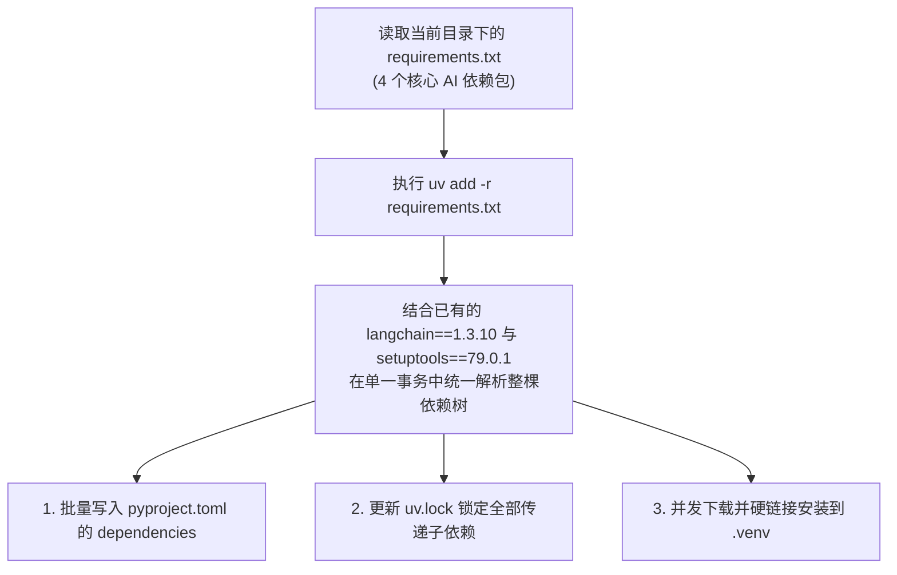

# `uv安装requirements.sh` 源码精讲：使用 `uv add -r` 批量导入并持久化 `requirements.txt` 依赖

---

## 一、文件定位与核心前置知识精讲

### 1.1 文件定位
`前置知识/1-uv环境管理工具/uv安装requirements.sh` 是 `1-uv环境管理工具` 模块的**第 7 步（收官脚本）**。它通过执行 `uv add -r requirements.txt`，将同目录下的 [`requirements.txt`](./requirements.txt.md) 中列出的 4 个核心包（`langchain-openai`、`langchain-mcp-adapters`、`fastmcp`、`a2a-sdk`）一次性批量安装到 `.venv` 虚拟环境中，并自动同步写入 `pyproject.toml` 和 `uv.lock`。

### 1.2 核心前置知识
1. **`uv add -r requirements.txt` 的核心机制**
   - `-r`（或 `--requirements`）参数告诉 `uv add`：不要把后面的字符串当成某个包的名称，而是将其作为一个依赖清单文件（`requirements.txt`）的路径去读取。
   - `uv` 会读取 `requirements.txt` 中的每一行包名与版本约束，**等价于对里面的每一行依次执行了 `uv add`**，而且是在**同一个依赖解析事务（Transaction）**中一次性解析所有包的版本兼容关系，速度比逐个执行 `uv add` 快得多！
2. **生死攸关的区别：`uv add -r requirements.txt` vs `uv pip install -r requirements.txt`**
   很多从 `pip` 转过来的开发者习惯写 `uv pip install -r requirements.txt`，但这两者有着本质区别：
   - **`uv add -r requirements.txt`（工程级持久化安装，本脚本采用）**：不仅装包进 `.venv`，还会**自动把 `requirements.txt` 里的所有依赖项写入 `pyproject.toml` 的 `dependencies` 列表中，并更新 `uv.lock`**。
   - **`uv pip install -r requirements.txt`（临时非持久化安装）**：只把包装进 `.venv`，**完全不修改 `pyproject.toml` 和 `uv.lock`**。一旦你之后运行了一次 `uv sync` 或 `uv add 其他包`，`uv` 会严格按照 `pyproject.toml` 重置环境，把你刚才用 `uv pip install` 装的包全部当成“多余未声明包”卸载掉！

### 1.3 在 Voyage 智途主项目中的关联
- 主项目根目录下同样维护了一份包含 12 个生产依赖的 [`requirements.txt`](../../根目录入口与配置/requirements.txt.md)。
- 当需要把 `requirements.txt` 中的所有依赖正式纳入 `uv` 项目管理并生成 `uv.lock` 时，执行的正是本脚本的 `uv add -r requirements.txt` 命令。

---

## 二、执行流程与示意图

### 2.1 执行流程图（Mermaid）



### 2.2 批量导入前后 `pyproject.toml` 的变化图（ASCII）

```text
[requirements.txt]                         [pyproject.toml (执行前)]
+---------------------------------+        +---------------------------------+
| langchain-openai==1.3.3         |        | dependencies = [                |
| langchain-mcp-adapters==0.3.0   |        |     "langchain==1.3.10",        |
| fastmcp==3.4.2                  |        |     "setuptools==79.0.1",       |
| a2a-sdk==1.1.2                  |        | ]                               |
+---------------------------------+        +---------------------------------+
                 |                                          |
                 +-------------------+----------------------+
                                     |
                                     | 执行: uv add -r requirements.txt
                                     v
                           [pyproject.toml (执行后)]
                           +---------------------------------+
                           | dependencies = [                |
                           |     "a2a-sdk==1.1.2",           |
                           |     "fastmcp==3.4.2",           |
                           |     "langchain==1.3.10",        |
                           |     "langchain-mcp-adapters==0.3.0", |
                           |     "langchain-openai==1.3.3",  |
                           |     "setuptools==79.0.1",       |
                           | ]                               |
                           +---------------------------------+
```

---

## 三、完整源码与逐行/逐段深度拆解

### 3.1 完整源码（100% 原始文件嵌入）

文件路径：`前置知识/1-uv环境管理工具/uv安装requirements.sh`

```bash
uv add -r requirements.txt
```

---

### 3.2 逐行深度拆解

| 行号 | 源码内容 | 深度技术拆解 |
| :--- | :--- | :--- |
| **第 1 行** | `uv add -r requirements.txt` | **从文件批量添加项目依赖指令**：<br/>• `uv add`：向当前项目的 `pyproject.toml` 添加依赖并同步到 `uv.lock` 与 `.venv`。<br/>• `-r`：`--requirements` 的简写，指定从后面的文本文件中读取依赖列表。<br/>• `requirements.txt`：当前工作目录下的依赖清单文件名（包含 `langchain-openai==1.3.3`、`langchain-mcp-adapters==0.3.0`、`fastmcp==3.4.2`、`a2a-sdk==1.1.2`）。 |

---

### 3.3 沙盘推演（Dry Run）：完整执行过程与环境最终状态验证

假设你已经按顺序执行完了前 5 个脚本，当前目录下已有 [`requirements.txt`](./requirements.txt.md)：

1. **在终端执行 `uv add -r requirements.txt`**：
   ```text
   > uv add -r requirements.txt
   Resolved 86 packages in 1.12s
   Prepared 42 packages in 2.85s
   Installed 54 packages in 610ms
    + a2a-sdk==1.1.2
    + fastmcp==3.4.2
    + httpx==0.28.1
    + langchain-mcp-adapters==0.3.0
    + langchain-openai==1.3.3
    + mcp==1.9.0
    + openai==1.78.0
    + protobuf==5.29.4
    + tiktoken==0.9.0
    ... (其余子依赖自动安装完毕)
   ```

2. **检查 `pyproject.toml` 的最终内容**：
   打开项目根目录的 `pyproject.toml`，可以看到之前单独 `uv add` 的 2 个包与 `requirements.txt` 中的 4 个包已经全部按字母序整齐排列在 `dependencies` 中：
   ```toml
   [project]
   name = "myproject"
   version = "0.1.0"
   description = "Add your description here"
   readme = "README.md"
   requires-python = ">=3.10"
   dependencies = [
       "a2a-sdk==1.1.2",
       "fastmcp==3.4.2",
       "langchain==1.3.10",
       "langchain-mcp-adapters==0.3.0",
       "langchain-openai==1.3.3",
       "setuptools==79.0.1",
   ]
   ```

3. **至此，`1-uv环境管理工具` 模块的 7 个脚本全部执行完毕！**
   你的 `.venv\Scripts\python.exe` 已经拥有了运行后续 Function Call、异步编程、MCP 协议、Agent 智能体与 A2A 协议全部代码的能力！

---

## 四、常见易错点与对比总结

### 4.1 批量安装与导出命令横向对比

| 场景需求 | 推荐的 `uv` 命令 | 底层行为说明 |
| :--- | :--- | :--- |
| **把已有的 `requirements.txt` 导入到 `uv` 项目中（本脚本）** | **`uv add -r requirements.txt`** | 解析并安装所有包，同时自动写入 `pyproject.toml` 和 `uv.lock`。 |
| **别人克隆了含 `pyproject.toml` + `uv.lock` 的项目后安装环境** | **`uv sync`** | 直接按 `uv.lock` 极速还原 100% 相同的 `.venv` 环境，无需再用 `-r requirements.txt`。 |
| **将当前 `uv` 项目的依赖导出为传统 `requirements.txt`** | `uv export --format requirements-txt > requirements.txt` | 从 `uv.lock` 导出兼容传统 `pip` 的依赖清单。 |

### 4.2 新手最容易踩的 2 个坑

1. **在错误的终端目录下执行 `uv add -r requirements.txt`**：
   - 报错：`error: File not found: requirements.txt`。
   - **原因**：`requirements.txt` 是一个相对路径，执行该命令时，终端的当前工作目录（或者指定的相对路径）下必须确实存在 `requirements.txt` 文件。
2. **`requirements.txt` 文件编码问题（UTF-16 LE BOM）**：
   - 在 Windows PowerShell 中如果用 `echo xxx > requirements.txt` 生成文件，默认可能是 `UTF-16` 编码，有时会导致解析器报编码错误。请确保使用 VSCode / PyCharm 将 `requirements.txt` 保存为标准的 **`UTF-8`** 编码。

---

## 五、自测思考题（附答案解析）

### 思考题 1
如果一个同学没有用本脚本的 `uv add -r requirements.txt`，而是自己敲了 `uv pip install -r requirements.txt` 把包装进了 `.venv`。虽然当时能跑代码，但过了一天他执行了一次 `uv sync`，结果发现昨天装的那 4 个包全没了！请解释原因。

<details>
<summary>点击查看答案解析</summary>

**答案解析**：
因为 `uv pip install -r requirements.txt` 属于低层级的 `pip` 兼容命令，它只会把包写进 `.venv/Lib/site-packages`，**不会**把这 4 个包登记到项目的工程声明文件 `pyproject.toml` 和锁文件 `uv.lock` 中。
而 `uv sync` 的设计原则是“**让 `.venv` 与 `pyproject.toml` / `uv.lock` 保持严格一致（多退少补）**”。当执行 `uv sync` 时，`uv` 发现那 4 个包并不在 `pyproject.toml` 中，就会把它们当成未声明的杂包自动清理卸载。因此必须使用 `uv add -r requirements.txt`！
</details>

### 思考题 2
把 `uv add langchain==1.3.10`、`uv add setuptools==79.0.1` 和 `uv add -r requirements.txt` 全部执行完之后，整个项目的直接依赖（Direct Dependencies）一共有几个？它们记录在哪个文件里？

<details>
<summary>点击查看答案解析</summary>

**答案解析**：
一共有 **6 个**直接依赖（`langchain==1.3.10`、`setuptools==79.0.1`、`langchain-openai==1.3.3`、`langchain-mcp-adapters==0.3.0`、`fastmcp==3.4.2`、`a2a-sdk==1.1.2`）。它们全部被自动记录在项目根目录下的 **`pyproject.toml`** 文件的 `[project] -> dependencies` 列表中。
</details>
