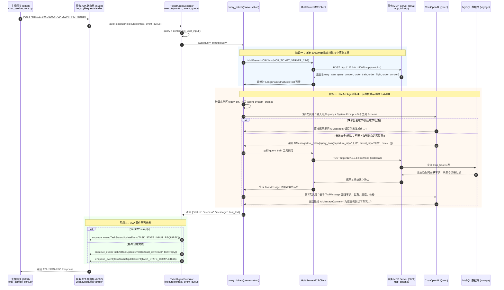

# `a2a_server/a2a_ticket.py` 代码精讲学习手册

> **源文件位置**：`a2a_server/a2a_ticket.py`  
> **所属模块**：`a2a_server`（A2A 领域专家子智能体服务层 —— 端口 `6002`）  
> **核心职责**：作为**票务查询与预定领域专家子智能体（Sub-Agent）**，向上通过 Google **A2A 协议**向主控路由（`8888`）暴露 4 项票务技能（查火车票、查演唱会票、订火车票、订演唱会票）与 JSON-RPC 2.0 端点（`POST http://127.0.0.1:6002/`）；向下通过 `MultiServerMCPClient` 连接票务 MCP 服务（`http://127.0.0.1:5002/mcp`），驱动 LangChain ReAct Agent 完成自然语言参数提取、缺参追问、数据库查询与票务预订。

---

## 一、文件定位与核心前置知识精讲

### 1.1 `a2a_ticket.py` 如何承上启下连接主控路由与票务 MCP Server？

在 **Voyage 智途 A2A** 系统中，`a2a_ticket.py`（端口 `6002`）是专职处理“**城际铁路出行（火车票/高铁票）与文娱演出（演唱会门票）**”的领域专家子智能体：
- **向上（对主控网关 `chat_service_core.py`）**：
  - 暴露 `GET /.well-known/agent-card.json`，返回 `ticket_agent_card`（包含 4 个细粒度 `AgentSkill`：查火车票、查演唱会票、订火车票、订演唱会票）。主控网关在拆分用户复合意图（如“帮我查明天北京的天气，以及明天上海到北京的高铁票”）时，会将“上海到北京的高铁票”这一子任务通过 A2A JSON-RPC 协议路由到 `http://127.0.0.1:6002/`。
- **向下（对 `mcp_server/mcp_ticket.py`）**：
  - 通过 `MultiServerMCPClient(MCP_TICKET_SERVER_CFG)` 连接 `http://127.0.0.1:5002/mcp`（`streamable-http` 传输协议），动态拉取 `mcp_ticket.py` 暴露的 5 个 MCP 工具，并交由内部的 ReAct Agent 自主调用。

---

### 1.2 子智能体内部的大模型调用机制（ReAct 闭环 vs 两阶段调用架构）

与 `a2a_weather.py` 一脉相承，理解 `a2a_ticket.py` 的核心在于掌握其内部大模型如何完成**“第一阶段：理解意图并调用远端 MCP 工具获取数据”**与**“第二阶段：整理原始数据生成顾问式自然语言回复”**：

#### 1. 当前源码实现：基于 `create_agent` 的 ReAct 内置两步推理闭环
在本文件的 `query_tickets(conversation: str)`（第 109~184 行）中：
1. **构建包含业务约束的 `agent_system_prompt`（第 131~146 行）**：
   - 将工具调用的**前置参数校验规则**（规则 1~4：相对日期基于 `today_str` 转换、提取出发/到达城市与日期、缺参时使用 `请提供出发城市` / `请提供到达城市` / `请提供日期` 直接反问、预定操作需确认）与**后置总结格式化规则**（规则 5~7：展示车次/航班/艺人、日期、座位/舱位/票型、价格；无匹配数据时统一回复）融合在同一份 System Prompt 中。
2. **执行 `agent_resp = await agent.ainvoke({"messages": [{"role": "user", "content": conversation}]})`**：
   - **ReAct 内部第 1 次 LLM 调用（对应阶段一：工具决策）**：LLM 分析用户的自然语言查询，若参数齐全，生成包含 `tool_calls` 的 `AIMessage`（如调用 `query_train(departure_city="上海", arrival_city="北京", date="2026-05-01")`）。
   - **MCP 跨进程调用**：`MultiServerMCPClient` 向 `http://127.0.0.1:5002/mcp` 发送 `tools/call` 请求，拿到 MySQL 查询结果后生成 `ToolMessage` 放入 `messages` 列表。
   - **ReAct 内部第 2 次 LLM 调用（对应阶段二：结果总结）**：LLM 读取 `ToolMessage` 中的原始 JSON/文本数据，按照规则 5 整理为通顺的中文车次列表，输出最终的 `AIMessage`。
3. **提取最终回复（第 163~171 行）**：
   - 从 `msg_list = agent_resp.get("messages", [])` 中取出最后一条消息 `msg_list[-1].content`。

#### 2. 对比：`config.yaml` 中的两阶段显式大模型调用设计
在 `config.yaml` 第 81~99 行中，为票务子智能体定义了如下总结提示词模板：
```yaml
  ticket:
    host: "127.0.0.1"
    port: 6002
    name: "TicketAssistant"
    prompt: |
      系统提示：您是一位专业的旅行顾问，以热情、精确的风格总结票务信息。基于查询和结果：
      - 核心描述点：
        · 机票：航班号、航空公司、出发/到达城市、起飞降落时间、舱位、价格、余票；
        · 火车/高铁票：车次、出发/到达城市、发车到站时间、座位类型、价格、余票；
        · 演唱会票：艺人/演唱会名称、城市、日期、场馆、票型、价格、余票。
      ...
      - 如果是预定成功类结果，突出"恭喜，预定成功"，并复述关键信息（日期、类型、数量）。
      - 语气：顾问式，如"为您推荐北京到上海的机票选项..."。
      - 保持中文，300字以内。

      查询：{query}
      结果：{raw_response}
```
在**显式两阶段调用架构**中：
- **第一阶段**：使用通用 `REACT_SYSTEM_PROMPT` 驱动 `create_agent` 调用 MCP 工具，然后遍历 `response["messages"]` 查找 `ToolMessage` 获取工具原始输出 `raw_response`：
  ```python
  # 遍历 messages 提取 ToolMessage 原始数据，若无 ToolMessage（如缺参反问）则取最后一条 AIMessage
  tool_outputs = [m.content for m in msg_list if m.__class__.__name__ == "ToolMessage"]
  raw_response = "\n".join(tool_outputs) if tool_outputs else msg_list[-1].content
  ```
- **第二阶段**：将 `query` 和 `raw_response` 填入 `config.yaml` 的 `prompt.format(query=conversation, raw_response=raw_response)`，再次调用 `await llm.ainvoke(...)` 生成严格控制在 300 字以内的“旅行顾问式”回复。
- **为什么当前代码演进为合并在 `agent_system_prompt` 中一步完成？**
  因为当 `create_agent` 在拿到 `ToolMessage` 后本身就会进行第二次 LLM 推理；将总结要求直接写进 `agent_system_prompt` 的第 5~7 条规则中，可以利用 ReAct 循环自带的最后一次 LLM 调用直接输出最终回复，省去第 3 次额外的 `llm.ainvoke()` 调用，显著提升响应速度。

---

### 1.3 从 `python-a2a` 到 `a2a-sdk` 的协议适配层升级解析

注意本文件第 187~194 行 `TicketAgentExecutor` 的类文档字符串，作者非常清晰地总结了版本演进：
```python
class TicketAgentExecutor(AgentExecutor):
    """票务查询与预定 Agent 执行器
    
    迭代改进说明：
    - 旧版：继承 python_a2a.A2AServer，实现 handle_message + handle_task
    - 新版：继承 a2a_sdk.AgentExecutor，实现 execute + cancel
    - 业务逻辑（query_tickets）完全不变，只改协议适配层
    """
```

让我们对比新旧两代 A2A 服务端及两种常见的 `a2a-sdk` 装配形态：
1. **旧版 `python-a2a`（基于 Flask + Waitress WSGI）**：
   - 继承 `A2AServer`，重写同步方法 `handle_message(message)` 和 `handle_task(task)`，在同步方法里必须依赖 `_run_async(query_tickets(query))` 桥接异步 MCP 客户端。
2. **新版 `a2a-sdk` 方式一（`DefaultRequestHandler` + `A2AFastAPIApplication` + `ASGIMiddleware` + `waitress.serve`）**：
   - 使用 `DefaultRequestHandler(agent_executor=executor, task_store=InMemoryTaskStore())`；
   - 使用 `A2AFastAPIApplication(agent_card=ticket_agent_card, http_handler=request_handler).build()` 构建 ASGI 应用；
   - 在 `execute` 中可通过 `await event_queue.enqueue_event(new_agent_text_message(reply))` 快速返回文本消息；
   - 用 `ASGIMiddleware` 转为 WSGI 后交给 `waitress.serve` 启动。
3. **新版 `a2a-sdk` 方式二（本文件采用的原生 FastAPI + `LegacyRequestHandler` + `uvicorn.run`）**：
   - **组件装配链**：
     `TicketAgentExecutor` $\rightarrow$ `InMemoryTaskStore` $\rightarrow$ `LegacyRequestHandler` $\rightarrow$ `FastAPI` + `add_a2a_routes_to_fastapi(create_agent_card_routes, create_jsonrpc_routes)` $\rightarrow$ `uvicorn.run`。
   - **优势**：全链路纯异步 ASGI，且在 `execute()` 中通过显式发送 `TaskStatusUpdateEvent(TASK_STATE_INPUT_REQUIRED)`、`TaskArtifactUpdateEvent`、`TaskStatusUpdateEvent(TASK_STATE_COMPLETED)` 和 `TaskStatusUpdateEvent(TASK_STATE_FAILED)`，实现了对 A2A 任务状态机的细粒度控制！

---

## 二、跨进程通信与内部执行流程图

### 2.1 主控网关 (8888) $\rightarrow$ 票务 A2A (6002) $\rightarrow$ LLM $\rightarrow$ 票务 MCP (5002) $\rightarrow$ MySQL 时序图（`sequenceDiagram`）



### 2.2 `a2a_ticket.py` 组件装配与请求处理全流程图（`flowchart TD`）

```mermaid
flowchart TD
    subgraph 模块初始化阶段
        A1["读取 CONFIG 配置<br/>(MCP: 5002, A2A: 6002)"] --> A2["初始化全局 ChatOpenAI(llm)"]
        A2 --> A3["构建 ticket_agent_card (AgentCard)<br/>包含 4 个 AgentSkill:<br/>1. query_train_tickets<br/>2. query_concert_tickets<br/>3. order_train_tickets<br/>4. order_concert_tickets"]
        A3 --> A4["实例化 executor = TicketAgentExecutor()<br/>task_store = InMemoryTaskStore()"]
        A4 --> A5["构建 LegacyRequestHandler"]
        A5 --> A6["add_a2a_routes_to_fastapi(app, ...)"]
    end

    subgraph 运行时请求处理阶段
        B1["收到 POST / JSON-RPC 请求"] --> B2["TicketAgentExecutor.execute()"]
        B2 --> B3["await query_tickets(query)"]
        B3 --> B4["MultiServerMCPClient.get_tools()"]
        B4 --> B5["create_agent(llm, tools, agent_system_prompt)"]
        B5 --> B6["await agent.ainvoke({'messages': [{'role': 'user', 'content': query}]})"]
        B6 --> B7["提取 msg_list[-1].content"]
        B7 --> B8{"状态与关键字判定"}
        B8 -->|"status=='success' 且含'请提供'"| B9["TASK_STATE_INPUT_REQUIRED"]
        B8 -->|"status=='success' 且不含'请提供'"| B10["TaskArtifactUpdateEvent +<br/>TASK_STATE_COMPLETED"]
        B8 -->|"status=='error' 或异常"| B11["TASK_STATE_FAILED"]
    end
```



---

## 三、完整源码与逐行/逐段深度拆解

### 3.1 100% 完整源码（共 339 行）

> [!NOTE]
> 以下为 `a2a_server/a2a_ticket.py` 的 100% 原始代码，包含所有中文注释，可脱离源码文件独立学习。

```python
"""
基于A2A的票务查询与预定agent服务
MCP Streamable HTTP

迭代改进：python-a2a(Flask) → a2a-sdk(FastAPI)
"""
import asyncio
import threading
from datetime import datetime
import pytz

# ===================== a2a-sdk 导入（替代 python-a2a）=====================
from a2a.types import (
    AgentCard, AgentSkill, AgentCapabilities,
    Role, TaskState,
    Message, Part, TaskStatus, Artifact,
    TaskStatusUpdateEvent, TaskArtifactUpdateEvent,
)
from a2a.server.agent_execution.agent_executor import AgentExecutor
from a2a.server.request_handlers.default_request_handler import LegacyRequestHandler
from a2a.server.tasks.inmemory_task_store import InMemoryTaskStore
from a2a.server.routes.fastapi_routes import add_a2a_routes_to_fastapi
from a2a.server.routes.agent_card_routes import create_agent_card_routes
from a2a.server.routes.jsonrpc_routes import create_jsonrpc_routes

# FastAPI 替代 Flask
from fastapi import FastAPI

# LLM & Agent 相关
from langchain_openai import ChatOpenAI
from langchain.agents import create_agent
# langchain MCP适配器
from langchain_mcp_adapters.client import MultiServerMCPClient

# 项目公共工具
from utils import logger
from utils import CONFIG

# ===================== 线程局部事件循环=====================
_loop_local = threading.local()


def _run_async(coro):
    """复用当前线程的事件循环执行协程，避免 asyncio.run() 每次新建 loop"""
    loop = getattr(_loop_local, "loop", None)
    if loop is None or loop.is_closed():
        loop = asyncio.new_event_loop()
        _loop_local.loop = loop
    return loop.run_until_complete(coro)


# ===================== 全局配置
# MCP票务服务：Streamable HTTP
MCP_TICKET_SERVER_CFG = {
    "ticket_mcp": {
        # 关键：加上/mcp ➡️ 标准MCP Streamable HTTP端点
        "url": f"http://{CONFIG.MCP_TICKET_HOST}:{CONFIG.MCP_TICKET_PORT}/mcp",
        "transport": "streamable-http",  # 使用Streamable HTTP传输协议
    }
}
# 当前A2A票务服务地址
A2A_SELF_URL = f"http://{CONFIG.A2A_TICKET_HOST}:{CONFIG.A2A_TICKET_PORT}"

# 初始化大模型
llm = ChatOpenAI(
    model=CONFIG.LLM_MODEL,  # 模型名称
    base_url=CONFIG.LLM_BASE_URL,  # API基础URL
    api_key=CONFIG.LLM_API_KEY,  # API密钥
    temperature=CONFIG.LLM_TEMPERATURE  # 温度参数，控制随机性
)

# ===================== Agent技能名片（a2a-sdk protobuf格式）
ticket_agent_card = AgentCard(
    name=CONFIG.A2A_TICKET_NAME,
    description="基于LangChain+MCP(Streamable HTTP)提供火车票/演唱会票查询与预定的独立子代理",
    capabilities=AgentCapabilities(streaming=False, push_notifications=False),
    skills=[
        AgentSkill(
            id="query_train_tickets",
            name="query train tickets",
            description="查询火车票信息，支持按出发/到达城市、日期、座位类型筛选",
            examples=["北京到上海的高铁 2026-05-01", "帮我查成都到北京的火车票 5月1日"],
        ),
        AgentSkill(
            id="query_concert_tickets",
            name="query concert tickets",
            description="查询演唱会门票信息，支持按城市、艺人、日期、票型筛选",
            examples=["薛之谦成都演唱会", "周杰伦5月1日演唱会门票"],
        ),
        AgentSkill(
            id="order_train_tickets",
            name="order train tickets",
            description="预定火车票",
            examples=["帮我订一张G351二等座 5月1日"],
        ),
        AgentSkill(
            id="order_concert_tickets",
            name="order concert tickets",
            description="预定演唱会票",
            examples=["买2张薛之谦VIP内场 5月1日"],
        ),
    ],
    default_input_modes=["text/plain"],
    default_output_modes=["text/plain"],
)


# ===================== 核心票务查询异步逻辑
async def query_tickets(conversation: str) -> dict:
    """
    接收用户自然语言，调用MCP票务工具获取结果
    返回统一格式 {status: success/error, message: 文本}

    参数:
        conversation: 用户的自然语言查询
    返回:
        dict: 包含status和message的字典
    """
    # 实例化MCP客户端，连接到票务服务
    mcp_client = MultiServerMCPClient(
        MCP_TICKET_SERVER_CFG
    )
    # 直接await获取工具列表（异步获取MCP提供的工具）
    tools = await mcp_client.get_tools()

    # 获取上海时区当前日期，用于解析相对时间（明天/后天等）
    now_cn = datetime.now(pytz.timezone("Asia/Shanghai"))
    today_str = now_cn.strftime("%Y-%m-%d")

    # 构建Agent的系统提示词
    agent_system_prompt = f"""你是专业票务查询与预定助手，
    仅能调用提供的票务工具（火车票/演唱会票），
    禁止编造票务数据。
    规则：
    1. 用户说的明天、后天、未来N天，
        基于今日{today_str}转换为标准YYYY-MM-DD日期；
    2. 仔细分析用户问题，提取必要参数：
        出发城市、到达城市、日期、座位类型/舱位/票型；
    3. 用户提问缺少必要参数，
        直接反问用户补齐（请提供出发城市、请提供到达城市、请提供日期），不能自行填充；
    4. 参数齐全后调用对应的票务工具查询数据库；
    5. 查询结果用通顺中文整理展示：车次/航班/艺人、日期、座位/舱位/票型、价格；
    6. 预定操作需确认后再执行；
    7. 无匹配票务数据时统一回复：
        未找到相关票务数据，请确认或修改查询条件。
    """
    # 创建工具调用Agent（将LLM和MCP工具绑定）
    agent = create_agent(
        model=llm,
        tools=tools,
        system_prompt=agent_system_prompt,
    )

    try:
        # 异步调用Agent处理用户查询
        agent_resp = await agent.ainvoke({
            "messages": [
                {"role": "user", "content": conversation}
            ]
        })

        # 提取最终回复文本消息列表
        msg_list = agent_resp.get("messages", [])

        # 检查最后一条消息是否有content属性
        if msg_list and hasattr(msg_list[-1], "content"):
            final_text = msg_list[-1].content
            status = "success"
        else:
            final_text = ""
            status = "error"

        return {
            "status": status,
            "message": final_text
        }

    except Exception as e:
        logger.exception('A2Aserver执行异常')
        return {
            "status": "error",
            "message": str(e)
        }


# ===================== AgentExecutor 实现（替代原 A2AServer）=====================
class TicketAgentExecutor(AgentExecutor):
    """票务查询与预定 Agent 执行器
    
    迭代改进说明：
    - 旧版：继承 python_a2a.A2AServer，实现 handle_message + handle_task
    - 新版：继承 a2a_sdk.AgentExecutor，实现 execute + cancel
    - 业务逻辑（query_tickets）完全不变，只改协议适配层
    """

    async def execute(self, context, event_queue):
        """处理用户请求
        
        参数:
            context: RequestContext，包含用户消息、任务ID等
            event_queue: EventQueue，用于发布事件给框架
        """
        # 提取用户输入文本（a2a-sdk 提供的便捷方法）
        query = context.get_user_input()
        logger.info(f"收到用户票务查询（execute）：{query}")

        try:
            # 复用当前线程的事件循环（和原来一样）
            query_result = await query_tickets(query)
            logger.info(f"MCP工具返回结果：{query_result}")
            reply = query_result.get("message", "未知查询异常，请重试")

            if query_result["status"] == "success":
                if "请提供" in reply:
                    # 需要用户补充信息 → INPUT_REQUIRED
                    await event_queue.enqueue_event(
                        TaskStatusUpdateEvent(
                            task_id=context.task_id,
                            context_id=context.context_id,
                            status=TaskStatus(
                                state=TaskState.TASK_STATE_INPUT_REQUIRED,
                                message=Message(
                                    role=Role.ROLE_AGENT,
                                    parts=[Part(text=reply)],
                                ),
                            ),
                        )
                    )
                else:
                    # 查询完成 → COMPLETED + 结果放入 artifact
                    await event_queue.enqueue_event(
                        TaskArtifactUpdateEvent(
                            task_id=context.task_id,
                            context_id=context.context_id,
                            artifact=Artifact(
                                artifact_id="result",
                                parts=[Part(text=reply)],
                            ),
                            last_chunk=True,
                        )
                    )
                    await event_queue.enqueue_event(
                        TaskStatusUpdateEvent(
                            task_id=context.task_id,
                            context_id=context.context_id,
                            status=TaskStatus(
                                state=TaskState.TASK_STATE_COMPLETED,
                            ),
                        )
                    )
            else:
                # 查询失败 → FAILED
                await event_queue.enqueue_event(
                    TaskStatusUpdateEvent(
                        task_id=context.task_id,
                        context_id=context.context_id,
                        status=TaskStatus(
                            state=TaskState.TASK_STATE_FAILED,
                            message=Message(
                                role=Role.ROLE_AGENT,
                                parts=[Part(text=reply)],
                            ),
                        ),
                    )
                )

        except Exception as e:
            logger.error(f"执行异常：{e}")
            await event_queue.enqueue_event(
                TaskStatusUpdateEvent(
                    task_id=context.task_id,
                    context_id=context.context_id,
                    status=TaskStatus(
                        state=TaskState.TASK_STATE_FAILED,
                        message=Message(
                            role=Role.ROLE_AGENT,
                            parts=[Part(text=f"服务处理失败：{e}")],
                        ),
                    ),
                )
            )

    async def cancel(self, context, event_queue):
        """取消正在执行的任务"""
        await event_queue.enqueue_event(
            TaskStatusUpdateEvent(
                task_id=context.task_id,
                context_id=context.context_id,
                status=TaskStatus(
                    state=TaskState.TASK_STATE_CANCELED,
                ),
            )
        )


# ===================== 组装 FastAPI 应用（替代 Flask）=====================
executor = TicketAgentExecutor()
task_store = InMemoryTaskStore()
request_handler = LegacyRequestHandler(
    agent_executor=executor,
    task_store=task_store,
    agent_card=ticket_agent_card,
)

# 创建 FastAPI 应用
app = FastAPI(title=CONFIG.A2A_TICKET_NAME)

# 挂载 A2A 路由（自动注册 agent-card + jsonrpc 端点）
add_a2a_routes_to_fastapi(
    app,
    agent_card_routes=create_agent_card_routes(ticket_agent_card),
    jsonrpc_routes=create_jsonrpc_routes(
        request_handler=request_handler,
        rpc_url="/",
        enable_v0_3_compat=True,
    ),
)


# ===================== 程序启动入口 =====================
if __name__ == "__main__":
    import uvicorn

    # 1. 本地开发调试启动方式
    uvicorn.run(
        "a2a_server.a2a_ticket:app",
        host=CONFIG.A2A_TICKET_HOST,
        port=CONFIG.A2A_TICKET_PORT,
        log_level="info",
    )

    # 2. Docker部署启动方式
    '''
    Dockerfile中：
    CMD ["uvicorn", "a2a_server.a2a_ticket:app", "--host", "0.0.0.0", "--port", "6002"]
    
    构建镜像后、启动容器
    docker run -d -p xxxx:6002 --name 自定义容器名 镜像名
    '''
```

---

### 3.2 逐段/逐行深度拆解

#### 第一部分：MCP 票务服务端连接配置与 LLM 初始化（第 52~70 行）

```python
MCP_TICKET_SERVER_CFG = {
    "ticket_mcp": {
        # 关键：加上/mcp ➡️ 标准MCP Streamable HTTP端点
        "url": f"http://{CONFIG.MCP_TICKET_HOST}:{CONFIG.MCP_TICKET_PORT}/mcp",
        "transport": "streamable-http",  # 使用Streamable HTTP传输协议
    }
}
```
- **第 56~58 行**：注释特别强调了 `# 关键：加上/mcp ➡️ 标准MCP Streamable HTTP端点`。
  - 根据 `config.yaml`，`CONFIG.MCP_TICKET_HOST` 为 `"127.0.0.1"`，`CONFIG.MCP_TICKET_PORT` 为 `5002`，因此连接地址为 `"http://127.0.0.1:5002/mcp"`。
- **第 62 行**：`A2A_SELF_URL = f"http://{CONFIG.A2A_TICKET_HOST}:{CONFIG.A2A_TICKET_PORT}"`（即 `http://127.0.0.1:6002`）。

---

#### 第二部分：多技能名片 `ticket_agent_card` 的颗粒度设计（第 72~105 行）

对比 `a2a_weather.py`（只有 1 个 `AgentSkill`），`ticket_agent_card` 在 `skills` 列表中精细声明了 **4 个独立的 `AgentSkill`**：
1. **`query_train_tickets`（第 78~83 行）**：查询火车票信息，示例：`["北京到上海的高铁 2026-05-01", "帮我查成都到北京的火车票 5月1日"]`。
2. **`query_concert_tickets`（第 84~89 行）**：查询演唱会门票信息，示例：`["薛之谦成都演唱会", "周杰伦5月1日演唱会门票"]`。
3. **`order_train_tickets`（第 90~95 行）**：预定火车票，示例：`["帮我订一张G351二等座 5月1日"]`。
4. **`order_concert_tickets`（第 96~101 行）**：预定演唱会票，示例：`["买2张薛之谦VIP内场 5月1日"]`。

> [!TIP]
> **为什么要将“查询（Query）”与“预定（Order）”拆成不同的 `AgentSkill`？**  
> 在 A2A 架构中，主控路由（`chat_service_core.py`）会读取每个子智能体 `AgentCard` 中的 `skills` 描述与 `examples` 来构造意图分类 Prompt。将“查火车票”、“订火车票”、“查演唱会”、“订演唱会”分别列出并配以典型示例（如 `"帮我订一张G351二等座 5月1日"`），能让主控路由在面对诸如 `"订一张G351二等座"` 这样不含“火车票”三个字的口语指令时，依然能凭借示例中的 `"G351二等座"` 精准路由到 `a2a_ticket`！

---

#### 第三部分：核心票务协程 `query_tickets(conversation: str)`（第 108~184 行）

1. **动态拉取 MCP 工具（第 120~124 行）**：
   - `mcp_client = MultiServerMCPClient(MCP_TICKET_SERVER_CFG)`
   - `tools = await mcp_client.get_tools()`
   - 从 `5002` 端口获取 5 个工具：`query_train`, `query_concert`, `order_train`, `order_flight`, `order_concert`。
2. **`agent_system_prompt` 中的 7 条核心业务规则（第 130~146 行）**：
   - **规则 1**：基于东八区今日 `{today_str}` 换算“明天/后天/未来N天”为 `YYYY-MM-DD`。
   - **规则 2~3（必填项校验与固定反问词）**：
     ```text
     3. 用户提问缺少必要参数，
         直接反问用户补齐（请提供出发城市、请提供到达城市、请提供日期），不能自行填充；
     ```
     注意括号里给出的标准反问模板すべて以 **`请提供`** 开头，与第 214 行 `if "请提供" in reply:` 完美呼应。
   - **规则 6（高危写操作保护）**：`6. 预定操作需确认后再执行；`。防止用户在只是模糊询问时误触发数据库扣减库存。
3. **ReAct Agent 调用与消息提取（第 148~176 行）**：
   - 调用 `agent_resp = await agent.ainvoke({"messages": [{"role": "user", "content": conversation}]})`。
   - 提取 `msg_list = agent_resp.get("messages", [])`，读取最后一条 `AIMessage` 的 `.content`。

---

#### 第四部分：`TicketAgentExecutor` 与 FastAPI 组装（第 186~339 行）

- **第 196~281 行（`execute` 方法）**：
  - 调用 `query_result = await query_tickets(query)`。
  - 若 `status == "success"`：
    - 若 `"请提供" in reply` $\rightarrow$ 入队 `TaskStatusUpdateEvent(state=TaskState.TASK_STATE_INPUT_REQUIRED, message=...)`；
    - 否则 $\rightarrow$ 先入队 `TaskArtifactUpdateEvent(artifact_id="result", parts=[Part(text=reply)], last_chunk=True)`，再入队 `TaskStatusUpdateEvent(state=TaskState.TASK_STATE_COMPLETED)`。
  - 若 `status == "error"` 或抛出异常 $\rightarrow$ 入队 `TaskStatusUpdateEvent(state=TaskState.TASK_STATE_FAILED, message=...)`。
- **第 297~317 行（FastAPI 装配）**：
  - 组装 `TicketAgentExecutor` + `InMemoryTaskStore` + `LegacyRequestHandler`，并通过 `add_a2a_routes_to_fastapi` 挂载到 `app = FastAPI(title=CONFIG.A2A_TICKET_NAME)`。

---

### 3.3 沙盘推演（Dry Run）：`"查询明天上海到北京的高铁票"` 全过程推演

假设今天是 `2026-04-30`，用户在前端输入：**`"查询明天上海到北京的高铁票"`**，主控网关将该子查询路由至 `a2a_ticket.py`（`http://127.0.0.1:6002/`）：

1. **`execute(context, event_queue)` 入口（第 196~205 行）**：
   - `context.get_user_input()` 提取出 `query = "查询明天上海到北京的高铁票"`。
   - 记录日志：`收到用户票务查询（execute）：查询明天上海到北京的高铁票`。
2. **进入 `await query_tickets(query)`（第 209 行 $\rightarrow$ 第 109 行）**：
   - `MultiServerMCPClient` 向 `http://127.0.0.1:5002/mcp` 发起 `tools/list`，拿到 5 个票务工具。
   - `today_str` 计算为 `"2026-04-30"`，注入 `agent_system_prompt`。
3. **ReAct Agent 内部执行 `await agent.ainvoke(...)`（第 156 行）**：
   - **第 1 次 LLM 调用（参数提取与工具选择）**：
     - LLM 根据规则 1 将基于今日 `"2026-04-30"` 的“明天”换算为 `"2026-05-01"`；
     - 提取出：`departure_city = "上海"`, `arrival_city = "北京"`, `date = "2026-05-01"`；
     - 3 个必填参数全部齐全，LLM 返回带 `tool_calls` 的 `AIMessage`：
       `tool_calls = [{"name": "query_train", "args": {"departure_city": "上海", "arrival_city": "北京", "date": "2026-05-01"}}]`。
   - **MCP 远程工具执行**：
     - `MultiServerMCPClient` 向 `http://127.0.0.1:5002/mcp` 发送 `tools/call` (`query_train`)；
     - `mcp_ticket.py` 查询 MySQL 数据库，返回匹配的火车票记录列表，在 `messages` 中追加一条 `ToolMessage`：
       `'[{"train_number": "G2", "departure_city": "上海", "arrival_city": "北京", "departure_date": "2026-05-01", "departure_time": "09:00", "arrival_time": "13:28", "seat_type": "二等座", "price": "553.00", "remaining_tickets": 45}, ...]'`。
   - **第 2 次 LLM 调用（生成顾问式自然语言总结）**：
     - LLM 读取 `ToolMessage`，按照规则 5（“查询结果用通顺中文整理展示：车次/航班/艺人、日期、座位/舱位/票型、价格”）生成最终 `AIMessage`：
       `"为您查询到 2026-05-01 从上海到北京的高铁车次信息如下：\n1. G2 次列车（09:00 发车 - 13:28 到达）：二等座票价 553 元（余票 45 张）..."`。
4. **提取结果并推入 `event_queue`（第 163~176 行 $\rightarrow$ 第 213~250 行）**：
   - `msg_list[-1].content` 被提取为 `final_text`，返回 `{"status": "success", "message": final_text}`。
   - `execute()` 检查 `query_result["status"] == "success"` 且 `"请提供" not in reply`：
     - 推入 `TaskArtifactUpdateEvent(artifact_id="result", parts=[Part(text=reply)], last_chunk=True)`；
     - 推入 `TaskStatusUpdateEvent(state=TaskState.TASK_STATE_COMPLETED)`。
5. **返回主控网关**：
   - `LegacyRequestHandler` 将完整的 JSON-RPC 结果返回给 `8888` 主控服务。

---

## 四、工程细节、四个服务的共性与差异对比、常见易错点

### 4.1 四个 A2A 子服务在路由与健康检查上的细微差异

仔细对比 4 个 `a2a_*.py` 文件的第 250~320 行：
- `a2a_weather.py`（第 306 行）和 `a2a_external.py`（第 258 行）都显式定义了：
  ```python
  @app.get("/health")
  async def health_check():
      return {"status": "healthy"}
  ```
- 而 **`a2a_ticket.py` 和 `a2a_trip.py` 中漏写了 `@app.get("/health")` 端点**！
- **如果外部监控或主控网关想要检查 `a2a_ticket.py`（6002）是否存活，应该访问哪个路径？**
  - 答案是：访问 A2A 协议自带的静态名片端点 **`GET http://127.0.0.1:6002/.well-known/agent-card.json`**（所有 4 个 A2A 服务均通过 `create_agent_card_routes` 自动注册了该端点），或者在 `a2a_ticket.py` 和 `a2a_trip.py` 中也补上 `@app.get("/health")`。

---

### 4.2 常见易错点与避坑指南

1. **易错点一：用户只说“帮我查去北京的火车票”（缺出发城市和日期）时的状态流转**
   - 当用户只提供到达城市“北京”时，LLM 根据规则 3 回复：`"请提供出发城市和出行日期，以便为您查询火车票。"`。
   - 此时 `"请提供" in reply` 为 `True`，`TicketAgentExecutor` 会向 `event_queue` 发送 `TaskState.TASK_STATE_INPUT_REQUIRED`。
   - **注意**：在 `INPUT_REQUIRED` 分支（第 216~228 行）中，追问文本是放在 `TaskStatusUpdateEvent.status.message` 中的，**并没有发送 `TaskArtifactUpdateEvent`**！因此上游 A2A 客户端（主控网关）在解析响应时，不仅要读取 `task.artifacts`，还必须检查當 `task.status.state == "input-required"`（或 `TASK_STATE_INPUT_REQUIRED`）时，从 `task.status.message.parts[0].text` 中提取追问文本返回给用户！
2. **易错点二：每次请求都新建 `MultiServerMCPClient` 的连接开销**
   - 在 `query_tickets` 第 120~124 行，每次收到查询都会执行 `mcp_client = MultiServerMCPClient(MCP_TICKET_SERVER_CFG)` 和 `tools = await mcp_client.get_tools()`。
   - 虽然 `streamable-http` 是无状态/短连接友好的 HTTP POST 请求，但在高并发场景下，每次查询都先发一次 `tools/list` 会多一次本地 HTTP 往返（约 2~5ms）。在生产高并发优化时，可以在服务启动时缓存 `tools` 列表，或设置定期刷新。

---

## 五、自测思考题（附答案解析）

### 思考题 1：当 `TicketAgentExecutor.execute` 返回 `TASK_STATE_INPUT_REQUIRED` 状态和返回 `TASK_STATE_COMPLETED` 状态时，回复文本 `reply` 在 A2A 事件对象中的存放位置有什么不同？为什么？
> **答案解析**：
> 1. **位置不同**：
>    - 当任务处于 `TASK_STATE_INPUT_REQUIRED`（或 `TASK_STATE_FAILED`）时，回复文本 `reply` 存放在 **`TaskStatusUpdateEvent.status.message`**（即 `TaskStatus(state=..., message=Message(role=Role.ROLE_AGENT, parts=[Part(text=reply)]))`）中。
>    - 当任务处于 `TASK_STATE_COMPLETED` 时，回复文本 `reply` 存放在 **`TaskArtifactUpdateEvent.artifact`**（即 `Artifact(artifact_id="result", parts=[Part(text=reply)])`）中，而随后的 `TaskStatusUpdateEvent` 只携带 `state=TaskState.TASK_STATE_COMPLETED`，不含 `message`。
> 2. **原因**：
>    - 这是 Google A2A 协议的标准语义区分：**`Artifact`（制品/交付物）**代表任务成功执行完毕后产出的最终业务成果（如查询到的车次表、生成的报告）；而 **`TaskStatus.message`** 代表任务在生命周期流转过程中的对话交互消息（如请求用户补充参数的追问、报错原因说明）。

### 思考题 2：如果在 `query_tickets()` 中我们想要提取 MCP 工具返回的原始数据 `raw_response`（而不是 LLM 总结后的最终回复），应该如何从 `agent_resp.get("messages", [])` 中提取？
> **答案解析**：
> 在 LangGraph `create_agent` 返回的 `agent_resp["messages"]` 列表中，消息类型依次为：`HumanMessage` $\rightarrow$ `AIMessage(tool_calls=...)` $\rightarrow$ `ToolMessage(content=...)` $\rightarrow$ `AIMessage(content=...)`。
> 因此，要提取 MCP 工具返回的原始结果 `raw_response`，只需遍历 `msg_list` 筛选出 `ToolMessage`（或判断 `getattr(msg, "type", "") == "tool"`）：
> ```python
> from langchain_core.messages import ToolMessage
> tool_contents = [msg.content for msg in msg_list if isinstance(msg, ToolMessage)]
> raw_response = "\n".join(tool_contents)
> ```
> 拿到 `raw_response` 后，就可以填入 `config.yaml` 的 `prompt.format(query=conversation, raw_response=raw_response)` 执行第二阶段的独立总结调用了。
