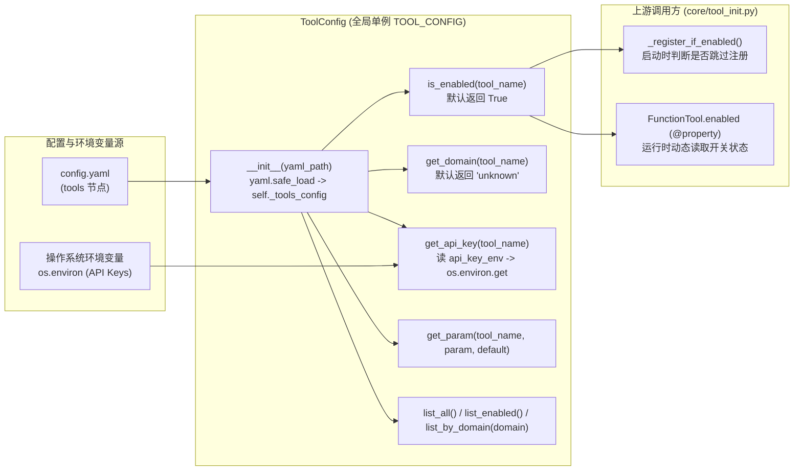

# `core/tool_config.py` 代码精讲学习手册

> **所属层级**：可插拔工具框架配置中心层（`core/`）  
> **核心职责**：从项目根目录 `config.yaml` 的 `tools` 节点读取所有工具的元数据配置，提供工具启用状态判断（`is_enabled`）、业务域查询（`get_domain`）、环境变量 API Key 动态提取（`get_api_key`）、自定义参数读取（`get_param`）以及按状态/业务域筛选工具列表的能力。  
> **上游调用方**：`core/tool_init.py`（`FunctionTool.enabled` 与 `_register_if_enabled`）  
> **下游依赖方**：`yaml`（PyYAML）、`os`、`utils.logger`、项目根目录 `config.yaml`

---

## 一、文件定位与核心前置知识精讲

在企业级多智能体系统中，随着接入的外部工具越来越多（本项目中共有票务、行程、天气、飞常准航班、博查搜索、高德地图等 **26 个工具**），如果把每个工具的“启用/禁用开关”、“所属业务领域（Domain）”、“第三方 API Key 环境变量名”硬编码在业务代码里，会带来严重的运维痛点：
1. **故障隔离困难（Feature Toggle / 熔断降级）**：比如某个第三方服务（如飞常准或高德地图）临时欠费或接口维护，运维人员希望能**只改一行 YAML 配置把该工具关掉（`enabled: false`）**，而不必去修改或注释 Python 代码。
2. **密钥安全解耦（Secret Indirection）**：配置文件 `config.yaml` 会提交到 Git 仓库，因此绝不能在 `config.yaml` 里直接写明文 API Key，而是应该在 `config.yaml` 里配置**环境变量的名字**（如 `api_key_env: "AmapApiKey"`），再由 `ToolConfig.get_api_key()` 去操作系统的环境变量 `os.environ` 中安全读取真实密钥！

这正是 `core/tool_config.py`（及其全局单例 `TOOL_CONFIG`）的设计定位。

### 1.1 配置中心的设计亮点：“默认启用（Fail-Open Default）”策略
请特别注意 `ToolConfig.is_enabled(tool_name)`（第 62~73 行）的实现：
```python
def is_enabled(self, tool_name: str) -> bool:
    tool_cfg = self._tools_config.get(tool_name, {})
    return tool_cfg.get("enabled", True)
```
- 如果 `config.yaml` 中**没有配置 `tools:` 节点**，或者某个工具没有出现在 `tools:` 节点下，`self._tools_config.get(tool_name, {})` 返回空字典 `{}`，接着 `.get("enabled", True)` 会返回默认值 **`True`（默认启用）**！
- **为什么采用默认启用（Convention over Configuration，约定优于配置）？**  
  这样开发者在开发新工具或运行基础教学环境时，不需要繁琐地在 `config.yaml` 中把 26 个工具逐一声明一遍就能开箱即用；只有当需要**显式禁用**某个工具，或者为某个工具附加特定参数时，才需要在 `config.yaml` 的 `tools:` 节点下声明该工具。

### 1.2 密钥间接寻址（Env Var Indirection）机制
在 `get_api_key(self, tool_name: str)`（第 87~100 行）中：
```yaml
# config.yaml 示例
tools:
  amap_nearby:
    enabled: true
    domain: "local_life"
    api_key_env: "AmapApiKey"
```
```python
env_var = tool_cfg.get("api_key_env", "")
if env_var:
    return os.environ.get(env_var, "")
return ""
```
1. 先从 YAML 字典查出环境变量的**名称字符串** `"AmapApiKey"`；
2. 再去 `os.environ.get("AmapApiKey", "")` 取出系统环境变量中的**真实密钥值**。
这实现了 **配置结构（YAML）** 与 **敏感凭证（环境变量 / `.env`）** 的彻底分离。

---

## 二、架构图与核心方法执行流程图

### 2.1 `ToolConfig` 数据读取与工具装配联动图



### 2.2 ASCII 核心方法调用树

```text
ToolConfig (全局单例 TOOL_CONFIG, core/tool_config.py)
├── __init__(yaml_path: str = None)
│   ├── 默认定位项目根目录: os.path.dirname(os.path.dirname(os.path.abspath(__file__))) + "/config.yaml"
│   ├── yaml.safe_load(f) 解析 YAML 文件
│   └── self._tools_config = _raw.get("tools", {})
├── 单工具属性查询
│   ├── is_enabled(tool_name: str) -> bool               # tool_cfg.get("enabled", True)
│   ├── get_domain(tool_name: str) -> str                # tool_cfg.get("domain", "unknown")
│   ├── get_api_key(tool_name: str) -> str               # 读 api_key_env -> os.environ.get(env_var, "")
│   └── get_param(tool_name: str, param_name, default)   # 读取工具任意自定义配置项
└── 批量列表查询
    ├── list_all() -> dict                               # 返回所有已配置工具的字典浅拷贝
    ├── list_enabled() -> list[str]                      # 返回配置中所有 enabled=True 的工具名列表
    └── list_by_domain(domain: str) -> list[str]         # 返回配置中指定 domain 且 enabled=True 的工具名列表
```

---

## 三、完整源码与逐段/逐行深度拆解

### 3.1 `core/tool_config.py` 100% 完整源码

```python
"""
工具开关配置 —— 控制每个工具的启用/禁用及参数

迭代改进新增：
- YAML 格式配置，控制每个工具的启用/禁用
- 每个工具的 API Key、endpoint 等参数集中管理
- 新增工具只需在此文件加一段配置，不动现有代码

配置示例（config.yaml 中新增 tools 节点）：
    tools:
      # 出行交通类
      query_flight:
        enabled: true
        domain: "transport"
      query_train:
        enabled: true
        domain: "transport"
      variflight_query:
        enabled: true
        domain: "transport"
        api_key_env: "VariFlightApiKey"
      
      # 住宿类
      query_hotel:
        enabled: true
        domain: "accommodation"
      
      # 信息服务类
      query_weather:
        enabled: true
        domain: "info_service"
      bocha_search:
        enabled: true
        domain: "info_service"
        api_key_env: "BochaApiKey"
      
      # 本地生活类
      amap_nearby:
        enabled: true
        domain: "local_life"
        api_key_env: "AmapApiKey"
"""
import os
import yaml
from utils import logger


class ToolConfig:
    """工具配置管理器 —— 从 config.yaml 读取工具配置"""

    def __init__(self, yaml_path: str = None):
        if yaml_path is None:
            _project_root = os.path.dirname(os.path.dirname(os.path.abspath(__file__)))
            yaml_path = os.path.join(_project_root, "config.yaml")

        with open(yaml_path, "r", encoding="utf-8") as f:
            _raw = yaml.safe_load(f)

        # 读取 tools 节点（如果不存在则为空字典）
        self._tools_config = _raw.get("tools", {})

    def is_enabled(self, tool_name: str) -> bool:
        """检查工具是否启用
        
        参数:
            tool_name: 工具名称
        
        返回:
            bool: True=启用, False=禁用
            如果配置中没有该工具，默认启用
        """
        tool_cfg = self._tools_config.get(tool_name, {})
        return tool_cfg.get("enabled", True)

    def get_domain(self, tool_name: str) -> str:
        """获取工具所属业务域
        
        参数:
            tool_name: 工具名称
        
        返回:
            str: 业务域名称
        """
        tool_cfg = self._tools_config.get(tool_name, {})
        return tool_cfg.get("domain", "unknown")

    def get_api_key(self, tool_name: str) -> str:
        """获取工具的 API Key（从环境变量读取）
        
        参数:
            tool_name: 工具名称
        
        返回:
            str: API Key，如果未配置则返回空字符串
        """
        tool_cfg = self._tools_config.get(tool_name, {})
        env_var = tool_cfg.get("api_key_env", "")
        if env_var:
            return os.environ.get(env_var, "")
        return ""

    def get_param(self, tool_name: str, param_name: str, default=None):
        """获取工具的自定义参数
        
        参数:
            tool_name: 工具名称
            param_name: 参数名
            default: 默认值
        
        返回:
            参数值
        """
        tool_cfg = self._tools_config.get(tool_name, {})
        return tool_cfg.get(param_name, default)

    def list_all(self) -> dict:
        """列出所有工具配置
        
        返回:
            dict: {tool_name: {enabled, domain, ...}}
        """
        return dict(self._tools_config)

    def list_enabled(self) -> list[str]:
        """列出所有启用的工具名称
        
        返回:
            list[str]: 启用的工具名称列表
        """
        return [
            name for name, cfg in self._tools_config.items()
            if cfg.get("enabled", True)
        ]

    def list_by_domain(self, domain: str) -> list[str]:
        """按业务域列出工具名称
        
        参数:
            domain: 业务域名称
        
        返回:
            list[str]: 该域下启用的工具名称列表
        """
        return [
            name for name, cfg in self._tools_config.items()
            if cfg.get("domain") == domain and cfg.get("enabled", True)
        ]


# 全局单例
TOOL_CONFIG = ToolConfig()
```

---

### 3.2 逐方法深度拆解

| 方法名 | 输入参数 | 返回值 | 核心逻辑与边界处理 |
| :--- | :--- | :--- | :--- |
| `__init__` | `yaml_path: str = None` | 无 | 利用两次 `os.path.dirname` 从 `core/tool_config.py` 向上回溯两级目录定位到项目根目录的 `config.yaml`；若 YAML 中无 `tools` 节点，初始化为空字典 `{}`。 |
| `is_enabled` | `tool_name: str` | `bool` | 链式安全字典查询 `self._tools_config.get(tool_name, {}).get("enabled", True)`，未配置的工具默认返回 `True`。 |
| `get_domain` | `tool_name: str` | `str` | 查询工具配置的 `domain` 字段，未配置时默认返回 `"unknown"`。 |
| `get_api_key` | `tool_name: str` | `str` | 先取 `api_key_env` 配置的环境变量名，再从 `os.environ.get(env_var, "")` 取值；任一环节为空均安全返回 `""`。 |
| `get_param` | `tool_name: str`<br/>`param_name: str`<br/>`default=None` | `Any` | 通用扩展槽位读取器，例如后续在 YAML 中给某个工具配置 `timeout: 15` 或 `max_retries: 3`，可直接通过 `get_param("bocha_search", "timeout", 10)` 读取。 |
| `list_all` | 无 | `dict` | 使用 `dict(self._tools_config)` 返回顶层字典的**浅拷贝**，防止外部调用者直接增删键破坏内部 `_tools_config` 状态。 |
| `list_enabled` | 无 | `list[str]` | 列表推导式过滤 `_tools_config` 中 `enabled` 为 `True`（或未显式设为 `False`）的工具名。 |
| `list_by_domain` | `domain: str` | `list[str]` | 列表推导式过滤同时满足 `cfg.get("domain") == domain` 且 `cfg.get("enabled", True)` 的工具名列表。 |

---

### 3.3 沙盘推演（Dry Run）：配置解析与各方法返回值推演

假设 `config.yaml` 中的 `tools` 节点内容如下，且系统环境变量中设置了 `os.environ["BochaApiKey"] = "sk-bocha-998877"`：
```yaml
tools:
  query_train:
    enabled: true
    domain: "transport"
  order_concert:
    enabled: false
    domain: "transport"
  bocha_search:
    enabled: true
    domain: "info_service"
    api_key_env: "BochaApiKey"
    max_results: 5
```

1. **模块导入时实例化 `TOOL_CONFIG = ToolConfig()`**：
   - `self._tools_config` 被加载为包含 `"query_train"`, `"order_concert"`, `"bocha_search"` 三个键的字典。
2. **检查已配置且开启的工具**：
   - `TOOL_CONFIG.is_enabled("query_train")` $\rightarrow$ `True`
3. **检查已配置但显式禁用的工具**：
   - `TOOL_CONFIG.is_enabled("order_concert")` $\rightarrow$ `False`（随后在 `tool_init.py` 的 `_register_if_enabled` 中会打印 `"工具 order_concert 已禁用，跳过注册"`）。
4. **检查未在 `config.yaml` 中声明的工具（如 `"query_weather"`）**：
   - `TOOL_CONFIG.is_enabled("query_weather")`：
     - `self._tools_config.get("query_weather", {})` 返回 `{}`
     - `{}.get("enabled", True)` 返回 **`True`**（默认启用生效！）。
5. **读取 API Key 与自定义参数**：
   - `TOOL_CONFIG.get_api_key("bocha_search")` $\rightarrow$ 查出 `env_var = "BochaApiKey"` $\rightarrow$ `os.environ.get("BochaApiKey", "")` $\rightarrow$ 返回 `"sk-bocha-998877"`。
   - `TOOL_CONFIG.get_param("bocha_search", "max_results", default=3)` $\rightarrow$ 返回 `5`。
6. **按业务域过滤**：
   - `TOOL_CONFIG.list_by_domain("transport")` $\rightarrow$ `"order_concert"` 因 `enabled: false` 被过滤掉，仅返回 `["query_train"]`。

---

## 四、关键工程设计亮点、容错降级机制与潜在优化点

### 4.1 关键工程设计亮点
1. **跨工作目录稳定的路径寻址**：第 53~54 行使用 `os.path.abspath(__file__)` 向上取两层 `os.path.dirname`，无论你是在项目根目录执行 `python main_http_api.py`，还是在 `test/` 子目录下运行单元测试，`ToolConfig` 都能 100% 精准定位到项目根目录下的 `config.yaml`，绝不会报 `FileNotFoundError`。
2. **防御式链式 `.get()` 访问**：全篇没有任何一处使用容易抛 `KeyError` 的 `dict["key"]` 硬索引，哪怕 `config.yaml` 里完全没有 `tools` 这一节，所有方法也都能平滑返回默认值。

### 4.2 潜在优化点
1. **空 YAML 文件或 `tools:` 值为空时的 `None` 防御**：
   - 如果有人在 `config.yaml` 里只写了一行 `tools:` 但下面没有任何缩进内容，`yaml.safe_load` 解析出的 `_raw.get("tools", {})` 会是 **`None`**（而不是 `{}`）！此时再调 `self._tools_config.get(...)` 会报 `AttributeError: 'NoneType' object has no attribute 'get'`。
   - **一行修复技巧**：将第 60 行改为 `self._tools_config = (_raw or {}).get("tools") or {}`，即可彻底免疫空 YAML 节点。
2. **配置热重载（Hot Reload）**：
   - 目前 `_tools_config` 仅在 `__init__` 时读取一次。可以增加一个 `reload()` 方法，支持通过运维 API 动态重读 `config.yaml`，实现不重启 FastAPI 服务动态开关工具。

---

## 五、自测思考题（附答案解析）

### 思考题 1
**问题**：为什么第 53 行计算 `_project_root` 要套两层 `os.path.dirname(os.path.dirname(os.path.abspath(__file__)))`？每一层分别得到什么路径？
> **答案解析**：  
> - `os.path.abspath(__file__)` 得到当前文件的绝对路径：`Voyage智途A2A\core\tool_config.py`；
> - 第一层 `os.path.dirname(...)` 去掉文件名，得到所在目录：`Voyage智途A2A\core`；
> - 第二层 `os.path.dirname(...)` 再往上退一级，得到项目根目录：`Voyage智途A2A`，从而与 `"config.yaml"` 拼接出 `Voyage智途A2A\config.yaml`。

### 思考题 2
**问题**：如果 `config.yaml` 中根本没有配置 `tools` 节点，`TOOL_CONFIG.is_enabled("query_weather")` 和 `TOOL_CONFIG.list_enabled()` 的返回值分别是什么？为什么会有这种差异？
> **答案解析**：  
> - `TOOL_CONFIG.is_enabled("query_weather")` 返回 **`True`**（因为未出现在 `_tools_config` 中的单个工具默认视为启用）；
> - `TOOL_CONFIG.list_enabled()` 返回 **`[]`（空列表）**（因为它遍历的是 `self._tools_config.items()` 中显式配置过的工具）。
> - 如果想列出系统中**实际已注册且处于启用状态**的全部工具，应该调用 `TOOL_REGISTRY.list_names()`（见 `core/tool_registry.py`），因为在 `init_tools()` 时所有通过 `is_enabled` 检查的工具都会被注册进 `TOOL_REGISTRY`。
